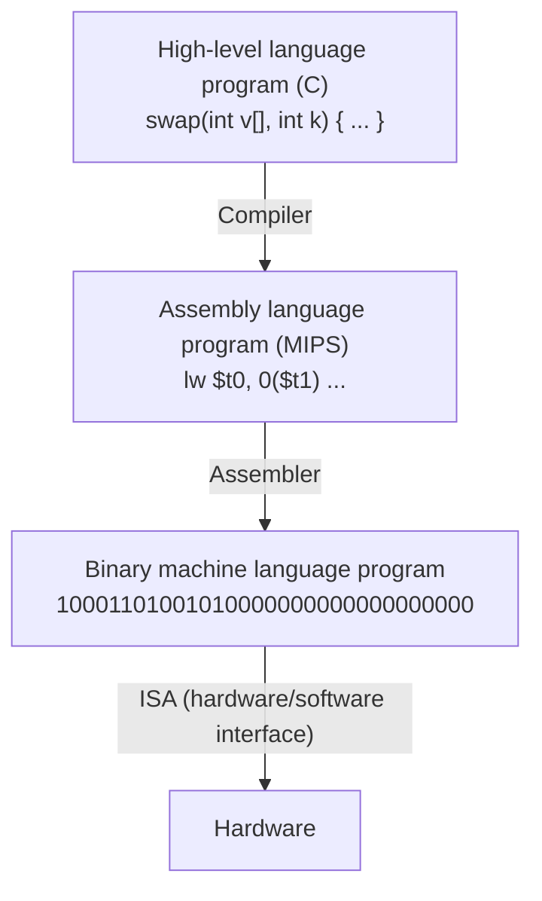

# بخش ۱، جلسه‌ی ۱ از ۸: کامپیوتر، انتزاع و تعریف معماری

این جلسه بخشی از **بخش ۱: مبانی طراحی کمّی کامپیوتر** است. زمان مطالعه: حدود نیم ساعت.

**منابع بخش ۱:** کتاب COD ویرایش ۵ فصل ۱، کتاب CAQA ویرایش ۵ و ۶ فصل ۱، اسلایدهای COD فصل ۱ و ۲ و اسلایدهای CAQA فصل ۱.

**فهرست این جلسه:**

- ۱. کامپیوتر و جایگاه آن
- ۲. هشت ایده‌ی بزرگ معماری کامپیوتر
- ۳. از برنامه تا سخت‌افزار: لایه‌های انتزاع
- ۴. اجزای سخت‌افزاری کامپیوتر
- ۵. تعریف معماری کامپیوتر
- ۶. سؤال امتحان

---

## ۱. کامپیوتر و جایگاه آن

### دسته‌بندی کامپیوترها

کامپیوترها امروز در همه‌جا هستند، ولی نیازهای طراحی آن‌ها خیلی با هم فرق دارد. کتاب CAQA کامپیوترها را در پنج دسته قرار می‌دهد:

| دسته | نمونه | معیار اصلی طراحی |
|---|---|---|
| دستگاه همراه شخصی (PMD) | گوشی هوشمند، تبلت | مصرف انرژی (به خاطر باتری و نبود فن)، پاسخ بی‌درنگ، قیمت، حجم کم کد و حافظه |
| رومیزی (Desktop) | رایانه‌ی شخصی، لپ‌تاپ | نسبت قیمت به کارایی، کارایی گرافیک و محاسبه |
| سرور | سرور پایگاه داده، سرور فایل | دسترس‌پذیری (همیشه روشن بودن)، مقیاس‌پذیری، گذردهی |
| خوشه و رایانه‌ی هم‌اندازه‌ی انبار (WSC) | مراکز داده‌ی گوگل و آمازون | قیمت به کارایی، توان مصرفی، دسترس‌پذیری |
| نهفته (Embedded) | کنترلر لباسشویی، خودرو، مودم | قیمت، توان، پاسخ بی‌درنگ |

دو نکته درباره‌ی این جدول:

- **ابررایانه‌ها** زیرشاخه‌ای از خوشه‌ها هستند. تفاوتشان این است که روی کارایی ممیز شناور و شبکه‌ی داخلی بسیار سریع تأکید دارند.
- **مرز دستگاه نهفته** این است که کاربر نمی‌تواند نرم‌افزار دلخواهش را روی آن اجرا کند. گوشی هوشمند با اینکه کوچک است، نهفته حساب نمی‌شود، چون کاربر روی آن برنامه نصب می‌کند.

کتاب COD همین موضوع را با عبارت **دوران پس از رایانه‌ی شخصی (Post-PC era)** توضیح می‌دهد: امروز تعداد گوشی‌ها و تبلت‌ها خیلی بیشتر از رایانه‌های رومیزی است، و بخش زیادی از پردازش در «ابر» یعنی مراکز داده انجام می‌شود. پس دو سر طیف طراحی، یعنی دستگاه کم‌مصرف همراه و مرکز داده‌ی عظیم، امروز مهم‌ترین بازارها هستند.

### چرا یادگیری معماری لازم است؟

کارایی یک برنامه به چند عامل بستگی دارد:

| عامل | روی چه چیزی اثر می‌گذارد | بخش درس |
|---|---|---|
| الگوریتم | تعداد عملیات سطح بالا و ورودی/خروجی | — |
| زبان، کامپایلر و معماری | تعداد دستورات ماشین برای هر عمل سطح بالا | ۲ |
| پردازنده و حافظه | سرعت اجرای هر دستور | ۳ تا ۱۰ |
| سیستم ورودی/خروجی | سرعت ورودی/خروجی | — |

برنامه‌نویسی که سخت‌افزار را می‌شناسد، برنامه‌ی سریع‌تر و کم‌مصرف‌تری می‌نویسد. طراح سخت‌افزاری هم که نرم‌افزار را می‌شناسد، سخت‌افزار بهتری می‌سازد.

---

## ۲. هشت ایده‌ی بزرگ معماری کامپیوتر

کتاب COD هشت ایده را معرفی می‌کند که در ۶۰ سال گذشته بارها و بارها در طراحی کامپیوترها به کار رفته‌اند. در طول این درس همه‌ی آن‌ها را با جزئیات می‌بینیم:

1. **طراحی برای قانون مور (Design for Moore's Law):** طبق قانون مور، تعداد ترانزیستورهای یک تراشه تقریباً هر ۱۸ تا ۲۴ ماه دو برابر می‌شد. طراحی یک پردازنده چند سال طول می‌کشد. پس معمار باید برای فناوریِ **زمان عرضه** طراحی کند، نه فناوری زمان شروع طراحی.
2. **استفاده از انتزاع برای ساده‌سازی طراحی (Abstraction):** پنهان کردن جزئیات سطح پایین تا بشود با سیستم‌های بسیار پیچیده کار کرد. نمونه‌ی مهمش مرز سخت‌افزار و نرم‌افزار است (قسمت بعدی همین جلسه).
3. **سریع کردن حالت رایج (Make the common case fast):** بهبود بخشی که بیشتر اتفاق می‌افتد، اثر بیشتری از بهبود حالت‌های نادر دارد. ابزار کمّی‌اش **قانون امدال** است (جلسه‌ی ۱-۴).
4. **کارایی از راه موازی‌سازی (Performance via parallelism):** انجام همزمان چند کار.
5. **کارایی از راه خط لوله (Performance via pipelining):** نوع خاصی از موازی‌سازی؛ مثل خط تولید کارخانه، هر مرحله روی یک کار متفاوت کار می‌کند (بخش ۵ درس).
6. **کارایی از راه پیش‌بینی (Performance via prediction):** گاهی حدس زدن و شروع کار، سریع‌تر از صبر کردن برای جواب قطعی است، به شرط اینکه حدس معمولاً درست باشد و جبران حدس غلط ارزان باشد. مثال اصلی: پیش‌بینی پرش (بخش ۷).
7. **سلسله‌مراتب حافظه (Hierarchy of memories):** حافظه‌ی سریع، گران و کوچک بالای سلسله‌مراتب و حافظه‌ی کند، ارزان و بزرگ پایین آن. نتیجه حافظه‌ای است که تقریباً به سرعت بالاترین سطح و به بزرگی پایین‌ترین سطح است (بخش ۶).
8. **اتکاپذیری از راه افزونگی (Dependability via redundancy):** داشتن قطعه‌های اضافه تا خرابی یک قطعه کل سیستم را از کار نیندازد (جلسه‌ی ۱-۷).

---

## ۳. از برنامه تا سخت‌افزار: لایه‌های انتزاع

### نرم‌افزار سیستمی

بین برنامه‌ی کاربر و سخت‌افزار، دو نرم‌افزار سیستمی مهم قرار دارد:

- **سیستم‌عامل:** ورودی و خروجی را مدیریت می‌کند، حافظه و فضای ذخیره‌سازی را تخصیص می‌دهد، و اجازه می‌دهد چند برنامه با هم از کامپیوتر استفاده کنند.
- **کامپایلر:** برنامه‌ی زبان سطح بالا (مثل C) را به دستورات سخت‌افزار ترجمه می‌کند.

### سطوح زبان

کامپیوتر فقط سیگنال‌های الکتریکی روشن و خاموش، یعنی ۰ و ۱، را می‌فهمد. برای اینکه انسان بتواند برنامه بنویسد، چند سطح زبان ساخته شده است:



به ترتیب از بالا به پایین:

1. **زبان سطح بالا:** نزدیک به زبان انسان، مستقل از سخت‌افزار و قابل‌حمل.
2. **زبان اسمبلی:** نمایش متنی دستورات ماشین؛ هر خط تقریباً یک دستور ماشین است.
3. **زبان ماشین:** همان دستورات به صورت باینری که سخت‌افزار اجرا می‌کند.

کامپایلر سطح اول را به دوم تبدیل می‌کند و **اسمبلر** سطح دوم را به سوم.

### معماری مجموعه‌دستورات

مهم‌ترین لایه‌ی انتزاع در کامپیوتر، **معماری مجموعه‌دستورات** یا **ISA** (Instruction Set Architecture) است. ISA قرارداد بین نرم‌افزار و سخت‌افزار است و هر چیزی را مشخص می‌کند که برنامه‌نویس سطح پایین (یا کامپایلر) برای نوشتن یک برنامه‌ی درست به زبان ماشین باید بداند: دستورات، ثبات‌ها، روش‌های دسترسی به حافظه، ورودی/خروجی و قالب باینری دستورات.

- **مزیت:** چون ISA ثابت است، سازنده‌ها می‌توانند **پیاده‌سازی‌های متفاوتی** از یک ISA بسازند که همه همان نرم‌افزار را اجرا کنند. مثلاً پردازنده‌های اینتل و ای‌ام‌دی ساختار داخلی کاملاً متفاوتی دارند، ولی هر دو برنامه‌های x86 را اجرا می‌کنند. پردازنده‌ی ارزان و گران هم می‌توانند ISA یکسانی داشته باشند.
- **عیب:** ISA تغییرات بنیادی را سخت می‌کند، چون نرم‌افزارهای قدیمی باید همچنان اجرا شوند. به همین دلیل x86 هنوز دستورات دهه‌ی ۱۹۷۰ را پشتیبانی می‌کند.

ترکیب ISA و رابط سیستم‌عامل را **رابط دودویی کاربردی** یا **ABI** (Application Binary Interface) می‌نامند. این همان چیزی است که تعیین می‌کند یک فایل اجرایی روی یک سیستم اجرا می‌شود یا نه.

### پیاده‌سازی در برابر معماری

- **معماری (Architecture):** همان ISA؛ چیزی که برنامه‌نویس می‌بیند.
- **پیاده‌سازی (Implementation):** سخت‌افزاری که معماری را اجرا می‌کند و از دید برنامه‌نویس پنهان است.

---

## ۴. اجزای سخت‌افزاری کامپیوتر

### پنج جزء کلاسیک

هر کامپیوتری، از گوشی تا ابررایانه، پنج جزء دارد:

| جزء | کار |
|---|---|
| ورودی (Input) | وارد کردن داده: صفحه‌کلید، صفحه‌ی لمسی، دوربین، میکروفون |
| خروجی (Output) | نمایش نتیجه: نمایشگر، بلندگو |
| حافظه (Memory) | نگهداری برنامه‌ها و داده‌ها هنگام اجرا |
| مسیر داده (Datapath) | انجام عملیات حسابی و منطقی روی داده‌ها |
| کنترل (Control) | فرمان دادن به مسیر داده، حافظه و ورودی/خروجی طبق دستورات برنامه |

مسیر داده و کنترل با هم **پردازنده** یا **CPU** را می‌سازند. تمرکز این درس روی پردازنده (بخش‌های ۲ تا ۵ و ۷ تا ۱۰) و حافظه (بخش ۶) است.

### انواع حافظه

| نوع | فناوری | ویژگی |
|---|---|---|
| حافظه‌ی نهان (Cache) | SRAM | بسیار سریع، گران، کوچک؛ داخل تراشه‌ی پردازنده |
| حافظه‌ی اصلی (Main memory) | DRAM | سرعت متوسط؛ برنامه‌ها هنگام اجرا آنجا هستند |
| حافظه‌ی ثانویه (Secondary) | فلش (SSD) یا دیسک مغناطیسی | کند، ارزان، بزرگ؛ اطلاعات با قطع برق از بین نمی‌رود |

- **حافظه‌ی فرّار (Volatile)** مثل DRAM و SRAM با قطع برق پاک می‌شود.
- **حافظه‌ی غیرفرّار (Nonvolatile)** مثل فلش و دیسک اطلاعات را نگه می‌دارد.

### شبکه

کامپیوترهای امروز تقریباً همه به شبکه وصل‌اند: شبکه‌ی محلی (LAN) مثل اترنت، شبکه‌ی گسترده (WAN) مثل اینترنت، و شبکه‌ی بی‌سیم مثل وای‌فای و بلوتوث. شبکه امکان اشتراک منابع، ارتباط و دسترسی از راه دور را فراهم می‌کند.

---

## ۵. تعریف معماری کامپیوتر

### دیدگاه قدیمی و دیدگاه امروزی

اسلایدهای COD تعریف ساده‌ای می‌دهند:

```math
\text{Computer Architecture} = \text{Instruction Set Architecture} + \text{Machine Organization}
```

کتاب CAQA این تعریف را **نگاه کوته‌بینانه (Myopic view)** می‌نامد. طبق دیدگاه امروزی، معماری کامپیوتر یعنی **طراحی کامل کامپیوتر برای رسیدن به بیشترین کارایی و بهره‌وری انرژی، با رعایت محدودیت‌های هزینه، توان، دسترس‌پذیری و نیازهای بازار.** این طراحی سه جزء دارد:

| جزء | معنی | مثال |
|---|---|---|
| مجموعه‌دستورات (ISA) | آنچه برنامه‌نویس می‌بیند | پردازنده‌های Core i7 و Ryzen هر دو ISA یکسان x86-64 دارند |
| سازمان یا ریزمعماری (Organization / Microarchitecture) | طراحی سطح بالای داخل پردازنده: خط لوله، کش، پیش‌بینی پرش | پردازنده‌های Core i7 و Ryzen ریزمعماری کاملاً متفاوتی دارند |
| سخت‌افزار (Hardware) | جزئیات طراحی منطقی، فناوری ساخت، بسته‌بندی | پردازنده‌های Core i7 و Xeon یک نسل، ریزمعماری تقریباً یکسانی دارند ولی فرکانس، تعداد هسته و کش متفاوت |

### هفت بُعد ISA

کتاب CAQA هر ISA را با هفت ویژگی توصیف می‌کند. این‌ها را در بخش ۲ با جزئیات برای MIPS، RISC-V و ARM می‌بینیم:

1. **کلاس ISA:** تقریباً همه‌ی ISAهای امروزی **ثبات همه‌منظوره** دارند. دو نوع رایج: **ثبات-حافظه** (مثل x86 که دستورات حسابی می‌توانند مستقیم با حافظه کار کنند) و **بارگذاری-ذخیره** یا Load-Store (مثل MIPS، RISC-V و ARM که فقط دستورات load و store به حافظه دسترسی دارند).
2. **آدرس‌دهی حافظه:** تقریباً همه از آدرس‌دهی **بایتی** استفاده می‌کنند. در MIPS و ARM داده‌ها باید **هم‌تراز (Aligned)** باشند: شیء s بایتی باید در آدرسی باشد که بر s بخش‌پذیر است.
3. **حالت‌های آدرس‌دهی:** روش‌های مشخص کردن عملوند. مثلاً MIPS حالت‌های ثبات، بلافصل (Immediate) و جابه‌جایی (Displacement) دارد.
4. **نوع و اندازه‌ی عملوندها:** ۸، ۱۶، ۳۲ و ۶۴ بیتی صحیح، و ممیز شناور ۳۲ و ۶۴ بیتی.
5. **عملیات:** انتقال داده، حسابی و منطقی، کنترلی و ممیز شناور.
6. **دستورات کنترل جریان:** پرش شرطی، پرش بدون شرط، فراخوانی و بازگشت از رویه.
7. **کدگذاری:** طول **ثابت** (همه‌ی دستورات MIPS و ARM ۳۲ بیتی‌اند) یا **متغیر** (دستورات x86 بین ۱ تا ۱۸ بایت).

---

## ۶. سؤال امتحان

### امتحان‌های ۹۵-۹۶ و ۹۹-۰۰، پرسش کوتاه: دسته‌بندی کامپیوترها

جواب نمونه در حد سه خط:

پنج دسته داریم: دستگاه همراه با تأکید بر انرژی و پاسخ بی‌درنگ؛ رومیزی با تأکید بر نسبت قیمت به کارایی؛ سرور با تأکید بر دسترس‌پذیری، مقیاس‌پذیری و گذردهی؛ مرکز داده (WSC) با تأکید بر قیمت به کارایی و توان؛ و نهفته با تأکید بر قیمت. در دسته‌های ارزان قیمت تعیین‌کننده است و در سرور و ابررایانه کارایی و دسترس‌پذیری.

---

جلسه‌ی بعدی: [موازی‌سازی، فناوری و تعریف کارایی](1-2-parallelism-technology-performance.md)
