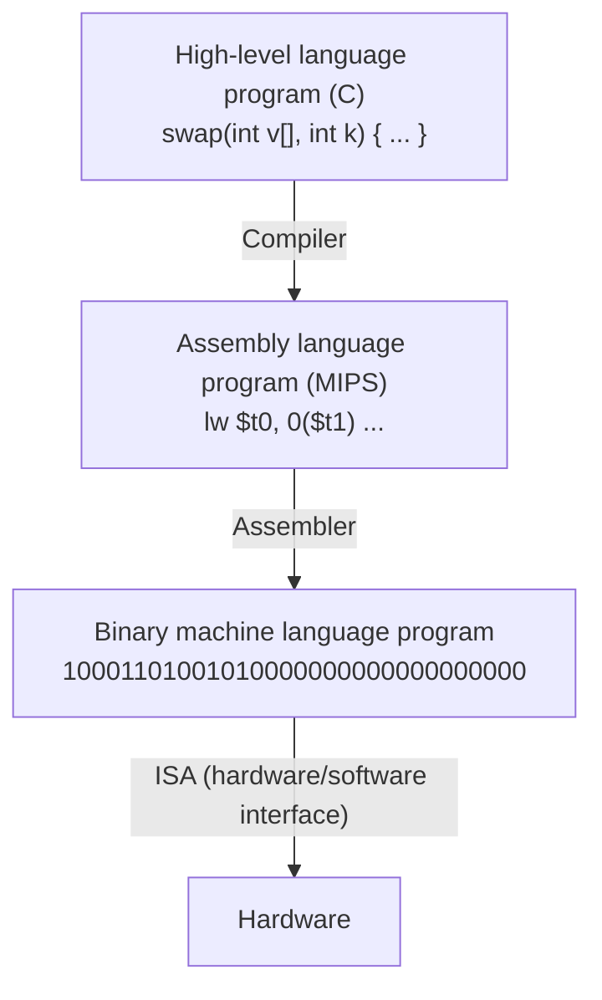

# بخش ۱: مبانی طراحی کمّی کامپیوتر

در این بخش یاد می‌گیریم کامپیوتر از چه اجزایی ساخته شده، «معماری» دقیقاً به چه معناست، کارایی را چطور تعریف و اندازه بگیریم، و یک معمار هنگام طراحی با چه محدودیت‌هایی روبه‌روست: توان مصرفی، هزینه و قابلیت اطمینان. این بخش پایه‌ی کل درس است. همه‌ی بخش‌های بعدی با همین ابزارها تحلیل می‌شوند.

**منابع این بخش:**

- کتاب COD ویرایش ۵، فصل ۱ (Computer Abstractions and Technology)
- کتاب CAQA ویرایش ۵ و ۶، فصل ۱ (Fundamentals of Quantitative Design and Analysis)
- اسلایدهای COD فصل ۱ و ۲ و اسلایدهای CAQA فصل ۱

**پیش‌نیاز:** مدار منطقی و آشنایی با برنامه‌نویسی C.

---

## فهرست

1. [کامپیوتر و جایگاه آن](#۱-کامپیوتر-و-جایگاه-آن)
2. [هشت ایده‌ی بزرگ معماری کامپیوتر](#۲-هشت-ایدهی-بزرگ-معماری-کامپیوتر)
3. [از برنامه تا سخت‌افزار: لایه‌های انتزاع](#۳-از-برنامه-تا-سختافزار-لایههای-انتزاع)
4. [اجزای سخت‌افزاری کامپیوتر](#۴-اجزای-سختافزاری-کامپیوتر)
5. [تعریف معماری کامپیوتر](#۵-تعریف-معماری-کامپیوتر)
6. [موازی‌سازی و طبقه‌بندی فلین](#۶-موازیسازی-و-طبقهبندی-فلین)
7. [فناوری ساخت و روندهای آن](#۷-فناوری-ساخت-و-روندهای-آن)
8. [تعریف و اندازه‌گیری کارایی](#۸-تعریف-و-اندازهگیری-کارایی)
9. [معادله‌ی کارایی پردازنده](#۹-معادلهی-کارایی-پردازنده)
10. [قانون امدال](#۱۰-قانون-امدال)
11. [محک‌ها و گزارش کارایی](#۱۱-محکها-و-گزارش-کارایی)
12. [توان و انرژی](#۱۲-توان-و-انرژی)
13. [گذر از تک‌پردازنده به چندپردازنده](#۱۳-گذر-از-تکپردازنده-به-چندپردازنده)
14. [هزینه](#۱۴-هزینه)
15. [اتکاپذیری](#۱۵-اتکاپذیری)
16. [اصول کمّی طراحی](#۱۶-اصول-کمّی-طراحی)
17. [باورهای غلط و تله‌ها](#۱۷-باورهای-غلط-و-تلهها)
18. [آزمایش عملی](#۱۸-آزمایش-عملی)
19. [معادل در ARM: پردازنده‌ی Cortex-A9](#۱۹-معادل-در-arm-پردازندهی-cortex-a9)
20. [حل سؤال‌های امتحان‌های قبلی](#۲۰-حل-سؤالهای-امتحانهای-قبلی)
21. [تمرین‌های خودآزمایی](#۲۱-تمرینهای-خودآزمایی)
22. [واژه‌نامه](#۲۲-واژهنامه)

---

## ۱. کامپیوتر و جایگاه آن

### دسته‌بندی کامپیوترها

کامپیوترها امروز در همه‌جا هستند، ولی نیازهای طراحی آن‌ها خیلی با هم فرق دارد. کتاب CAQA کامپیوترها را در پنج دسته قرار می‌دهد:

| دسته | نمونه | معیار اصلی طراحی |
|---|---|---|
| دستگاه همراه شخصی (PMD) | گوشی هوشمند، تبلت | مصرف انرژی (به خاطر باتری و نبود فن)، پاسخ بی‌درنگ، قیمت، حجم کم کد و حافظه |
| رومیزی (Desktop) | رایانه‌ی شخصی، لپ‌تاپ | نسبت قیمت به کارایی، کارایی گرافیک و محاسبه |
| سرور | سرور پایگاه داده، سرور فایل | دسترس‌پذیری (همیشه روشن بودن)، مقیاس‌پذیری، گذردهی |
| خوشه و رایانه‌ی هم‌اندازه‌ی انبار (WSC) | مراکز داده‌ی گوگل و آمازون | قیمت به کارایی، توان مصرفی، دسترس‌پذیری |
| نهفته (Embedded) | کنترلر لباسشویی، خودرو، مودم | قیمت، توان، پاسخ بی‌درنگ |

دو نکته درباره‌ی این جدول:

- **ابررایانه‌ها** زیرشاخه‌ای از خوشه‌ها هستند. تفاوتشان این است که روی کارایی ممیز شناور و شبکه‌ی داخلی بسیار سریع تأکید دارند.
- **مرز دستگاه نهفته** این است که کاربر نمی‌تواند نرم‌افزار دلخواهش را روی آن اجرا کند. گوشی هوشمند با اینکه کوچک است، نهفته حساب نمی‌شود، چون کاربر روی آن برنامه نصب می‌کند.

کتاب COD همین موضوع را با عبارت **دوران پس از رایانه‌ی شخصی (Post-PC era)** توضیح می‌دهد: امروز تعداد گوشی‌ها و تبلت‌ها خیلی بیشتر از رایانه‌های رومیزی است، و بخش زیادی از پردازش در «ابر» یعنی مراکز داده انجام می‌شود. پس دو سر طیف طراحی، یعنی دستگاه کم‌مصرف همراه و مرکز داده‌ی عظیم، امروز مهم‌ترین بازارها هستند.

### چرا یادگیری معماری لازم است؟

کارایی یک برنامه به چند عامل بستگی دارد:

| عامل | روی چه چیزی اثر می‌گذارد | بخش درس |
|---|---|---|
| الگوریتم | تعداد عملیات سطح بالا و ورودی/خروجی | — |
| زبان، کامپایلر و معماری | تعداد دستورات ماشین برای هر عمل سطح بالا | ۲ |
| پردازنده و حافظه | سرعت اجرای هر دستور | ۳ تا ۱۰ |
| سیستم ورودی/خروجی | سرعت ورودی/خروجی | — |

برنامه‌نویسی که سخت‌افزار را می‌شناسد، برنامه‌ی سریع‌تر و کم‌مصرف‌تری می‌نویسد. طراح سخت‌افزاری هم که نرم‌افزار را می‌شناسد، سخت‌افزار بهتری می‌سازد.

---

## ۲. هشت ایده‌ی بزرگ معماری کامپیوتر

کتاب COD هشت ایده را معرفی می‌کند که در ۶۰ سال گذشته بارها و بارها در طراحی کامپیوترها به کار رفته‌اند. در طول این درس همه‌ی آن‌ها را با جزئیات می‌بینیم:

1. **طراحی برای قانون مور (Design for Moore's Law):** طبق قانون مور، تعداد ترانزیستورهای یک تراشه تقریباً هر ۱۸ تا ۲۴ ماه دو برابر می‌شد. طراحی یک پردازنده چند سال طول می‌کشد. پس معمار باید برای فناوریِ **زمان عرضه** طراحی کند، نه فناوری زمان شروع طراحی.
2. **استفاده از انتزاع برای ساده‌سازی طراحی (Abstraction):** پنهان کردن جزئیات سطح پایین تا بشود با سیستم‌های بسیار پیچیده کار کرد. نمونه‌ی مهمش مرز سخت‌افزار و نرم‌افزار است (بخش ۳).
3. **سریع کردن حالت رایج (Make the common case fast):** بهبود بخشی که بیشتر اتفاق می‌افتد، اثر بیشتری از بهبود حالت‌های نادر دارد. ابزار کمّی‌اش **قانون امدال** است (بخش ۱۰).
4. **کارایی از راه موازی‌سازی (Performance via parallelism):** انجام همزمان چند کار.
5. **کارایی از راه خط لوله (Performance via pipelining):** نوع خاصی از موازی‌سازی؛ مثل خط تولید کارخانه، هر مرحله روی یک کار متفاوت کار می‌کند (بخش ۵ درس).
6. **کارایی از راه پیش‌بینی (Performance via prediction):** گاهی حدس زدن و شروع کار، سریع‌تر از صبر کردن برای جواب قطعی است، به شرط اینکه حدس معمولاً درست باشد و جبران حدس غلط ارزان باشد. مثال اصلی: پیش‌بینی پرش (بخش ۷).
7. **سلسله‌مراتب حافظه (Hierarchy of memories):** حافظه‌ی سریع، گران و کوچک بالای سلسله‌مراتب و حافظه‌ی کند، ارزان و بزرگ پایین آن. نتیجه حافظه‌ای است که تقریباً به سرعت بالاترین سطح و به بزرگی پایین‌ترین سطح است (بخش ۶).
8. **اتکاپذیری از راه افزونگی (Dependability via redundancy):** داشتن قطعه‌های اضافه تا خرابی یک قطعه کل سیستم را از کار نیندازد (بخش ۱۵).

---

## ۳. از برنامه تا سخت‌افزار: لایه‌های انتزاع

### نرم‌افزار سیستمی

بین برنامه‌ی کاربر و سخت‌افزار، دو نرم‌افزار سیستمی مهم قرار دارد:

- **سیستم‌عامل:** ورودی و خروجی را مدیریت می‌کند، حافظه و فضای ذخیره‌سازی را تخصیص می‌دهد، و اجازه می‌دهد چند برنامه با هم از کامپیوتر استفاده کنند.
- **کامپایلر:** برنامه‌ی زبان سطح بالا (مثل C) را به دستورات سخت‌افزار ترجمه می‌کند.

### سطوح زبان

کامپیوتر فقط سیگنال‌های الکتریکی روشن و خاموش، یعنی ۰ و ۱، را می‌فهمد. برای اینکه انسان بتواند برنامه بنویسد، چند سطح زبان ساخته شده است:



به ترتیب از بالا به پایین:

1. **زبان سطح بالا:** نزدیک به زبان انسان، مستقل از سخت‌افزار و قابل‌حمل.
2. **زبان اسمبلی:** نمایش متنی دستورات ماشین؛ هر خط تقریباً یک دستور ماشین است.
3. **زبان ماشین:** همان دستورات به صورت باینری که سخت‌افزار اجرا می‌کند.

کامپایلر سطح اول را به دوم تبدیل می‌کند و **اسمبلر** سطح دوم را به سوم.

### معماری مجموعه‌دستورات

مهم‌ترین لایه‌ی انتزاع در کامپیوتر، **معماری مجموعه‌دستورات** یا **ISA** (Instruction Set Architecture) است. ISA قرارداد بین نرم‌افزار و سخت‌افزار است و هر چیزی را مشخص می‌کند که برنامه‌نویس سطح پایین (یا کامپایلر) برای نوشتن یک برنامه‌ی درست به زبان ماشین باید بداند: دستورات، ثبات‌ها، روش‌های دسترسی به حافظه، ورودی/خروجی و قالب باینری دستورات.

- **مزیت:** چون ISA ثابت است، سازنده‌ها می‌توانند **پیاده‌سازی‌های متفاوتی** از یک ISA بسازند که همه همان نرم‌افزار را اجرا کنند. مثلاً پردازنده‌های اینتل و ای‌ام‌دی ساختار داخلی کاملاً متفاوتی دارند، ولی هر دو برنامه‌های x86 را اجرا می‌کنند. پردازنده‌ی ارزان و گران هم می‌توانند ISA یکسانی داشته باشند.
- **عیب:** ISA تغییرات بنیادی را سخت می‌کند، چون نرم‌افزارهای قدیمی باید همچنان اجرا شوند. به همین دلیل x86 هنوز دستورات دهه‌ی ۱۹۷۰ را پشتیبانی می‌کند.

ترکیب ISA و رابط سیستم‌عامل را **رابط دودویی کاربردی** یا **ABI** (Application Binary Interface) می‌نامند. این همان چیزی است که تعیین می‌کند یک فایل اجرایی روی یک سیستم اجرا می‌شود یا نه.

### پیاده‌سازی در برابر معماری

- **معماری (Architecture):** همان ISA؛ چیزی که برنامه‌نویس می‌بیند.
- **پیاده‌سازی (Implementation):** سخت‌افزاری که معماری را اجرا می‌کند و از دید برنامه‌نویس پنهان است.

---

## ۴. اجزای سخت‌افزاری کامپیوتر

### پنج جزء کلاسیک

هر کامپیوتری، از گوشی تا ابررایانه، پنج جزء دارد:

| جزء | کار |
|---|---|
| ورودی (Input) | وارد کردن داده: صفحه‌کلید، صفحه‌ی لمسی، دوربین، میکروفون |
| خروجی (Output) | نمایش نتیجه: نمایشگر، بلندگو |
| حافظه (Memory) | نگهداری برنامه‌ها و داده‌ها هنگام اجرا |
| مسیر داده (Datapath) | انجام عملیات حسابی و منطقی روی داده‌ها |
| کنترل (Control) | فرمان دادن به مسیر داده، حافظه و ورودی/خروجی طبق دستورات برنامه |

مسیر داده و کنترل با هم **پردازنده** یا **CPU** را می‌سازند. تمرکز این درس روی پردازنده (بخش‌های ۲ تا ۵ و ۷ تا ۱۰) و حافظه (بخش ۶) است.

### انواع حافظه

| نوع | فناوری | ویژگی |
|---|---|---|
| حافظه‌ی نهان (Cache) | SRAM | بسیار سریع، گران، کوچک؛ داخل تراشه‌ی پردازنده |
| حافظه‌ی اصلی (Main memory) | DRAM | سرعت متوسط؛ برنامه‌ها هنگام اجرا آنجا هستند |
| حافظه‌ی ثانویه (Secondary) | فلش (SSD) یا دیسک مغناطیسی | کند، ارزان، بزرگ؛ اطلاعات با قطع برق از بین نمی‌رود |

- **حافظه‌ی فرّار (Volatile)** مثل DRAM و SRAM با قطع برق پاک می‌شود.
- **حافظه‌ی غیرفرّار (Nonvolatile)** مثل فلش و دیسک اطلاعات را نگه می‌دارد.

### شبکه

کامپیوترهای امروز تقریباً همه به شبکه وصل‌اند: شبکه‌ی محلی (LAN) مثل اترنت، شبکه‌ی گسترده (WAN) مثل اینترنت، و شبکه‌ی بی‌سیم مثل وای‌فای و بلوتوث. شبکه امکان اشتراک منابع، ارتباط و دسترسی از راه دور را فراهم می‌کند.

---

## ۵. تعریف معماری کامپیوتر

### دیدگاه قدیمی و دیدگاه امروزی

اسلایدهای COD تعریف ساده‌ای می‌دهند:

```math
\text{Computer Architecture} = \text{Instruction Set Architecture} + \text{Machine Organization}
```

کتاب CAQA این تعریف را **نگاه کوته‌بینانه (Myopic view)** می‌نامد. طبق دیدگاه امروزی، معماری کامپیوتر یعنی **طراحی کامل کامپیوتر برای رسیدن به بیشترین کارایی و بهره‌وری انرژی، با رعایت محدودیت‌های هزینه، توان، دسترس‌پذیری و نیازهای بازار.** این طراحی سه جزء دارد:

| جزء | معنی | مثال |
|---|---|---|
| مجموعه‌دستورات (ISA) | آنچه برنامه‌نویس می‌بیند | پردازنده‌های Core i7 و Ryzen هر دو ISA یکسان x86-64 دارند |
| سازمان یا ریزمعماری (Organization / Microarchitecture) | طراحی سطح بالای داخل پردازنده: خط لوله، کش، پیش‌بینی پرش | پردازنده‌های Core i7 و Ryzen ریزمعماری کاملاً متفاوتی دارند |
| سخت‌افزار (Hardware) | جزئیات طراحی منطقی، فناوری ساخت، بسته‌بندی | پردازنده‌های Core i7 و Xeon یک نسل، ریزمعماری تقریباً یکسانی دارند ولی فرکانس، تعداد هسته و کش متفاوت |

### هفت بُعد ISA

کتاب CAQA هر ISA را با هفت ویژگی توصیف می‌کند. این‌ها را در بخش ۲ با جزئیات برای MIPS، RISC-V و ARM می‌بینیم:

1. **کلاس ISA:** تقریباً همه‌ی ISAهای امروزی **ثبات همه‌منظوره** دارند. دو نوع رایج: **ثبات-حافظه** (مثل x86 که دستورات حسابی می‌توانند مستقیم با حافظه کار کنند) و **بارگذاری-ذخیره** یا Load-Store (مثل MIPS، RISC-V و ARM که فقط دستورات load و store به حافظه دسترسی دارند).
2. **آدرس‌دهی حافظه:** تقریباً همه از آدرس‌دهی **بایتی** استفاده می‌کنند. در MIPS و ARM داده‌ها باید **هم‌تراز (Aligned)** باشند: شیء s بایتی باید در آدرسی باشد که بر s بخش‌پذیر است.
3. **حالت‌های آدرس‌دهی:** روش‌های مشخص کردن عملوند. مثلاً MIPS حالت‌های ثبات، بلافصل (Immediate) و جابه‌جایی (Displacement) دارد.
4. **نوع و اندازه‌ی عملوندها:** ۸، ۱۶، ۳۲ و ۶۴ بیتی صحیح، و ممیز شناور ۳۲ و ۶۴ بیتی.
5. **عملیات:** انتقال داده، حسابی و منطقی، کنترلی و ممیز شناور.
6. **دستورات کنترل جریان:** پرش شرطی، پرش بدون شرط، فراخوانی و بازگشت از رویه.
7. **کدگذاری:** طول **ثابت** (همه‌ی دستورات MIPS و ARM ۳۲ بیتی‌اند) یا **متغیر** (دستورات x86 بین ۱ تا ۱۸ بایت).

---

## ۶. موازی‌سازی و طبقه‌بندی فلین

از حدود سال ۲۰۰۳، افزایش کارایی تک‌پردازنده خیلی کند شد (دلیلش را در بخش ۱۲ می‌بینیم). از آن به بعد، راه اصلی افزایش کارایی **موازی‌سازی** است.

### موازی‌سازی در برنامه‌ها

1. **موازی‌سازی سطح داده** یا **DLP** (Data-Level Parallelism): تعداد زیادی داده که می‌شود همزمان روی آن‌ها یک کار را انجام داد. مثلاً روشن‌تر کردن همه‌ی پیکسل‌های یک تصویر.
2. **موازی‌سازی سطح وظیفه** یا **TLP** (Task-Level Parallelism): کارهای مستقلی که می‌توانند همزمان اجرا شوند. مثلاً پاسخ به درخواست‌های کاربران مختلف.

### موازی‌سازی در سخت‌افزار

سخت‌افزار به چهار روش از این موازی‌سازی‌ها استفاده می‌کند. این جدول در واقع نقشه‌ی کل درس است:

| روش | توضیح | بخش درس |
|---|---|---|
| موازی‌سازی سطح دستور (ILP) | اجرای همزمان چند دستور از یک برنامه با خط لوله، اجرای خارج از ترتیب و صدور چنددستوری؛ سخت‌افزار و کامپایلر آن را بدون دخالت برنامه‌نویس استخراج می‌کنند | ۵، ۷، ۸ |
| معماری برداری و پردازنده‌ی گرافیکی (GPU) | اجرای یک دستور روی تعداد زیادی داده (استفاده از DLP) | ۹ |
| موازی‌سازی سطح نخ (Thread-Level) | چند نخ روی چند هسته یا یک هسته‌ی چندنخی | ۱۰ |
| موازی‌سازی سطح درخواست (Request-Level) | درخواست‌های کاملاً مستقل کاربران در مراکز داده | ۱۰ |

### طبقه‌بندی فلین

مایکل فلین در سال ۱۹۶۶ کامپیوترها را بر اساس تعداد **جریان دستور** و **جریان داده** طبقه‌بندی کرد:

| | یک جریان داده | چند جریان داده |
|---|---|---|
| **یک جریان دستور** | تک‌دستور، تک‌داده (SISD): تک‌پردازنده‌ی معمولی؛ ILP هم در همین دسته است | تک‌دستور، چندداده (SIMD): معماری برداری، توسعه‌های چندرسانه‌ای (SSE و AVX در x86، NEON در ARM) و GPU |
| **چند جریان دستور** | چنددستور، تک‌داده (MISD): نمونه‌ی تجاری ندارد | چنددستور، چندداده (MIMD): پردازنده‌های چندهسته‌ای و خوشه‌ها |

دسته‌ی MIMD دو نوع دارد: **تنگاتنگ (Tightly coupled)** که هسته‌ها حافظه‌ی مشترک دارند، و **سست (Loosely coupled)** که هر گره حافظه‌ی خودش را دارد و ارتباط از راه شبکه است.

---

## ۷. فناوری ساخت و روندهای آن

### از ترانزیستور تا تراشه

**ترانزیستور** کلیدی است که با ولتاژ روشن و خاموش می‌شود. **مدار مجتمع** یا **IC** تعداد زیادی ترانزیستور را روی یک تراشه کنار هم قرار می‌دهد. وقتی تعداد ترانزیستورها به میلیون‌ها و میلیاردها رسید، به آن **VLSI** (Very Large-Scale Integration) گفتند.

| سال | فناوری | کارایی نسبی به ازای واحد هزینه |
|---|---|---|
| ۱۹۵۱ | لامپ خلأ | ۱ |
| ۱۹۶۵ | ترانزیستور | ۳۵ |
| ۱۹۷۵ | مدار مجتمع | ۹۰۰ |
| ۱۹۹۵ | مدار مجتمع خیلی بزرگ (VLSI) | ۲٬۴۰۰٬۰۰۰ |
| ۲۰۱۳ | مدار مجتمع فوق‌العاده بزرگ | ۲۵۰٬۰۰۰٬۰۰۰٬۰۰۰ |

### مراحل ساخت تراشه

1. **شمش سیلیکون (Ingot):** استوانه‌ای از سیلیکون خالص به قطر ۲۰ تا ۳۰ سانتی‌متر.
2. **ویفر (Wafer):** شمش به برش‌های نازک، حدود یک میلی‌متر، تقسیم می‌شود.
3. **پردازش ویفر:** در ده‌ها تا صدها مرحله، لایه‌های ترانزیستور، عایق و فلز روی ویفر ساخته می‌شود. نتیجه تعداد زیادی **قالب (Die)** تکراری روی هر ویفر است.
4. **آزمایش ویفر:** قالب‌های معیوب علامت می‌خورند. هر نقص کوچک در ویفر می‌تواند یک قالب را خراب کند.
5. **برش (Dicing):** ویفر به قالب‌های جدا بریده می‌شود.
6. **بسته‌بندی و آزمایش نهایی:** قالب‌های سالم بسته‌بندی و دوباره آزمایش می‌شوند.

درصد قالب‌های سالم را **بازده (Yield)** می‌گویند. در بخش ۱۴ می‌بینیم بازده چقدر روی هزینه اثر دارد.

### روندهای فناوری

| فناوری | نرخ بهبود (طبق CAQA) |
|---|---|
| تراکم ترانزیستور | حدود ۳۵٪ در سال؛ همراه با بزرگ‌تر شدن تراشه، تعداد ترانزیستور حدود ۴۰ تا ۵۵٪ در سال |
| ظرفیت DRAM | ۲۵ تا ۴۰٪ در سال، و رو به کندی |
| ظرفیت حافظه‌ی فلش | ۵۰ تا ۶۰٪ در سال؛ هر بیت ۱۵ تا ۲۰ برابر ارزان‌تر از DRAM |
| دیسک مغناطیسی | حدود ۴۰٪ در سال؛ هر بیت ۱۵ تا ۲۵ برابر ارزان‌تر از فلش |

### پهنای باند در برابر تأخیر

- **پهنای باند** یا **گذردهی** (Bandwidth / Throughput): حجم کار انجام‌شده در واحد زمان.
- **تأخیر** یا **زمان پاسخ** (Latency / Response time): زمان بین شروع و پایان یک رویداد.

در چند دهه‌ی گذشته، پهنای باند پردازنده‌ها ۱۰ تا ۲۵ هزار برابر بهتر شده ولی تأخیرشان فقط ۳۰ تا ۸۰ برابر. در حافظه و دیسک هم پهنای باند ۳۰۰ تا ۱۲۰۰ برابر و تأخیر فقط ۶ تا ۸ برابر بهتر شده است.

**قاعده‌ی سرانگشتی CAQA:** پهنای باند دست‌کم به اندازه‌ی **مربعِ** بهبود تأخیر رشد می‌کند. نتیجه‌ی مهم این قاعده: فاصله‌ی سرعت پردازنده و حافظه مدام بیشتر می‌شود. به این مشکل **دیوار حافظه (Memory Wall)** می‌گویند و دلیل اصلی اهمیت حافظه‌ی نهان است.

### ترانزیستور و سیم

**اندازه‌ی ویژگی** یا **Feature size** کوچک‌ترین اندازه‌ی یک ترانزیستور یا سیم روی تراشه است. این اندازه از ۱۰ میکرون در ۱۹۷۱ به ۳۲ نانومتر در ۲۰۱۱ رسید، و امروز سازنده‌ها از فناوری‌های چند نانومتری صحبت می‌کنند.

- چون مساحت دوبعدی است، با کوچک شدن اندازه‌ی ویژگی، **تعداد ترانزیستورها با توان دوم** زیاد می‌شود.
- **سرعت ترانزیستور** تقریباً به‌طور خطی بهتر می‌شود.
- **تأخیر سیم** بهتر نمی‌شود. سیم نازک‌تر مقاومت بیشتری دارد. برای همین امروز در طراحی تراشه، تأخیر سیم‌ها یک محدودیت اصلی است. به عنوان مثال، در بعضی پردازنده‌ها مراحلی از خط لوله فقط برای انتقال سیگنال در طول تراشه اضافه شده است.

### پایان قانون مور

ویرایش ۶ کتاب CAQA تأکید می‌کند که **قانون مور در حال کند شدن است**. تعداد ترانزیستورها دیگر هر دو سال دو برابر نمی‌شود، و هزینه‌ی ساخت هر نسل جدید فناوری به شدت بالا رفته است. همراه با پایان مقیاس‌پذیری دنارد (بخش ۱۲)، این یعنی معماران دیگر نمی‌توانند فقط به بهبود فناوری تکیه کنند. یکی از پاسخ‌های اصلی صنعت، **معماری‌های مخصوص حوزه** یا **DSA** (Domain-Specific Architectures) است: سخت‌افزاری که فقط برای یک دسته کار، مثلاً شبکه‌های عصبی، بهینه شده است. پردازنده‌های تنسوری گوگل (TPU) و واحدهای پردازش عصبی (NPU) در گوشی‌ها نمونه‌های آن هستند.

---

## ۸. تعریف و اندازه‌گیری کارایی

### مثال هواپیماها

اسلایدهای COD با این سؤال شروع می‌کنند: کدام هواپیما «بهتر» است؟

| هواپیما | ظرفیت مسافر | برد (مایل) | سرعت (مایل بر ساعت) | گذردهی (مسافر × سرعت) |
|---|---|---|---|---|
| بوئینگ 737-100 | 101 | 630 | 598 | 60,398 |
| بوئینگ 747 | 470 | 4150 | 610 | 286,700 |
| کنکورد | 132 | 4000 | 1350 | 178,200 |
| داگلاس DC-8-50 | 146 | 8720 | 544 | 79,424 |

جواب به معیار بستگی دارد:

- برای یک مسافر، **کنکورد** بهتر است، چون زودتر می‌رساند. یعنی **زمان پاسخ** کمتری دارد.
- برای شرکت هواپیمایی، **بوئینگ 747** بهتر است، چون در هر ساعت بیشترین مسافر را جابه‌جا می‌کند. یعنی **گذردهی** بیشتری دارد.

در کامپیوتر هم دقیقاً همین دو معیار را داریم.

### زمان پاسخ و گذردهی

| معیار | سؤالی که جواب می‌دهد | برای چه کسی مهم است |
|---|---|---|
| زمان پاسخ یا زمان اجرا (Response time / Execution time) | کار من چقدر طول می‌کشد؟ | کاربر یک رایانه‌ی شخصی |
| گذردهی یا پهنای باند (Throughput / Bandwidth) | در هر ثانیه چند کار انجام می‌شود؟ | مدیر یک سرور یا مرکز داده |

**سؤال اسلاید:** اگر پردازنده‌ی یک ماشین را با پردازنده‌ی سریع‌تر عوض کنیم، هر دو معیار بهتر می‌شوند. اگر یک پردازنده‌ی **دیگر** به سیستم اضافه کنیم، فقط گذردهی بهتر می‌شود، چون هیچ کار منفردی سریع‌تر اجرا نمی‌شود. البته اگر کارها در صف منتظر بوده باشند، زمان پاسخ هم کم می‌شود، چون زمان انتظار در صف کوتاه‌تر شده است.

### تعریف کارایی

در این فصل تمرکز ما روی **زمان اجرا** است. کارایی را معکوس زمان اجرا تعریف می‌کنیم:

```math
\text{Performance}_X = \frac{1}{\text{Execution time}_X}
```

وقتی می‌گوییم «کامپیوتر X، n برابر سریع‌تر از Y است»:

```math
n = \frac{\text{Performance}_X}{\text{Performance}_Y} = \frac{\text{Execution time}_Y}{\text{Execution time}_X}
```

**مثال:** برنامه‌ای روی ماشین A در ۱۰ ثانیه و روی B در ۱۵ ثانیه اجرا می‌شود. پس A به اندازه‌ی ۱۵ تقسیم بر ۱۰، یعنی **۱.۵ برابر** سریع‌تر از B است.

نکته: عبارت «X درصد سریع‌تر» ابهام دارد. در این درس همیشه از **نسبت** (n برابر) استفاده می‌کنیم.

### کدام زمان را اندازه بگیریم؟

| نوع زمان | تعریف |
|---|---|
| زمان سپری‌شده (Elapsed / Wall-clock time) | کل زمان از شروع تا پایان، شامل دسترسی به دیسک و حافظه، ورودی/خروجی، سربار سیستم‌عامل و اجرای برنامه‌های دیگر |
| زمان پردازنده (CPU time) | فقط زمانی که پردازنده واقعاً روی این برنامه کار کرده؛ زمان انتظار برای ورودی/خروجی و برنامه‌های دیگر حساب نمی‌شود |
| زمان پردازنده‌ی کاربر (User CPU time) | زمان اجرای کد خود برنامه |
| زمان پردازنده‌ی سیستم (System CPU time) | زمانی که سیستم‌عامل برای این برنامه کار کرده، مثلاً در فراخوانی‌های سیستمی |

رابطه‌ی بین آن‌ها:

```math
\text{Elapsed time} = \text{User CPU time} + \text{System CPU time} + \text{Waiting time}
```

**تمرکز این فصل** روی زمان پردازنده‌ی کاربر است و از این به بعد به آن «زمان اجرا» می‌گوییم.

روی لینوکس، دستور `time ./program` هر سه را نشان می‌دهد: مقدار `real` همان زمان سپری‌شده است، `user` زمان کاربر و `sys` زمان سیستم.

---

## ۹. معادله‌ی کارایی پردازنده

### کلاک

تقریباً همه‌ی کامپیوترها یک **ساعت (Clock)** دارند که زمان رویدادهای سخت‌افزاری را تعیین می‌کند. هر رویداد سخت‌افزاری، مثل یک جمع یا یک ضرب، چند **سیکل ساعت** طول می‌کشد.

- **زمان سیکل (Clock cycle time)** را با T نشان می‌دهیم: فاصله‌ی بین دو تیک ساعت. مثلاً 250ps.
- **نرخ ساعت** یا **فرکانس (Clock rate)** را با f نشان می‌دهیم: تعداد سیکل در ثانیه. مثلاً 4GHz.

```math
f = \frac{1}{T}
```

مثال اسلاید: ساعت 200MHz زمان سیکلی برابر 5ns دارد.

```text
T = 1 / (200 x 10^6) = 5 x 10^-9 s = 5 ns
```

### معادله‌ی اول

```math
\text{CPU time} = \text{CPU clock cycles} \times T = \frac{\text{CPU clock cycles}}{f}
```

یعنی برای سریع‌تر کردن برنامه دو راه داریم: **سیکل‌های کمتر** یا **سیکل‌های کوتاه‌تر**. ولی این دو معمولاً با هم بده‌بستان دارند. طرحی که سیکل را کوتاه‌تر می‌کند، اغلب تعداد سیکل لازم برای هر دستور را بیشتر می‌کند.

### آیا تعداد سیکل‌ها برابر تعداد دستورات است؟

خیر، چون دستورات مختلف زمان متفاوتی لازم دارند:

- ضرب کندتر از جمع است.
- عملیات ممیز شناور کندتر از عملیات صحیح است.
- دسترسی به حافظه کندتر از دسترسی به ثبات است.

پس **میانگین سیکل به ازای هر دستور** یا **CPI** (Clock cycles Per Instruction) را تعریف می‌کنیم:

```math
\text{CPI} = \frac{\text{CPU clock cycles}}{\text{Instruction count}}
```

معکوس CPI را **IPC** (Instructions Per Clock) می‌نامند. در پردازنده‌های امروزی که چند دستور را در هر سیکل اجرا می‌کنند، IPC بزرگ‌تر از یک و CPI کمتر از یک است.

### معادله‌ی اصلی کارایی

با ترکیب دو رابطه‌ی بالا، مهم‌ترین فرمول این بخش به دست می‌آید. تعداد دستورات (Instruction Count) را با IC نشان می‌دهیم:

```math
\text{CPU time} = IC \times CPI \times T = \frac{IC \times CPI}{f}
```

به صورت واحدها:

```math
\frac{\text{Seconds}}{\text{Program}} = \frac{\text{Instructions}}{\text{Program}} \times \frac{\text{Clock cycles}}{\text{Instruction}} \times \frac{\text{Seconds}}{\text{Clock cycle}}
```

### چه چیزی روی هر جزء اثر می‌گذارد؟

| عامل | تعداد دستورات (IC) | سیکل به ازای دستور (CPI) | زمان سیکل (T) |
|---|---|---|---|
| الگوریتم | دارد | دارد | ندارد |
| زبان برنامه‌نویسی | دارد | دارد | ندارد |
| کامپایلر | دارد | دارد | ندارد |
| مجموعه‌دستورات (ISA) | دارد | دارد | دارد |
| ریزمعماری | ندارد | دارد | دارد |
| فناوری ساخت | ندارد | ندارد | دارد |

**سؤال اسلاید:** اگر دو ماشین ISA یکسانی داشته باشند، کدام کمیت همیشه یکسان است؟
**جواب:** با برنامه و کامپایلر یکسان، فقط **تعداد دستورات (IC)**. نرخ ساعت، CPI، زمان اجرا و MIPS همه می‌توانند فرق کنند.

### محاسبه‌ی CPI برای چند دسته دستور

اگر دستورات n دسته داشته باشند و دسته‌ی i تعداد ICᵢ دستور با CPIᵢ داشته باشد:

```math
\text{CPU clock cycles} = \sum_{i=1}^{n} IC_i \times CPI_i
```

```math
CPI = \sum_{i=1}^{n} \frac{IC_i}{IC} \times CPI_i
```

کسر ICᵢ/IC همان **سهم (فراوانی)** دسته‌ی i است. پس CPI کل، **میانگین وزن‌دار** CPI دسته‌ها است.

### مثال‌های حل‌شده‌ی اسلایدها

**مثال ۱: طراحی نرخ ساعت.**
برنامه‌ای روی ماشین A با ساعت 400MHz در 10 ثانیه اجرا می‌شود. می‌خواهیم ماشین B آن را در 6 ثانیه اجرا کند. فناوری جدید فرکانس را بالا می‌برد، ولی باعث می‌شود B به اندازه‌ی ۱.۲ برابر سیکل بیشتر برای این برنامه لازم داشته باشد. فرکانس B چقدر باید باشد؟

```text
Cycles(A) = 10 s x 400 x 10^6 = 4 x 10^9
Cycles(B) = 1.2 x 4 x 10^9    = 4.8 x 10^9
f(B)      = 4.8 x 10^9 / 6 s  = 800 MHz
```

جواب: فرکانس باید دو برابر شود تا زمان فقط ۱.۶۷ برابر کم شود، چون تعداد سیکل‌ها هم زیاد شده است.

**مثال ۲: مقایسه‌ی دو پیاده‌سازی از یک ISA.**
ماشین A زمان سیکل 10ns و CPI برابر 2.0 دارد. ماشین B زمان سیکل 20ns و CPI برابر 1.2 دارد. کدام سریع‌تر است؟

```text
Time per instruction (A) = 2.0 x 10 ns = 20 ns
Time per instruction (B) = 1.2 x 20 ns = 24 ns
```

چون ISA یکسان است، IC هم یکسان است. پس ماشین A به اندازه‌ی ۲۴ تقسیم بر ۲۰، یعنی **۱.۲ برابر** سریع‌تر است. ماشین B با وجود CPI کمتر، کندتر است.

**مثال ۳: مقایسه‌ی دو دنباله کد.**
سه دسته دستور A، B و C به ترتیب ۱، ۲ و ۳ سیکل لازم دارند.

| دنباله | تعداد A | تعداد B | تعداد C | کل دستورات | کل سیکل‌ها | CPI |
|---|---|---|---|---|---|---|
| دنباله‌ی ۱ | 2 | 1 | 2 | 5 | 2 + 2 + 6 = 10 | 2.0 |
| دنباله‌ی ۲ | 4 | 1 | 1 | 6 | 4 + 2 + 3 = 9 | 1.5 |

دنباله‌ی ۲ با اینکه **یک دستور بیشتر** دارد، **سریع‌تر** است (به اندازه‌ی ۱۰ تقسیم بر ۹، یعنی ۱.۱۱ برابر).
نتیجه: تعداد دستورات به تنهایی کارایی را تعیین نمی‌کند.

**مثال ۴: معیار MIPS.**
دو کامپایلر برای یک ماشین 500MHz با همان سه دسته دستور، کد زیر را تولید می‌کنند (اعداد به میلیارد دستور):

| کامپایلر | دسته‌ی A | دسته‌ی B | دسته‌ی C | کل دستورات | کل سیکل‌ها | زمان اجرا | MIPS |
|---|---|---|---|---|---|---|---|
| کامپایلر ۱ | 5 | 1 | 1 | 7 | 10 | 20 ثانیه | 350 |
| کامپایلر ۲ | 10 | 1 | 1 | 12 | 15 | 30 ثانیه | 400 |

```text
Compiler 1: cycles = 5x1 + 1x2 + 1x3 = 10 x 10^9 ; time = 10e9 / 500e6 = 20 s ; MIPS = 7000 / 20  = 350
Compiler 2: cycles = 10x1 + 1x2 + 1x3 = 15 x 10^9 ; time = 15e9 / 500e6 = 30 s ; MIPS = 12000 / 30 = 400
```

طبق MIPS، کامپایلر ۲ بهتر است. ولی طبق زمان اجرا، که معیار واقعی است، کامپایلر ۱ به اندازه‌ی ۱.۵ برابر سریع‌تر است.

### چرا MIPS معیار مناسبی نیست؟

معیار **MIPS** یعنی میلیون دستور در ثانیه (Million Instructions Per Second):

```math
\text{MIPS} = \frac{IC}{\text{Execution time} \times 10^6} = \frac{f}{CPI \times 10^6}
```

سه مشکل دارد:

1. **قابلیت هر دستور را در نظر نمی‌گیرد.** نمی‌شود MIPS دو ماشین با ISA متفاوت را مقایسه کرد، چون کاری که هر دستور انجام می‌دهد فرق دارد.
2. **روی یک ماشین هم برای برنامه‌های مختلف فرق می‌کند.** پس یک عدد واحد برای یک ماشین معنی ندارد.
3. **می‌تواند با کارایی رابطه‌ی معکوس داشته باشد،** همان‌طور که در مثال ۴ دیدیم.

**قاعده‌ی اصلی:** تنها معیار کاملاً معتبر کارایی، **زمان اجرای برنامه‌های واقعی** است. هر معیاری که فقط بخشی از معادله‌ی کارایی را در نظر بگیرد (فقط فرکانس، فقط CPI، فقط تعداد دستورات یا فقط MIPS) می‌تواند گمراه‌کننده باشد.

---

## ۱۰. قانون امدال

### صورت قانون

**قانون امدال** (Amdahl's Law) می‌گوید: افزایش کارایی حاصل از بهبود یک بخش، به **سهم زمانی** آن بخش محدود است. دو مقدار لازم داریم:

- **کسر بهبودیافته** یا Fraction_enhanced (با f نشان می‌دهیم): سهمی از **زمان اجرای اصلی** که بهبود روی آن اثر دارد. همیشه کوچک‌تر یا مساوی ۱ است.
- **ضریب بهبود** یا Speedup_enhanced (با s نشان می‌دهیم): آن بخش چند برابر سریع‌تر شده است. همیشه بزرگ‌تر از ۱ است.

زمان جدید برابر است با زمان بخش بدون تغییر، به علاوه‌ی زمان بخش بهبودیافته که s برابر کوتاه‌تر شده:

```math
\text{Time}_{new} = \text{Time}_{old} \times \left( (1 - f) + \frac{f}{s} \right)
```

```math
\text{Speedup}_{overall} = \frac{\text{Time}_{old}}{\text{Time}_{new}} = \frac{1}{(1 - f) + \dfrac{f}{s}}
```

### حد بالا

حتی اگر s بی‌نهایت شود، یعنی آن بخش زمان صفر بگیرد:

```math
\text{Speedup}_{overall} \le \frac{1}{1 - f}
```

مثلاً اگر ۹۰٪ زمان برنامه قابل بهبود باشد، حتی با بی‌نهایت بهبود، برنامه بیشتر از **۱۰ برابر** سریع‌تر نمی‌شود.

به این پدیده **قانون بازده نزولی** می‌گویند: هر چه بخش بهبودیافته سریع‌تر می‌شود، اثر بهبود بعدی کمتر می‌شود، چون بخش بهبودنیافته غالب می‌شود.

**درس طراحی:** منابع را به نسبت زمان مصرف هر بخش خرج کن. یعنی **حالت رایج را سریع کن.**

### یک اشتباه رایج

کسر f باید سهم زمان **قبل از** بهبود باشد. اگر سهم زمان را **بعد از** بهبود اندازه بگیریم و در فرمول بگذاریم، جواب غلط می‌شود.

### مثال‌های اسلاید COD

**مثال ۱.** برنامه‌ای 100 ثانیه طول می‌کشد و 80 ثانیه‌ی آن صرف ضرب می‌شود. سرعت ضرب را چقدر باید بالا ببریم تا کل برنامه ۴ برابر سریع‌تر شود؟

```text
Target time = 100 / 4 = 25 s
25 = 20 + 80 / n   ->   80 / n = 5   ->   n = 16
```

جواب: ضرب باید **۱۶ برابر** سریع‌تر شود.

برای ۵ برابر سریع‌تر شدن:

```text
Target time = 100 / 5 = 20 s
20 = 20 + 80 / n   ->   80 / n = 0   ->   impossible
```

جواب: **غیرممکن است.** حتی اگر ضرب زمان صفر بگیرد، 20 ثانیه‌ی بقیه‌ی برنامه باقی می‌ماند.

**مثال ۲.** همه‌ی دستورات ممیز شناور ۵ برابر سریع‌تر شده‌اند. زمان اجرای یک محک 10 ثانیه است که نصف آن صرف ممیز شناور می‌شود. افزایش سرعت چقدر است؟

```text
New time = 5 + 5 / 5 = 6 s
Speedup  = 10 / 6   = 1.67
```

**مثال ۳.** با همان واحد ممیز شناور ۵ برابر سریع‌تر، می‌خواهیم محکی با زمان 100 ثانیه **۳ برابر** سریع‌تر شود. چند ثانیه از زمان این محک باید ممیز شناور باشد؟

```text
100 / 3 = (100 - x) + x / 5
33.33   = 100 - 0.8 x
x       = 83.33 s
```

جواب: حدود **۸۳.۳٪** زمان محک باید ممیز شناور باشد.

### مثال‌های کتاب CAQA

**مثال ۴: سرور وب.**
پردازنده‌ی جدیدی برای کار محاسباتی یک سرور وب ۱۰ برابر سریع‌تر است. پردازنده‌ی قدیمی ۴۰٪ زمان مشغول محاسبه است و ۶۰٪ زمان منتظر ورودی/خروجی. افزایش سرعت کل چقدر است؟

```text
Speedup = 1 / (0.6 + 0.4 / 10) = 1 / 0.64 = 1.56
```

با اینکه پردازنده ۱۰ برابر سریع‌تر شده، کل سیستم فقط ۱.۵۶ برابر سریع‌تر می‌شود.

**مثال ۵: انتخاب بین دو طرح.**
در یک برنامه‌ی گرافیکی، جذر ممیز شناور (FPSQR) ۲۰٪ زمان اجرا را می‌گیرد و کل دستورات ممیز شناور ۵۰٪ زمان را. تیم طراحی با هزینه‌ی یکسان می‌تواند یکی از این دو کار را بکند: یا FPSQR را ۱۰ برابر سریع‌تر کند، یا همه‌ی دستورات ممیز شناور را ۱.۶ برابر.

```text
Speedup(FPSQR) = 1 / (0.8 + 0.2 / 10)  = 1 / 0.82   = 1.22
Speedup(FP)    = 1 / (0.5 + 0.5 / 1.6) = 1 / 0.8125 = 1.23
```

طرح دوم کمی بهتر است، با اینکه ضریب بهبودش خیلی کمتر است، چون بخش **رایج‌تری** را بهبود می‌دهد.

### کاربرد قانون امدال برای چند بهبود همزمان

اگر چند بهبود روی بخش‌های **جدا از هم** اثر بگذارند، زمان جدید را با جمع زمان بخش‌ها حساب می‌کنیم:

```math
\frac{\text{Time}_{new}}{\text{Time}_{old}} = \sum_{i} \frac{f_i}{s_i}
```

برای بخش‌هایی که بهبود پیدا نکرده‌اند، sᵢ برابر ۱ است. نمونه‌ی کامل این حالت در سؤال امتحان ۰۰-۰۱ آمده است ([بخش ۲۰](#۲۰-حل-سؤالهای-امتحانهای-قبلی)).

نکته‌ی مهم: هرگز افزایش سرعت چند بهبود را در هم **ضرب** نکن. همیشه زمان‌ها را جمع کن.

### قانون امدال در پردازش موازی

اگر سهم موازی‌پذیر برنامه p باشد و N هسته داشته باشیم، بخش موازی N برابر سریع‌تر می‌شود:

```math
\text{Speedup}(N) = \frac{1}{(1 - p) + \dfrac{p}{N}}
```

| سهم موازی‌پذیر | ۴ هسته | ۱۶ هسته | ۶۴ هسته | بی‌نهایت هسته |
|---|---|---|---|---|
| ۵۰٪ | 1.60 | 1.88 | 1.97 | 2 |
| ۹۰٪ | 3.08 | 6.40 | 8.77 | 10 |
| ۹۹٪ | 3.88 | 13.91 | 39.26 | 100 |

حتی با ۹۹٪ موازی‌پذیری، ۶۴ هسته فقط حدود ۳۹ برابر سرعت می‌دهند. یک درصد سریال، بیشتر از ۳۰٪ توان پردازشی را هدر می‌دهد.

### قانون گوستافسون

قانون امدال فرض می‌کند **اندازه‌ی مسئله ثابت** است. گوستافسون در ۱۹۸۸ گفت در عمل وقتی هسته‌ی بیشتری داریم، مسئله‌ی **بزرگ‌تری** حل می‌کنیم. مثلاً شبیه‌سازی با دقت بیشتر یا داده‌ی بیشتر. در این حالت بخش موازی بزرگ می‌شود ولی بخش سریال تقریباً ثابت می‌ماند، و افزایش سرعت تقریباً خطی است:

```math
\text{Scaled speedup}(N) = (1 - p) + p \times N
```

به حالت امدال **مقیاس‌پذیری قوی (Strong scaling)** و به حالت گوستافسون **مقیاس‌پذیری ضعیف (Weak scaling)** می‌گویند.

### کاربرد قانون امدال در اتکاپذیری

قانون امدال فقط مخصوص کارایی نیست. در [بخش ۱۵](#۱۵-اتکاپذیری) آن را برای قابلیت اطمینان هم به کار می‌بریم.

---

## ۱۱. محک‌ها و گزارش کارایی

### انواع برنامه‌های محک

بهترین راه سنجش کارایی، اجرای **همان برنامه‌هایی** است که کاربر واقعاً اجرا می‌کند. وقتی این ممکن نیست، از **محک (Benchmark)** استفاده می‌کنیم. انواع محک، از بهترین به بدترین:

| نوع | نمونه | ویژگی |
|---|---|---|
| برنامه‌های واقعی | کامپایلر، ویرایشگر تصویر | دقیق‌ترین، ولی بزرگ و گاهی وابسته به سیستم |
| برنامه‌های واقعی اصلاح‌شده | برنامه‌ی واقعی با ورودی/خروجی حذف‌شده | قابل‌حمل‌تر |
| هسته‌ها (Kernels) | حلقه‌های لیورمور، لینپک، ضرب ماتریس | تکه‌های کلیدی برنامه‌های واقعی |
| برنامه‌های کوچک (Toy) | مرتب‌سازی سریع، برج هانوی | ساده، ولی نماینده‌ی خوبی نیستند |
| محک‌های مصنوعی (Synthetic) | دریستون، ویتستون | ساختگی؛ به‌راحتی با بهینه‌سازی هدفمند فریب داده می‌شوند |
| مجموعه‌ی محک (Benchmark suite) | SPEC، TPC، EEMBC | ترکیبی از برنامه‌های واقعی؛ نقاط ضعف یک برنامه را برنامه‌های دیگر پوشش می‌دهند |

محک‌های کوچک برای معماران و طراحان مفیدند، چون استانداردسازی‌شان آسان است. ولی **سوءاستفاده از آن‌ها هم آسان است**، چون سازنده می‌تواند کامپایلر یا سخت‌افزار را مخصوص همان برنامه‌ی کوچک بهینه کند.

### سازمان SPEC

**سازمان SPEC** (Standard Performance Evaluation Corporation) کنسرسیومی **غیرانتفاعی** است که در سال ۱۹۸۸ توسط سازندگان کامپیوتر تأسیس شد. با اینکه بودجه‌اش از صنعت می‌آید، مستقل است و هم برنامه‌نویسان و هم سازندگان به آن اعتماد دارند. کارهای SPEC:

- ساخت مجموعه‌محک‌های استاندارد از **برنامه‌های واقعی**
- تعیین **قوانین اجرا** (مثلاً تغییر کد منبع ممنوع است)
- تعیین **قوانین گزارش** (توضیح کامل ماشین و فلگ‌های کامپایلر باید گزارش شود)
- **به‌روزرسانی منظم**: برنامه‌هایی که دیگر نماینده‌ی کارهای واقعی نیستند یا سازنده‌ها برایشان بهینه‌سازی هدفمند کرده‌اند، حذف می‌شوند و برنامه‌های جدید اضافه می‌شوند

### تاریخچه‌ی SPEC CPU

| نسل | ویژگی |
|---|---|
| نسخه‌ی SPEC CPU89 | ۱۰ برنامه، نتیجه به صورت یک عدد |
| نسخه‌ی SPEC CPU92 | جدا شدن بخش صحیح (۶ برنامه) و ممیز شناور (۱۴ برنامه)؛ فلگ کامپایلر برای هر برنامه می‌توانست متفاوت باشد |
| نسخه‌ی SPEC CPU95 | ۸ برنامه‌ی صحیح و ۱۰ ممیز شناور؛ یک تنظیم فلگ برای همه‌ی برنامه‌ها |
| نسخه‌ی SPEC CPU2000 | ۱۲ برنامه‌ی صحیح و ۱۴ ممیز شناور به زبان‌های C، C++ و فرترن |
| نسخه‌ی SPEC CPU2006 | ۱۲ برنامه‌ی صحیح و ۱۷ ممیز شناور |
| نسخه‌ی SPEC CPU2017 | ۴۳ برنامه در چهار مجموعه |
| نسخه‌ی SPEC CPU 2026 | نسل جدید، منتشرشده در ۲۰۲۶؛ ۵۲ برنامه، با جایگزینی کامل نسخه‌ی ۲۰۱۷ |

اسلایدهای COD فهرست برنامه‌های SPEC CPU2000 را آورده‌اند: مثلاً `gzip` و `bzip2` برای فشرده‌سازی، `gcc` کامپایلر، `crafty` بازی شطرنج و `vpr` جای‌گذاری و مسیریابی FPGA در بخش صحیح؛ و `swim` مدل‌سازی آب کم‌عمق، `art` شبکه‌ی عصبی و `equake` شبیه‌سازی زلزله در بخش ممیز شناور. نکته‌ی جالب کتاب CAQA: از برنامه‌های SPEC89 فقط **gcc** در نسل‌های بعدی باقی ماند.

### متریک‌های SPEC CPU

- **متریک SPECspeed:** زمان اجرای **یک** نسخه از هر برنامه؛ یعنی زمان پاسخ.
- **متریک SPECrate:** اجرای **چند نسخه‌ی همزمان** از هر برنامه؛ یعنی گذردهی. این متریک برای سرورهای چندهسته‌ای مناسب است.
- **حالت پایه (Base):** همه‌ی برنامه‌ها باید با فلگ‌های یکسان کامپایل شوند.
- **حالت اوج (Peak):** هر برنامه می‌تواند فلگ‌های بهینه‌ی خودش را داشته باشد.

### محک‌های دیگر

| حوزه | محک |
|---|---|
| سرور: گذردهی پردازنده | متریک SPECrate |
| سرور: جاوا و کسب‌وکار | محک SPECjbb |
| سرور: وب و فایل | محک‌های SPECweb و SPECSFS |
| سرور: پایگاه داده و تراکنش | محک‌های TPC (مثل TPC-C و TPC-E)؛ گذردهی تراکنش و نسبت قیمت به کارایی را گزارش می‌کنند |
| بهره‌وری انرژی سرور | محک SPECpower (بخش ۱۲) |
| مجازی‌سازی | محک SPECvirt |
| سیستم‌های نهفته | محک‌های EEMBC و CoreMark؛ و محک مصنوعی دریستون (Dhrystone) که هنوز در دنیای ARM رایج است (بخش ۱۹) |

### تکرارپذیری نتایج

یک گزارش کارایی خوب باید **قابل تکرار** باشد: هر کسی با همان سخت‌افزار و نرم‌افزار باید به همان نتیجه برسد. برای همین SPEC الزام می‌کند این‌ها گزارش شوند: پیکربندی کامل سخت‌افزار (پردازنده، حافظه، کش)، نسخه‌ی سیستم‌عامل، نسخه و فلگ‌های کامپایلر، و هر تنظیم خاص.

### خلاصه کردن نتایج: میانگین هندسی

فرض کن n برنامه داریم. چطور نتیجه را در یک عدد خلاصه کنیم؟

**روش اول: جمع زمان‌ها یا میانگین حسابی زمان‌ها.** اگر همه‌ی برنامه‌ها به یک اندازه اجرا شوند، این روش درست است. ولی برنامه‌ی طولانی‌تر بر نتیجه غلبه می‌کند. می‌شود برای هر برنامه وزن تعریف کرد (**میانگین وزن‌دار**)، ولی انتخاب وزن‌ها بحث‌برانگیز است.

**روش SPEC: نرمال کردن نسبت به ماشین مرجع.** برای هر برنامه، زمان اجرا روی یک **ماشین مرجع** را بر زمان اجرا روی ماشین مورد آزمایش تقسیم می‌کنیم:

```math
\text{SPECRatio}_i = \frac{\text{Execution time}_{\text{reference}, i}}{\text{Execution time}_{\text{test}, i}}
```

بعد **میانگین هندسی** این نسبت‌ها را می‌گیریم:

```math
\text{Geometric mean} = \sqrt[n]{\prod_{i=1}^{n} \text{SPECRatio}_i}
```

**چرا هندسی؟** چون نسبت امتیاز دو ماشین به ماشین مرجع بستگی ندارد:

```math
\frac{GM(\text{SPECRatio}_A)}{GM(\text{SPECRatio}_B)} = GM\left( \frac{\text{Time}_{B,i}}{\text{Time}_{A,i}} \right)
```

زمان ماشین مرجع از صورت و مخرج حذف می‌شود. اما با میانگین حسابی، عوض کردن ماشین مرجع می‌تواند برنده را عوض کند.

**مثال کوچک.** دو برنامه و دو ماشین A و B، با نسبت‌های نرمال‌شده‌ی زیر:

| ماشین | برنامه‌ی ۱ | برنامه‌ی ۲ | میانگین حسابی | میانگین هندسی |
|---|---|---|---|---|
| ماشین A | 2.0 | 0.5 | 1.25 | 1.0 |
| ماشین B | 0.5 | 2.0 | 1.25 | 1.0 |

**عیب میانگین هندسی:** با کل زمان اجرا متناسب نیست. اگر بخواهیم بدانیم اجرای واقعی کل مجموعه روی یک ماشین چقدر طول می‌کشد، میانگین هندسی جواب نمی‌دهد. اسلاید COD هم تأکید می‌کند که **کل زمان اجرا خلاصه‌ی سازگاری از کارایی است.**

---

## ۱۲. توان و انرژی

### چرا توان مهم شده است؟

یک معمار با سه مسئله‌ی توان روبه‌روست:

1. **رساندن توان:** تراشه باید جریان کافی از طریق پایه‌ها و سیم‌کشی تغذیه دریافت کند.
2. **دفع گرما:** گرمای تولیدشده باید خارج شود. یک پردازنده‌ی Core i7 با فرکانس 3.3GHz حدود 130 وات مصرف می‌کند، روی تراشه‌ای حدود ۱.۵ در ۱.۵ سانتی‌متر. این تقریباً **حد خنک‌سازی با هوا** است. در مقابل، پردازنده‌ی 80386 اینتل حدود ۲ وات مصرف می‌کرد.
3. **مصرف انرژی:** در گوشی، عمر باتری؛ و در مرکز داده، هزینه‌ی برق و خنک‌سازی.

### توان طراحی حرارتی

**توان طراحی حرارتی** یا **TDP** (Thermal Design Power) توان پایداری است که منبع تغذیه و سیستم خنک‌کننده باید برایش طراحی شوند. TDP از **بیشینه‌ی توان** کمتر و از **میانگین توان** بیشتر است. اگر دما از حد مجاز بالاتر برود، پردازنده فرکانس را پایین می‌آورد (**Thermal throttling**) و اگر باز هم دما بالا برود، خاموش می‌شود.

### توان یا انرژی؟

- **توان** (وات): نرخ مصرف انرژی در هر لحظه. تعیین‌کننده‌ی **گرما** و طراحی خنک‌کننده.
- **انرژی** (ژول): کل مصرف برای انجام یک کار. تعیین‌کننده‌ی **عمر باتری** و **قبض برق**.

برای مقایسه‌ی دو پردازنده در یک کار مشخص، **انرژی به ازای هر کار** معیار بهتری است.

**مثال:** پردازنده‌ی A حدود ۲۰٪ توان بیشتری از B مصرف می‌کند، ولی کار را در ۷۰٪ زمان B تمام می‌کند.

```text
Energy(A) / Energy(B) = 1.2 x 0.7 = 0.84
```

پس A با وجود توان بیشتر، **۱۶٪ انرژی کمتری** مصرف می‌کند.

### توان پویا

در فناوری CMOS، مصرف اصلی انرژی هنگام **سوئیچ کردن** ترانزیستورهاست، یعنی تغییر وضعیت از ۰ به ۱ یا از ۱ به ۰. اگر بار خازنی مدار C و ولتاژ تغذیه V باشد، انرژی یک پالس کامل (۰ به ۱ و برگشت به ۰) برابر است با:

```math
\text{Energy}_{dynamic} \propto C \times V^2
```

و انرژی یک گذار تکی (فقط ۰ به ۱ یا فقط ۱ به ۰):

```math
\text{Energy}_{dynamic} \propto \frac{1}{2} \times C \times V^2
```

توان، یعنی انرژی در واحد زمان، با فرکانس سوئیچ f زیاد می‌شود:

```math
\text{Power}_{dynamic} \propto \frac{1}{2} \times C \times V^2 \times f
```

**سه نتیجه‌ی مهم:**

1. **ولتاژ اثر درجه‌ی دو دارد.** پس کاهش ولتاژ مؤثرترین راه کاهش انرژی و توان است. در ۲۵ سال، ولتاژ تغذیه از ۵ ولت به حدود ۱ ولت رسید. همین باعث شد فرکانس حدود ۱۰۰۰ برابر شود ولی توان فقط حدود ۳۰ برابر.
2. **کاهش فرکانس به تنهایی توان را کم می‌کند، ولی انرژی را نه.** کار طولانی‌تر طول می‌کشد، ولی تعداد کل سوئیچ‌ها همان است.
3. **کاهش ظرفیت خازنی** (با ترانزیستور کوچک‌تر و سیم کوتاه‌تر) هم انرژی را کم می‌کند.

**مثال کتاب CAQA:** بعضی پردازنده‌ها ولتاژ قابل تنظیم دارند. فرض کن ولتاژ ۱۵٪ کم شود و در نتیجه فرکانس هم ۱۵٪ کم شود:

```text
Energy(new) / Energy(old) = 0.85^2        = 0.72   (28% less energy)
Power(new)  / Power(old)  = 0.85^2 x 0.85 = 0.61   (39% less power)
```

### توان ایستا

حتی وقتی ترانزیستور سوئیچ نمی‌کند، **جریان نشتی (Leakage current)** از آن عبور می‌کند:

```math
\text{Power}_{static} \propto I_{static} \times V
```

توان ایستا با **تعداد ترانزیستورها** زیاد می‌شود و هر چه ترانزیستور کوچک‌تر باشد، نشتی‌اش بیشتر است. در فناوری‌های جدید، توان ایستا می‌تواند ۲۵ تا ۵۰٪ کل توان باشد. حافظه‌های SRAM بزرگ (کش‌ها) سهم زیادی از نشتی را دارند، چون ترانزیستور زیادی دارند.

**راه حل: قطع تغذیه (Power gating).** تغذیه‌ی بخش‌هایی که کار نمی‌کنند کاملاً قطع می‌شود.

### پایان مقیاس‌پذیری دنارد و دیوار توان

**مقیاس‌پذیری دنارد (Dennard scaling)** در سال ۱۹۷۴ مطرح شد: با کوچک شدن ترانزیستور، ولتاژ و جریان هم به همان نسبت کم می‌شوند. پس **چگالی توان (توان در هر میلی‌متر مربع) ثابت می‌ماند.** یعنی در هر نسل ترانزیستور بیشتر و سریع‌تر داشتیم، بدون افزایش گرمای هر میلی‌متر مربع.

از حدود سال ۲۰۰۴ این روند متوقف شد:

- ولتاژ دیگر نمی‌تواند کم شود. زیر یک حد مشخص، فاصله‌ی ولتاژ تغذیه با **ولتاژ آستانه‌ی ترانزیستور (Threshold voltage)** خیلی کم می‌شود. ترانزیستور کند می‌شود یا جریان نشتی به‌طور نمایی بالا می‌رود.
- طبق اسلایدهای CAQA، ظرفیت خازنی فقط حدود ۳.۵٪ و ولتاژ فقط حدود ۳.۲٪ در سال کم می‌شوند. این کمتر از نرخ رشد تعداد ترانزیستورهاست.
- از طرف دیگر، **تأخیر سیم‌ها** با کوچک شدن بهتر نمی‌شود. پس افزایش فرکانس فقط با ترانزیستور سریع‌تر ممکن نیست.

**پیامد:** فرکانس پردازنده‌ها از حدود ۳ تا ۴ گیگاهرتز بالاتر نرفت. به این محدودیت **دیوار توان (Power wall)** می‌گویند. صنعت مجبور شد به جای هسته‌ی سریع‌تر، **هسته‌های بیشتر** روی تراشه بگذارد (بخش ۱۳).

### سیلیکون تاریک

امروز می‌توانیم ترانزیستوری بیشتر از آنچه بشود **همزمان روشن نگه داشت** روی یک تراشه قرار دهیم. پس بخشی از تراشه در هر لحظه باید خاموش بماند. به این پدیده **سیلیکون تاریک (Dark silicon)** می‌گویند. یکی از نتایج آن، رواج **شتاب‌دهنده‌های تخصصی** است: مدارهایی مثل NPU، GPU و DSP که فقط وقتی لازم‌اند روشن می‌شوند و کار خودشان را با انرژی خیلی کمتری از پردازنده‌ی همه‌منظوره انجام می‌دهند.

### هزینه‌ی انرژی عملیات مختلف

ویرایش ۶ کتاب CAQA جدولی از انرژی تقریبی عملیات در فناوری ۴۵ نانومتر آورده است. این جدول نشان می‌دهد چرا **جابه‌جایی داده** از محاسبه گران‌تر است:

| عملیات | انرژی تقریبی (پیکوژول) |
|---|---|
| جمع صحیح ۸ بیتی | 0.03 |
| جمع صحیح ۳۲ بیتی | 0.1 |
| ضرب صحیح ۸ بیتی | 0.2 |
| جمع ممیز شناور ۳۲ بیتی | 0.9 |
| ضرب صحیح ۳۲ بیتی | 3.1 |
| ضرب ممیز شناور ۳۲ بیتی | 3.7 |
| خواندن ۳۲ بیت از SRAM کوچک (8KB) | 5 |
| خواندن ۳۲ بیت از DRAM | 640 |

خواندن یک کلمه از DRAM حدود **۶۴۰۰ برابر** انرژی یک جمع ۳۲ بیتی مصرف می‌کند. دو نتیجه:

- **کش‌ها و استفاده‌ی مجدد از داده** نه فقط برای سرعت، برای انرژی هم حیاتی‌اند.
- **عملیات با دقت کمتر** (مثلاً ۸ بیتی به جای ممیز شناور ۳۲ بیتی) انرژی را به شدت کم می‌کند. این پایه‌ی **کوانتیزه‌سازی شبکه‌های عصبی** در هوش مصنوعی لبه (Edge AI) است.

### روش‌های کاهش توان

کتاب CAQA این روش‌ها را معرفی می‌کند:

1. **هیچ کاری را خوب انجام بده (Do nothing well):** خاموش کردن ساعت واحدهایی که کار نمی‌کنند (**Clock gating**). مثلاً اگر دستور ممیز شناوری اجرا نمی‌شود، ساعت واحد ممیز شناور قطع می‌شود.
2. **تغییر پویای ولتاژ و فرکانس** یا **DVFS** (Dynamic Voltage-Frequency Scaling): وقتی بار کم است، ولتاژ و فرکانس پایین می‌آیند. مثلاً پردازنده‌ای با سه حالت 2.4، 1.8 و 1GHz.
3. **حالت‌های کم‌مصرف برای حافظه و دیسک:** مثلاً DRAM در حالت کم‌مصرف یا دیسک با سرعت چرخش کمتر.
4. **افزایش موقت فرکانس (Overclocking / Turbo mode):** وقتی فقط چند هسته فعال‌اند، فرکانس آن‌ها برای مدتی کوتاه بالا می‌رود، تا جایی که دما و TDP اجازه دهند.
5. **تمام کن و خاموش شو (Race-to-halt):** کار را با سرعت کامل زود تمام کن و بعد کل تراشه را به حالت کم‌مصرف ببر. چون توان ایستا و ثابت زیاد است، این روش اغلب انرژی کمتری از اجرای آهسته مصرف می‌کند.

### سنجش بهره‌وری انرژی: محک SPECpower

محک **SPECpower** بهره‌وری انرژی سرورها را می‌سنجد. سرور در ۱۱ سطح بار، از ۱۰۰٪ تا ۱۰٪ و حالت بیکار، کار می‌کند. در هر سطح، گذردهی (ssj_ops یعنی عملیات جاوای سمت سرور در ثانیه) و توان مصرفی اندازه گرفته می‌شود. نتیجه‌ی نهایی:

```math
\text{Overall ssj\_ops per watt} = \frac{\sum_{i} \text{ssj\_ops}_i}{\sum_{i} \text{power}_i}
```

---

## ۱۳. گذر از تک‌پردازنده به چندپردازنده

تا حدود سال ۲۰۰۳، کارایی تک‌پردازنده هر سال حدود ۵۰٪ بهتر می‌شد. این رشد دو منبع داشت: **فناوری** (ترانزیستور سریع‌تر و بیشتر) و **معماری** (خط لوله، ILP، کش). بعد از آن، سه دیوار رشد را کند کرد:

1. **دیوار توان (Power wall):** دیگر نمی‌شد فرکانس را بالا برد (بخش ۱۲).
2. **دیوار ILP:** موازی‌سازی سطح دستوری که در برنامه‌های معمولی وجود دارد محدود است، و استخراج بیشترش سخت‌افزار خیلی پیچیده و پرمصرف می‌خواهد (بخش ۸).
3. **دیوار حافظه (Memory wall):** فاصله‌ی سرعت پردازنده و DRAM مدام بیشتر می‌شد (بخش ۷).

نتیجه: از حدود ۲۰۰۵ همه‌ی سازنده‌ها پردازنده‌های **چندهسته‌ای (Multicore)** ساختند. ولی این تغییر هزینه دارد:

- برنامه‌نویس باید برنامه را **صریحاً موازی** بنویسد. کتاب CAQA می‌گوید دوران برنامه‌نویسی که بدون هیچ تلاشی، برنامه‌اش با هر نسل جدید پردازنده سریع‌تر می‌شد، تمام شده است.
- برنامه‌نویسی موازی سخت است: **تقسیم بار** متوازن بین هسته‌ها، **زمان‌بندی**، کاهش **ارتباط و همگام‌سازی** بین هسته‌ها، و البته **قانون امدال**: کوچک‌ترین بخش سریال کل سرعت را محدود می‌کند.

---

## ۱۴. هزینه

### هزینه و قیمت

**هزینه (Cost)** مبلغی است که ساخت یک محصول برای سازنده تمام می‌شود. **قیمت (Price)** مبلغی است که مشتری می‌پردازد. معمار باید هزینه را بشناسد، چون تصمیم‌های طراحی مستقیماً روی آن اثر دارند.

سه عامل اصلی کاهش هزینه در طول زمان:

1. **منحنی یادگیری (Learning curve):** با گذشت زمان و تجربه‌ی بیشتر در تولید، **بازده** (درصد تراشه‌های سالم) بالا می‌رود. دو برابر شدن بازده، هزینه را نصف می‌کند.
2. **حجم تولید (Volume):** با حجم بیشتر، هزینه‌های ثابت طراحی بین تعداد بیشتری محصول تقسیم می‌شود. طبق یک قاعده‌ی سرانگشتی، هر دو برابر شدن حجم، هزینه را حدود ۱۰٪ کم می‌کند.
3. **کالای عمومی شدن (Commoditization):** وقتی محصولی را چند سازنده تقریباً یکسان می‌سازند (مثل DRAM یا دیسک)، رقابت قیمت را به هزینه نزدیک می‌کند.

### هزینه‌ی مدار مجتمع

هزینه‌ی یک مدار مجتمع پس از بسته‌بندی:

```math
\text{Cost of IC} = \frac{\text{Cost of die} + \text{Cost of testing die} + \text{Cost of packaging and final test}}{\text{Final test yield}}
```

مهم‌ترین بخش، هزینه‌ی قالب (Die) است:

```math
\text{Cost of die} = \frac{\text{Cost of wafer}}{\text{Dies per wafer} \times \text{Die yield}}
```

تعداد قالب‌ها در هر ویفر: جمله‌ی اول مساحت ویفر تقسیم بر مساحت قالب است. جمله‌ی دوم قالب‌های ناقصی را کم می‌کند که در لبه‌ی گرد ویفر جا نمی‌شوند:

```math
\text{Dies per wafer} = \frac{\pi \times (\text{Wafer diameter}/2)^2}{\text{Die area}} - \frac{\pi \times \text{Wafer diameter}}{\sqrt{2 \times \text{Die area}}}
```

بازده قالب طبق مدل **بوز-اینشتین (Bose-Einstein)**:

```math
\text{Die yield} = \text{Wafer yield} \times \frac{1}{(1 + \text{Defects per unit area} \times \text{Die area})^N}
```

- در این فرمول، **Wafer yield** درصد ویفرهایی است که کاملاً خراب نیستند.
- مقدار **Defects per unit area** یا چگالی نقص، در سال ۲۰۱۰ حدود ۰.۰۱۶ تا ۰.۰۵۷ نقص در هر سانتی‌متر مربع بود.
- ضریب **N** پیچیدگی فرایند ساخت را نشان می‌دهد؛ برای فناوری ۴۰ نانومتر حدود ۱۱.۵ تا ۱۵.۵.

### مثال حل‌شده

ویفر با قطر 30 سانتی‌متر، قالب مربعی به ضلع 1.5 سانتی‌متر (مساحت 2.25 سانتی‌متر مربع)، چگالی نقص 0.031 در سانتی‌متر مربع، N برابر 13.5، و بازده ویفر ۱۰۰٪:

```text
Dies per wafer = (pi x 15^2) / 2.25 - (pi x 30) / sqrt(2 x 2.25)
               = 314.2 - 44.4 = 270

Die yield      = 1 / (1 + 0.031 x 2.25)^13.5 = 1 / (1.0698)^13.5 = 0.40

Good dies      = 270 x 0.40 = 108
```

### نتیجه‌ی مهم برای معمار

هزینه‌ی قالب با مساحت آن **بیشتر از خطی** رشد می‌کند. قالب بزرگ‌تر دو اثر منفی دارد:

1. تعداد کمتری در هر ویفر جا می‌شود.
2. احتمال وجود نقص در آن بیشتر است، پس بازده کمتر است.

پس هر ویژگی که مساحت تراشه را زیاد کند (کش بزرگ‌تر، هسته‌ی بیشتر) باید ارزشش را داشته باشد. به همین دلیل سازنده‌هایی مثل AMD امروز به جای یک قالب بزرگ، از چند **قالب کوچک (Chiplet)** در یک بسته استفاده می‌کنند.

---

## ۱۵. اتکاپذیری

### توافق‌نامه‌ی سطح خدمات

وقتی می‌گوییم یک سیستم «کار می‌کند»، دقیقاً منظورمان چیست؟ ارائه‌دهندگان خدمات معمولاً یک **توافق‌نامه‌ی سطح خدمات** یا **SLA** (Service Level Agreement) با مشتری امضا می‌کنند که مشخص می‌کند سیستم چه خدمتی و با چه کیفیتی باید ارائه دهد. سیستم همیشه در یکی از دو حالت است:

1. **حالت انجام خدمت (Service accomplishment):** خدمت طبق SLA ارائه می‌شود.
2. **حالت قطع خدمت (Service interruption):** خدمت با SLA فرق دارد.

گذار از حالت ۱ به ۲ را **خرابی (Failure)** و از ۲ به ۱ را **بازیابی (Restoration)** می‌گویند.

### معیارهای کمّی

| معیار | تعریف |
|---|---|
| میانگین زمان تا خرابی (MTTF) | معیار **قابلیت اطمینان (Reliability)**؛ میانگین زمان پیوسته‌ی کار درست |
| نرخ خرابی | معکوس MTTF |
| تعداد خرابی در میلیارد ساعت (FIT) | نرخ خرابی به ازای هر 10⁹ ساعت کار. مثلاً MTTF برابر یک میلیون ساعت یعنی 1000 FIT |
| میانگین زمان تعمیر (MTTR) | معیار قطع خدمت |
| میانگین زمان بین خرابی‌ها (MTBF) | برابر MTTF + MTTR |
| دسترس‌پذیری (Availability) | کسری از زمان که سیستم کار می‌کند |

```math
\text{Availability} = \frac{MTTF}{MTTF + MTTR}
```

### مثال حل‌شده‌ی CAQA

یک زیرسیستم دیسک شامل این اجزاست:

| جزء | تعداد | MTTF (ساعت) |
|---|---|---|
| دیسک | 10 | 1,000,000 |
| کنترلر ATA | 1 | 500,000 |
| منبع تغذیه | 1 | 200,000 |
| فن | 1 | 200,000 |
| کابل ATA | 1 | 1,000,000 |

فرض کن خرابی‌ها مستقل‌اند، عمر هر جزء توزیع نمایی دارد، و خرابی هر جزء کل سیستم را از کار می‌اندازد. در این حالت **نرخ‌های خرابی جمع می‌شوند**:

```text
Failure rate = 10/1,000,000 + 1/500,000 + 1/200,000 + 1/200,000 + 1/1,000,000
             = (10 + 2 + 5 + 5 + 1) / 1,000,000
             = 23 / 1,000,000 failures per hour

MTTF(system) = 1,000,000 / 23 = 43,500 hours   (less than 5 years)
FIT          = 23,000
```

**نکته:** هر جزء به تنهایی صدها هزار ساعت عمر دارد، ولی کل سیستم کمتر از ۵ سال. هر چه اجزای بیشتری داشته باشیم، سیستم زودتر خراب می‌شود.

### افزونگی

**افزونگی (Redundancy)** یعنی داشتن جزء اضافه تا خرابی یک جزء کل سیستم را از کار نیندازد:

- **افزونگی زمانی:** تکرار عملیات تا ببینیم هنوز خطا دارد یا نه.
- **افزونگی منابع:** جزء اضافه‌ای که در صورت خرابی جزء اصلی جایش را می‌گیرد. مثلاً RAID برای دیسک‌ها یا منبع تغذیه‌ی دوتایی.

**مثال CAQA (قانون امدال برای اتکاپذیری):** در مثال بالا، با اضافه کردن منبع تغذیه‌ی دوم، MTTF منابع تغذیه از 200,000 ساعت به 830,000,000 ساعت می‌رسد، یعنی **۴۱۵۰ برابر** بهتر. قابلیت اطمینان کل سیستم چقدر بهتر می‌شود؟

سهم منبع تغذیه از نرخ خرابی کل برابر ۵ از ۲۳ است، یعنی ۰.۲۲:

```text
Improvement = 1 / ((1 - 0.22) + 0.22 / 4150) = 1 / 0.78 = 1.28
```

با اینکه منبع تغذیه ۴۱۵۰ برابر قابل‌اطمینان‌تر شده، کل سیستم فقط **۱.۲۸ برابر** بهتر شده است، چون **فن** و بقیه‌ی اجزا هنوز تک هستند. این همان **نقطه‌ی شکست منفرد (Single point of failure)** است (بخش ۱۷).

---

## ۱۶. اصول کمّی طراحی

کتاب CAQA چهار اصل اساسی طراحی را معرفی می‌کند:

### اصل ۱: از موازی‌سازی استفاده کن

موازی‌سازی در همه‌ی سطوح کاربرد دارد:

- **سطح سیستم:** چند پردازنده و چند دیسک. توانایی گسترش سیستم با افزودن پردازنده یا دیسک را **مقیاس‌پذیری** می‌گویند.
- **سطح پردازنده:** خط لوله و اجرای همزمان چند دستور (ILP).
- **سطح مدار:** مثلاً جمع‌کننده‌ی **پیش‌بینی رقم نقلی (Carry-lookahead)** که بیت‌ها را موازی جمع می‌کند (بخش ۳)، یا کش **انجمنی مجموعه‌ای** که چند خانه را همزمان جست‌وجو می‌کند (بخش ۶).

### اصل ۲: اصل محلی بودن

برنامه‌ها داده‌ها و دستوراتی را که اخیراً استفاده کرده‌اند دوباره استفاده می‌کنند. یک قاعده‌ی سرانگشتی می‌گوید برنامه‌ها حدود **۹۰٪ زمان اجرا را در ۱۰٪ کد** می‌گذرانند. دو نوع محلی بودن داریم:

- **محلی بودن زمانی (Temporal locality):** داده‌ای که الان استفاده شد، احتمالاً به‌زودی دوباره استفاده می‌شود. مثلاً متغیر شمارنده‌ی یک حلقه.
- **محلی بودن مکانی (Spatial locality):** داده‌هایی که آدرسشان نزدیک به داده‌ی فعلی است، احتمالاً به‌زودی استفاده می‌شوند. مثلاً عناصر پشت‌سرهم یک آرایه.

این اصل پایه‌ی **سلسله‌مراتب حافظه و کش** است (بخش ۶).

### اصل ۳: روی حالت رایج تمرکز کن

وقتی بین دو هدف بده‌بستان هست، حالت رایج را بهینه کن. مثلاً سرریز در جمع نادر است. پس جمع‌کننده را برای حالت بدون سرریز سریع کن، حتی اگر حالت سرریز کندتر شود. ابزار سنجش این اصل **قانون امدال** است (بخش ۱۰).

### اصل ۴: از معادله‌ی کارایی پردازنده استفاده کن

با معادله‌ی `IC × CPI × T` (بخش ۹) می‌شود اثر هر تصمیم طراحی را تحلیل کرد. وقتی ارزیابی کامل با شبیه‌سازی گران است، این معادله کمک می‌کند گزینه‌ها را سریع مقایسه کنیم.

### جمع‌بندی: کارایی، قیمت و توان با هم

کتاب CAQA در بخش «Putting It All Together» سه سرور را با محک SPECpower مقایسه می‌کند. نتیجه‌ی مهم: **سروری که بیشترین کارایی را دارد لزوماً بهترین انتخاب نیست.** وقتی نسبت کارایی به توان و کارایی به قیمت را هم در نظر بگیریم، رتبه‌بندی می‌تواند کاملاً عوض شود. معمار باید همیشه هر سه را با هم ببیند.

---

## ۱۷. باورهای غلط و تله‌ها

هر فصل هر دو کتاب بخشی به نام **Fallacies and Pitfalls** دارد. **باور غلط (Fallacy)** یعنی تصور اشتباهی که رایج است. **تله (Pitfall)** یعنی اشتباهی که آسان پیش می‌آید، یا تعمیم یک اصل درست به جایی که درست نیست.

**تله: انتظار اینکه بهبود یک بخش، کارایی کل را به همان نسبت بالا ببرد.**
این همان قانون امدال است. مثال ضرب 80 ثانیه‌ای در بخش ۱۰ را ببین.

**تله: قربانی قانون دل‌شکن امدال شدن.**
تقریباً همه‌ی معماران قانون امدال را می‌شناسند، ولی باز گاهی تلاش زیادی برای بهینه کردن یک بخش می‌کنند **قبل از اینکه اندازه بگیرند** آن بخش چقدر استفاده می‌شود. همیشه اول اندازه بگیر، بعد بهینه کن.

**تله: استفاده از بخشی از معادله‌ی کارایی به عنوان معیار کارایی.**
فقط فرکانس، فقط CPI، فقط تعداد دستورات یا MIPS. مثال ۴ بخش ۹ را ببین.

**باور غلط: کامپیوتری که کم کار می‌کند، توان کمی مصرف می‌کند.**
سرورهای مراکز داده معمولاً فقط ۱۰ تا ۵۰٪ ظرفیتشان کار می‌کنند. ولی یک سرور معمولی در ۱۰٪ بار هنوز حدود **نصف** توان بیشینه‌اش را مصرف می‌کند. به همین دلیل طراحی سیستم‌های **متناسب با انرژی (Energy-proportional)** مهم شده است.

**باور غلط: طراحی برای کارایی و طراحی برای بهره‌وری انرژی دو هدف بی‌ربط هستند.**
چون انرژی برابر توان ضرب در زمان است، بهینه‌سازی‌ای که زمان را کم کند، معمولاً انرژی کل را هم کم می‌کند، حتی اگر توان کمی بالا برود.

**باور غلط: بهبودهای سخت‌افزاری که کارایی را بالا می‌برند، بهره‌وری انرژی را هم بهتر می‌کنند، یا دست‌کم بی‌اثرند.**
اندازه‌گیری روی یک هسته‌ی Core i7 با حالت توربو نشان داد: فرکانس ۱.۱ برابر شد و کارایی ۱.۰۷ برابر، ولی انرژی مصرفی ۱.۳۷ برابر. یعنی بهبود کارایی همیشه به نفع انرژی نیست.

**باور غلط: چندپردازنده‌ای راه‌حل جادویی است.**
تغییر به چندهسته‌ای حدود ۲۰۰۵ به خاطر یک کشف بزرگ در برنامه‌نویسی موازی نبود. دلیلش این بود که به خاطر دیوار ILP و دیوار توان **راه دیگری نبود**. چندهسته‌ای تضمین نمی‌کند توان کمتر شود، و سریع‌تر شدن برنامه حالا **به عهده‌ی برنامه‌نویس** است.

**تله: نقطه‌ی شکست منفرد (Single point of failure).**
اتکاپذیری یک سیستم از ضعیف‌ترین حلقه‌اش قوی‌تر نیست. در مثال بخش ۱۵، هر قدر هم منبع تغذیه را بهتر کنیم، فن تکی قابلیت اطمینان کل سیستم را محدود می‌کند. قاعده‌ی سیستم‌های تحمل‌پذیر خطا: **هر جزء باید افزونه داشته باشد.**

**باور غلط: محک‌ها برای همیشه معتبر می‌مانند.**
وقتی یک محک محبوب می‌شود، سازنده‌ها برای آن **بهینه‌سازی هدفمند** می‌کنند. مثال CAQA: محک کوچک `matrix300` در SPEC89 ۹۹٪ زمانش را در یک خط کد می‌گذراند. یک کامپایلر IBM با بهینه‌سازی همان حلقه، کارایی را **۹ برابر** کرد. این محک کامپایلر را می‌سنجید، نه کارایی واقعی را. به همین دلیل SPEC مرتب به‌روز می‌شود.

**باور غلط: میانگین زمان تا خرابی دیسک‌ها 1,200,000 ساعت یعنی حدود ۱۴۰ سال است، پس دیسک‌ها عملاً خراب نمی‌شوند.**
این عدد آماری است: سازنده هزاران دیسک را چند ماه کار می‌دهد و کل ساعت کار را بر تعداد خرابی‌ها تقسیم می‌کند. معیار مفیدتر **درصد خرابی سالانه** است:

```text
Failed disks per year = (1000 disks x 8760 hours) / 1,000,000 hours = 9 disks  ->  0.9% per year
```

یعنی حدود ۴.۴٪ دیسک‌ها در ۵ سال عمرشان خراب می‌شوند. اندازه‌گیری‌های واقعی در مراکز داده نرخ خرابی سالانه‌ی ۲ تا ۱۰٪ نشان داده‌اند؛ یعنی MTTF واقعی **۲ تا ۱۰ برابر بدتر** از عدد اعلام‌شده است.

**باور غلط: کارایی اوج با کارایی واقعی هماهنگ است.**
تنها تعریف همیشه درست از **کارایی اوج (Peak performance)** این است: «کارایی‌ای که کامپیوتر تضمین می‌کند هرگز از آن بالاتر نرود.» در اندازه‌گیری‌های کتاب، کارایی واقعی چند برنامه روی چند چندپردازنده بین ۵ تا ۵۸٪ کارایی اوج بود.

**تله: تشخیص خطا می‌تواند دسترس‌پذیری را کم کند.**
همه‌ی خطاها مهم نیستند. مثلاً خطا در پیش‌بینی‌کننده‌ی پرش فقط کارایی را کم می‌کند، نه درستی را. اگر سخت‌افزار با دیدن هر خطایی کل سیستم را متوقف کند، خطاهایی هم که اثری روی نتیجه نداشتند باعث قطع خدمت می‌شوند.

**باور غلط (ویرایش ۶ CAQA): همه‌ی قانون‌های نمایی تا ابد ادامه پیدا می‌کنند.**
مقیاس‌پذیری دنارد حدود ۲۰۰۴ تمام شد، و قانون مور هم در حال کند شدن است. معماری که فرض کند فناوری همیشه با همان سرعت قبلی بهتر می‌شود، طراحی اشتباهی خواهد کرد.

---

## ۱۸. آزمایش عملی

این آزمایش اختیاری است، ولی خیلی کمک می‌کند معادله‌ی کارایی را روی سیستم خودت ببینی. با ابزار `perf` روی لینوکس، هر سه جزء معادله را اندازه می‌گیریم.

### نصب

```bash
sudo apt install linux-tools-common linux-tools-$(uname -r)
sudo sysctl kernel.perf_event_paranoid=1
```

دستور دوم فقط وقتی لازم است که `perf` خطای دسترسی بدهد.

### برنامه‌ی آزمایش

این کد را در فایلی به نام `sum.c` ذخیره کن:

```c
#include <stdio.h>
#include <stdlib.h>

#define N 10000000

int sum(const int *a, int n) {
    int s = 0;
    for (int i = 0; i < n; i++) s += a[i];
    return s;
}

int main(void) {
    int *a = malloc(N * sizeof(int));
    for (int i = 0; i < N; i++) a[i] = i & 7;
    long long tot = 0;
    for (int r = 0; r < 100; r++) tot += sum(a, N);
    printf("%lld\n", tot);
    return 0;
}
```

### اجرا

```bash
gcc -O0 -o sum_O0 sum.c
gcc -O2 -o sum_O2 sum.c
perf stat -e instructions,cycles,task-clock ./sum_O0
perf stat -e instructions,cycles,task-clock ./sum_O2
```

### تفسیر خروجی

| خروجی perf | جزء معادله |
|---|---|
| مقدار instructions | تعداد دستورات (IC) |
| مقدار cycles | تعداد سیکل‌ها |
| مقدار insn per cycle | دستور به ازای سیکل (IPC)؛ معکوسش CPI است |
| مقدار task-clock | زمان پردازنده |
| تقسیم cycles بر task-clock | فرکانس واقعی پردازنده |

**کار تو:** با این اعداد، دستی بررسی کن که زمان پردازنده تقریباً برابر حاصل‌ضرب IC در CPI تقسیم بر فرکانس است. بعد دو نسخه را مقایسه کن: بهینه‌سازی کامپایلر کدام جزء معادله را عوض کرده است؟ (راهنما: هم IC و هم CPI.)

---

## ۱۹. معادل در ARM: پردازنده‌ی Cortex-A9

این قسمت شروع گزارش تمرین ARM است. در پایان هر بخش، یک قسمت به این گزارش اضافه می‌کنیم.

### معرفی

پردازنده‌ی **Cortex-A9** در سال ۲۰۰۷ توسط شرکت ARM معرفی شد و مجموعه‌دستورات **ARMv7-A** را اجرا می‌کند. ARM خودش تراشه نمی‌سازد. طرح پردازنده را به شرکت‌های دیگر **مجوز (License)** می‌دهد تا آن را در تراشه‌های خودشان استفاده کنند.

| ویژگی | مقدار در Cortex-A9 |
|---|---|
| مجموعه‌دستورات | معماری ARMv7-A، ۳۲ بیتی؛ دستورات ARM و Thumb-2 |
| دسته‌ی کامپیوتر (بخش ۱) | دستگاه همراه شخصی و نهفته‌ی پرقدرت |
| تعداد هسته | ۱ تا ۴ هسته با کش منسجم (نسخه‌ی MPCore) |
| ریزمعماری | دو-صدوری (Superscalar)، خارج از ترتیب (Out-of-Order) و حدسی (Speculative) |
| طول خط لوله | ۸ مرحله |
| کارایی | ۲.۵ دریستون-MIPS بر مگاهرتز برای هر هسته |
| فرکانس معمول | ۸۰۰ مگاهرتز تا ۲ گیگاهرتز |
| توان | کمتر از ۲۵۰ میلی‌وات برای هر هسته در فرکانس بیش از ۱ گیگاهرتز (فناوری ۶۵ نانومتر) |
| کش سطح ۱ | ۳۲ کیلوبایت دستور و ۳۲ کیلوبایت داده برای هر هسته (قابل تنظیم بین ۱۶ تا ۶۴)؛ ۴ راهه |
| کش سطح ۲ | مشترک و یکپارچه، با کنترلر جدا؛ ۱۲۸ کیلوبایت تا ۸ مگابایت |
| توسعه‌ها | پردازش برداری NEON، واحد ممیز شناور VFPv3، امنیت TrustZone |
| تراشه‌های نمونه | اپل A5، انویدیا Tegra 2 و 3، سامسونگ Exynos 4، زایلینکس Zynq-7000، اینتل (آلترا) Cyclone V SoC |

سری **Zynq-7000** زایلینکس دو هسته‌ی Cortex-A9 را کنار منطق FPGA روی یک تراشه دارد. بردهایی مثل ZedBoard و PYNQ از این تراشه استفاده می‌کنند. اگر به چنین بردی دسترسی پیدا کنی، بهترین ابزار برای آزمایش‌های عملی این گزارش است.

### جایگاه در خانواده‌ی ARM

| پردازنده | ریزمعماری | طول خط لوله | کارایی |
|---|---|---|---|
| پردازنده‌ی ARM11 (۲۰۰۳) | تک-صدوری، درون‌ترتیب | ۸ مرحله | — |
| پردازنده‌ی Cortex-A8 (۲۰۰۵) | دو-صدوری، **درون‌ترتیب** | ۱۳ مرحله | حدود ۲ دریستون-MIPS بر مگاهرتز |
| پردازنده‌ی Cortex-A9 (۲۰۰۷) | دو-صدوری، **خارج از ترتیب** | ۸ مرحله | حدود ۲.۵ دریستون-MIPS بر مگاهرتز |

### تحلیل با معادله‌ی کارایی

- **پردازنده‌ی A8** خط لوله‌ی عمیق ۱۳ مرحله‌ای داشت. خط لوله‌ی عمیق‌تر یعنی هر مرحله کار کمتری دارد، پس **زمان سیکل (T) کوتاه‌تر** و فرکانس بالاتر ممکن می‌شود.
- **پردازنده‌ی A9** خط لوله را به ۸ مرحله کوتاه کرد، ولی **اجرای خارج از ترتیب** را اضافه کرد. این یعنی وقتی یک دستور منتظر داده است، دستورات مستقل بعدی اجرا می‌شوند. نتیجه **CPI کمتر** است.

در همان فرکانس، A9 حدود ۲۵٪ کار بیشتری در هر سیکل انجام می‌دهد. این همان بده‌بستان CPI و T است که در بخش ۹ دیدیم.

### واحد دریستون-MIPS بر مگاهرتز

دریستون-MIPS یا **DMIPS** یعنی معیار MIPS که با محک دریستون اندازه گرفته شده است. تقسیم آن بر فرکانس (DMIPS/MHz) کارایی را **مستقل از فرکانس** نشان می‌دهد و تقریباً معادل IPC است.

با این حال، طبق بخش‌های ۹ و ۱۱: دریستون یک محک **مصنوعی** و کوچک است، و MIPS هم معیار ضعیفی است. برای مقایسه‌ی جدی پردازنده‌های ARM از محک‌هایی مثل **CoreMark**، **SPEC CPU** یا **Geekbench** استفاده می‌شود.

### کار برای گزارش

یک صفحه بنویس که این موارد را داشته باشد:

1. معرفی Cortex-A9 و دسته‌ی کاربردی آن
2. جدول مشخصات بالا
3. مقایسه‌ی A8 و A9 با معادله‌ی کارایی
4. روش‌های مدیریت توان در تراشه‌های مبتنی بر A9 (DVFS، Clock gating و Power gating)

در بخش ۲، مجموعه‌دستورات ARMv7 را کنار MIPS قرار می‌دهیم.

---

## ۲۰. حل سؤال‌های امتحان‌های قبلی

### امتحان ۰۰-۰۱، سؤال ۱: قانون امدال

> ترکیب **زمان اجرای** برنامه‌ای روی پردازنده‌ی MIPS این است: ۳۰٪ دستورات حافظه، ۳۰٪ دستورات صحیح، ۲۰٪ دستورات ممیز شناور و ۲۰٪ سایر دستورات.
> دو بهبود ممکن است:
> بهبود A: سرعت دستورات ممیز شناور ۳ برابر شود.
> بهبود B: سرعت حافظه با ارتقای حافظه‌ی نهان ۲ برابر شود.
> بهبود A، بهبود B و هر دو با هم چقدر کارایی را بالا می‌برند؟

**حل.** زمان قبلی را ۱ فرض می‌کنیم و زمان جدید را با جمع زمان بخش‌ها حساب می‌کنیم:

```text
A only : T = 0.30   + 0.30 + 0.20/3 + 0.20 = 0.8667   ->  Speedup = 1 / 0.8667 = 1.154
B only : T = 0.30/2 + 0.30 + 0.20   + 0.20 = 0.8500   ->  Speedup = 1 / 0.8500 = 1.176
A + B  : T = 0.15   + 0.30 + 0.0667 + 0.20 = 0.7167   ->  Speedup = 1 / 0.7167 = 1.395
```

**نکته‌ها:**

- بهبود B کمی بهتر از A است، با اینکه ضریبش کمتر است (۲ در برابر ۳). دلیلش این است که B بخش بزرگ‌تری از زمان را بهبود می‌دهد (۳۰٪ در برابر ۲۰٪). یعنی **حالت رایج را سریع کن.**
- افزایش سرعت ترکیبی (۱.۳۹۵) با حاصل‌ضرب افزایش‌های جداگانه (۱.۱۵۴ ضرب در ۱.۱۷۶ مساوی ۱.۳۵۷) فرق دارد. ضرب کردن افزایش‌های سرعت **اشتباه** است.
- صورت سؤال گفته «ترکیب **زمان اجرا**». اگر گفته بود «ترکیب **دستورات**»، اول باید با CPI هر دسته، سهم زمانی آن را حساب می‌کردی.

### امتحان ۹۵-۹۶ و ۹۹-۰۰، سؤال ۱: پرسش‌های کوتاه

جواب‌های نمونه در حد سه خط:

**بند b) معرفی SPEC:**
سازمان SPEC کنسرسیومی غیرانتفاعی از شرکت‌های سازنده است که مجموعه‌محک‌های استاندارد از برنامه‌های واقعی می‌سازد (مثل SPEC CPU با دو بخش صحیح و ممیز شناور) و قوانین اجرا و گزارش آن‌ها را تعیین می‌کند. نتیجه به صورت میانگین هندسی نسبت زمان ماشین مرجع به زمان ماشین آزمایشی گزارش می‌شود، و پیکربندی ماشین و فلگ‌های کامپایلر هم باید اعلام شوند.

**بند f) دسته‌بندی کامپیوترها و اهمیت قیمت و کارایی در هر دسته:**
پنج دسته داریم: دستگاه همراه با تأکید بر انرژی و پاسخ بی‌درنگ؛ رومیزی با تأکید بر نسبت قیمت به کارایی؛ سرور با تأکید بر دسترس‌پذیری، مقیاس‌پذیری و گذردهی؛ مرکز داده (WSC) با تأکید بر قیمت به کارایی و توان؛ و نهفته با تأکید بر قیمت. در دسته‌های ارزان قیمت تعیین‌کننده است و در سرور و ابررایانه کارایی و دسترس‌پذیری.

**بند a) اصول طراحی MIPS:**
در بخش ۲ (مجموعه‌دستورات MIPS) جواب داده می‌شود.

---

## ۲۱. تمرین‌های خودآزمایی

<details>
<summary>تمرین ۱: محاسبه‌ی CPI و زمان اجرا</summary>

**صورت:** پردازنده‌ای با فرکانس 2GHz برنامه‌ای با 10⁹ دستور اجرا می‌کند. سهم دسته‌های دستور: ۵۰٪ ALU با CPI برابر ۱، ۲۰٪ load با CPI برابر ۵، ۱۰٪ store با CPI برابر ۳، و ۲۰٪ پرش با CPI برابر ۲. مقدار CPI و زمان اجرا چقدر است؟

**جواب:**

```text
CPI      = 0.5 x 1 + 0.2 x 5 + 0.1 x 3 + 0.2 x 2 = 0.5 + 1.0 + 0.3 + 0.4 = 2.2
CPU time = 10^9 x 2.2 / (2 x 10^9) = 1.1 s
```
</details>

<details>
<summary>تمرین ۲: بهبود حافظه با دو روش</summary>

**صورت:** در تمرین ۱، اگر با کش بهتر، CPI دستورات load از ۵ به ۲ برسد، افزایش سرعت چقدر است؟ جواب را با قانون امدال هم به دست بیاور.

**جواب با معادله‌ی کارایی:**

```text
CPI(new) = 0.5 + 0.2 x 2 + 0.3 + 0.4 = 1.6
Speedup  = 2.2 / 1.6 = 1.375
```

**جواب با قانون امدال:** سهم زمانی load برابر ۱.۰ تقسیم بر ۲.۲ است، یعنی ۰.۴۵۴۵. ضریب بهبود آن ۵ تقسیم بر ۲، یعنی ۲.۵ است.

```text
Speedup = 1 / (0.5455 + 0.4545 / 2.5) = 1 / 0.7273 = 1.375
```

هر دو روش جواب یکسانی می‌دهند.
</details>

<details>
<summary>تمرین ۳: قانون امدال در پردازش موازی</summary>

**صورت:** برنامه‌ای ۹۵٪ موازی‌پذیر است. با ۸ هسته چقدر سریع‌تر می‌شود؟ بیشترین افزایش سرعت ممکن چقدر است؟ برای افزایش سرعت ۱۵ برابر چند هسته لازم است؟

**جواب:**

```text
Speedup(8) = 1 / (0.05 + 0.95/8) = 1 / 0.16875 = 5.93
Maximum    = 1 / 0.05 = 20
15 = 1 / (0.05 + 0.95/N)  ->  0.95/N = 0.01667  ->  N = 57
```

برای رسیدن به ۷۵٪ حد بالا، ۵۷ هسته لازم است.
</details>

<details>
<summary>تمرین ۴: تغییر ولتاژ و فرکانس</summary>

**صورت:** پردازنده‌ای ولتاژ را از 1.0 ولت به 0.8 ولت و فرکانس را از 2GHz به 1.5GHz کاهش می‌دهد. توان پویا و انرژی پویای یک کار ثابت چقدر عوض می‌شوند؟

**جواب:**

```text
Power(new) / Power(old)   = 0.8^2 x (1.5/2) = 0.64 x 0.75 = 0.48   (52% less)
Energy(new) / Energy(old) = 0.8^2           = 0.64                (36% less)
Execution time            = 2 / 1.5         = 1.33 times longer
```
</details>

<details>
<summary>تمرین ۵: دسترس‌پذیری</summary>

**صورت:** سیستمی MTTF برابر ۱۰٬۰۰۰ ساعت و MTTR برابر ۲۴ ساعت دارد. دسترس‌پذیری آن چقدر است؟ برای رسیدن به دسترس‌پذیری ۹۹.۹۹۹٪ (معروف به «پنج نُه») با همان MTTF، زمان تعمیر چقدر باید باشد؟

**جواب:**

```text
Availability = 10000 / (10000 + 24) = 0.9976  ->  99.76%
0.99999 = 10000 / (10000 + MTTR)  ->  MTTR = 0.1 hour = 6 minutes
```
</details>

<details>
<summary>تمرین ۶: هزینه و مساحت قالب</summary>

**صورت:** در مثال بخش ۱۴، اگر مساحت قالب از 2.25 به 1.0 سانتی‌متر مربع کاهش یابد، تعداد قالب‌های سالم در هر ویفر چند برابر می‌شود؟

**جواب:**

```text
Dies per wafer = (pi x 225) / 1.0 - (pi x 30) / sqrt(2) = 706.9 - 66.6 = 640
Die yield      = 1 / (1 + 0.031)^13.5 = 0.66
Good dies      = 640 x 0.66 = 423   (vs 108 before: about 3.9 times more)
```

مساحت ۲.۲۵ برابر کم شده، ولی تعداد قالب سالم حدود ۳.۹ برابر شده است. هزینه با مساحت بیشتر از خطی رشد می‌کند.
</details>

<details>
<summary>تمرین ۷: پرسش مفهومی درباره‌ی فرکانس</summary>

**صورت:** چرا با اینکه تعداد ترانزیستورها هنوز رو به افزایش است، فرکانس پردازنده‌ها از حدود ۲۰۰۵ تقریباً ثابت مانده است؟

**جواب:** به خاطر پایان مقیاس‌پذیری دنارد. ولتاژ دیگر کم نمی‌شود، پس توان پویا که با C ضرب در V به توان دو ضرب در f متناسب است، با افزایش فرکانس به سرعت از حد خنک‌سازی (حدود ۱۰۰ تا ۱۵۰ وات) بالاتر می‌رود. توان ایستا هم با تعداد ترانزیستورها زیاد می‌شود. پس ترانزیستورهای اضافه صرف هسته‌های بیشتر، کش بزرگ‌تر و شتاب‌دهنده‌های تخصصی می‌شوند، نه فرکانس بالاتر.
</details>

<details>
<summary>تمرین ۸: مقایسه با انرژی</summary>

**صورت:** پردازنده‌ی X یک کار را در ۴ ثانیه با توان ۲۰ وات انجام می‌دهد. پردازنده‌ی Y همان کار را در ۶ ثانیه با توان ۱۲ وات. کدام انرژی کمتری مصرف می‌کند؟ اگر بعد از تمام شدن کار، هر دو تا پایان ثانیه‌ی ۶ در حالت بیکار با توان ۲ وات بمانند، جواب عوض می‌شود؟

**جواب:**

```text
Energy(X) = 20 x 4 = 80 J ; Energy(Y) = 12 x 6 = 72 J   ->  Y uses less energy
With idle : Energy(X) = 80 + 2 x 2 = 84 J ; Energy(Y) = 72 J  ->  Y still uses less
```

در این مثال، روش «تمام کن و خاموش شو» به نفع X نیست، چون توان X خیلی بیشتر است. این روش وقتی مفید است که توان ثابت و ایستا سهم بزرگی از کل توان باشد.
</details>

---

## ۲۲. واژه‌نامه

| اصطلاح فارسی | اصطلاح انگلیسی |
|---|---|
| معماری مجموعه‌دستورات | Instruction Set Architecture (ISA) |
| رابط دودویی کاربردی | Application Binary Interface (ABI) |
| ریزمعماری / سازمان | Microarchitecture / Organization |
| مسیر داده | Datapath |
| حافظه‌ی نهان | Cache |
| فرّار / غیرفرّار | Volatile / Nonvolatile |
| زمان پاسخ / تأخیر | Response time / Latency |
| گذردهی / پهنای باند | Throughput / Bandwidth |
| زمان سیکل / نرخ ساعت | Clock cycle time / Clock rate |
| سیکل به ازای هر دستور | Cycles Per Instruction (CPI) |
| تعداد دستورات | Instruction Count (IC) |
| افزایش سرعت | Speedup |
| محک | Benchmark |
| میانگین هندسی | Geometric mean |
| توان پویا / ایستا | Dynamic / Static power |
| جریان نشتی | Leakage current |
| توان طراحی حرارتی | Thermal Design Power (TDP) |
| تغییر پویای ولتاژ و فرکانس | Dynamic Voltage-Frequency Scaling (DVFS) |
| قطع ساعت / قطع تغذیه | Clock gating / Power gating |
| سیلیکون تاریک | Dark silicon |
| دیوار توان / حافظه | Power wall / Memory wall |
| قالب / ویفر / شمش | Die / Wafer / Ingot |
| بازده | Yield |
| اتکاپذیری / قابلیت اطمینان / دسترس‌پذیری | Dependability / Reliability / Availability |
| توافق‌نامه‌ی سطح خدمات | Service Level Agreement (SLA) |
| افزونگی | Redundancy |
| نقطه‌ی شکست منفرد | Single point of failure |
| محلی بودن زمانی / مکانی | Temporal / Spatial locality |
| حالت رایج | Common case |
| باور غلط / تله | Fallacy / Pitfall |
| معماری مخصوص حوزه | Domain-Specific Architecture (DSA) |

---

**بخش بعدی:** بخش ۲، معماری مجموعه‌دستورات MIPS و برنامه‌نویسی اسمبلی
