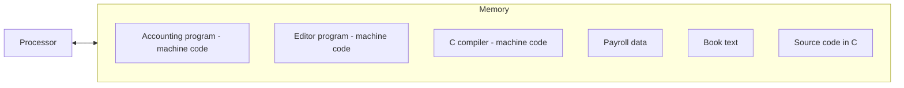

# بخش ۲، جلسه‌ی ۴ از ۱۲: نمایش دستورات و عملیات منطقی

این جلسه بخشی از **بخش ۲: معماری مجموعه‌دستورات MIPS و برنامه‌نویسی اسمبلی** است. زمان مطالعه: حدود نیم ساعت.

**فهرست این جلسه:**

- ۱. دستور هم یک عدد است
- ۲. قالب R
- ۳. قالب I و اصل مصالحه‌ی خوب
- ۴. ترجمه‌ی کامل یک قطعه کد به زبان ماشین
- ۵. مفهوم برنامه‌ی ذخیره‌شده
- ۶. عملیات منطقی
- ۷. تمرین‌ها

---

## ۱. دستور هم یک عدد است

انسان‌ها دستور را به شکل `add $t0, $s1, $s2` می‌نویسند، ولی کامپیوتر فقط بیت می‌فهمد. پس هر دستور اسمبلی باید به یک عدد دودویی تبدیل شود. به این شکل عددی **زبان ماشین (Machine language)** و به یک دنباله از این عددها **کد ماشین (Machine code)** می‌گوییم.

در MIPS هر دستور دقیقاً ۳۲ بیت است، یعنی یک کلمه. این دستور از چند بخش به نام **فیلد (Field)** تشکیل می‌شود. چیدمان فیلدها را **قالب دستور (Instruction format)** می‌نامیم.

معماری MIPS فقط سه قالب دارد:

- **قالب R** برای دستورات ثباتی، مثل `add` و `sub`.
- **قالب I** برای دستورات با ثابت و دستورات حافظه و پرش شرطی، مثل `addi`، `lw` و `beq`.
- **قالب J** برای پرش‌های غیرشرطی `j` و `jal`. این قالب را در جلسه‌ی ۲-۷ می‌بینیم.

## ۲. قالب R

قالب R شش فیلد دارد:

| فیلد | op | rs | rt | rd | shamt | funct |
|---|---|---|---|---|---|---|
| تعداد بیت | 6 | 5 | 5 | 5 | 5 | 6 |
| بیت‌ها | 31–26 | 25–21 | 20–16 | 15–11 | 10–6 | 5–0 |

معنای فیلدها:

- **فیلد op:** عمل پایه‌ی دستور که به آن **کد عمل (Opcode)** می‌گوییم. برای همه‌ی دستورات قالب R برابر صفر است.
- **فیلد rs:** شماره‌ی ثبات عملوند منبع اول.
- **فیلد rt:** شماره‌ی ثبات عملوند منبع دوم.
- **فیلد rd:** شماره‌ی ثبات مقصد که نتیجه در آن نوشته می‌شود.
- **فیلد shamt:** مقدار شیفت (Shift amount). فقط در دستورات شیفت استفاده می‌شود و بقیه‌ی جاها صفر است.
- **فیلد funct:** کد تابع (Function code). نسخه‌ی خاص عمل را انتخاب می‌کند. مثلاً `add` و `sub` هر دو op صفر دارند و با funct از هم جدا می‌شوند.

### مثال: کدگذاری دستور add

دستور `add $t0, $s1, $s2` را کدگذاری کن. شماره‌ی ثبات‌ها از جلسه‌ی ۲-۱: `$t0` برابر ۸، `$s1` برابر ۱۷ و `$s2` برابر ۱۸ است. فیلد funct جمع ۳۲ است.

| فیلد | op | rs | rt | rd | shamt | funct |
|---|---|---|---|---|---|---|
| ده‌دهی | 0 | 17 | 18 | 8 | 0 | 32 |
| دودویی | 000000 | 10001 | 10010 | 01000 | 00000 | 100000 |

```text
000000 10001 10010 01000 00000 100000
= 0000 0010 0011 0010 0100 0000 0010 0000
= 0x02324020
```

به ترتیب فیلدها دقت کن. در اسمبلی مقصد اول است (`$t0`)، ولی در کد ماشین مقصد در فیلد rd و بعد از دو منبع می‌آید.

## ۳. قالب I و اصل مصالحه‌ی خوب

حالا دستور `lw` را در نظر بگیر. این دستور دو ثبات (پایه و مقصد) و یک ثابت جابه‌جایی دارد. اگر بخواهیم از همان قالب R استفاده کنیم، ثابت فقط ۵ بیت جا دارد و حداکثر جابه‌جایی ۳۱ می‌شود. این برای دسترسی به آرایه یا ساختار خیلی کم است.

اینجا یک تعارض داریم:

- **خواسته‌ی اول:** همه‌ی دستورات هم‌طول باشند (اصل ۱: سادگی با نظم).
- **خواسته‌ی دوم:** یک قالب واحد برای همه‌ی دستورات داشته باشیم.

نمی‌توانیم هر دو را داشته باشیم. طراحان MIPS طول ثابت را نگه داشتند و قالب‌های مختلف را پذیرفتند. این همان **اصل ۴: طراحی خوب مصالحه‌ی خوب می‌خواهد (Good design demands good compromises)** است.

قالب I این شکل را دارد:

| فیلد | op | rs | rt | constant or address |
|---|---|---|---|---|
| تعداد بیت | 6 | 5 | 5 | 16 |

- **فیلد rs:** ثبات منبع یا ثبات پایه.
- **فیلد rt:** در دستورات بارگذاری و `addi` ثبات **مقصد** است. در `sw` ثبات داده‌ای است که نوشته می‌شود. در `beq` منبع دوم است.
- **فیلد ثابت:** عدد ۱۶ بیتی علامت‌دار، از −32768 تا +32767.

مثال: `lw $t0, 32($s3)` با op برابر ۳۵:

| فیلد | op | rs | rt | constant |
|---|---|---|---|---|
| ده‌دهی | 35 | 19 | 8 | 32 |

```text
100011 10011 01000 0000000000100000 = 0x8E680020
```

### چرا قالب‌ها شبیه هم هستند

قالب‌ها با هم فرق دارند ولی تا جایی که شده شبیه نگه داشته شده‌اند:

- **فیلد op:** همیشه در شش بیت اول است. سخت‌افزار با نگاه به آن می‌فهمد بقیه‌ی دستور را چطور تفسیر کند. اگر op صفر باشد قالب R است.
- **فیلدهای rs و rt:** در قالب R و I همیشه در یک جا هستند. پس سخت‌افزار می‌تواند فایل ثبات را قبل از رمزگشایی کامل بخواند. این نکته در بخش ۴ و ۵ برای سرعت مسیر داده خیلی مهم است.

### جدول کدهای مهم

| دستور | قالب | op | rs | rt | rd | shamt | funct یا ثابت |
|---|---|---|---|---|---|---|---|
| دستور `add` | R | 0 | reg | reg | reg | 0 | 32 (0x20) |
| دستور `sub` | R | 0 | reg | reg | reg | 0 | 34 (0x22) |
| دستور `and` | R | 0 | reg | reg | reg | 0 | 36 (0x24) |
| دستور `or` | R | 0 | reg | reg | reg | 0 | 37 (0x25) |
| دستور `nor` | R | 0 | reg | reg | reg | 0 | 39 (0x27) |
| دستور `slt` | R | 0 | reg | reg | reg | 0 | 42 (0x2A) |
| دستور `sll` | R | 0 | 0 | reg | reg | n | 0 |
| دستور `srl` | R | 0 | 0 | reg | reg | n | 2 |
| دستور `jr` | R | 0 | reg | 0 | 0 | 0 | 8 |
| دستور `addi` | I | 8 | reg | reg | – | – | constant |
| دستور `andi` | I | 12 | reg | reg | – | – | constant |
| دستور `ori` | I | 13 | reg | reg | – | – | constant |
| دستور `lui` | I | 15 | 0 | reg | – | – | constant |
| دستور `lw` | I | 35 | reg | reg | – | – | address |
| دستور `sw` | I | 43 | reg | reg | – | – | address |
| دستور `beq` | I | 4 | reg | reg | – | – | offset |
| دستور `bne` | I | 5 | reg | reg | – | – | offset |
| دستور `j` | J | 2 | – | – | – | – | address 26 bit |
| دستور `jal` | J | 3 | – | – | – | – | address 26 bit |

لازم نیست این جدول را حفظ کنی. کارت مرجع سبز کتاب (MIPS Reference Data) در امتحان‌ها معمولاً در اختیار است. ولی باید بتوانی با کمک آن یک دستور را کدگذاری یا رمزگشایی کنی.

## ۴. ترجمه‌ی کامل یک قطعه کد به زبان ماشین

فرض کن آدرس آرایه‌ی `A` در `$t1` و `h` در `$s2` است:

```c
A[300] = h + A[300];
```

جابه‌جایی برابر 300×4 یعنی ۱۲۰۰ است:

```asm
lw   $t0, 1200($t1)    # t0 = A[300]
add  $t0, $s2, $t0     # t0 = h + A[300]
sw   $t0, 1200($t1)    # A[300] = t0
```

فیلدها به ده‌دهی:

| دستور | op | rs | rt | rd | shamt یا ثابت | funct |
|---|---|---|---|---|---|---|
| دستور `lw` | 35 | 9 | 8 | – | 1200 | – |
| دستور `add` | 0 | 18 | 8 | 8 | 0 | 32 |
| دستور `sw` | 43 | 9 | 8 | – | 1200 | – |

و به دودویی و شانزده‌شانزدهی:

```text
lw : 100011 01001 01000 0000010010110000          = 0x8D2804B0
add: 000000 10010 01000 01000 00000 100000        = 0x02484020
sw : 101011 01001 01000 0000010010110000          = 0xAD2804B0
```

دستورات `lw` و `sw` فقط در یک بیت op با هم فرق دارند (بیت سوم از چپ). این شباهت طراحی سخت‌افزار را ساده می‌کند.

## ۵. مفهوم برنامه‌ی ذخیره‌شده

دو اصل پایه‌ی کامپیوترهای امروزی:

- **دستورات به شکل عدد نمایش داده می‌شوند.**
- **برنامه‌ها مثل عدد در حافظه ذخیره می‌شوند** و می‌توان آن‌ها را مثل داده خواند و نوشت.



نتیجه‌های این ایده:

- **چرخه‌ی واکشی و اجرا (Fetch and execute):** پردازنده دستور را از حافظه می‌آورد و در یک ثبات ویژه می‌گذارد. بیت‌های این ثبات کارهای بعدی را کنترل می‌کنند. بعد دستور بعدی را واکشی می‌کند و همین را تکرار می‌کند.
- **یک کامپیوتر برای همه‌ی کارها:** یک ماشین می‌تواند امروز ویرایشگر و فردا کامپایلر اجرا کند، فقط با بارگذاری برنامه‌ی دیگر.
- **سازگاری دودویی (Binary compatibility):** برنامه‌ها به شکل فایل دودویی فروخته می‌شوند. پس کامپیوترهای جدید باید همان ISA قدیمی را اجرا کنند. این دلیل اصلی ماندگاری ISAهایی مثل x86 است.
- **برنامه‌ای که برنامه می‌سازد:** کامپایلر و اسمبلر و لینکر برنامه‌هایی هستند که برنامه‌ی دیگری را به شکل داده تولید می‌کنند.

## ۶. عملیات منطقی

گاهی لازم است روی بیت‌های جداگانه‌ی یک کلمه کار کنیم، مثلاً برای بسته‌بندی کاراکترها در کلمه یا خواندن یک فیلد از یک کلمه. دستورات منطقی برای همین هستند:

| عمل منطقی | عملگر C | عملگر جاوا | دستور MIPS |
|---|---|---|---|
| شیفت به چپ | `<<` | `<<` | `sll` |
| شیفت به راست | `>>` | `>>>` | `srl` |
| و بیتی | `&` | `&` | `and`، `andi` |
| یا بیتی | `\|` | `\|` | `or`، `ori` |
| نقیض بیتی | `~` | `~` | `nor` |

### شیفت

دستور **شیفت منطقی به چپ (sll)** همه‌ی بیت‌ها را به چپ می‌برد و از راست صفر وارد می‌کند. فرض کن `$s0` برابر ۹ است:

```asm
sll  $t2, $s0, 4       # t2 = s0 << 4
```

```text
s0 = 0000 0000 0000 0000 0000 0000 0000 1001  =   9
t2 = 0000 0000 0000 0000 0000 0000 1001 0000  = 144
```

شیفت به چپ به اندازه‌ی i بیت مثل ضرب در 2 به توان i است. برای همین `sll $t1, $s4, 2` معادل ضرب در ۴ است و در محاسبه‌ی آدرس آرایه خیلی استفاده می‌شود.

کدگذاری این دستور: op و funct صفر، rs استفاده نمی‌شود و صفر است، rt ثبات منبع و rd مقصد است، و shamt برابر ۴:

| فیلد | op | rs | rt | rd | shamt | funct |
|---|---|---|---|---|---|---|
| ده‌دهی | 0 | 0 | 16 | 10 | 4 | 0 |

```text
000000 00000 10000 01010 00100 000000 = 0x00105100
```

دستور **شیفت منطقی به راست (srl)** از چپ صفر وارد می‌کند و برای اعداد بدون علامت مثل تقسیم بر توان دو است. دستور **شیفت حسابی به راست (sra)** از چپ بیت علامت را وارد می‌کند و برای اعداد علامت‌دار استفاده می‌شود. نسخه‌های متغیر `sllv`، `srlv` و `srav` مقدار شیفت را از یک ثبات می‌گیرند.

### و بیتی

دستور `and` بیت‌هایی را یک می‌کند که در هر دو عملوند یک باشند. با آن می‌توان بیت‌هایی را **پوشاند (Mask)**، یعنی بقیه را صفر کرد:

```text
t2      = 0000 0000 0000 0000 0000 1101 1100 0000
t1      = 0000 0000 0000 0000 0011 1100 0000 0000
and t0  = 0000 0000 0000 0000 0000 1100 0000 0000
```

### یا بیتی

دستور `or` بیت‌هایی را یک می‌کند که دست‌کم در یکی از دو عملوند یک باشند. با آن می‌توان بیت‌هایی را یک کرد:

```text
or t0   = 0000 0000 0000 0000 0011 1101 1100 0000
```

### نقیض با nor

معماری MIPS دستور جداگانه‌ی NOT ندارد. به جای آن دستور `nor` دارد که یعنی نقیضِ یا. اگر یکی از عملوندها صفر باشد، `nor` همان NOT است:

```math
A \;\text{NOR}\; 0 = \overline{A + 0} = \overline{A}
```

```asm
nor  $t0, $t1, $zero   # t0 = ~t1
```

چرا NOT جداگانه نیست؟ چون با حفظ قالب سه‌عملوندی، `nor` هم کار NOT را می‌کند و هم کار NOR. این باز هم اصل ۱ است.

### ثابت‌های منطقی

دستورات `andi` و `ori` ثابت ۱۶ بیتی دارند. برخلاف `addi`، این ثابت با **صفر** گسترش داده می‌شود. چون در عملیات بیتی می‌خواهیم دقیقاً همان بیت‌هایی را که نوشته‌ایم داشته باشیم.

مثال: بیرون کشیدن بیت‌های ۴ تا ۷ یک ثبات:

```asm
srl  $t0, $s0, 4       # move bits 7..4 to 3..0
andi $t0, $t0, 0xF     # keep only 4 bits
```

### معادل در RISC-V

در RISC-V دستورات `sll`، `srl`، `sra`، `and`، `or` و `xor` با ثبات هستند و `slli`، `srli`، `srai`، `andi`، `ori` و `xori` با ثابت. یعنی برخلاف MIPS، دستور شیفت ثابت جدا از شیفت ثباتی نام‌گذاری شده است. RISC-V دستور `nor` ندارد و نقیض را با `xori rd, rs, -1` می‌سازد. ثابت‌های منطقی RISC-V با علامت گسترش داده می‌شوند.

## ۷. تمرین‌ها

<details>
<summary>تمرین ۱: کدگذاری</summary>

**صورت:** دستور `sub $s0, $t3, $s5` را به شانزده‌شانزدهی تبدیل کن.

**جواب:** شماره‌ها: `$s0` برابر ۱۶، `$t3` برابر ۱۱، `$s5` برابر ۲۱. فیلدها: op=0، rs=11، rt=21، rd=16، shamt=0، funct=34.

```text
000000 01011 10101 10000 00000 100010 = 0x01758022
```
</details>

<details>
<summary>تمرین ۲: رمزگشایی</summary>

**صورت:** کلمه‌ی 0xAE0BFFFC چه دستوری است؟

**جواب:**

```text
101011 10000 01011 1111111111111100
```

فیلد op برابر ۴۳ یعنی `sw` است. rs برابر ۱۶ یعنی `$s0`، rt برابر ۱۱ یعنی `$t3`، و ثابت 0xFFFC برابر −4 است. پس دستور `sw $t3, -4($s0)` است.
</details>

<details>
<summary>تمرین ۳: استخراج فیلد</summary>

**صورت:** فرض کن یک کلمه‌ی دستور MIPS در `$s0` است. با کمترین تعداد دستور، فیلد rs را در `$t0` بگذار.

**جواب:** فیلد rs در بیت‌های ۲۵ تا ۲۱ است. اول آن را به پایین شیفت می‌دهیم و بعد پنج بیت را نگه می‌داریم:

```asm
srl  $t0, $s0, 21
andi $t0, $t0, 0x1F
```

راه دیگر: `sll $t0, $s0, 6` و بعد `srl $t0, $t0, 27`.
</details>

<details>
<summary>تمرین ۴: پرسش مفهومی</summary>

**صورت:** اگر MIPS به جای ۳۲ ثبات ۱۲۸ ثبات داشت و تعداد دستورات هم چهار برابر می‌شد، طول فیلدهای قالب R چه تغییری می‌کرد؟ آیا هنوز در ۳۲ بیت جا می‌شد؟

**جواب:** شماره‌ی ثبات ۷ بیت و op هشت بیت می‌شود. فرض کن shamt و funct همان بمانند. جمع بیت‌ها: 8 + 7 + 7 + 7 + 5 + 6 = 40 بیت. پس دیگر در ۳۲ بیت جا نمی‌شود و باید فیلدها را کوچک کرد یا طول دستور را بیشتر کرد. این نشان می‌دهد چرا تعداد ثبات‌ها و طول دستور با هم گره خورده‌اند.
</details>

---

جلسه‌ی قبلی: [اعداد علامت‌دار و بدون علامت](2-3-signed-and-unsigned-numbers.md)  
جلسه‌ی بعدی: [تصمیم‌گیری، حلقه و دستور switch](2-5-decisions-and-loops.md)
