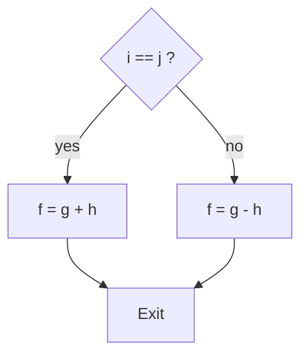

# بخش ۲، جلسه‌ی ۵ از ۱۲: تصمیم‌گیری، حلقه و دستور switch

این جلسه بخشی از **بخش ۲: معماری مجموعه‌دستورات MIPS و برنامه‌نویسی اسمبلی** است. زمان مطالعه: حدود نیم ساعت.

**فهرست این جلسه:**

- ۱. پرش‌های شرطی
- ۲. ترجمه‌ی if و if-else
- ۳. ترجمه‌ی حلقه‌ها
- ۴. بلوک پایه
- ۵. مقایسه‌ی کوچک‌تر بودن
- ۶. چرا blt در سخت‌افزار نیست
- ۷. ترفند بررسی مرز آرایه
- ۸. دستور switch و جدول پرش
- ۹. تمرین‌ها

---

## ۱. پرش‌های شرطی

چیزی که کامپیوتر را از یک ماشین‌حساب ساده جدا می‌کند، توانایی **تصمیم‌گیری** است. یعنی بر اساس داده‌ی ورودی یا نتیجه‌ی محاسبه، دستورات متفاوتی اجرا شوند. در زبان سطح بالا این کار را با `if` انجام می‌دهیم. MIPS برای این کار دو دستور **پرش شرطی (Conditional branch)** دارد:

```asm
beq  reg1, reg2, L1    # if (reg1 == reg2) go to L1
bne  reg1, reg2, L1    # if (reg1 != reg2) go to L1
```

- **دستور beq** یعنی Branch if equal: اگر دو ثبات برابر بودند، به دستوری که برچسب `L1` دارد برو.
- **دستور bne** یعنی Branch if not equal: اگر دو ثبات نابرابر بودند، به `L1` برو.

اگر شرط برقرار نباشد، پردازنده دستور بعدی را اجرا می‌کند.

یک **برچسب (Label)** نامی است که به آدرس یک دستور داده می‌شود و بعد از آن دونقطه می‌آید. اسمبلر آدرس را خودش حساب می‌کند. این یکی از کارهایی است که اسمبلی را از زبان ماشین راحت‌تر می‌کند.

دستور پرش **غیرشرطی (Unconditional jump)** هم داریم که همیشه می‌پرد:

```asm
j    Exit              # go to Exit
```

## ۲. ترجمه‌ی if و if-else

### مثال if-else از کتاب

فرض کن `f` تا `j` در `$s0` تا `$s4` هستند:

```c
if (i == j) f = g + h;
else        f = g - h;
```



کامپایلر معمولاً **شرط مخالف** را آزمایش می‌کند. یعنی اگر `i` و `j` نابرابر بودند، از بلوک then بگذر و به بلوک else برو. این کار کد را کوتاه‌تر می‌کند، چون بلوک then بلافاصله بعد از پرش می‌آید:

```asm
        bne  $s3, $s4, Else    # if (i != j) go to Else
        add  $s0, $s1, $s2     # f = g + h   (skipped if i != j)
        j    Exit              # go to Exit
Else:   sub  $s0, $s1, $s2     # f = g - h   (skipped if i == j)
Exit:
```

به دستور `j Exit` دقت کن. بدون آن، بعد از اجرای بلوک then، بلوک else هم اجرا می‌شد.

### مثال if ساده

```c
if (i == j) h = i + j;
```

```asm
        bne  $s0, $s1, Label   # i in $s0, j in $s1
        add  $s3, $s0, $s1     # h = i + j
Label:
```

## ۳. ترجمه‌ی حلقه‌ها

### حلقه‌ی while از کتاب

فرض کن `i` در `$s3`، `k` در `$s5` و آدرس آرایه‌ی `save` در `$s6` است:

```c
while (save[i] == k)
    i += 1;
```

```asm
Loop:   sll  $t1, $s3, 2       # t1 = i * 4
        add  $t1, $t1, $s6     # t1 = &save[i]
        lw   $t0, 0($t1)       # t0 = save[i]
        bne  $t0, $s5, Exit    # if save[i] != k, exit
        addi $s3, $s3, 1       # i = i + 1
        j    Loop              # repeat
Exit:
```

هر حلقه از دو چیز ساخته می‌شود: یک **پرش شرطی** برای خروج و یک **پرش به عقب** برای تکرار.

### بهینه‌سازی حلقه

حلقه‌ی بالا در هر تکرار دو پرش اجرا می‌کند: `bne` و `j`. می‌توان آن را طوری نوشت که در هر تکرار فقط یک پرش اجرا شود. ایده: شرط را به انتهای حلقه ببریم.

```asm
        sll  $t1, $s3, 2
        add  $t1, $t1, $s6
        lw   $t0, 0($t1)
        bne  $t0, $s5, Exit    # test once before the loop
Loop:   addi $s3, $s3, 1       # i = i + 1
        sll  $t1, $s3, 2
        add  $t1, $t1, $s6
        lw   $t0, 0($t1)
        beq  $t0, $s5, Loop    # one branch per iteration
Exit:
```

کامپایلرهای واقعی همین کار را می‌کنند. این تمرین ۲.۲۳ کتاب هم هست.

### حلقه‌ی for

حلقه‌ی for را می‌توان به شکل while نوشت. مثلاً جمع عناصر آرایه، با `n` در `$s0`، آدرس `A` در `$s1` و نتیجه در `$v0`:

```c
sum = 0;
for (i = 0; i < n; i++)
    sum += A[i];
```

```asm
        add  $v0, $zero, $zero # sum = 0
        add  $t0, $zero, $zero # i = 0
Loop:   slt  $t1, $t0, $s0     # t1 = (i < n)
        beq  $t1, $zero, Exit  # if !(i < n) exit
        sll  $t2, $t0, 2       # t2 = i * 4
        add  $t2, $t2, $s1     # t2 = &A[i]
        lw   $t3, 0($t2)       # t3 = A[i]
        add  $v0, $v0, $t3     # sum += A[i]
        addi $t0, $t0, 1       # i++
        j    Loop
Exit:
```

اینجا از دستور `slt` استفاده کردیم که در بخش ۵ همین جلسه توضیح داده می‌شود.

## ۴. بلوک پایه

یک **بلوک پایه (Basic block)** دنباله‌ای از دستورات است که:

- هیچ پرشی در وسط یا انتهای آن نیست، به‌جز احتمالاً آخرین دستور.
- هیچ برچسبی که مقصد پرش باشد در آن نیست، به‌جز احتمالاً اولین دستور.

یعنی اگر اجرا وارد بلوک شود، تا آخر آن بدون انشعاب ادامه می‌دهد. یکی از اولین مراحل کامپایل، شکستن برنامه به بلوک‌های پایه است. بیشتر بهینه‌سازی‌های کامپایلر روی بلوک پایه کار می‌کنند.

بلوک پایه در بخش‌های ۵ و ۷ هم مهم است. هر چه بلوک پایه بزرگ‌تر باشد، دستورات مستقل بیشتری برای اجرای موازی و زمان‌بندی وجود دارد. در کدهای معمولی صحیح، هر بلوک پایه فقط حدود ۴ تا ۷ دستور دارد. برای همین تکنیک‌هایی مثل باز کردن حلقه (Loop unrolling) ابداع شدند.

## ۵. مقایسه‌ی کوچک‌تر بودن

آزمایش برابری کافی نیست. خیلی وقت‌ها باید بپرسیم آیا یک متغیر از دیگری کوچک‌تر است. MIPS برای این کار دستور **کوچک‌تر بودن (Set on less than)** را دارد:

```asm
slt  $t0, $s3, $s4     # t0 = 1 if s3 < s4, else 0
slti $t0, $s2, 10      # t0 = 1 if s2 < 10, else 0
```

این دستور پرش نمی‌کند. فقط یک ثبات را ۰ یا ۱ می‌کند. بعد با `beq` یا `bne` و ثبات `$zero` پرش انجام می‌شود. ترکیب `slt` و `beq` یا `bne` همه‌ی مقایسه‌ها را پوشش می‌دهد:

| شرط | کد MIPS |
|---|---|
| شرط a < b | `slt $t0, a, b` و بعد `bne $t0, $zero, L` |
| شرط a >= b | `slt $t0, a, b` و بعد `beq $t0, $zero, L` |
| شرط a > b | `slt $t0, b, a` و بعد `bne $t0, $zero, L` |
| شرط a <= b | `slt $t0, b, a` و بعد `beq $t0, $zero, L` |

### علامت‌دار و بدون علامت

همان‌طور که در جلسه‌ی ۲-۳ دیدیم، یک الگوی بیتی بسته به تفسیر، دو مقدار دارد. پس مقایسه هم دو نسخه دارد:

- **دستورات slt و slti:** مقایسه‌ی علامت‌دار.
- **دستورات sltu و sltiu:** مقایسه‌ی بدون علامت.

مثال کتاب: فرض کن

```text
$s0 = 1111 1111 1111 1111 1111 1111 1111 1111
$s1 = 0000 0000 0000 0000 0000 0000 0000 0001
```

```asm
slt  $t0, $s0, $s1     # signed:   -1 < 1          -> t0 = 1
sltu $t1, $s0, $s1     # unsigned: 4,294,967,295 < 1 -> t1 = 0
```

### شبه‌دستورات پرش

اسمبلر MIPS برای راحتی برنامه‌نویس دستورات `blt`، `bgt`، `ble` و `bge` را می‌پذیرد. ولی این‌ها دستور واقعی سخت‌افزار نیستند. به آن‌ها **شبه‌دستور (Pseudo-instruction)** می‌گوییم و اسمبلر آن‌ها را به دو دستور واقعی تبدیل می‌کند:

```asm
blt  $s0, $s1, L       # pseudo-instruction
# becomes:
slt  $at, $s0, $s1     # at = (s0 < s1)
bne  $at, $zero, L
```

این دلیل رزرو بودن ثبات `$at` برای اسمبلر است. شبه‌دستورات را در جلسه‌ی ۲-۸ کامل می‌بینیم.

## ۶. چرا blt در سخت‌افزار نیست

چرا MIPS به جای دو دستور `slt` و `bne`، یک دستور `blt` ندارد؟ این یک تصمیم آگاهانه است:

- **کندی مقایسه:** مقایسه‌ی کوچک‌تر بودن به یک تفریق کامل ۳۲ بیتی نیاز دارد، ولی برابری فقط با XOR و یک NOR بزرگ بررسی می‌شود که خیلی سریع‌تر است.
- **طول سیکل:** اگر `blt` در سخت‌افزار بود، یا سیکل ساعت باید طولانی‌تر می‌شد یا این دستور سیکل‌های بیشتری می‌گرفت. یک دستور کند همه‌ی دستورات را کند می‌کند.
- **نتیجه:** دو دستور سریع بهتر از یک دستور کند است. این همان اصل «حالت رایج را سریع کن» و «سادگی با نظم» است. برابری حالت رایج‌تری است و ارزش دارد سریع باشد.

در بخش ۵ می‌بینیم که در خط لوله‌ی MIPS، مقایسه‌ی برابری برای `beq` حتی به مرحله‌ی ID منتقل می‌شود تا جریمه‌ی پرش کم شود. این فقط به این دلیل ممکن است که برابری سریع است.

معماری‌های دیگر راه دیگری رفته‌اند. ARM و x86 **کدهای شرط (Condition codes)** یا **پرچم (Flags)** دارند. دستور حسابی یا دستور `cmp` پرچم‌هایی مثل صفر، منفی، رقم نقلی و سرریز را تنظیم می‌کند و پرش بعدی آن‌ها را می‌خواند. RISC-V برخلاف MIPS دستورات `blt`، `bge`، `bltu` و `bgeu` را واقعاً در سخت‌افزار دارد، چون طراحانش دیدند با فناوری امروز این مقایسه سیکل را طولانی نمی‌کند.

## ۷. ترفند بررسی مرز آرایه

یک ترفند جالب با مقایسه‌ی بدون علامت: بررسی اینکه آیا `0 <= x < y` است، فقط با یک مقایسه.

عدد منفی در مکمل دو، اگر بدون علامت تفسیر شود، از هر عدد مثبت علامت‌دار بزرگ‌تر است. پس `sltu` همزمان هم منفی بودن و هم بزرگ بودن را آزمایش می‌کند. فرض کن طول آرایه در `$t2` و اندیس در `$s1` است:

```asm
sltu $t0, $s1, $t2         # t0 = 0 if s1 >= length or s1 < 0
beq  $t0, $zero, IndexOutOfBounds
```

زبان جاوا این بررسی را برای هر دسترسی آرایه اجباری می‌کند و این ترفند هزینه‌اش را نصف می‌کند.

## ۸. دستور switch و جدول پرش

دستور switch در C یک متغیر را با چند مقدار مقایسه می‌کند:

```c
switch (k) {
    case 0: f = i + j; break;
    case 1: f = g + h; break;
    case 2: f = g - h; break;
    case 3: f = i - j; break;
}
```

دو راه برای ترجمه‌ی آن وجود دارد:

- **زنجیره‌ی if-else:** ساده است ولی برای حالت آخر باید همه‌ی مقایسه‌ها انجام شود.
- **جدول پرش (Jump address table):** آرایه‌ای از آدرس‌ها در حافظه که خانه‌ی k آن، آدرس کد مربوط به حالت k است. برنامه آدرس را از جدول می‌خواند و به آن می‌پرد. زمان این روش به تعداد حالت‌ها بستگی ندارد.

برای روش دوم دستور **پرش با ثبات (Jump register)** لازم است. این دستور به آدرسی که داخل یک ثبات است می‌پرد:

```asm
jr   $t0               # go to address in $t0
```

فرض کن `f` تا `k` در `$s0` تا `$s5` و آدرس جدول در `$t4` است:

```asm
        slt  $t3, $s5, $zero   # k < 0 ?
        bne  $t3, $zero, Exit
        slti $t3, $s5, 4       # k < 4 ?
        beq  $t3, $zero, Exit
        sll  $t1, $s5, 2       # t1 = k * 4
        add  $t1, $t1, $t4     # t1 = &JumpTable[k]
        lw   $t0, 0($t1)       # t0 = JumpTable[k]
        jr   $t0               # jump to case k
L0:     add  $s0, $s3, $s4     # k = 0: f = i + j
        j    Exit
L1:     add  $s0, $s1, $s2     # k = 1: f = g + h
        j    Exit
L2:     sub  $s0, $s1, $s2     # k = 2: f = g - h
        j    Exit
L3:     sub  $s0, $s3, $s4     # k = 3: f = i - j
Exit:
```

جدول در بخش داده تعریف می‌شود:

```asm
        .data
JumpTable: .word L0, L1, L2, L3
```

دو مقایسه‌ی ابتدایی را می‌توان با ترفند بخش ۷ به یک `sltiu` تبدیل کرد. کامپایلر وقتی حالت‌ها زیاد و پشت‌سرهم باشند جدول پرش و وقتی کم یا پراکنده باشند زنجیره‌ی if-else می‌سازد.

دستور `jr` در جلسه‌ی بعد هم برای بازگشت از تابع استفاده می‌شود. فراخوانی تابع‌های مجازی در C++ و جاوا و اشاره‌گر به تابع در C هم با همین دستور پیاده می‌شوند.

### خلاصه‌ی دستورات این جلسه

| دستور | مثال | معنی |
|---|---|---|
| پرش برابری `beq` | `beq $s1, $s2, L` | اگر برابر، برو به L |
| پرش نابرابری `bne` | `bne $s1, $s2, L` | اگر نابرابر، برو به L |
| مقایسه `slt` | `slt $s1, $s2, $s3` | اگر s2<s3 آنگاه s1=1 وگرنه 0 |
| مقایسه با ثابت `slti` | `slti $s1, $s2, 20` | اگر s2<20 آنگاه s1=1 |
| مقایسه‌ی بدون علامت `sltu` و `sltiu` | `sltu $s1, $s2, $s3` | همان، بدون علامت |
| پرش `j` | `j L` | برو به L |
| پرش با ثبات `jr` | `jr $ra` | برو به آدرس داخل ثبات |

## ۹. تمرین‌ها

<details>
<summary>تمرین ۱: شرط مرکب</summary>

**صورت:** کد زیر را ترجمه کن. فرض کن `a` در `$s0`، `b` در `$s1` و `c` در `$s2` است.

```c
if (a < b && b < c) c = a;
```

**جواب:** هر کدام از شرط‌ها نادرست باشد، از بلوک می‌گذریم:

```asm
        slt  $t0, $s0, $s1     # a < b ?
        beq  $t0, $zero, Skip
        slt  $t0, $s1, $s2     # b < c ?
        beq  $t0, $zero, Skip
        add  $s2, $s0, $zero   # c = a
Skip:
```
</details>

<details>
<summary>تمرین ۲: شمارش</summary>

**صورت:** آرایه‌ای از `n` عدد صحیح داریم. `n` در `$s0` و آدرس آرایه در `$s1` است. تعداد عناصر منفی را در `$v0` بگذار.

**جواب:** این بار به جای اندیس از اشاره‌گر استفاده می‌کنیم. در جلسه‌ی ۲-۹ این دو روش را مقایسه می‌کنیم:

```asm
        add  $v0, $zero, $zero # count = 0
        sll  $t1, $s0, 2
        add  $t1, $t1, $s1     # t1 = end = &A[n]
        add  $t0, $s1, $zero   # p = &A[0]
Loop:   beq  $t0, $t1, Exit    # p == end ?
        lw   $t2, 0($t0)
        slt  $t3, $t2, $zero   # A[i] < 0 ?
        add  $v0, $v0, $t3     # count += (A[i] < 0)
        addi $t0, $t0, 4
        j    Loop
Exit:
```

به ترفند `add $v0, $v0, $t3` دقت کن: نتیجه‌ی ۰ یا ۱ دستور `slt` را مستقیماً جمع کردیم و پرش اضافه نیاز نشد.
</details>

<details>
<summary>تمرین ۳: بلوک پایه</summary>

**صورت:** کد حلقه‌ی for بخش ۳ چند بلوک پایه دارد؟

**جواب:** سه بلوک پایه:

- **بلوک اول:** دو دستور مقداردهی اولیه.
- **بلوک دوم:** از `Loop` تا `beq` (دو دستور).
- **بلوک سوم:** از `sll` تا `j Loop` (شش دستور).

برچسب `Exit` شروع بلوک چهارم است که بعد از حلقه می‌آید.
</details>

<details>
<summary>تمرین ۴: تفاوت slt و sltu</summary>

**صورت:** فرض کن `$s0 = 0x80000000` و `$s1 = 0x00000001`. مقدار `$t0` بعد از `slt $t0, $s0, $s1` و `sltu $t0, $s0, $s1` چیست؟

**جواب:** به شکل علامت‌دار، `$s0` منفی‌ترین عدد است، پس از ۱ کوچک‌تر است و `slt` مقدار ۱ می‌دهد. به شکل بدون علامت، `$s0` برابر 2,147,483,648 است که از ۱ بزرگ‌تر است، پس `sltu` مقدار ۰ می‌دهد.
</details>

---

جلسه‌ی قبلی: [نمایش دستورات و عملیات منطقی](2-4-instruction-encoding-and-logical-ops.md)  
جلسه‌ی بعدی: [رویه‌ها و پشته](2-6-procedures-and-stack.md)
