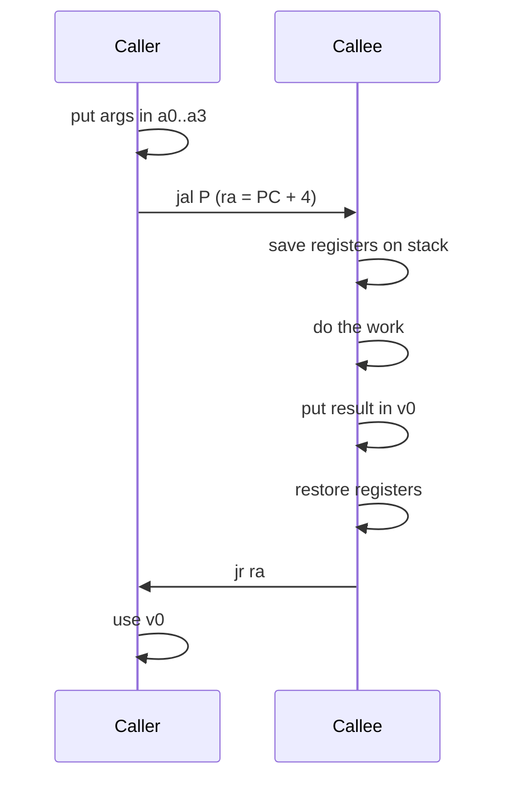

# بخش ۲، جلسه‌ی ۶ از ۱۲: رویه‌ها و پشته

این جلسه بخشی از **بخش ۲: معماری مجموعه‌دستورات MIPS و برنامه‌نویسی اسمبلی** است. زمان مطالعه: حدود نیم ساعت.

**فهرست این جلسه:**

- ۱. رویه و شش مرحله‌ی فراخوانی
- ۲. دستورات jal و jr
- ۳. پشته و استفاده از آن
- ۴. ثبات‌های حفظ‌شده و حفظ‌نشده
- ۵. رویه‌های تودرتو و بازگشتی
- ۶. قاب رویه و اشاره‌گر قاب
- ۷. چیدمان حافظه‌ی برنامه
- ۸. بیش از چهار آرگومان و فراخوانی دنباله‌ای
- ۹. تمرین‌ها

---

## ۱. رویه و شش مرحله‌ی فراخوانی

**رویه (Procedure)** یا تابع، زیربرنامه‌ای است که با پارامترهایی که می‌گیرد، یک کار مشخص انجام می‌دهد. رویه‌ها کد را قابل فهم‌تر و قابل استفاده‌ی مجدد می‌کنند. برنامه‌نویس با رویه‌ها روی یک بخش کوچک تمرکز می‌کند و پارامترها رابط بین رویه و بقیه‌ی برنامه هستند.

کتاب رویه را به جاسوسی تشبیه می‌کند که با یک مأموریت سری بیرون می‌رود، منابع لازم را جمع می‌کند، کار را انجام می‌دهد، ردپاها را پاک می‌کند و با نتیجه برمی‌گردد. هیچ چیز دیگری نباید بعد از برگشتن او تغییر کرده باشد.

برنامه‌ای که رویه را صدا می‌زند **فراخواننده (Caller)** و خود رویه **فراخوانده‌شده (Callee)** نام دارد. اجرای یک رویه شش مرحله دارد:

1. فراخواننده پارامترها را جایی می‌گذارد که رویه به آن دسترسی دارد.
2. کنترل به رویه منتقل می‌شود.
3. رویه منابع حافظه‌ای لازم را به دست می‌آورد.
4. رویه کار خواسته‌شده را انجام می‌دهد.
5. رویه نتیجه را جایی می‌گذارد که فراخواننده به آن دسترسی دارد.
6. کنترل به نقطه‌ی فراخوانی برمی‌گردد.

ثبات‌ها سریع‌ترین جا برای نگه‌داری داده هستند، پس MIPS تا جای ممکن از آن‌ها استفاده می‌کند:

- **ثبات‌های `$a0` تا `$a3`:** چهار ثبات آرگومان برای فرستادن پارامترها.
- **ثبات‌های `$v0` و `$v1`:** دو ثبات برای برگرداندن مقدار.
- **ثبات `$ra`:** ثبات آدرس بازگشت.

## ۲. دستورات jal و jr

دستور **پرش و پیوند (Jump and link)** به رویه می‌پرد و همزمان آدرس دستور بعدی را در `$ra` ذخیره می‌کند:

```asm
jal  ProcedureAddress   # $ra = PC + 4; go to ProcedureAddress
```

به این آدرسِ ذخیره‌شده **آدرس بازگشت (Return address)** می‌گوییم. چون یک رویه ممکن است از جاهای مختلف برنامه صدا زده شود، باید بداند به کجا برگردد.

برای برگشتن، رویه از دستور `jr` استفاده می‌کند که در جلسه‌ی قبل دیدیم:

```asm
jr   $ra                # go back to caller
```

ثباتی که آدرس دستور در حال اجرا را نگه می‌دارد **شمارنده‌ی برنامه (Program counter)** یا PC نام دارد. پس `jal` در واقع PC+4 را در `$ra` می‌نویسد.



## ۳. پشته و استفاده از آن

اگر رویه به ثبات‌های بیشتری از چهار آرگومان و دو مقدار بازگشتی نیاز داشته باشد چه؟ طبق قانون جاسوس، هر ثباتی که فراخواننده لازم دارد باید پس از بازگشت دست‌نخورده باشد. پس رویه باید مقدار قدیمی ثبات‌ها را جایی ذخیره کند و قبل از بازگشت برگرداند.

ساختار داده‌ی ایده‌آل برای این کار **پشته (Stack)** است: صفی از نوع «آخرین ورودی، اولین خروجی». پشته یک اشاره‌گر به آخرین خانه‌ی پرشده نیاز دارد که در MIPS ثبات `$sp` است. گذاشتن داده روی پشته **Push** و برداشتن آن **Pop** نام دارد.

طبق قرارداد تاریخی، **پشته از آدرس‌های بالا به سمت آدرس‌های پایین رشد می‌کند**. پس برای Push مقدار `$sp` را کم می‌کنیم و برای Pop زیاد می‌کنیم.

### مثال: رویه‌ی برگ

رویه‌ای که هیچ رویه‌ی دیگری را صدا نمی‌زند **رویه‌ی برگ (Leaf procedure)** نام دارد. مثال کتاب:

```c
int leaf_example(int g, int h, int i, int j)
{
    int f;
    f = (g + h) - (i + j);
    return f;
}
```

آرگومان‌ها در `$a0` تا `$a3` هستند و `f` در `$s0` قرار می‌گیرد. چون `$s0` باید حفظ شود، اول آن را ذخیره می‌کنیم:

```asm
leaf_example:
        addi $sp, $sp, -4      # make room for 1 item
        sw   $s0, 0($sp)       # save $s0
        add  $t0, $a0, $a1     # t0 = g + h
        add  $t1, $a2, $a3     # t1 = i + j
        sub  $s0, $t0, $t1     # f = t0 - t1
        add  $v0, $s0, $zero   # return f
        lw   $s0, 0($sp)       # restore $s0
        addi $sp, $sp, 4       # pop 1 item
        jr   $ra               # return to caller
```

در نسخه‌ی کتاب، `$t0` و `$t1` هم روی پشته ذخیره شده‌اند. بعد کتاب نشان می‌دهد که طبق قرارداد ثبات‌های `$t` لازم نیست حفظ شوند و دو Push و دو Pop اضافه را حذف می‌کند. نسخه‌ی بالا همان نسخه‌ی بهینه است. حتی بهتر: اگر به جای `$s0` از یک ثبات `$t` استفاده کنیم، هیچ ذخیره‌ای لازم نیست.

## ۴. ثبات‌های حفظ‌شده و حفظ‌نشده

برای اینکه رویه‌ها مجبور نباشند همه‌ی ثبات‌ها را ذخیره کنند، MIPS یک قرارداد دارد:

| حفظ‌شده (Callee-saved) | حفظ‌نشده (Caller-saved) |
|---|---|
| ثبات‌های `$s0` تا `$s7` | ثبات‌های `$t0` تا `$t9` |
| ثبات اشاره‌گر پشته `$sp` | ثبات‌های آرگومان `$a0` تا `$a3` |
| ثبات آدرس بازگشت `$ra` | ثبات‌های بازگشتی `$v0` و `$v1` |
| ثبات‌های `$fp` و `$gp` | ثبات `$at` و ثبات‌های `$k0` و `$k1` |
| حافظه‌ی پشته در بالای `$sp` | حافظه‌ی پشته در زیر `$sp` |

یعنی:

- **ثبات‌های حفظ‌شده:** اگر رویه بخواهد از آن‌ها استفاده کند، باید مقدار قبلی را ذخیره و قبل از بازگشت بازیابی کند. فراخواننده مطمئن است که این‌ها بعد از فراخوانی تغییر نکرده‌اند.
- **ثبات‌های حفظ‌نشده:** رویه آزاد است آن‌ها را عوض کند. اگر فراخواننده بعد از فراخوانی به مقدارشان نیاز دارد، خودش باید قبل از فراخوانی آن‌ها را ذخیره کند.

این قرارداد بخشی از **قرارداد فراخوانی (Calling convention)** یا **ABI** است. سخت‌افزار آن را اجبار نمی‌کند، ولی همه‌ی کامپایلرها و کتابخانه‌ها باید از آن پیروی کنند تا بتوانند کد همدیگر را صدا بزنند.

## ۵. رویه‌های تودرتو و بازگشتی

رویه‌ای که رویه‌ی دیگری را صدا می‌زند مشکل جدیدی دارد. فرض کن `A` با آرگومان ۳ صدا زده شده (`$a0 = 3`) و بعد `B` را با آرگومان ۷ صدا می‌زند. حالا:

- مقدار `$a0` عوض شده و `A` آرگومان خودش را از دست داده است.
- دستور `jal B` مقدار `$ra` را بازنویسی کرده و `A` دیگر نمی‌داند به کجا برگردد.

راه‌حل: همه‌ی ثبات‌هایی که بعد از فراخوانی لازم هستند روی پشته ذخیره شوند.

### مثال: فاکتوریل بازگشتی

```c
int fact(int n)
{
    if (n < 1) return 1;
    else return n * fact(n - 1);
}
```

آرگومان `n` در `$a0` است. رویه باید `$ra` و `$a0` را حفظ کند:

```asm
fact:   addi $sp, $sp, -8      # make room for 2 items
        sw   $ra, 4($sp)       # save return address
        sw   $a0, 0($sp)       # save argument n
        slti $t0, $a0, 1       # n < 1 ?
        beq  $t0, $zero, L1    # if n >= 1, go to L1
        addi $v0, $zero, 1     # return 1
        addi $sp, $sp, 8       # pop 2 items
        jr   $ra               # return
L1:     addi $a0, $a0, -1      # n = n - 1
        jal  fact              # call fact(n - 1)
        lw   $a0, 0($sp)       # restore n
        lw   $ra, 4($sp)       # restore return address
        addi $sp, $sp, 8       # pop 2 items
        mul  $v0, $a0, $v0     # return n * fact(n - 1)
        jr   $ra               # return
```

دستور `mul` ضرب ۳۲ بیتی است. ضرب را در بخش ۳ کامل می‌بینیم.

در حالت پایه (n<1) لازم نبود `$ra` و `$a0` بازیابی شوند، چون تغییری نکرده‌اند. فقط اشاره‌گر پشته باید برگردد.

### تصویر پشته برای fact(2)

```text
high address
   +----------------+
   | ra (main)      |   frame of fact(2)
   | a0 = 2         |
   +----------------+
   | ra (in fact)   |   frame of fact(1)
   | a0 = 1         |
   +----------------+
   | ra (in fact)   |   frame of fact(0)
   | a0 = 0         | <- sp
   +----------------+
low address
```

هر فراخوانی قاب خودش را دارد. وقتی fact(0) مقدار ۱ را برمی‌گرداند، fact(1) مقدار 1×1 و بعد fact(2) مقدار 2×1 را برمی‌گرداند.

## ۶. قاب رویه و اشاره‌گر قاب

پشته فقط برای ثبات‌ها نیست. **متغیرهای محلی** رویه که در ثبات جا نمی‌شوند، مثل آرایه‌ها و ساختارهای محلی، هم روی پشته قرار می‌گیرند. بخشی از پشته که ثبات‌های ذخیره‌شده و متغیرهای محلی یک رویه را دارد **قاب رویه (Procedure frame)** یا **رکورد فعال‌سازی (Activation record)** نام دارد.

مقدار `$sp` ممکن است در طول اجرای رویه عوض شود، مثلاً وقتی متغیر موقتی Push می‌شود. پس دسترسی به متغیرهای محلی با جابه‌جایی نسبت به `$sp` سخت می‌شود. بعضی کامپایلرها از ثبات **اشاره‌گر قاب (Frame pointer)** یعنی `$fp` استفاده می‌کنند که به اولین کلمه‌ی قاب اشاره می‌کند و در طول رویه ثابت می‌ماند.

```text
high address
        +---------------------+ <- fp
        | saved arguments     |
        | saved ra            |
        | saved s registers   |
        | local arrays and    |
        | structures          |
        +---------------------+ <- sp
low address
```

اگر رویه متغیر محلی روی پشته نداشته باشد، کامپایلر معمولاً از `$fp` استفاده نمی‌کند و زمان تنظیم و بازیابی آن را صرفه‌جویی می‌کند. در این حالت `$fp` مثل یک ثبات `$s` دیگر است.

## ۷. چیدمان حافظه‌ی برنامه

علاوه بر متغیرهای خودکار (محلی)، برنامه‌های C متغیرهای ایستا (static و سراسری) و حافظه‌ی پویا (`malloc`) هم دارند. قرارداد MIPS برای چیدمان حافظه این است:

```text
  $sp -> 7fff fffc hex  +-------------------+
                        |      Stack        |  grows down
                        |        |          |
                        |        v          |
                        |                   |
                        |        ^          |
                        |        |          |
                        |  Dynamic data     |  heap, grows up
                        +-------------------+
                        |  Static data      |
  $gp -> 1000 8000 hex  |                   |
         1000 0000 hex  +-------------------+
                        |  Text (code)      |
  pc  -> 0040 0000 hex  +-------------------+
                        |  Reserved         |
         0              +-------------------+
```

- **بخش رزرو:** پایین‌ترین قسمت حافظه برای سیستم‌عامل است.
- **بخش متن (Text segment):** کد ماشین برنامه از آدرس 0x00400000 شروع می‌شود.
- **بخش داده‌ی ایستا (Static data):** ثابت‌ها و متغیرهای سراسری از 0x10000000. ثبات `$gp` روی 0x10008000 تنظیم می‌شود. چون جابه‌جایی ۱۶ بیتی علامت‌دار است، با `$gp` می‌توان به ۶۴ کیلوبایت از 0x10000000 تا 0x1000FFFF با یک دستور دسترسی داشت.
- **داده‌ی پویا (Heap):** بعد از داده‌ی ایستا شروع می‌شود و به سمت بالا رشد می‌کند. در C با `malloc` و `free` مدیریت می‌شود.
- **پشته:** از 0x7FFFFFFC شروع می‌شود و به سمت پایین رشد می‌کند.

این چیدمان کمک می‌کند پشته و heap تا وقتی با هم برخورد نکرده‌اند از فضای خالی میانی استفاده کنند. فراموش کردن `free` باعث **نشت حافظه (Memory leak)** و آزاد کردن زودهنگام باعث **اشاره‌گر آویزان (Dangling pointer)** می‌شود.

در شبیه‌ساز MARS آدرس‌ها کمی فرق دارند: بخش داده‌ی کاربر از 0x10010000 شروع می‌شود. این را در پنجره‌ی Data Segment می‌بینی.

## ۸. بیش از چهار آرگومان و فراخوانی دنباله‌ای

### آرگومان‌های اضافه

اگر رویه بیش از چهار آرگومان داشته باشد، آرگومان‌های اضافه روی پشته قرار می‌گیرند، درست بالای قاب رویه. رویه با جابه‌جایی از `$fp` یا `$sp` به آن‌ها دسترسی دارد.

### فراخوانی دنباله‌ای

بعضی رویه‌های بازگشتی را می‌توان بدون پشته و به شکل حلقه اجرا کرد. مثال کتاب:

```c
int sum(int n, int acc) {
    if (n > 0) return sum(n - 1, acc + n);
    else return acc;
}
```

در اینجا فراخوانی بازگشتی آخرین کار رویه است. به این **فراخوانی دنباله‌ای (Tail call)** می‌گوییم. کامپایلر می‌تواند آن را به یک پرش ساده تبدیل کند:

```asm
sum:    slti $t0, $a0, 1       # n <= 0 ?
        bne  $t0, $zero, sum_exit
        add  $a1, $a1, $a0     # acc = acc + n
        addi $a0, $a0, -1      # n = n - 1
        j    sum               # jump, not jal
sum_exit:
        add  $v0, $a1, $zero   # return acc
        jr   $ra
```

### معادل در RISC-V

در RISC-V دستور `jal rd, label` آدرس بازگشت را در هر ثباتی که بخواهی می‌نویسد. فراخوانی معمولی `jal ra, func` و بازگشت `jalr x0, 0(ra)` است که اسمبلر آن را با شبه‌دستور `ret` می‌پذیرد. RISC-V هشت ثبات آرگومان (`a0` تا `a7`) دارد و `a0` و `a1` همزمان ثبات بازگشتی هستند. پشته هم به سمت پایین رشد می‌کند و باید ۱۶ بایتی ردیف باشد.

## ۹. تمرین‌ها

<details>
<summary>تمرین ۱: کدام ثبات‌ها را ذخیره کنیم</summary>

**صورت:** رویه‌ای غیربرگ از `$s0`، `$s1`، `$t0` و `$a0` استفاده می‌کند و یک رویه‌ی دیگر را صدا می‌زند. بعد از فراخوانی به `$t0` و `$a0` هم نیاز دارد. چه ثبات‌هایی و چه کسی باید ذخیره کند؟

**جواب:**

- **ثبات‌های `$s0` و `$s1`:** رویه باید آن‌ها را در ابتدای کار ذخیره کند، چون فراخواننده‌اش انتظار دارد حفظ شوند.
- **ثبات `$ra`:** باید ذخیره شود، چون `jal` آن را بازنویسی می‌کند.
- **ثبات‌های `$t0` و `$a0`:** رویه به‌عنوان فراخواننده‌ی رویه‌ی داخلی، باید قبل از `jal` آن‌ها را ذخیره کند، چون رویه‌ی داخلی آزاد است عوضشان کند.
</details>

<details>
<summary>تمرین ۲: فیبوناچی</summary>

**صورت:** رویه‌ی بازگشتی `fib(n)` را بنویس که اگر n کمتر از ۲ بود n و در غیر این صورت `fib(n-1) + fib(n-2)` را برگرداند.

**جواب:**

```asm
fib:    slti $t0, $a0, 2       # n < 2 ?
        beq  $t0, $zero, fib_rec
        add  $v0, $a0, $zero   # return n
        jr   $ra
fib_rec:
        addi $sp, $sp, -12
        sw   $ra, 8($sp)
        sw   $a0, 4($sp)
        sw   $s0, 0($sp)
        addi $a0, $a0, -1
        jal  fib               # v0 = fib(n-1)
        add  $s0, $v0, $zero   # s0 = fib(n-1)
        lw   $a0, 4($sp)
        addi $a0, $a0, -2
        jal  fib               # v0 = fib(n-2)
        add  $v0, $s0, $v0     # v0 = fib(n-1) + fib(n-2)
        lw   $s0, 0($sp)
        lw   $ra, 8($sp)
        addi $sp, $sp, 12
        jr   $ra
```

نتیجه‌ی اولین فراخوانی در `$s0` نگه داشته شد، چون `$s0` بعد از فراخوانی دوم حفظ می‌شود. ولی خود `$s0` را باید ذخیره کرد تا فراخواننده‌ی ما ضرر نکند.
</details>

<details>
<summary>تمرین ۳: اشتباه رایج</summary>

**صورت:** کد زیر چه اشکالی دارد؟

```asm
func:   addi $sp, $sp, -4
        sw   $s0, 0($sp)
        jal  other
        lw   $s0, 0($sp)
        addi $sp, $sp, 4
        jr   $ra
```

**جواب:** مقدار `$ra` ذخیره نشده است. دستور `jal other` آن را بازنویسی می‌کند. پس `jr $ra` در انتها به دستور بعد از `jal other` برمی‌گردد و برنامه در حلقه‌ی بی‌پایان می‌افتد. باید `$ra` هم روی پشته ذخیره و بازیابی شود.
</details>

---

جلسه‌ی قبلی: [تصمیم‌گیری، حلقه و دستور switch](2-5-decisions-and-loops.md)  
جلسه‌ی بعدی: [رشته‌ها، ثابت‌های بزرگ و روش‌های آدرس‌دهی](2-7-strings-and-addressing-modes.md)
