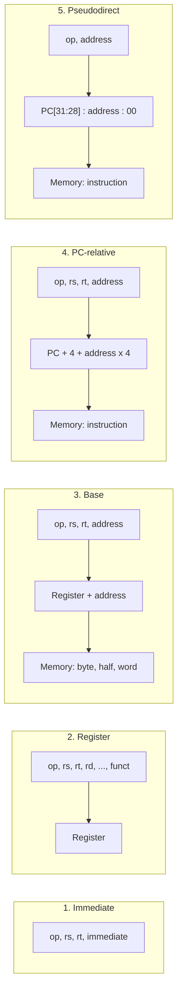

# بخش ۲، جلسه‌ی ۷ از ۱۲: رشته‌ها، ثابت‌های بزرگ و روش‌های آدرس‌دهی

این جلسه بخشی از **بخش ۲: معماری مجموعه‌دستورات MIPS و برنامه‌نویسی اسمبلی** است. زمان مطالعه: حدود نیم ساعت.

**فهرست این جلسه:**

- ۱. کاراکتر و رشته
- ۲. دستورات بایت و نیم‌کلمه
- ۳. مثال strcpy
- ۴. ثابت‌های ۳۲ بیتی
- ۵. آدرس‌دهی در پرش‌ها
- ۶. پنج روش آدرس‌دهی MIPS
- ۷. رمزگشایی کد ماشین
- ۸. تمرین‌ها

---

## ۱. کاراکتر و رشته

کامپیوترها اول برای محاسبه‌ی عددی ساخته شدند، ولی خیلی زود برای پردازش متن هم استفاده شدند. بیشتر کامپیوترهای امروزی هر کاراکتر را با یک بایت نمایش می‌دهند و از کد **ASCII** استفاده می‌کنند (American Standard Code for Information Interchange).

چند کد مهم ASCII:

| کاراکتر | کد ده‌دهی | کد شانزده‌شانزدهی |
|---|---|---|
| فاصله (space) | 32 | 0x20 |
| رقم 0 تا 9 | 48 تا 57 | 0x30 تا 0x39 |
| حرف A تا Z | 65 تا 90 | 0x41 تا 0x5A |
| حرف a تا z | 97 تا 122 | 0x61 تا 0x7A |
| کاراکتر پایان رشته (NUL) | 0 | 0x00 |

به دو ترفند دقت کن:

- **تفاوت حروف بزرگ و کوچک:** دقیقاً ۳۲ است، یعنی فقط بیت ۵. پس با `ori` و `andi` می‌توان حروف را بزرگ یا کوچک کرد.
- **مقدار رقم:** کد رقم منهای ۴۸ برابر مقدار آن است.

یک **رشته (String)** دنباله‌ای از کاراکترهاست. برای نمایش طول رشته سه راه وجود دارد:

- **روش اول:** طول رشته در اولین خانه نوشته شود. زبان جاوا این‌گونه است.
- **روش دوم:** طول در یک متغیر همراه رشته باشد، مثل یک struct.
- **روش سوم:** آخرین خانه با یک کاراکتر ویژه علامت‌گذاری شود. زبان C از بایت صفر استفاده می‌کند.

مثلاً رشته‌ی "Cal" در C چهار بایت است: 67، 97، 108 و 0.

### یونیکد

زبان جاوا و سیستم‌عامل‌های جدید از **یونیکد (Unicode)** استفاده می‌کنند که الفبای بیشتر زبان‌های دنیا، از جمله فارسی، را دارد. جاوا برای هر کاراکتر ۱۶ بیت به کار می‌برد (کدگذاری UTF-16). در وب و لینوکس رایج‌ترین کدگذاری UTF-8 است که طول متغیر دارد: حروف انگلیسی یک بایت و حروف فارسی دو بایت.

## ۲. دستورات بایت و نیم‌کلمه

برای کار با کاراکترها MIPS دستورات بایتی دارد:

```asm
lb   $t0, 0($sp)       # load byte, sign-extend to 32 bits
lbu  $t0, 0($sp)       # load byte, zero-extend to 32 bits
sb   $t0, 0($gp)       # store the rightmost byte of $t0
```

- **دستور lb** بایت را با گسترش علامت می‌خواند.
- **دستور lbu** بایت را با گسترش صفر می‌خواند. برای کاراکترها معمولاً از این استفاده می‌شود، چون کاراکتر عدد بدون علامت است.
- **دستور sb** فقط هشت بیت سمت راست ثبات را در حافظه می‌نویسد.

برای کاراکترهای ۱۶ بیتی و اعداد کوتاه، دستورات نیم‌کلمه داریم:

```asm
lh   $t0, 0($sp)       # load halfword, sign-extend
lhu  $t0, 0($sp)       # load halfword, zero-extend
sh   $t0, 0($gp)       # store the rightmost 16 bits
```

همان‌طور که در جلسه‌ی ۲-۲ دیدیم، نیم‌کلمه باید در آدرس زوج باشد ولی بایت هر جایی می‌تواند باشد.

## ۳. مثال strcpy

رویه‌ی `strcpy` رشته‌ی `y` را در `x` کپی می‌کند و با رسیدن به بایت صفر متوقف می‌شود:

```c
void strcpy(char x[], char y[])
{
    int i;
    i = 0;
    while ((x[i] = y[i]) != '\0')  /* copy and test byte */
        i += 1;
}
```

آدرس `x` در `$a0` و آدرس `y` در `$a1` است. متغیر `i` در `$s0` قرار می‌گیرد:

```asm
strcpy: addi $sp, $sp, -4      # make room for 1 item
        sw   $s0, 0($sp)       # save $s0
        add  $s0, $zero, $zero # i = 0
L1:     add  $t1, $s0, $a1     # t1 = &y[i]
        lbu  $t2, 0($t1)       # t2 = y[i]
        add  $t3, $s0, $a0     # t3 = &x[i]
        sb   $t2, 0($t3)       # x[i] = y[i]
        beq  $t2, $zero, L2    # if y[i] == 0, exit
        addi $s0, $s0, 1       # i = i + 1
        j    L1                # next iteration
L2:     lw   $s0, 0($sp)       # restore $s0
        addi $sp, $sp, 4       # pop 1 item
        jr   $ra               # return
```

چند نکته:

- **ضرب لازم نیست:** چون هر کاراکتر یک بایت است، آدرس `x[i]` برابر `x + i` است و به ضرب در ۴ نیاز نداریم.
- **بهینه‌سازی:** چون `strcpy` رویه‌ی برگ است، کامپایلر می‌تواند به جای `$s0` از یک ثبات `$t` استفاده کند و ذخیره و بازیابی را حذف کند. کتاب می‌گوید ثبات‌های `$t` را باید اول در رویه‌های برگ استفاده کرد.

## ۴. ثابت‌های ۳۲ بیتی

ثابت‌ها معمولاً کوچک‌اند و ۱۶ بیت کافی است. ولی گاهی ثابت یا آدرس بزرگ‌تری لازم است. برای این کار MIPS دستور **بارگذاری بالای ثابت (Load upper immediate)** را دارد:

```asm
lui  $t0, 255          # t0 = 255 << 16
```

این دستور ثابت ۱۶ بیتی را در ۱۶ بیت **بالای** ثبات می‌گذارد و ۱۶ بیت پایین را صفر می‌کند:

```text
lui $t0, 255:
t0 = 0000 0000 1111 1111 0000 0000 0000 0000
```

### مثال: ساختن یک ثابت ۳۲ بیتی

می‌خواهیم این عدد را در `$s0` بگذاریم:

```text
0000 0000 0011 1101 0000 1001 0000 0000
```

۱۶ بیت بالا برابر ۶۱ و ۱۶ بیت پایین برابر ۲۳۰۴ است:

```asm
lui  $s0, 61           # s0 = 0000 0000 0011 1101 0000 0000 0000 0000
ori  $s0, $s0, 2304    # s0 = 0000 0000 0011 1101 0000 1001 0000 0000
```

چرا از `ori` استفاده کردیم و نه `addi`؟ چون `ori` ثابت را با **صفر** گسترش می‌دهد. اگر بیت ۱۵ ثابت یک بود، `addi` آن را منفی تفسیر می‌کرد و ۱۶ بیت بالا را خراب می‌کرد.

این کار اغلب توسط اسمبلر انجام می‌شود. شبه‌دستورات `li` (بارگذاری ثابت) و `la` (بارگذاری آدرس) به همین دو دستور تبدیل می‌شوند و ثبات `$at` برای نگه‌داری مقدار میانی به کار می‌رود.

کدگذاری: `lui $s0, 61` برابر 0x3C10003D و `ori $s0, $s0, 2304` برابر 0x36100900 است.

## ۵. آدرس‌دهی در پرش‌ها

### قالب J و آدرس‌دهی شبه‌مستقیم

دستورات `j` و `jal` از **قالب J** استفاده می‌کنند:

| فیلد | op | address |
|---|---|---|
| تعداد بیت | 6 | 26 |

آدرس مقصد کامل ۳۲ بیت است ولی فقط ۲۶ بیت جا داریم. راه‌حل:

- **دو بیت پایین:** چون هر دستور در آدرس مضرب ۴ است (ردیف بودن)، دو بیت پایین همیشه صفر است و ذخیره نمی‌شود. پس فیلد ۲۶ بیتی آدرس **کلمه‌ای** است و در عمل ۲۸ بیت آدرس داریم.
- **چهار بیت بالا:** از چهار بیت بالای PC گرفته می‌شود.

```math
\text{Target} = \text{PC}[31{:}28] \;\Vert\; \text{address}_{26} \;\Vert\; 00
```

به این روش **آدرس‌دهی شبه‌مستقیم (Pseudodirect addressing)** می‌گوییم. نتیجه: با `j` می‌توان به هر جای یک ناحیه‌ی ۲۵۶ مگابایتی پرید. برای پرش به بیرون از این ناحیه باید آدرس را در ثبات گذاشت و از `jr` استفاده کرد.

### آدرس‌دهی نسبی به PC

پرش‌های شرطی `beq` و `bne` در قالب I هستند و فقط ۱۶ بیت برای مقصد دارند. اگر این ۱۶ بیت آدرس مطلق بود، برنامه نمی‌توانست بزرگ‌تر از ۶۴ کیلوبایت باشد.

راه‌حل: آدرس مقصد **نسبت به PC** حساب می‌شود. دلیلش این است که بیشتر پرش‌های شرطی به جای نزدیکی می‌پرند. کتاب می‌گوید تقریباً نیمی از پرش‌های شرطی SPEC به فاصله‌ی کمتر از ۱۶ دستور می‌پرند. این هم مصداق حالت رایج است.

```math
\text{Target} = (\text{PC} + 4) + \text{SignExt}(\text{offset}_{16}) \times 4
```

چند نکته‌ی مهم:

- **نسبت به PC+4:** در MIPS جابه‌جایی نسبت به دستور **بعدی** حساب می‌شود، نه خود دستور پرش. دلیلش این است که سخت‌افزار در همان ابتدای اجرا PC را به PC+4 افزایش داده است.
- **واحد کلمه:** جابه‌جایی بر حسب کلمه است و در ۴ ضرب می‌شود. پس برد پرش حدود ±۱۲۸ کیلوبایت یا ±۲ به توان ۱۵ دستور است.
- **علامت‌دار:** جابه‌جایی منفی یعنی پرش به عقب، مثل حلقه.

### مثال: کد ماشین حلقه‌ی while

حلقه‌ی while جلسه‌ی ۲-۵ را در نظر بگیر و فرض کن از آدرس 80000 شروع شده است:

| آدرس | دستور | op | rs | rt | rd | shamt | funct یا آدرس |
|---|---|---|---|---|---|---|---|
| خانه‌ی 80000 | `Loop: sll $t1,$s3,2` | 0 | 0 | 19 | 9 | 2 | 0 |
| خانه‌ی 80004 | `add $t1,$t1,$s6` | 0 | 9 | 22 | 9 | 0 | 32 |
| خانه‌ی 80008 | `lw $t0,0($t1)` | 35 | 9 | 8 | – | – | 0 |
| خانه‌ی 80012 | `bne $t0,$s5,Exit` | 5 | 8 | 21 | – | – | 2 |
| خانه‌ی 80016 | `addi $s3,$s3,1` | 8 | 19 | 19 | – | – | 1 |
| خانه‌ی 80020 | `j Loop` | 2 | – | – | – | – | 20000 |
| خانه‌ی 80024 | `Exit:` | | | | | | |

به دو عدد دقت کن:

- **جابه‌جایی bne برابر ۲ است:** مقصد `Exit` در 80024 است. PC+4 برابر 80016 است. فاصله 8 بایت یعنی ۲ کلمه.
- **آدرس j برابر 20000 است:** مقصد 80000 است و 80000 تقسیم بر ۴ می‌شود 20000.

### پرش به جای دور

اگر مقصد پرش شرطی بیرون از برد ۱۶ بیتی باشد، اسمبلر شرط را برعکس می‌کند و یک پرش غیرشرطی اضافه می‌کند:

```asm
        beq  $s0, $s1, L1      # L1 is too far
# becomes:
        bne  $s0, $s1, L2
        j    L1
L2:
```

## ۶. پنج روش آدرس‌دهی MIPS

**روش آدرس‌دهی (Addressing mode)** یعنی راه پیدا کردن عملوند یا مقصد. MIPS فقط پنج روش دارد:

| روش | عملوند کجاست | مثال |
|---|---|---|
| آدرس‌دهی ثابت (Immediate) | ثابتی داخل خود دستور | `addi $t0, $t1, 5` |
| آدرس‌دهی ثباتی (Register) | داخل یک ثبات | `add $t0, $t1, $t2` |
| آدرس‌دهی پایه (Base or displacement) | حافظه در آدرس ثبات + ثابت | `lw $t0, 8($sp)` |
| آدرس‌دهی نسبی به PC (PC-relative) | دستور در آدرس PC+4 + ثابت×4 | `beq $t0, $t1, L` |
| آدرس‌دهی شبه‌مستقیم (Pseudodirect) | دستور در آدرس PC بالا + ثابت ۲۶ بیتی×4 | `j L` |



یک روش آدرس‌دهی ممکن است در چند دستور به کار رود. مثلاً `jr` آدرس‌دهی ثباتی برای مقصد پرش دارد. دستورات حسابی هم بسته به نوعشان ثباتی یا ثابت هستند.

معماری‌های دیگر روش‌های بیشتری دارند، مثل آدرس‌دهی غیرمستقیم حافظه، آدرس‌دهی با اندیس مقیاس‌دار (x86) یا افزایش خودکار پس از دسترسی (ARM). در جلسه‌ی ۲-۱۲ این‌ها را می‌بینیم. MIPS با پنج روش ساده کار سخت‌افزار را آسان کرده و کارهای پیچیده‌تر را به چند دستور می‌سپارد.

## ۷. رمزگشایی کد ماشین

گاهی لازم است کد ماشین را به اسمبلی برگردانیم، مثلاً در اشکال‌زدایی. مثال کتاب: کلمه‌ی 0x00AF8020 چه دستوری است؟

اول به دودویی تبدیل می‌کنیم و به op نگاه می‌کنیم:

```text
0000 0000 1010 1111 1000 0000 0010 0000
op = 000000  ->  R-format
```

چون op صفر است، قالب R است و بقیه‌ی فیلدها را جدا می‌کنیم:

| فیلد | op | rs | rt | rd | shamt | funct |
|---|---|---|---|---|---|---|
| دودویی | 000000 | 00101 | 01111 | 10000 | 00000 | 100000 |
| ده‌دهی | 0 | 5 | 15 | 16 | 0 | 32 |

ثبات ۵ یعنی `$a1`، ثبات ۱۵ یعنی `$t7`، ثبات ۱۶ یعنی `$s0` و funct برابر ۳۲ یعنی `add`. پس دستور این است:

```asm
add  $s0, $a1, $t7
```

## ۸. تمرین‌ها

<details>
<summary>تمرین ۱: ساختن ثابت</summary>

**صورت:** کد MIPS برای قرار دادن 0x1234ABCD در `$t0` بنویس. چرا `lui` و بعد `addi` جواب درست نمی‌دهد؟

**جواب:**

```asm
lui  $t0, 0x1234
ori  $t0, $t0, 0xABCD
```

ثابت 0xABCD بیت ۱۵ یک دارد. دستور `addi` آن را به 0xFFFFABCD گسترش می‌دهد و نتیجه 0x12340000 + 0xFFFFABCD یعنی 0x1233ABCD می‌شود که غلط است. البته `addi` ثابت 0xABCD را اصلاً نمی‌پذیرد، چون از +32767 بزرگ‌تر است.
</details>

<details>
<summary>تمرین ۲: برد پرش</summary>

**صورت:** دستور `beq` در آدرس 0x00400100 است. دورترین آدرس به جلو و به عقب که می‌تواند به آن بپرد چیست؟

**جواب:** PC+4 برابر 0x00400104 است. جابه‌جایی بین −32768 و +32767 کلمه است:

```text
forward : 0x00400104 + 32767 x 4 = 0x00400104 + 0x1FFFC = 0x00420100
backward: 0x00400104 - 32768 x 4 = 0x00400104 - 0x20000 = 0x003E0104
```
</details>

<details>
<summary>تمرین ۳: حرف بزرگ</summary>

**صورت:** رویه‌ای بنویس که یک رشته‌ی C با آدرس `$a0` را بگیرد و حروف کوچک انگلیسی آن را بزرگ کند.

**جواب:** حرف کوچک بین 'a' (97) و 'z' (122) است. برای بزرگ کردن، ۳۲ کم می‌کنیم:

```asm
toupper:
L1:     lbu  $t0, 0($a0)       # c = *s
        beq  $t0, $zero, Done
        slti $t1, $t0, 97      # c < 'a' ?
        bne  $t1, $zero, Next
        slti $t1, $t0, 123     # c <= 'z' ?
        beq  $t1, $zero, Next
        addi $t0, $t0, -32     # c = c - 32
        sb   $t0, 0($a0)
Next:   addi $a0, $a0, 1
        j    L1
Done:   jr   $ra
```

این رویه برگ است و فقط از ثبات‌های `$t` استفاده می‌کند. پس به پشته نیازی ندارد.
</details>

<details>
<summary>تمرین ۴: رمزگشایی</summary>

**صورت:** کلمه‌ی 0x8E080004 چه دستوری است؟

**جواب:**

```text
100011 10000 01000 0000000000000100
```

فیلد op برابر ۳۵ یعنی `lw`. rs برابر ۱۶ یعنی `$s0` (پایه)، rt برابر ۸ یعنی `$t0` (مقصد)، ثابت ۴. پس دستور `lw $t0, 4($s0)` است.
</details>

---

جلسه‌ی قبلی: [رویه‌ها و پشته](2-6-procedures-and-stack.md)  
جلسه‌ی بعدی: [همگام‌سازی و ترجمه و اجرای برنامه](2-8-synchronization-and-translation.md)
