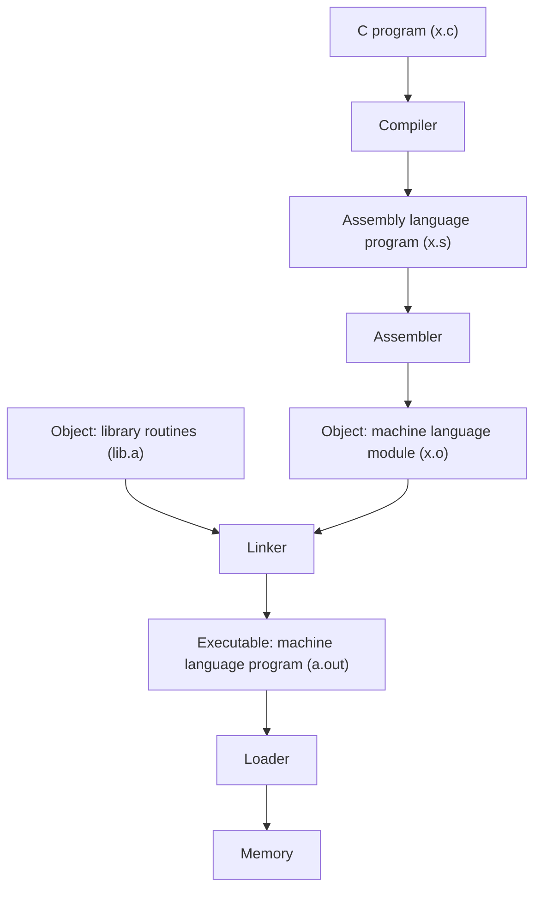
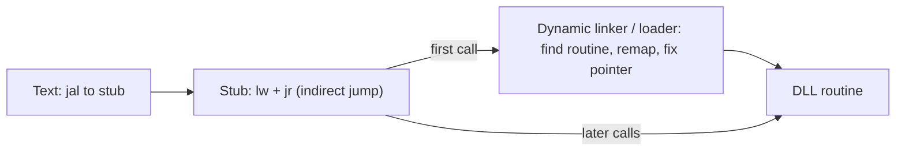
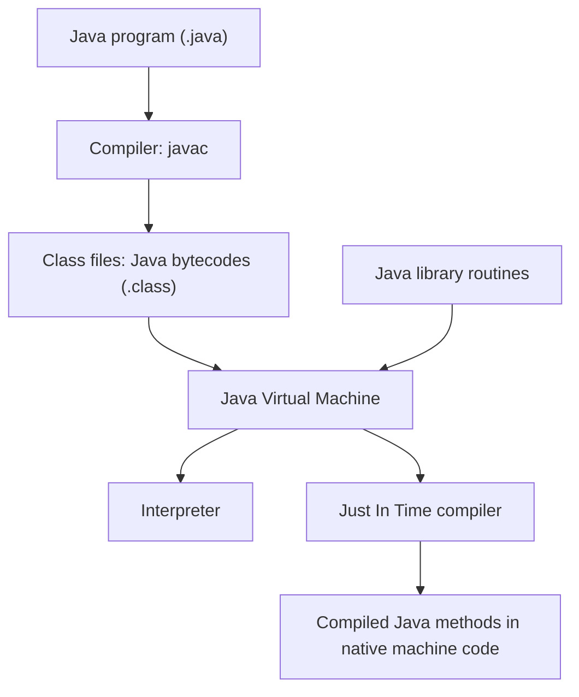

# بخش ۲، جلسه‌ی ۸ از ۱۲: همگام‌سازی و ترجمه و اجرای برنامه

این جلسه بخشی از **بخش ۲: معماری مجموعه‌دستورات MIPS و برنامه‌نویسی اسمبلی** است. زمان مطالعه: حدود نیم ساعت.

**فهرست این جلسه:**

- ۱. موازی‌سازی و همگام‌سازی
- ۲. دستورات ll و sc
- ۳. زنجیره‌ی ترجمه‌ی برنامه
- ۴. کامپایلر
- ۵. اسمبلر و شبه‌دستورات
- ۶. فایل شیء
- ۷. پیونددهنده
- ۸. بارکننده
- ۹. پیوند پویا
- ۱۰. ترجمه و اجرای برنامه‌ی جاوا
- ۱۱. تمرین‌ها

---

## ۱. موازی‌سازی و همگام‌سازی

در بخش ۱ دیدیم که امروز هر تراشه چند هسته دارد. وقتی چند نخ (Thread) روی چند هسته با هم کار می‌کنند، گاهی باید به یک داده‌ی مشترک دسترسی داشته باشند. اگر هماهنگی نباشد، **مسابقه‌ی داده (Data race)** رخ می‌دهد: نتیجه‌ی برنامه به ترتیب تصادفی دسترسی‌ها بستگی پیدا می‌کند.

مثال کتاب: دو نفر روی یک گزارش کار می‌کنند. اگر یکی بخش خودش را تمام نکرده باشد و دیگری آن را بخواند، نتیجه غلط است. پس باید **همگام‌سازی (Synchronization)** داشته باشیم.

ابزار پایه‌ی همگام‌سازی **قفل (Lock)** است. قفل تضمین می‌کند در هر لحظه فقط یک نخ وارد **بخش بحرانی (Critical section)** شود. برای ساختن قفل، سخت‌افزار باید عملی **اتمی (Atomic)** داشته باشد: یک خواندن و یک نوشتن روی یک خانه‌ی حافظه که هیچ عمل دیگری نتواند وسط آن‌ها وارد شود.

یک راه ساده، دستور **مبادله‌ی اتمی (Atomic exchange یا swap)** است: مقدار یک ثبات با یک خانه‌ی حافظه به شکل اتمی عوض می‌شود. برای قفل، صفر یعنی آزاد و یک یعنی گرفته‌شده. نخ عدد یک را با خانه‌ی قفل مبادله می‌کند:

- اگر مقدار برگشتی صفر بود، قفل آزاد بوده و حالا این نخ آن را گرفته است.
- اگر مقدار برگشتی یک بود، قفل دست کس دیگری است و باید دوباره امتحان کرد.

## ۲. دستورات ll و sc

ساختن یک دستور واحد که هم بخواند و هم بنویسد، با فلسفه‌ی MIPS جور نیست. دستوری که دو دسترسی حافظه دارد، طراحی خط لوله را سخت می‌کند. پس MIPS یک جفت دستور دارد:

- **دستور بارگذاری پیوندی (Load linked):** نام آن `ll` است. مثل `lw` کار می‌کند ولی سخت‌افزار آدرس را به خاطر می‌سپارد.
- **دستور ذخیره‌ی شرطی (Store conditional):** نام آن `sc` است. فقط اگر از زمان `ll` هیچ نوشتنی روی آن آدرس انجام نشده باشد، می‌نویسد. اگر موفق شود، ثبات منبع را ۱ می‌کند و اگر ناموفق باشد ۰ می‌کند.

مثال کتاب: مبادله‌ی اتمی `$s4` با خانه‌ی حافظه‌ای که آدرسش در `$s1` است:

```asm
again:  addi $t0, $s4, 0       # copy exchange value
        ll   $t1, 0($s1)       # load linked
        sc   $t0, 0($s1)       # store conditional
        beq  $t0, $zero, again # branch if store fails
        add  $s4, $zero, $t1   # put loaded value in $s4
```

اگر بین `ll` و `sc` هسته‌ی دیگری روی این خانه بنویسد، یا یک وقفه یا تعویض متن رخ دهد، `sc` شکست می‌خورد و حلقه دوباره تکرار می‌شود. در نهایت محتوای `$s4` و خانه‌ی حافظه به شکل اتمی عوض شده‌اند.

چند نکته:

- **دستورات کم بین ll و sc:** بین این دو باید دستورات کمی باشد، وگرنه احتمال شکست زیاد می‌شود و حتی ممکن است برنامه هیچ‌گاه پیش نرود.
- **کاربرد عمومی:** با این دو دستور می‌توان عملیات اتمی دیگری هم ساخت، مثل افزایش اتمی یک شمارنده (Fetch-and-increment).
- **ادامه در بخش ۱۰:** جزئیات قفل‌ها، انسجام کش و سازگاری حافظه را در بخش ۱۰ می‌بینیم.

در RISC-V همین جفت با نام `lr.w` و `sc.w` وجود دارد و علاوه بر آن دستورات اتمی کامل مثل `amoswap.w` و `amoadd.w` هم هست. در ARMv8 نام‌ها `ldxr` و `stxr` هستند.

## ۳. زنجیره‌ی ترجمه‌ی برنامه

برنامه‌ی C در چهار مرحله به برنامه‌ای در حال اجرا تبدیل می‌شود:



پسوند فایل‌ها در یونیکس و لینوکس: `.c` برای C، `.s` برای اسمبلی، `.o` برای فایل شیء، `.a` برای کتابخانه‌ی ایستا، `.so` برای کتابخانه‌ی پویا و `a.out` برای فایل اجرایی. در ویندوز معادل آن‌ها `.asm`، `.obj`، `.lib`، `.dll` و `.exe` است.

بعضی سیستم‌ها برای سرعت ترجمه این مراحل را با هم ترکیب می‌کنند. مثلاً بیشتر کامپایلرها مستقیماً فایل شیء تولید می‌کنند.

## ۴. کامپایلر

**کامپایلر (Compiler)** برنامه‌ی C را به برنامه‌ی اسمبلی تبدیل می‌کند. زبان اسمبلی شکل نمادین زبان ماشین است.

برنامه‌ی سطح بالا خیلی کمتر خط دارد. پس بهره‌وری برنامه‌نویس خیلی بیشتر است. در دهه‌ی ۱۹۷۰ بیشتر سیستم‌عامل‌ها و اسمبلرها به زبان اسمبلی نوشته می‌شدند، چون حافظه کم بود و کامپایلرها ناکارآمد بودند. امروز کامپایلرها به اندازه‌ی یک متخصص اسمبلی و گاهی بهتر کد تولید می‌کنند. بهینه‌سازی‌های کامپایلر را در جلسه‌ی ۲-۹ و بخش ۷ می‌بینیم.

## ۵. اسمبلر و شبه‌دستورات

**اسمبلر (Assembler)** برنامه‌ی اسمبلی را به فایل شیء تبدیل می‌کند. کارهای اصلی آن:

- تبدیل هر دستور اسمبلی به یک کلمه‌ی ۳۲ بیتی.
- تبدیل برچسب‌ها به آدرس. اسمبلر همه‌ی برچسب‌ها و آدرس‌هایشان را در **جدول نمادها (Symbol table)** نگه می‌دارد.
- پذیرفتن اعداد به مبنای ده، دو، شانزده و حتی رشته.
- تبدیل شبه‌دستورات به دستورات واقعی.

### شبه‌دستورات

اسمبلر می‌تواند دستوراتی را بپذیرد که سخت‌افزار ندارد. این **شبه‌دستورات (Pseudo-instructions)** برنامه‌نویسی را راحت‌تر می‌کنند، بدون اینکه سخت‌افزار پیچیده شود. مهم‌ترین‌ها:

| شبه‌دستور | معنی | دستورات واقعی |
|---|---|---|
| انتقال `move $t0, $t1` | کپی ثبات | `addu $t0, $zero, $t1` |
| بارگذاری ثابت `li $t0, 5` | ثابت کوچک | `addiu $t0, $zero, 5` |
| بارگذاری ثابت بزرگ `li $t0, 0x12345678` | ثابت ۳۲ بیتی | `lui $at, 0x1234` و `ori $t0, $at, 0x5678` |
| بارگذاری آدرس `la $t0, label` | آدرس یک برچسب | `lui` و `ori` |
| پرش کوچک‌تر `blt $t0, $t1, L` | پرش اگر کوچک‌تر | `slt $at, $t0, $t1` و `bne $at, $zero, L` |
| پرش بزرگ‌تر یا مساوی `bge $t0, $t1, L` | پرش اگر بزرگ‌تر یا مساوی | `slt $at, $t0, $t1` و `beq $at, $zero, L` |
| پرش صفر `beqz $t0, L` | پرش اگر صفر | `beq $t0, $zero, L` |
| نقیض `not $t0, $t1` | نقیض بیتی | `nor $t0, $t1, $zero` |
| ضرب سه‌عملوندی `mul $t0, $t1, $t2` | ضرب | `mult` و `mflo` |
| بدون عمل `nop` | هیچ کار | `sll $zero, $zero, 0` |

یک نکته: دستور `nop` در کد ماشین برابر 0x00000000 است که همان `sll $zero, $zero, 0` است.

شبه‌دستورات و ثبات `$at` در امتحان پرسیده می‌شوند. توجه کن که شبه‌دستورات بخشی از ISA نیستند. اگر در امتحان «دستور MIPS» خواسته شود، بهتر است از دستورات واقعی استفاده کنی یا بگویی شبه‌دستور است.

### شکاف تأخیر پرش

در MIPS واقعی، دستوری که بلافاصله بعد از یک پرش می‌آید **همیشه** اجرا می‌شود، چه پرش انجام شود چه نشود. به این جای خالی **شکاف تأخیر پرش (Branch delay slot)** می‌گوییم. دلیلش خط لوله است که در بخش ۵ توضیح می‌دهیم.

اسمبلر به‌طور پیش‌فرض این شکاف را پنهان می‌کند. یا یک دستور مفید را جابه‌جا می‌کند و در شکاف می‌گذارد، یا یک `nop` اضافه می‌کند. مثلاً اسمبلر LLVM برای `beq` و `j` و `jr` خودش یک `nop` بعد از آن‌ها قرار می‌دهد.

در شبیه‌سازهای MARS و QtSpim این ویژگی به‌طور پیش‌فرض خاموش است. در این درس هم فرض می‌کنیم خاموش است، مگر اینکه صورت سؤال چیز دیگری بگوید.

### دستورالعمل‌های اسمبلر

علاوه بر دستورات، اسمبلر **دستورالعمل‌هایی (Directives)** دارد که با نقطه شروع می‌شوند و به خود اسمبلر می‌گویند چه کند:

| دستورالعمل | کار |
|---|---|
| دستورالعمل `.text` | شروع بخش کد |
| دستورالعمل `.data` | شروع بخش داده |
| دستورالعمل `.word 1, 2, 3` | ذخیره‌ی کلمه‌های ۳۲ بیتی |
| دستورالعمل `.half`، `.byte` | ذخیره‌ی نیم‌کلمه و بایت |
| دستورالعمل `.float`، `.double` | ذخیره‌ی عدد ممیز شناور |
| دستورالعمل `.asciiz "hi"` | ذخیره‌ی رشته با بایت صفر انتهایی |
| دستورالعمل `.space 40` | رزرو ۴۰ بایت |
| دستورالعمل `.align 2` | ردیف کردن به ۲ به توان ۲ یعنی ۴ بایت |
| دستورالعمل `.globl main` | برچسب `main` را برای فایل‌های دیگر قابل دیدن کن |

## ۶. فایل شیء

فایل شیء در سیستم‌های یونیکس معمولاً شش بخش دارد:

- **سرآیند (Header):** اندازه و مکان بقیه‌ی بخش‌های فایل.
- **بخش متن (Text segment):** کد ماشین.
- **بخش داده‌ی ایستا (Static data segment):** داده‌هایی که در طول اجرای برنامه زنده‌اند. هم داده‌ی ایستا و هم داده‌ی پویا (Dynamic) را در جلسه‌ی ۲-۶ دیدیم.
- **اطلاعات جابه‌جایی (Relocation information):** دستورات و داده‌هایی که به آدرس مطلق وابسته‌اند و وقتی برنامه در حافظه جای دیگری قرار گیرد، باید اصلاح شوند.
- **جدول نمادها (Symbol table):** برچسب‌هایی که هنوز تعریف نشده‌اند، مثل ارجاع به رویه‌های فایل‌های دیگر.
- **اطلاعات اشکال‌زدایی (Debugging information):** توضیح اینکه هر بخش کد از کدام خط C آمده، برای ابزارهایی مثل gdb.

قالب رایج امروزی برای این فایل‌ها در لینوکس **ELF** است.

## ۷. پیونددهنده

اگر با تغییر یک خط کد مجبور باشیم کل برنامه و همه‌ی کتابخانه‌ها را دوباره کامپایل کنیم، وقت زیادی هدر می‌رود. راه‌حل: هر فایل جداگانه کامپایل و اسمبل شود و بعد قطعه‌ها به هم وصل شوند. این کار **پیونددهنده (Linker یا Link editor)** است.

پیونددهنده سه کار می‌کند:

1. ماژول‌های کد و داده را به شکل نمادین در حافظه قرار می‌دهد.
2. آدرس برچسب‌های داده و دستورات را پیدا می‌کند.
3. ارجاع‌های داخلی و خارجی را اصلاح می‌کند (Patching).

پیونددهنده از اطلاعات جابه‌جایی و جدول نمادهای هر فایل شیء استفاده می‌کند تا ارجاع‌های تعریف‌نشده را پیدا کند و آدرس واقعی را جایگزین کند. اگر نمادی پیدا نشود، خطای مشهور «undefined reference» را می‌دهد.

### مثال کوتاه

فرض کن فایل A رویه‌ی B را با `jal B` صدا می‌زند و یک متغیر X را با `lw $a0, 0($gp)` می‌خواند. فایل B هم متغیر Y را با `sw` می‌نویسد. پیونددهنده:

- بخش متن A را از 0x00400000 و بخش متن B را بعد از آن قرار می‌دهد.
- بخش داده‌ی A را از 0x10000000 و داده‌ی B را بعد از آن قرار می‌دهد.
- فیلد آدرس `jal B` را با آدرس واقعی B تقسیم بر ۴ پر می‌کند.
- جابه‌جایی `lw` را طوری پر می‌کند که آدرس واقعی X نسبت به `$gp` (یعنی 0x10008000) به دست آید. مثلاً اگر X در 0x10000000 باشد، جابه‌جایی برابر 0x8000 یعنی −32768 است.

نتیجه یک **فایل اجرایی (Executable)** است که همان قالب فایل شیء را دارد ولی ارجاع حل‌نشده ندارد.

## ۸. بارکننده

برای اجرای برنامه، سیستم‌عامل آن را با **بارکننده (Loader)** در حافظه قرار می‌دهد. در یونیکس این مراحل انجام می‌شود:

1. سرآیند فایل اجرایی را می‌خواند تا اندازه‌ی بخش متن و داده را بفهمد.
2. یک فضای آدرس به اندازه‌ی کافی برای متن و داده می‌سازد.
3. دستورات و داده‌ها را از فایل به حافظه کپی می‌کند.
4. پارامترهای برنامه‌ی اصلی (اگر باشند) را روی پشته کپی می‌کند.
5. ثبات‌ها را مقداردهی اولیه می‌کند و `$sp` را روی اولین خانه‌ی خالی پشته تنظیم می‌کند.
6. به یک روال شروع (Start-up routine) می‌پرد. این روال آرگومان‌ها را در ثبات‌های `$a` می‌گذارد و `main` را صدا می‌زند. وقتی `main` برگشت، روال شروع با فراخوانی سیستمی `exit` برنامه را تمام می‌کند.

## ۹. پیوند پویا

پیوند ایستا که در بخش ۷ دیدیم، چند مشکل دارد:

- **به‌روزرسانی سخت:** کتابخانه بخشی از فایل اجرایی می‌شود. اگر نسخه‌ی جدیدی از کتابخانه با رفع اشکال بیاید، برنامه‌ی قدیمی همچنان نسخه‌ی قدیمی را دارد.
- **حجم زیاد:** همه‌ی رویه‌های کتابخانه که ممکن است صدا زده شوند بارگذاری می‌شوند، حتی اگر استفاده نشوند. کتابخانه‌ی استاندارد C خیلی بزرگ است.

راه‌حل **کتابخانه‌های پیوند پویا (Dynamically linked libraries، DLL)** است. در این روش رویه‌های کتابخانه فقط هنگام اجرا پیوند می‌خورند. در لینوکس فایل‌های `.so` و در ویندوز فایل‌های `.dll` این‌گونه‌اند.

### پیوند تنبل

نسخه‌ی اولیه‌ی DLL همه‌ی رویه‌ها را در شروع برنامه پیوند می‌داد. نسخه‌ی بهتر **پیوند تنبل رویه (Lazy procedure linkage)** است: هر رویه فقط در اولین فراخوانی پیوند می‌خورد.



هر رویه‌ی غیرمحلی یک مدخل در جدولی دارد که در ابتدا به یک **کد واسط (Stub)** اشاره می‌کند. در اولین فراخوانی، کد واسط پیونددهنده‌ی پویا را صدا می‌زند. پیونددهنده رویه را پیدا می‌کند و مدخل جدول را عوض می‌کند تا مستقیم به رویه اشاره کند. از دفعه‌ی دوم فقط یک پرش غیرمستقیم اضافه هزینه دارد. در لینوکس این جدول‌ها **PLT** و **GOT** نام دارند.

## ۱۰. ترجمه و اجرای برنامه‌ی جاوا

جاوا هدف دیگری دارد: برنامه باید روی هر کامپیوتری بدون تغییر اجرا شود، حتی اگر کندتر باشد.



- **بایت‌کد جاوا (Java bytecode):** کامپایلر جاوا به جای زبان ماشین یک کامپیوتر خاص، دستوراتی برای یک ماشین مجازی تولید می‌کند. این دستورات ساده و ماشین‌مستقل هستند و نزدیک به زبان سطح بالا طراحی شده‌اند.
- **ماشین مجازی جاوا (JVM):** برنامه‌ای که بایت‌کد را **تفسیر (Interpret)** می‌کند. مفسر کندتر از کد ماشین است، ولی هر کامپیوتری که JVM داشته باشد برنامه را اجرا می‌کند.
- **کامپایلر درجا (Just In Time compiler، JIT):** برای جبران کندی، JVM متدهایی که زیاد اجرا می‌شوند (Hot) را در زمان اجرا به کد ماشین واقعی کامپایل می‌کند. دفعه‌های بعد کد کامپایل‌شده اجرا می‌شود.

ماشین مجازی بایت‌کد جاوا ماشینی پشته‌ای است، یعنی عملوندها روی پشته قرار دارند و نه در ثبات. در جلسه‌ی ۲-۹ کارایی جاوای تفسیری و JIT را با C مقایسه می‌کنیم.

## ۱۱. تمرین‌ها

<details>
<summary>تمرین ۱: افزایش اتمی</summary>

**صورت:** با `ll` و `sc` کدی بنویس که مقدار خانه‌ی حافظه‌ای با آدرس `$s0` را به شکل اتمی یکی زیاد کند.

**جواب:**

```asm
again:  ll   $t0, 0($s0)       # t0 = Mem[s0]
        addi $t0, $t0, 1       # t0 = t0 + 1
        sc   $t0, 0($s0)       # try to store
        beq  $t0, $zero, again # retry if failed
```
</details>

<details>
<summary>تمرین ۲: باز کردن شبه‌دستور</summary>

**صورت:** اسمبلر شبه‌دستور `ble $s0, $s1, L` را به چه دستورات واقعی تبدیل می‌کند؟

**جواب:** شرط s0 <= s1 معادل «s1 < s0 نیست» است:

```asm
slt  $at, $s1, $s0     # at = (s1 < s0)
beq  $at, $zero, L     # if not (s1 < s0), go to L
```
</details>

<details>
<summary>تمرین ۳: نقش هر مرحله</summary>

**صورت:** هر کدام از موارد زیر در کدام مرحله‌ی ترجمه حل می‌شود: الف) آدرس برچسب داخل یک فایل، ب) آدرس رویه‌ای در فایل دیگر، ج) آدرس `printf` در یک کتابخانه‌ی پویا، د) مقدار اولیه‌ی `$sp`.

**جواب:** الف) اسمبلر (به‌صورت نسبی، و اگر مطلق باشد پیونددهنده اصلاحش می‌کند). ب) پیونددهنده. ج) پیونددهنده‌ی پویا در زمان اجرا، در اولین فراخوانی. د) بارکننده.
</details>

---

جلسه‌ی قبلی: [رشته‌ها، ثابت‌های بزرگ و روش‌های آدرس‌دهی](2-7-strings-and-addressing-modes.md)  
جلسه‌ی بعدی: [مثال کامل مرتب‌سازی، آرایه و اشاره‌گر](2-9-sort-example-arrays-vs-pointers.md)
