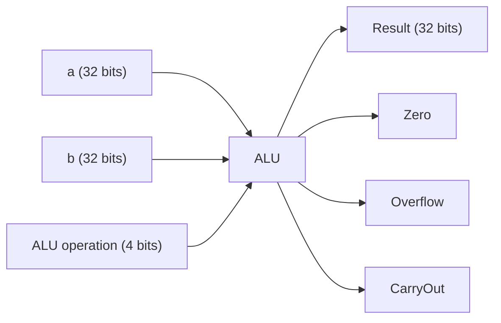
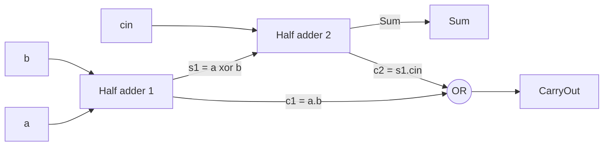

# بخش ۳، جلسه‌ی ۱ از ۱۰: جمع، تفریق و سرریز

این جلسه بخشی از **بخش ۳: محاسبات کامپیوتری** است. زمان مطالعه: حدود نیم ساعت.

**فهرست این جلسه:**

- ۱. این بخش درباره‌ی چیست
- ۲. مرور سه روش نمایش عدد منفی
- ۳. جمع و تفریق دودویی
- ۴. سرریز و تشخیص آن
- ۵. رفتار MIPS هنگام سرریز
- ۶. حساب اشباعی
- ۷. جمع‌کننده‌ی یک‌بیتی با گیت
- ۸. تمرین‌ها

---

## ۱. این بخش درباره‌ی چیست

در بخش ۲ دیدیم که بیت‌ها به خودی خود معنا ندارند. یک قرارداد تعیین می‌کند الگوی بیتی چه عددی است. حالا سؤال‌های تازه‌ای داریم:

- **سخت‌افزار** چطور دو عدد را جمع، تفریق، ضرب یا تقسیم می‌کند؟
- **عدد اعشاری** چطور نمایش داده می‌شود و حساب روی آن چطور انجام می‌شود؟
- **وقتی نتیجه جا نمی‌شود** چه اتفاقی می‌افتد؟
- **چطور سریع‌تر** حساب کنیم؟ همان‌طور که الگوریتم بهتر نرم‌افزار را سریع می‌کند، سازمان‌دهی بهتر هم سخت‌افزار را سریع می‌کند.

در پایان این بخش، **واحد حساب و منطق (ALU)** را خودمان می‌سازیم. این واحد در بخش ۴ قلب مسیر داده‌ی MIPS است:



منابع این بخش: فصل ۳ کتاب COD ویرایش ۵، بخش‌های B.5 و B.6 پیوست B همان کتاب برای ساختن ALU و جمع‌کننده‌ی سریع، و اسلایدهای COD فصل ۴ درس.

## ۲. مرور سه روش نمایش عدد منفی

در جلسه‌ی ۲-۳ سه روش را دیدیم. اسلاید درس آن‌ها را برای ۳ بیت کنار هم گذاشته است:

| الگوی بیتی | علامت و اندازه | مکمل یک | مکمل دو |
|---|---|---|---|
| الگوی 000 | +0 | +0 | 0 |
| الگوی 001 | +1 | +1 | +1 |
| الگوی 010 | +2 | +2 | +2 |
| الگوی 011 | +3 | +3 | +3 |
| الگوی 100 | −0 | −3 | −4 |
| الگوی 101 | −1 | −2 | −3 |
| الگوی 110 | −2 | −1 | −2 |
| الگوی 111 | −3 | −0 | −1 |

سه معیار برای مقایسه داریم:

- **تعادل (Balance):** آیا تعداد اعداد مثبت و منفی برابر است؟
- **صفر یکتا:** آیا صفر فقط یک نمایش دارد؟
- **سادگی حساب:** آیا جمع و تفریق ساده است؟

دو روش اول تعادل دارند ولی دو صفر دارند. مکمل دو صفر یکتا و حساب ساده دارد ولی یک عدد منفی اضافه دارد. سادگی حساب برنده شد و همه‌ی کامپیوترهای امروزی از مکمل دو استفاده می‌کنند.

اسلاید فرمول دو روش آخر را هم داده است. اگر عدد n+1 بیتی را به شکل بیت علامت x با n بیت باقی‌مانده‌ی X′ بنویسیم:

```math
\text{Two's complement: } \; x_n X' = -x_n \cdot 2^{n} + X'
```

```math
\text{One's complement: } \; x_n X' = -x_n \cdot (2^{n} - 1) + X'
```

## ۳. جمع و تفریق دودویی

### جمع

جمع دودویی دقیقاً مثل جمع دبستانی است، فقط در مبنای دو. از راست به چپ رقم‌ها را جمع می‌کنیم و **رقم نقلی (Carry)** را به ستون بعد می‌بریم. مثال کتاب: ۷ به‌علاوه‌ی ۶ با ۸ بیت (فقط بیت‌های پایین نوشته شده):

```text
carries:   0000 1110
             0000 0111     (7)
           + 0000 0110     (6)
           -----------
             0000 1101     (13)
```

### تفریق

تفریق یعنی جمع با قرینه. برای محاسبه‌ی A − B، عدد B را قرینه می‌کنیم (همه‌ی بیت‌ها را برعکس و یک اضافه می‌کنیم) و با A جمع می‌کنیم. مثال کتاب: ۷ منهای ۶:

```text
             0000 0111     (7)
           + 1111 1010     (-6)
           -----------
          1  0000 0001     (1, carry out of bit 7 is discarded)
```

رقم نقلی که از بیت آخر بیرون می‌رود دور ریخته می‌شود. نکته‌ی مهم این است که **بیرون رفتن رقم نقلی به معنی سرریز نیست**. در این مثال نتیجه درست است.

### تمرین ذهنی اسلاید

اسلاید درس این جمع‌های ۴ بیتی را پیشنهاد می‌کند. همه‌ی ثبات‌ها، از جمله نتیجه، ۴ بیتی‌اند:

| جمع | دودویی | نتیجه‌ی ۴ بیتی | تفسیر مکمل دو | درست؟ |
|---|---|---|---|---|
| جمع ۵ و ۱ | 0101 + 0001 | 0110 | 6 | بله |
| جمع ۶ و ۵ | 0110 + 0101 | 1011 | −5 | خیر، سرریز |
| جمع −۵ و ۷ | 1011 + 0111 | 0010 | 2 | بله |
| جمع −۷ و −۶ | 1001 + 1010 | 0011 | 3 | خیر، سرریز |
| جمع −۱ و −۲ | 1111 + 1110 | 1101 | −3 | بله |

در سطر سوم و پنجم رقم نقلی بیرون رفت ولی نتیجه درست است. در سطر دوم رقم نقلی بیرون نرفت ولی نتیجه غلط است. پس سرریز را باید با قاعده‌ی دیگری تشخیص داد.

## ۴. سرریز و تشخیص آن

**سرریز (Overflow)** یعنی نتیجه‌ی واقعی در تعداد بیت‌های ثابت ثبات جا نمی‌شود. نتیجه‌ی ذخیره‌شده غلط است.

### قاعده‌ی علامت

در جلسه‌ی ۲-۳ دیدیم:

- **جمع دو عدد با علامت مخالف** هرگز سرریز نمی‌دهد.
- **تفریق دو عدد هم‌علامت** هرگز سرریز نمی‌دهد، چون A − B همان A + (−B) است و −B علامت مخالف B دارد.
- **سرریز وقتی رخ می‌دهد** که نتیجه علامت «اشتباه» داشته باشد:

| عمل | عملوند A | عملوند B | علامت نتیجه در صورت سرریز |
|---|---|---|---|
| عمل A + B | ≥ 0 | ≥ 0 | < 0 |
| عمل A + B | < 0 | < 0 | ≥ 0 |
| عمل A − B | ≥ 0 | < 0 | < 0 |
| عمل A − B | < 0 | ≥ 0 | ≥ 0 |

### قاعده‌ی سخت‌افزاری

برای سخت‌افزار قاعده‌ی ساده‌تری وجود دارد. سرریز وقتی است که **رقم نقلی ورودی به بیت علامت** با **رقم نقلی خروجی از بیت علامت** برابر نباشد:

```math
\text{Overflow} = c_{n-1} \oplus c_{n}
```

اینجا c با اندیس n−1 رقم نقلیِ ورودی به بیت پرارزش و c با اندیس n رقم نقلیِ خروجی از آن است. پس فقط یک گیت XOR لازم است.

چرا این قاعده درست است؟ اسلاید درس با جدول زیر استدلال می‌کند. دو عدد را به شکل بیت علامت و بقیه‌ی بیت‌ها بنویس. اگر جمع بیت‌های پایین از ۲ به توان n−1 کمتر باشد، رقم نقلی به بیت علامت صفر است و اگر نباشد یک است:

| بیت‌های علامت | رقم نقلی ورودی صفر | رقم نقلی ورودی یک |
|---|---|---|
| هر دو صفر | درست (خروجی ۰) | سرریز (خروجی ۰) |
| یکی صفر و یکی یک | درست (خروجی ۰) | درست (خروجی ۱) |
| هر دو یک | سرریز (خروجی ۱) | درست (خروجی ۱) |

در هر دو حالت سرریز، رقم نقلی ورودی و خروجی با هم فرق دارند. در حالت‌های درست، با هم برابرند.

### پرسش‌های اسلاید

- **آیا A + B وقتی B صفر است سرریز می‌دهد؟** خیر، نتیجه همان A است.
- **آیا A − B وقتی A صفر است سرریز می‌دهد؟** بله، در یک حالت: وقتی B منفی‌ترین عدد باشد. قرینه‌ی −2 به توان n−1 در n بیت جا نمی‌شود. این همان عدم تقارن مکمل دو است.

### سرریز در اعداد بدون علامت

اعداد بدون علامت معمولاً برای آدرس حافظه استفاده می‌شوند و در آن‌ها سرریز معمولاً نادیده گرفته می‌شود. اگر لازم باشد، تشخیص ساده است:

- **در جمع:** اگر نتیجه از هر کدام از عملوندها کوچک‌تر باشد، سرریز رخ داده است. این همان رقم نقلی خروجی از بیت آخر است.
- **در تفریق:** اگر نتیجه از عملوند اول بزرگ‌تر باشد، سرریز رخ داده است.

## ۵. رفتار MIPS هنگام سرریز

در جلسه‌ی ۲-۳ دیدیم که MIPS دو خانواده دستور دارد:

- **دستورات `add`، `addi` و `sub`** در صورت سرریز استثنا ایجاد می‌کنند.
- **دستورات `addu`، `addiu` و `subu`** سرریز را نادیده می‌گیرند.

وقتی استثنا رخ می‌دهد:

1. آدرس دستورِ خطادار در ثبات **EPC** ذخیره می‌شود.
2. علت استثنا در ثبات **Cause** نوشته می‌شود.
3. کنترل به یک آدرس ثابت می‌رود که روال مدیریت استثنای سیستم‌عامل آنجاست.

در SPIM می‌توانی این دو ثبات را ببینی. اسلاید درس می‌گوید جزئیات بعدی، یعنی اینکه برنامه ادامه پیدا کند یا متوقف شود، به سیستم‌عامل و زبان برنامه‌نویسی بستگی دارد.

### آشکار کردن سرریز در نرم‌افزار

اگر برنامه با `addu` جمع کند ولی بخواهد سرریز را خودش تشخیص دهد، می‌تواند از قاعده‌ی علامت استفاده کند. کد کتاب برای جمع علامت‌دار:

```asm
        addu $t0, $t1, $t2     # t0 = sum, no trap
        xor  $t3, $t1, $t2     # check if signs differ
        slt  $t3, $t3, $zero   # t3 = 1 if signs differ
        bne  $t3, $zero, No_overflow   # different signs: no overflow
        xor  $t3, $t0, $t1     # signs equal; does sum sign differ?
        slt  $t3, $t3, $zero   # t3 = 1 if sum sign is different
        bne  $t3, $zero, Overflow      # all 3 signs not equal: overflow
No_overflow:
```

و برای جمع بدون علامت، از این حقیقت استفاده می‌کنیم که اگر a + b از 2 به توان 32 منهای یک بیشتر شود سرریز است. یعنی b > NOT(a):

```asm
        addu $t0, $t1, $t2     # t0 = sum
        nor  $t3, $t1, $zero   # t3 = NOT t1 = 2^32 - t1 - 1
        sltu $t3, $t3, $t2     # (2^32 - t1 - 1) < t2 ?
        bne  $t3, $zero, Overflow      # if so, overflow
```

## ۶. حساب اشباعی

در پردازش سیگنال و چندرسانه‌ای، گاهی سرریز معمولی رفتار بدی دارد. مثلاً اگر صدای بلند را بلندتر کنیم و نتیجه سرریز کند، عدد بزرگ مثبت به عدد بزرگ منفی تبدیل می‌شود و صدای وحشتناکی تولید می‌شود.

در **حساب اشباعی (Saturating arithmetic)**، وقتی نتیجه سرریز می‌کند، به جای آن **بزرگ‌ترین یا کوچک‌ترین عدد قابل نمایش** قرار می‌گیرد. مثل پیچ صدای رادیو که وقتی به آخر رسید، بیشتر نمی‌چرخد. یا روشنایی پیکسل که از سفید کامل سفیدتر نمی‌شود.

مثلاً در حساب اشباعی ۸ بیتی بدون علامت:

| عمل | حساب معمولی | حساب اشباعی |
|---|---|---|
| جمع 200 و 100 | 44 (بیت نهم دور ریخته شد) | 255 |
| تفریق 50 و 100 | 206 | 0 |

دستورات چندرسانه‌ای x86 (مثل MMX و SSE) و ARM (مثل NEON) نسخه‌ی اشباعی جمع و تفریق دارند. MIPS پایه چنین دستوری ندارد، ولی توسعه‌ی DSP آن دارد.

## ۷. جمع‌کننده‌ی یک‌بیتی با گیت

حالا به سطح گیت برویم. برای جمع یک ستون، **جمع‌کننده‌ی کامل (Full adder)** سه ورودی دارد: a، b و رقم نقلی ورودی (CarryIn). دو خروجی دارد: Sum و CarryOut.

| ورودی a | ورودی b | ورودی CarryIn | خروجی CarryOut | خروجی Sum |
|---|---|---|---|---|
| ورودی 0 | 0 | 0 | 0 | 0 |
| ورودی 0 | 0 | 1 | 0 | 1 |
| ورودی 0 | 1 | 0 | 0 | 1 |
| ورودی 0 | 1 | 1 | 1 | 0 |
| ورودی 1 | 0 | 0 | 0 | 1 |
| ورودی 1 | 0 | 1 | 1 | 0 |
| ورودی 1 | 1 | 0 | 1 | 0 |
| ورودی 1 | 1 | 1 | 1 | 1 |

از جدول درستی این معادله‌ها به دست می‌آیند:

```math
\text{CarryOut} = a \cdot b + a \cdot c_{in} + b \cdot c_{in}
```

```math
\text{Sum} = a \oplus b \oplus c_{in}
```

یعنی CarryOut وقتی یک است که دست‌کم دو ورودی یک باشند (تابع اکثریت). Sum وقتی یک است که تعداد ورودی‌های یک فرد باشد.

### ساختن از نیم‌جمع‌کننده

**نیم‌جمع‌کننده (Half adder)** فقط دو ورودی دارد و رقم نقلی ورودی ندارد: Sum برابر a XOR b و Carry برابر a AND b است. اسلاید درس نشان می‌دهد که یک جمع‌کننده‌ی کامل از دو نیم‌جمع‌کننده و یک گیت OR ساخته می‌شود:



### جمع‌کننده‌ی ۳۲ بیتی ساده

اگر ۳۲ جمع‌کننده‌ی کامل را پشت هم بگذاریم و CarryOut هر کدام را به CarryIn بعدی وصل کنیم، یک **جمع‌کننده‌ی موج‌گذر (Ripple-carry adder)** ساخته‌ایم. اسمش از این است که رقم نقلی مثل موج از بیت ۰ تا بیت ۳۱ حرکت می‌کند. این ساده‌ترین جمع‌کننده است ولی کند است، چون بیت ۳۱ باید منتظر بماند تا رقم نقلی از همه‌ی ۳۱ بیت قبلی بگذرد. در جلسه‌ی ۳-۳ راه سریع‌تر را می‌بینیم.

## ۸. تمرین‌ها

<details>
<summary>تمرین ۱: جمع ۸ بیتی</summary>

**صورت:** حاصل 0x7F + 0x01 و 0x80 + 0xFF را به شکل ۸ بیتی حساب کن. آیا سرریز علامت‌دار یا بدون علامت رخ داده است؟

**جواب:**

| جمع | نتیجه‌ی ۸ بیتی | سرریز علامت‌دار | سرریز بدون علامت |
|---|---|---|---|
| جمع 0x7F و 0x01 | 0x80 | بله (127 + 1 شد −128) | خیر (127 + 1 = 128) |
| جمع 0x80 و 0xFF | 0x7F | بله (−128 + −1 شد 127) | بله (128 + 255 = 383 جا نمی‌شود) |

در جمع اول رقم نقلی ورودی به بیت ۷ یک و خروجی صفر است، پس XOR آن‌ها یک است. در جمع دوم رقم نقلی ورودی به بیت ۷ صفر و خروجی یک است.
</details>

<details>
<summary>تمرین ۲: اثبات قاعده‌ی سرریز</summary>

**صورت:** نشان بده اگر برای نتیجه یک بیت اضافه داشته باشیم (n+1 بیت برای جمع دو عدد n بیتی)، سرریز رخ نمی‌دهد.

**جواب:** بزرگ‌ترین عدد n بیتی 2 به توان n−1 منهای یک است. جمع دو تا از آن 2 به توان n منهای ۲ می‌شود که از بزرگ‌ترین عدد n+1 بیتی، یعنی 2 به توان n منهای یک، کمتر است. کوچک‌ترین عدد n بیتی منفی 2 به توان n−1 است و جمع دو تا از آن منفی 2 به توان n می‌شود که دقیقاً کوچک‌ترین عدد n+1 بیتی است. پس نتیجه همیشه جا می‌شود.
</details>

<details>
<summary>تمرین ۳: حساب اشباعی</summary>

**صورت:** در حساب اشباعی ۸ بیتی علامت‌دار، حاصل 100 + 50 و −100 − 50 چیست؟

**جواب:** برد ۸ بیتی علامت‌دار از −128 تا 127 است. حاصل اول 150 است که به 127 اشباع می‌شود. حاصل دوم −150 است که به −128 اشباع می‌شود. در حساب معمولی این دو به −106 و 106 تبدیل می‌شدند.
</details>

---

جلسه‌ی بعدی: [ساختن ALU سی‌ودو بیتی](3-2-building-the-alu.md)
