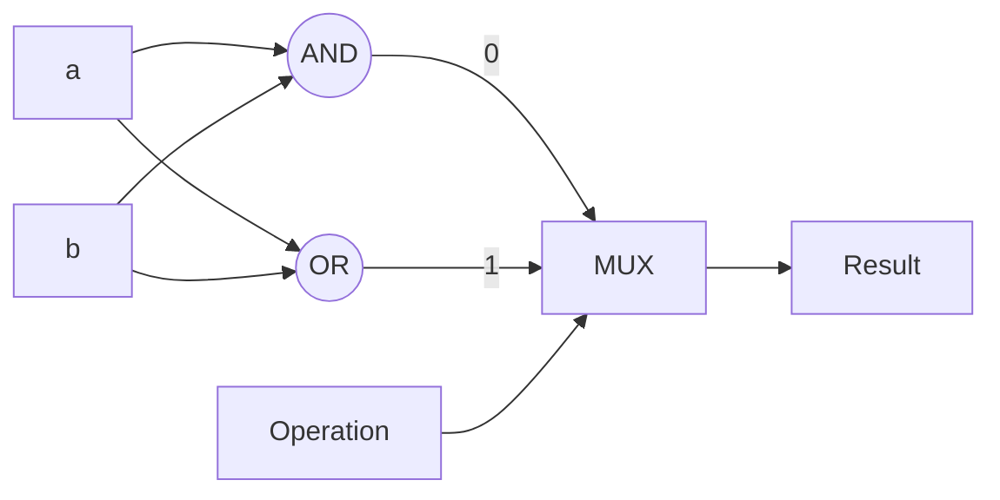
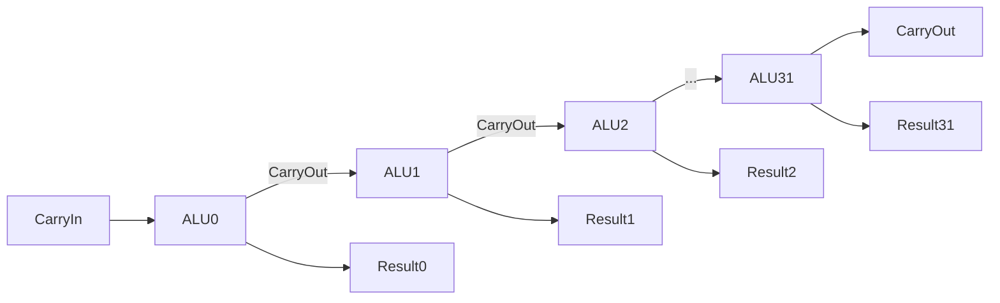
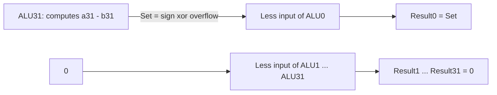
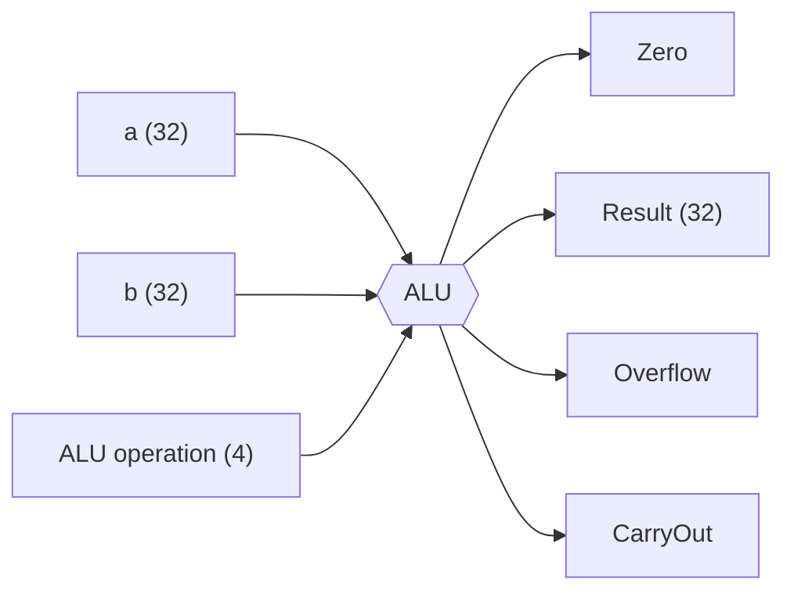

# بخش ۳، جلسه‌ی ۲ از ۱۰: ساختن ALU سی‌ودو بیتی

این جلسه بخشی از **بخش ۳: محاسبات کامپیوتری** است. زمان مطالعه: حدود نیم ساعت.

**فهرست این جلسه:**

- ۱. مرور سخت‌افزار پایه
- ۲. واحد منطقی یک‌بیتی
- ۳. افزودن جمع و ساختن ALU سی‌ودو بیتی
- ۴. تفریق
- ۵. عمل NOR
- ۶. دستور slt
- ۷. تشخیص سرریز و صفر
- ۸. خطوط کنترل ALU
- ۹. چند نکته‌ی مهم سخت‌افزاری
- ۱۰. تمرین‌ها

---

## ۱. مرور سخت‌افزار پایه

برای ساختن ALU فقط چهار قطعه لازم داریم:

| قطعه | نماد بولی | کار |
|---|---|---|
| گیت AND | c = a · b | خروجی یک اگر هر دو ورودی یک باشند |
| گیت OR | c = a + b | خروجی یک اگر دست‌کم یکی یک باشد |
| گیت NOT (وارونگر) | c = ā | خروجی برعکس ورودی |
| مالتی‌پلکسر (Multiplexor) | اگر d=0 آنگاه c=a وگرنه c=b | یکی از ورودی‌ها را بر اساس سیگنال انتخاب به خروجی می‌برد |

**مالتی‌پلکسر** یا **انتخاب‌گر** ابزار اصلی ماست. ایده‌ی کلی ساختن ALU این است: همه‌ی عمل‌ها را همزمان حساب کن و با یک مالتی‌پلکسر، نتیجه‌ی عمل خواسته‌شده را انتخاب کن.

## ۲. واحد منطقی یک‌بیتی

اول یک واحد یک‌بیتی برای `and` و `or` می‌سازیم. بعد ۳۲ نسخه از آن را کنار هم می‌گذاریم.



اگر Operation برابر ۰ باشد، نتیجه AND است و اگر ۱ باشد، OR. چون عمل‌های منطقی روی هر بیت مستقل‌اند، ۳۲ نسخه‌ی این واحد بدون هیچ ارتباطی با هم یک واحد منطقی ۳۲ بیتی می‌سازند.

## ۳. افزودن جمع و ساختن ALU سی‌ودو بیتی

حالا جمع‌کننده‌ی کامل جلسه‌ی قبل را به همین واحد اضافه می‌کنیم. مالتی‌پلکسر حالا سه ورودی دارد و سیگنال Operation دو بیتی می‌شود:

| مقدار Operation | خروجی |
|---|---|
| مقدار 00 | a AND b |
| مقدار 01 | a OR b |
| مقدار 10 | Sum از جمع‌کننده |

برای ساختن ALU سی‌ودو بیتی، ۳۲ نسخه از این واحد را کنار هم می‌گذاریم و CarryOut هر واحد را به CarryIn واحد بعدی وصل می‌کنیم:



این همان جمع‌کننده‌ی موج‌گذر است. همه‌ی ۳۲ واحد خط Operation مشترک دارند.

## ۴. تفریق

برای حساب a − b از ایده‌ی مکمل دو استفاده می‌کنیم: a + (−b) که −b یعنی برعکسِ همه‌ی بیت‌های b به‌علاوه‌ی یک.

دو تغییر لازم است:

- **برعکس کردن b:** یک مالتی‌پلکسر جلوی ورودی b می‌گذاریم که بین b و برعکسِ آن انتخاب کند. سیگنال کنترل آن **Binvert** نام دارد.
- **افزودن یک:** CarryIn واحد ALU0 (کم‌ارزش‌ترین بیت) را یک می‌کنیم. این ترفند زیبایی است: افزودن یک به هیچ سخت‌افزار اضافه‌ای نیاز ندارد، چون جمع‌کننده‌ی بیت صفر ورودی رقم نقلی دارد که در جمع معمولی بی‌استفاده است.

```math
a + \bar{b} + 1 = a + (-b) = a - b
```

## ۵. عمل NOR

برای دستور `nor` در MIPS از قانون دمورگان استفاده می‌کنیم:

```math
\overline{a + b} = \bar{a} \cdot \bar{b}
```

یعنی NOR همان AND روی برعکسِ هر دو ورودی است. پس کافی است یک مالتی‌پلکسر هم جلوی ورودی a بگذاریم با سیگنال کنترل **Ainvert**. حالا با Ainvert=1، Binvert=1 و انتخاب خروجی AND، نتیجه‌ی NOR به دست می‌آید. بدون هیچ گیت NOR جدید.

## ۶. دستور slt

دستور `slt` اگر rs < rt باشد ۱ و در غیر این صورت ۰ برمی‌گرداند. یعنی نتیجه‌ی ۳۲ بیتی آن یا 0…01 است یا 0…00. پس:

- **بیت‌های ۱ تا ۳۱ نتیجه:** همیشه صفر.
- **بیت صفر نتیجه:** یک اگر a < b.

### از کجا بفهمیم a < b

ایده: a − b را حساب کن. اگر منفی بود، a < b است. پس بیت علامت a − b جواب است.

ولی اسلاید درس یک نکته‌ی مهم دارد که خود شکل کتاب آن را درست نشان نمی‌دهد: **اگر تفریق سرریز کند، بیت علامت غلط است**. مثال‌های اسلاید با ۴ بیت:

```text
 5 - 6 = 0101 + 1010 = 1111       sign = 1, no overflow   -> 5 < 6   correct
-7 - 6 = 1001 + 1010 = 0011       sign = 0, overflow      -> but -7 < 6
```

در مثال دوم بیت علامت صفر است ولی −7 از 6 کوچک‌تر است. پس قاعده‌ی درست:

```math
\text{Set} = \text{MSB}(a - b) \oplus \text{Overflow}
```

### پیاده‌سازی

- به مالتی‌پلکسر هر واحد یک ورودی چهارم به نام **Less** اضافه می‌کنیم (Operation = 11).
- در واحدهای ALU1 تا ALU31، ورودی Less به صفر وصل است.
- واحد ALU31 یک خروجی اضافه به نام **Set** دارد که از رابطه‌ی بالا ساخته می‌شود.
- خروجی Set واحد ALU31 به ورودی Less واحد ALU0 وصل می‌شود.



برای `slt` همه‌ی واحدها تفریق انجام می‌دهند (Binvert=1 و CarryIn=1)، ولی مالتی‌پلکسر خروجی Less را انتخاب می‌کند. یعنی تفریق فقط برای ساختن Set در بیت ۳۱ استفاده می‌شود.

## ۷. تشخیص سرریز و صفر

### سرریز

در جلسه‌ی قبل دیدیم سرریز برابر XOR رقم نقلی ورودی و خروجی بیت پرارزش است. این منطق فقط در ALU31 قرار می‌گیرد. پس ALU31 کمی با بقیه فرق دارد: خروجی‌های Set و Overflow را هم دارد.

### صفر

دستورات `beq` و `bne` باید برابری را بسنجند. روش: a − b را حساب کن و ببین صفر است یا نه.

```math
\text{Zero} = \overline{\text{Result}_{31} + \text{Result}_{30} + \cdots + \text{Result}_{0}}
```

یعنی یک گیت OR بزرگ روی همه‌ی ۳۲ بیت نتیجه و بعد یک NOT. اسلاید می‌پرسد: آیا اینجا باید نگران سرریز باشیم؟ خیر. اگر a و b برابر باشند، a − b دقیقاً صفر است. اگر برابر نباشند، a − b حتی با سرریز هم صفر نمی‌شود، چون در حساب پیمانه‌ای ۲ به توان ۳۲، تفاضل دو عدد متفاوت هیچ‌وقت صفر نیست.

### ترکیب Binvert و CarryIn

اسلاید یک ساده‌سازی دیگر هم دارد. هر وقت Binvert یک است (تفریق و slt)، CarryIn هم یک است و هر وقت صفر است (جمع، AND و OR)، CarryIn هم بی‌اهمیت یا صفر است. پس این دو را یک سیگنال می‌کنیم که نامش **Bnegate** است.

## ۸. خطوط کنترل ALU

واحد ALU نهایی چهار بیت کنترل دارد: Ainvert، Bnegate و دو بیت Operation:

| خطوط کنترل ALU | عمل | Ainvert | Bnegate | Operation |
|---|---|---|---|---|
| مقدار 0000 | AND | 0 | 0 | 00 |
| مقدار 0001 | OR | 0 | 0 | 01 |
| مقدار 0010 | add | 0 | 0 | 10 |
| مقدار 0110 | subtract | 0 | 1 | 10 |
| مقدار 0111 | set on less than | 0 | 1 | 11 |
| مقدار 1100 | NOR | 1 | 1 | 00 |

این جدول را به خاطر بسپار. در بخش ۴، واحد کنترل ALU دقیقاً این کدها را بر اساس فیلد funct و نوع دستور تولید می‌کند.

واحد ALU را در نقشه‌ها با این نماد نشان می‌دهند:



## ۹. چند نکته‌ی مهم سخت‌افزاری

جمع‌بندی اسلاید درس:

- **ایده‌ی کلیدی:** از مالتی‌پلکسر برای انتخاب خروجی استفاده کن، تفریق را با مکمل دو انجام بده، و ALU یک‌بیتی را تکرار کن.
- **همه‌ی گیت‌ها همیشه کار می‌کنند:** برخلاف نرم‌افزار، سخت‌افزار «انتخاب نمی‌کند» که چه چیزی حساب شود. AND، OR و جمع همه همزمان حساب می‌شوند و مالتی‌پلکسر فقط یکی را بیرون می‌فرستد.
- **سرعت گیت به تعداد ورودی‌ها بستگی دارد:** گیتی با ورودی‌های بیشتر (Fan-in بزرگ‌تر) کندتر است.
- **سرعت مدار به تعداد گیت‌های پشت سر هم بستگی دارد:** طولانی‌ترین مسیر از ورودی به خروجی را **مسیر بحرانی (Critical path)** می‌نامیم.
- **سازمان‌دهی بهتر:** همان‌طور که الگوریتم بهتر نرم‌افزار را سریع می‌کند، تغییر هوشمندانه‌ی سازمان سخت‌افزار هم آن را سریع می‌کند. در جلسه‌های بعد این را برای جمع، ضرب و تقسیم می‌بینیم.

### مشکل ALU ما

واحد ALU سی‌ودو بیتی ما به اندازه‌ی ALU یک‌بیتی سریع نیست. چرا؟ چون رقم نقلی باید از ۳۲ واحد عبور کند. اگر هر واحد ۲ تأخیر گیت برای CarryOut داشته باشد، کل جمع حدود ۶۴ تأخیر گیت طول می‌کشد. این بدترین بخش ALU است و موضوع جلسه‌ی بعد است.

## ۱۰. تمرین‌ها

<details>
<summary>تمرین ۱: مقدار خطوط کنترل</summary>

**صورت:** فرض کن a = 0x00000005 و b = 0xFFFFFFFA. خروجی‌های Result، Zero و Overflow را برای هر کدام از کدهای 0010، 0110 و 0111 بنویس.

**جواب:** مقدار b برابر −6 است.

| کد | عمل | Result | Zero | Overflow |
|---|---|---|---|---|
| کد 0010 | جمع 5 و −6 | 0xFFFFFFFF | 0 | 0 |
| کد 0110 | تفریق 5 و −6 | 0x0000000B | 0 | 0 |
| کد 0111 | آیا 5 < −6؟ | 0x00000000 | 1 | 0 |

در سطر آخر، Result صفر است، پس خروجی Zero یک می‌شود. این مهم نیست، چون برای `slt` از Zero استفاده نمی‌شود.
</details>

<details>
<summary>تمرین ۲: slt با سرریز</summary>

**صورت:** با ALU چهار بیتی، `slt` را برای a = 0111 (یعنی 7) و b = 1000 (یعنی −8) حساب کن.

**جواب:** حاصل a − b یعنی 0111 + 0111 + 1 که با چهار بیت 1111 است و بیت علامتش یک است. ولی 7 − (−8) = 15 در چهار بیت جا نمی‌شود، پس سرریز رخ داده است. پس Set برابر 1 XOR 1 یعنی صفر است. یعنی 7 < −8 نادرست است که جواب درستی است. اگر فقط بیت علامت را نگاه می‌کردیم جواب غلط می‌گرفتیم.
</details>

<details>
<summary>تمرین ۳: افزودن XOR</summary>

**صورت:** چطور دستور `xor` را به این ALU اضافه کنیم؟

**جواب:** ساده‌ترین راه: یک گیت XOR در هر واحد یک‌بیتی و یک ورودی پنجم به مالتی‌پلکسر اضافه کن. چون حالا پنج ورودی داریم، Operation باید سه بیتی شود. راه دیگر بدون گیت جدید: خروجی Sum جمع‌کننده وقتی CarryIn صفر باشد همان a XOR b است، ولی در ALU موج‌گذر CarryIn هر بیت از بیت قبل می‌آید و صفر نیست. پس این راه ساده جواب نمی‌دهد مگر اینکه زنجیره‌ی رقم نقلی را قطع کنیم.
</details>

---

جلسه‌ی قبلی: [جمع، تفریق و سرریز](3-1-addition-subtraction-overflow.md)  
جلسه‌ی بعدی: [جمع‌کننده‌های سریع](3-3-fast-adders.md)
