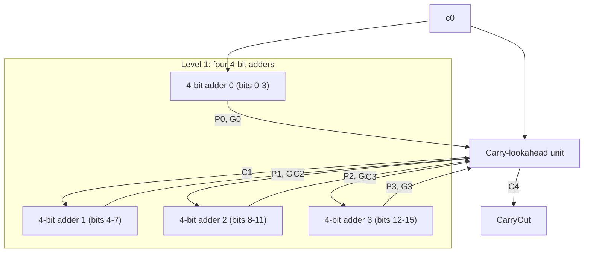

# بخش ۳، جلسه‌ی ۳ از ۱۰: جمع‌کننده‌های سریع

این جلسه بخشی از **بخش ۳: محاسبات کامپیوتری** است. زمان مطالعه: حدود نیم ساعت.

**فهرست این جلسه:**

- ۱. مشکل جمع‌کننده‌ی موج‌گذر
- ۲. دو حد افراطی
- ۳. سیگنال‌های تولید و انتشار
- ۴. پیش‌بینی رقم نقلی چهاربیتی
- ۵. پیش‌بینی دوسطحی برای ۱۶ بیت
- ۶. مقایسه‌ی تأخیر
- ۷. یک مثال کامل
- ۸. روش‌های دیگر جمع سریع
- ۹. تمرین‌ها

---

## ۱. مشکل جمع‌کننده‌ی موج‌گذر

در جمع‌کننده‌ی موج‌گذر، رقم نقلی بیت i به رقم نقلی بیت i−1 وابسته است. پس بیت ۳۱ باید منتظر بماند تا رقم نقلی از همه‌ی بیت‌های قبلی عبور کند. اگر هر جمع‌کننده‌ی کامل ۲ تأخیر گیت برای ساختن CarryOut داشته باشد (یک AND و یک OR):

```math
T_{\text{ripple}}(n) \approx 2n \text{ gate delays}
```

برای ۳۲ بیت حدود ۶۴ تأخیر گیت. چون جمع در تقریباً همه‌ی دستورات (حتی محاسبه‌ی آدرس lw و sw) استفاده می‌شود، این کندی مستقیماً سیکل ساعت را طولانی می‌کند.

اسلاید درس می‌پرسد: آیا بیش از یک راه برای جمع وجود دارد؟ بله.

## ۲. دو حد افراطی

### حد اول: موج‌گذر

ساده، کم‌گیت، ولی کند.

### حد دوم: مجموع حاصل‌ضرب‌ها

در نظر تئوری، هر رقم نقلی تابعی از ورودی‌های اصلی است. پس می‌توانیم هر کدام را مستقیماً به شکل **مجموع حاصل‌ضرب‌ها (Sum of products)** بنویسیم و در دو سطح گیت پیاده کنیم. c₀ رقم نقلی ورودی اولیه است:

```math
c_1 = b_0 c_0 + a_0 c_0 + a_0 b_0
```

```math
c_2 = b_1 c_1 + a_1 c_1 + a_1 b_1
```

اگر c₁ را جای‌گذاری کنیم:

```math
c_2 = a_1 a_0 b_0 + a_1 a_0 c_0 + a_1 b_0 c_0 + b_1 a_0 b_0 + b_1 a_0 c_0 + b_1 b_0 c_0 + a_1 b_1
```

اسلاید می‌گوید c₃ مجموع ۱۵ جمله‌ی چهارتایی است. تعداد جمله‌ها با بالا رفتن بیت‌ها **به‌طور نمایی** زیاد می‌شود. پس برای ۳۲ بیت این روش ممکن نیست، چون گیت‌هایی با هزاران ورودی لازم است.

راه‌حل، چیزی بین این دو حد است.

## ۳. سیگنال‌های تولید و انتشار

دوباره به معادله‌ی رقم نقلی نگاه کن و از آن فاکتور بگیر:

```math
c_{i+1} = a_i b_i + (a_i + b_i)\, c_i
```

دو اسم برای این دو قسمت می‌گذاریم:

```math
g_i = a_i \cdot b_i \qquad p_i = a_i + b_i
```

```math
c_{i+1} = g_i + p_i \cdot c_i
```

معنای این دو سیگنال:

- **تولید (Generate):** اگر gᵢ یک باشد، بیت i خودش رقم نقلی **تولید** می‌کند، صرف نظر از رقم نقلی ورودی. این وقتی است که هر دو ورودی یک باشند.
- **انتشار (Propagate):** اگر pᵢ یک باشد، بیت i رقم نقلی ورودی را **منتقل** می‌کند. یعنی اگر cᵢ یک باشد، cᵢ₊₁ هم یک می‌شود. این وقتی است که دست‌کم یکی از ورودی‌ها یک باشد.

نکته‌ی مهم: همه‌ی gᵢ و pᵢ فقط با یک تأخیر گیت و **همزمان** از ورودی‌ها به دست می‌آیند. هیچ وابستگی به رقم نقلی ندارند.

### تشبیه لوله‌کشی کتاب

کتاب COD برای این ایده یک تشبیه دارد: رقم نقلی را آب تصور کن که در لوله جریان دارد. هر بیت یک **شیر تولید** دارد که اگر باز باشد، آب را مستقیم به خروجی آن مرحله می‌ریزد. و یک **شیر انتشار** دارد که اگر باز باشد، آب ورودی از مرحله‌ی قبل را عبور می‌دهد. خروجی c₄ وقتی آب دارد که یکی از شیرهای تولید باز باشد و همه‌ی شیرهای انتشار بعد از آن هم باز باشند.

## ۴. پیش‌بینی رقم نقلی چهاربیتی

با جای‌گذاری پشت هم رابطه‌ی cᵢ₊₁ برای ۴ بیت:

```math
\begin{aligned}
c_1 &= g_0 + p_0 c_0 \\
c_2 &= g_1 + p_1 g_0 + p_1 p_0 c_0 \\
c_3 &= g_2 + p_2 g_1 + p_2 p_1 g_0 + p_2 p_1 p_0 c_0 \\
c_4 &= g_3 + p_3 g_2 + p_3 p_2 g_1 + p_3 p_2 p_1 g_0 + p_3 p_2 p_1 p_0 c_0
\end{aligned}
```

خواندن c₄ به زبان ساده: رقم نقلی از بیت ۳ بیرون می‌آید اگر

- بیت ۳ خودش تولید کند، **یا**
- بیت ۲ تولید کند و بیت ۳ منتشر کند، **یا**
- بیت ۱ تولید کند و بیت‌های ۲ و ۳ منتشر کنند، **یا**
- بیت ۰ تولید کند و بیت‌های ۱ تا ۳ منتشر کنند، **یا**
- رقم نقلی ورودی یک باشد و همه‌ی چهار بیت منتشر کنند.

هر کدام از این معادله‌ها با دو سطح گیت (AND و بعد OR) پیاده می‌شود. حداکثر گیت پنج ورودی دارد که قابل قبول است. به این مدار **پیش‌بینی رقم نقلی (Carry-lookahead)** می‌گوییم، چون رقم نقلی را از قبل «پیش‌بینی» می‌کند و منتظر موج نمی‌ماند.

ولی برای ۱۶ یا ۳۲ بیت، این معادله‌ها دوباره خیلی بزرگ می‌شوند. راه‌حل: **سلسله‌مراتب**.

## ۵. پیش‌بینی دوسطحی برای ۱۶ بیت

ایده: ۱۶ بیت را به چهار بلوک ۴ بیتی تقسیم کن. هر بلوک را مثل یک «بیت بزرگ» ببین که خودش سیگنال تولید و انتشار دارد.

### سیگنال‌های بلوک

یک بلوک ۴ بیتی رقم نقلی را **منتشر** می‌کند اگر همه‌ی چهار بیتش منتشر کنند:

```math
\begin{aligned}
P_0 &= p_3\, p_2\, p_1\, p_0 \\
P_1 &= p_7\, p_6\, p_5\, p_4 \\
P_2 &= p_{11}\, p_{10}\, p_9\, p_8 \\
P_3 &= p_{15}\, p_{14}\, p_{13}\, p_{12}
\end{aligned}
```

یک بلوک رقم نقلی **تولید** می‌کند اگر از بیت‌های خودش رقم نقلی بیرون بیاید، بدون توجه به ورودی بلوک:

```math
\begin{aligned}
G_0 &= g_3 + p_3 g_2 + p_3 p_2 g_1 + p_3 p_2 p_1 g_0 \\
G_1 &= g_7 + p_7 g_6 + p_7 p_6 g_5 + p_7 p_6 p_5 g_4 \\
G_2 &= g_{11} + p_{11} g_{10} + p_{11} p_{10} g_9 + p_{11} p_{10} p_9 g_8 \\
G_3 &= g_{15} + p_{15} g_{14} + p_{15} p_{14} g_{13} + p_{15} p_{14} p_{13} g_{12}
\end{aligned}
```

### رقم نقلی ورودی هر بلوک

حالا دقیقاً همان معادله‌های بخش ۴ را در سطح بلوک می‌نویسیم. Cᵢ رقم نقلی ورودی به بلوک i است:

```math
\begin{aligned}
C_1 &= G_0 + P_0 c_0 \\
C_2 &= G_1 + P_1 G_0 + P_1 P_0 c_0 \\
C_3 &= G_2 + P_2 G_1 + P_2 P_1 G_0 + P_2 P_1 P_0 c_0 \\
C_4 &= G_3 + P_3 G_2 + P_3 P_2 G_1 + P_3 P_2 P_1 G_0 + P_3 P_2 P_1 P_0 c_0
\end{aligned}
```

در اینجا C₁ همان c₄، C₂ همان c₈ و C₃ همان c₁₂ است و C₄ رقم نقلی خروجی کل جمع‌کننده است.



### پنج گام محاسبه

اسلاید درس مراحل را این‌طور می‌شمارد:

1. هر ALU یک‌بیتی مقدار pᵢ و gᵢ خودش را حساب می‌کند.
2. هر بلوک ۴ بیتی مقدار Pᵢ و Gᵢ را حساب می‌کند.
3. واحد پیش‌بینی، رقم‌های نقلی Cᵢ ورودی بلوک‌ها را حساب می‌کند.
4. هر بلوک ۴ بیتی رقم‌های نقلی داخلی cᵢ را با پیش‌بینی ۴ بیتی حساب می‌کند.
5. هر ALU یک‌بیتی بیت حاصل جمع را حساب می‌کند.

## ۶. مقایسه‌ی تأخیر

مثال کتاب: تأخیر جمع ۱۶ بیتی با دو روش، با این فرض که تأخیر هر گیت AND یا OR یک واحد است.

**جمع‌کننده‌ی موج‌گذر:** هر بیت ۲ تأخیر برای رقم نقلی دارد. رقم نقلی خروجی بیت ۱۵:

```math
16 \times 2 = 32 \text{ gate delays}
```

**پیش‌بینی دوسطحی:** رقم نقلی خروجی C₄:

| مرحله | تأخیر |
|---|---|
| ساختن pᵢ و gᵢ (یک AND یا OR) | 1 |
| ساختن Pᵢ و Gᵢ از آن‌ها (AND و بعد OR) | 2 |
| ساختن C₄ از Pᵢ و Gᵢ (AND و بعد OR) | 2 |
| مجموع | 5 |

یعنی شش برابر سریع‌تر. ساختن بیت‌های حاصل جمع کمی بیشتر طول می‌کشد، چون بعد از Cᵢ باید رقم‌های نقلی داخلی بلوک و بعد XOR حساب شوند، ولی هنوز خیلی از ۳۲ کمتر است.

### رشد لگاریتمی

با اضافه کردن یک سطح به سلسله‌مراتب، تعداد بیت‌ها چهار برابر می‌شود ولی فقط حدود ۲ تأخیر گیت اضافه می‌شود. پس:

```math
T_{\text{CLA}}(n) = O(\log n) \qquad T_{\text{ripple}}(n) = O(n)
```

برای ۶۴ بیت سه سطح کافی است: ۱۶ بلوک ۴ بیتی، بعد ۴ ابربلوک ۱۶ بیتی، و یک واحد پیش‌بینی در بالا.

## ۷. یک مثال کامل

اسلاید درس این جمع ۱۶ بیتی را برای تمرین داده است:

```text
a = 0001 1010 0011 0011
b = 1110 0101 1110 1011
```

**گام ۱: مقدار gᵢ و pᵢ.** بیت‌ها از ۱۵ (چپ) تا ۰ (راست):

```text
g = a AND b = 0000 0000 0010 0011
p = a OR  b = 1111 1111 1111 1011
```

**گام ۲: سیگنال‌های بلوک.**

| بلوک | بیت‌ها | P | G | توضیح |
|---|---|---|---|---|
| بلوک 0 | 3..0 | 0 | 0 | بیت ۲ انتشار ندارد و تولید بیت‌های ۰ و ۱ از آن عبور نمی‌کند |
| بلوک 1 | 7..4 | 1 | 1 | بیت ۵ تولید دارد و بیت‌های ۶ و ۷ منتشر می‌کنند |
| بلوک 2 | 11..8 | 1 | 0 | همه منتشر می‌کنند، هیچ‌کدام تولید ندارند |
| بلوک 3 | 15..12 | 1 | 0 | همه منتشر می‌کنند، هیچ‌کدام تولید ندارند |

**گام ۳: رقم نقلی بلوک‌ها** با c₀ = 0:

```text
C1 = G0 + P0.c0                    = 0
C2 = G1 + P1.G0 + P1.P0.c0         = 1
C3 = G2 + P2.G1 + ...              = 0 + 1.1 = 1
C4 = G3 + P3.G2 + P3.P2.G1 + ...   = 0 + 0 + 1.1.1 = 1
```

رقم نقلی خروجی یک است. اگر جمع را مستقیم حساب کنی، نتیجه‌ی ۱۶ بیتی برابر 0000 0000 0001 1110 با رقم نقلی خروجی یک است. رقم نقلی تولیدشده در بیت ۵، با انتشار از همه‌ی بیت‌های ۶ تا ۱۵، تا انتها رفته است.

## ۸. روش‌های دیگر جمع سریع

پیش‌بینی رقم نقلی تنها راه نیست. چند روش مهم دیگر:

- **انتخاب رقم نقلی (Carry-select):** هر بلوک بالایی دو بار حساب می‌شود، یک بار با فرض رقم نقلی ورودی صفر و یک بار با فرض یک. وقتی رقم نقلی واقعی رسید، با یک مالتی‌پلکسر نتیجه‌ی درست انتخاب می‌شود. دو برابر سخت‌افزار برای نیمی از تأخیر. این ایده‌ی «هر دو حالت را از قبل حساب کن» را در بخش ۷ هم می‌بینیم.
- **پرش رقم نقلی (Carry-skip):** اگر همه‌ی بیت‌های یک بلوک منتشر کنند (Pᵢ = 1)، رقم نقلی ورودی مستقیم از روی بلوک می‌پرد. سخت‌افزار کم و بهبود متوسط.
- **جمع‌کننده‌های پیشوندی (Parallel prefix):** مثل Kogge-Stone و Brent-Kung. نسخه‌ی کلی‌تر و منظم‌تر پیش‌بینی رقم نقلی با ساختار درختی. پردازنده‌های سریع امروزی معمولاً از این خانواده استفاده می‌کنند.

همه‌ی این روش‌ها یک مصالحه را نشان می‌دهند: **سخت‌افزار بیشتر در ازای تأخیر کمتر**. این همان یکی از هشت ایده‌ی بزرگ بخش ۱ است: کارایی از راه موازی‌سازی.

## ۹. تمرین‌ها

<details>
<summary>تمرین ۱: گسترش c₃</summary>

**صورت:** نشان بده که c₃ در روش مجموع حاصل‌ضرب‌ها و بدون g و p، مجموع چند جمله است. (اسلاید می‌گوید ۱۵ جمله‌ی چهارتایی.)

**جواب:** با g و p، c₃ چهار جمله دارد: g₂، p₂g₁، p₂p₁g₀ و p₂p₁p₀c₀. حالا هر g جمله‌ی aᵢbᵢ است و هر p دو جمله‌ی aᵢ و bᵢ. پس تعداد جمله‌ها: ۱ + (۲×۱) + (۲×۲×۱) + (۲×۲×۲×۱) = ۱ + ۲ + ۴ + ۸ = ۱۵. طولانی‌ترین جمله‌ها چهار متغیر دارند، مثل a₂a₁a₀c₀.
</details>

<details>
<summary>تمرین ۲: تأخیر ۶۴ بیتی</summary>

**صورت:** با همان فرض تأخیر واحد برای هر گیت، تأخیر رقم نقلی خروجی جمع ۶۴ بیتی را با روش موج‌گذر و با پیش‌بینی سه‌سطحی تخمین بزن.

**جواب:** موج‌گذر: 64 × 2 = 128 تأخیر. سه‌سطحی: یک تأخیر برای pᵢ و gᵢ، دو تأخیر برای سیگنال‌های بلوک ۴ بیتی، دو تأخیر برای سیگنال‌های ابربلوک ۱۶ بیتی، و دو تأخیر برای رقم نقلی خروجی در بالاترین سطح. مجموع حدود ۷ تأخیر.
</details>

<details>
<summary>تمرین ۳: انتخاب رقم نقلی</summary>

**صورت:** یک جمع‌کننده‌ی ۳۲ بیتی را از دو نیمه‌ی ۱۶ بیتی موج‌گذر با روش انتخاب رقم نقلی می‌سازیم. اگر تأخیر هر بیت موج‌گذر ۲ واحد و تأخیر مالتی‌پلکسر ۲ واحد باشد، تأخیر کل چقدر است؟

**جواب:** نیمه‌ی پایین ۱۶ × ۲ = ۳۲ واحد طول می‌کشد. دو نسخه‌ی نیمه‌ی بالا همزمان با نیمه‌ی پایین کار می‌کنند و آن‌ها هم ۳۲ واحد طول می‌کشند. وقتی رقم نقلی نیمه‌ی پایین آماده شد، مالتی‌پلکسر ۲ واحد دیگر طول می‌کشد. پس کل حدود ۳۴ واحد، در مقابل ۶۴ واحد موج‌گذر کامل.
</details>

---

جلسه‌ی قبلی: [ساختن ALU سی‌ودو بیتی](3-2-building-the-alu.md)  
جلسه‌ی بعدی: [ضرب](3-4-multiplication.md)
