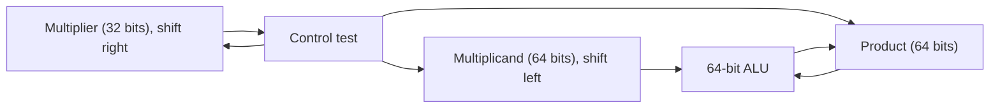
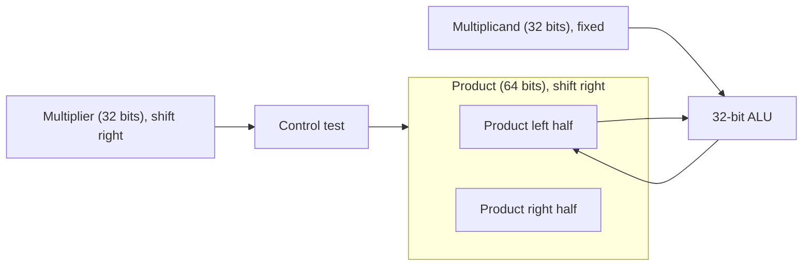
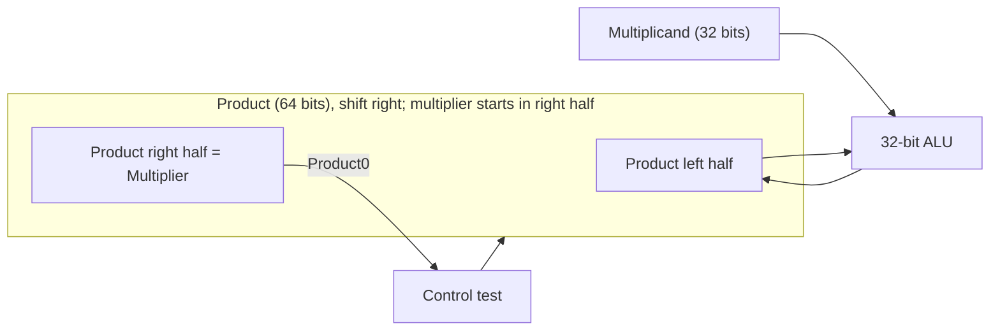
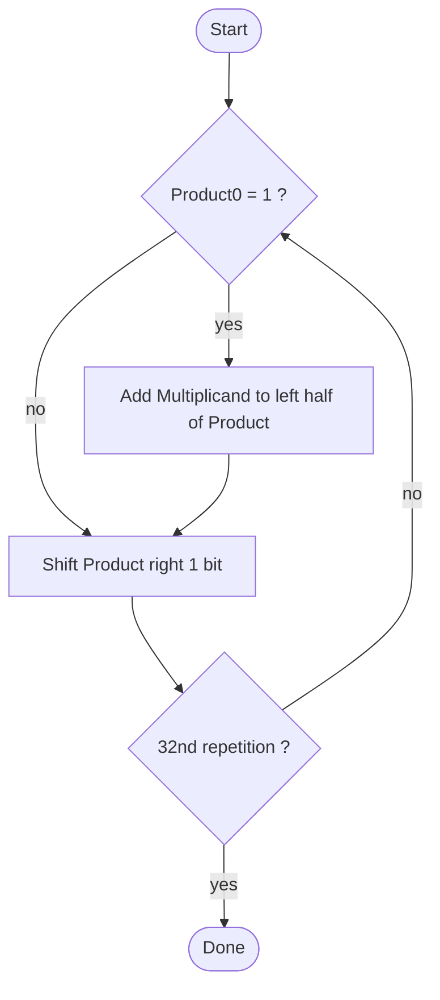
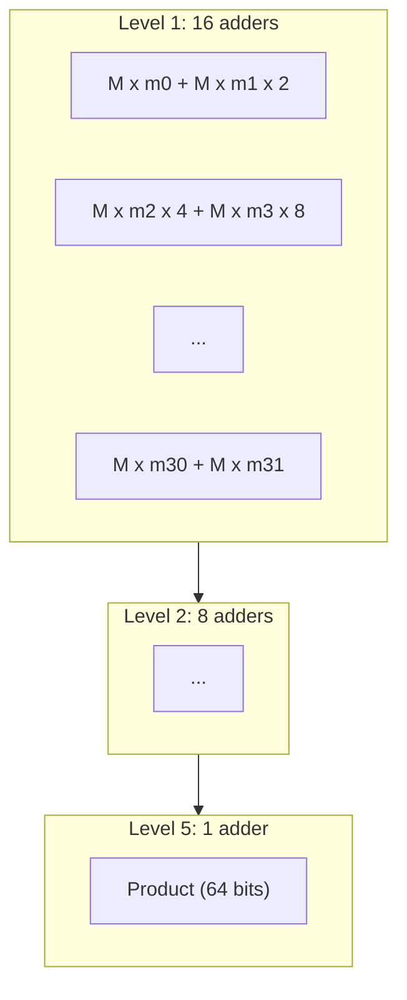

# بخش ۳، جلسه‌ی ۴ از ۱۰: ضرب

این جلسه بخشی از **بخش ۳: محاسبات کامپیوتری** است. زمان مطالعه: حدود نیم ساعت.

**فهرست این جلسه:**

- ۱. ضرب به روش دبستانی
- ۲. سخت‌افزار ضرب نسخه‌ی ۱
- ۳. نسخه‌ی ۲: شیفت حاصل‌ضرب به جای مضروب
- ۴. نسخه‌ی ۳: ترکیب ثبات مضروب‌فیه و حاصل‌ضرب
- ۵. ضرب علامت‌دار
- ۶. ضرب سریع
- ۷. ضرب در MIPS
- ۸. تمرین‌ها

---

## ۱. ضرب به روش دبستانی

کتاب ضرب را با روش دستی شروع می‌کند. نام‌گذاری:

- **مضروب (Multiplicand):** عدد اول.
- **مضروب‌فیه (Multiplier):** عدد دوم که رقم‌به‌رقم بررسی می‌شود.
- **حاصل‌ضرب (Product):** نتیجه.

مثال اسلاید، 1000 ضرب در 1001 (یعنی ۸ ضرب در ۹):

```text
  Multiplicand        1000
  Multiplier        x 1001
                    ------
                      1000
                     0000
                    0000
                   1000
                  --------
  Product         01001000     (72)
```

دو مشاهده‌ی مهم:

- **طول حاصل‌ضرب:** ضرب عدد m بیتی در عدد n بیتی، حاصلی با m+n بیت دارد. پس ضرب دو عدد ۳۲ بیتی ۶۴ بیت نتیجه دارد.
- **مبنای دو ساده است:** هر رقم مضروب‌فیه یا ۰ است یا ۱. اگر ۱ باشد، مضروب را (شیفت‌یافته) کپی کن. اگر ۰ باشد، صفر بگذار. پس ضرب دودویی فقط **جمع و شیفت** است.

## ۲. سخت‌افزار ضرب نسخه‌ی ۱

نسخه‌ی اول دقیقاً روش دستی را تقلید می‌کند:



- **مضروب:** در یک ثبات ۶۴ بیتی قرار دارد که در ابتدا مضروب ۳۲ بیتی در نیمه‌ی **راست** آن است و نیمه‌ی چپ صفر. هر مرحله یک بیت به چپ شیفت داده می‌شود.
- **مضروب‌فیه:** در یک ثبات ۳۲ بیتی است که هر مرحله یک بیت به راست شیفت داده می‌شود تا بیت بعدی در بیت صفر قرار گیرد.
- **حاصل‌ضرب:** یک ثبات ۶۴ بیتی که در ابتدا صفر است.
- **واحد ALU:** یک جمع‌کننده‌ی ۶۴ بیتی.

الگوریتم، ۳۲ بار تکرار:

1. اگر بیت صفر مضروب‌فیه یک است، مضروب را با حاصل‌ضرب جمع کن و در حاصل‌ضرب بنویس.
2. ثبات مضروب را یک بیت به چپ شیفت بده.
3. ثبات مضروب‌فیه را یک بیت به راست شیفت بده.

### مشاهدات اسلاید

- **کندی:** اگر هر گام یک سیکل بگیرد، ضرب حدود ۱۰۰ سیکل طول می‌کشد (۳ گام در ۳۲ تکرار).
- **هدر رفتن نصف مضروب:** نیمی از بیت‌های ثبات مضروب همیشه صفر است.
- **صفرهای سمت راست:** با شیفت به چپ، از راست صفر وارد می‌شود و بیت‌های پایین حاصل‌ضرب دیگر هیچ‌وقت تغییر نمی‌کنند.

ایده‌ی بهبود: به جای اینکه مضروب را به چپ ببریم، حاصل‌ضرب را به راست ببریم.

## ۳. نسخه‌ی ۲: شیفت حاصل‌ضرب به جای مضروب



تغییرها:

- **مضروب ثابت:** ثبات مضروب ۳۲ بیتی است و شیفت داده نمی‌شود.
- **واحد ALU کوچک:** جمع‌کننده ۳۲ بیتی شده است، چون مضروب فقط با نیمه‌ی **چپ** حاصل‌ضرب جمع می‌شود.
- **شیفت حاصل‌ضرب:** حاصل‌ضرب ۶۴ بیتی هر مرحله یک بیت به راست شیفت داده می‌شود.

مشاهده‌ی اسلاید: در هر گام، حاصل‌ضرب دقیقاً به اندازه‌ی بیت‌هایی که از مضروب‌فیه باقی مانده، فضای بی‌استفاده در سمت راست دارد. و مضروب‌فیه دقیقاً به همان اندازه بیت مصرف‌شده دارد. پس ایده: این دو ثبات را یکی کنیم.

## ۴. نسخه‌ی ۳: ترکیب ثبات مضروب‌فیه و حاصل‌ضرب



- **بدون ثبات مضروب‌فیه:** مضروب‌فیه در ابتدا در نیمه‌ی راست ثبات حاصل‌ضرب قرار می‌گیرد و نیمه‌ی چپ صفر است.
- **بیت آزمون:** حالا بیت صفر **ثبات حاصل‌ضرب** بیت جاری مضروب‌فیه است.
- **شیفت:** با هر شیفت به راست، یک بیت مضروب‌فیه بیرون می‌رود و یک بیت حاصل‌ضرب از چپ وارد نیمه‌ی راست می‌شود.

الگوریتم نهایی، ۳۲ بار تکرار:

1. اگر بیت صفر حاصل‌ضرب یک است، مضروب را با نیمه‌ی چپ حاصل‌ضرب جمع کن و در نیمه‌ی چپ بنویس.
2. ثبات حاصل‌ضرب را یک بیت به راست شیفت بده.



### مثال: ۲ ضرب در ۳ با ۴ بیت

مضروب 0010 و مضروب‌فیه 0011. ثبات حاصل‌ضرب ۸ بیتی است و در ابتدا 0000 0011:

| تکرار | گام | مضروب | حاصل‌ضرب |
|---|---|---|---|
| مقدار اولیه | – | 0010 | 0000 0011 |
| تکرار 1 | بیت صفر یک است: جمع | 0010 | 0010 0011 |
| تکرار 1 | شیفت به راست | 0010 | 0001 0001 |
| تکرار 2 | بیت صفر یک است: جمع | 0010 | 0011 0001 |
| تکرار 2 | شیفت به راست | 0010 | 0001 1000 |
| تکرار 3 | بیت صفر صفر است: کاری نکن | 0010 | 0001 1000 |
| تکرار 3 | شیفت به راست | 0010 | 0000 1100 |
| تکرار 4 | بیت صفر صفر است: کاری نکن | 0010 | 0000 1100 |
| تکرار 4 | شیفت به راست | 0010 | 0000 0110 |

نتیجه 0000 0110 یعنی ۶ است.

### دو نکته

- **دو گام برای هر بیت:** اسلاید می‌گوید نسخه‌ی ۳ برای هر بیت دو گام دارد: جمع و شیفت. در سخت‌افزار واقعی این دو در **یک سیکل** انجام می‌شوند: خروجی جمع‌کننده مستقیماً با یک بیت جابه‌جایی در ثبات نوشته می‌شود. پس ضرب ۳۲ بیتی حدود ۳۲ سیکل طول می‌کشد.
- **رقم نقلی جمع:** جمع ۳۲ بیتی ممکن است رقم نقلی خروجی داشته باشد. این رقم نقلی در شیفت بعدی به‌عنوان بیت جدید سمت چپ وارد می‌شود. پس عملاً ثبات حاصل‌ضرب یک بیت اضافه دارد (۶۵ بیت).

## ۵. ضرب علامت‌دار

ساده‌ترین روش برای اعداد علامت‌دار، که اسلاید هم پیشنهاد می‌کند:

1. هر دو عدد را مثبت کن و علامت‌های اولیه را به خاطر بسپار.
2. ضرب بدون علامت را برای ۳۱ بیت انجام بده (بیت علامت کنار گذاشته می‌شود).
3. اگر علامت‌ها متفاوت بودند، حاصل را قرینه کن.

راه بهتر این است که ضرب مستقیماً روی اعداد مکمل دو انجام شود. با دو تغییر کوچک، الگوریتم بالا اعداد علامت‌دار را هم درست ضرب می‌کند:

- **شیفت حسابی:** هنگام شیفت به راست، بیت علامت تکرار شود و صفر وارد نشود.
- **آخرین بیت:** چون وزن بیت علامت مضروب‌فیه منفی است، در آخرین گام به جای جمع، **تفریق** انجام شود.

روش زیباتر و معروف‌تر **الگوریتم بوث** است که موضوع جلسه‌ی بعد است و همین سخت‌افزار را استفاده می‌کند.

## ۶. ضرب سریع

قانون مور منابع زیادی در اختیار طراح گذاشته است. پس می‌توانیم ضرب‌کننده‌ی سریع‌تری بسازیم.

### ضرب‌کننده‌ی آرایه‌ای

ایده: به جای یک جمع‌کننده که ۳۲ بار استفاده شود، **۳۱ جمع‌کننده** بگذاریم. هر جمع‌کننده یک مضرب جزئی را اضافه می‌کند. مضرب جزئی i برابر مضروب AND بیت i مضروب‌فیه است. این کار شبیه **باز کردن حلقه (Loop unrolling)** در نرم‌افزار است. ولی جمع‌ها هنوز پشت هم‌اند، پس تأخیر 31 برابر یک جمع است.

### درخت جمع‌کننده

کتاب COD یک قدم جلوتر می‌رود: به جای زنجیره، جمع‌ها را به شکل **درخت** سازمان بده. ۳۲ مضرب جزئی را دوبه‌دو جمع کن (۱۶ جمع موازی)، بعد نتیجه‌ها را دوبه‌دو (۸ جمع) و همین‌طور تا آخر:



تعداد سطح‌ها به جای ۳۱ برابر لگاریتم ۳۲ یعنی ۵ است:

```math
\text{levels} = \log_2 32 = 5 \text{ adder delays (instead of 31)}
```

این ضرب‌کننده را می‌توان **خط لوله** هم کرد. یعنی هر سطح یک مرحله باشد و در هر سیکل یک ضرب جدید شروع شود.

### جمع‌کننده‌ی ذخیره‌ی رقم نقلی

یک ترفند دیگر: در سطح‌های میانی، رقم نقلی را منتقل نکن. **جمع‌کننده‌ی ذخیره‌ی رقم نقلی (Carry-save adder)** سه عدد را می‌گیرد و دو عدد برمی‌گرداند: یکی بیت‌های حاصل جمع و یکی بیت‌های رقم نقلی. چون هیچ رقم نقلی بین بیت‌ها حرکت نمی‌کند، تأخیر هر سطح فقط تأخیر یک جمع‌کننده‌ی کامل یک‌بیتی است. فقط در انتها یک جمع‌کننده‌ی معمولی سریع دو عدد را جمع می‌کند. به این ساختار **درخت والاس (Wallace tree)** می‌گویند. ضرب‌کننده‌های امروزی همه بر همین اساس‌اند.

## ۷. ضرب در MIPS

حاصل ضرب ۶۴ بیتی است و در یک ثبات ۳۲ بیتی جا نمی‌شود. پس MIPS دو ثبات ویژه‌ی ۳۲ بیتی به نام **Hi** و **Lo** دارد که با هم حاصل ۶۴ بیتی را نگه می‌دارند:

| دستور | معنی |
|---|---|
| دستور `mult $s2, $s3` | ضرب علامت‌دار، Hi:Lo = s2 × s3 |
| دستور `multu $s2, $s3` | ضرب بدون علامت، Hi:Lo = s2 × s3 |
| دستور `mfhi $t0` | انتقال از Hi به t0 |
| دستور `mflo $t0` | انتقال از Lo به t0 |
| شبه‌دستور `mul $t0, $s2, $s3` | ضرب سه‌عملوندی، فقط ۳۲ بیت پایین |

چند نکته:

- **سرریز:** دستورات `mult` و `multu` سرریز را بررسی نمی‌کنند. نرم‌افزار باید خودش بررسی کند. برای `multu`، اگر Hi صفر نباشد سرریز رخ داده است. برای `mult`، اگر Hi با گسترش علامتِ بیت ۳۱ ثبات Lo برابر نباشد، سرریز رخ داده است.
- **شبه‌دستورات:** شبه‌دستور `mul` (بدون بررسی سرریز)، `mulo` (با بررسی سرریز علامت‌دار) و `mulou` (با بررسی بدون علامت) هم در اسلاید آمده‌اند.
- **ضرب در توان دو:** کامپایلر ضرب در ثابتی مثل ۴ یا ۸ را با `sll` جایگزین می‌کند، چون شیفت خیلی سریع‌تر است. ضرب در ثابت‌هایی مثل ۹ را هم می‌توان با شیفت و جمع ساخت: x × 9 = (x << 3) + x.
- **نسخه‌های جدید:** در MIPS32 دستور `mul` سه‌عملوندی واقعاً یک دستور سخت‌افزاری است. در MIPS32 نسخه‌ی ۶ ثبات‌های Hi و Lo حذف شدند و به جای آن‌ها دستورات `mul` و `muh` برای نیمه‌ی پایین و بالا آمدند. RISC-V هم دقیقاً همین روش را دارد: دستورات `mul`، `mulh`، `mulhu` و `mulhsu`.

## ۸. تمرین‌ها

<details>
<summary>تمرین ۱: اجرای الگوریتم</summary>

**صورت:** با نسخه‌ی ۳ الگوریتم و ۴ بیت، حاصل 0110 ضرب در 0101 (یعنی ۶ ضرب در ۵) را قدم‌به‌قدم حساب کن.

**جواب:**

| تکرار | گام | حاصل‌ضرب |
|---|---|---|
| مقدار اولیه | – | 0000 0101 |
| تکرار 1 | جمع (بیت یک است) | 0110 0101 |
| تکرار 1 | شیفت | 0011 0010 |
| تکرار 2 | بیت صفر است | 0011 0010 |
| تکرار 2 | شیفت | 0001 1001 |
| تکرار 3 | جمع | 0111 1001 |
| تکرار 3 | شیفت | 0011 1100 |
| تکرار 4 | بیت صفر است | 0011 1100 |
| تکرار 4 | شیفت | 0001 1110 |

نتیجه 0001 1110 یعنی ۳۰ است.
</details>

<details>
<summary>تمرین ۲: ضرب با شیفت</summary>

**صورت:** کد MIPS بنویس که `$t0 = $s0 × 10` را بدون دستور ضرب حساب کند.

**جواب:** ۱۰ = ۸ + ۲، پس x × 10 = (x << 3) + (x << 1):

```asm
sll  $t1, $s0, 3       # t1 = 8x
sll  $t2, $s0, 1       # t2 = 2x
add  $t0, $t1, $t2     # t0 = 10x
```
</details>

<details>
<summary>تمرین ۳: زمان ضرب</summary>

**صورت:** جمع ۳۲ بیتی ۴ نانوثانیه و شیفت ۱ نانوثانیه طول می‌کشد. زمان ضرب ۳۲ بیتی با نسخه‌ی ۱ (جمع و دو شیفت پشت هم)، نسخه‌ی ۳ (جمع و شیفت در یک گام) و درخت جمع‌کننده (فقط جمع) را مقایسه کن.

**جواب:** نسخه‌ی ۱: در بدترین حالت هر تکرار ۴ + ۱ + ۱ = ۶ نانوثانیه، پس ۳۲ × ۶ = ۱۹۲ نانوثانیه. نسخه‌ی ۳: اگر جمع و شیفت در یک سیکل باشند و سیکل را جمع تعیین کند، ۳۲ × ۴ = ۱۲۸ نانوثانیه. درخت جمع‌کننده: ۵ سطح، پس ۵ × ۴ = ۲۰ نانوثانیه. البته جمع‌کننده‌ی سطح‌های پایین‌تر درخت کوچک‌ترند و این تخمین کمی بدبینانه است.
</details>

---

جلسه‌ی قبلی: [جمع‌کننده‌های سریع](3-3-fast-adders.md)  
جلسه‌ی بعدی: [الگوریتم بوث](3-5-booth-algorithm.md)
