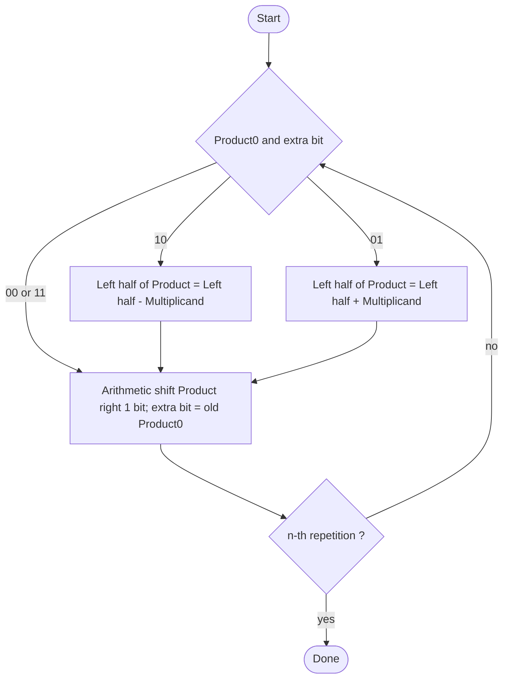

# بخش ۳، جلسه‌ی ۵ از ۱۰: الگوریتم بوث

این جلسه بخشی از **بخش ۳: محاسبات کامپیوتری** است. زمان مطالعه: حدود نیم ساعت.

**فهرست این جلسه:**

- ۱. انگیزه: رشته‌ای از یک‌ها
- ۲. قاعده‌ی الگوریتم
- ۳. سخت‌افزار و روند الگوریتم
- ۴. مثال ۲ ضرب در ۷
- ۵. مثال ۲ ضرب در منفی ۳
- ۶. چرا بوث درست کار می‌کند
- ۷. کی بوث سریع‌تر است
- ۸. بوث مبنای ۴
- ۹. تمرین‌ها

---

## ۱. انگیزه: رشته‌ای از یک‌ها

**الگوریتم بوث (Booth's algorithm)** را اندرو بوث در سال ۱۹۵۱ ابداع کرد. دو مزیت دارد:

- **اعداد علامت‌دار:** اعداد مکمل دو را بدون هیچ کار اضافه‌ای درست ضرب می‌کند.
- **سرعت:** در ماشین‌هایی که شیفت از جمع سریع‌تر بود، تعداد جمع‌ها را کم می‌کرد.

مثال اسلاید: 0010 ضرب در 0110 (یعنی ۲ ضرب در ۶). در روش معمولی دو جمع لازم است:

```text
         0010
       x 0110
       ------
         0000      shift (0 in multiplier)
        0010       add   (1 in multiplier)
       0010        add   (1 in multiplier)
      0000         shift (0 in multiplier)
     --------
     00001100      (12)
```

ولی به 0110 دقت کن. دو یک پشت سر هم دارد و می‌توان آن را این‌طور نوشت:

```math
0110_2 = 2^2 + 2^1 = 2^3 - 2^1 = 8 - 2 = 6
```

پس به جای دو جمع، می‌توانیم **یک تفریق** (وقتی اولین یک دیده شد) و **یک جمع** (بعد از آخرین یک) انجام دهیم:

```text
         0010
       x 0110
       ------
         0000      shift (0 in multiplier)
       -0010       sub   (first 1 in multiplier)
       0000        shift (middle of string of 1s)
      0010         add   (prior step had last 1)
     --------
     00001100
```

به‌طور کلی، رشته‌ای از یک‌ها از بیت m تا بیت n این مقدار را دارد:

```math
2^{n} + 2^{n-1} + \cdots + 2^{m} = 2^{n+1} - 2^{m}
```

یعنی رشته‌ی یک‌ها با یک تفریق در **ابتدای** رشته و یک جمع بعد از **انتهای** آن جایگزین می‌شود.

## ۲. قاعده‌ی الگوریتم

بیت‌های مضروب‌فیه را از راست به چپ نگاه می‌کنیم. در هر گام، بیت جاری و **بیت سمت راست آن** (بیت گام قبل) را با هم بررسی می‌کنیم. برای بیت صفر، بیت سمت راست را صفر فرض می‌کنیم.

| بیت جاری | بیت سمت راست | توضیح | مثال | عمل |
|---|---|---|---|---|
| مقدار 0 | 0 | وسط رشته‌ای از صفرها | 0001111000 | هیچ |
| مقدار 0 | 1 | پایان رشته‌ای از یک‌ها | 0001111000 | جمع مضروب |
| مقدار 1 | 0 | آغاز رشته‌ای از یک‌ها | 0001111000 | تفریق مضروب |
| مقدار 1 | 1 | وسط رشته‌ای از یک‌ها | 0001111000 | هیچ |

یک راه برای به خاطر سپردن: «بیت راست منهای بیت جاری» را حساب کن. اگر ۱ شد جمع کن، اگر −۱ شد تفریق کن و اگر ۰ شد کاری نکن.

## ۳. سخت‌افزار و روند الگوریتم

اسلاید درس می‌گوید بوث **همان سخت‌افزار** ضرب نسخه‌ی ۳ را استفاده می‌کند، فقط با دو تغییر:

- **یک فلیپ‌فلاپ اضافه:** برای نگه داشتن بیت سمت راست، یعنی بیتی که در شیفت قبلی از ثبات حاصل‌ضرب بیرون رفته است. این بیت در ابتدا صفر است.
- **شیفت حسابی:** شیفت به راست باید **حسابی** باشد، یعنی بیت علامت تکرار شود. چون حاصل‌ضرب جزئی ممکن است منفی باشد.



## ۴. مثال ۲ ضرب در ۷

مضروب 0010 و مضروب‌فیه 0111. ثبات حاصل‌ضرب در ابتدا 0000 0111 و بیت اضافه صفر است. در جدول، بیت اضافه بعد از حاصل‌ضرب آمده است:

| تکرار | گام | مضروب | حاصل‌ضرب و بیت اضافه | دو بیت بعدی |
|---|---|---|---|---|
| مقدار اولیه | – | 0010 | 0000 0111 0 | 10 یعنی تفریق |
| تکرار 1 | تفریق | 0010 | 1110 0111 0 | – |
| تکرار 1 | شیفت حسابی | 0010 | 1111 0011 1 | 11 یعنی هیچ |
| تکرار 2 | هیچ | 0010 | 1111 0011 1 | – |
| تکرار 2 | شیفت حسابی | 0010 | 1111 1001 1 | 11 یعنی هیچ |
| تکرار 3 | هیچ | 0010 | 1111 1001 1 | – |
| تکرار 3 | شیفت حسابی | 0010 | 1111 1100 1 | 01 یعنی جمع |
| تکرار 4 | جمع | 0010 | 0001 1100 1 | – |
| تکرار 4 | شیفت حسابی | 0010 | 0000 1110 0 | پایان |

نتیجه 0000 1110 یعنی ۱۴ است. به جای سه جمع (برای سه بیت یک) فقط یک تفریق و یک جمع انجام شد.

به تکرار ۱ دقت کن: پس از تفریق، نیمه‌ی چپ 1110 یعنی منفی شد. شیفت حسابی بیت علامت یک را حفظ کرد. اگر شیفت منطقی بود، صفر وارد می‌شد و جواب غلط می‌شد.

## ۵. مثال ۲ ضرب در منفی ۳

مضروب 0010 و مضروب‌فیه 1101 (یعنی −3 در مکمل دو):

| تکرار | گام | مضروب | حاصل‌ضرب و بیت اضافه | دو بیت بعدی |
|---|---|---|---|---|
| مقدار اولیه | – | 0010 | 0000 1101 0 | 10 یعنی تفریق |
| تکرار 1 | تفریق | 0010 | 1110 1101 0 | – |
| تکرار 1 | شیفت حسابی | 0010 | 1111 0110 1 | 01 یعنی جمع |
| تکرار 2 | جمع | 0010 | 0001 0110 1 | – |
| تکرار 2 | شیفت حسابی | 0010 | 0000 1011 0 | 10 یعنی تفریق |
| تکرار 3 | تفریق | 0010 | 1110 1011 0 | – |
| تکرار 3 | شیفت حسابی | 0010 | 1111 0101 1 | 11 یعنی هیچ |
| تکرار 4 | هیچ | 0010 | 1111 0101 1 | – |
| تکرار 4 | شیفت حسابی | 0010 | 1111 1010 1 | پایان |

نتیجه 1111 1010 یعنی −6 در مکمل دو ۸ بیتی. بدون اینکه علامت‌ها را جدا کنیم یا آخر کار قرینه بگیریم، جواب درست است.

پرسش اسلاید: اگر رشته‌ی یک‌ها از چپ‌ترین بیت شروع شود، مثل 11110001، آیا فرمول باید عوض شود؟ خیر. رشته‌ای که تا بیت علامت ادامه دارد، فقط تفریق ابتدایی را دارد و جمع پایانی ندارد. چون وزن بیت علامت منفی است، این دقیقاً درست است. بخش بعد این را ثابت می‌کند.

## ۶. چرا بوث درست کار می‌کند

بیت‌های مضروب‌فیه را a₃₁ تا a₀ و بیت فرضی a₋₁ = 0 بگیر. مضروب را b بگیر. در گام i، الگوریتم مقدار (aᵢ₋₁ − aᵢ) × b را در جای i اضافه می‌کند:

| مقدار aᵢ | مقدار aᵢ₋₁ | مقدار aᵢ₋₁ − aᵢ | عمل |
|---|---|---|---|
| مقدار 0 | 0 | 0 | هیچ |
| مقدار 0 | 1 | +1 | جمع b |
| مقدار 1 | 0 | −1 | تفریق b |
| مقدار 1 | 1 | 0 | هیچ |

پس کل چیزی که بوث حساب می‌کند این مجموع است:

```math
\sum_{i=0}^{31} (a_{i-1} - a_i)\, b\, 2^{i}
```

این یک **مجموع تلسکوپی** است. جمله‌ها را باز کن و هم‌توان‌ها را کنار هم بگذار:

```math
b \Big[ (a_{-1} - a_0) 2^0 + (a_0 - a_1) 2^1 + (a_1 - a_2) 2^2 + \cdots + (a_{30} - a_{31}) 2^{31} \Big]
```

```math
= b \Big[ -a_{31} 2^{31} + a_{30} 2^{30} + \cdots + a_1 2^1 + a_0 2^0 \Big]
```

برای هر aᵢ، یک بار با وزن 2 به توان i+1 مثبت و یک بار با وزن 2 به توان i منفی آمده است و جمع آن‌ها 2 به توان i می‌شود. فقط a₃₁ تنها با علامت منفی می‌ماند. عبارت داخل کروشه دقیقاً **مقدار مکمل دوی** مضروب‌فیه است. پس بوث حاصل‌ضرب درست علامت‌دار را حساب می‌کند.

## ۷. کی بوث سریع‌تر است

در بوث تعداد جمع و تفریق برابر **تعداد مرزهای بین صفر و یک** در مضروب‌فیه است:

| مضروب‌فیه | تعداد جمع در روش معمولی | تعداد جمع و تفریق در بوث |
|---|---|---|
| مقدار 0000 1111 0000 0000 | 4 | 2 |
| مقدار 0111 1111 1111 1110 | 14 | 2 |
| مقدار 0101 0101 0101 0101 | 8 | 16 |

پس بوث برای رشته‌های بلند یک‌ها خیلی خوب است، ولی برای الگوی متناوب 0101 حتی بدتر است. در سخت‌افزار امروزی که جمع و شیفت در یک سیکل انجام می‌شوند، تعداد سیکل‌ها در هر حال برابر تعداد بیت‌هاست. پس امروز مزیت اصلی بوث **سادگی ضرب علامت‌دار** است.

## ۸. بوث مبنای ۴

برای کم کردن تعداد گام‌ها، **بوث اصلاح‌شده (Modified Booth یا Radix-4 Booth)** در هر گام **دو بیت** مضروب‌فیه را بررسی می‌کند، به‌علاوه‌ی بیت سمت راست آن‌ها. پس سه بیت نگاه می‌کند:

| سه بیت (aᵢ₊₁ aᵢ aᵢ₋₁) | عمل |
|---|---|
| مقدار 000 | هیچ (0 × b) |
| مقدار 001 | جمع b |
| مقدار 010 | جمع b |
| مقدار 011 | جمع 2b |
| مقدار 100 | تفریق 2b |
| مقدار 101 | تفریق b |
| مقدار 110 | تفریق b |
| مقدار 111 | هیچ (0 × b) |

بعد از هر گام، حاصل‌ضرب **دو بیت** شیفت داده می‌شود. پس ضرب ۳۲ بیتی ۱۶ گام دارد. ضرایب فقط ۰، ±۱ و ±۲ هستند. ساختن 2b هم فقط یک شیفت است. در ضرب‌کننده‌های درختی سخت‌افزاری، این روش تعداد مضرب‌های جزئی را نصف می‌کند و تقریباً همه‌ی ضرب‌کننده‌های سریع امروزی از آن استفاده می‌کنند.

## ۹. تمرین‌ها

<details>
<summary>تمرین ۱: بوث با دو عدد منفی</summary>

**صورت:** با بوث و ۴ بیت، حاصل −3 ضرب در −5 را حساب کن. مضروب 1101 و مضروب‌فیه 1011 است.

**جواب:** تفریق مضروب یعنی جمع با 0011 و جمع مضروب یعنی جمع با 1101:

| تکرار | گام | حاصل‌ضرب و بیت اضافه |
|---|---|---|
| مقدار اولیه | – | 0000 1011 0 |
| تکرار 1 | دو بیت 10: تفریق | 0011 1011 0 |
| تکرار 1 | شیفت حسابی | 0001 1101 1 |
| تکرار 2 | دو بیت 11: هیچ | 0001 1101 1 |
| تکرار 2 | شیفت حسابی | 0000 1110 1 |
| تکرار 3 | دو بیت 01: جمع | 1101 1110 1 |
| تکرار 3 | شیفت حسابی | 1110 1111 0 |
| تکرار 4 | دو بیت 10: تفریق | 0001 1111 0 |
| تکرار 4 | شیفت حسابی | 0000 1111 1 |

نتیجه 0000 1111 یعنی ۱۵ است.
</details>

<details>
<summary>تمرین ۲: بازنویسی بوث</summary>

**صورت:** مضروب‌فیه 0011 1100 را با ارقام بوث (+1، 0، −1) بازنویسی کن.

**جواب:** از راست، هر بیت را با بیت سمت راستش مقایسه کن (aᵢ₋₁ − aᵢ):

```text
bits:      0  0  1  1  1  1  0  0  (a_-1 = 0)
digits:    0 +1  0  0  0 -1  0  0
```

یعنی 2⁶ − 2² = 64 − 4 = 60 که همان 0011 1100 است. فقط یک جمع و یک تفریق به جای چهار جمع.
</details>

<details>
<summary>تمرین ۳: بوث مبنای ۴</summary>

**صورت:** مضروب‌فیه ۸ بیتی 0111 0110 (یعنی ۱۱۸) را با بوث مبنای ۴ رمزگذاری کن.

**جواب:** بیت‌ها را از راست سه‌تا‌سه‌تا با یک بیت هم‌پوشانی جدا می‌کنیم (a₋₁ = 0). گروه i شامل بیت‌های 2i+1، 2i و 2i−1 است:

| گروه | بیت‌ها (aᵢ₊₁ aᵢ aᵢ₋₁) | ضریب | وزن |
|---|---|---|---|
| گروه 0 | سه بیت 100 | −2 | 1 |
| گروه 1 | سه بیت 011 | +2 | 4 |
| گروه 2 | سه بیت 110 | −1 | 16 |
| گروه 3 | سه بیت 011 | +2 | 64 |

مقدار: −2 × 1 + 2 × 4 − 1 × 16 + 2 × 64 = −2 + 8 − 16 + 128 = 118. پس ۴ گام به جای ۸ گام.
</details>

---

جلسه‌ی قبلی: [ضرب](3-4-multiplication.md)  
جلسه‌ی بعدی: [تقسیم](3-6-division.md)
