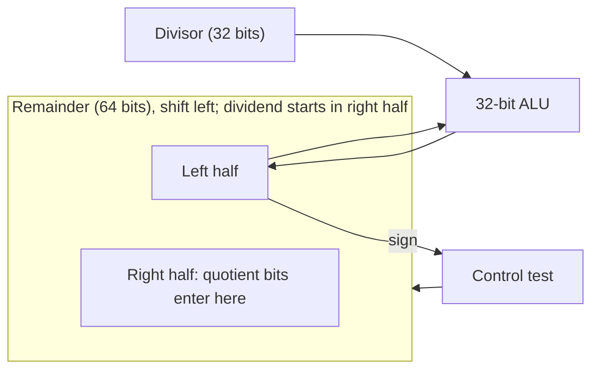

# بخش ۳، جلسه‌ی ۶ از ۱۰: تقسیم

این جلسه بخشی از **بخش ۳: محاسبات کامپیوتری** است. زمان مطالعه: حدود نیم ساعت.

**فهرست این جلسه:**

- ۱. تقسیم به روش دبستانی
- ۲. سخت‌افزار تقسیم نسخه‌ی ۱
- ۳. نسخه‌ی ۲ و ۳
- ۴. مثال ۷ تقسیم بر ۲
- ۵. تقسیم علامت‌دار
- ۶. تقسیم بدون بازیابی و تقسیم سریع
- ۷. تقسیم در MIPS
- ۸. تمرین‌ها

---

## ۱. تقسیم به روش دبستانی

نام‌گذاری اجزای تقسیم:

- **مقسوم (Dividend):** عددی که تقسیم می‌شود.
- **مقسوم‌علیه (Divisor):** عددی که بر آن تقسیم می‌کنیم.
- **خارج‌قسمت (Quotient):** نتیجه‌ی اصلی.
- **باقی‌مانده (Remainder):** چیزی که می‌ماند.

رابطه‌ی اصلی که همیشه باید برقرار باشد:

```math
\text{Dividend} = \text{Quotient} \times \text{Divisor} + \text{Remainder}, \qquad |\text{Remainder}| < |\text{Divisor}|
```

مثال اسلاید: 1001010 تقسیم بر 1000 (یعنی ۷۴ تقسیم بر ۸):

```text
                 1001        Quotient
             --------
     1000  | 1001010         Dividend
            -1000
            -----
               10
               101
               1010
              -1000
              -----
                 10          Remainder
```

نتیجه: خارج‌قسمت ۹ و باقی‌مانده ۲. بررسی: 9 × 8 + 2 = 74.

در روش دستی، در هر گام می‌بینیم بزرگ‌ترین مضرب مقسوم‌علیه که می‌شود کم کرد چقدر است. در مبنای دو این خیلی ساده است: یا مقسوم‌علیه یک بار جا می‌شود (رقم ۱) یا اصلاً جا نمی‌شود (رقم ۰).

کامپیوتر نمی‌تواند با یک نگاه بفهمد که مقسوم‌علیه جا می‌شود یا نه. پس **تفریق می‌کند** و علامت نتیجه را نگاه می‌کند. اگر منفی شد، یعنی جا نمی‌شد و باید مقدار قبلی را **بازیابی** کند. به همین دلیل نام این روش **تقسیم با بازیابی (Restoring division)** است.

## ۲. سخت‌افزار تقسیم نسخه‌ی ۱


- **مقسوم‌علیه:** در نیمه‌ی **چپ** یک ثبات ۶۴ بیتی قرار می‌گیرد و هر گام یک بیت به راست شیفت داده می‌شود.
- **باقی‌مانده:** یک ثبات ۶۴ بیتی که در ابتدا مقسوم در نیمه‌ی راست آن است.
- **خارج‌قسمت:** یک ثبات ۳۲ بیتی که در ابتدا صفر است و هر گام یک بیت به چپ شیفت داده می‌شود.

الگوریتم، **۳۳ بار** تکرار:

1. مقسوم‌علیه را از باقی‌مانده کم کن و نتیجه را در باقی‌مانده بنویس.
2. اگر باقی‌مانده مثبت یا صفر است: خارج‌قسمت را به چپ شیفت بده و بیت جدید سمت راست را ۱ کن.
3. اگر باقی‌مانده منفی است: مقسوم‌علیه را دوباره به باقی‌مانده اضافه کن تا مقدار قبلی **بازیابی** شود. بعد خارج‌قسمت را به چپ شیفت بده و بیت جدید را ۰ کن.
4. مقسوم‌علیه را یک بیت به راست شیفت بده.

### مشاهدات اسلاید

- **هدر رفتن نصف مقسوم‌علیه و ALU:** نیمی از بیت‌های ثبات مقسوم‌علیه همیشه صفر است، پس نصف جمع‌کننده‌ی ۶۴ بیتی هم بی‌استفاده است.
- **گام اول بی‌فایده:** در گام اول مقسوم‌علیه ۳۲ بیتی در نیمه‌ی چپ است و مقسوم ۳۲ بیتی در نیمه‌ی راست. پس تفریق هیچ‌وقت مثبت نمی‌شود و اولین بیت خارج‌قسمت همیشه صفر است. چرا ۳۳ گام لازم است؟ دقیقاً به همین دلیل: یک گام اضافه که همیشه صفر می‌دهد.

ایده‌ها برای بهبود: به جای شیفت مقسوم‌علیه به راست، باقی‌مانده را به چپ شیفت بده. و ترتیب را عوض کن: اول شیفت، بعد تفریق، تا گام بی‌فایده حذف شود.

## ۳. نسخه‌ی ۲ و ۳

### نسخه‌ی ۲

- **مقسوم‌علیه ثابت:** ثبات مقسوم‌علیه ۳۲ بیتی است و شیفت داده نمی‌شود.
- **واحد ALU کوچک:** جمع‌کننده ۳۲ بیتی است و فقط با نیمه‌ی چپ باقی‌مانده کار می‌کند.
- **شیفت باقی‌مانده:** باقی‌مانده‌ی ۶۴ بیتی به چپ شیفت داده می‌شود.
- **شیفت اول:** قبل از حلقه یک بار باقی‌مانده به چپ شیفت داده می‌شود تا گام بی‌فایده‌ی نسخه‌ی ۱ حذف شود. پس حلقه ۳۲ بار تکرار می‌شود.

مشاهده‌ی اسلاید: در هر گام، باقی‌مانده دقیقاً به اندازه‌ی بیت‌های خارج‌قسمتِ تولیدشده، فضای خالی در سمت راست دارد. پس ثبات خارج‌قسمت را هم در ثبات باقی‌مانده ادغام می‌کنیم.

### نسخه‌ی ۳



- **بدون ثبات خارج‌قسمت:** بیت‌های خارج‌قسمت از راست وارد ثبات باقی‌مانده می‌شوند.
- **همان سخت‌افزار ضرب:** این ساختار دقیقاً همان سخت‌افزار ضرب نسخه‌ی ۳ است، فقط شیفت به چپ است و ALU تفریق هم می‌کند. پس یک سخت‌افزار برای هر دو کار کافی است.

الگوریتم نسخه‌ی ۳:

1. باقی‌مانده را یک بیت به چپ شیفت بده.
2. ۳۲ بار تکرار کن:
   - مقسوم‌علیه را از نیمه‌ی چپ باقی‌مانده کم کن.
   - اگر نتیجه مثبت یا صفر است، باقی‌مانده را به چپ شیفت بده و بیت جدید سمت راست را ۱ کن.
   - اگر نتیجه منفی است، مقسوم‌علیه را اضافه کن تا بازیابی شود، باقی‌مانده را به چپ شیفت بده و بیت جدید را ۰ کن.
3. **گام اصلاح:** در پایان، فقط نیمه‌ی چپ را یک بیت به راست شیفت بده.

### چرا گام اصلاح لازم است

در هر تکرار، باقی‌مانده **کامل** به چپ شیفت داده می‌شود، یعنی هم نیمه‌ی راست (خارج‌قسمت) و هم نیمه‌ی چپ (باقی‌مانده). در تکرار آخر، شیفت برای ورود آخرین بیت خارج‌قسمت لازم است ولی نیمه‌ی چپ را هم یک بار بیش از حد به چپ برده است. پس در پایان نیمه‌ی چپ باید یک بیت به راست برگردد. اسلاید این را با یک شکل نشان می‌دهد: در کل ۳۳ شیفت و ۳۲ تفریق داریم و بیت حاصل از هر تفریق در شیفت بعدی وارد می‌شود.

## ۴. مثال ۷ تقسیم بر ۲

با نسخه‌ی ۳ و ۴ بیت. مقسوم‌علیه 0010 و مقسوم 0111. ثبات باقی‌مانده ۸ بیتی است. در جدول نیمه‌ی چپ و راست با فاصله جدا شده‌اند:

| تکرار | گام | مقسوم‌علیه | باقی‌مانده |
|---|---|---|---|
| مقدار اولیه | – | 0010 | 0000 0111 |
| شیفت اول | شیفت به چپ | 0010 | 0000 1110 |
| تکرار 1 | تفریق: نتیجه منفی | 0010 | 1110 1110 |
| تکرار 1 | بازیابی، شیفت، بیت ۰ | 0010 | 0001 1100 |
| تکرار 2 | تفریق: نتیجه منفی | 0010 | 1111 1100 |
| تکرار 2 | بازیابی، شیفت، بیت ۰ | 0010 | 0011 1000 |
| تکرار 3 | تفریق: نتیجه مثبت | 0010 | 0001 1000 |
| تکرار 3 | شیفت، بیت ۱ | 0010 | 0011 0001 |
| تکرار 4 | تفریق: نتیجه مثبت | 0010 | 0001 0001 |
| تکرار 4 | شیفت، بیت ۱ | 0010 | 0010 0011 |
| گام اصلاح | شیفت نیمه‌ی چپ به راست | 0010 | 0001 0011 |

نتیجه: نیمه‌ی چپ 0001 یعنی باقی‌مانده‌ی ۱ و نیمه‌ی راست 0011 یعنی خارج‌قسمت ۳. بررسی: 3 × 2 + 1 = 7.

## ۵. تقسیم علامت‌دار

روش ساده‌ی اسلاید برای تقسیم علامت‌دار:

1. مقسوم و مقسوم‌علیه را مثبت کن و علامت‌ها را به خاطر بسپار.
2. تقسیم بدون علامت را انجام بده.
3. اگر علامت‌ها متفاوت بودند، خارج‌قسمت را قرینه کن.
4. علامت باقی‌مانده را **هم‌علامت مقسوم** کن.

چرا قاعده‌ی چهارم؟ کتاب مثال −7 تقسیم بر 2 را می‌زند. دو جواب ممکن است:

| انتخاب | خارج‌قسمت | باقی‌مانده | بررسی |
|---|---|---|---|
| انتخاب اول | −3 | −1 | −3 × 2 + (−1) = −7 |
| انتخاب دوم | −4 | +1 | −4 × 2 + 1 = −7 |

هر دو رابطه‌ی اصلی را برقرار می‌کنند. ولی با انتخاب دوم، خارج‌قسمتِ −7 تقسیم بر 2 با قرینه‌ی خارج‌قسمتِ 7 تقسیم بر 2 فرق دارد. برنامه‌نویسان انتظار دارند این دو فقط در علامت فرق کنند:

```math
\text{quotient}(-x, y) = -\,\text{quotient}(x, y)
```

پس انتخاب اول درست است: باقی‌مانده هم‌علامت مقسوم. تقسیم صحیح در C (از استاندارد C99) و در MIPS همین قاعده را دارد. به این روش **گرد کردن به سمت صفر** هم می‌گویند.

| تقسیم | خارج‌قسمت | باقی‌مانده |
|---|---|---|
| تقسیم +7 بر +2 | +3 | +1 |
| تقسیم −7 بر +2 | −3 | −1 |
| تقسیم +7 بر −2 | −3 | +1 |
| تقسیم −7 بر −2 | +3 | −1 |

## ۶. تقسیم بدون بازیابی و تقسیم سریع

### تقسیم بدون بازیابی

در تقسیم با بازیابی، وقتی تفریق منفی می‌شود، دو کار اضافه داریم: بازیابی (جمع) و تفریق در گام بعد. ولی می‌توان این دو را با یک جمع جایگزین کرد. فرض کن r باقی‌مانده و d مقسوم‌علیه است:

- **روش با بازیابی:** r − d منفی شد. بازیابی کن، شیفت بده و دوباره کم کن: 2r − d.
- **روش بدون بازیابی:** حاصل منفی r − d را نگه دار، شیفت بده و این بار **جمع کن**: 2(r − d) + d = 2r − d.

هر دو یک نتیجه می‌دهند، ولی روش دوم در هر گام فقط یک جمع یا تفریق دارد. به آن **تقسیم بدون بازیابی (Nonrestoring division)** می‌گوییم. فقط در انتها، اگر باقی‌مانده منفی ماند، یک بار بازیابی لازم است.

### چرا تقسیم سخت‌تر از ضرب سریع می‌شود

در ضرب، همه‌ی مضرب‌های جزئی از ابتدا معلوم‌اند و می‌توان آن‌ها را با درخت جمع‌کننده موازی جمع کرد. ولی در تقسیم، هر گام به **علامت نتیجه‌ی گام قبل** وابسته است. پس نمی‌توان گام‌ها را موازی کرد.

راه‌حل‌های سریع‌تر:

- **چند بیت در هر گام:** با چند تفریق‌کننده‌ی موازی، می‌توان چند بیت خارج‌قسمت را در یک گام حساب کرد.
- **تقسیم SRT:** این روش به نام سه مخترعش (Sweeney، Robertson و Tocher) است. خارج‌قسمت را چند بیت در هر گام **حدس می‌زند**. حدس با یک **جدول جست‌وجو** بر اساس چند بیت بالای مقسوم‌علیه و باقی‌مانده انجام می‌شود. اگر حدس کمی اشتباه باشد، در گام‌های بعد اصلاح می‌شود. ارقام خارج‌قسمت می‌توانند منفی هم باشند.

باگ مشهور **FDIV پنتیوم** در سال ۱۹۹۴ دقیقاً در همین جدول SRT بود: پنج خانه از جدول اشتباه پر شده بود. این ماجرا را در جلسه‌ی ۳-۱۰ کامل می‌گوییم.

## ۷. تقسیم در MIPS

معماری MIPS برای تقسیم از همان ثبات‌های Hi و Lo استفاده می‌کند:

| دستور | معنی |
|---|---|
| دستور `div $s2, $s3` | تقسیم علامت‌دار: Lo = s2 / s3 و Hi = s2 mod s3 |
| دستور `divu $s2, $s3` | تقسیم بدون علامت با همان خروجی‌ها |
| دستور `mflo $t0` | خواندن خارج‌قسمت |
| دستور `mfhi $t0` | خواندن باقی‌مانده |
| شبه‌دستور `div $t0, $s2, $s3` | تقسیم سه‌عملوندی با بررسی تقسیم بر صفر |
| شبه‌دستور `rem $t0, $s2, $s3` | فقط باقی‌مانده |

چند نکته:

- **ترتیب Hi و Lo:** خارج‌قسمت در **Lo** و باقی‌مانده در **Hi** است. این را با ضرب اشتباه نکن.
- **سرریز و تقسیم بر صفر:** دستورات سخت‌افزاری `div` و `divu` سرریز و تقسیم بر صفر را نادیده می‌گیرند. نرم‌افزار باید خودش بررسی کند. شبه‌دستور سه‌عملوندی اسمبلر یک بررسی تقسیم بر صفر قبل از تقسیم اضافه می‌کند.
- **سرریز تقسیم:** تنها حالت سرریز در تقسیم علامت‌دار، تقسیم منفی‌ترین عدد بر −1 است، چون نتیجه‌ی مثبت آن جا نمی‌شود.
- **تقسیم بر توان دو:** تقسیم بدون علامت بر ۴ معادل `srl` به اندازه‌ی ۲ است. ولی برای اعداد منفی علامت‌دار، `sra` معادل تقسیم C نیست. این یکی از باورهای غلط جلسه‌ی ۳-۱۰ است.
- **در RISC-V:** توسعه‌ی M دستورات `div`، `divu`، `rem` و `remu` را دارد که مستقیماً در ثبات معمولی می‌نویسند. تقسیم بر صفر استثنا نمی‌دهد و مقدار ثابتی (همه‌ی بیت‌ها یک) برمی‌گرداند.

## ۸. تمرین‌ها

<details>
<summary>تمرین ۱: اجرای تقسیم</summary>

**صورت:** با نسخه‌ی ۳ و ۴ بیت، 1101 را بر 0011 تقسیم کن (یعنی ۱۳ تقسیم بر ۳).

**جواب:**

| تکرار | گام | باقی‌مانده |
|---|---|---|
| مقدار اولیه | – | 0000 1101 |
| شیفت اول | شیفت | 0001 1010 |
| تکرار 1 | تفریق منفی، بازیابی، شیفت، بیت ۰ | 0011 0100 |
| تکرار 2 | تفریق مثبت (0000)، شیفت، بیت ۱ | 0000 1001 |
| تکرار 3 | تفریق منفی، بازیابی، شیفت، بیت ۰ | 0001 0010 |
| تکرار 4 | تفریق منفی، بازیابی، شیفت، بیت ۰ | 0010 0100 |
| گام اصلاح | شیفت نیمه‌ی چپ به راست | 0001 0100 |

باقی‌مانده 0001 یعنی ۱ و خارج‌قسمت 0100 یعنی ۴. بررسی: 4 × 3 + 1 = 13.
</details>

<details>
<summary>تمرین ۲: باقی‌مانده با علامت</summary>

**صورت:** در MIPS بعد از `div $s0, $s1` با `$s0 = -17` و `$s1 = 5`، مقدار Hi و Lo چیست؟

**جواب:** ابتدا ۱۷ تقسیم بر ۵: خارج‌قسمت ۳ و باقی‌مانده ۲. علامت‌ها متفاوت‌اند، پس خارج‌قسمت −3 است. باقی‌مانده هم‌علامت مقسوم یعنی −2 است. پس Lo = −3 و Hi = −2. بررسی: −3 × 5 + (−2) = −17.
</details>

<details>
<summary>تمرین ۳: کد MIPS</summary>

**صورت:** کدی بنویس که `$t0 = $s0 / $s1` و `$t1 = $s0 % $s1` را حساب کند و اگر `$s1` صفر بود به برچسب `DivZero` بپرد.

**جواب:**

```asm
        beq  $s1, $zero, DivZero
        div  $s0, $s1          # Lo = quotient, Hi = remainder
        mflo $t0
        mfhi $t1
```
</details>

---

جلسه‌ی قبلی: [الگوریتم بوث](3-5-booth-algorithm.md)  
جلسه‌ی بعدی: [نمایش اعداد ممیز شناور](3-7-floating-point-representation.md)
