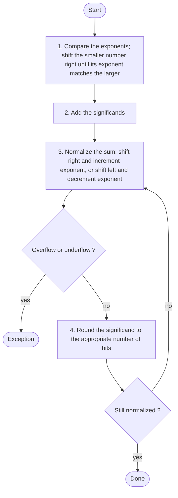
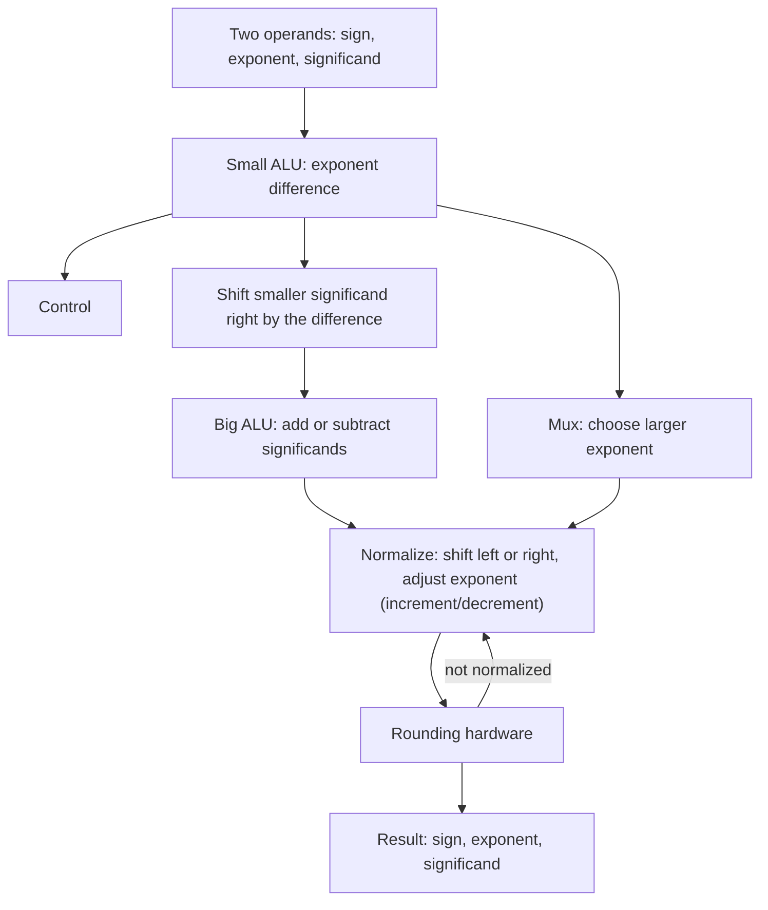
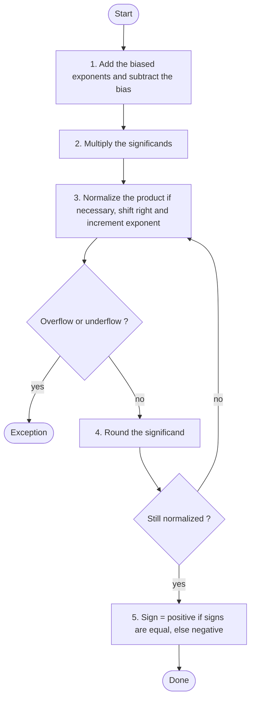

# بخش ۳، جلسه‌ی ۸ از ۱۰: جمع و ضرب ممیز شناور

این جلسه بخشی از **بخش ۳: محاسبات کامپیوتری** است. زمان مطالعه: حدود نیم ساعت.

**فهرست این جلسه:**

- ۱. جمع ممیز شناور در مبنای ده
- ۲. الگوریتم جمع
- ۳. جمع ممیز شناور در مبنای دو
- ۴. سخت‌افزار جمع ممیز شناور
- ۵. ضرب ممیز شناور در مبنای ده
- ۶. الگوریتم ضرب
- ۷. ضرب ممیز شناور در مبنای دو
- ۸. تقسیم و جذر
- ۹. تمرین‌ها

---

## ۱. جمع ممیز شناور در مبنای ده

کتاب COD الگوریتم را اول در مبنای ده نشان می‌دهد، چون برای ما آشناتر است. فرض کن ماشین ما فقط **چهار رقم** مانتیس و **دو رقم** توان دارد. می‌خواهیم این دو عدد را جمع کنیم:

```math
9.999 \times 10^{1} + 1.610 \times 10^{-1}
```

**گام ۱: هم‌تراز کردن ممیز.** نمی‌توان مانتیس‌ها را مستقیم جمع کرد، چون توان‌ها فرق دارند. عدد با توان **کوچک‌تر** را طوری بازنویسی می‌کنیم که توانش با دیگری برابر شود. یعنی مانتیس آن را به راست شیفت می‌دهیم:

```math
1.610 \times 10^{-1} = 0.1610 \times 10^{0} = 0.01610 \times 10^{1}
```

چون فقط چهار رقم داریم، رقم‌های اضافه از دست می‌روند و عدد 0.016 × 10¹ می‌شود.

**گام ۲: جمع مانتیس‌ها.**

```math
9.999 + 0.016 = 10.015 \quad\Rightarrow\quad 10.015 \times 10^{1}
```

**گام ۳: نرمال کردن.** نتیجه نرمال نیست. ممیز را جابه‌جا و توان را تنظیم می‌کنیم:

```math
10.015 \times 10^{1} = 1.0015 \times 10^{2}
```

حالا باید بررسی کنیم توان از برد مجاز بیرون نرفته باشد. یعنی **سرریز یا زیرریز** رخ نداده باشد. اینجا توان ۲ در دو رقم جا می‌شود.

**گام ۴: گرد کردن.** مانتیس پنج رقم دارد ولی فقط چهار رقم جا داریم. رقم پنجم ۵ است، پس به بالا گرد می‌کنیم:

```math
1.0015 \times 10^{2} \;\Rightarrow\; 1.002 \times 10^{2}
```

گرد کردن ممکن است دوباره نتیجه را غیرنرمال کند. مثلاً 9.9999 به 10.000 گرد می‌شود. پس بعد از گرد کردن باید دوباره نرمال بودن را بررسی کنیم.

## ۲. الگوریتم جمع



چند نکته:

- **کدام عدد شیفت می‌خورد:** همیشه عدد با توان کوچک‌تر. اگر عدد بزرگ‌تر را شیفت می‌دادیم، رقم‌های پرارزش آن از دست می‌رفت که خطای خیلی بزرگ‌تری است.
- **جمع یا تفریق:** اگر علامت‌ها مخالف باشند، مانتیس‌ها کم می‌شوند. چون IEEE 754 از نمایش علامت و اندازه استفاده می‌کند، جمع‌کننده‌ی مانتیس باید بتواند تفریق هم بکند.
- **نرمال کردن به چپ:** در تفریق دو عدد نزدیک به هم، نتیجه ممکن است صفرهای زیادی در ابتدا داشته باشد. پس مانتیس باید چند بیت به چپ شیفت بخورد. به این پدیده **حذف (Cancellation)** می‌گویند و منبع اصلی خطای محاسبات عددی است.

## ۳. جمع ممیز شناور در مبنای دو

مثال کتاب: 0.5 + (−0.4375) با فرض ۴ بیت دقت.

ابتدا به دودویی نرمال:

```math
0.5 = \tfrac{1}{2} = 0.1_2 = 1.000_2 \times 2^{-1}
```

```math
-0.4375 = -\tfrac{7}{16} = -0.0111_2 = -1.110_2 \times 2^{-2}
```

**گام ۱:** توان دوم کوچک‌تر است، پس آن را یک بیت به راست شیفت می‌دهیم:

```math
-1.110_2 \times 2^{-2} = -0.111_2 \times 2^{-1}
```

**گام ۲:** جمع مانتیس‌ها:

```math
1.000_2 - 0.111_2 = 0.001_2 \quad\Rightarrow\quad 0.001_2 \times 2^{-1}
```

**گام ۳:** نرمال کردن. نتیجه سه صفر ابتدایی دارد، پس سه بیت به چپ شیفت می‌دهیم و توان را سه واحد کم می‌کنیم:

```math
0.001_2 \times 2^{-1} = 1.000_2 \times 2^{-4}
```

توان −4 بین −126 و +127 است، پس سرریز و زیرریز نداریم. با بایاس، توان ذخیره‌شده −4 + 127 = 123 است.

**گام ۴:** گرد کردن. نتیجه در ۴ بیت جا می‌شود، پس تغییری نمی‌کند.

```math
1.000_2 \times 2^{-4} = \tfrac{1}{16} = 0.0625
```

که درست است: 0.5 − 0.4375 = 0.0625.

## ۴. سخت‌افزار جمع ممیز شناور



مراحل سخت‌افزار به ترتیب الگوریتم:

- **واحد ALU کوچک:** توان‌ها را از هم کم می‌کند تا بفهمد کدام بزرگ‌تر است و چقدر.
- **مالتی‌پلکسرها:** توان بزرگ‌تر و مانتیس عدد کوچک‌تر (برای شیفت) را انتخاب می‌کنند.
- **شیفت‌دهنده به راست:** مانتیس عدد کوچک‌تر را به اندازه‌ی تفاضل توان‌ها شیفت می‌دهد.
- **واحد ALU بزرگ:** مانتیس‌ها را جمع یا تفریق می‌کند.
- **واحد نرمال‌سازی:** نتیجه را به چپ یا راست شیفت می‌دهد و توان را تنظیم می‌کند. برای شیفت به چپ، باید تعداد صفرهای ابتدایی شمرده شود.
- **سخت‌افزار گرد کردن:** نتیجه را گرد می‌کند و اگر لازم شد، دوباره به مرحله‌ی نرمال‌سازی برمی‌گرداند.

این مدار خیلی بیشتر از یک جمع‌کننده‌ی صحیح طول می‌کشد. برای همین در پردازنده‌ها جمع ممیز شناور چند سیکل طول می‌کشد (معمولاً ۳ تا ۵ سیکل) و به شکل **خط لوله** ساخته می‌شود. در بخش ۷ و ۸ این تأخیرها را در زمان‌بندی دستورات می‌بینیم.

## ۵. ضرب ممیز شناور در مبنای ده

مثال کتاب: باز هم با چهار رقم مانتیس.

```math
1.110 \times 10^{10} \times 9.200 \times 10^{-5}
```

**گام ۱: جمع توان‌ها.**

```math
10 + (-5) = 5
```

اگر توان‌ها بایاس‌دار باشند، باید مراقب باشیم. با بایاس ۱۲۷:

```math
(10 + 127) + (-5 + 127) = 137 + 122 = 259
```

این غلط است، چون بایاس دو بار اضافه شده است. پس باید یک بار بایاس را کم کنیم:

```math
259 - 127 = 132 = 5 + 127
```

**گام ۲: ضرب مانتیس‌ها.**

```math
1.110 \times 9.200 = 10.212000
```

هر مانتیس سه رقم بعد از ممیز دارد، پس حاصل شش رقم بعد از ممیز دارد. نتیجه 10.212 × 10⁵ است.

**گام ۳: نرمال کردن.**

```math
10.212 \times 10^{5} = 1.0212 \times 10^{6}
```

و بررسی سرریز و زیرریز توان.

**گام ۴: گرد کردن** به چهار رقم:

```math
1.0212 \times 10^{6} \;\Rightarrow\; 1.021 \times 10^{6}
```

**گام ۵: تعیین علامت.** اگر علامت‌ها یکی باشند، حاصل مثبت و اگر متفاوت باشند منفی است. اینجا هر دو مثبت‌اند:

```math
+1.021 \times 10^{6}
```

## ۶. الگوریتم ضرب



نکته‌ها:

- **ضرب مانتیس‌ها:** این همان ضرب صحیح بدون علامت جلسه‌ی ۳-۴ است، روی ۲۴ یا ۵۳ بیت.
- **نرمال کردن ساده‌تر:** حاصل ضرب دو عدد بین ۱ و ۲، بین ۱ و ۴ است. پس حداکثر یک بیت شیفت به راست لازم است. برخلاف جمع، شیفت به چپ لازم نیست.
- **علامت مستقل:** علامت حاصل فقط XOR دو بیت علامت است.

## ۷. ضرب ممیز شناور در مبنای دو

مثال کتاب: 0.5 × (−0.4375) با ۴ بیت دقت.

```math
1.000_2 \times 2^{-1} \;\times\; -1.110_2 \times 2^{-2}
```

**گام ۱: جمع توان‌ها.** بدون بایاس: −1 + (−2) = −3. با بایاس:

```math
(-1 + 127) + (-2 + 127) - 127 = 126 + 125 - 127 = 124
```

**گام ۲: ضرب مانتیس‌ها.**

```text
        1.000
      x 1.110
      -------
         0000
        1000
       1000
      1000
     --------
      1110000   ->  1.110000  (6 bits after the point)
```

نتیجه 1.110000₂ × 2⁻³ است که با ۴ بیت 1.110₂ × 2⁻³ می‌شود.

**گام ۳:** حاصل نرمال است. توان −3 در برد مجاز است.

**گام ۴:** گرد کردن تغییری نمی‌دهد.

**گام ۵:** علامت‌ها متفاوت‌اند، پس حاصل منفی است:

```math
-1.110_2 \times 2^{-3} = -0.001110_2 = -\tfrac{7}{32} = -0.21875
```

بررسی: 0.5 × −0.4375 = −0.21875.

## ۸. تقسیم و جذر

تقسیم ممیز شناور هم الگوریتم مشابهی دارد:

- **توان:** توان‌ها کم می‌شوند و بایاس یک بار اضافه می‌شود.
- **مانتیس:** مانتیس‌ها تقسیم می‌شوند. حاصل بین ۰.۵ و ۲ است، پس حداکثر یک بیت شیفت به چپ لازم است.
- **علامت:** مثل ضرب، XOR دو علامت.

تقسیم و جذر خیلی کندتر از جمع و ضرب‌اند. در پردازنده‌های امروزی تقسیم دقت مضاعف معمولاً ۱۰ تا ۲۰ سیکل و حتی بیشتر طول می‌کشد و اغلب **خط لوله نیست**. بعضی پردازنده‌ها تقسیم را با **روش نیوتن-رافسون** انجام می‌دهند: ابتدا یک تقریب از 1/b را از جدول برمی‌دارند و با چند ضرب آن را دقیق می‌کنند. چون ضرب سریع و خط لوله‌ای است، این روش سریع است.

در بخش ۸ سؤال امتحان ۰۲-۰۳ را حل می‌کنیم که در آن جمع ممیز شناور ۳، ضرب ۱۰ و تقسیم ۲۰ سیکل فرض شده است. حالا می‌دانی چرا تقسیم این‌قدر طولانی‌تر است.

## ۹. تمرین‌ها

<details>
<summary>تمرین ۱: جمع ده‌دهی</summary>

**صورت:** با چهار رقم مانتیس، 8.765 × 10³ + 2.345 × 10¹ را حساب کن.

**جواب:** عدد دوم را دو رقم به راست شیفت می‌دهیم: 0.02345 × 10³ که با چهار رقم 0.023 × 10³ می‌شود. جمع: 8.765 + 0.023 = 8.788. نتیجه 8.788 × 10³ است که نرمال است. مقدار دقیق 8788.45 است، پس با گرد کردن درست جواب 8.788 × 10³ است و این‌بار خطای شیفت اثری نداشت.
</details>

<details>
<summary>تمرین ۲: جمع دودویی</summary>

**صورت:** حاصل 1.5 + 0.375 را با ۴ بیت دقت و قدم‌به‌قدم حساب کن.

**جواب:** 1.5 = 1.100₂ × 2⁰ و 0.375 = 0.011₂ = 1.100₂ × 2⁻². عدد دوم را دو بیت به راست شیفت می‌دهیم: 0.011₂ × 2⁰. جمع مانتیس‌ها: 1.100 + 0.011 = 1.111. نتیجه 1.111₂ × 2⁰ = 1.875 است که نرمال است و در ۴ بیت جا می‌شود.
</details>

<details>
<summary>تمرین ۳: ضرب با توان بایاس‌دار</summary>

**صورت:** دو عدد دقت ساده با توان ذخیره‌شده‌ی ۲۰۰ و ۱۸۰ ضرب می‌شوند. توان ذخیره‌شده‌ی حاصل چیست؟ آیا سرریز رخ می‌دهد؟

**جواب:** 200 + 180 − 127 = 253، با فرض اینکه نرمال‌سازی توان را تغییر ندهد. توان واقعی 253 − 127 = 126 است که مجاز است. ولی اگر حاصل‌ضرب مانتیس‌ها بین ۲ و ۴ باشد، نرمال‌سازی توان را یکی زیاد می‌کند و 254 می‌شود که هنوز مجاز است. اگر توان‌ها ۲۰۰ و ۱۹۰ بودند، حاصل 263 می‌شد که از 254 بیشتر است و سرریز رخ می‌داد.
</details>

---

جلسه‌ی قبلی: [نمایش اعداد ممیز شناور](3-7-floating-point-representation.md)  
جلسه‌ی بعدی: [دقت، گرد کردن و دستورات ممیز شناور MIPS](3-9-rounding-and-mips-fp.md)
