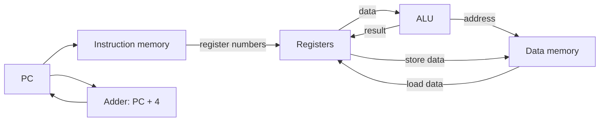
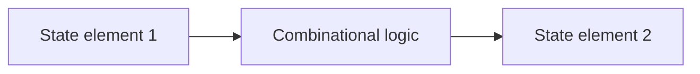
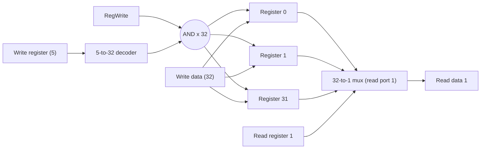

# بخش ۴، جلسه‌ی ۱ از ۱۱: مقدمه و قراردادهای طراحی منطقی

این جلسه بخشی از **بخش ۴: مسیر داده و کنترل تک‌سیکلی و چندسیکلی** است. زمان مطالعه: حدود نیم ساعت.

**فهرست این جلسه:**

- ۱. از ISA به سخت‌افزار
- ۲. زیرمجموعه‌ی MIPS که می‌سازیم
- ۳. نمای کلی اجرای یک دستور
- ۴. سه سبک پیاده‌سازی
- ۵. عناصر ترکیبی و حالت‌دار
- ۶. روش زمان‌بندی با ساعت
- ۷. لچ و فلیپ‌فلاپ
- ۸. فایل ثبات
- ۹. تمرین‌ها

---

## ۱. از ISA به سخت‌افزار

در بخش ۱ دیدیم که کارایی یک برنامه به سه چیز بستگی دارد:

```math
\text{CPU time} = \text{Instruction count} \times \text{CPI} \times \text{Clock cycle time}
```

تعداد دستور را کامپایلر و ISA تعیین می‌کنند. ولی **CPI** و **زمان سیکل ساعت** را پیاده‌سازی پردازنده تعیین می‌کند. در این بخش یاد می‌گیریم یک پردازنده‌ی MIPS را از قطعه‌هایی که در بخش ۳ ساختیم (ALU، جمع‌کننده، مالتی‌پلکسر و ثبات) سرهم کنیم.

پردازنده دو بخش اصلی دارد:

- **مسیر داده (Datapath):** قطعه‌هایی که داده را نگه می‌دارند، جابه‌جا می‌کنند و رویش عمل انجام می‌دهند. مثل ALU، فایل ثبات و حافظه.
- **واحد کنترل (Control):** بر اساس دستور، به مسیر داده می‌گوید چه کار کند. یعنی تعیین می‌کند کدام مالتی‌پلکسر کدام ورودی را انتخاب کند، ALU چه عملی انجام دهد و کدام عنصر نوشته شود.

اسلاید درس می‌گوید روش‌هایی که در این بخش برای طراحی مسیر داده و کنترل یاد می‌گیریم، **هسته‌ی همه‌ی معماری‌های امروزی** است. پردازنده‌های پیچیده‌ی امروزی هم همین ایده‌ها را در مقیاس بزرگ‌تر دارند.

## ۲. زیرمجموعه‌ی MIPS که می‌سازیم

برای اینکه طراحی قابل فهم بماند، فقط این دستورات را پیاده می‌کنیم:

| دسته | دستورات | قالب |
|---|---|---|
| دستورات حسابی و منطقی | `add`، `sub`، `and`، `or`، `slt` | قالب R |
| دستورات حافظه | `lw`، `sw` | قالب I |
| دستورات کنترل جریان | `beq` و در انتها `j` | قالب I و J |

این زیرمجموعه کوچک است، ولی همه‌ی ایده‌های اصلی را نشان می‌دهد. بقیه‌ی دستورات (مثل `addi`، `jal` یا شیفت‌ها) را با همین روش می‌توان اضافه کرد. در جلسه‌ی ۴-۱۰ چند دستور جدید، از جمله دستورات سؤال‌های امتحانی، را اضافه می‌کنیم.

یادآوری قالب‌ها از جلسه‌ی ۲-۴:

| قالب | بیت‌های 31–26 | بیت‌های 25–21 | بیت‌های 20–16 | بیت‌های 15–11 | بیت‌های 10–6 | بیت‌های 5–0 |
|---|---|---|---|---|---|---|
| قالب R | op | rs | rt | rd | shamt | funct |
| قالب I | op | rs | rt | ثابت ۱۶ بیتی | ثابت | ثابت |
| قالب J | op | آدرس ۲۶ بیتی | آدرس | آدرس | آدرس | آدرس |

## ۳. نمای کلی اجرای یک دستور

برای هر دستور، دو گام اول همیشه یکی است:

1. **واکشی دستور:** محتوای PC را به حافظه‌ی دستور بفرست و دستور را بخوان.
2. **خواندن ثبات‌ها:** با فیلدهای دستور، یک یا دو ثبات را بخوان. برای `lw` فقط یک ثبات و برای بقیه دو ثبات.

بعد از این دو گام، کار به نوع دستور بستگی دارد، ولی برای همه‌ی دسته‌ها شباهت زیادی دارد. همه‌ی دستورات به‌جز `j` از ALU استفاده می‌کنند:

- **دستورات حافظه** از ALU برای محاسبه‌ی آدرس استفاده می‌کنند.
- **دستورات حسابی** از ALU برای خود عمل استفاده می‌کنند.
- **پرش شرطی** از ALU برای مقایسه استفاده می‌کند.

بعد از ALU:

- **دستور `lw`** از حافظه‌ی داده می‌خواند و در ثبات می‌نویسد.
- **دستور `sw`** در حافظه‌ی داده می‌نویسد.
- **دستورات حسابی** نتیجه‌ی ALU را در ثبات می‌نویسند.
- **پرش شرطی** بر اساس نتیجه‌ی مقایسه، PC را عوض می‌کند. اگر پرش نکند، مثل بقیه‌ی دستورات PC + 4 در PC نوشته می‌شود.



این شکل هنوز کامل نیست. مثلاً نشان نمی‌دهد که ورودی ثبات‌ها از دو جای مختلف می‌آید (ALU یا حافظه). برای انتخاب بین منبع‌های مختلف به **مالتی‌پلکسر** و برای کنترل آن‌ها به **واحد کنترل** نیاز داریم. در جلسه‌های بعد این‌ها را اضافه می‌کنیم.

## ۴. سه سبک پیاده‌سازی

اسلاید درس سه سبک پیاده‌سازی را معرفی می‌کند:

| سبک | ایده | مزیت | عیب |
|---|---|---|---|
| تک‌سیکلی (Single cycle) | هر دستور در یک سیکل ساعت | ساده، CPI برابر ۱ | سیکل به اندازه‌ی کندترین دستور طولانی است |
| چندسیکلی (Multicycle) | هر دستور به چند گام شکسته می‌شود و هر گام یک سیکل | هر دستور فقط به اندازه‌ی گام‌های لازم سیکل می‌گیرد، سخت‌افزار کمتر | CPI بیشتر از ۱ |
| خط لوله‌ای (Pipelined) | گام‌های دستورات مختلف همزمان اجرا می‌شوند، مثل خط تولید | تقریباً یک دستور در هر سیکل با سیکل کوتاه | پیچیدگی مخاطره‌ها |

در این بخش دو سبک اول را کامل می‌سازیم. سبک سوم موضوع بخش ۵ است. اسلاید می‌گوید: معماری MIPS از ابتدا **برای خط لوله طراحی شده بود**.

## ۵. عناصر ترکیبی و حالت‌دار

سخت‌افزار مسیر داده از دو نوع عنصر ساخته می‌شود:

- **عنصر ترکیبی (Combinational element):** خروجی آن فقط به ورودی فعلی بستگی دارد. حافظه ندارد. با ورودی یکسان، همیشه خروجی یکسان می‌دهد. مثال: ALU، جمع‌کننده، مالتی‌پلکسر و گیت AND.
- **عنصر حالت‌دار (State element):** حافظه‌ی داخلی دارد. خروجی آن به داده‌ی ذخیره‌شده بستگی دارد. مثال: ثبات‌ها، PC، حافظه‌ی دستور و حافظه‌ی داده.

اسلاید یک آزمایش ذهنی پیشنهاد می‌کند: اگر کامپیوتر را خاموش و دوباره روشن کنی و بخواهی دقیقاً از همان نقطه ادامه بدهی، چه چیزهایی باید ذخیره شده باشد؟ همان **عناصر حالت‌دار**. مجموع محتوای این عناصر را **حالت ماشین** می‌گوییم.

یک عنصر حالت‌دار دست‌کم دو ورودی دارد:

- **ورودی داده:** مقداری که باید نوشته شود.
- **ورودی ساعت:** تعیین می‌کند **کی** نوشته شود.

## ۶. روش زمان‌بندی با ساعت

**روش زمان‌بندی (Clocking methodology)** تعیین می‌کند سیگنال‌ها کی می‌توانند خوانده و کی نوشته شوند. این خیلی مهم است. اگر یک سیگنال همزمان خوانده و نوشته شود، مقدار خوانده‌شده ممکن است مقدار قدیمی، مقدار جدید یا ترکیبی از هر دو باشد.

دو روش وجود دارد:

- **حساس به سطح (Level-triggered):** عنصر حالت‌دار وقتی ساعت در سطح بالا (یا پایین) است، تغییر می‌کند.
- **حساس به لبه (Edge-triggered):** عنصر حالت‌دار فقط روی **لبه‌ی** ساعت تغییر می‌کند، یعنی لحظه‌ی رفتن از پایین به بالا (لبه‌ی بالارونده) یا برعکس.

ما از روش **حساس به لبه** استفاده می‌کنیم. ساختار کلی هر سیکل این است:



- **در لبه‌ی ساعت:** عنصر حالت‌دار ۱ مقدار جدیدش را بیرون می‌دهد.
- **در طول سیکل:** منطق ترکیبی روی آن کار می‌کند و خروجی آرام‌آرام پایدار می‌شود.
- **در لبه‌ی بعدی:** عنصر حالت‌دار ۲ نتیجه را ذخیره می‌کند.

نکته‌ی مهم: با روش حساس به لبه، یک عنصر حالت‌دار می‌تواند **در یک سیکل هم خوانده و هم نوشته شود**، بدون مسابقه. مقدار قدیمی در طول سیکل خوانده می‌شود و مقدار جدید در لبه‌ی انتهایی نوشته می‌شود. مثلاً دستور `add $t0, $t0, $t1` ثبات `$t0` را هم می‌خواند و هم می‌نویسد.


### سیگنال کنترل نوشتن

اگر عنصر حالت‌دار در **هر** لبه‌ی ساعت نوشته شود، به سیگنال کنترل نیازی ندارد. مثلاً PC در طراحی تک‌سیکلی هر سیکل نوشته می‌شود. ولی برای عنصری مثل فایل ثبات که فقط گاهی نوشته می‌شود، یک سیگنال **فعال‌ساز نوشتن (Write enable)** لازم است، مثل `RegWrite`. نوشتن فقط وقتی انجام می‌شود که هم لبه‌ی ساعت برسد و هم این سیگنال فعال باشد.

یک قرارداد نام‌گذاری: سیگنالی که مقدارش ۱ است **فعال (Asserted)** و سیگنالی که ۰ است **غیرفعال (Deasserted)** نام دارد.

### طول سیکل ساعت

طول سیکل ساعت باید آن‌قدر باشد که سیگنال‌ها از طولانی‌ترین مسیر ترکیبی بین دو عنصر حالت‌دار عبور کنند. به علاوه، زمان راه‌اندازی (Setup time) و تأخیر عنصر حالت‌دار را هم باید در نظر گرفت. این طولانی‌ترین مسیر همان **مسیر بحرانی** است که در جلسه‌ی ۳-۲ دیدیم.

## ۷. لچ و فلیپ‌فلاپ

اسلاید درس عناصر حالت‌دار یک‌بیتی را مرور می‌کند:

- **لچ SR بدون ساعت:** از دو گیت NAND (یا NOR) متقاطع ساخته می‌شود. دو ورودی Set و Reset دارد. اگر هر دو همزمان فعال شوند، حالت بعدی نامعلوم است.
- **لچ SR با ساعت:** فقط وقتی ساعت بالاست تغییر می‌کند. هنوز مشکل فعال شدن همزمان دو ورودی را دارد.
- **لچ D با ساعت:** یک ورودی داده (D) دارد. وقتی ساعت بالاست، خروجی Q برابر D می‌شود. مشکل نامعلومی ندارد. ولی **شفاف** است: تا وقتی ساعت بالاست، هر تغییری در D به Q می‌رسد.
- **فلیپ‌فلاپ D:** فقط روی **لبه‌ی** ساعت مقدار D را می‌گیرد. معمولاً از دو لچ D پشت سر هم ساخته می‌شود (ساختار ارباب و برده، Master-slave). اسلاید نسخه‌ای را نشان می‌دهد که از سه لچ SR ساخته شده و با لبه‌ی پایین‌رونده کار می‌کند.

| عنصر | حساس به | کاربرد |
|---|---|---|
| لچ (Latch) | سطح ساعت | ساده‌تر، ولی شفاف است |
| فلیپ‌فلاپ (Flip-flop) | لبه‌ی ساعت | پایه‌ی ثبات‌ها در طراحی ما |

برای اینکه فلیپ‌فلاپ مقدار را درست ذخیره کند، ورودی D باید مدتی قبل از لبه (زمان راه‌اندازی، Setup) و مدتی بعد از لبه (زمان نگه‌داری، Hold) ثابت بماند.

## ۸. فایل ثبات

فایل ثبات MIPS سی‌ودو ثبات ۳۲ بیتی دارد که با **دو درگاه خواندن** و **یک درگاه نوشتن** دسترسی‌پذیر است:

| ورودی یا خروجی | عرض |
|---|---|
| شماره‌ی ثبات خواندنی اول (Read register 1) | 5 بیت |
| شماره‌ی ثبات خواندنی دوم (Read register 2) | 5 بیت |
| شماره‌ی ثبات نوشتنی (Write register) | 5 بیت |
| داده‌ی نوشتنی (Write data) | 32 بیت |
| سیگنال نوشتن (RegWrite) | 1 بیت |
| داده‌ی خوانده‌شده‌ی اول و دوم (Read data 1 و 2) | 32 بیت هر کدام |

پیاده‌سازی، طبق اسلاید:

- **درگاه‌های خواندن:** هر درگاه یک مالتی‌پلکسر ۳۲ به ۱ با عرض ۳۲ بیت است. شماره‌ی ثبات، سیگنال انتخاب مالتی‌پلکسر است. خواندن **ترکیبی** است و به ساعت نیاز ندارد.
- **درگاه نوشتن:** یک رمزگشای ۵ به ۳۲ شماره‌ی ثبات را به ۳۲ خط تبدیل می‌کند. هر خط با `RegWrite` AND می‌شود و ورودی ساعت ثبات مربوط را کنترل می‌کند. داده‌ی نوشتنی به همه‌ی ثبات‌ها می‌رسد، ولی فقط یکی آن را ذخیره می‌کند.



چرا دو درگاه خواندن و یک درگاه نوشتن؟ چون دستورات قالب R دو منبع و یک مقصد دارند. هر درگاه اضافه سطح تراشه و تأخیر را بالا می‌برد. این تصمیم مستقیماً از طراحی ISA می‌آید و در جلسه‌ی ۴-۱۰ می‌بینیم که دستوری مثل `CADD.Z` با چهار ثبات، دقیقاً همین محدودیت را به چالش می‌کشد.

## ۹. تمرین‌ها

<details>
<summary>تمرین ۱: ترکیبی یا حالت‌دار</summary>

**صورت:** هر کدام از این قطعه‌ها ترکیبی است یا حالت‌دار؟ ALU، PC، مالتی‌پلکسر، فایل ثبات، واحد گسترش علامت، حافظه‌ی داده.

**جواب:**

| قطعه | نوع |
|---|---|
| واحد ALU | ترکیبی |
| ثبات PC | حالت‌دار |
| مالتی‌پلکسر | ترکیبی |
| فایل ثبات | حالت‌دار (ولی خواندنش ترکیبی است) |
| واحد گسترش علامت | ترکیبی |
| حافظه‌ی داده | حالت‌دار |
</details>

<details>
<summary>تمرین ۲: هزینه‌ی درگاه</summary>

**صورت:** فایل ثباتی با ۳۲ ثبات ۳۲ بیتی می‌خواهیم که سه درگاه خواندن داشته باشد. چه سخت‌افزاری اضافه می‌شود؟

**جواب:** یک مالتی‌پلکسر ۳۲ به ۱ دیگر با عرض ۳۲ بیت، یعنی ۳۲ مالتی‌پلکسر یک‌بیتی ۳۲ ورودی، به‌علاوه‌ی ۵ سیم ورودی شماره‌ی ثبات و ۳۲ سیم خروجی. در پیاده‌سازی واقعی با حافظه‌ی SRAM، هر خانه‌ی ثبات یک خط بیت و یک خط کلمه‌ی اضافه می‌گیرد. پس سطح هر خانه تقریباً به نسبت مجذور تعداد درگاه‌ها بزرگ می‌شود.
</details>

<details>
<summary>تمرین ۳: خواندن و نوشتن در یک سیکل</summary>

**صورت:** چرا دستور `add $t0, $t0, $t1` در طراحی حساس به لبه مشکلی ندارد، ولی در طراحی حساس به سطح با لچ ممکن است مشکل داشته باشد؟

**جواب:** در طراحی حساس به لبه، `$t0` در طول سیکل خوانده می‌شود و نتیجه فقط در لبه‌ی پایانی نوشته می‌شود. پس مقدار خوانده‌شده تا پایان سیکل ثابت است. در طراحی با لچ شفاف، تا وقتی ساعت بالاست، مقدار جدید `$t0` بلافاصله به خروجی می‌رسد، دوباره وارد جمع‌کننده می‌شود و نتیجه را دوباره عوض می‌کند. این یک حلقه‌ی بدون کنترل است که ممکن است چند بار اتفاق بیفتد.
</details>

---

جلسه‌ی بعدی: [ساختن مسیر داده‌ی تک‌سیکلی](4-2-single-cycle-datapath.md)
