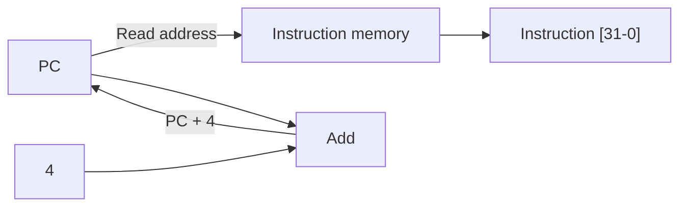
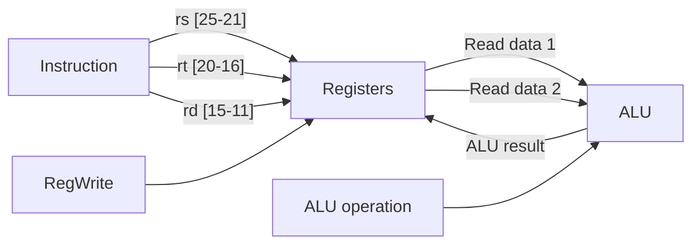
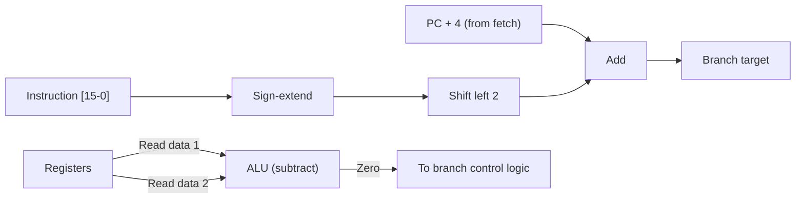
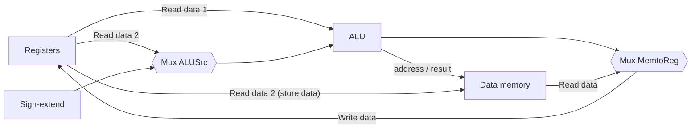
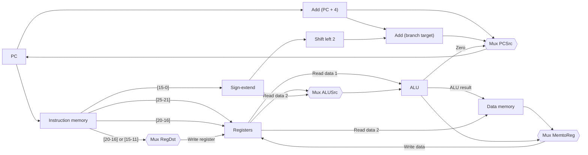

# بخش ۴، جلسه‌ی ۲ از ۱۱: ساختن مسیر داده‌ی تک‌سیکلی

این جلسه بخشی از **بخش ۴: مسیر داده و کنترل تک‌سیکلی و چندسیکلی** است. زمان مطالعه: حدود نیم ساعت.

**فهرست این جلسه:**

- ۱. روش کار
- ۲. واکشی دستور و افزایش PC
- ۳. دستورات قالب R
- ۴. دستورات بارگذاری و ذخیره
- ۵. پرش شرطی beq
- ۶. ترکیب مسیرها با مالتی‌پلکسر
- ۷. مسیر داده‌ی کامل
- ۸. تمرین‌ها

---

## ۱. روش کار

برای ساختن مسیر داده، هر دسته‌ی دستور را جداگانه بررسی می‌کنیم و می‌بینیم چه قطعه‌هایی لازم دارد. بعد این قطعه‌ها را با مالتی‌پلکسر به هم وصل می‌کنیم تا یک مسیر داده‌ی واحد بسازیم.

در طراحی **تک‌سیکلی**، هر دستور دقیقاً در یک سیکل ساعت اجرا می‌شود. از یک لبه‌ی ساعت شروع و در لبه‌ی بعدی تمام می‌شود. این قید یک نتیجه‌ی مهم دارد: **هیچ قطعه‌ای نمی‌تواند در یک دستور دو بار استفاده شود**. اگر دستوری به دو جمع نیاز دارد، باید دو جمع‌کننده داشته باشیم.

## ۲. واکشی دستور و افزایش PC

سه قطعه برای واکشی لازم است:

- **حافظه‌ی دستور (Instruction memory):** آدرس را می‌گیرد و دستور را برمی‌گرداند. در این طراحی فقط خوانده می‌شود، پس آن را ترکیبی فرض می‌کنیم: خروجی همیشه دستورِ آدرس فعلی است و سیگنال کنترل خواندن لازم ندارد.
- **شمارنده‌ی برنامه (PC):** یک ثبات ۳۲ بیتی که آدرس دستور فعلی را دارد. در هر سیکل نوشته می‌شود، پس سیگنال نوشتن ندارد.
- **جمع‌کننده:** یک ALU که همیشه جمع می‌کند، برای ساختن PC + 4.



در هر سیکل: دستور از آدرس PC خوانده می‌شود و همزمان جمع‌کننده PC + 4 را حساب می‌کند. در لبه‌ی بعدی ساعت، PC + 4 در PC نوشته می‌شود.

## ۳. دستورات قالب R

دستوری مثل `add rd, rs, rt` دو ثبات را می‌خواند، عملی روی آن‌ها انجام می‌دهد و نتیجه را در ثبات سوم می‌نویسد:

```text
R[rd] <- R[rs] op R[rt]
```

دو قطعه لازم است:

- **فایل ثبات:** که در جلسه‌ی قبل دیدیم. شماره‌ی rs و rt به درگاه‌های خواندن و rd به درگاه نوشتن وصل می‌شود.
- **واحد ALU:** که در جلسه‌ی ۳-۲ ساختیم. یک ورودی کنترل ۴ بیتی دارد و خروجی Zero هم دارد.



## ۴. دستورات بارگذاری و ذخیره

دستورات `lw rt, offset(rs)` و `sw rt, offset(rs)` آدرس را با جمع ثبات پایه و ثابت ۱۶ بیتی **گسترش علامت داده‌شده** حساب می‌کنند:

```text
lw:  R[rt] <- Mem[R[rs] + SignExt(offset)]
sw:  Mem[R[rs] + SignExt(offset)] <- R[rt]
```

دو قطعه‌ی جدید لازم است:

- **حافظه‌ی داده (Data memory):** یک ورودی آدرس، یک ورودی داده‌ی نوشتنی و یک خروجی داده‌ی خوانده‌شده دارد. دو سیگنال کنترل `MemRead` و `MemWrite` دارد. برخلاف فایل ثبات، خواندن حافظه‌ی داده سیگنال کنترل لازم دارد، چون خواندن از آدرس نامعتبر می‌تواند مشکل ایجاد کند.
- **واحد گسترش علامت (Sign-extension unit):** ورودی ۱۶ بیتی را به ۳۲ بیت تبدیل می‌کند (جلسه‌ی ۲-۳).

مسیرها:

- **دستور `lw`:** ثبات rs خوانده می‌شود، ALU آن را با ثابت گسترش‌یافته جمع می‌کند، حاصل به‌عنوان آدرس به حافظه‌ی داده می‌رود، و داده‌ی خوانده‌شده در ثبات rt نوشته می‌شود.
- **دستور `sw`:** ثبات‌های rs و rt خوانده می‌شوند، ALU آدرس را حساب می‌کند و مقدار rt در حافظه نوشته می‌شود.

به این نکته دقت کن: در `lw` ثبات مقصد **rt** است، نه rd. پس شماره‌ی ثبات نوشتنی گاهی از بیت‌های ۲۰ تا ۱۶ و گاهی از بیت‌های ۱۵ تا ۱۱ می‌آید. این یک مالتی‌پلکسر لازم دارد که در جلسه‌ی بعد اضافه می‌کنیم.

## ۵. پرش شرطی beq

دستور `beq rs, rt, offset` سه کار دارد:

1. دو ثبات را بخواند و با هم مقایسه کند.
2. آدرس مقصد پرش را حساب کند.
3. بر اساس نتیجه‌ی مقایسه، PC را با PC + 4 یا با آدرس مقصد پر کند.

```math
\text{Branch target} = (\text{PC} + 4) + \text{SignExt}(\text{offset}) \times 4
```

جزئیات (جلسه‌ی ۲-۷):

- **پایه‌ی آدرس:** PC + 4 است، یعنی آدرس دستور بعدی. همان چیزی که جمع‌کننده‌ی واکشی ساخته است.
- **ضرب در ۴:** با **شیفت به چپ به اندازه‌ی ۲** انجام می‌شود. اسلاید درس تأکید می‌کند که برای این شیفت هیچ سخت‌افزاری لازم نیست: فقط سیم‌ها با دو خانه جابه‌جایی وصل می‌شوند و دو بیت پایین به صفر وصل می‌شوند.
- **مقایسه:** با ALU انجام می‌شود. ALU دو ثبات را از هم **کم می‌کند** و خروجی **Zero** نشان می‌دهد که برابرند یا نه.
- **جمع‌کننده‌ی جدید:** چون ALU در همین سیکل برای مقایسه مشغول است، آدرس مقصد با یک **جمع‌کننده‌ی جداگانه** حساب می‌شود. این همان قید طراحی تک‌سیکلی است.



دو اصطلاح:

- **پرش انجام‌شده (Branch taken):** شرط برقرار است و PC برابر آدرس مقصد می‌شود.
- **پرش انجام‌نشده (Branch not taken):** شرط برقرار نیست و PC برابر PC + 4 می‌شود، مثل هر دستور دیگر.

یک نکته از کتاب: در MIPS واقعی پرش‌ها **تأخیری (Delayed)** هستند. یعنی دستور بعد از پرش همیشه اجرا می‌شود (جلسه‌ی ۲-۸). در طراحی تک‌سیکلی این موضوع اهمیتی ندارد و آن را نادیده می‌گیریم. در بخش ۵ دلیلش را می‌فهمیم.

## ۶. ترکیب مسیرها با مالتی‌پلکسر

حالا مسیرهای جداگانه را یکی می‌کنیم. هر جا که یک ورودی از دو منبع مختلف می‌آید، یک مالتی‌پلکسر می‌گذاریم.

### ترکیب قالب R و دستورات حافظه

دو تفاوت بین این دو دسته:

| تفاوت | قالب R | دستورات حافظه | مالتی‌پلکسر |
|---|---|---|---|
| ورودی دوم ALU | ثبات (Read data 2) | ثابت گسترش‌یافته | مالتی‌پلکسر **ALUSrc** |
| داده‌ی نوشتنی در ثبات | نتیجه‌ی ALU | داده‌ی حافظه | مالتی‌پلکسر **MemtoReg** |



### حافظه‌ی دستور و داده‌ی جدا

اسلاید درس یک سؤال مهم دارد: چرا حافظه‌ی دستور و حافظه‌ی داده جدا هستند؟ چون در طراحی تک‌سیکلی، دستور `lw` در **همان سیکل** هم دستور را می‌خواند و هم داده را. یک حافظه‌ی تک‌درگاهی نمی‌تواند در یک سیکل دو دسترسی داشته باشد. در کامپیوترهای واقعی، این دو معمولاً **کش دستور و کش داده‌ی جدا** هستند که از یک حافظه‌ی اصلی مشترک پر می‌شوند (بخش ۶).

### اضافه کردن پرش

یک مالتی‌پلکسر دیگر ورودی PC را بین PC + 4 و آدرس مقصد پرش انتخاب می‌کند. سیگنال انتخاب آن **PCSrc** است.

## ۷. مسیر داده‌ی کامل



در این شکل همه‌ی قطعه‌های لازم برای هفت دستور ما (به‌جز `j`) وجود دارند. شکل ۴.۱۱ کتاب COD همین مسیر را با جزئیات دقیق نشان می‌دهد. حالا فقط مانده که بگوییم برای هر دستور هر مالتی‌پلکسر چه چیزی انتخاب کند و ALU چه عملی انجام دهد. این کار **واحد کنترل** است که موضوع جلسه‌ی بعد است.

### فهرست قطعه‌ها

| قطعه | تعداد | چرا |
|---|---|---|
| حافظه‌ی دستور | 1 | واکشی |
| حافظه‌ی داده | 1 | جدا از حافظه‌ی دستور، چون در یک سیکل هر دو لازم است |
| فایل ثبات | 1 | دو درگاه خواندن، یک درگاه نوشتن |
| واحد ALU | 1 | عمل اصلی، آدرس یا مقایسه |
| جمع‌کننده | 2 | یکی PC + 4 و یکی آدرس پرش، چون ALU مشغول است |
| مالتی‌پلکسر | 4 | ورودی‌های RegDst، ALUSrc، MemtoReg و PCSrc |
| واحد گسترش علامت | 1 | ثابت ۱۶ بیتی |
| شیفت به چپ ۲ | 1 | فقط سیم‌کشی |

## ۸. تمرین‌ها

<details>
<summary>تمرین ۱: مسیر یک دستور</summary>

**صورت:** برای دستور `sw $t0, 8($s1)`، کدام قطعه‌های مسیر داده فعال‌اند و کدام بی‌استفاده؟

**جواب:** فعال: PC، حافظه‌ی دستور، جمع‌کننده‌ی PC + 4، فایل ثبات (خواندن `$s1` و `$t0`)، واحد گسترش علامت، ALU (جمع برای آدرس)، حافظه‌ی داده (نوشتن). بی‌استفاده: نوشتن در فایل ثبات، خروجی حافظه‌ی داده، مالتی‌پلکسر MemtoReg و جمع‌کننده‌ی آدرس پرش (کار می‌کند ولی خروجی‌اش انتخاب نمی‌شود).
</details>

<details>
<summary>تمرین ۲: جمع‌کننده‌ی اضافه</summary>

**صورت:** آیا می‌توان جمع‌کننده‌ی PC + 4 را حذف کرد و از ALU استفاده کرد؟

**جواب:** در طراحی تک‌سیکلی خیر. دستورات قالب R، حافظه و پرش همه در همان سیکل از ALU استفاده می‌کنند، و PC + 4 هم باید در همان سیکل حساب شود. چون هر قطعه فقط یک بار در هر سیکل استفاده می‌شود، جمع‌کننده‌ی جداگانه لازم است. در طراحی چندسیکلی (جلسه‌ی ۴-۶) دقیقاً همین جمع‌کننده‌ها حذف می‌شوند، چون ALU در سیکل‌های مختلف استفاده می‌شود.
</details>

<details>
<summary>تمرین ۳: پرش با بیت‌های اضافه</summary>

**صورت:** اگر ثابت پرش به جای ۲ بیت، ۳ بیت به چپ شیفت داده می‌شد، چه مزیت و عیبی داشت؟

**جواب:** مزیت: برد پرش دو برابر می‌شد. عیب: چون دستورات ۴ بایتی‌اند، آدرس مقصد مضرب ۸ می‌شد و نمی‌توانستیم به نیمی از دستورات بپریم. پس شیفت ۲ بیتی دقیقاً به اندازه‌ی ردیف بودن دستورات است و هیچ بیتی هدر نمی‌رود.
</details>

---

جلسه‌ی قبلی: [مقدمه و قراردادهای طراحی منطقی](4-1-introduction-and-logic-conventions.md)  
جلسه‌ی بعدی: [واحد کنترل ALU و سیگنال‌های کنترل](4-3-alu-control-and-control-signals.md)
