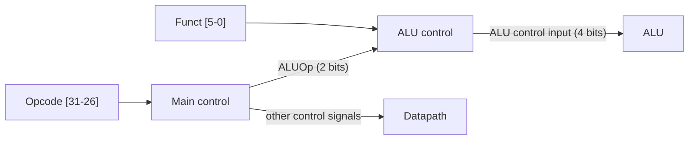
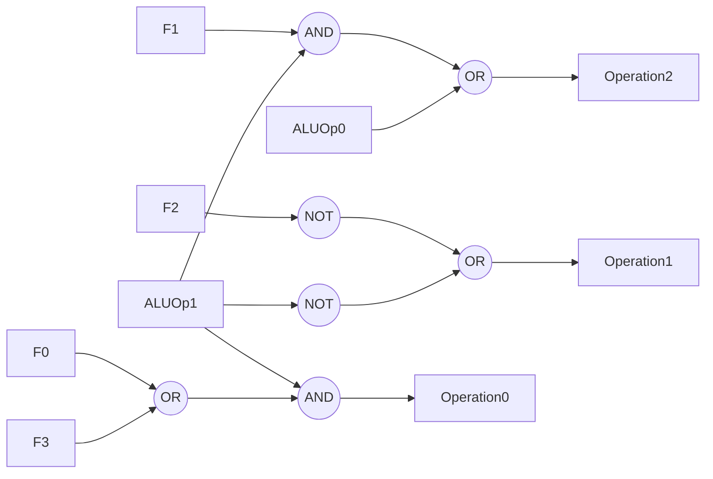
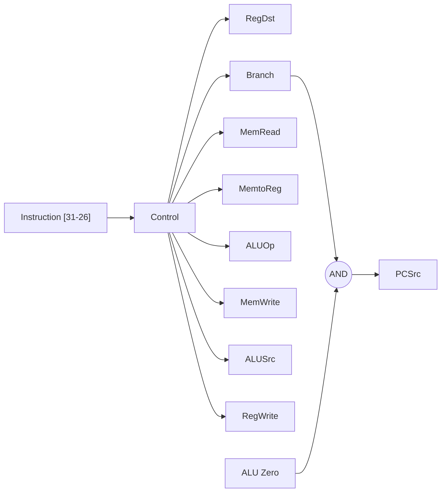

# بخش ۴، جلسه‌ی ۳ از ۱۱: واحد کنترل ALU و سیگنال‌های کنترل

این جلسه بخشی از **بخش ۴: مسیر داده و کنترل تک‌سیکلی و چندسیکلی** است. زمان مطالعه: حدود نیم ساعت.

**فهرست این جلسه:**

- ۱. دو سطح کنترل
- ۲. کار ALU برای هر دستور
- ۳. جدول درستی کنترل ALU
- ۴. معادله‌های منطقی کنترل ALU
- ۵. مشاهدات درباره‌ی قالب دستور
- ۶. مالتی‌پلکسر RegDst
- ۷. هفت سیگنال تک‌بیتی
- ۸. تمرین‌ها

---

## ۱. دو سطح کنترل

واحد کنترل از **کد عمل** دستور (بیت‌های ۳۱ تا ۲۶) سه نوع خروجی می‌سازد:

- **ورودی کنترل ALU:** که عمل ALU را تعیین می‌کند.
- **سیگنال‌های فعال‌ساز:** برای هر عنصر حالت‌دار که نوشته یا خوانده می‌شود، مثل `RegWrite` و `MemRead`.
- **سیگنال‌های انتخاب:** برای هر مالتی‌پلکسر.

برای ساده‌تر شدن طراحی، کنترل را دو سطح می‌کنیم:



- **کنترل اصلی (Main control):** از روی کد عمل، همه‌ی سیگنال‌ها را می‌سازد. برای ALU فقط یک سیگنال دوبیتی به نام **ALUOp** می‌فرستد.
- **کنترل ALU (ALU control):** از روی ALUOp و فیلد funct، ورودی ۴ بیتی ALU را می‌سازد.

این روش **رمزگشایی چندسطحی (Multiple levels of decoding)** نام دارد. مزایایش:

- **کنترل اصلی کوچک‌تر:** کنترل اصلی لازم نیست فیلد funct را ببیند.
- **سرعت بیشتر:** هر بلوک کوچک‌تر است و ممکن است سریع‌تر باشد. در طراحی‌های واقعی، کنترل ALU معمولاً روی مسیر بحرانی است.

## ۲. کار ALU برای هر دستور

از جلسه‌ی ۳-۲، خطوط کنترل ALU این‌ها هستند:

| ورودی کنترل ALU | عمل |
|---|---|
| مقدار 0000 | AND |
| مقدار 0001 | OR |
| مقدار 0010 | add |
| مقدار 0110 | subtract |
| مقدار 0111 | set on less than |
| مقدار 1100 | NOR |

اسلاید درس از نسخه‌ی قدیمی‌تر کتاب استفاده می‌کند که ALU آن NOR نداشت و کنترلش ۳ بیتی بود: 000 برای AND، 001 برای OR، 010 برای add، 110 برای sub و 111 برای slt. این همان جدول بالاست، فقط بدون بیت Ainvert. هر دو را بلد باش.

حالا ALU برای هر دستور چه باید بکند:

| دستور | کار ALU | مقدار ALUOp |
|---|---|---|
| دستورات `lw` و `sw` | جمع، برای محاسبه‌ی آدرس | 00 |
| دستور `beq` | تفریق، برای مقایسه | 01 |
| دستورات قالب R | بسته به فیلد funct: and، or، add، sub یا slt | 10 |

## ۳. جدول درستی کنترل ALU

| کد عمل دستور | مقدار ALUOp | عمل دستور | فیلد funct | عمل ALU | ورودی کنترل ALU |
|---|---|---|---|---|---|
| دستور `lw` | 00 | load word | XXXXXX | add | 0010 |
| دستور `sw` | 00 | store word | XXXXXX | add | 0010 |
| دستور `beq` | 01 | branch equal | XXXXXX | subtract | 0110 |
| نوع R | 10 | add | 100000 | add | 0010 |
| نوع R | 10 | subtract | 100010 | subtract | 0110 |
| نوع R | 10 | AND | 100100 | AND | 0000 |
| نوع R | 10 | OR | 100101 | OR | 0001 |
| نوع R | 10 | set on less than | 101010 | set on less than | 0111 |

علامت X یعنی «اهمیت ندارد» (Don't care). وقتی ALUOp برابر 00 یا 01 است، فیلد funct اصلاً بررسی نمی‌شود. در دستورات `lw`، `sw` و `beq` آن بیت‌ها بخشی از ثابت ۱۶ بیتی‌اند.

### جدول فشرده با «اهمیت ندارد»

بیت‌های funct همه مهم نیستند. مثلاً بیت‌های F5 و F4 در همه‌ی دستورات قالب R ما 10 هستند. با این مشاهده جدول کوچک‌تر می‌شود:

| بیت ALUOp1 | بیت ALUOp0 | F5 | F4 | F3 | F2 | F1 | F0 | عمل |
|---|---|---|---|---|---|---|---|---|
| مقدار 0 | 0 | X | X | X | X | X | X | 0010 |
| مقدار X | 1 | X | X | X | X | X | X | 0110 |
| مقدار 1 | X | X | X | 0 | 0 | 0 | 0 | 0010 |
| مقدار 1 | X | X | X | 0 | 0 | 1 | 0 | 0110 |
| مقدار 1 | X | X | X | 0 | 1 | 0 | 0 | 0000 |
| مقدار 1 | X | X | X | 0 | 1 | 0 | 1 | 0001 |
| مقدار 1 | X | X | X | 1 | 0 | 1 | 0 | 0111 |

چرا می‌توانیم ALUOp0 را در سطرهای قالب R و ALUOp1 را در سطر `beq` نادیده بگیریم؟ چون مقدار 11 برای ALUOp هیچ‌وقت تولید نمی‌شود.

### اشتباه چاپی که اسلاید اشاره می‌کند

اسلاید درس روی شکل ۵.۱۵ کتاب قدیمی یک اشتباه را نشان داده است: در سطر دوم، اگر ALUOp1 به جای صفر برابر X باشد، این سطر با سطرهای قالب R (که ALUOp1 در آن‌ها یک است) تداخل پیدا می‌کند، مگر اینکه مطمئن باشیم ALUOp هیچ‌وقت 11 نمی‌شود. با قرارداد «11 تولید نمی‌شود»، هر دو نسخه درست کار می‌کنند. اگر در امتحان این جدول را نوشتی، این فرض را ذکر کن.

## ۴. معادله‌های منطقی کنترل ALU

از جدول فشرده، معادله‌های هر بیت خروجی به دست می‌آید. اسم بیت‌های خروجی را Operation3 تا Operation0 می‌گذاریم:

```math
\begin{aligned}
\text{Operation3} &= 0 \\
\text{Operation2} &= \text{ALUOp0} + \text{ALUOp1} \cdot F_1 \\
\text{Operation1} &= \overline{\text{ALUOp1}} + \overline{F_2} \\
\text{Operation0} &= \text{ALUOp1} \cdot (F_3 + F_0)
\end{aligned}
```

بررسی برای چند حالت:

| دستور | ALUOp | funct | Op2 | Op1 | Op0 | نتیجه |
|---|---|---|---|---|---|---|
| دستور `lw` | 00 | – | 0 | 1 | 0 | 0010 یعنی add |
| دستور `beq` | 01 | – | 1 | 1 | 0 | 0110 یعنی sub |
| دستور `add` | 10 | 100000 | 0 | 1 | 0 | 0010 یعنی add |
| دستور `sub` | 10 | 100010 | 1 | 1 | 0 | 0110 یعنی sub |
| دستور `and` | 10 | 100100 | 0 | 0 | 0 | 0000 یعنی AND |
| دستور `or` | 10 | 100101 | 0 | 0 | 1 | 0001 یعنی OR |
| دستور `slt` | 10 | 101010 | 1 | 1 | 1 | 0111 یعنی slt |

بیت Operation3 همیشه صفر است، چون هیچ‌کدام از دستورات ما NOR نیست. اگر `nor` را اضافه کنیم، این بیت هم معادله پیدا می‌کند. یادت باشد که در ALU جلسه‌ی ۳-۲، بیت Operation2 همان **Bnegate** و بیت Operation3 همان **Ainvert** است.



## ۵. مشاهدات درباره‌ی قالب دستور

قبل از طراحی کنترل اصلی، اسلاید درس این مشاهدات را درباره‌ی قالب‌های دستور مرور می‌کند:

| فیلد | جای ثابت | نتیجه برای مسیر داده |
|---|---|---|
| کد عمل | همیشه بیت‌های 31–26 | ورودی کنترل اصلی |
| دو ثبات خواندنی | همیشه rs در 25–21 و rt در 20–16 | مستقیم به درگاه‌های خواندن |
| ثبات پایه در lw و sw | همیشه rs در 25–21 | مستقیم به درگاه خواندن اول |
| ثابت ۱۶ بیتی | همیشه بیت‌های 15–0 | مستقیم به واحد گسترش علامت |
| ثبات مقصد | در lw بیت‌های 20–16 (rt) و در قالب R بیت‌های 15–11 (rd) | یک مالتی‌پلکسر لازم است |

این شباهت‌ها تصادفی نیستند. ISA طوری طراحی شده که مسیر داده ساده بماند. این همان اصل «سادگی با نظم» است.

## ۶. مالتی‌پلکسر RegDst

برای حل مشکل ثبات مقصد، یک مالتی‌پلکسر جلوی ورودی Write register فایل ثبات می‌گذاریم:

- اگر **RegDst = 0** باشد، شماره‌ی ثبات نوشتنی از بیت‌های 20–16 (rt) می‌آید. برای `lw`.
- اگر **RegDst = 1** باشد، از بیت‌های 15–11 (rd) می‌آید. برای قالب R.

## ۷. هفت سیگنال تک‌بیتی

به‌جز ALUOp، هفت سیگنال تک‌بیتی داریم. جدول زیر اثر هر سیگنال را نشان می‌دهد:

| سیگنال | اثر وقتی غیرفعال (۰) است | اثر وقتی فعال (۱) است |
|---|---|---|
| سیگنال RegDst | شماره‌ی ثبات مقصد از فیلد rt (بیت‌های 20–16) | شماره‌ی ثبات مقصد از فیلد rd (بیت‌های 15–11) |
| سیگنال RegWrite | هیچ | ثبات مقصد با Write data نوشته می‌شود |
| سیگنال ALUSrc | ورودی دوم ALU از Read data 2 | ورودی دوم ALU ثابت گسترش‌یافته است |
| سیگنال PCSrc | ورودی PC از PC + 4 | ورودی PC آدرس مقصد پرش است |
| سیگنال MemRead | هیچ | حافظه‌ی داده در آدرس داده‌شده خوانده می‌شود |
| سیگنال MemWrite | هیچ | حافظه‌ی داده در آدرس داده‌شده با Write data نوشته می‌شود |
| سیگنال MemtoReg | داده‌ی نوشتنی در ثبات از ALU | داده‌ی نوشتنی در ثبات از حافظه‌ی داده |

### سیگنال PCSrc

سیگنال PCSrc را نمی‌توان مستقیماً از کد عمل ساخت، چون به نتیجه‌ی مقایسه هم بستگی دارد. پس کنترل اصلی یک سیگنال به نام **Branch** می‌سازد که فقط برای `beq` فعال است و PCSrc از AND آن با خروجی Zero به دست می‌آید:

```math
\text{PCSrc} = \text{Branch} \cdot \text{Zero}
```

پس خروجی‌های کنترل اصلی در مجموع ۹ بیت‌اند: RegDst، ALUSrc، MemtoReg، RegWrite، MemRead، MemWrite، Branch و دو بیت ALUOp.



## ۸. تمرین‌ها

<details>
<summary>تمرین ۱: افزودن nor</summary>

**صورت:** فیلد funct دستور `nor` برابر 100111 است. معادله‌ی Operation3 و تغییرات لازم در معادله‌های دیگر را بنویس.

**جواب:** کد ALU برای NOR برابر 1100 است. با ALUOp = 10 و F3..F0 = 0111:

- **بیت Operation3:** باید فقط برای nor یک باشد. در بین دستورات ما فقط nor هر دو بیت F2 و F1 را یک دارد، پس Operation3 = ALUOp1 · F2 · F1.
- **بیت Operation2:** باید یک باشد. با معادله‌ی فعلی، ALUOp1 · F1 = 1 است. درست است.
- **بیت Operation1:** باید صفر باشد. معادله‌ی فعلی نقیض F2 را می‌دهد که صفر است. درست است.
- **بیت Operation0:** باید صفر باشد. ولی معادله‌ی فعلی ALUOp1 · (F3 + F0) با F0 = 1 مقدار یک می‌دهد. باید اصلاح شود، مثلاً Operation0 = ALUOp1 · (F3 + F0 · نقیض F1). برای or (با F1 = 0) هنوز یک می‌دهد و برای nor صفر.
</details>

<details>
<summary>تمرین ۲: سیگنال گیرکرده</summary>

**صورت:** اگر سیگنال RegDst به دلیل خرابی همیشه صفر بماند، کدام دستورات درست کار نمی‌کنند؟

**جواب:** دستورات قالب R. نتیجه‌ی آن‌ها به جای rd در rt نوشته می‌شود. دستورات `lw`، `sw` و `beq` درست کار می‌کنند، چون `lw` همان rt را می‌خواهد و دو دستور دیگر در ثبات نمی‌نویسند. این نوع سؤال در کتاب COD (تمرین‌های ۴.۷ به بعد) زیاد است.
</details>

<details>
<summary>تمرین ۳: کدام سیگنال‌ها لازم است</summary>

**صورت:** چرا فایل ثبات سیگنال خواندن ندارد ولی حافظه‌ی داده دارد؟

**جواب:** خواندن فایل ثبات بی‌خطر است و همیشه انجام می‌شود. اگر دستور به آن نیاز نداشته باشد، خروجی نادیده گرفته می‌شود. ولی خواندن حافظه‌ی داده با آدرس نامعتبر (مثلاً وقتی ALU در یک دستور قالب R یک عدد دلخواه تولید کرده) ممکن است خطای دسترسی، خطای صفحه یا عدم اصابت کش ایجاد کند. پس فقط وقتی واقعاً لازم است فعال می‌شود.
</details>

---

جلسه‌ی قبلی: [ساختن مسیر داده‌ی تک‌سیکلی](4-2-single-cycle-datapath.md)  
جلسه‌ی بعدی: [کنترل اصلی، اجرای دستورات و پرش j](4-4-main-control-and-jump.md)
