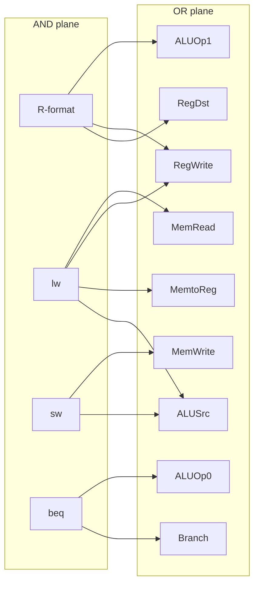
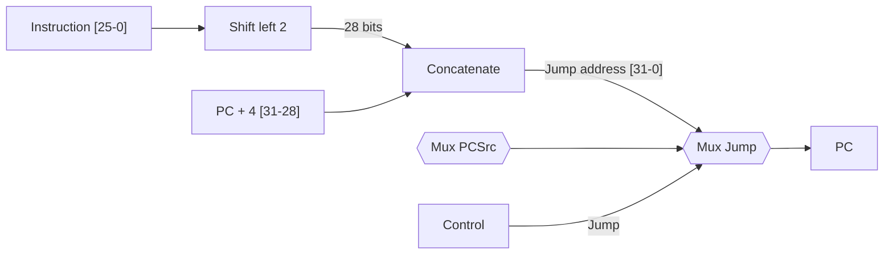

# بخش ۴، جلسه‌ی ۴ از ۱۱: کنترل اصلی، اجرای دستورات و پرش j

این جلسه بخشی از **بخش ۴: مسیر داده و کنترل تک‌سیکلی و چندسیکلی** است. زمان مطالعه: حدود نیم ساعت.

**فهرست این جلسه:**

- ۱. جدول کنترل اصلی
- ۲. اجرای دستور قالب R
- ۳. اجرای دستور lw
- ۴. اجرای دستور beq
- ۵. پیاده‌سازی منطقی کنترل اصلی
- ۶. افزودن پرش j
- ۷. نکته‌های مهم درباره‌ی طراحی تک‌سیکلی
- ۸. تمرین‌ها

---

## ۱. جدول کنترل اصلی

کنترل اصلی فقط شش بیت کد عمل را می‌بیند و ۹ سیگنال می‌سازد. جدول کامل (شکل ۴.۱۸ کتاب COD و اسلاید درس):

| دستور | RegDst | ALUSrc | MemtoReg | RegWrite | MemRead | MemWrite | Branch | ALUOp1 | ALUOp0 |
|---|---|---|---|---|---|---|---|---|---|
| قالب R | 1 | 0 | 0 | 1 | 0 | 0 | 0 | 1 | 0 |
| دستور `lw` | 0 | 1 | 1 | 1 | 1 | 0 | 0 | 0 | 0 |
| دستور `sw` | X | 1 | X | 0 | 0 | 1 | 0 | 0 | 0 |
| دستور `beq` | X | 0 | X | 0 | 0 | 0 | 1 | 0 | 1 |

چرا هر سطر این‌طور است:

- **قالب R:** ثبات مقصد rd است (RegDst=1). ورودی دوم ALU ثبات است (ALUSrc=0). نتیجه از ALU به ثبات می‌رود (MemtoReg=0، RegWrite=1). با حافظه کاری ندارد. ALUOp برابر 10 یعنی «به funct نگاه کن».
- **دستور `lw`:** ثبات مقصد rt است (RegDst=0). ورودی دوم ALU ثابت است (ALUSrc=1). داده از حافظه به ثبات می‌رود (MemtoReg=1، RegWrite=1، MemRead=1). ALUOp برابر 00 یعنی «جمع کن».
- **دستور `sw`:** ثابت به ALU می‌رود و حافظه نوشته می‌شود (MemWrite=1). در ثبات نمی‌نویسد (RegWrite=0)، پس RegDst و MemtoReg اهمیتی ندارند.
- **دستور `beq`:** دو ثبات با تفریق مقایسه می‌شوند (ALUSrc=0، ALUOp=01). سیگنال Branch فعال است. در ثبات و حافظه نمی‌نویسد.

### چرا X مجاز است و کجا مجاز نیست

مقدار X برای مالتی‌پلکسری مجاز است که خروجی‌اش استفاده نمی‌شود. ولی برای سیگنال‌های **نوشتن** مثل RegWrite و MemWrite هرگز X نمی‌گذاریم. اگر در `sw` سیگنال RegWrite تصادفاً یک شود، یک ثبات خراب می‌شود. پس سیگنال‌های نوشتن همیشه باید صریح صفر یا یک باشند.

## ۲. اجرای دستور قالب R

کتاب و اسلاید اجرای `add $t1, $t2, $t3` را در چهار مرحله نشان می‌دهند. همه‌ی این مراحل در **یک سیکل** اتفاق می‌افتند. مراحل فقط ترتیب جریان سیگنال‌ها در مسیر ترکیبی را نشان می‌دهند:

1. **واکشی:** دستور از حافظه‌ی دستور خوانده و PC + 4 حساب می‌شود.
2. **خواندن ثبات‌ها:** ثبات‌های `$t2` و `$t3` خوانده می‌شوند. همزمان کنترل اصلی مقادیر سیگنال‌ها را از کد عمل حساب می‌کند.
3. **محاسبه:** ALU روی دو مقدار کار می‌کند. کد عمل ALU از فیلد funct (بیت‌های 5–0) و ALUOp ساخته می‌شود.
4. **نوشتن:** نتیجه‌ی ALU در ثبات `$t1` (فیلد rd، بیت‌های 15–11) نوشته می‌شود.

اسلاید تأکید می‌کند: مسیر داده کاملاً **ترکیبی** است و در طول سیکل هیچ چیزی ذخیره نمی‌شود. همه‌ی سیگنال‌ها از شروع سیکل جریان پیدا می‌کنند و فقط در **پایان سیکل** به حالت پایدار می‌رسند. نوشتن در لبه‌ی پایانی ساعت انجام می‌شود.

## ۳. اجرای دستور lw

دستور `lw $t1, offset($t2)` پنج مرحله‌ی منطقی دارد:

1. **واکشی** دستور و افزایش PC.
2. **خواندن** ثبات `$t2` (بیت‌های 25–21).
3. **محاسبه‌ی آدرس:** ALU مقدار `$t2` را با ثابت گسترش‌یافته‌ی ۱۶ بیت پایین جمع می‌کند.
4. **دسترسی به حافظه:** حاصل ALU آدرس حافظه‌ی داده است.
5. **نوشتن:** داده‌ی حافظه در ثبات `$t1` (بیت‌های 20–16) نوشته می‌شود.

این طولانی‌ترین مسیر در بین همه‌ی دستورات است، چون از **پنج** واحد کاری پشت سر هم عبور می‌کند: حافظه‌ی دستور، فایل ثبات، ALU، حافظه‌ی داده و دوباره فایل ثبات.

## ۴. اجرای دستور beq

دستور `beq $t1, $t2, offset`:

1. **واکشی** دستور و افزایش PC.
2. **خواندن** دو ثبات `$t1` و `$t2`.
3. **مقایسه و محاسبه‌ی مقصد:** ALU دو ثبات را از هم کم می‌کند. همزمان جمع‌کننده‌ی دوم PC + 4 را با ثابت گسترش‌یافته و شیفت‌یافته جمع می‌کند.
4. **انتخاب PC:** خروجی Zero با Branch AND می‌شود و تعیین می‌کند کدام جمع‌کننده در PC نوشته شود.

## ۵. پیاده‌سازی منطقی کنترل اصلی

کدهای عمل چهار دستور ما:

| دستور | کد عمل ده‌دهی | Op5 | Op4 | Op3 | Op2 | Op1 | Op0 |
|---|---|---|---|---|---|---|---|
| قالب R | 0 | 0 | 0 | 0 | 0 | 0 | 0 |
| دستور `lw` | 35 | 1 | 0 | 0 | 0 | 1 | 1 |
| دستور `sw` | 43 | 1 | 0 | 1 | 0 | 1 | 1 |
| دستور `beq` | 4 | 0 | 0 | 0 | 1 | 0 | 0 |

ابتدا برای هر دستور یک گیت AND می‌سازیم که فقط برای همان کد عمل یک شود:

```math
\begin{aligned}
\text{Rformat} &= \overline{Op_5}\,\overline{Op_4}\,\overline{Op_3}\,\overline{Op_2}\,\overline{Op_1}\,\overline{Op_0} \\
\text{lw} &= Op_5\,\overline{Op_4}\,\overline{Op_3}\,\overline{Op_2}\,Op_1\,Op_0 \\
\text{sw} &= Op_5\,\overline{Op_4}\,Op_3\,\overline{Op_2}\,Op_1\,Op_0 \\
\text{beq} &= \overline{Op_5}\,\overline{Op_4}\,\overline{Op_3}\,Op_2\,\overline{Op_1}\,\overline{Op_0}
\end{aligned}
```

بعد هر خروجی، OR آن دستوراتی است که آن سیگنال را فعال می‌کنند:

```math
\begin{aligned}
\text{RegDst} &= \text{Rformat} \\
\text{ALUSrc} &= \text{lw} + \text{sw} \\
\text{MemtoReg} &= \text{lw} \\
\text{RegWrite} &= \text{Rformat} + \text{lw} \\
\text{MemRead} &= \text{lw} \\
\text{MemWrite} &= \text{sw} \\
\text{Branch} &= \text{beq} \\
\text{ALUOp1} &= \text{Rformat} \\
\text{ALUOp0} &= \text{beq}
\end{aligned}
```

این ساختار دو سطحی (یک سطح AND و یک سطح OR) همان **آرایه‌ی منطقی برنامه‌پذیر (PLA)** است. در جلسه‌ی ۴-۸ دوباره PLA را برای کنترل چندسیکلی می‌بینیم.



## ۶. افزودن پرش j

دستور `j` قالب J دارد: کد عمل ۲ و یک آدرس ۲۶ بیتی. از جلسه‌ی ۲-۷:

```math
\text{Jump target} = (\text{PC} + 4)[31{:}28] \;\Vert\; \text{address}[25{:}0] \;\Vert\; 00
```

برای پیاده‌سازی:

- **شیفت ۲ بیتی:** آدرس ۲۶ بیتی دو بیت به چپ شیفت می‌خورد و ۲۸ بیت می‌شود. این هم فقط سیم‌کشی است.
- **چهار بیت بالا:** از PC + 4 گرفته می‌شود و به‌عنوان بیت‌های 31–28 به ۲۸ بیت قبلی چسبانده می‌شود.
- **مالتی‌پلکسر جدید:** یک مالتی‌پلکسر دیگر بعد از مالتی‌پلکسر PCSrc، بین خروجی آن و آدرس پرش j انتخاب می‌کند.
- **سیگنال جدید:** کنترل اصلی یک سیگنال جدید به نام **Jump** می‌سازد که فقط وقتی کد عمل ۲ است فعال است.



سطر جدید جدول کنترل برای `j`:

| دستور | RegDst | ALUSrc | MemtoReg | RegWrite | MemRead | MemWrite | Branch | ALUOp | Jump |
|---|---|---|---|---|---|---|---|---|---|
| دستور `j` | X | X | X | 0 | 0 | 0 | 0 | XX | 1 |

و برای بقیه‌ی دستورات، Jump = 0. دوباره سیگنال‌های نوشتن صریحاً صفرند.

## ۷. نکته‌های مهم درباره‌ی طراحی تک‌سیکلی

- **همه چیز ترکیبی است:** اجرای هر دستور فقط یک سیکل است و داخل سیکل چیزی ذخیره نمی‌شود. «مراحل» فقط ترتیب جریان سیگنال‌اند.
- **مقدار CPI برابر ۱ است:** هر دستور دقیقاً یک سیکل.
- **قطعه‌های تکراری:** هر قطعه‌ای که دو بار در یک دستور لازم است تکرار شده است: دو حافظه و سه جمع‌کننده (ALU، PC + 4 و آدرس پرش).
- **سیکل طولانی:** طول سیکل را کندترین دستور (`lw`) تعیین می‌کند. این بزرگ‌ترین عیب است و موضوع جلسه‌ی بعد است.

اسلاید درس به یک مدل Verilog ساده از کامپیوتر تک‌سیکلی اشاره می‌کند. اگر با Verilog کار کرده‌ای، نوشتن این مسیر داده و کنترل آن در Verilog بهترین تمرین برای فهمیدن همه‌ی جزئیات است. بخش ۴.۱۳ کتاب COD (روی سایت ناشر) هم توصیف Verilog خط لوله‌ی MIPS را دارد که در بخش ۵ به کار می‌آید.

## ۸. تمرین‌ها

<details>
<summary>تمرین ۱: افزودن addi</summary>

**صورت:** دستور `addi rt, rs, imm` با کد عمل ۸ را به طراحی تک‌سیکلی اضافه کن. چه تغییری در مسیر داده و کنترل لازم است؟

**جواب:** مسیر داده تغییری نمی‌خواهد: ورودی دوم ALU ثابت گسترش‌یافته است (مثل `lw`) و نتیجه‌ی ALU در rt نوشته می‌شود. فقط یک سطر جدید در کنترل:

| دستور | RegDst | ALUSrc | MemtoReg | RegWrite | MemRead | MemWrite | Branch | ALUOp | Jump |
|---|---|---|---|---|---|---|---|---|---|
| دستور `addi` | 0 | 1 | 0 | 1 | 0 | 0 | 0 | 00 | 0 |

سیگنال ALUOp برابر 00 یعنی جمع، همان کاری که برای `lw` و `sw` انجام می‌شود.
</details>

<details>
<summary>تمرین ۲: افزودن jal</summary>

**صورت:** دستور `jal` آدرس PC + 4 را در `$ra` (ثبات ۳۱) می‌نویسد و به مقصد می‌پرد. چه تغییری لازم است؟

**جواب:**

- **مالتی‌پلکسر RegDst:** یک ورودی سوم با مقدار ثابت ۳۱ می‌گیرد. پس RegDst دوبیتی می‌شود.
- **مالتی‌پلکسر MemtoReg:** یک ورودی سوم از PC + 4 می‌گیرد. پس MemtoReg هم دوبیتی می‌شود.
- **کنترل:** برای `jal`: Jump = 1، RegWrite = 1، RegDst انتخاب ۳۱، MemtoReg انتخاب PC + 4، و MemWrite = 0.
</details>

<details>
<summary>تمرین ۳: سیگنال گیرکرده</summary>

**صورت:** اگر سیگنال ALUSrc همیشه یک بماند، کدام دستورات خراب می‌شوند؟ اگر MemtoReg همیشه یک بماند چطور؟

**جواب:** با ALUSrc = 1 دستورات قالب R و `beq` خراب می‌شوند، چون به جای ثبات دوم، ثابت (یعنی بیت‌های پایین دستور) را می‌گیرند. با MemtoReg = 1 دستورات قالب R خراب می‌شوند، چون به جای نتیجه‌ی ALU، داده‌ی حافظه در ثبات نوشته می‌شود. دستورات `sw` و `beq` در ثبات نمی‌نویسند، پس از MemtoReg اثر نمی‌گیرند.
</details>

---

جلسه‌ی قبلی: [واحد کنترل ALU و سیگنال‌های کنترل](4-3-alu-control-and-control-signals.md)  
جلسه‌ی بعدی: [کارایی طراحی تک‌سیکلی](4-5-single-cycle-performance.md)
