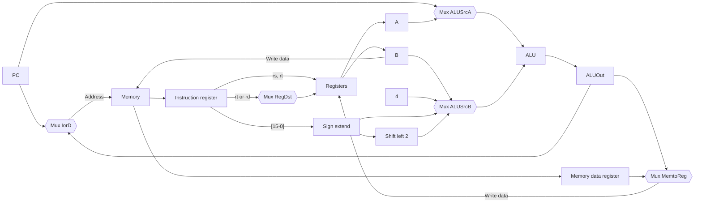
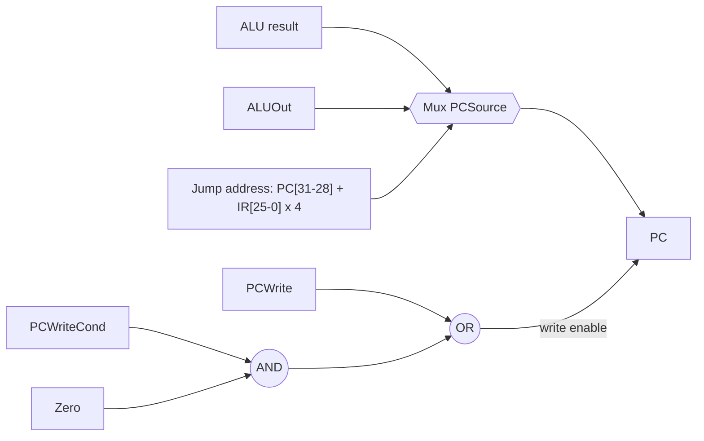

# بخش ۴، جلسه‌ی ۶ از ۱۱: مسیر داده‌ی چندسیکلی

این جلسه بخشی از **بخش ۴: مسیر داده و کنترل تک‌سیکلی و چندسیکلی** است. زمان مطالعه: حدود نیم ساعت.

**فهرست این جلسه:**

- ۱. ایده‌ی اصلی
- ۲. قانون طراحی هر گام
- ۳. حذف قطعه‌های تکراری
- ۴. ثبات‌های داخلی
- ۵. مالتی‌پلکسرهای جدید
- ۶. مسیر داده‌ی کامل با پرش
- ۷. جدول سیگنال‌های کنترل
- ۸. تمرین‌ها

---

## ۱. ایده‌ی اصلی

در **پیاده‌سازی چندسیکلی (Multicycle implementation)**، اجرای هر دستور به چند **گام** شکسته می‌شود و هر گام یک سیکل ساعت می‌گیرد. اسلاید درس ایده‌ها را این‌طور خلاصه می‌کند:

- **گام‌های متعادل:** دستور را طوری بشکن که مقدار کار هر گام تقریباً برابر باشد. طول سیکل برابر کندترین گام است.
- **استفاده‌ی مجدد از قطعه‌ها:** محدود کن که هر گام از هر واحد کاری حداکثر یک بار استفاده کند. پس یک واحد می‌تواند در گام‌های مختلف یک دستور استفاده شود و لازم نیست تکرار شود.
- **ثبات‌های داخلی:** نتیجه‌ی هر گام باید تا گام بعد نگه داشته شود. پس ثبات‌های داخلی **نامرئی برای برنامه‌نویس** اضافه می‌کنیم.
- **دو نوع ثبات:** داده‌ای که در **سیکل بعدی همان دستور** لازم است، در ثبات داخلی نگه داشته می‌شود. داده‌ای که در **دستورات بعدی** لازم است، در عناصر حالت‌دار قابل دیدن برای برنامه‌نویس، یعنی فایل ثبات، PC یا حافظه، ذخیره می‌شود.

## ۲. قانون طراحی هر گام

اسلاید یک قانون مهم دارد: در هر گام حداکثر **یکی** از این‌ها انجام شود:

- **یک عمل ALU**
- **یک دسترسی به فایل ثبات** (خواندن یا نوشتن)
- **یک دسترسی به حافظه**

با فرض‌های جلسه‌ی قبل، این یعنی طول سیکل حدود ۲۰۰ پیکوثانیه (یک دسترسی حافظه) به جای ۶۰۰ پیکوثانیه.

## ۳. حذف قطعه‌های تکراری

در مقایسه با طراحی تک‌سیکلی:

| قطعه در طراحی تک‌سیکلی | در طراحی چندسیکلی | چرا |
|---|---|---|
| حافظه‌ی دستور و حافظه‌ی داده‌ی جدا | یک حافظه‌ی مشترک | واکشی دستور و دسترسی به داده در سیکل‌های جدا انجام می‌شوند |
| یک ALU و دو جمع‌کننده | فقط یک ALU | محاسبه‌ی PC + 4، آدرس پرش و عمل اصلی در سیکل‌های جدا انجام می‌شوند |

در عوض باید مالتی‌پلکسرهای بیشتر و چند ثبات داخلی اضافه کنیم. مالتی‌پلکسر و ثبات خیلی ارزان‌تر از حافظه و جمع‌کننده‌اند، پس در مجموع سخت‌افزار کمتر می‌شود.

## ۴. ثبات‌های داخلی

پنج ثبات داخلی اضافه می‌شوند. همه ۳۲ بیتی‌اند:

| ثبات | نام کامل | چه چیزی نگه می‌دارد | سیگنال نوشتن |
|---|---|---|---|
| ثبات IR | Instruction register | دستور خوانده‌شده از حافظه | دارد (IRWrite) |
| ثبات MDR | Memory data register | داده‌ی خوانده‌شده از حافظه | ندارد، هر سیکل نوشته می‌شود |
| ثبات A | – | خروجی اول فایل ثبات | ندارد، هر سیکل نوشته می‌شود |
| ثبات B | – | خروجی دوم فایل ثبات | ندارد، هر سیکل نوشته می‌شود |
| ثبات ALUOut | – | خروجی ALU | ندارد، هر سیکل نوشته می‌شود |

چرا فقط IR سیگنال نوشتن دارد؟ چون **IR باید در طول همه‌ی سیکل‌های یک دستور ثابت بماند**. بقیه‌ی ثبات‌ها فقط بین دو سیکل پشت سر هم داده را نگه می‌دارند. یعنی هر مقدار فقط در سیکل بعد از نوشته شدنش استفاده می‌شود. پس اشکالی ندارد که در هر سیکل بازنویسی شوند.

این نکته برای سؤال‌های امتحانی «افزودن دستور جدید» **بسیار مهم** است. اگر دستور جدید بخواهد مقدار A یا B یا ALUOut را برای **بیش از یک سیکل** نگه دارد، باید برای آن ثبات سیگنال نوشتن اضافه کنیم. در جلسه‌ی ۴-۱۰ همین مسئله را در دستور `xchg` می‌بینیم.

## ۵. مالتی‌پلکسرهای جدید

چون قطعه‌ها مشترک شده‌اند، ورودی‌هایشان باید از جاهای مختلف بیایند:

- **مالتی‌پلکسر آدرس حافظه (IorD):** آدرس حافظه از PC (برای واکشی دستور) یا از ALUOut (برای دسترسی به داده) می‌آید. نام IorD یعنی Instruction or Data.
- **مالتی‌پلکسر ورودی اول ALU (ALUSrcA):** بین PC (برای PC + 4 و آدرس پرش) و ثبات A (برای عمل اصلی).
- **مالتی‌پلکسر ورودی دوم ALU (ALUSrcB):** حالا چهار ورودی دارد، پس دو بیت کنترل:

| مقدار ALUSrcB | ورودی دوم ALU | کاربرد |
|---|---|---|
| مقدار 00 | ثبات B | قالب R و مقایسه‌ی beq |
| مقدار 01 | ثابت 4 | محاسبه‌ی PC + 4 |
| مقدار 10 | ثابت گسترش‌یافته | محاسبه‌ی آدرس lw و sw |
| مقدار 11 | ثابت گسترش‌یافته و شیفت‌یافته به اندازه‌ی ۲ | محاسبه‌ی آدرس پرش |

- **مالتی‌پلکسرهای RegDst و MemtoReg:** مثل قبل هستند. فقط حالا MemtoReg بین ALUOut و MDR انتخاب می‌کند.



## ۶. مسیر داده‌ی کامل با پرش

برای پرش‌ها، ورودی PC حالا از سه جا می‌آید. پس یک مالتی‌پلکسر سه‌ورودی به نام **PCSource** اضافه می‌کنیم:

| مقدار PCSource | ورودی PC | کاربرد |
|---|---|---|
| مقدار 00 | خروجی مستقیم ALU | PC + 4 در گام واکشی |
| مقدار 01 | ثبات ALUOut | آدرس پرش beq که در گام قبل حساب شده |
| مقدار 10 | آدرس پرش j | ترکیب PC[31:28] با آدرس ۲۶ بیتی شیفت‌یافته |

نوشتن در PC دو حالت دارد:

- **نوشتن غیرشرطی:** در واکشی (PC + 4) و در `j`. سیگنال **PCWrite** این را کنترل می‌کند.
- **نوشتن شرطی:** در `beq`، فقط اگر دو ثبات برابر باشند. سیگنال **PCWriteCond** با خروجی Zero ترکیب می‌شود.

```math
\text{PC write enable} = \text{PCWrite} + (\text{PCWriteCond} \cdot \text{Zero})
```



## ۷. جدول سیگنال‌های کنترل

سیگنال‌های تک‌بیتی:

| سیگنال | اثر وقتی غیرفعال (۰) است | اثر وقتی فعال (۱) است |
|---|---|---|
| سیگنال RegDst | شماره‌ی ثبات مقصد از rt | شماره‌ی ثبات مقصد از rd |
| سیگنال RegWrite | هیچ | ثبات مقصد با Write data نوشته می‌شود |
| سیگنال ALUSrcA | ورودی اول ALU از PC | ورودی اول ALU از ثبات A |
| سیگنال MemRead | هیچ | حافظه در آدرس داده‌شده خوانده می‌شود و روی خروجی می‌آید |
| سیگنال MemWrite | هیچ | حافظه در آدرس داده‌شده با Write data نوشته می‌شود |
| سیگنال MemtoReg | داده‌ی نوشتنی در ثبات از ALUOut | داده‌ی نوشتنی در ثبات از MDR |
| سیگنال IorD | آدرس حافظه از PC | آدرس حافظه از ALUOut |
| سیگنال IRWrite | هیچ | خروجی حافظه در IR نوشته می‌شود |
| سیگنال PCWrite | هیچ | PC نوشته می‌شود؛ منبع با PCSource تعیین می‌شود |
| سیگنال PCWriteCond | هیچ | اگر Zero یک باشد PC نوشته می‌شود |

سیگنال‌های دوبیتی:

| سیگنال | مقدار | اثر |
|---|---|---|
| سیگنال ALUOp | 00 | ALU جمع می‌کند |
| سیگنال ALUOp | 01 | ALU تفریق می‌کند |
| سیگنال ALUOp | 10 | عمل ALU از فیلد funct تعیین می‌شود |
| سیگنال ALUSrcB | 00 تا 11 | جدول بخش ۵ |
| سیگنال PCSource | 00 تا 10 | جدول بخش ۶ |

در مجموع ۱۰ سیگنال تک‌بیتی و ۳ سیگنال دوبیتی، یعنی ۱۶ بیت خروجی کنترل. کنترل ALU همان واحد جلسه‌ی ۴-۳ است.

برخلاف طراحی تک‌سیکلی، این سیگنال‌ها فقط به کد عمل بستگی ندارند. به **گامی که در آن هستیم** هم بستگی دارند. یعنی کنترل چندسیکلی یک **ماشین حالت** است، نه یک مدار ترکیبی ساده. این موضوع جلسه‌ی ۴-۸ است.

## ۸. تمرین‌ها

<details>
<summary>تمرین ۱: چرا IR سیگنال نوشتن دارد</summary>

**صورت:** اگر IR مثل MDR در هر سیکل نوشته می‌شد، در دستور `lw` چه اتفاقی می‌افتاد؟

**جواب:** در گام چهارم `lw`، حافظه از آدرس داده (ALUOut) خوانده می‌شود. اگر IR هم هر سیکل نوشته می‌شد، داده‌ی خوانده‌شده در IR قرار می‌گرفت و دستور از بین می‌رفت. در گام پنجم، فیلد rt دیگر شماره‌ی ثبات درست نبود. همچنین سیگنال‌های کنترل که به کد عمل وابسته‌اند خراب می‌شدند.
</details>

<details>
<summary>تمرین ۲: مقایسه‌ی سخت‌افزار</summary>

**صورت:** فهرست قطعه‌هایی را که در طراحی چندسیکلی نسبت به تک‌سیکلی حذف یا اضافه شده‌اند بنویس.

**جواب:**

| تغییر | قطعه |
|---|---|
| حذف شده | یک حافظه، دو جمع‌کننده |
| اضافه شده | پنج ثبات داخلی (IR، MDR، A، B، ALUOut) |
| اضافه شده | مالتی‌پلکسر IorD و ALUSrcA |
| بزرگ‌تر شده | مالتی‌پلکسر ALUSrcB (چهار ورودی) و PCSource (سه ورودی) |
| تغییر کرده | کنترل به جای مدار ترکیبی، ماشین حالت است |
</details>

<details>
<summary>تمرین ۳: اگر قانون گام را بشکنیم</summary>

**صورت:** فرض کن در یک گام هم ALU کار کند و هم حافظه خوانده شود. طول سیکل با فرض‌های جلسه‌ی قبل چقدر می‌شود؟

**جواب:** ALU ۱۰۰ و حافظه ۲۰۰ پیکوثانیه است. پس آن گام ۳۰۰ پیکوثانیه می‌شود و همه‌ی سیکل‌ها باید ۳۰۰ پیکوثانیه باشند، حتی گام‌هایی که فقط ۵۰ پیکوثانیه کار دارند. این همان دلیل قانون «یک کار اصلی در هر گام» است: گام‌ها باید متعادل باشند.
</details>

---

جلسه‌ی قبلی: [کارایی طراحی تک‌سیکلی](4-5-single-cycle-performance.md)  
جلسه‌ی بعدی: [پنج گام اجرا در طراحی چندسیکلی](4-7-multicycle-execution-steps.md)
