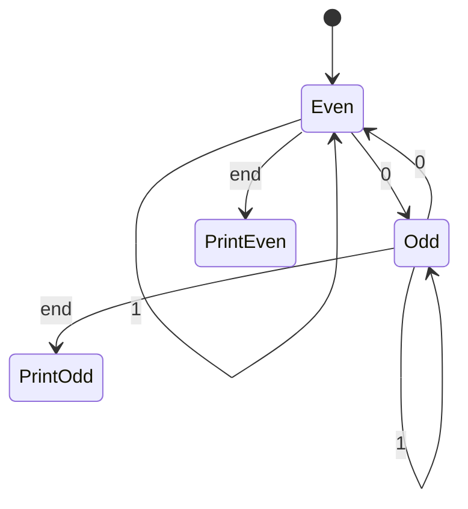
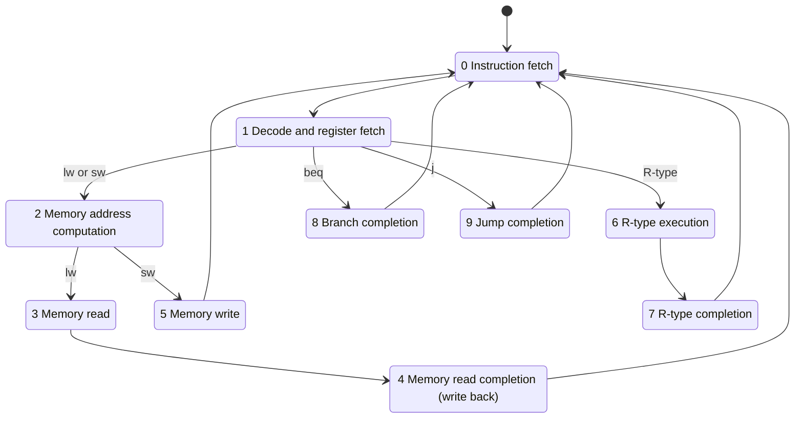
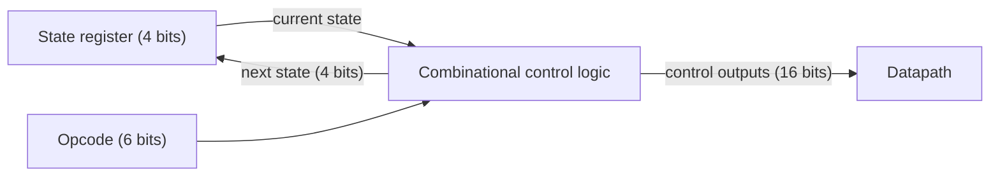

# بخش ۴، جلسه‌ی ۸ از ۱۱: کنترل با ماشین حالت متناهی

این جلسه بخشی از **بخش ۴: مسیر داده و کنترل تک‌سیکلی و چندسیکلی** است. زمان مطالعه: حدود نیم ساعت.

**فهرست این جلسه:**

- ۱. چرا کنترل چندسیکلی ماشین حالت است
- ۲. مرور ماشین حالت متناهی
- ۳. حالت‌های مشترک: واکشی و رمزگشایی
- ۴. حالت‌های دستورات حافظه
- ۵. حالت‌های قالب R، پرش شرطی و پرش
- ۶. نمودار کامل ده حالت
- ۷. پیاده‌سازی ماشین حالت
- ۸. پیاده‌سازی با ROM یا PLA
- ۹. تمرین‌ها

---

## ۱. چرا کنترل چندسیکلی ماشین حالت است

در طراحی تک‌سیکلی، سیگنال‌های کنترل فقط به **کد عمل** بستگی داشتند. پس کنترل یک مدار ترکیبی بود. ولی اسلاید درس می‌گوید در طراحی چندسیکلی، مقدار سیگنال‌ها به دو چیز بستگی دارد:

- **کدام دستور** اجرا می‌شود.
- **کدام گام** از آن دستور در حال اجراست.

برای اینکه کنترل بداند در کدام گام است، باید حافظه داشته باشد. پس کنترل یک **ماشین حالت متناهی** است. اسلاید دو روش برای توصیف آن معرفی می‌کند:

- **نمودار حالت:** روش گرافیکی، که موضوع این جلسه است.
- **ریزبرنامه‌نویسی:** روش متنی شبیه زبان برنامه‌نویسی، که موضوع جلسه‌ی بعد است.

پیاده‌سازی سخت‌افزاری از روی هر کدام از این توصیف‌ها ساخته می‌شود.

## ۲. مرور ماشین حالت متناهی

**ماشین حالت متناهی (Finite state machine یا FSM)** این اجزا را دارد:

- **مجموعه‌ای از حالت‌ها:** که در یک ثبات حالت ذخیره می‌شوند.
- **تابع حالت بعدی (Next-state function):** از روی حالت فعلی و ورودی‌ها، حالت بعدی را تعیین می‌کند.
- **تابع خروجی (Output function):** خروجی‌ها را می‌سازد.

دو نوع ماشین حالت داریم:

| نوع | خروجی به چه بستگی دارد |
|---|---|
| ماشین مور (Moore) | فقط حالت فعلی |
| ماشین میلی (Mealy) | حالت فعلی و ورودی‌ها |

کنترل چندسیکلی ما **ماشین مور** است. خروجی‌ها یعنی سیگنال‌های کنترل، فقط به حالت فعلی بستگی دارند. ورودی‌ها یعنی بیت‌های کد عمل، فقط روی حالت بعدی اثر دارند. یک استثنای کوچک: سیگنال نوشتن PC در `beq` به Zero هم وابسته است، ولی این ترکیب در مسیر داده انجام می‌شود، نه در خود ماشین حالت.

### مثال اسلاید

ماشینی که یک رشته از صفر و یک می‌خواند و وقتی به علامت پایان رسید، «even» یا «odd» را بر اساس زوج یا فرد بودن تعداد صفرها چاپ می‌کند:



در ماشین مور، خروجی (چاپ «even» یا «odd») به حالت‌های پایانی وابسته است، نه به ورودی.

## ۳. حالت‌های مشترک: واکشی و رمزگشایی

دو حالت اول برای همه‌ی دستورات یکسان است. در هر حالت فقط سیگنال‌هایی را می‌نویسیم که **فعال‌اند** یا مقدارشان مهم است. بقیه‌ی سیگنال‌های نوشتن به‌طور پیش‌فرض غیرفعال‌اند.

**حالت ۰: واکشی دستور**

```text
MemRead, ALUSrcA = 0, IorD = 0, IRWrite,
ALUSrcB = 01, ALUOp = 00, PCWrite, PCSource = 00
```

**حالت ۱: رمزگشایی و خواندن ثبات‌ها**

```text
ALUSrcA = 0, ALUSrcB = 11, ALUOp = 00
```

از حالت ۱، بر اساس کد عمل به یکی از چهار مسیر می‌رویم:

| کد عمل | حالت بعدی |
|---|---|
| دستور `lw` یا `sw` | حالت ۲ |
| قالب R | حالت ۶ |
| دستور `beq` | حالت ۸ |
| دستور `j` | حالت ۹ |

## ۴. حالت‌های دستورات حافظه

دستورات حافظه چهار حالت مخصوص به خود دارند:

| حالت | گام | سیگنال‌ها | حالت بعدی |
|---|---|---|---|
| حالت ۲ | محاسبه‌ی آدرس | ALUSrcA = 1، ALUSrcB = 10، ALUOp = 00 | اگر `lw`: حالت ۳، اگر `sw`: حالت ۵ |
| حالت ۳ | خواندن حافظه | MemRead، IorD = 1 | حالت ۴ |
| حالت ۴ | نوشتن در ثبات | RegDst = 0، RegWrite، MemtoReg = 1 | حالت ۰ |
| حالت ۵ | نوشتن در حافظه | MemWrite، IorD = 1 | حالت ۰ |

## ۵. حالت‌های قالب R، پرش شرطی و پرش

**قالب R: دو حالت**

| حالت | گام | سیگنال‌ها | حالت بعدی |
|---|---|---|---|
| حالت ۶ | اجرا | ALUSrcA = 1، ALUSrcB = 00، ALUOp = 10 | حالت ۷ |
| حالت ۷ | نوشتن در ثبات | RegDst = 1، RegWrite، MemtoReg = 0 | حالت ۰ |

**پرش شرطی beq: یک حالت**

| حالت | گام | سیگنال‌ها | حالت بعدی |
|---|---|---|---|
| حالت ۸ | تکمیل پرش | ALUSrcA = 1، ALUSrcB = 00، ALUOp = 01، PCWriteCond، PCSource = 01 | حالت ۰ |

**پرش j: یک حالت**

| حالت | گام | سیگنال‌ها | حالت بعدی |
|---|---|---|---|
| حالت ۹ | تکمیل پرش | PCWrite، PCSource = 10 | حالت ۰ |

## ۶. نمودار کامل ده حالت



شمارش حالت‌ها برای هر دستور همان تعداد سیکل جلسه‌ی قبل است: `lw` از حالت‌های ۰، ۱، ۲، ۳ و ۴ عبور می‌کند، یعنی ۵ سیکل.

### جدول کامل خروجی‌ها

| سیگنال | حالت 0 | حالت 1 | حالت 2 | حالت 3 | حالت 4 | حالت 5 | حالت 6 | حالت 7 | حالت 8 | حالت 9 |
|---|---|---|---|---|---|---|---|---|---|---|
| سیگنال PCWrite | 1 | 0 | 0 | 0 | 0 | 0 | 0 | 0 | 0 | 1 |
| سیگنال PCWriteCond | 0 | 0 | 0 | 0 | 0 | 0 | 0 | 0 | 1 | 0 |
| سیگنال IorD | 0 | X | X | 1 | X | 1 | X | X | X | X |
| سیگنال MemRead | 1 | 0 | 0 | 1 | 0 | 0 | 0 | 0 | 0 | 0 |
| سیگنال MemWrite | 0 | 0 | 0 | 0 | 0 | 1 | 0 | 0 | 0 | 0 |
| سیگنال IRWrite | 1 | 0 | 0 | 0 | 0 | 0 | 0 | 0 | 0 | 0 |
| سیگنال MemtoReg | X | X | X | X | 1 | X | X | 0 | X | X |
| سیگنال PCSource | 00 | XX | XX | XX | XX | XX | XX | XX | 01 | 10 |
| سیگنال ALUOp | 00 | 00 | 00 | XX | XX | XX | 10 | XX | 01 | XX |
| سیگنال ALUSrcB | 01 | 11 | 10 | XX | XX | XX | 00 | XX | 00 | XX |
| سیگنال ALUSrcA | 0 | 0 | 1 | X | X | X | 1 | X | 1 | X |
| سیگنال RegWrite | 0 | 0 | 0 | 0 | 1 | 0 | 0 | 1 | 0 | 0 |
| سیگنال RegDst | X | X | X | X | 0 | X | X | 1 | X | X |

دوباره به قاعده‌ی جلسه‌ی ۴-۴ دقت کن: سیگنال‌های نوشتن (PCWrite، PCWriteCond، MemWrite، IRWrite و RegWrite) و MemRead هیچ‌وقت X نیستند.

## ۷. پیاده‌سازی ماشین حالت



- **ثبات حالت:** ده حالت داریم، پس ۴ بیت لازم است، چون ۲ به توان ۴ برابر ۱۶ و بیشتر از ۱۰ است.
- **ورودی‌های منطق ترکیبی:** ۶ بیت کد عمل و ۴ بیت حالت فعلی، یعنی ۱۰ بیت.
- **خروجی‌های منطق ترکیبی:** ۱۶ بیت سیگنال کنترل (جلسه‌ی ۴-۶) و ۴ بیت حالت بعدی، یعنی ۲۰ بیت.

یک نمونه معادله‌ی خروجی، با بیت‌های حالت S3 تا S0. سیگنال PCWrite در حالت ۰ (0000) و حالت ۹ (1001) فعال است:

```math
\text{PCWrite} = \overline{S_3}\,\overline{S_2}\,\overline{S_1}\,\overline{S_0} + S_3\,\overline{S_2}\,\overline{S_1}\,S_0
```

و سیگنال IorD (برای حالت‌های ۳ و ۵) را اسلاید با همین الگو نوشته است: OR دو جمله‌ی AND که هر کدام یکی از دو حالت را تشخیص می‌دهد.

## ۸. پیاده‌سازی با ROM یا PLA

اسلاید درس دو روش را مقایسه می‌کند.

### پیاده‌سازی با ROM

یک **حافظه‌ی فقط‌خواندنی (ROM)** هر جدول درستی را پیاده می‌کند. با m بیت آدرس، ۲ به توان m خانه دارد و هر خانه n بیت خروجی دارد:

```math
\text{ROM size} = 2^{m} \times n \text{ bits}
```

برای کنترل ما با ۱۰ ورودی و ۲۰ خروجی:

```math
2^{10} \times 20 = 20{,}480 \text{ bits} \approx 20\text{K bits}
```

ولی بیشتر این ROM هدر است. خروجی‌های کنترل فقط به ۴ بیت حالت بستگی دارند، نه به کد عمل. پس می‌توان ROM را دو تکه کرد:

| بخش | ورودی | خروجی | اندازه |
|---|---|---|---|
| خروجی‌های کنترل | 4 بیت حالت | 16 بیت | 2⁴ × 16 = 256 بیت |
| حالت بعدی | 10 بیت | 4 بیت | 2¹⁰ × 4 = 4096 بیت |
| مجموع | – | – | حدود 4.3K بیت |

حتی جدول حالت بعدی هم پر از تکرار است. مثلاً از حالت‌های ۳، ۴، ۵، ۷، ۸ و ۹ همیشه به یک حالت مشخص می‌رویم و کد عمل اهمیتی ندارد.

### پیاده‌سازی با PLA

**آرایه‌ی منطقی برنامه‌پذیر (PLA)** فقط جمله‌هایی را می‌سازد که واقعاً لازم‌اند. ساختار آن:

- **صفحه‌ی AND:** همه‌ی جمله‌های حاصل‌ضرب را می‌سازد. هر جمله ترکیبی از ورودی‌ها یا نقیضشان است.
- **صفحه‌ی OR:** هر خروجی، OR چند جمله است.

مزایای PLA نسبت به ROM:

- **اشتراک جمله‌ها:** یک جمله‌ی AND می‌تواند در چند خروجی استفاده شود.
- **فقط جمله‌های فعال:** فقط سطرهایی که خروجی فعال تولید می‌کنند لازم است.
- **استفاده از «اهمیت ندارد»:** مقدارهای X جمله‌ها را کوتاه‌تر می‌کنند.

اندازه‌ی PLA:

```math
\text{PLA size} = (\#\text{inputs} \times \#\text{product terms}) + (\#\text{outputs} \times \#\text{product terms})
```

برای کنترل ما با ۱۷ جمله‌ی حاصل‌ضرب:

```math
(10 \times 17) + (20 \times 17) = 460 \text{ PLA cells}
```

هر خانه‌ی PLA تقریباً هم‌اندازه‌ی یک خانه‌ی ROM است (کمی بزرگ‌تر). پس PLA حدود ده برابر از ROM کوچک‌تر است.

### روش سوم: ترتیب‌دهنده

کتاب COD (پیوست D) روش دیگری هم دارد. به جای ذخیره‌ی حالت بعدی برای هر ترکیب، از یک **شمارنده** برای رفتن به حالت بعدی استفاده می‌کنیم. فقط هنگام انشعاب (مثل حالت ۱ و ۲) از یک جدول کوچک به نام **جدول توزیع (Dispatch table)** کمک می‌گیریم. این ایده مستقیماً به ریزبرنامه‌نویسی، موضوع جلسه‌ی بعد، منجر می‌شود.

## ۹. تمرین‌ها

<details>
<summary>تمرین ۱: افزودن addi به ماشین حالت</summary>

**صورت:** دستور `addi rt, rs, imm` را به ماشین حالت اضافه کن.

**جواب:** از حالت ۱، برای کد عمل `addi` به یک حالت جدید (حالت ۱۰) می‌رویم:

| حالت | گام | سیگنال‌ها | حالت بعدی |
|---|---|---|---|
| حالت ۱۰ | اجرا | ALUSrcA = 1، ALUSrcB = 10، ALUOp = 00 | حالت ۱۱ |
| حالت ۱۱ | نوشتن | RegDst = 0، RegWrite، MemtoReg = 0 | حالت ۰ |

راه کوتاه‌تر: حالت ۲ همین محاسبه را انجام می‌دهد. پس می‌توانیم از حالت ۲ برای `addi` به حالت ۱۱ برویم و فقط یک حالت جدید اضافه کنیم. `addi` چهار سیکل می‌گیرد.
</details>

<details>
<summary>تمرین ۲: معادله‌ی حالت بعدی</summary>

**صورت:** بیت NS0 حالت بعدی (کم‌ارزش‌ترین بیت) کی یک است؟

**جواب:** حالت‌های فرد بعدی ۱، ۳، ۵، ۷ و ۹ هستند:

| حالت بعدی | از کدام حالت | شرط |
|---|---|---|
| حالت ۱ | حالت ۰ | همیشه |
| حالت ۳ | حالت ۲ | کد عمل `lw` |
| حالت ۵ | حالت ۲ | کد عمل `sw` |
| حالت ۷ | حالت ۶ | همیشه |
| حالت ۹ | حالت ۱ | کد عمل `j` |

پس NS0 برابر OR پنج جمله است: (حالت = 0)، (حالت = 2 و op = lw)، (حالت = 2 و op = sw)، (حالت = 6) و (حالت = 1 و op = j).
</details>

<details>
<summary>تمرین ۳: اندازه‌ی ROM</summary>

**صورت:** اگر ۲۰ دستور دیگر اضافه کنیم و تعداد حالت‌ها به ۳۰ برسد و سیگنال‌های کنترل ۲۴ بیت شوند، اندازه‌ی ROM یکپارچه و ROM دوتکه چقدر می‌شود؟

**جواب:** حالا ۵ بیت حالت لازم است. ROM یکپارچه: ورودی 6 + 5 = 11 بیت و خروجی 24 + 5 = 29 بیت، پس 2¹¹ × 29 = 59,392 بیت. ROM دوتکه: 2⁵ × 24 = 768 بیت برای خروجی‌ها و 2¹¹ × 5 = 10,240 بیت برای حالت بعدی، یعنی حدود 11K بیت.
</details>

---

جلسه‌ی قبلی: [پنج گام اجرا در طراحی چندسیکلی](4-7-multicycle-execution-steps.md)  
جلسه‌ی بعدی: [ریزبرنامه‌نویسی و استثناها](4-9-microprogramming-and-exceptions.md)
