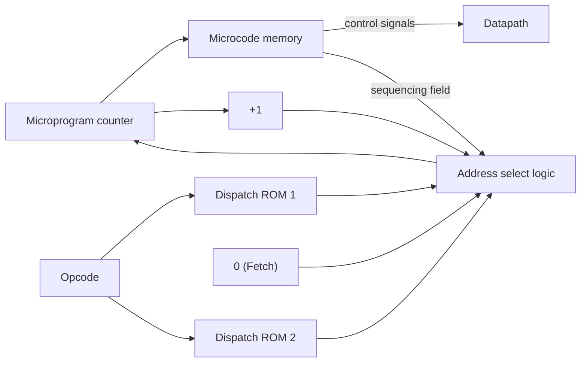
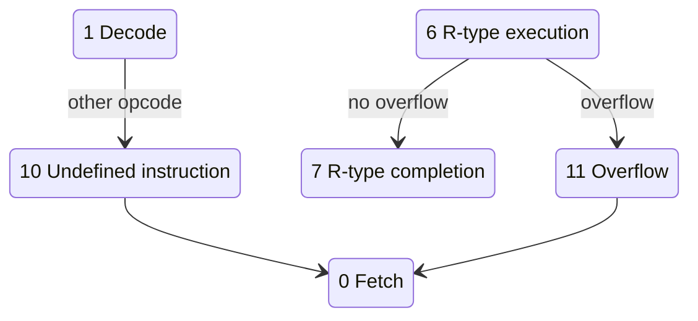

# بخش ۴، جلسه‌ی ۹ از ۱۱: ریزبرنامه‌نویسی و استثناها

این جلسه بخشی از **بخش ۴: مسیر داده و کنترل تک‌سیکلی و چندسیکلی** است. زمان مطالعه: حدود نیم ساعت.

**فهرست این جلسه:**

- ۱. ایده‌ی ریزبرنامه‌نویسی
- ۲. فیلدهای ریزدستور
- ۳. ترتیب‌دهی و جدول‌های توزیع
- ۴. ریزبرنامه‌ی کامل
- ۵. مزایا و معایب ریزبرنامه‌نویسی
- ۶. استثنا و وقفه
- ۷. مدیریت استثنا در MIPS
- ۸. افزودن استثنا به طراحی چندسیکلی
- ۹. تمرین‌ها

---

## ۱. ایده‌ی ریزبرنامه‌نویسی

در جلسه‌ی قبل کنترل را با نمودار حالت توصیف کردیم. برای ده حالت این کار ساده بود. ولی اسلاید درس می‌گوید اگر ISA بزرگ باشد یا دستورات سیکل‌های زیادی بگیرند، ممکن است **هزاران حالت** و تعداد بیشتری کمان داشته باشیم. کشیدن چنین نموداری ممکن نیست.

**ریزبرنامه‌نویسی (Microprogramming)** روش توصیف متنی کنترل است، شبیه یک زبان برنامه‌نویسی:

- **ریزدستور (Microinstruction):** هر سطر، سیگنال‌های کنترل یک سیکل را مشخص می‌کند. هر ریزدستور معادل یک حالت در ماشین حالت است.
- **ریزبرنامه (Microprogram):** دنباله‌ای از ریزدستورها که کل کنترل را توصیف می‌کند.
- **ریزکد (Microcode):** نام دیگر ریزبرنامه، وقتی در ROM ذخیره شده باشد.

ایده از موریس ویلکس (Maurice Wilkes) در سال ۱۹۵۱ است. او دید که کنترل خودش شبیه یک کامپیوتر کوچک است که برنامه‌اش ریزدستورها هستند.

یک نکته‌ی مهم: ریزبرنامه یک **توصیف** است. پیاده‌سازی آن می‌تواند با ROM یا PLA باشد، درست مثل نمودار حالت.

## ۲. فیلدهای ریزدستور

اسلاید درس ریزدستور را با هشت فیلد تعریف می‌کند: یک برچسب و هفت فیلد کاری.

| فیلد | کار | مقادیر ممکن |
|---|---|---|
| برچسب (Label) | نام ریزدستور برای پرش به آن | نام دلخواه |
| کنترل ALU | عمل ALU | Add، Subt، Func code |
| منبع اول (SRC1) | ورودی اول ALU | PC، A |
| منبع دوم (SRC2) | ورودی دوم ALU | B، 4، Extend، Extshft |
| کنترل ثبات | خواندن یا نوشتن فایل ثبات | Read، Write ALU، Write MDR |
| حافظه | خواندن یا نوشتن حافظه | Read PC، Read ALU، Write ALU |
| کنترل نوشتن PC | نوشتن PC | ALU، ALUOut-cond، Jump address |
| ترتیب‌دهی (Sequencing) | ریزدستور بعدی | Seq، Fetch، Dispatch i |

معنای چند مقدار:

- **مقدار Extend:** ثابت گسترش‌یافته‌ی ۱۶ بیتی (ALUSrcB = 10).
- **مقدار Extshft:** ثابت گسترش‌یافته و شیفت‌یافته (ALUSrcB = 11).
- **مقدار Func code:** ALU از فیلد funct استفاده کند (ALUOp = 10).
- **مقدار Read PC:** حافظه با آدرس PC خوانده شود و در IR برود.
- **مقدار Read ALU:** حافظه با آدرس ALUOut خوانده شود و در MDR برود.
- **مقدار Write MDR:** محتوای MDR در ثبات rt نوشته شود.
- **مقدار ALUOut-cond:** اگر Zero یک بود، PC از ALUOut نوشته شود.

هر مقدار نمادین به یک مجموعه سیگنال تبدیل می‌شود. مثلاً «SRC2 = Extshft» یعنی ALUSrcB = 11.

## ۳. ترتیب‌دهی و جدول‌های توزیع

فیلد ترتیب‌دهی تعیین می‌کند ریزدستور بعدی کدام است:

- **مقدار Seq:** برو به ریزدستور بعدی در ترتیب.
- **مقدار Fetch:** برو به اولین ریزدستور، یعنی شروع واکشی دستور بعدی.
- **مقدار Dispatch i:** با استفاده از **جدول توزیع (Dispatch table)** شماره‌ی i و بر اساس کد عمل، به ریزدستور مناسب برو.

جدول توزیع یک ROM کوچک است که با کد عمل اندیس‌گذاری می‌شود و برچسب ریزدستور را برمی‌گرداند. ما دو جدول داریم:

**جدول توزیع ۱ (بعد از رمزگشایی):**

| کد عمل | نام | مقصد |
|---|---|---|
| کد 000000 | قالب R | Rformat1 |
| کد 000010 | دستور j | JUMP1 |
| کد 000100 | دستور beq | BEQ1 |
| کد 100011 | دستور lw | Mem1 |
| کد 101011 | دستور sw | Mem1 |

**جدول توزیع ۲ (بعد از محاسبه‌ی آدرس):**

| کد عمل | نام | مقصد |
|---|---|---|
| کد 100011 | دستور lw | LW2 |
| کد 101011 | دستور sw | SW2 |



## ۴. ریزبرنامه‌ی کامل

ریزبرنامه‌ی معادل ماشین حالت ده‌حالتی جلسه‌ی قبل:

| برچسب | کنترل ALU | منبع اول | منبع دوم | کنترل ثبات | حافظه | کنترل PC | ترتیب‌دهی |
|---|---|---|---|---|---|---|---|
| برچسب Fetch | Add | PC | 4 | – | Read PC | ALU | Seq |
| بدون برچسب | Add | PC | Extshft | Read | – | – | Dispatch 1 |
| برچسب Mem1 | Add | A | Extend | – | – | – | Dispatch 2 |
| برچسب LW2 | – | – | – | – | Read ALU | – | Seq |
| بدون برچسب | – | – | – | Write MDR | – | – | Fetch |
| برچسب SW2 | – | – | – | – | Write ALU | – | Fetch |
| برچسب Rformat1 | Func code | A | B | – | – | – | Seq |
| بدون برچسب | – | – | – | Write ALU | – | – | Fetch |
| برچسب BEQ1 | Subt | A | B | – | – | ALUOut-cond | Fetch |
| برچسب JUMP1 | – | – | – | – | – | Jump address | Fetch |

ده ریزدستور، دقیقاً معادل ده حالت. مقایسه:

| ریزدستور | حالت معادل |
|---|---|
| ریزدستور Fetch | حالت ۰ |
| ریزدستور دوم | حالت ۱ |
| ریزدستور Mem1 | حالت ۲ |
| ریزدستور LW2 و بعدی | حالت‌های ۳ و ۴ |
| ریزدستور SW2 | حالت ۵ |
| ریزدستور Rformat1 و بعدی | حالت‌های ۶ و ۷ |
| ریزدستور BEQ1 | حالت ۸ |
| ریزدستور JUMP1 | حالت ۹ |

### افقی و عمودی

دو سبک برای قالب ریزدستور وجود دارد:

- **ریزکد افقی (Horizontal):** هر سیگنال کنترل یک بیت جدا دارد. ریزدستور پهن است ولی رمزگشایی نمی‌خواهد و سریع است.
- **ریزکد عمودی (Vertical):** فیلدها رمزگذاری شده‌اند و قبل از استفاده رمزگشایی می‌شوند. ریزدستور باریک‌تر است ولی منطق رمزگشایی اضافه دارد.

## ۵. مزایا و معایب ریزبرنامه‌نویسی

اسلاید درس این مقایسه را دارد:

**مزایای توصیف:**

- **طراحی و نوشتن آسان:** مثل نوشتن یک برنامه است.
- **طراحی موازی:** معمولاً سازنده معماری و ریزکد را همزمان طراحی می‌کند.

**مزایای پیاده‌سازی:**

- **تغییر آسان:** چون مقادیر در حافظه‌اند (مثلاً ROM بیرون از تراشه)، می‌توان آن‌ها را عوض کرد و اشکال‌ها را رفع کرد.
- **شبیه‌سازی معماری دیگر:** با ریزکد متفاوت، یک سخت‌افزار می‌تواند ISA دیگری را اجرا کند.
- **ثبات‌های داخلی:** ریزکد می‌تواند از ثبات‌های داخلی که برنامه‌نویس نمی‌بیند استفاده کند.

**معایب پیاده‌سازی (امروزی):**

- **همه‌چیز روی تراشه است:** کنترل امروز روی همان تراشه‌ی پردازنده است. پس مزیت ROM بیرونی وجود ندارد.
- **حافظه‌ی ROM سریع‌تر نیست:** حافظه‌ی ROM دیگر از کش روی تراشه سریع‌تر نیست.
- **نیاز کمتر به تغییر:** کامپیوترهای عمومی امروز خیلی بیشتر از کامپیوترهای خاص‌منظوره استفاده می‌شوند و نیاز کمتری به تغییر ریزکد هست.

### ریزکد امروز

دهه‌ی ۱۹۷۰ دوران طلایی ریزکد بود. ماشین‌هایی مثل VAX دستورات بسیار پیچیده‌ای با ریزکد پیاده می‌کردند. ایده‌ی RISC در دهه‌ی ۱۹۸۰ تا حدی واکنشی به این وضع بود: دستورات ساده با **کنترل سیم‌بندی‌شده (Hardwired control)** سریع‌تر بودند.

امروز پردازنده‌های x86 ترکیبی از هر دو را دارند. دستورات ساده و رایج مستقیماً با سخت‌افزار به ریزعملیات ترجمه می‌شوند. دستورات پیچیده و نادر (مثل `rep movs` یا دستورات رشته‌ای) از یک **ROM ریزکد** کمک می‌گیرند. اینتل و AMD هم با به‌روزرسانی ریزکد اشکال‌های پردازنده را، مثلاً آسیب‌پذیری‌های امنیتی، رفع می‌کنند.

## ۶. استثنا و وقفه

یکی از سخت‌ترین بخش‌های کنترل، مدیریت رویدادهای غیرعادی است. اصطلاحات کتاب COD:

- **استثنا (Exception):** هر تغییر غیرمنتظره در جریان کنترل، چه از داخل پردازنده باشد چه از بیرون.
- **وقفه (Interrupt):** استثنایی که از **بیرون** پردازنده می‌آید.

معماری‌های دیگر این دو کلمه را گاهی جابه‌جا استفاده می‌کنند. مثلاً اینتل همه را وقفه می‌نامد.

| نوع رویداد | از کجا | اصطلاح MIPS |
|---|---|---|
| درخواست دستگاه ورودی و خروجی | بیرون | وقفه |
| فراخوانی سیستم‌عامل از برنامه‌ی کاربر (syscall) | داخل | استثنا |
| سرریز حسابی | داخل | استثنا |
| دستور تعریف‌نشده | داخل | استثنا |
| خرابی سخت‌افزار | هر دو | استثنا یا وقفه |

## ۷. مدیریت استثنا در MIPS

وقتی استثنا رخ می‌دهد، سخت‌افزار باید دو کار انجام دهد:

1. **ذخیره‌ی آدرس دستور خطادار:** در ثبات **EPC (Exception Program Counter)**.
2. **انتقال کنترل به سیستم‌عامل:** پرش به یک آدرس مشخص.

سیستم‌عامل باید **علت** استثنا را بداند. دو روش وجود دارد:

- **ثبات علت (Cause register):** یک ثبات وضعیت که علت در آن نوشته می‌شود. همه‌ی استثناها به **یک آدرس** (در MIPS، 0x80000180) می‌پرند و روال سیستم‌عامل ثبات علت را می‌خواند. این روش MIPS است.
- **وقفه‌ی برداری (Vectored interrupt):** هر نوع استثنا آدرس مخصوص خودش را دارد. آدرس مقصد خودش علت را نشان می‌دهد. مثلاً در طراحی کتاب برای دستور تعریف‌نشده 0x80000000 و برای سرریز 0x80000180.

بعد از اینکه سیستم‌عامل کارش را کرد، یا برنامه را متوقف می‌کند یا با استفاده از EPC به آن برمی‌گردد.

در طراحی ساده‌ی ما، ثبات علت برای دو استثنا تنظیم می‌شود: مقدار ۰ برای دستور تعریف‌نشده و مقدار ۱ برای سرریز حسابی.

## ۸. افزودن استثنا به طراحی چندسیکلی

### تغییرات مسیر داده

- **ثبات EPC:** یک ثبات ۳۲ بیتی با سیگنال نوشتن **EPCWrite**.
- **ثبات Cause:** یک ثبات ۳۲ بیتی با سیگنال نوشتن **CauseWrite**. یک مالتی‌پلکسر با سیگنال **IntCause** بین مقدار ۰ و ۱ انتخاب می‌کند.
- **مالتی‌پلکسر PCSource:** یک ورودی چهارم (مقدار 11) با آدرس ثابت 0x80000180 می‌گیرد.

### چه آدرسی در EPC ذخیره شود

در گام واکشی، PC به PC + 4 تغییر کرده است. ولی EPC باید آدرس **خود دستور خطادار** را داشته باشد. پس باید ۴ را کم کنیم. این کار با ALU انجام می‌شود:

```text
EPC <= PC - 4;
```

سیگنال‌ها: ALUSrcA = 0 (منبع PC)، ALUSrcB = 01 (ثابت ۴)، ALUOp = 01 (تفریق). خروجی ALU به ورودی EPC وصل است.

### حالت‌های جدید

| حالت | استثنا | سیگنال‌ها |
|---|---|---|
| حالت ۱۰ | دستور تعریف‌نشده | IntCause = 0، CauseWrite، ALUSrcA = 0، ALUSrcB = 01، ALUOp = 01، EPCWrite، PCWrite، PCSource = 11 |
| حالت ۱۱ | سرریز حسابی | IntCause = 1، CauseWrite، ALUSrcA = 0، ALUSrcB = 01، ALUOp = 01، EPCWrite، PCWrite، PCSource = 11 |

بعد از هر دو حالت، به حالت ۰ می‌رویم تا اولین دستور روال سیستم‌عامل واکشی شود.

### تشخیص استثنا

- **دستور تعریف‌نشده:** در حالت ۱، اگر کد عمل هیچ‌کدام از کدهای شناخته‌شده نباشد، به حالت ۱۰ می‌رویم. یعنی یک کمان «other» از حالت ۱ به حالت ۱۰.
- **سرریز:** ALU در حالت ۶ عمل قالب R را انجام می‌دهد و همان‌جا خروجی Overflow را تولید می‌کند. اگر سرریز رخ داده باشد، ماشین به جای حالت ۷ به حالت ۱۱ می‌رود. این مهم است: نتیجه‌ی غلط **نباید** در ثبات نوشته شود.



### چرا استثنا سخت است

کتاب COD می‌گوید استثناها یکی از سخت‌ترین بخش‌های کنترل‌اند و بیشتر خطاهای طراحی پردازنده‌ها همین‌جاست. مهم‌ترین نکته **استثنای دقیق (Precise exception)** است: وقتی استثنا رخ می‌دهد، همه‌ی دستورات قبل از دستور خطادار باید کامل شده باشند و هیچ‌کدام از دستورات بعدی نباید اثری گذاشته باشند. در طراحی چندسیکلی این ساده است، چون فقط یک دستور در حال اجراست. در خط لوله (بخش ۵) و اجرای خارج از ترتیب (بخش ۸) این خیلی سخت‌تر می‌شود.

## ۹. تمرین‌ها

<details>
<summary>تمرین ۱: ریزدستور برای addi</summary>

**صورت:** ریزدستورهای لازم برای `addi` را بنویس و جدول‌های توزیع را به‌روز کن.

**جواب:** یک ردیف در جدول توزیع ۱ (کد ۰۰۱۰۰۰ به Mem1)، چون محاسبه همان جمع A و ثابت است. و یک ردیف در جدول توزیع ۲ (کد ۰۰۱۰۰۰ به ADDI2). ریزدستور جدید:

| برچسب | کنترل ALU | منبع اول | منبع دوم | کنترل ثبات | حافظه | کنترل PC | ترتیب‌دهی |
|---|---|---|---|---|---|---|---|
| برچسب ADDI2 | – | – | – | Write ALU rt | – | – | Fetch |

یک مقدار جدید «Write ALU rt» برای فیلد کنترل ثبات لازم است، یعنی RegWrite، MemtoReg = 0 و RegDst = 0. در ریزبرنامه‌ی اصلی، «Write ALU» با RegDst = 1 به rd می‌نویسد.
</details>

<details>
<summary>تمرین ۲: EPC</summary>

**صورت:** دستوری در آدرس 0x00400020 سرریز ایجاد می‌کند. مقادیر EPC، Cause و PC را بعد از حالت ۱۱ بنویس.

**جواب:** در حالت ۱۱، PC برابر 0x00400024 است (از گام واکشی). ALU حاصل PC − 4 یعنی 0x00400020 را می‌سازد که در EPC نوشته می‌شود. Cause برابر ۱ است. PC برابر 0x80000180 می‌شود.
</details>

<details>
<summary>تمرین ۳: کدام بهتر است</summary>

**صورت:** برای پردازنده‌ای با ۳۰۰ دستور و ۲۰۰۰ حالت کنترل، نمودار حالت مناسب‌تر است یا ریزبرنامه؟ پیاده‌سازی با PLA یا ROM؟

**جواب:** برای توصیف، ریزبرنامه، چون نمودار با ۲۰۰۰ حالت قابل کشیدن و بررسی نیست. برای پیاده‌سازی، ROM ریزکد معمولاً انتخاب می‌شود، چون با این تعداد حالت، ساختار منظم ROM و امکان اصلاح بعدی ارزشمند است. ولی اگر سرعت مهم باشد، بخش‌های پرکاربرد را می‌توان با منطق سیم‌بندی‌شده یا PLA پیاده کرد. این همان کاری است که پردازنده‌های x86 امروزی می‌کنند.
</details>

---

جلسه‌ی قبلی: [کنترل با ماشین حالت متناهی](4-8-fsm-control.md)  
جلسه‌ی بعدی: [افزودن دستور جدید و حل سؤال‌های امتحانی](4-10-adding-instructions-exam-problems.md)
