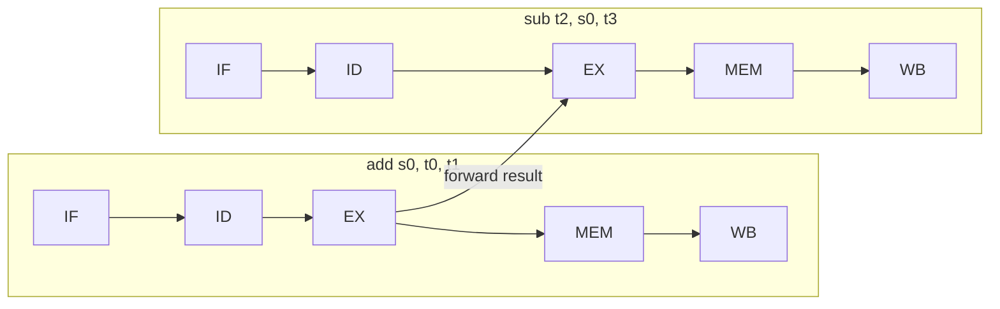

# بخش ۵، جلسه‌ی ۲ از ۱۱: نگاهی به مخاطره‌ها

این جلسه بخشی از **بخش ۵: خط لوله و مخاطره‌ها** است. زمان مطالعه: حدود نیم ساعت.

**فهرست این جلسه:**

- ۱. مخاطره‌ی ساختاری
- ۲. مخاطره‌ی داده
- ۳. ارسال رو به جلو
- ۴. مخاطره‌ی بارگذاری و استفاده
- ۵. مرتب‌سازی دوباره‌ی کد
- ۶. مخاطره‌ی کنترل
- ۷. سه راه‌حل برای پرش
- ۸. تمرین‌ها

---

## ۱. مخاطره‌ی ساختاری

**مخاطره‌ی ساختاری (Structural hazard)** یعنی سخت‌افزار نمی‌تواند ترکیب دستوراتی را که در یک سیکل در خط لوله هستند پشتیبانی کند.

مثال اسلاید: فرض کن به جای حافظه‌ی دستور و داده‌ی جدا، فقط **یک حافظه** با یک درگاه داشتیم. با چهار `lw` پشت سر هم:

| دستور | سیکل ۱ | سیکل ۲ | سیکل ۳ | سیکل ۴ | سیکل ۵ |
|---|---|---|---|---|---|
| دستور اول `lw` | IF | ID | EX | **MEM** | WB |
| دستور دوم `lw` | | IF | ID | EX | MEM |
| دستور سوم `lw` | | | IF | ID | EX |
| دستور چهارم `lw` | | | | **IF** | ID |

در سیکل ۴، دستور اول در مرحله‌ی MEM از حافظه داده می‌خواند و دستور چهارم در مرحله‌ی IF دستور واکشی می‌کند. هر دو به یک حافظه نیاز دارند و یکی باید صبر کند.

راه‌حل MIPS ساده است: **حافظه‌ی دستور و داده‌ی جدا** (در عمل کش دستور و کش داده‌ی جدا). اسلاید می‌گوید: MIPS برای خط لوله طراحی شده، پس از مخاطره‌ی ساختاری به راحتی می‌توان دوری کرد.

### فایل ثبات

یک مخاطره‌ی ساختاری دیگر: در یک سیکل، دستوری در مرحله‌ی WB در فایل ثبات می‌نویسد و دستور دیگری در مرحله‌ی ID از آن می‌خواند. راه‌حل کتاب: **نوشتن در نیمه‌ی اول سیکل و خواندن در نیمه‌ی دوم**. پس دستوری که در ID است، مقداری را که در همان سیکل در WB نوشته شده، می‌خواند. در نمودارها این را با سایه‌ی نیمه‌ی راست (نوشتن) و نیمه‌ی چپ (خواندن) نشان می‌دهند.

## ۲. مخاطره‌ی داده

**مخاطره‌ی داده (Data hazard)** یعنی دستوری به داده‌ای نیاز دارد که دستور قبلی در خط لوله هنوز تولید نکرده است. مثال کتاب:

```asm
add $s0, $t0, $t1
sub $t2, $s0, $t3
```

دستور `add` مقدار `$s0` را در مرحله‌ی WB، یعنی سیکل ۵، در فایل ثبات می‌نویسد. ولی `sub` در مرحله‌ی ID، یعنی سیکل ۳، آن را می‌خواند:

| دستور | سیکل ۱ | سیکل ۲ | سیکل ۳ | سیکل ۴ | سیکل ۵ | سیکل ۶ |
|---|---|---|---|---|---|---|
| دستور `add $s0, ...` | IF | ID | EX | MEM | **WB** | |
| دستور `sub $t2, $s0, ...` | | IF | **ID** | EX | MEM | WB |

اگر کاری نکنیم، `sub` مقدار قدیمی `$s0` را می‌خواند. ساده‌ترین راه این است که `sub` دو سیکل صبر کند. این یعنی دو حباب در خط لوله، که خیلی گران است. وابستگی بین دستورات پشت سر هم در برنامه‌ها خیلی رایج است.

## ۳. ارسال رو به جلو

به نمودار دقت کن. نتیجه‌ی `add` در واقع در **پایان مرحله‌ی EX**، یعنی پایان سیکل ۳، آماده است. و `sub` آن را در **ابتدای مرحله‌ی EX** خودش، یعنی ابتدای سیکل ۴، لازم دارد. پس لازم نیست منتظر نوشتن در فایل ثبات بمانیم.

**ارسال رو به جلو (Forwarding)** یا **دورزدن (Bypassing)**: سخت‌افزار اضافه‌ای که نتیجه را مستقیم از ثبات‌های داخلی خط لوله به ورودی ALU می‌رساند، بدون انتظار برای فایل ثبات.



قاعده‌ی مهم: ارسال فقط **رو به جلو در زمان** ممکن است. یعنی مقدار باید قبل از اینکه لازم شود تولید شده باشد. در نمودار خط لوله، اگر خط ارسال **به عقب** برود، ارسال ممکن نیست.

## ۴. مخاطره‌ی بارگذاری و استفاده

اسلاید درس می‌گوید ارسال همیشه کافی نیست. مثال:

```asm
lw   $s0, 20($t1)
sub  $t2, $s0, $t3
```

داده‌ی `lw` در **پایان مرحله‌ی MEM** (سیکل ۴) آماده می‌شود. ولی `sub` آن را در **ابتدای مرحله‌ی EX** (سیکل ۴) لازم دارد. این به عقب در زمان است:

| دستور | سیکل ۱ | سیکل ۲ | سیکل ۳ | سیکل ۴ | سیکل ۵ | سیکل ۶ | سیکل ۷ |
|---|---|---|---|---|---|---|---|
| دستور `lw $s0, ...` | IF | ID | EX | **MEM** | WB | | |
| دستور `sub` (بدون توقف) | | IF | ID | **EX** | MEM | WB | |
| دستور `sub` (با یک توقف) | | | IF | ID | **EX** | MEM | WB |

حتی با ارسال، یک سیکل توقف لازم است. به این حالت **مخاطره‌ی بارگذاری و استفاده (Load-use data hazard)** می‌گوییم. سیکل خالی‌ای که در خط لوله ایجاد می‌شود **حباب (Bubble)** یا **توقف (Stall)** نام دارد.

## ۵. مرتب‌سازی دوباره‌ی کد

کامپایلر می‌تواند ترتیب دستورات را عوض کند تا از توقف دوری کند. مثال کتاب: کد C زیر، با فرض اینکه همه‌ی متغیرها در حافظه و نسبت به `$t0` در دسترس‌اند:

```c
a = b + e;
c = b + f;
```

کد اولیه:

```asm
lw   $t1, 0($t0)       # b
lw   $t2, 4($t0)       # e
add  $t3, $t1, $t2     # b + e     (stall: uses $t2 just loaded)
sw   $t3, 12($t0)      # a
lw   $t4, 8($t0)       # f
add  $t5, $t1, $t4     # b + f     (stall: uses $t4 just loaded)
sw   $t5, 16($t0)      # c
```

دو مخاطره‌ی بارگذاری و استفاده داریم: هر دو `add` بلافاصله بعد از `lw` می‌آیند که مقدارشان را تولید می‌کند. با ارسال، هر کدام یک توقف دارد.

کد مرتب‌شده: سومین `lw` را دو خط بالاتر ببر:

```asm
lw   $t1, 0($t0)
lw   $t2, 4($t0)
lw   $t4, 8($t0)       # moved up
add  $t3, $t1, $t2     # $t2 now ready via forwarding
sw   $t3, 12($t0)
add  $t5, $t1, $t4     # $t4 now ready via forwarding
sw   $t5, 16($t0)
```

حالا هیچ دستوری بلافاصله بعد از `lw` مقدار آن را استفاده نمی‌کند. تعداد سیکل‌ها:

| نسخه | دستورات | توقف‌ها | سیکل کل |
|---|---|---|---|
| کد اولیه | 7 | 2 | 7 + 4 + 2 = 13 |
| کد مرتب‌شده | 7 | 0 | 7 + 4 = 11 |

عدد ۴ برای پر شدن خط لوله است. پس با مرتب‌سازی، ۲ سیکل صرفه‌جویی شد.

### مثال اسلاید

```asm
lw   $t0, 0($t1)
lw   $t2, 4($t1)
sw   $t2, 0($t1)       # data hazard: uses $t2 just loaded
sw   $t0, 4($t1)
```

با جابه‌جا کردن دو `sw`، اولین `sw` مقدار `$t0` را ذخیره می‌کند که یک سیکل زودتر آماده شده است:

```asm
lw   $t0, 0($t1)
lw   $t2, 4($t1)
sw   $t0, 4($t1)       # interchanged
sw   $t2, 0($t1)
```

یک نکته‌ی دقیق: در مثال اسلاید، `sw` مقدار `$t2` را در مرحله‌ی MEM لازم دارد، نه EX. پس با یک مسیر ارسال از MEM/WB به ورودی حافظه، حتی بدون مرتب‌سازی هم توقفی لازم نبود. ولی خط لوله‌ی پایه‌ی کتاب این مسیر را ندارد و همه‌ی ارسال‌ها را به ورودی ALU می‌برد. در جلسه‌ی ۵-۵ این را بیشتر بررسی می‌کنیم.

## ۶. مخاطره‌ی کنترل

**مخاطره‌ی کنترل (Control hazard)** یا **مخاطره‌ی پرش (Branch hazard)** یعنی برای انتخاب دستور بعدی، باید نتیجه‌ی دستوری را بدانیم که هنوز در خط لوله است.

بعد از دستور `beq`، دستور بعدی در سیکل بعد واکشی می‌شود. ولی هنوز نمی‌دانیم پرش انجام می‌شود یا نه. پس نمی‌دانیم دستور بعدی کدام است: دستور بعد از پرش یا دستور مقصد.

## ۷. سه راه‌حل برای پرش

### راه‌حل ۱: توقف

صبر کن تا نتیجه‌ی پرش معلوم شود. اسلاید و کتاب فرض می‌کنند سخت‌افزار اضافه‌ای در مرحله‌ی ID مقایسه را انجام دهد و آدرس مقصد را حساب کند. پس فقط **یک** سیکل توقف لازم است:

| دستور | سیکل ۱ | سیکل ۲ | سیکل ۳ | سیکل ۴ | سیکل ۵ | سیکل ۶ | سیکل ۷ |
|---|---|---|---|---|---|---|---|
| دستور `add $4, $5, $6` | IF | ID | EX | MEM | WB | | |
| دستور `beq $1, $2, 40` | | IF | **ID** | EX | MEM | WB | |
| حباب | | | | | | | |
| دستور `lw $3, 300($0)` | | | | IF | ID | EX | MEM |

مثال کتاب: اگر ۱۷٪ دستورات پرش شرطی باشند و هر پرش یک سیکل توقف داشته باشد، CPI از ۱ به ۱.۱۷ می‌رسد. اگر نتیجه‌ی پرش در MEM معلوم شود، توقف خیلی بیشتر است. در خط لوله‌های عمیق‌تر، این روش قابل قبول نیست.

### راه‌حل ۲: پیش‌بینی

فرض کن پرش **انجام نمی‌شود** و دستور بعدی را واکشی کن. اگر درست حدس زدی، هیچ توقفی نداری. اگر اشتباه کردی، دستوری را که واکشی کرده‌ای دور بریز و از مقصد پرش ادامه بده. به این کار **پیش‌بینی پرش (Branch prediction)** می‌گوییم.

| حالت | دستور | سیکل ۱ | سیکل ۲ | سیکل ۳ | سیکل ۴ | سیکل ۵ | سیکل ۶ |
|---|---|---|---|---|---|---|---|
| پیش‌بینی درست | دستور `beq` | IF | ID | EX | MEM | WB | |
| پیش‌بینی درست | دستور بعدی (`lw`) | | IF | ID | EX | MEM | WB |
| پیش‌بینی غلط | دستور `beq` | IF | ID | EX | MEM | WB | |
| پیش‌بینی غلط | دستور بعدی (دور ریخته شد) | | IF | حباب | حباب | حباب | حباب |
| پیش‌بینی غلط | دستور مقصد (`or`) | | | IF | ID | EX | MEM |

پیش‌بینی‌های پیچیده‌تر هم وجود دارند. مثلاً پیش‌بینی کن پرش‌های **به عقب** (حلقه‌ها) انجام می‌شوند و پرش‌های به جلو نه. یا **پیش‌بینی پویا** بر اساس سابقه‌ی هر پرش. این‌ها را در جلسه‌ی ۵-۷ می‌بینیم.

### راه‌حل ۳: پرش تأخیری

راه‌حل MIPS اصلی: دستوری که بلافاصله بعد از پرش است، **همیشه اجرا می‌شود**، چه پرش انجام شود چه نشود. پرش با یک دستور تأخیر اثر می‌کند. جای آن دستور را **شکاف تأخیر پرش (Branch delay slot)** می‌گوییم (جلسه‌ی ۲-۸).

کار کامپایلر این است که یک دستور مفید که **به نتیجه‌ی پرش بستگی ندارد** پیدا کند و در شکاف بگذارد:

```asm
# original                    # with delay slot
add  $4, $5, $6               beq  $1, $2, 40
beq  $1, $2, 40               add  $4, $5, $6    # delay slot, always executed
lw   $3, 300($0)              lw   $3, 300($0)
```

دستور `add` روی `$1` و `$2` اثر ندارد، پس می‌توان آن را بعد از پرش گذاشت. اگر هیچ دستور مفیدی پیدا نشود، کامپایلر `nop` می‌گذارد.

اسلاید درس یادآوری می‌کند: MIPS واقعی پرش تأخیری دارد، ولی در شبیه‌ساز SPIM باید آن را در تنظیمات فعال کنی. در طراحی خط لوله‌ی این بخش، پرش تأخیری را فرض **نمی‌کنیم**، مگر جایی که صریحاً گفته شود.

## ۸. تمرین‌ها

<details>
<summary>تمرین ۱: شناسایی مخاطره</summary>

**صورت:** در کد زیر همه‌ی وابستگی‌های داده را پیدا کن. کدام‌ها با ارسال حل می‌شوند و کدام توقف لازم دارند؟

```asm
lw   $t0, 0($s0)
add  $t1, $t0, $s1
sub  $t2, $t1, $t0
sw   $t2, 4($s0)
```

**جواب:**

| وابستگی | فاصله | حل با |
|---|---|---|
| مقدار `$t0` از `lw` به `add` | پشت سر هم | ارسال کافی نیست، یک توقف لازم است |
| مقدار `$t1` از `add` به `sub` | پشت سر هم | ارسال از EX/MEM |
| مقدار `$t0` از `lw` به `sub` | دو دستور فاصله (با توقف، سه) | ارسال یا خواندن از فایل ثبات |
| مقدار `$t2` از `sub` به `sw` | پشت سر هم | ارسال از EX/MEM به ورودی B |
</details>

<details>
<summary>تمرین ۲: مرتب‌سازی</summary>

**صورت:** کد زیر را بدون تغییر معنا طوری مرتب کن که هیچ توقف بارگذاری و استفاده نداشته باشد.

```asm
lw   $t1, 0($a0)
add  $t2, $t1, $t1
lw   $t3, 4($a0)
add  $t4, $t3, $t3
```

**جواب:** دومین `lw` را بالاتر ببر:

```asm
lw   $t1, 0($a0)
lw   $t3, 4($a0)
add  $t2, $t1, $t1     # $t1 loaded two instructions earlier
add  $t4, $t3, $t3     # $t3 loaded two instructions earlier
```
</details>

<details>
<summary>تمرین ۳: هزینه‌ی پرش</summary>

**صورت:** ۲۰٪ دستورات پرش شرطی‌اند و ۶۰٪ آن‌ها انجام می‌شوند. با «پیش‌بینی انجام‌نشده» و جریمه‌ی یک سیکل برای پیش‌بینی غلط، CPI چقدر است؟ با توقف همیشگی یک‌سیکلی چطور؟

**جواب:** پیش‌بینی: پیش‌بینی برای ۶۰٪ پرش‌ها غلط است. CPI = 1 + 0.20 × 0.60 × 1 = 1.12. توقف همیشگی: CPI = 1 + 0.20 × 1 = 1.20.
</details>

---

جلسه‌ی قبلی: [ایده‌ی خط لوله](5-1-pipelining-overview.md)  
جلسه‌ی بعدی: [مسیر داده‌ی خط لوله](5-3-pipelined-datapath.md)
