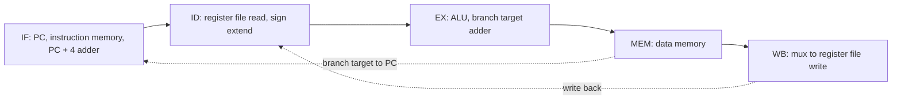

# بخش ۵، جلسه‌ی ۳ از ۱۱: مسیر داده‌ی خط لوله

این جلسه بخشی از **بخش ۵: خط لوله و مخاطره‌ها** است. زمان مطالعه: حدود نیم ساعت.

**فهرست این جلسه:**

- ۱. ایده: سخت‌افزار تک‌سیکلی، اجرای چندمرحله‌ای
- ۲. ثبات‌های خط لوله
- ۳. دنبال کردن یک lw در خط لوله
- ۴. یک اشکال و رفع آن
- ۵. دنبال کردن یک sw
- ۶. دو روش نمایش خط لوله
- ۷. نکته‌های مهم
- ۸. تمرین‌ها

---

## ۱. ایده: سخت‌افزار تک‌سیکلی، اجرای چندمرحله‌ای

مسیر داده‌ی تک‌سیکلی جلسه‌ی ۴-۲ را به یاد بیاور. می‌توانیم آن را از چپ به راست به پنج قسمت تقسیم کنیم که هر قسمت یکی از پنج مرحله است:

اسلاید درس سؤال کلیدی را می‌پرسد: اگر اجرا را به چند سیکل بشکنیم ولی **سخت‌افزار اضافه‌ی تک‌سیکلی را نگه داریم** چه می‌شود؟ جواب: می‌توانیم در هر سیکل یک دستور جدید شروع کنیم. این همان خط لوله است.

این یعنی تفاوت با طراحی چندسیکلی: در چندسیکلی، یک ALU و یک حافظه را بین گام‌ها **مشترک** کردیم. در خط لوله، هر مرحله سخت‌افزار **خودش** را دارد، چون در هر سیکل همه‌ی مرحله‌ها همزمان کار می‌کنند. پس دو حافظه و سه جمع‌کننده‌ی طراحی تک‌سیکلی دوباره لازم‌اند.

دو جریان از راست به چپ وجود دارد که خلاف جهت اصلی است:

- **نوشتن در فایل ثبات** در مرحله‌ی WB که داده را به مرحله‌ی ID برمی‌گرداند. منبع مخاطره‌ی داده.
- **انتخاب PC بعدی** بین PC + 4 و آدرس پرش از مرحله‌ی MEM. منبع مخاطره‌ی کنترل.

## ۲. ثبات‌های خط لوله

برای اینکه پنج دستور همزمان در مسیر داده باشند، باید داده‌ی هر دستور بین مرحله‌ها نگه داشته شود. پس بین هر دو مرحله یک **ثبات خط لوله (Pipeline register)** می‌گذاریم. نام هر ثبات، نام دو مرحله‌ای است که جدا می‌کند:

| ثبات | بین مرحله‌ها | محتوای اصلی |
|---|---|---|
| ثبات IF/ID | واکشی و رمزگشایی | دستور و PC + 4 |
| ثبات ID/EX | رمزگشایی و اجرا | PC + 4، دو مقدار ثبات، ثابت گسترش‌یافته، شماره‌های rt و rd |
| ثبات EX/MEM | اجرا و حافظه | آدرس پرش، خروجی Zero، نتیجه‌ی ALU، مقدار ثبات دوم (برای sw)، شماره‌ی ثبات مقصد |
| ثبات MEM/WB | حافظه و نوشتن | داده‌ی خوانده‌شده از حافظه، نتیجه‌ی ALU، شماره‌ی ثبات مقصد |

اسلاید درس عرض این ثبات‌ها را بر حسب بیت نشان می‌دهد. مثلاً IF/ID برابر ۶۴ بیت است: ۳۲ بیت دستور و ۳۲ بیت PC + 4. ثبات‌های دیگر هم با جمع کردن عرض فیلدهایشان به دست می‌آیند و بعد از رفع اشکال بخش ۴، ثبات‌های بعد از ID هر کدام ۵ بیت برای شماره‌ی ثبات مقصد بزرگ‌تر می‌شوند.

نکته‌های مهم:

- **بدون ثبات بعد از WB:** بعد از مرحله‌ی WB ثبات خط لوله نداریم، چون نتیجه در فایل ثبات یا حافظه نوشته می‌شود که خودشان عنصر حالت‌دارند. PC هم در واقع ثبات خط لوله‌ی مرحله‌ی IF است.
- **نوشتن در هر سیکل:** ثبات‌های خط لوله در هر لبه‌ی ساعت نوشته می‌شوند، پس سیگنال نوشتن ندارند. (در جلسه‌ی ۵-۶ برای توقف، به IF/ID و PC سیگنال نوشتن اضافه می‌کنیم.)
- **ثبات‌های نامرئی:** مثل ثبات‌های داخلی طراحی چندسیکلی، برنامه‌نویس آن‌ها را نمی‌بیند.

## ۳. دنبال کردن یک lw در خط لوله

کتاب اجرای `lw` را مرحله‌به‌مرحله نشان می‌دهد. در هر مرحله، سخت‌افزار فقط از اطلاعاتی استفاده می‌کند که در ثبات خط لوله‌ی سمت چپش است.

**مرحله‌ی ۱: واکشی دستور**

- دستور با آدرس PC از حافظه خوانده و در IF/ID نوشته می‌شود.
- مقدار PC + 4 حساب می‌شود، در PC نوشته می‌شود (برای دستور بعدی) و همچنین در IF/ID ذخیره می‌شود. چرا در IF/ID؟ چون ممکن است بعداً برای محاسبه‌ی آدرس پرش لازم باشد. سخت‌افزار هنوز نمی‌داند این دستور `lw` است.

**مرحله‌ی ۲: رمزگشایی و خواندن ثبات‌ها**

- فیلد ثابت ۱۶ بیتی از IF/ID گسترش علامت می‌یابد.
- دو ثبات rs و rt خوانده می‌شوند.
- هر سه مقدار، به‌علاوه‌ی PC + 4، در ID/EX نوشته می‌شوند. باز هم هر چیزی که **ممکن است** بعداً لازم شود منتقل می‌شود.

**مرحله‌ی ۳: اجرا یا محاسبه‌ی آدرس**

- واحد ALU ثبات rs و ثابت را جمع می‌کند و نتیجه در EX/MEM نوشته می‌شود.

**مرحله‌ی ۴: دسترسی به حافظه**

- حافظه‌ی داده با آدرس موجود در EX/MEM خوانده می‌شود و داده در MEM/WB نوشته می‌شود.

**مرحله‌ی ۵: نوشتن**

- داده از MEM/WB خوانده و در فایل ثبات نوشته می‌شود.

## ۴. یک اشکال و رفع آن

اسلاید درس یک اشکال در مسیر داده‌ی اولیه نشان می‌دهد. در مرحله‌ی ۵، شماره‌ی ثبات نوشتنی از کجا می‌آید؟ در طراحی اولیه، از فیلد rt در **IF/ID**. ولی در آن لحظه، IF/ID دستور دیگری را دارد که چهار دستور بعد از `lw` واکشی شده است. پس داده‌ی `lw` در ثبات اشتباه نوشته می‌شود.

**رفع اشکال:** شماره‌ی ثبات مقصد هم مثل داده‌ها از ثبات‌های ID/EX، EX/MEM و MEM/WB عبور داده می‌شود. پس در مرحله‌ی WB، شماره‌ی ثبات از **MEM/WB** می‌آید که مال همان دستور است. هر کدام از این سه ثبات ۵ بیت بزرگ‌تر می‌شوند.

این یک اصل کلی است:

> هر اطلاعاتی که در مرحله‌ی بعدی لازم است باید همراه دستور از ثبات‌های خط لوله عبور کند.

## ۵. دنبال کردن یک sw

دستور `sw` تا مرحله‌ی ۳ دقیقاً مثل `lw` است. تفاوت‌ها:

- **مرحله‌ی ۳:** ALU آدرس را حساب می‌کند. همچنین مقدار ثبات rt (داده‌ای که باید ذخیره شود) که در مرحله‌ی ID خوانده شده، از ID/EX به EX/MEM منتقل می‌شود.
- **مرحله‌ی ۴:** داده از EX/MEM در حافظه نوشته می‌شود.
- **مرحله‌ی ۵:** هیچ کاری انجام نمی‌شود. ولی دستور همچنان از این مرحله «عبور» می‌کند، چون دستور بعدی پشت سرش در حرکت است.

یعنی هر دستور از همه‌ی پنج مرحله عبور می‌کند، حتی اگر در بعضی کاری نداشته باشد. دلیلش این است که اگر دستوری مرحله‌ای را رد کند، ممکن است با دستور بعدی در یک مرحله برخورد کند.

### چرا قالب R در مرحله‌ی ۵ می‌نویسد

اسلاید درس این سؤال را مطرح می‌کند: در طراحی چندسیکلی، دستور قالب R در **گام ۴** در فایل ثبات می‌نوشت. در خط لوله در **مرحله‌ی ۵**. چرا؟

جواب: **مخاطره‌ی ساختاری روی درگاه نوشتن فایل ثبات**. اگر قالب R در مرحله‌ی ۴ بنویسد و `lw` در مرحله‌ی ۵، آن‌وقت در کد `lw` و بلافاصله `add`، هر دو در یک سیکل بخواهند در فایل ثبات بنویسند: `lw` در مرحله‌ی ۵ و `add` در مرحله‌ی ۴. فایل ثبات فقط یک درگاه نوشتن دارد. با نوشتن همه در مرحله‌ی ۵، هر سیکل حداکثر یک نوشتن داریم.

## ۶. دو روش نمایش خط لوله

### نمودار چندسیکلی

هر سطر یک دستور و هر ستون یک سیکل ساعت است. این همان جدول‌هایی است که تا اینجا کشیدیم. مثال اسلاید:

| دستور | سیکل ۱ | سیکل ۲ | سیکل ۳ | سیکل ۴ | سیکل ۵ | سیکل ۶ | سیکل ۷ | سیکل ۸ |
|---|---|---|---|---|---|---|---|---|
| دستور `lw $t0, 10($t1)` | IM | REG | ALU | DM | REG | | | |
| دستور `sw $t3, 20($t4)` | | IM | REG | ALU | DM | REG | | |
| دستور `add $t5, $t6, $t7` | | | IM | REG | ALU | DM | REG | |
| دستور `sub $t8, $t9, $t10` | | | | IM | REG | ALU | DM | REG |

در این نسخه به جای نام مرحله، نام منبع سخت‌افزاری (IM حافظه‌ی دستور، REG فایل ثبات، DM حافظه‌ی داده) نوشته شده است. این نمایش برای دیدن **مخاطره‌های ساختاری** مفید است.

### نمودار تک‌سیکلی

تصویر کل مسیر داده در **یک** سیکل مشخص، با نوشتن نام دستوری که در هر مرحله است. اسلاید درس هشت تصویر از این نوع برای همین چهار دستور دارد. خلاصه‌ی آن‌ها:

| سیکل | IF | ID | EX | MEM | WB |
|---|---|---|---|---|---|
| سیکل ۱ | دستور `lw` | – | – | – | – |
| سیکل ۲ | دستور `sw` | دستور `lw` | – | – | – |
| سیکل ۳ | دستور `add` | دستور `sw` | دستور `lw` | – | – |
| سیکل ۴ | دستور `sub` | دستور `add` | دستور `sw` | دستور `lw` | – |
| سیکل ۵ | – | دستور `sub` | دستور `add` | دستور `sw` | دستور `lw` |
| سیکل ۶ | – | – | دستور `sub` | دستور `add` | دستور `sw` |
| سیکل ۷ | – | – | – | دستور `sub` | دستور `add` |
| سیکل ۸ | – | – | – | – | دستور `sub` |

این نمایش برای دیدن **مقدار سیگنال‌ها و ثبات‌ها** در یک لحظه مفید است. در سیکل ۵ خط لوله **پر** است و هر پنج مرحله مشغول‌اند.

## ۷. نکته‌های مهم

اسلاید درس این نکته‌ها را تکرار می‌کند:

- **تفاوت اصلی با چندسیکلی:** افزودن ثبات‌های خط لوله برای جدا کردن پنج مرحله از هم.
- **مقدار CPI ایده‌آل برابر ۱:** چون در حالت پایدار، در هر سیکل یک دستور تمام می‌شود. هر دستور پنج سیکل طول می‌کشد، ولی پنج دستور همزمان در حال اجرا هستند.
- **پرش j:** کتاب در خط لوله `j` را نمی‌سازد. اسلاید می‌گوید ساختن آن نباید سخت باشد. در جلسه‌ی ۵-۷ آن را بررسی می‌کنیم.
- **شبیه‌سازی:** اسلاید به پروژه‌ی RaVi دانشگاه دورتموند برای دیدن شبیه‌سازی خط لوله اشاره می‌کند. شبیه‌ساز MARS هم یک ابزار نمایش خط لوله دارد.

## ۸. تمرین‌ها

تمرین ۱: محتوای ثبات‌ها

**صورت:** در سیکل ۵ جدول بخش ۶، هر ثبات خط لوله اطلاعات کدام دستور را دارد؟

**جواب:** در پایان سیکل ۴ (یعنی در طول سیکل ۵): IF/ID مال `sub`، ID/EX مال `add`، EX/MEM مال `sw` و MEM/WB مال `lw` است. در پایان سیکل ۵، هر کدام یک مرحله جلو می‌روند و MEM/WB اطلاعات `sw` را می‌گیرد.

تمرین ۲: کدام اطلاعات منتقل شود

**صورت:** کدام بخش‌های ثبات ID/EX برای دستور `sw` لازم نیست؟

**جواب:** فیلد rd، چون `sw` در ثبات نمی‌نویسد. فیلد rt هم به‌عنوان شماره‌ی مقصد لازم نیست، ولی مقدار ثبات rt لازم است. PC + 4 هم لازم نیست، چون `sw` پرش نمی‌کند. با این حال سخت‌افزار همه را منتقل می‌کند، چون در مرحله‌ی ID هنوز سیگنال‌ها آماده می‌شوند و ساده‌تر است همه چیز منتقل شود.

تمرین ۳: طول سیکل

**صورت:** با تأخیرهای IF ۲۰۰، ID ۱۰۰، EX ۱۵۰، MEM ۲۰۰ و WB ۱۰۰ پیکوثانیه، طول سیکل در طراحی تک‌سیکلی و خط لوله چقدر است؟ اگر ثبات‌های خط لوله ۲۰ پیکوثانیه سربار داشته باشند چطور؟

**جواب:** تک‌سیکلی: مجموع یعنی ۷۵۰ پیکوثانیه. خط لوله: کندترین مرحله یعنی ۲۰۰ پیکوثانیه، و با سربار ۲۲۰ پیکوثانیه. تسریع ایده‌آل 750 / 220 ≈ 3.4، کمتر از ۵ به خاطر عدم تعادل و سربار.

---

جلسه‌ی قبلی: [نگاهی به مخاطره‌ها](5-2-hazards-overview.md)  
جلسه‌ی بعدی: [کنترل خط لوله](5-4-pipelined-control.md)
