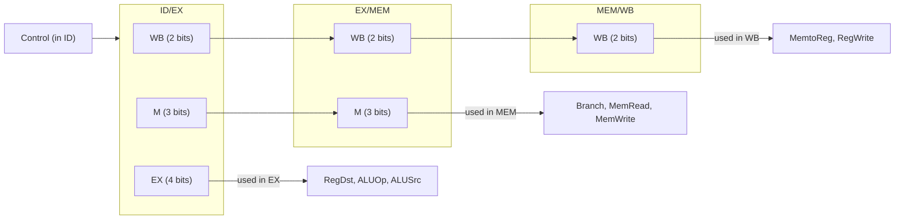

# بخش ۵، جلسه‌ی ۴ از ۱۱: کنترل خط لوله

این جلسه بخشی از **بخش ۵: خط لوله و مخاطره‌ها** است. زمان مطالعه: حدود نیم ساعت.

**فهرست این جلسه:**

- ۱. همان سیگنال‌های تک‌سیکلی
- ۲. سیگنال‌هایی که لازم نیست
- ۳. گروه‌بندی سیگنال‌ها بر اساس مرحله
- ۴. عبور دادن کنترل در ثبات‌های خط لوله
- ۵. فیلد funct در مرحله‌ی EX
- ۶. یک مثال کامل
- ۷. تمرین‌ها

---

## ۱. همان سیگنال‌های تک‌سیکلی

اسلاید درس می‌گوید طراحی اولیه‌ی کنترل خط لوله، از کنترل تک‌سیکلی الهام می‌گیرد و **همان سیگنال‌ها** را استفاده می‌کند. یادآوری از جلسه‌ی ۴-۴:

| دستور | RegDst | ALUSrc | MemtoReg | RegWrite | MemRead | MemWrite | Branch | ALUOp1 | ALUOp0 |
|---|---|---|---|---|---|---|---|---|---|
| قالب R | 1 | 0 | 0 | 1 | 0 | 0 | 0 | 1 | 0 |
| دستور `lw` | 0 | 1 | 1 | 1 | 1 | 0 | 0 | 0 | 0 |
| دستور `sw` | X | 1 | X | 0 | 0 | 1 | 0 | 0 | 0 |
| دستور `beq` | X | 0 | X | 0 | 0 | 0 | 1 | 0 | 1 |

کنترل ALU هم دقیقاً همان جدول جلسه‌ی ۴-۳ است: ALUOp و فیلد funct، کد چهاربیتی (در اسلاید سه‌بیتی) ALU را می‌سازند.

## ۲. سیگنال‌هایی که لازم نیست

اسلاید چند مشاهده دارد:

- **نوشتن PC:** PC در هر سیکل نوشته می‌شود، پس سیگنال نوشتن جدا لازم ندارد. (در جلسه‌ی ۵-۶ برای توقف این را عوض می‌کنیم.)
- **نوشتن ثبات‌های خط لوله:** آن‌ها هم در هر سیکل نوشته می‌شوند.
- **خواندن حافظه‌ی دستور:** در هر سیکل خوانده می‌شود.
- **خواندن فایل ثبات:** در هر سیکل خوانده می‌شود.

پس فقط باید سیگنال‌های هر مرحله را درست تنظیم کنیم.

## ۳. گروه‌بندی سیگنال‌ها بر اساس مرحله

هر سیگنال کنترل به یک قطعه‌ی سخت‌افزاری مربوط است و آن قطعه فقط در یک مرحله فعال است. پس سیگنال‌ها را بر اساس مرحله پنج گروه می‌کنیم:

| مرحله | سیگنال‌ها | توضیح |
|---|---|---|
| مرحله‌ی IF | هیچ | در هر سیکل همان کار تکراری: واکشی و PC + 4 |
| مرحله‌ی ID | هیچ | در هر سیکل همان کار: خواندن دو ثبات و گسترش علامت |
| مرحله‌ی EX | RegDst، ALUOp، ALUSrc | انتخاب ثبات مقصد، عمل ALU و ورودی دوم ALU |
| مرحله‌ی MEM | Branch، MemRead، MemWrite | پرش و دسترسی به حافظه |
| مرحله‌ی WB | MemtoReg، RegWrite | انتخاب داده‌ی نوشتنی و نوشتن در فایل ثبات |

یک نکته: در خط لوله‌ی کتاب، مالتی‌پلکسر RegDst در مرحله‌ی EX است. یعنی هم rt و هم rd تا آنجا منتقل می‌شوند و در EX انتخاب می‌شود کدام ثبات مقصد است. شماره‌ی انتخاب‌شده بعد از آن در EX/MEM و MEM/WB منتقل می‌شود.

جدول کنترل بر اساس مرحله (از اسلاید):

| دستور | RegDst | ALUOp1 | ALUOp0 | ALUSrc | Branch | MemRead | MemWrite | RegWrite | MemtoReg |
|---|---|---|---|---|---|---|---|---|---|
| قالب R | 1 | 1 | 0 | 0 | 0 | 0 | 0 | 1 | 0 |
| دستور `lw` | 0 | 0 | 0 | 1 | 0 | 1 | 0 | 1 | 1 |
| دستور `sw` | X | 0 | 0 | 1 | 0 | 0 | 1 | 0 | X |
| دستور `beq` | X | 0 | 1 | 0 | 1 | 0 | 0 | 0 | X |

چهار ستون اول مال مرحله‌ی EX، سه ستون بعد مال MEM و دو ستون آخر مال WB هستند.

## ۴. عبور دادن کنترل در ثبات‌های خط لوله

سیگنال‌ها در مرحله‌ی ID ساخته می‌شوند، چون آنجاست که کد عمل رمزگشایی می‌شود. ولی در مرحله‌های بعد لازم‌اند. راه‌حل: **سیگنال‌های کنترل را هم مثل داده‌ها از ثبات‌های خط لوله عبور بده**.



- **ثبات ID/EX:** همه‌ی ۹ سیگنال را دارد: ۴ بیت برای EX، ۳ بیت برای MEM و ۲ بیت برای WB.
- **ثبات EX/MEM:** سیگنال‌های EX مصرف شده‌اند و فقط ۵ بیت برای MEM و WB می‌ماند.
- **ثبات MEM/WB:** فقط ۲ بیت برای WB می‌ماند.

مزیت این روش: هر دستور سیگنال‌های **خودش** را همراه دارد. پس در هر سیکل، پنج دستور با پنج مجموعه سیگنال متفاوت می‌توانند همزمان در خط لوله باشند. این دقیقاً مثل این است که هر دستور یک برگه‌ی دستورالعمل همراه خودش در خط تولید حمل کند.

### پرش در مرحله‌ی MEM

در این طراحی اولیه، تصمیم پرش در مرحله‌ی MEM گرفته می‌شود:

```math
\text{PCSrc} = \text{EX/MEM.Branch} \cdot \text{EX/MEM.Zero}
```

یعنی آدرس پرش و خروجی Zero در EX حساب و در EX/MEM ذخیره می‌شوند و در MEM استفاده می‌شوند. در جلسه‌ی ۵-۷ تصمیم پرش را به مرحله‌ی ID می‌آوریم تا جریمه‌ی پرش کمتر شود.

## ۵. فیلد funct در مرحله‌ی EX

کنترل ALU در مرحله‌ی EX کار می‌کند و به فیلد funct نیاز دارد. ولی آیا funct به EX منتقل شده؟ اسلاید درس یک ترفند زیبا نشان می‌دهد: فیلد funct همان **۶ بیت پایین** دستور است. این بیت‌ها بخشی از فیلد ثابت ۱۶ بیتی‌اند که گسترش علامت می‌یابد و به ID/EX منتقل می‌شود. پس funct را می‌توان از ۶ بیت پایین ثابت گسترش‌یافته در ID/EX برداشت و نیازی به فیلد جداگانه نیست.

## ۶. یک مثال کامل

کتاب و اسلاید این دنباله را مرحله‌به‌مرحله نشان می‌دهند:

```asm
lw   $10, 20($1)
sub  $11, $2, $3
and  $12, $4, $5
or   $13, $6, $7
add  $14, $8, $9
```

این دستورات **هیچ وابستگی** به هم ندارند، پس بدون مخاطره اجرا می‌شوند.

| سیکل | IF | ID | EX | MEM | WB |
|---|---|---|---|---|---|
| سیکل ۱ | دستور `lw` | – | – | – | – |
| سیکل ۲ | دستور `sub` | دستور `lw` | – | – | – |
| سیکل ۳ | دستور `and` | دستور `sub` | دستور `lw` | – | – |
| سیکل ۴ | دستور `or` | دستور `and` | دستور `sub` | دستور `lw` | – |
| سیکل ۵ | دستور `add` | دستور `or` | دستور `and` | دستور `sub` | دستور `lw` |
| سیکل ۶ | بعدی ۱ | دستور `add` | دستور `or` | دستور `and` | دستور `sub` |
| سیکل ۷ | بعدی ۲ | بعدی ۱ | دستور `add` | دستور `or` | دستور `and` |
| سیکل ۸ | بعدی ۳ | بعدی ۲ | بعدی ۱ | دستور `add` | دستور `or` |
| سیکل ۹ | بعدی ۴ | بعدی ۳ | بعدی ۲ | بعدی ۱ | دستور `add` |

### نمای سیکل ۵

در سیکل ۵، خط لوله پر است. سیگنال‌ها و داده‌ها در هر مرحله:

| مرحله | دستور | چه اتفاقی می‌افتد |
|---|---|---|
| مرحله‌ی IF | دستور `add $14, $8, $9` | دستور واکشی و PC + 4 حساب می‌شود |
| مرحله‌ی ID | دستور `or $13, $6, $7` | ثبات‌های ۶ و ۷ خوانده می‌شوند و کنترل قالب R ساخته می‌شود |
| مرحله‌ی EX | دستور `and $12, $4, $5` | ALU با کد AND روی مقادیر ثبات ۴ و ۵ کار می‌کند؛ RegDst = 1 پس مقصد ۱۲ است |
| مرحله‌ی MEM | دستور `sub $11, $2, $3` | MemRead و MemWrite صفرند؛ نتیجه‌ی تفریق فقط عبور می‌کند |
| مرحله‌ی WB | دستور `lw $10, 20($1)` | MemtoReg = 1 و RegWrite = 1؛ داده‌ی حافظه در ثبات ۱۰ نوشته می‌شود |

به این نکته دقت کن: در همان سیکل ۵، مرحله‌ی ID ثبات‌های ۶ و ۷ را می‌خواند و مرحله‌ی WB در ثبات ۱۰ می‌نویسد. چون فایل ثبات در نیمه‌ی اول سیکل می‌نویسد و در نیمه‌ی دوم می‌خواند، اگر دستور `or` ثبات ۱۰ را می‌خواند، مقدار جدید را می‌گرفت.

## ۷. تمرین‌ها

<details>
<summary>تمرین ۱: سیگنال‌ها در یک سیکل</summary>

**صورت:** در سیکل ۶ مثال بالا، مقدار سیگنال‌های مرحله‌ی EX، MEM و WB چیست؟

**جواب:**

| مرحله | دستور | سیگنال‌ها |
|---|---|---|
| مرحله‌ی EX | دستور `or` | RegDst = 1، ALUOp = 10، ALUSrc = 0 |
| مرحله‌ی MEM | دستور `and` | Branch = 0، MemRead = 0، MemWrite = 0 |
| مرحله‌ی WB | دستور `sub` | RegWrite = 1، MemtoReg = 0 |
</details>

<details>
<summary>تمرین ۲: عرض بیت کنترل</summary>

**صورت:** اگر دستور `jal` را اضافه کنیم که در WB مقدار PC + 4 را در ثبات ۳۱ می‌نویسد، چه بیت‌هایی به ثبات‌های خط لوله اضافه می‌شود؟

**جواب:** مقدار PC + 4 باید تا MEM/WB منتقل شود، یعنی ۳۲ بیت به ID/EX (که از قبل دارد)، EX/MEM و MEM/WB اضافه می‌شود. سیگنال MemtoReg باید دوبیتی شود (ALU، حافظه یا PC + 4) و سیگنال RegDst هم دوبیتی (rt، rd یا ۳۱). پس یک بیت به بخش WB و یک بیت به بخش EX کنترل اضافه می‌شود. البته `jal` یک پرش هم هست و مخاطره‌ی کنترل دارد.
</details>

<details>
<summary>تمرین ۳: پرسش مفهومی</summary>

**صورت:** چرا نمی‌توان کنترل خط لوله را مثل طراحی چندسیکلی با یک ماشین حالت ساخت؟

**جواب:** در طراحی چندسیکلی فقط یک دستور در حال اجراست، پس یک حالت کافی است. در خط لوله، پنج دستور همزمان در مرحله‌های مختلف‌اند و هر کدام سیگنال‌های متفاوتی لازم دارد. یک ماشین حالت باید ترکیب همه‌ی این حالت‌ها را بداند که خیلی بزرگ می‌شود. عبور دادن سیگنال‌ها همراه دستور، کنترل را به همان مدار ترکیبی ساده‌ی تک‌سیکلی برمی‌گرداند.
</details>

---

جلسه‌ی قبلی: [مسیر داده‌ی خط لوله](5-3-pipelined-datapath.md)  
جلسه‌ی بعدی: [مخاطره‌ی داده و ارسال رو به جلو](5-5-data-hazards-forwarding.md)
