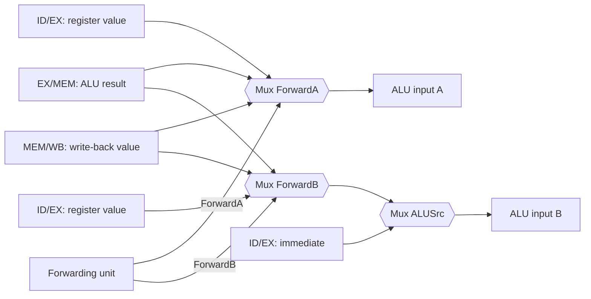

# بخش ۵، جلسه‌ی ۵ از ۱۱: مخاطره‌ی داده و ارسال رو به جلو

این جلسه بخشی از **بخش ۵: خط لوله و مخاطره‌ها** است. زمان مطالعه: حدود نیم ساعت.

**فهرست این جلسه:**

- ۱. یک مثال با چهار وابستگی
- ۲. راه‌حل نرم‌افزاری
- ۳. شرط‌های تشخیص مخاطره
- ۴. سخت‌افزار ارسال
- ۵. واحد ارسال: قاعده‌ی مخاطره‌ی EX
- ۶. واحد ارسال: قاعده‌ی مخاطره‌ی MEM
- ۷. یک مثال قدم‌به‌قدم
- ۸. ارسال برای دستور sw
- ۹. تمرین‌ها

---

## ۱. یک مثال با چهار وابستگی

مثال کتاب و اسلاید:

```asm
sub  $2, $1, $3        # register $2 written by sub
and  $12, $2, $5       # 1st operand ($2) depends on sub
or   $13, $6, $2       # 2nd operand ($2) depends on sub
add  $14, $2, $2       # 1st and 2nd operands depend on sub
sw   $15, 100($2)      # base ($2) depends on sub
```

فرض کن `$2` قبل از `sub` مقدار ۱۰ دارد و بعد از آن مقدار ۲۰-. مقدار `$2` در فایل ثبات در هر سیکل:

| سیکل | ۱ | ۲ | ۳ | ۴ | ۵ | ۶ | ۷ | ۸ | ۹ |
|---|---|---|---|---|---|---|---|---|---|
| مقدار `$2` | 10 | 10 | 10 | 10 | 10 و بعد −20 | −20 | −20 | −20 | −20 |

دستور `sub` در سیکل ۵ (مرحله‌ی WB) می‌نویسد. حالا هر دستور `$2` را کی می‌خواند؟

| دستور | خواندن در مرحله‌ی ID در سیکل | مقدار خوانده‌شده | درست؟ |
|---|---|---|---|
| دستور `and` | 3 | 10 | خیر |
| دستور `or` | 4 | 10 | خیر |
| دستور `add` | 5 | −20 (نوشتن در نیمه‌ی اول، خواندن در نیمه‌ی دوم) | بله |
| دستور `sw` | 6 | −20 | بله |

پس `and` و `or` مقدار قدیمی را می‌خوانند. در نمودار، وابستگی‌های این دو دستور **به عقب در زمان** می‌روند.

## ۲. راه‌حل نرم‌افزاری

اسلاید درس اول راه‌حل نرم‌افزاری را می‌گوید: کامپایلر تضمین کند هیچ‌وقت مخاطره‌ی داده نباشد. یعنی بین دستورات وابسته، به اندازه‌ی کافی دستور مستقل بگذارد. اگر پیدا نکرد، `nop` بگذارد:

```asm
# reordered                       # or, with nops
sub  $2, $1, $3                   sub  $2, $1, $3
lw   $10, 40($3)                  nop
slt  $5, $6, $7                   nop
and  $12, $2, $5                  and  $12, $2, $5
add  $14, $2, $2                  add  $14, $2, $2
```

مشکل: این کار همیشه ممکن نیست و `nop`ها ماشین را کند می‌کنند. در این مثال، دو `nop` برای هر وابستگی نزدیک یعنی CPI خیلی بالاتر. پس راه‌حل سخت‌افزاری لازم است.

## ۳. شرط‌های تشخیص مخاطره

ایده‌ی ارسال: نتیجه‌ی ALU در پایان مرحله‌ی EX آماده است و در ثبات EX/MEM و بعد MEM/WB نگه داشته می‌شود. پس دستوری که آن را لازم دارد، می‌تواند مستقیم از این ثبات‌ها بگیرد.

اسلاید ارسال را دو گام می‌داند: (۱) تشخیص مخاطره و (۲) ارسال داده‌ی میانی.

برای تشخیص، شماره‌ی ثبات‌ها را در ثبات‌های خط لوله مقایسه می‌کنیم. نام‌گذاری: «ID/EX.RegisterRs» یعنی شماره‌ی ثبات rs که در ثبات خط لوله‌ی ID/EX ذخیره شده است. چهار شرط:

| شرط | معنی | مثال بالا |
|---|---|---|
| شرط 1a | `EX/MEM.RegisterRd = ID/EX.RegisterRs` | دستور `and` در EX و `sub` در MEM |
| شرط 1b | `EX/MEM.RegisterRd = ID/EX.RegisterRt` | – |
| شرط 2a | `MEM/WB.RegisterRd = ID/EX.RegisterRs` | – |
| شرط 2b | `MEM/WB.RegisterRd = ID/EX.RegisterRt` | دستور `or` در EX و `sub` در WB |

اینجا RegisterRd یعنی شماره‌ی ثبات **مقصد**، که برای قالب R همان rd و برای `lw` همان rt است. همان مقداری که بعد از مالتی‌پلکسر RegDst ذخیره شده است. برای این مقایسه، ID/EX باید شماره‌ی rs را هم نگه دارد، نه فقط rt و rd.

### دو شرط اضافه

اسلاید دو شرط دیگر را هم اضافه می‌کند:

- **دستور قبلی واقعاً بنویسد:** بعضی دستورات مثل `sw` و `beq` در ثبات نمی‌نویسند. فیلد rd آن‌ها یک عدد تصادفی است. پس باید سیگنال RegWrite آن دستور فعال باشد.
- **مقصد صفر نباشد:** اگر دستوری مثل `sll $0, $1, 2` در `$0` بنویسد، نتیجه نباید ارسال شود، چون `$0` همیشه صفر است.

## ۴. سخت‌افزار ارسال

برای ارسال، جلوی **هر دو ورودی ALU** یک مالتی‌پلکسر سه‌ورودی می‌گذاریم:



مقادیر سیگنال‌های کنترل این مالتی‌پلکسرها (از کتاب COD و اسلاید درس):

| سیگنال | منبع | توضیح |
|---|---|---|
| مقدار ForwardA = 00 | ثبات ID/EX | عملوند اول ALU از فایل ثبات می‌آید |
| مقدار ForwardA = 10 | ثبات EX/MEM | عملوند اول از نتیجه‌ی ALU دستور قبلی ارسال می‌شود |
| مقدار ForwardA = 01 | ثبات MEM/WB | عملوند اول از حافظه‌ی داده یا نتیجه‌ی ALU دو دستور قبل ارسال می‌شود |
| مقدار ForwardB = 00 | ثبات ID/EX | عملوند دوم ALU از فایل ثبات می‌آید |
| مقدار ForwardB = 10 | ثبات EX/MEM | عملوند دوم از نتیجه‌ی ALU دستور قبلی ارسال می‌شود |
| مقدار ForwardB = 01 | ثبات MEM/WB | عملوند دوم از حافظه‌ی داده یا نتیجه‌ی ALU دو دستور قبل ارسال می‌شود |

مقدار MEM/WB همان خروجی مالتی‌پلکسر MemtoReg است، یعنی یا داده‌ی حافظه یا نتیجه‌ی ALU.

به جای مالتی‌پلکسر ForwardB دقت کن: **قبل** از مالتی‌پلکسر ALUSrc است. پس مقدار ارسال‌شده هم برای ALU و هم برای داده‌ی ذخیره‌ی `sw` (که از همین مسیر به EX/MEM می‌رود) استفاده می‌شود.

## ۵. واحد ارسال: قاعده‌ی مخاطره‌ی EX

**واحد ارسال (Forwarding unit)** یک مدار ترکیبی در مرحله‌ی EX است که شماره‌ی ثبات‌ها را مقایسه می‌کند و ForwardA و ForwardB را می‌سازد.

**مخاطره‌ی EX**: دستور قبلی (اکنون در MEM) نتیجه‌ای دارد که دستور فعلی (در EX) لازم دارد:

```text
if (EX/MEM.RegWrite
    and (EX/MEM.RegisterRd != 0)
    and (EX/MEM.RegisterRd == ID/EX.RegisterRs))
        ForwardA = 10

if (EX/MEM.RegWrite
    and (EX/MEM.RegisterRd != 0)
    and (EX/MEM.RegisterRd == ID/EX.RegisterRt))
        ForwardB = 10
```

## ۶. واحد ارسال: قاعده‌ی مخاطره‌ی MEM

**مخاطره‌ی MEM**: دو دستور قبل (اکنون در WB) نتیجه‌ای دارد که دستور فعلی لازم دارد:

```text
if (MEM/WB.RegWrite
    and (MEM/WB.RegisterRd != 0)
    and not (EX/MEM.RegWrite and (EX/MEM.RegisterRd != 0)
             and (EX/MEM.RegisterRd == ID/EX.RegisterRs))
    and (MEM/WB.RegisterRd == ID/EX.RegisterRs))
        ForwardA = 01

if (MEM/WB.RegWrite
    and (MEM/WB.RegisterRd != 0)
    and not (EX/MEM.RegWrite and (EX/MEM.RegisterRd != 0)
             and (EX/MEM.RegisterRd == ID/EX.RegisterRt))
    and (MEM/WB.RegisterRd == ID/EX.RegisterRt))
        ForwardB = 01
```

### چرا شرط «not» لازم است

این شرط وقتی مهم است که **هر دو** دستور قبلی در همان ثبات بنویسند. اسلاید درس مثال جمع یک آرایه را می‌زند:

```asm
add  $1, $1, $2
add  $1, $1, $3
add  $1, $1, $4
```

دستور سوم به `$1` نیاز دارد. دستور اول (در WB) و دستور دوم (در MEM) هر دو `$1` را نوشته‌اند. مقدار درست، **جدیدترین** مقدار است، یعنی مال دستور دوم در EX/MEM. پس مخاطره‌ی EX اولویت دارد. شرط «not» در قاعده‌ی MEM همین را تضمین می‌کند. به این وضعیت **مخاطره‌ی داده‌ی دوگانه** می‌گوییم.

اسلاید درس قاعده‌ی MEM را کمی ساده‌تر نوشته است: فقط شرط `EX/MEM.RegisterRd != ID/EX.RegisterRs` را دارد. این نسخه در بیشتر حالت‌ها درست کار می‌کند، ولی اگر دستور در MEM اصلاً در ثبات ننویسد (مثلاً `sw` با فیلد rd تصادفی برابر rs)، ارسال از MEM/WB به اشتباه حذف می‌شود. نسخه‌ی کامل بالا، که در ویرایش ۵ کتاب آمده، این حالت را هم درست می‌کند.

## ۷. یک مثال قدم‌به‌قدم

مثال اسلاید درس:

```asm
sub  $2, $1, $3
and  $4, $2, $5
or   $4, $4, $2
add  $9, $4, $2
```

| سیکل | IF | ID | EX | MEM | WB |
|---|---|---|---|---|---|
| سیکل ۳ | دستور `or` | دستور `and` | دستور `sub` | – | – |
| سیکل ۴ | دستور `add` | دستور `or` | دستور `and` | دستور `sub` | – |
| سیکل ۵ | بعدی ۱ | دستور `add` | دستور `or` | دستور `and` | دستور `sub` |
| سیکل ۶ | بعدی ۲ | بعدی ۱ | دستور `add` | دستور `or` | دستور `and` |

سیگنال‌های ارسال در هر سیکل:

| سیکل | دستور در EX | ForwardA | ForwardB | دلیل |
|---|---|---|---|---|
| سیکل ۴ | دستور `and $4, $2, $5` | 10 | 00 | ثبات rs برابر `$2` با مقصد `sub` در EX/MEM برابر است |
| سیکل ۵ | دستور `or $4, $4, $2` | 10 | 01 | ثبات rs برابر `$4` از `and` در EX/MEM؛ ثبات rt برابر `$2` از `sub` در MEM/WB |
| سیکل ۶ | دستور `add $9, $4, $2` | 10 | 00 | ثبات rs برابر `$4` از `or` در EX/MEM؛ ثبات `$2` در سیکل ۵ از فایل ثبات درست خوانده شده |

سیکل ۶ یک مخاطره‌ی دوگانه دارد: هم `and` (در WB) و هم `or` (در MEM) در `$4` می‌نویسند. ForwardA برابر 10 است، یعنی مقدار جدیدتر از `or` انتخاب می‌شود.

## ۸. ارسال برای دستور sw

تا اینجا فقط ارسال به ورودی ALU را دیدیم. اسلاید درس یادآوری می‌کند که این کافی است تا برای **دستورات قالب R** و آدرس `lw` و `sw` جواب بدهد.

یک حالت ظریف: `lw` و بلافاصله `sw` که مقدار بارگذاری‌شده را ذخیره می‌کند:

```asm
lw   $1, 0($2)
sw   $1, 0($3)         # memory-to-memory copy
```

در خط لوله‌ی کتاب، `sw` مقدار `$1` را در مرحله‌ی EX (از مسیر ForwardB) لازم دارد، در حالی که `lw` هنوز در MEM است. پس یک توقف لازم است. ولی در واقع `sw` داده را در **مرحله‌ی MEM** لازم دارد. با یک مسیر ارسال جدید از MEM/WB به ورودی داده‌ی حافظه، این توقف حذف می‌شود. کتاب COD این را در یک تمرین بررسی می‌کند. این نوع کپی در برنامه‌ها رایج است.

## ۹. تمرین‌ها

<details>
<summary>تمرین ۱: سیگنال‌های ارسال</summary>

**صورت:** برای کد زیر، در هر سیکل که دستوری در EX است، مقدار ForwardA و ForwardB را بنویس.

```asm
add  $1, $2, $3
sub  $4, $1, $5
and  $6, $1, $4
```

**جواب:**

| دستور در EX | ForwardA | ForwardB | دلیل |
|---|---|---|---|
| دستور `add` | 00 | 00 | وابستگی ندارد |
| دستور `sub` | 10 | 00 | ثبات `$1` از `add` در EX/MEM |
| دستور `and` | 01 | 10 | ثبات `$1` از `add` در MEM/WB و ثبات `$4` از `sub` در EX/MEM |
</details>

<details>
<summary>تمرین ۲: ثبات صفر</summary>

**صورت:** در کد زیر، اگر شرط «مقصد صفر نباشد» وجود نداشت چه اتفاقی می‌افتاد؟

```asm
add  $0, $1, $2
sub  $3, $0, $4
```

**جواب:** دستور `add` حاصل `$1 + $2` را به‌عنوان نتیجه‌ی ALU دارد، ولی در `$0` نوشته نمی‌شود. بدون آن شرط، واحد ارسال این مقدار را به `sub` می‌فرستاد و `sub` به جای `0 - $4` مقدار `($1 + $2) - $4` را حساب می‌کرد. با آن شرط، `sub` مقدار صفر را از فایل ثبات می‌گیرد که درست است.
</details>

<details>
<summary>تمرین ۳: بدون ارسال</summary>

**صورت:** اگر خط لوله ارسال نداشت (فقط نوشتن در نیمه‌ی اول و خواندن در نیمه‌ی دوم)، کد تمرین ۱ چند سیکل توقف می‌خواست؟

**جواب:** دستور `sub` به `$1` نیاز دارد که `add` در WB می‌نویسد. `sub` باید ID خود را هم‌زمان با WB دستور `add` انجام دهد، یعنی دو سیکل توقف. بعد از آن، `and` یک دستور بعد از `sub` است و به `$4` نیاز دارد، پس آن هم باید دو سیکل صبر کند. در مجموع ۴ سیکل توقف. با ارسال، صفر.
</details>

---

جلسه‌ی قبلی: [کنترل خط لوله](5-4-pipelined-control.md)  
جلسه‌ی بعدی: [مخاطره‌ی بارگذاری و توقف](5-6-load-use-stalls.md)
