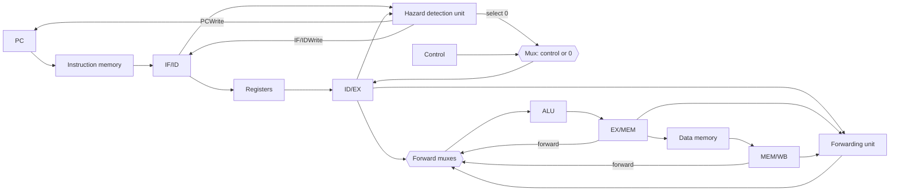

# بخش ۵، جلسه‌ی ۶ از ۱۱: مخاطره‌ی بارگذاری و توقف

این جلسه بخشی از **بخش ۵: خط لوله و مخاطره‌ها** است. زمان مطالعه: حدود نیم ساعت.

**فهرست این جلسه:**

- ۱. چرا ارسال برای lw کافی نیست
- ۲. واحد تشخیص مخاطره
- ۳. سازوکار توقف
- ۴. چرا بیت‌های دستور را صفر نمی‌کنیم
- ۵. مثال قدم‌به‌قدم
- ۶. مسیر داده با ارسال و تشخیص مخاطره
- ۷. اثر توقف بر کارایی
- ۸. زمان‌بندی کد توسط کامپایلر
- ۹. تمرین‌ها

---

## ۱. چرا ارسال برای lw کافی نیست

مثال اسلاید درس:

```asm
lw   $2, 20($1)
and  $4, $2, $5
or   $8, $2, $6
add  $9, $4, $2
slt  $1, $6, $7
```

داده‌ی `lw` در پایان مرحله‌ی MEM (سیکل ۴) آماده می‌شود. دستور `and` آن را در ابتدای مرحله‌ی EX (سیکل ۴) لازم دارد. اسلاید می‌گوید: چون این وابستگی در خط لوله **به عقب در زمان** می‌رود، ارسال آن را حل نمی‌کند. دستور `or` مشکلی ندارد، چون در سیکل ۵ در EX است و داده را از MEM/WB می‌گیرد.

پس به یک **واحد تشخیص مخاطره (Hazard detection unit)** نیاز داریم که در این حالت خط لوله را **متوقف** کند.

## ۲. واحد تشخیص مخاطره

واحد تشخیص مخاطره در **مرحله‌ی ID** کار می‌کند. چرا ID؟ چون می‌خواهیم دستور وابسته را قبل از اینکه وارد EX شود نگه داریم. شرط توقف:

```text
if (ID/EX.MemRead
    and ((ID/EX.RegisterRt == IF/ID.RegisterRs)
      or (ID/EX.RegisterRt == IF/ID.RegisterRt)))
        stall the pipeline
```

معنای شرط:

- **شرط اول:** دستوری که در EX است `lw` باشد. تنها دستوری که حافظه می‌خواند `lw` است، پس MemRead کافی است.
- **شرط دوم:** ثبات مقصد `lw` (که در rt است) با یکی از دو ثبات منبع دستوری که در ID است برابر باشد.

اسلاید می‌گوید اگر این شرط برقرار باشد، خط لوله فقط **یک سیکل** بعد از `lw` متوقف می‌شود. بعد از آن، واحد ارسال وابستگی را حل می‌کند.

### یک نکته‌ی دقیق

این شرط محافظه‌کار است. مثلاً اگر دستور در ID یک `addi` باشد که rt آن **مقصد** است نه منبع، شرط باز هم ممکن است برقرار شود و یک توقف بی‌دلیل ایجاد کند. یا اگر دستور در ID یک `sw` باشد که فقط داده‌ی ذخیره را از rt می‌گیرد، که در مرحله‌ی MEM لازم است. این توقف‌های اضافه کمیاب‌اند و سادگی واحد را حفظ می‌کنند. همچنین اگر `lw` در `$0` بنویسد، توقف لازم نیست ولی این شرط آن را بررسی نمی‌کند.

## ۳. سازوکار توقف

اسلاید درس سه کاری را که سخت‌افزار برای توقف یک سیکل انجام می‌دهد این‌طور می‌گوید:

1. **ثبات IF/ID تغییر نکند:** سیگنال نوشتن آن غیرفعال می‌شود. پس دستوری که در ID است، در سیکل بعد هم در ID می‌ماند و دوباره رمزگشایی می‌شود.
2. **مقدار PC تغییر نکند:** چون دستور پشت سرش در IF هم باید صبر کند. سیگنال نوشتن PC غیرفعال می‌شود. پس همان دستور دوباره واکشی می‌شود.
3. **یک حباب در EX:** همه‌ی سیگنال‌های کنترل EX، MEM و WB در ثبات ID/EX **صفر** می‌شوند. پس چیزی که در سیکل بعد وارد EX می‌شود، عملاً یک `nop` است: هیچ ثباتی نمی‌نویسد و حافظه را عوض نمی‌کند. می‌گوییم یک **حباب** در خط لوله وارد شده است.

برای این کار، دو سیگنال جدید لازم است:

| سیگنال | کار |
|---|---|
| سیگنال PCWrite | اگر صفر باشد، PC در این سیکل نوشته نمی‌شود |
| سیگنال IF/IDWrite | اگر صفر باشد، IF/ID در این سیکل نوشته نمی‌شود |

و یک مالتی‌پلکسر جلوی بخش کنترل ID/EX که بین سیگنال‌های واقعی و صفر انتخاب می‌کند.

حالا معنی جمله‌ی جلسه‌ی ۵-۴ را می‌فهمیم که می‌گفت PC سیگنال نوشتن ندارد، «مگر با واحد تشخیص مخاطره».

## ۴. چرا بیت‌های دستور را صفر نمی‌کنیم

اسلاید یک سؤال جالب دارد. دستور `nop` در MIPS برابر ۳۲ بیت صفر است. پس چرا خود دستور را در IF/ID صفر نمی‌کنیم تا `nop` شود؟

جواب: دستوری که در ID است **قبلاً رمزگشایی شده** و سیگنال‌های کنترلش در همین سیکل ساخته شده‌اند. صفر کردن بیت‌های دستور در IF/ID روی دستوری اثر دارد که هنوز وارد ID نشده. ما می‌خواهیم دستوری که از ID به EX می‌رود حباب شود. پس باید **سیگنال‌های کنترل** در ID/EX صفر شوند.

## ۵. مثال قدم‌به‌قدم

با یک توقف، کد بخش ۱ این‌طور اجرا می‌شود:

| دستور | سیکل ۱ | سیکل ۲ | سیکل ۳ | سیکل ۴ | سیکل ۵ | سیکل ۶ | سیکل ۷ | سیکل ۸ | سیکل ۹ | سیکل ۱۰ |
|---|---|---|---|---|---|---|---|---|---|---|
| دستور `lw $2, 20($1)` | IF | ID | EX | MEM | WB | | | | | |
| دستور `and $4, $2, $5` | | IF | ID | ID | EX | MEM | WB | | | |
| حباب | | | | EX | MEM | WB | | | | |
| دستور `or $8, $2, $6` | | | IF | IF | ID | EX | MEM | WB | | |
| دستور `add $9, $4, $2` | | | | | IF | ID | EX | MEM | WB | |
| دستور `slt $1, $6, $7` | | | | | | IF | ID | EX | MEM | WB |

جزئیات:

- **سیکل ۳:** `lw` در EX و `and` در ID است. واحد تشخیص مخاطره شرط را بررسی می‌کند: MemRead یک است و rt دستور `lw` (یعنی `$2`) با rs دستور `and` برابر است. پس توقف.
- **سیکل ۴:** `and` دوباره در ID است و `or` دوباره در IF. حباب وارد EX شده است.
- **سیکل ۵:** `and` در EX است. حالا `lw` در WB است. واحد ارسال `$2` را از MEM/WB می‌گیرد (ForwardA = 01).
- **سیکل ۶:** `or` در EX است. `$2` از فایل ثبات درست خوانده شده (سیکل ۵ که `lw` نوشت). ولی در واقع `or` در سیکل ۵ در ID بوده و همان سیکلی که `lw` در WB بود، پس با نوشتن در نیمه‌ی اول، مقدار درست را خوانده است.

اسلاید جمع‌بندی می‌کند: واحد تشخیص مخاطره یک حباب یک‌سیکلی وارد خط لوله می‌کند و بعد از آن همه‌ی وابستگی‌ها رو به جلو می‌روند و واحد ارسال آن‌ها را حل می‌کند.

## ۶. مسیر داده با ارسال و تشخیص مخاطره



دو واحد جدید را مقایسه کن:

| ویژگی | واحد ارسال | واحد تشخیص مخاطره |
|---|---|---|
| مرحله | مرحله‌ی EX | مرحله‌ی ID |
| کار | انتخاب ورودی درست ALU | متوقف کردن خط لوله |
| ورودی‌ها | شماره‌ی rs و rt در ID/EX، شماره‌ی مقصد و RegWrite در EX/MEM و MEM/WB | سیگنال MemRead و rt در ID/EX، شماره‌ی rs و rt در IF/ID |
| خروجی‌ها | ForwardA و ForwardB | PCWrite، IF/IDWrite و صفر کردن کنترل |
| کی فعال است | وقتی داده در خط لوله آماده است | وقتی داده هنوز آماده نیست (فقط lw) |

## ۷. اثر توقف بر کارایی

با توقف، CPI بیشتر از ۱ می‌شود:

```math
\text{CPI} = 1 + \text{stall cycles per instruction}
```

مثال: اگر ۲۵٪ دستورات `lw` باشند و نیمی از آن‌ها بلافاصله با یک دستور وابسته دنبال شوند:

```math
\text{CPI} = 1 + 0.25 \times 0.5 \times 1 = 1.125
```

## ۸. زمان‌بندی کد توسط کامپایلر

همان‌طور که در جلسه‌ی ۵-۲ دیدیم، کامپایلر می‌تواند با جابه‌جا کردن دستورات، دستورات مستقل را بین `lw` و استفاده‌کننده‌اش بگذارد. به این کار **زمان‌بندی ایستا (Static scheduling)** می‌گوییم. در بخش ۷ این کار را برای حلقه‌ها با **باز کردن حلقه (Loop unrolling)** گسترش می‌دهیم. در بخش ۸ می‌بینیم که سخت‌افزار هم می‌تواند در زمان اجرا همین کار را بکند (**زمان‌بندی پویا**).

یک مثال کلاسیک: حلقه‌ای که آرایه را می‌خواند و پردازش می‌کند.

```asm
Loop:   lw   $t0, 0($s1)       # load element
        addu $t0, $t0, $s2     # add scalar (stall: uses $t0)
        sw   $t0, 0($s1)       # store result
        addi $s1, $s1, -4      # decrement pointer
        bne  $s1, $zero, Loop
```

با جابه‌جا کردن `addi`، توقف حذف می‌شود. ولی باید جابه‌جایی `sw` را هم اصلاح کنیم، چون حالا `$s1` قبل از `sw` کم شده است:

```asm
Loop:   lw   $t0, 0($s1)
        addi $s1, $s1, -4      # moved up: fills the load delay
        addu $t0, $t0, $s2
        sw   $t0, 4($s1)       # offset adjusted: +4
        bne  $s1, $zero, Loop
```

این همان نوع مرتب‌سازی است که در سؤال‌های بخش ۷ زیاد می‌بینیم.

## ۹. تمرین‌ها

<details>
<summary>تمرین ۱: آیا توقف لازم است</summary>

**صورت:** برای هر جفت، بگو آیا واحد تشخیص مخاطره توقف ایجاد می‌کند و آیا توقف واقعاً لازم است.

```asm
# (a)
lw   $1, 0($2)
add  $3, $1, $4
# (b)
lw   $1, 0($2)
add  $3, $4, $5
# (c)
lw   $1, 0($2)
addi $1, $3, 10
# (d)
lw   $1, 0($2)
sw   $1, 4($2)
```

**جواب:**

| جفت | توقف ایجاد می‌شود؟ | توقف لازم است؟ | توضیح |
|---|---|---|---|
| جفت (a) | بله | بله | مخاطره‌ی بارگذاری و استفاده |
| جفت (b) | خیر | خیر | ثبات `$1` استفاده نمی‌شود |
| جفت (c) | بله | خیر | در `addi` فیلد rt مقصد است، نه منبع؛ ولی شرط برقرار است |
| جفت (d) | بله | خیر، اگر ارسال MEM به MEM باشد | در خط لوله‌ی پایه لازم است، چون ForwardB در EX است |
</details>

<details>
<summary>تمرین ۲: شمارش سیکل</summary>

**صورت:** کد زیر با ارسال و تشخیص مخاطره چند سیکل طول می‌کشد؟

```asm
lw   $t1, 0($a0)
lw   $t2, 4($a0)
add  $t3, $t1, $t2
sw   $t3, 8($a0)
```

**جواب:** چهار دستور در حالت ایده‌آل 4 + 4 = 8 سیکل می‌گیرند. دستور `add` بلافاصله بعد از `lw $t2` است و به `$t2` نیاز دارد، پس یک توقف. دستور `sw` به `$t3` از `add` نیاز دارد که با ارسال حل می‌شود. پس در مجموع ۹ سیکل.
</details>

<details>
<summary>تمرین ۳: طراحی شرط کامل</summary>

**صورت:** شرط واحد تشخیص مخاطره را طوری بنویس که توقف‌های بی‌دلیل جفت (c) و حالت مقصد `$0` را نداشته باشد.

**جواب:** باید بدانیم دستور در ID واقعاً از rt به‌عنوان منبع استفاده می‌کند. این را می‌توان از کد عمل فهمید: برای قالب R، `beq`، `bne` و `sw` بله، برای `lw` و `addi` و دیگر دستورات ثابت خیر. اگر سیگنال UsesRt را از کنترل در ID بسازیم:

```text
if (ID/EX.MemRead and (ID/EX.RegisterRt != 0)
    and ((ID/EX.RegisterRt == IF/ID.RegisterRs)
      or (UsesRt and ID/EX.RegisterRt == IF/ID.RegisterRt)))
        stall
```

برای `sw` حتی می‌توان یک قدم جلوتر رفت و با ارسال MEM به MEM توقف را حذف کرد.
</details>

---

جلسه‌ی قبلی: [مخاطره‌ی داده و ارسال رو به جلو](5-5-data-hazards-forwarding.md)  
جلسه‌ی بعدی: [مخاطره‌ی کنترل و پیش‌بینی پرش](5-7-control-hazards-branch-prediction.md)
