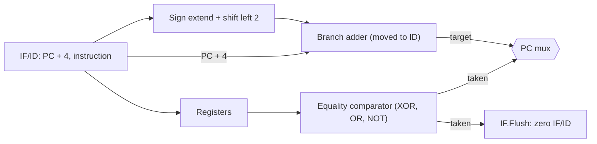
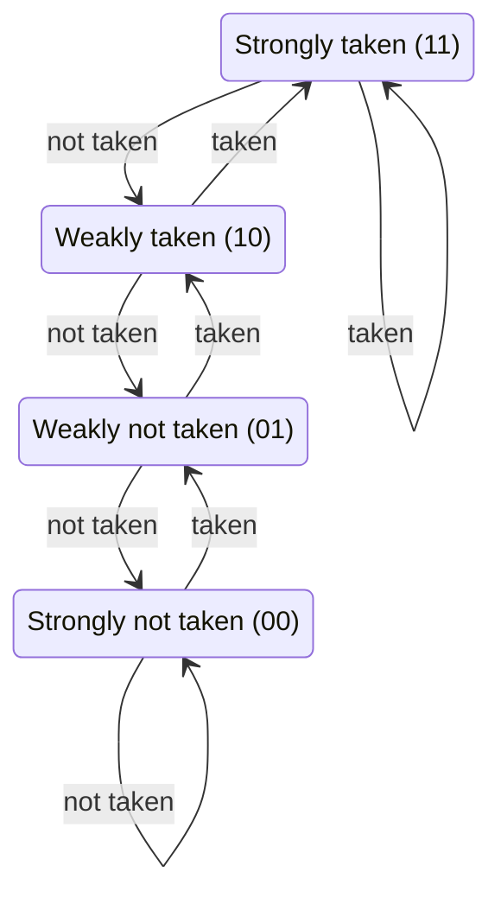

# بخش ۵، جلسه‌ی ۷ از ۱۱: مخاطره‌ی کنترل و پیش‌بینی پرش

این جلسه بخشی از **بخش ۵: خط لوله و مخاطره‌ها** است. زمان مطالعه: حدود نیم ساعت.

**فهرست این جلسه:**

- ۱. مشکل پرش در خط لوله‌ی فعلی
- ۲. پیش‌بینی «انجام‌نشده» و پاک کردن
- ۳. انتقال تصمیم پرش به مرحله‌ی ID
- ۴. مخاطره‌ی داده برای پرش
- ۵. مثال پرش با یک حباب
- ۶. پرش تأخیری و پر کردن شکاف
- ۷. پیش‌بینی پویای پرش
- ۸. پیش‌بینی‌کننده‌ی دوبیتی
- ۹. بافر مقصد پرش و دستور j
- ۱۰. تمرین‌ها

---

## ۱. مشکل پرش در خط لوله‌ی فعلی

در خط لوله‌ای که تا اینجا ساختیم، تصمیم پرش در **مرحله‌ی MEM** گرفته می‌شود (جلسه‌ی ۵-۴). اسلاید درس می‌پرسد: تا آن موقع، چه دستوراتی باید بعد از پرش وارد خط لوله شوند؟

دو راه:

- **توقف تا معلوم شدن نتیجه:** کارآمد نیست و خط لوله را خیلی کند می‌کند. سه سیکل توقف برای هر پرش.
- **پیش‌بینی نتیجه:** مثلاً همیشه فرض کن پرش انجام نمی‌شود و دستورات بعدی را ادامه بده.

## ۲. پیش‌بینی «انجام‌نشده» و پاک کردن

با پیش‌بینی **انجام‌نشده (Predict not taken)**، دستورات بعدی به ترتیب واکشی می‌شوند. اگر پیش‌بینی غلط بود، باید دستوراتی را که بعد از پرش وارد خط لوله شده‌اند **پاک کنیم (Flush)**، یعنی دور بریزیم، و از مقصد پرش ادامه دهیم.

مثال اسلاید درس:

```asm
40  beq  $1, $3, 7         # branch to 40 + 4 + 7 x 4 = 72
44  and  $12, $2, $5
48  or   $13, $6, $2
52  add  $14, $2, $2
72  lw   $4, 50($7)
```

| دستور | سیکل ۱ | سیکل ۲ | سیکل ۳ | سیکل ۴ | سیکل ۵ | سیکل ۶ | سیکل ۷ | سیکل ۸ |
|---|---|---|---|---|---|---|---|---|
| دستور `40 beq` | IF | ID | EX | **MEM** | WB | | | |
| دستور `44 and` (پاک می‌شود) | | IF | ID | EX | | | | |
| دستور `48 or` (پاک می‌شود) | | | IF | ID | | | | |
| دستور `52 add` (پاک می‌شود) | | | | IF | | | | |
| دستور `72 lw` | | | | | IF | ID | EX | MEM |

پرش انجام می‌شود (پیش‌بینی غلط بود). نتیجه در سیکل ۴، وقتی `beq` در MEM است، معلوم می‌شود. سه دستوری که بعد از آن وارد شده‌اند پاک می‌شوند و جریمه **سه سیکل** است.

### پاک کردن چطور انجام می‌شود

اسلاید می‌گوید: همان روش توقف بارگذاری. سیگنال‌های کنترل (یا خود دستور) در ثبات‌های خط لوله‌ی دستوراتی که بعد از پرش‌اند، صفر می‌شوند تا به `nop` تبدیل شوند. چون این دستورات هنوز به مرحله‌ی MEM یا WB نرسیده‌اند، هیچ اثری روی حافظه یا ثبات‌ها نگذاشته‌اند.

## ۳. انتقال تصمیم پرش به مرحله‌ی ID

برای کم کردن جریمه، اسلاید و کتاب پیشنهاد می‌کنند تصمیم پرش را از MEM به **ID** منتقل کنیم. دو چیز لازم است:

- **محاسبه‌ی آدرس مقصد در ID:** جمع‌کننده‌ی آدرس پرش را از EX به ID منتقل کن. ورودی‌های آن، یعنی PC + 4 و ثابت، از قبل در IF/ID هستند.
- **مقایسه در ID:** به جای استفاده از ALU (تفریق و بعد آزمون صفر، که به خاطر انتشار رقم نقلی کند است)، یک **مقایسه‌گر برابری** سریع بساز: XOR بیت‌به‌بیت دو ثبات، OR همه‌ی نتیجه‌ها و NOT. این مدار آن‌قدر سریع است که مرحله‌ی ID را زیاد طولانی نمی‌کند. یادت باشد هدف طراحی خط لوله، متعادل نگه داشتن مرحله‌هاست.

این دقیقاً همان دلیلی است که در جلسه‌ی ۲-۵ گفتیم MIPS دستور `blt` ندارد: مقایسه‌ی برابری سریع است و در ID جا می‌شود، ولی مقایسه‌ی کوچک‌تر بودن به تفریق کامل نیاز دارد.

بعد از این تغییر، اگر پیش‌بینی غلط باشد، فقط **یک** دستور (دستوری که در IF است) باید پاک شود. سیگنال جدیدی به نام **IF.Flush** ثبات IF/ID را صفر می‌کند، یعنی دستور را به `nop` تبدیل می‌کند. جریمه‌ی پرش از سه سیکل به **یک سیکل** کاهش می‌یابد.



## ۴. مخاطره‌ی داده برای پرش

اسلاید یک نکته‌ی مهم دارد: وقتی مقایسه به ID منتقل شد، ممکن است ثبات‌های پرش به نتیجه‌ی دستورات قبلی وابسته باشند که هنوز در خط لوله‌اند. پس باید واحد ارسال و تشخیص مخاطره را هم برای ID گسترش دهیم.

| دستور قبلی | فاصله | چه لازم است |
|---|---|---|
| دستور قالب R | دو یا سه دستور قبل | ارسال از EX/MEM یا MEM/WB به مقایسه‌گر در ID |
| دستور قالب R | بلافاصله قبل | یک سیکل توقف، چون نتیجه در پایان EX آماده است و پرش آن را در ابتدای ID لازم دارد |
| دستور `lw` | بلافاصله قبل | دو سیکل توقف، چون داده در پایان MEM آماده است |
| دستور `lw` | دو دستور قبل | یک سیکل توقف |

مثلاً:

```asm
add  $1, $2, $3
beq  $1, $4, target    # 1 stall: $1 computed in EX of add
```

```asm
lw   $1, 0($2)
beq  $1, $4, target    # 2 stalls: $1 available only after MEM of lw
```

این هزینه‌ی انتقال پرش به ID است: پرش‌ها به نتیجه‌ی دستورات قبلی حساس‌تر می‌شوند.

## ۵. مثال پرش با یک حباب

مثال اسلاید و کتاب:

```asm
36  sub  $10, $4, $8
40  beq  $1, $3, 7         # target = 44 + 28 = 72
44  and  $12, $2, $5
48  or   $13, $2, $6
52  add  $14, $4, $2
56  slt  $15, $6, $7
72  lw   $4, 50($7)
```

| دستور | سیکل ۱ | سیکل ۲ | سیکل ۳ | سیکل ۴ | سیکل ۵ | سیکل ۶ | سیکل ۷ |
|---|---|---|---|---|---|---|---|
| دستور `36 sub` | IF | ID | EX | MEM | WB | | |
| دستور `40 beq` | | IF | **ID** | EX | MEM | WB | |
| دستور `44 and` (پاک می‌شود) | | | IF | حباب | حباب | حباب | حباب |
| دستور `72 lw` | | | | IF | ID | EX | MEM |

در سیکل ۳، `beq` در ID است. مقایسه‌گر می‌بیند `$1` و `$3` برابرند (پرش انجام می‌شود). آدرس ۷۲ انتخاب می‌شود و IF.Flush دستور `and` را در IF/ID صفر می‌کند. در سیکل ۴، `lw` از آدرس ۷۲ واکشی می‌شود. اسلاید جمع‌بندی می‌کند: خط لوله‌ی بهینه‌شده فقط **یک حباب** برای پرش انجام‌شده دارد.

## ۶. پرش تأخیری و پر کردن شکاف

با تصمیم در ID، هنوز یک دستور بعد از پرش واکشی می‌شود. راه‌حل MIPS: **پرش تأخیری**، یعنی این دستور همیشه اجرا شود (جلسه‌ی ۵-۲). کامپایلر باید دستور مناسبی برای شکاف پیدا کند. کتاب سه راه را نشان می‌دهد:

| راه | دستور شکاف از کجا | شرط | کی مفید است |
|---|---|---|---|
| راه (a): از قبل | دستوری مستقل از قبل از پرش | پرش به نتیجه‌ی آن وابسته نباشد | همیشه؛ بهترین انتخاب |
| راه (b): از مقصد | دستوری از مقصد پرش (کپی‌شده) | اجرای آن وقتی پرش انجام نمی‌شود بی‌ضرر باشد | وقتی پرش معمولاً انجام می‌شود، مثل حلقه‌ها |
| راه (c): از ادامه | دستوری از بعد از پرش | اجرای آن وقتی پرش انجام می‌شود بی‌ضرر باشد | وقتی پرش معمولاً انجام نمی‌شود |

راه (a): دستور `add` از قبل از پرش به شکاف منتقل می‌شود، چون پرش به `$s1` وابسته نیست:

```asm
# before                          # after
add  $s1, $s2, $s3                beq  $s2, $zero, L
beq  $s2, $zero, L                add  $s1, $s2, $s3     # delay slot
```

راه (b): دستور اول مقصد (`sub`) در شکاف **کپی** می‌شود و پرش به دستور بعد از آن می‌رود:

```asm
# before                          # after
Loop: sub  $t4, $t5, $t6          Loop: sub  $t4, $t5, $t6
      ...                               ...
      add  $s1, $s2, $s3                add  $s1, $s2, $s3
      beq  $s1, $zero, Loop             beq  $s1, $zero, Loop2
                                        sub  $t4, $t5, $t6   # delay slot (copy)
                                  # Loop2 is the instruction after sub
```

راه (c): همان دستور بعد از پرش (`sub`) سر جایش می‌ماند و نقش شکاف را بازی می‌کند. حالا این دستور حتی وقتی پرش انجام می‌شود اجرا می‌شود. پس اجرای آن باید در آن حالت بی‌ضرر باشد، یعنی `$t4` در مسیر مقصد پرش قبل از نوشته شدن خوانده نشود:

```asm
# before                          # after
add  $s1, $s2, $s3                add  $s1, $s2, $s3
beq  $s1, $zero, L                beq  $s1, $zero, L
sub  $t4, $t5, $t6                sub  $t4, $t5, $t6     # delay slot
```

در راه (b)، دستور مقصد **کپی** می‌شود، نه جابه‌جا، چون ممکن است از جای دیگری هم به مقصد پرش شود. در هر سه حالت، اگر دستور مناسبی پیدا نشود، `nop` در شکاف قرار می‌گیرد.

### محدودیت پرش تأخیری

کتاب می‌گوید پرش تأخیری برای خط لوله‌های ساده‌ی پنج‌مرحله‌ای که یک دستور در هر سیکل اجرا می‌کنند خوب کار می‌کند. ولی در خط لوله‌های عمیق‌تر و پردازنده‌هایی که چند دستور در هر سیکل اجرا می‌کنند، جریمه‌ی پرش خیلی بیشتر از یک شکاف است. پس پرش تأخیری مزیتش را از دست داده و **پیش‌بینی پویا** جای آن را گرفته است. معماری‌های جدیدتر مثل RISC-V و ARMv8 پرش تأخیری ندارند.

## ۷. پیش‌بینی پویای پرش

**پیش‌بینی پویا (Dynamic branch prediction)** یعنی پیش‌بینی بر اساس **رفتار گذشته‌ی همان پرش** در زمان اجرا.

ساده‌ترین روش، **بافر پیش‌بینی پرش (Branch prediction buffer)** یا **جدول تاریخچه‌ی پرش (Branch history table)** است:

- یک حافظه‌ی کوچک که با **بیت‌های پایین آدرس دستور پرش** اندیس‌گذاری می‌شود.
- هر خانه یک بیت دارد که می‌گوید دفعه‌ی آخر این پرش انجام شد یا نه.
- اگر پیش‌بینی غلط بود، بیت برعکس می‌شود.

دو نکته:

- **برچسب ندارد:** چند پرش ممکن است به یک خانه نگاشته شوند و پیش‌بینی همدیگر را خراب کنند. این فقط کارایی را کم می‌کند، نه درستی را. چون پیش‌بینی فقط یک حدس است و اگر غلط باشد اصلاح می‌شود.
- **حدس، نه قطعیت:** پیش‌بینی همیشه در ID یا EX بررسی می‌شود.

### مشکل پیش‌بینی‌کننده‌ی یک‌بیتی

مثال کتاب: یک حلقه‌ی ۱۰ تکراری که پرش انتهای آن ۹ بار انجام می‌شود و یک بار نه. این حلقه بارها اجرا می‌شود.

| اجرای پرش | واقعی | پیش‌بینی یک‌بیتی | درست؟ |
|---|---|---|---|
| تکرار ۱ (از اجرای قبلی حلقه، بیت «انجام‌نشده» است) | انجام | انجام‌نشده | خیر |
| تکرار ۲ تا ۹ | انجام | انجام | بله |
| تکرار ۱۰ (خروج) | انجام‌نشده | انجام | خیر |

دو پیش‌بینی غلط در هر ۱۰ پرش، یعنی دقت **۸۰٪**. در حالی که پرش ۹۰٪ وقت انجام می‌شود. مشکل این است که یک استثنا (خروج از حلقه) بیت را برعکس می‌کند و در شروع اجرای بعدی حلقه دوباره اشتباه می‌شود.

## ۸. پیش‌بینی‌کننده‌ی دوبیتی

راه‌حل: پیش‌بینی فقط وقتی عوض شود که **دو بار پشت سر هم** غلط باشد. هر خانه یک شمارنده‌ی اشباعی دوبیتی دارد:



- در دو حالت بالا (11 و 10) پیش‌بینی «انجام» است.
- در دو حالت پایین (01 و 00) پیش‌بینی «انجام‌نشده» است.
- هر پرش انجام‌شده شمارنده را یکی زیاد و هر پرش انجام‌نشده یکی کم می‌کند (اشباعی).

برای حلقه‌ی ۱۰ تکراری: در تکرار ۱۰، پیش‌بینی غلط است و حالت از 11 به 10 می‌رود. ولی هنوز «انجام» پیش‌بینی می‌کند. پس در شروع اجرای بعدی حلقه درست است. فقط **یک** پیش‌بینی غلط در هر ۱۰ پرش، یعنی دقت **۹۰٪**.

پیش‌بینی‌کننده‌های پیشرفته‌تر (همبسته، تورنمنت و TAGE) دقت را به بیش از ۹۵٪ می‌رسانند. این‌ها را در بخش ۷ کامل می‌بینیم.

## ۹. بافر مقصد پرش و دستور j

حتی با پیش‌بینی درست «انجام»، در خط لوله‌ی ما آدرس مقصد در ID حساب می‌شود. پس یک سیکل از دست می‌رود. راه‌حل: **بافر مقصد پرش (Branch target buffer یا BTB)**. یک کش کوچک که با PC اندیس‌گذاری می‌شود و آدرس مقصد پرش‌های قبلی را نگه می‌دارد. در مرحله‌ی IF، اگر PC در BTB باشد، دستور بعدی مستقیماً از مقصد واکشی می‌شود و جریمه صفر است.

### دستور j

اسلاید درس می‌گوید کتاب `j` را در خط لوله نمی‌سازد ولی ساختنش سخت نیست. آدرس مقصد `j` فقط به خود دستور و PC بستگی دارد. پس در مرحله‌ی ID معلوم است. یک مالتی‌پلکسر جلوی PC آدرس پرش را انتخاب می‌کند و دستوری که در IF است پاک می‌شود. پس `j` همیشه **یک سیکل** جریمه دارد (یعنی ۲ سیکل در کل)، مگر با پرش تأخیری یا BTB.

## ۱۰. تمرین‌ها

<details>
<summary>تمرین ۱: جریمه‌ی پرش</summary>

**صورت:** ۲۰٪ دستورات پرش شرطی‌اند و ۶۵٪ آن‌ها انجام می‌شوند. CPI را برای این سه طراحی حساب کن: (الف) تصمیم در MEM با پیش‌بینی انجام‌نشده، (ب) تصمیم در ID با پیش‌بینی انجام‌نشده، (ج) تصمیم در ID با پیش‌بینی‌کننده‌ی ۹۰٪ دقیق.

**جواب:**

| طراحی | جریمه‌ی هر پیش‌بینی غلط | نرخ پیش‌بینی غلط | مقدار CPI |
|---|---|---|---|
| طراحی (الف) | 3 | 65% | 1 + 0.20 × 0.65 × 3 = 1.39 |
| طراحی (ب) | 1 | 65% | 1 + 0.20 × 0.65 × 1 = 1.13 |
| طراحی (ج) | 1 | 10% | 1 + 0.20 × 0.10 × 1 = 1.02 |

در طراحی (ج) فرض کرده‌ایم وقتی پیش‌بینی «انجام» درست است، با BTB هیچ جریمه‌ای نیست.
</details>

<details>
<summary>تمرین ۲: شبیه‌سازی پیش‌بینی‌کننده</summary>

**صورت:** دنباله‌ی نتیجه‌های یک پرش: T، T، N، T، T، N، T، T، N (T یعنی انجام). پیش‌بینی‌کننده‌ی دوبیتی از حالت 00 شروع می‌کند. چند پیش‌بینی درست است؟

**جواب:**

| پرش | حالت قبل | پیش‌بینی | واقعی | درست؟ | حالت بعد |
|---|---|---|---|---|---|
| پرش ۱ | 00 | N | T | خیر | 01 |
| پرش ۲ | 01 | N | T | خیر | 10 |
| پرش ۳ | 10 | T | N | خیر | 01 |
| پرش ۴ | 01 | N | T | خیر | 10 |
| پرش ۵ | 10 | T | T | بله | 11 |
| پرش ۶ | 11 | T | N | خیر | 10 |
| پرش ۷ | 10 | T | T | بله | 11 |
| پرش ۸ | 11 | T | T | بله | 11 |
| پرش ۹ | 11 | T | N | خیر | 10 |

سه پیش‌بینی درست از نه. این الگو (دو انجام و یک انجام‌نشده) برای پیش‌بینی‌کننده‌ی ساده سخت است. یک پیش‌بینی‌کننده‌ی همبسته (بخش ۷) که تاریخچه را ببیند، آن را کامل یاد می‌گیرد.
</details>

<details>
<summary>تمرین ۳: توقف برای پرش</summary>

**صورت:** با تصمیم پرش در ID، کد زیر چند سیکل توقف دارد؟

```asm
lw   $t0, 0($s0)
addi $t0, $t0, -1
beq  $t0, $zero, Done
```

**جواب:** دستور `addi` بلافاصله بعد از `lw` به `$t0` نیاز دارد: یک توقف (بارگذاری و استفاده). دستور `beq` بلافاصله بعد از `addi` به `$t0` نیاز دارد و نتیجه‌ی `addi` در پایان EX آماده است: یک توقف دیگر. در مجموع دو سیکل توقف، به‌علاوه‌ی یک سیکل جریمه اگر پرش انجام شود و پیش‌بینی انجام‌نشده باشد.
</details>

---

جلسه‌ی قبلی: [مخاطره‌ی بارگذاری و توقف](5-6-load-use-stalls.md)  
جلسه‌ی بعدی: [استثنا در خط لوله](5-8-exceptions-in-pipeline.md)
