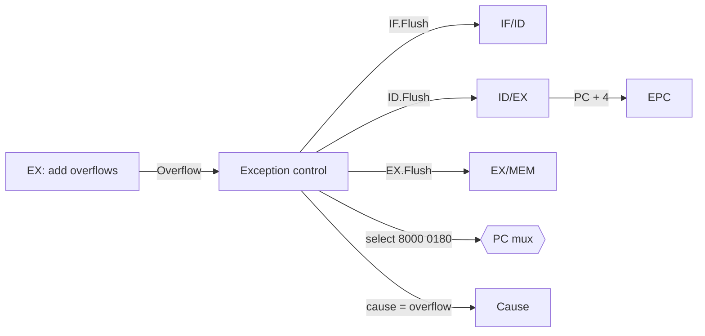

# بخش ۵، جلسه‌ی ۸ از ۱۱: استثنا در خط لوله

این جلسه بخشی از **بخش ۵: خط لوله و مخاطره‌ها** است. زمان مطالعه: حدود نیم ساعت.

**فهرست این جلسه:**

- ۱. استثنا، یک مخاطره‌ی کنترل دیگر
- ۲. هر استثنا در کدام مرحله رخ می‌دهد
- ۳. مدیریت سرریز در خط لوله
- ۴. مثال کتاب
- ۵. چند استثنا همزمان
- ۶. استثنای دقیق و نادقیق
- ۷. تمرین‌ها

---

## ۱. استثنا، یک مخاطره‌ی کنترل دیگر

در جلسه‌ی ۴-۹ دیدیم که در طراحی چندسیکلی، مدیریت استثنا نسبتاً ساده بود، چون فقط یک دستور در حال اجرا بود. در خط لوله، پنج دستور همزمان در حال اجرا هستند و این کار را خیلی سخت‌تر می‌کند.

کتاب COD می‌گوید از دید خط لوله، استثنا **نوع دیگری از مخاطره‌ی کنترل** است. مثل پرشی که پیش‌بینی‌اش غلط بوده:

- باید دستوراتی که بعد از دستور خطادار وارد خط لوله شده‌اند پاک شوند.
- باید از یک آدرس جدید (روال سیستم‌عامل) شروع به واکشی کنیم.

ولی یک تفاوت مهم دارد: در پرش، خود دستور پرش کامل اجرا می‌شود. در استثنا، معمولاً خود دستور خطادار هم **نباید کامل شود**. مثلاً در سرریز، نتیجه‌ی غلط نباید در ثبات نوشته شود.

## ۲. هر استثنا در کدام مرحله رخ می‌دهد

| نوع استثنا | مرحله‌ی خط لوله |
|---|---|
| درخواست دستگاه ورودی و خروجی | هر مرحله (وقفه‌ی خارجی) |
| فراخوانی سیستم‌عامل (syscall) | مرحله‌ی ID (بعد از رمزگشایی) |
| دستور تعریف‌نشده | مرحله‌ی ID |
| سرریز حسابی | مرحله‌ی EX |
| خطای صفحه یا عدم اصابت TLB در واکشی دستور | مرحله‌ی IF |
| خطای صفحه یا عدم اصابت TLB در دسترسی به داده | مرحله‌ی MEM |
| آدرس غیرردیف در دسترسی به داده | مرحله‌ی MEM |
| خرابی سخت‌افزار | هر مرحله |

نتیجه: استثناها در **مرحله‌های مختلف** رخ می‌دهند و ممکن است چند دستور همزمان استثنا داشته باشند.

## ۳. مدیریت سرریز در خط لوله

مثال کتاب: دستور `add $1, $2, $1` در مرحله‌ی EX سرریز می‌کند. کارهایی که باید انجام شود:

1. **جلوگیری از نوشتن نتیجه:** مقدار `$1` نباید عوض شود، چون روال سیستم‌عامل ممکن است مقدار اولیه‌ی آن را بخواهد. پس دستور `add` باید پاک شود.
2. **پاک کردن دستورات بعدی:** دو دستوری که بعد از `add` در ID و IF هستند هم باید پاک شوند.
3. **کامل شدن دستورات قبلی:** دستوراتی که قبل از `add` در MEM و WB هستند، باید کامل اجرا شوند.
4. **ذخیره‌ی آدرس:** آدرس دستور خطادار در EPC ذخیره شود و علت در Cause.
5. **پرش به روال استثنا:** آدرس 0x80000180 در PC قرار گیرد.

### تغییرات مسیر داده

- **سیگنال‌های پاک کردن:** علاوه بر IF.Flush که برای پرش داشتیم، دو سیگنال جدید **ID.Flush** و **EX.Flush** اضافه می‌شوند. این‌ها مالتی‌پلکسرهایی را کنترل می‌کنند که سیگنال‌های کنترل را در ثبات‌های ID/EX و EX/MEM صفر می‌کنند.
- **ورودی جدید PC:** یک ورودی با مقدار ثابت 0x80000180 به مالتی‌پلکسر PC اضافه می‌شود.
- **ثبات‌های EPC و Cause:** مثل جلسه‌ی ۴-۹.

### کدام آدرس در EPC

در خط لوله، وقتی `add` در EX است، مقدار PC + 4 آن در ثبات ID/EX موجود است. کتاب می‌گوید EPC همین مقدار PC + 4 را می‌گیرد و روال سیستم‌عامل باید ۴ از آن کم کند تا آدرس دستور خطادار به دست آید. این ساده‌تر از کم کردن ۴ در سخت‌افزار است.



## ۴. مثال کتاب

```asm
40hex  sub  $11, $2, $4
44hex  and  $12, $2, $5
48hex  or   $13, $2, $6
4Chex  add  $1, $2, $1        # overflow!
50hex  slt  $15, $6, $7
54hex  lw   $16, 50($7)
...
# exception handler
80000180hex  sw  $26, 1000($0)
80000184hex  sw  $27, 1004($0)
```

| دستور | سیکل ۱ | سیکل ۲ | سیکل ۳ | سیکل ۴ | سیکل ۵ | سیکل ۶ | سیکل ۷ | سیکل ۸ |
|---|---|---|---|---|---|---|---|---|
| دستور `40 sub` | IF | ID | EX | MEM | WB | | | |
| دستور `44 and` | | IF | ID | EX | MEM | WB | | |
| دستور `48 or` | | | IF | ID | EX | MEM | WB | |
| دستور `4C add` | | | | IF | ID | **EX** | پاک | |
| دستور `50 slt` | | | | | IF | ID | پاک | |
| دستور `54 lw` | | | | | | IF | پاک | |
| دستور `80000180 sw` | | | | | | | IF | ID |

در سیکل ۶، `add` در EX سرریز را تشخیص می‌دهد. در پایان همین سیکل:

- **دستورات `add`، `slt` و `lw`** با صفر شدن سیگنال‌های کنترلشان پاک می‌شوند. هیچ‌کدام در ثبات یا حافظه نمی‌نویسند.
- **دستورات `sub`، `and` و `or`** که جلوتر بودند، کامل می‌شوند.
- **مقدار EPC** برابر 0x50 (یعنی PC + 4 دستور `add`) و **Cause** برابر کد سرریز می‌شود.
- **مقدار PC** برابر 0x80000180 می‌شود و در سیکل ۷ اولین دستور روال استثنا واکشی می‌شود.

دستورات روال استثنا (`sw $26` و `sw $27`) ثبات‌های `$k0` و `$k1` را ذخیره می‌کنند. این‌ها همان ثبات‌هایی هستند که برای هسته‌ی سیستم‌عامل رزرو شده‌اند (جلسه‌ی ۲-۱).

## ۵. چند استثنا همزمان

چون پنج دستور در خط لوله هستند، ممکن است در یک سیکل چند استثنا رخ دهد. مثلاً در یک سیکل:

- دستوری در MEM به آدرس غیرردیف دسترسی دارد.
- دستوری در EX سرریز می‌کند.
- دستوری در ID تعریف‌نشده است.

راه‌حل: استثنای **قدیمی‌ترین دستور** (دستوری که جلوتر در خط لوله است) را اول رسیدگی کن. یعنی دستوری که در MEM است. چرا؟ چون اگر برنامه بدون خط لوله اجرا می‌شد، این دستور زودتر اجرا می‌شد و استثنایش اول رخ می‌داد. بقیه‌ی دستورات پاک می‌شوند و بعد از بازگشت از روال سیستم‌عامل دوباره اجرا می‌شوند. اگر هنوز خطا داشتند، دوباره استثنا رخ می‌دهد.

وقفه‌های خارجی (ورودی و خروجی) به هیچ دستور خاصی وابسته نیستند. معمولاً سخت‌افزار یکی از دستورات در خط لوله را انتخاب می‌کند، آن و دستورات بعدی را پاک می‌کند و دستورات قبلی را کامل می‌کند.

## ۶. استثنای دقیق و نادقیق

**استثنای دقیق (Precise exception)** یعنی وقتی روال سیستم‌عامل شروع می‌شود، وضعیت ماشین دقیقاً مثل این باشد که دستورات یکی‌یکی و به ترتیب اجرا شده‌اند:

- همه‌ی دستورات **قبل** از دستور خطادار کامل شده‌اند.
- دستور خطادار و همه‌ی دستورات **بعد** از آن هیچ اثری نگذاشته‌اند.
- آدرس دستور خطادار دقیقاً معلوم است.

خط لوله‌ی پنج‌مرحله‌ای MIPS این را تضمین می‌کند، چون همه‌ی دستورات به ترتیب و در مرحله‌ی WB (یا MEM برای `sw`) می‌نویسند.

**استثنای نادقیق (Imprecise exception)** یعنی سخت‌افزار فقط آدرسی **نزدیک** به دستور خطادار را ذخیره می‌کند و ممکن است دستورات بعدی هم تا حدی اجرا شده باشند. سیستم‌عامل باید بفهمد کدام دستور مقصر بوده است. بعضی ماشین‌های قدیمی با واحدهای ممیز شناور طولانی این‌طور بودند.

### چرا استثنای دقیق مهم است

- **حافظه‌ی مجازی:** برای خطای صفحه، سیستم‌عامل باید صفحه را بیاورد و دستور را **از اول اجرا کند**. این فقط با استثنای دقیق ممکن است. در بخش ۶ این را می‌بینیم.
- **اشکال‌زدایی:** برنامه‌نویس باید بداند کدام دستور خطا داشت.

در پردازنده‌هایی که دستورات را **خارج از ترتیب** اجرا می‌کنند (بخش ۸)، دستورات ممکن است به ترتیب دیگری تمام شوند. برای حفظ استثنای دقیق، این پردازنده‌ها یک **بافر بازترتیب (Reorder buffer)** دارند که نتیجه‌ها را به ترتیب اصلی برنامه نهایی می‌کند. یکی از مهم‌ترین دلیل‌های وجود این بافر همین است.

## ۷. تمرین‌ها

<details>
<summary>تمرین ۱: کدام دستورات کامل می‌شوند</summary>

**صورت:** در یک خط لوله‌ی پنج‌مرحله‌ای، یک `lw` در مرحله‌ی MEM خطای صفحه می‌دهد. کدام دستورات کامل می‌شوند و کدام پاک می‌شوند؟

**جواب:** فقط دستوری که در WB است (یک دستور جلوتر) کامل می‌شود. خود `lw` و سه دستور بعدی (در EX، ID و IF) پاک می‌شوند. بعد از اینکه سیستم‌عامل صفحه را آورد، `lw` از اول اجرا می‌شود. برای این کار، EPC باید آدرس خود `lw` را داشته باشد.
</details>

<details>
<summary>تمرین ۲: ترتیب استثناها</summary>

**صورت:** در یک سیکل، دستور A در MEM خطای آدرس غیرردیف دارد و دستور B که بعد از A است، در ID دستور تعریف‌نشده است. کدام استثنا اول رسیدگی می‌شود؟ اگر A در ID و B در MEM بود چه؟

**جواب:** حالت اول: A قدیمی‌تر است، پس استثنای A اول. B پاک می‌شود و بعداً دوباره اجرا می‌شود. حالت دوم ممکن نیست، چون اگر B بعد از A در برنامه باشد، نمی‌تواند جلوتر از A در خط لوله باشد. خط لوله‌ی ساده ترتیب را حفظ می‌کند.
</details>

<details>
<summary>تمرین ۳: هزینه‌ی سرریز</summary>

**صورت:** در مثال بخش ۴، از سیکلی که `add` سرریز را تشخیص داد تا سیکلی که اولین دستور روال استثنا به WB رسید، چند سیکل طول کشید؟

**جواب:** سرریز در سیکل ۶ تشخیص داده شد. دستور `sw` روال در سیکل ۷ واکشی می‌شود و در سیکل ۱۱ به WB می‌رسد. البته `sw` در MEM (سیکل ۱۰) کارش را انجام می‌دهد. مهم این است که سه دستور پاک شدند، یعنی سه سیکل از کار مفید از دست رفت، به‌علاوه‌ی کل زمان روال سیستم‌عامل.
</details>

---

جلسه‌ی قبلی: [مخاطره‌ی کنترل و پیش‌بینی پرش](5-7-control-hazards-branch-prediction.md)  
جلسه‌ی بعدی: [کارایی خط لوله و نگاهی به صدور چندگانه](5-9-performance-and-multiple-issue.md)
