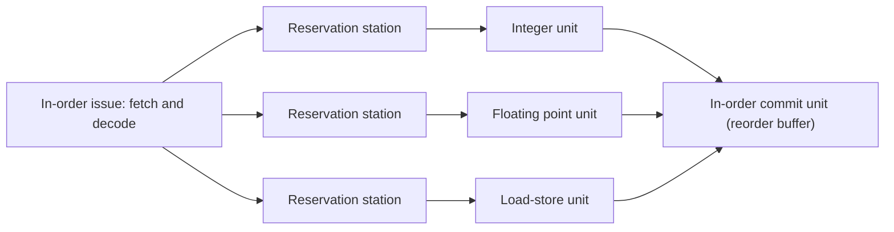

# بخش ۵، جلسه‌ی ۹ از ۱۱: کارایی خط لوله و نگاهی به صدور چندگانه

این جلسه بخشی از **بخش ۵: خط لوله و مخاطره‌ها** است. زمان مطالعه: حدود نیم ساعت.

**فهرست این جلسه:**

- ۱. فرمول کارایی خط لوله با توقف
- ۲. مثال اسلاید: مقایسه‌ی سه طراحی
- ۳. مثال CAQA: روش‌های پرش در خط لوله‌ی عمیق
- ۴. محدودیت‌های عمیق کردن خط لوله
- ۵. صدور چندگانه: ایده
- ۶. صدور چندگانه‌ی ایستا
- ۷. صدور چندگانه‌ی پویا
- ۸. تمرین‌ها

---

## ۱. فرمول کارایی خط لوله با توقف

پیوست C کتاب CAQA فرمول کارایی خط لوله را با در نظر گرفتن توقف‌ها می‌دهد. تسریع خط لوله نسبت به اجرای بدون خط لوله:

```math
\text{Speedup} = \frac{\text{CPI}_{\text{unpipelined}} \times \text{Clock}_{\text{unpipelined}}}{\text{CPI}_{\text{pipelined}} \times \text{Clock}_{\text{pipelined}}}
```

مقدار CPI خط لوله برابر CPI ایده‌آل به‌علاوه‌ی توقف‌هاست:

```math
\text{CPI}_{\text{pipelined}} = \text{Ideal CPI} + \text{Pipeline stall cycles per instruction} = 1 + \text{stalls}
```

اگر مرحله‌ها متعادل باشند و سربار را نادیده بگیریم، سیکل بدون خط لوله برابر عمق خط لوله ضرب در سیکل خط لوله است و CPI بدون خط لوله برابر ۱ است. پس:

```math
\text{Speedup} = \frac{\text{Pipeline depth}}{1 + \text{Pipeline stall cycles per instruction}}
```

برای توقف‌های پرش:

```math
\text{Pipeline speedup} = \frac{\text{Pipeline depth}}{1 + \text{Branch frequency} \times \text{Branch penalty}}
```

## ۲. مثال اسلاید: مقایسه‌ی سه طراحی

اسلاید درس سه طراحی را با ترکیب دستورات برنامه‌ی gcc مقایسه می‌کند. فرض‌ها:

- **تأخیرها:** حافظه ۲ نانوثانیه، ALU ۲ نانوثانیه، خواندن یا نوشتن ثبات ۱ نانوثانیه.
- **ترکیب دستورات:** ۲۳٪ بارگذاری، ۱۳٪ ذخیره، ۱۹٪ پرش شرطی، ۲٪ پرش و ۴۳٪ دستورات ALU.
- **خط لوله:** ۵۰٪ بارگذاری‌ها بلافاصله با دستوری دنبال می‌شوند که نتیجه را لازم دارد. ۲۵٪ پرش‌ها اشتباه پیش‌بینی می‌شوند. جریمه‌ی پیش‌بینی غلط یک سیکل است. پرش‌های `j` همیشه یک سیکل تأخیر دارند.

**تک‌سیکلی:** طول سیکل ۸ نانوثانیه، CPI برابر ۱، پس **۸ نانوثانیه** برای هر دستور.

**چندسیکلی:** طول سیکل ۲ نانوثانیه.

```math
\text{CPI} = 0.23 \times 5 + 0.13 \times 4 + 0.19 \times 3 + 0.02 \times 3 + 0.43 \times 4 = 4.02
```

زمان هر دستور 4.02 × 2 = **۸.۰۴ نانوثانیه**.

**خط لوله:** طول سیکل ۲ نانوثانیه.

| دسته | سیکل | سهم |
|---|---|---|
| بارگذاری | 1 بدون وابستگی، 2 با وابستگی؛ میانگین 1.5 | 23% |
| ذخیره | 1 | 13% |
| پرش شرطی | 1 با پیش‌بینی درست، 2 با غلط؛ میانگین 1.25 | 19% |
| پرش | 2 | 2% |
| دستورات ALU | 1 | 43% |

```math
\text{CPI} = 1.5 \times 0.23 + 1 \times 0.13 + 1.25 \times 0.19 + 2 \times 0.02 + 1 \times 0.43 \approx 1.18
```

زمان هر دستور 1.18 × 2 = **۲.۳۶ نانوثانیه**.

| طراحی | CPI | طول سیکل | زمان هر دستور | نسبت به تک‌سیکلی |
|---|---|---|---|---|
| تک‌سیکلی | 1.00 | 8 ns | 8.00 ns | 1.00 |
| چندسیکلی | 4.02 | 2 ns | 8.04 ns | 0.995 |
| خط لوله | 1.18 | 2 ns | 2.36 ns | 3.39 |

خط لوله هم سیکل کوتاه چندسیکلی را دارد و هم CPI نزدیک به یک تک‌سیکلی را. این دلیل استفاده‌ی همه‌ی پردازنده‌های امروزی از خط لوله است.

## ۳. مثال CAQA: روش‌های پرش در خط لوله‌ی عمیق

پیوست C کتاب CAQA یک خط لوله‌ی عمیق‌تر را بررسی می‌کند که در آن تصمیم پرش دیرتر گرفته می‌شود. فرض‌ها: ۴٪ پرش‌های غیرشرطی، ۶٪ پرش‌های شرطی انجام‌نشده و ۱۰٪ پرش‌های شرطی انجام‌شده. جریمه‌ها برای سه روش:

| روش | پرش غیرشرطی | شرطی انجام‌نشده | شرطی انجام‌شده |
|---|---|---|---|
| روش توقف | 2 | 3 | 3 |
| پیش‌بینی انجام | 2 | 3 | 2 |
| پیش‌بینی انجام‌نشده | 2 | 0 | 3 |

سهم هر روش در CPI:

| روش | غیرشرطی | انجام‌نشده | انجام‌شده | مجموع |
|---|---|---|---|---|
| روش توقف | 0.04 × 2 = 0.08 | 0.06 × 3 = 0.18 | 0.10 × 3 = 0.30 | 0.56 |
| پیش‌بینی انجام | 0.08 | 0.18 | 0.10 × 2 = 0.20 | 0.46 |
| پیش‌بینی انجام‌نشده | 0.08 | 0 | 0.30 | 0.38 |

تسریع پیش‌بینی انجام‌نشده نسبت به توقف:

```math
\frac{1 + 0.56}{1 + 0.38} = \frac{1.56}{1.38} \approx 1.13
```

درس این مثال: در خط لوله‌های عمیق، جریمه‌ی پرش بزرگ‌تر است و حتی ساده‌ترین پیش‌بینی هم سود قابل توجهی دارد. برای همین پیش‌بینی پویا (جلسه‌ی ۵-۷ و بخش ۷) این‌قدر مهم است.

## ۴. محدودیت‌های عمیق کردن خط لوله

ایده‌ی ساده: هرچه مرحله‌ها بیشتر، سیکل کوتاه‌تر و کارایی بیشتر. ولی چند محدودیت وجود دارد:

- **سربار ثبات‌های خط لوله:** هر ثبات زمان راه‌اندازی و تأخیر دارد که به هر مرحله اضافه می‌شود (تمرین ۳ جلسه‌ی ۵-۱).
- **جریمه‌ی پرش بیشتر:** تصمیم پرش چند مرحله دیرتر گرفته می‌شود، پس دستورات بیشتری پاک می‌شوند.
- **مخاطره‌ی داده بیشتر:** فاصله‌ی تولید و استفاده‌ی نتیجه بیشتر است، پس توقف‌های بیشتری لازم است.
- **انرژی:** ساعت سریع‌تر مصرف توان را زیاد می‌کند. این همان **دیوار توان** بخش ۱ است.

مثال تاریخی: پردازنده‌ی پنتیوم ۴ اینتل تا ۳۱ مرحله داشت و به فرکانس‌های بالایی رسید، ولی مصرف انرژی آن خیلی زیاد بود. اینتل بعد از آن به خط لوله‌های کوتاه‌تر (حدود ۱۴ تا ۲۰ مرحله) و **چند هسته** روی آورد. پردازنده‌ی ARM Cortex-A76 که در تکلیف درس بررسی کردیم، ۱۳ مرحله دارد.

## ۵. صدور چندگانه: ایده

خط لوله در بهترین حالت CPI برابر ۱ دارد. برای رسیدن به CPI کمتر از ۱، باید در هر سیکل **بیش از یک دستور** صادر شود. به این **صدور چندگانه (Multiple issue)** می‌گوییم.

مقیاس جدید: به جای CPI از **IPC (Instructions per clock)** استفاده می‌شود. مثلاً پردازنده‌ای که در هر سیکل چهار دستور صادر می‌کند، در بهترین حالت IPC برابر ۴ یا CPI برابر ۰.۲۵ دارد.

در مثال لباسشویی: به جای یک ماشین لباسشویی، یک خشک‌کن و یک میز تا کردن، از هر کدام دو تا داشته باشیم.

کتاب دو کار اصلی صدور چندگانه را نام می‌برد:

- **بسته‌بندی دستورات در شکاف‌های صدور:** کدام دستورات در یک سیکل صادر شوند؟
- **مدیریت مخاطره‌های داده و کنترل:** با دستورات بیشتر در خط لوله، مخاطره‌ها هم بیشتر می‌شوند.

دو روش برای این کار وجود دارد: ایستا (کامپایلر) و پویا (سخت‌افزار).

## ۶. صدور چندگانه‌ی ایستا

در **صدور چندگانه‌ی ایستا (Static multiple issue)**، کامپایلر تصمیم می‌گیرد کدام دستورات با هم صادر شوند. دستورات در **بسته‌های صدور (Issue packets)** قرار می‌گیرند. اگر این بسته‌ها یک دستور بزرگ با چند عملیات باشند، به آن **کلمه‌ی دستور خیلی بلند (VLIW)** می‌گوییم.

مثال کتاب: یک MIPS با صدور دوگانه‌ی ایستا. در هر سیکل دو دستور صادر می‌شود:

| شکاف | نوع دستور |
|---|---|
| شکاف اول | دستور ALU یا پرش |
| شکاف دوم | دستور بارگذاری یا ذخیره |

اگر کامپایلر دستور مناسبی برای یک شکاف پیدا نکند، `nop` می‌گذارد. سخت‌افزار اضافه لازم: دو درگاه خواندن اضافه و یک درگاه نوشتن اضافه برای فایل ثبات، و یک جمع‌کننده‌ی جدا برای محاسبه‌ی آدرس.

کتاب حلقه‌ای را برای این ماشین زمان‌بندی می‌کند و نشان می‌دهد که با **باز کردن حلقه (Loop unrolling)** و **تغییر نام ثبات (Register renaming)** توسط کامپایلر، IPC از حدود ۱.۲۵ به حدود ۱.۷۵ می‌رسد. این دقیقاً همان کاری است که در بخش ۷ برای سؤال‌های امتحانی باز کردن حلقه انجام می‌دهیم.

## ۷. صدور چندگانه‌ی پویا

در **صدور چندگانه‌ی پویا (Dynamic multiple issue)** یا **ابرعددی (Superscalar)**، سخت‌افزار در زمان اجرا تصمیم می‌گیرد چند دستور و کدام‌ها را صادر کند. کد لازم نیست برای ماشین خاصی زمان‌بندی شده باشد.

بیشتر پردازنده‌های ابرعددی امروزی **زمان‌بندی پویای خط لوله (Dynamic pipeline scheduling)** هم دارند: دستورات را **خارج از ترتیب** اجرا می‌کنند تا توقف‌ها را دور بزنند. مثلاً اگر یک `lw` در کش نبود و دستور بعدی منتظر آن است، دستورات مستقل بعدی زودتر اجرا می‌شوند.



سه بخش اصلی:

- **واحد صدور به ترتیب:** دستورات را به ترتیب برنامه واکشی و رمزگشایی می‌کند.
- **ایستگاه‌های رزرو و واحدهای اجرا:** هر دستور منتظر می‌ماند تا عملوندهایش آماده شوند و بعد **خارج از ترتیب** اجرا می‌شود.
- **واحد نهایی‌سازی به ترتیب:** نتیجه‌ها را به ترتیب برنامه نهایی می‌کند تا استثناها دقیق باشند (جلسه‌ی ۵-۸).

این ساختار همان **الگوریتم توماسولو** است که موضوع بخش ۸ است. سؤال امتحان ۰۲-۰۳ دقیقاً درباره‌ی همین است.

### گمانه‌زنی

برای پر نگه داشتن این خط لوله‌های پهن، پردازنده باید از پرش‌ها هم جلوتر برود. **گمانه‌زنی (Speculation)** یعنی دستورات بعد از یک پرش را بر اساس پیش‌بینی اجرا کن، قبل از اینکه نتیجه‌ی پرش معلوم شود. اگر پیش‌بینی غلط بود، نتیجه‌ها دور ریخته می‌شوند. بافر بازترتیب این کار را ممکن می‌کند.

### مقایسه

| ویژگی | صدور ایستا (VLIW) | صدور پویا (ابرعددی) |
|---|---|---|
| تصمیم کیست | کامپایلر | سخت‌افزار |
| پیچیدگی سخت‌افزار | کم | زیاد |
| وابستگی کد به ماشین | زیاد: باید برای هر ماشین دوباره کامپایل شود | کم: کد قدیمی اجرا می‌شود |
| مدیریت توقف‌های پیش‌بینی‌نشده (مثل عدم اصابت کش) | ضعیف | خوب |
| مصرف انرژی | کمتر | بیشتر |
| نمونه | Intel Itanium، پردازنده‌های DSP | Intel Core، AMD Ryzen، ARM Cortex-A76 |

## ۸. تمرین‌ها

<details>
<summary>تمرین ۱: تسریع با توقف</summary>

**صورت:** یک خط لوله‌ی ۸ مرحله‌ای متعادل در هر دستور به‌طور میانگین ۰.۴ سیکل توقف دارد. تسریع آن نسبت به اجرای بدون خط لوله چقدر است؟

**جواب:**

```math
\text{Speedup} = \frac{8}{1 + 0.4} \approx 5.7
```
</details>

<details>
<summary>تمرین ۲: انتخاب عمق</summary>

**صورت:** مسیر کامل یک دستور ۱۰ نانوثانیه است و سربار هر ثبات خط لوله ۰.۵ نانوثانیه. با k مرحله، تعداد توقف‌های پرش به ازای هر دستور برابر 0.05 × (k − 3) است. برای k برابر ۵ و ۱۰ و ۲۰، زمان هر دستور را حساب کن.

**جواب:**

| عمق | طول سیکل | توقف به ازای دستور | CPI | زمان هر دستور |
|---|---|---|---|---|
| عمق 5 | 10/5 + 0.5 = 2.5 ns | 0.10 | 1.10 | 2.75 ns |
| عمق 10 | 1.0 + 0.5 = 1.5 ns | 0.35 | 1.35 | 2.03 ns |
| عمق 20 | 0.5 + 0.5 = 1.0 ns | 0.85 | 1.85 | 1.85 ns |

با این فرض‌ها، خط لوله‌ی عمیق‌تر هنوز سریع‌تر است، ولی سود هر مرحله‌ی اضافه کم می‌شود. با در نظر گرفتن انرژی، احتمالاً عمق متوسط بهتر است.
</details>

<details>
<summary>تمرین ۳: صدور دوگانه</summary>

**صورت:** در MIPS صدور دوگانه‌ی ایستا، کد زیر را در کمترین تعداد سیکل بسته‌بندی کن. فرض کن هیچ وابستگی‌ای بین این دستورات نیست.

```asm
add  $t0, $t1, $t2
lw   $t3, 0($s0)
sub  $t4, $t5, $t6
sw   $t7, 4($s0)
and  $t8, $t9, $s1
```

**جواب:** سه دستور ALU و دو دستور حافظه داریم. شکاف ALU در هر سیکل یکی می‌پذیرد، پس حداقل سه سیکل:

| سیکل | شکاف ALU یا پرش | شکاف بارگذاری یا ذخیره |
|---|---|---|
| سیکل ۱ | دستور `add` | دستور `lw` |
| سیکل ۲ | دستور `sub` | دستور `sw` |
| سیکل ۳ | دستور `and` | دستور `nop` |

پنج دستور در سه سیکل، یعنی IPC برابر ۱.۶۷.
</details>

---

جلسه‌ی قبلی: [استثنا در خط لوله](5-8-exceptions-in-pipeline.md)  
جلسه‌ی بعدی: [حل سؤال‌های امتحانی خط لوله](5-10-pipeline-exam-problems.md)
