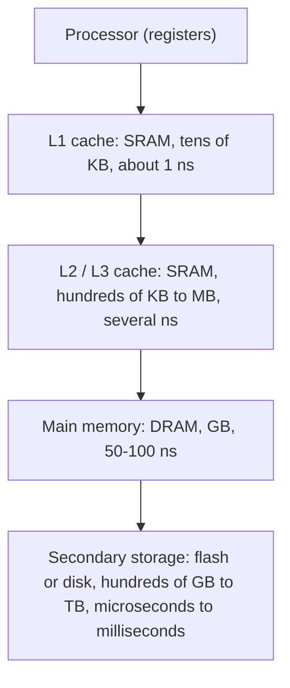

# بخش ۶، جلسه‌ی ۱ از ۱۲: اصل محلی بودن و فناوری‌های حافظه

این جلسه بخشی از **بخش ۶: سلسله‌مراتب حافظه** است. زمان مطالعه: حدود نیم ساعت.

**فهرست این جلسه:**

- ۱. چرا سلسله‌مراتب حافظه لازم است
- ۲. اصل محلی بودن
- ۳. ساختار سلسله‌مراتب
- ۴. اصطلاحات: اصابت و عدم اصابت
- ۵. فناوری‌های حافظه
- ۶. شکاف بین پردازنده و حافظه
- ۷. تمرین‌ها

---

## ۱. چرا سلسله‌مراتب حافظه لازم است

اسلاید درس مشکل را این‌طور می‌گوید: کاربرها حافظه‌ی **بزرگ و سریع** می‌خواهند، ولی حافظه‌ی بزرگ و سریع گران است و کسی دوست ندارد برایش پول بدهد. راه‌حل این است که کاری کنیم **به نظر برسد** چنین حافظه‌ای داریم. این کار با **سلسله‌مراتب حافظه (Memory hierarchy)** انجام می‌شود.

کتاب COD یک تشبیه دارد: دانشجویی را تصور کن که در کتابخانه روی یک گزارش کار می‌کند. همه‌ی کتاب‌های کتابخانه را نمی‌تواند روی میزش بگذارد. پس چند کتاب مرتبط را از قفسه برمی‌دارد و روی میز می‌گذارد. بیشتر وقت‌ها هر چه لازم دارد روی میز است و دسترسی به آن سریع است. فقط گاهی باید به قفسه برگردد. میز کوچک و سریع است؛ قفسه بزرگ و کند است.

در کامپیوتر هم همین کار را می‌کنیم: داده‌هایی که الان لازم‌اند در یک حافظه‌ی کوچک و سریع نزدیک پردازنده نگه داشته می‌شوند و بقیه در حافظه‌های بزرگ‌تر و کندتر.

## ۲. اصل محلی بودن

چرا این ایده جواب می‌دهد؟ چون برنامه‌ها در هر لحظه فقط به بخش کوچکی از فضای آدرسشان دسترسی دارند. به این **اصل محلی بودن (Principle of locality)** می‌گوییم. دو نوع محلی بودن داریم:

- **محلی بودن زمانی (Temporal locality):** اگر به یک خانه‌ی حافظه دسترسی پیدا کردیم، احتمالاً **به‌زودی دوباره** به همان خانه دسترسی خواهیم داشت. مثل کتابی که دانشجو تازه برداشته و احتمالاً دوباره بازش می‌کند.
- **محلی بودن مکانی (Spatial locality):** اگر به یک خانه دسترسی پیدا کردیم، احتمالاً **به‌زودی به خانه‌های نزدیک** آن هم دسترسی خواهیم داشت. مثل کتاب‌های هم‌موضوع که کنار هم در قفسه‌اند.

اسلاید می‌پرسد: چرا کد و داده محلی بودن دارند؟

| منبع | محلی بودن زمانی | محلی بودن مکانی |
|---|---|---|
| دستورات | حلقه‌ها: همان دستورات بارها اجرا می‌شوند | دستورات به ترتیب اجرا می‌شوند |
| داده‌ها | متغیرهای پرکاربرد، مثل شمارنده‌ی حلقه یا جمع | عناصر آرایه پشت سر هم پیمایش می‌شوند |
| پشته | متغیرهای محلی رویه‌ی فعلی | قاب رویه پیوسته است |

## ۳. ساختار سلسله‌مراتب

سلسله‌مراتب چند **سطح (Level)** دارد. سطح نزدیک‌تر به پردازنده کوچک‌تر، سریع‌تر و گران‌تر به ازای هر بیت است:



ویژگی‌های مهم این ساختار، طبق اسلاید:

- **داده فقط بین دو سطح مجاور** جابه‌جا می‌شود.
- **شمول (Inclusion):** معمولاً هر سطح زیرمجموعه‌ای از سطح پایین‌تر است. یعنی هر چیزی که در کش است، در حافظه‌ی اصلی هم هست.
- **کارایی به نرخ اصابت بستگی دارد:** اگر بیشتر دسترسی‌ها در سطح بالا پیدا شوند، کل سیستم تقریباً به سرعت سطح بالا و به اندازه‌ی سطح پایین است.

## ۴. اصطلاحات: اصابت و عدم اصابت

اسلاید درس روی **دو سطح مجاور** تمرکز می‌کند: سطح **بالا** (نزدیک پردازنده) و سطح **پایین** (دور از پردازنده). اصطلاحات:

| اصطلاح | تعریف |
|---|---|
| بلوک (Block) یا خط (Line) | کوچک‌ترین واحد داده که بین دو سطح جابه‌جا می‌شود |
| اصابت (Hit) | داده‌ی درخواستی در سطح بالا هست |
| عدم اصابت (Miss) | داده‌ی درخواستی در سطح بالا نیست و باید از سطح پایین آورده شود |
| نرخ اصابت (Hit rate) | کسری از دسترسی‌ها که اصابت هستند |
| نرخ عدم اصابت (Miss rate) | برابر ۱ منهای نرخ اصابت |
| زمان اصابت (Hit time) | زمان تشخیص اصابت به‌علاوه‌ی زمان رساندن داده از سطح بالا |
| جریمه‌ی عدم اصابت (Miss penalty) | زمان تشخیص عدم اصابت، به‌علاوه‌ی جایگزینی بلوک در سطح بالا با بلوک سطح پایین، به‌علاوه‌ی رساندن آن به پردازنده |

زمان اصابت خیلی کمتر از جریمه‌ی عدم اصابت است. مثلاً زمان اصابت کش حدود یک سیکل است ولی جریمه‌ی عدم اصابت آن، یعنی دسترسی به DRAM، صدها سیکل است.

## ۵. فناوری‌های حافظه

چهار فناوری اصلی در سلسله‌مراتب امروزی (جدول کتاب COD ویرایش ۵، با قیمت‌های حدود سال ۲۰۱۲):

| فناوری | زمان دسترسی معمول | قیمت به ازای هر گیگابایت |
|---|---|---|
| حافظه‌ی SRAM | 0.5 تا 2.5 ns | 500 تا 1000 دلار |
| حافظه‌ی DRAM | 50 تا 70 ns | 10 تا 20 دلار |
| حافظه‌ی فلش (Flash) | 5,000 تا 50,000 ns | 0.75 تا 1 دلار |
| دیسک مغناطیسی | 5,000,000 تا 20,000,000 ns | 0.05 تا 0.10 دلار |

قیمت‌ها از آن زمان خیلی پایین آمده‌اند، ولی **نسبت‌ها** تقریباً همان است: هر سطح حدود یک مرتبه‌ی بزرگی ارزان‌تر و کندتر از سطح بالایی است.

### حافظه‌ی SRAM

اسلاید درس: مقدار در یک جفت گیت وارونگر متقاطع ذخیره می‌شود. تا وقتی برق هست، مقدار باقی می‌ماند. به همین دلیل **ایستا (Static)** نام دارد.

- **سرعت:** خیلی سریع.
- **اندازه:** هر بیت ۴ تا ۶ ترانزیستور، پس فضای زیادی می‌گیرد.
- **کاربرد:** کش‌ها و فایل ثبات.

### حافظه‌ی DRAM

اسلاید درس: مقدار به شکل بار الکتریکی روی یک **خازن** ذخیره می‌شود. این بار به‌تدریج نشت می‌کند، پس باید به‌طور دوره‌ای **تازه‌سازی (Refresh)** شود. به همین دلیل **پویا (Dynamic)** نام دارد.

- **اندازه:** فقط یک ترانزیستور برای هر بیت، پس خیلی فشرده است.
- **سرعت:** ۵ تا ۱۰ برابر کندتر از SRAM.
- **کاربرد:** حافظه‌ی اصلی.

سازمان داخلی DRAM: بیت‌ها در یک آرایه‌ی سطر و ستون چیده شده‌اند. برای خواندن، ابتدا یک **سطر کامل** باز می‌شود و در یک بافر سطر قرار می‌گیرد. بعد ستون‌های موردنظر از این بافر خوانده می‌شوند. دسترسی پشت سر هم به ستون‌های همان سطر خیلی سریع‌تر از باز کردن سطر جدید است. این دلیلی است که خواندن یک بلوک پیوسته از DRAM کارآمد است.

نسل‌های DRAM امروزی **همگام (Synchronous DRAM یا SDRAM)** هستند و با ساعت کار می‌کنند. نسخه‌ی **DDR (Double Data Rate)** در هر دو لبه‌ی ساعت داده منتقل می‌کند. امروز DDR4 و DDR5 برای رایانه‌ها و LPDDR برای گوشی‌ها رایج‌اند.

### حافظه‌ی فلش

نوعی حافظه‌ی **غیرفرّار (Nonvolatile)** است، یعنی بدون برق هم داده را نگه می‌دارد. از دیسک خیلی سریع‌تر است. یک محدودیت مهم دارد: هر خانه فقط تعداد محدودی بار (حدود هزار تا صد هزار بار) قابل نوشتن است. کنترل‌گر فلش با **یکسان‌سازی فرسایش (Wear leveling)** نوشتن‌ها را بین بلوک‌ها پخش می‌کند. در گوشی‌ها و درایوهای SSD استفاده می‌شود.

### دیسک مغناطیسی

صفحه‌های چرخان با پوشش مغناطیسی. زمان دسترسی سه بخش دارد: **زمان جست‌وجو (Seek)** برای حرکت هد به شیار درست، **تأخیر چرخشی (Rotational latency)** تا رسیدن قطاع زیر هد، و **زمان انتقال**. چون بخش مکانیکی دارد، میلیون‌ها برابر کندتر از DRAM است. امروز بیشتر برای ذخیره‌سازی ارزان و حجیم استفاده می‌شود.

## ۶. شکاف بین پردازنده و حافظه

اسلاید درس در پایان این نکته را می‌گوید: سرعت پردازنده‌ها خیلی سریع‌تر از سرعت DRAM و دیسک رشد کرده است. کتاب CAQA این را با نمودار **شکاف کارایی پردازنده و حافظه** نشان می‌دهد: از دهه‌ی ۱۹۸۰ تا حدود ۲۰۰۵، کارایی پردازنده سالانه حدود ۵۰٪ رشد می‌کرد ولی زمان دسترسی DRAM فقط حدود ۷٪ در سال بهتر می‌شد. نتیجه این است که امروز یک دسترسی به DRAM صدها سیکل پردازنده طول می‌کشد.

به همین دلیل طراحی سلسله‌مراتب حافظه یکی از مهم‌ترین بخش‌های معماری کامپیوتر است. اسلاید روندهای مقابله با این شکاف را این‌طور می‌شمارد:

- **حافظه‌های SRAM همگام** که داده را به شکل پشت سر هم (Burst) می‌دهند.
- **طراحی دوباره‌ی تراشه‌های DRAM** برای پهنای باند بیشتر.
- **بازسازی کد** برای افزایش محلی بودن (جلسه‌ی ۶-۱۱).
- **پیش‌واکشی (Prefetching)** و قابل دیدن کردن کش برای ISA (جلسه‌ی ۶-۱۱).

یک نکته‌ی مهم از CAQA: در پردازنده‌های چندهسته‌ای، نیاز به **پهنای باند** حافظه حتی سریع‌تر از نیاز به کاهش **تأخیر** رشد می‌کند، چون چند هسته همزمان به حافظه دسترسی دارند.

## ۷. تمرین‌ها

<details>
<summary>تمرین ۱: نوع محلی بودن</summary>

**صورت:** در کد زیر، دسترسی به هر کدام از این‌ها چه نوع محلی بودنی دارد: `sum`، `i`، `A[i]` و دستورات حلقه؟

```c
for (i = 0; i < 1000; i++)
    sum += A[i];
```

**جواب:**

| مورد | نوع محلی بودن |
|---|---|
| متغیر `sum` | زمانی (در هر تکرار دوباره استفاده می‌شود) |
| متغیر `i` | زمانی |
| عناصر `A[i]` | مکانی (عناصر پشت سر هم) و هیچ محلی بودن زمانی (هر عنصر یک بار) |
| دستورات حلقه | زمانی (هر دستور ۱۰۰۰ بار) و مکانی (دستورات پشت سر هم) |

در عمل `sum` و `i` در ثبات نگه داشته می‌شوند و اصلاً به حافظه نمی‌روند.
</details>

<details>
<summary>تمرین ۲: زمان دسترسی میانگین ساده</summary>

**صورت:** کشی با زمان اصابت ۱ نانوثانیه و نرخ اصابت ۹۸٪ داریم. حافظه‌ی اصلی ۸۰ نانوثانیه است. زمان دسترسی میانگین تقریباً چقدر است؟

**جواب:** در ۹۸٪ مواقع ۱ نانوثانیه و در ۲٪ مواقع ۱ + ۸۰ نانوثانیه (تشخیص عدم اصابت و بعد دسترسی به حافظه):

```math
T = 1 + 0.02 \times 80 = 2.6 \text{ ns}
```

بدون کش، هر دسترسی ۸۰ نانوثانیه بود. یعنی کش حدود ۳۰ برابر کمک کرده است، با اینکه شاید فقط ۰.۱٪ حجم حافظه‌ی اصلی را داشته باشد. این فرمول را در جلسه‌ی ۶-۴ دقیق‌تر می‌کنیم.
</details>

<details>
<summary>تمرین ۳: هزینه</summary>

**صورت:** با قیمت‌های جدول، ساختن ۱۶ گیگابایت حافظه از SRAM و از DRAM چقدر هزینه دارد (کمترین قیمت)؟

**جواب:** حافظه‌ی SRAM: 16 × 500 = 8000 دلار. حافظه‌ی DRAM: 16 × 10 = 160 دلار. این تفاوت ۵۰ برابری، به‌علاوه‌ی تفاوت چگالی، دلیل استفاده از SRAM فقط برای کش‌های کوچک است.
</details>

---

جلسه‌ی بعدی: [کش با نگاشت مستقیم](6-2-direct-mapped-cache.md)
