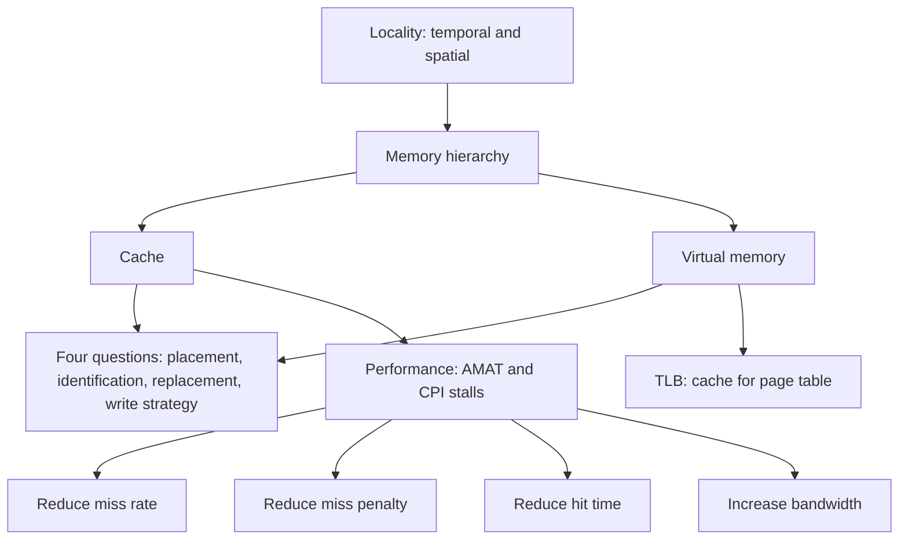

# بخش ۶، جلسه‌ی ۱۲ از ۱۲: سیستم‌های واقعی، باورهای غلط و واژه‌نامه

این جلسه بخشی از **بخش ۶: سلسله‌مراتب حافظه** است. زمان مطالعه: حدود نیم ساعت.

**فهرست این جلسه:**

- ۱. سلسله‌مراتب حافظه در ARM Cortex-A8 و Intel Core i7
- ۲. پیوند با پردازنده‌های امروزی
- ۳. باورهای غلط و دام‌ها
- ۴. جمع‌بندی بخش
- ۵. واژه‌نامه
- ۶. تمرین‌های مرور

---

## ۱. سلسله‌مراتب حافظه در ARM Cortex-A8 و Intel Core i7

کتاب COD (بخش ۵.۱۳) و CAQA (بخش ۲.۶) این دو پردازنده را مقایسه می‌کنند. یکی برای دستگاه‌های همراه کم‌مصرف، دیگری برای رومیزی و سرور. جدول زیر خلاصه‌ی مهم‌ترین ویژگی‌هاست (عددها از جدول COD نقل شده‌اند):

| ویژگی | ARM Cortex-A8 | Intel Core i7 |
|---|---|---|
| آدرس مجازی و فیزیکی | ۳۲ بیت و ۳۲ بیت | ۴۸ بیت و ۴۴ بیت |
| اندازه‌ی صفحه | متغیر: ۴ و ۱۶ و ۶۴ کیلوبایت، ۱ و ۱۶ مگابایت | متغیر: ۴ کیلوبایت و ۲ یا ۴ مگابایت |
| سازمان TLB | یک TLB دستور و یک TLB داده، هر کدام کاملاً انجمنی با ۳۲ خانه | دو سطح: TLB سطح ۱ جدا برای دستور و داده، TLB سطح ۲ مشترک با ۵۱۲ خانه و چهارراهه |
| رسیدگی به عدم اصابت TLB | سخت‌افزاری | سخت‌افزاری |
| کش سطح ۱ | جدا برای دستور و داده، هر کدام ۱۶ یا ۳۲ کیلوبایت، چهارراهه، بلوک ۶۴ بایت | جدا برای دستور و داده، هر کدام ۳۲ کیلوبایت، کش دستور چهارراهه و کش داده هشت‌راهه، بلوک ۶۴ بایت |
| سیاست نوشتن سطح ۱ | نوشتن بازگشتی | نوشتن بازگشتی |
| کش سطح ۲ | یکپارچه، ۱۲۸ کیلوبایت تا ۱ مگابایت، هشت‌راهه | یکپارچه برای هر هسته، ۲۵۶ کیلوبایت، هشت‌راهه |
| کش سطح ۳ | ندارد | مشترک بین هسته‌ها، ۸ مگابایت، ۱۶ راهه |

نکته‌های مهم:

- **انجمنی بودن کش سطح ۱:** در هر دو، کش سطح ۱ از نوع VIPT است (جلسه‌ی ۶-۸). خواندن کش و ترجمه‌ی TLB همزمان انجام می‌شود.
- **کش‌های بدون توقف:** Core i7 چندین عدم اصابت همزمان را پشتیبانی می‌کند (کش بدون توقف، جلسه‌ی ۶-۱۱). Cortex-A8 فقط اصابت زیر عدم اصابت را داشت.
- **پیش‌واکشی:** هر دو پیش‌واکشی سخت‌افزاری دارند.
- **سطح‌های بیشتر برای پردازنده‌ی بزرگ‌تر:** Core i7 یک کش سطح ۳ بزرگ و مشترک دارد تا جریمه‌ی رفتن به DRAM را کم کند. پردازنده‌ی کوچک‌تر این هزینه را نمی‌پردازد.
- **ترجمه‌ی سخت‌افزاری:** برخلاف MIPS که عدم اصابت TLB را با نرم‌افزار حل می‌کند (جلسه‌ی ۶-۸)، هر دو پردازنده‌ی این جدول جدول صفحه را با سخت‌افزار پیمایش می‌کنند (Page table walker).

## ۲. پیوند با پردازنده‌های امروزی

پردازنده‌های امروز همان اصول را دارند ولی با عددهای بزرگ‌تر:

- **کش سطح ۱:** هنوز حدود ۳۲ تا ۶۴ کیلوبایت، چون زمان اصابت باید یک تا چند سیکل بماند.
- **کش سطح ۲ خصوصی:** از ۲۵۶ کیلوبایت به حدود ۱ تا ۲ مگابایت برای هر هسته رسیده است.
- **کش سطح ۳ یا کش سطح آخر (LLC):** چند ده مگابایت، مشترک بین هسته‌ها. بعضی طراحی‌ها کش سطح ۳ را روی تراشه‌ی جداگانه و روی هم (3D stacking) می‌گذارند.
- **حافظه‌ی HBM:** در پردازنده‌های گرافیکی و شتاب‌دهنده‌ها، حافظه‌ی پهن روی بسته‌ی تراشه قرار می‌گیرد. ویرایش ۶ CAQA این را یک سطح اضافه بین کش و DRAM معرفی می‌کند.
- **پردازنده‌ی RISC-V:** معماری RISC-V هم حافظه‌ی مجازی صفحه‌ای با جدول صفحه‌ی چندسطحی دارد (مثلاً طرح Sv39 با آدرس مجازی ۳۹ بیتی و سه سطح جدول، و Sv48 با چهار سطح). دستور `sfence.vma` محتوای TLB را بعد از تغییر جدول صفحه معتبر می‌کند.

اگر تمرین سلسله‌مراتب حافظه‌ی ARM Cortex-A76 را انجام می‌دهی، همین جدول بخش ۱ را برای آن پر کن. ستون‌های جدول (آدرس، صفحه، TLB، هر سطح کش، سیاست نوشتن) چارچوب خوبی برای مقایسه‌اند. عددهای دقیق را از راهنمای فنی (Technical Reference Manual) خود ARM بگیر.

## ۳. باورهای غلط و دام‌ها

این موارد از بخش ۵.۱۶ کتاب COD و بخش ۲.۸ CAQA است.

### دام ۱: نادیده گرفتن رفتار حافظه هنگام برنامه‌نویسی یا تولید کد

برنامه‌نویس‌ها معمولاً فکر می‌کنند فقط تعداد عملیات مهم است. آزمایش جلسه‌ی ۶-۱۱ نشان داد ترتیب دسترسی به تنهایی بیش از ده برابر تفاوت ایجاد می‌کند. کتاب COD مثال مرتب‌سازی Radix sort و Quicksort را می‌آورد: Radix sort دستورات کمتری اجرا می‌کند ولی به خاطر عدم اصابت‌های زیاد کش، برای آرایه‌های بزرگ کندتر است.

### دام ۲: فراموش کردن آدرس‌دهی بایتی یا اندازه‌ی بلوک در شبیه‌سازی کش

وقتی یک دنباله‌ی آدرس را دستی در کش شبیه‌سازی می‌کنی (مثل مسائل امتحان جلسه‌ی ۶-۶)، باید دقیق بدانی آدرس‌ها **بایتی** هستند یا **کلمه‌ای**، و بلوک چند کلمه است. شماره‌ی بلوک برابر است با:

```math
\text{Block address} = \left\lfloor \frac{\text{Byte address}}{\text{Bytes per block}} \right\rfloor
```

و شماره‌ی مجموعه:

```math
\text{Set index} = \text{Block address} \bmod \text{Number of sets}
```

اشتباه رایج: تقسیم آدرس بایتی بر تعداد **کلمه‌ها**ی بلوک به جای تعداد **بایت‌ها**.

### دام ۳: کش مشترک با انجمنی بودن کمتر از تعداد هسته‌ها یا نخ‌ها

اگر کش سطح ۳ مشترک بین ۸ هسته فقط چهارراهه باشد و هر هسته یک بلوک داغ دارد که به یک مجموعه نگاشت می‌شود، بلوک‌ها مدام همدیگر را بیرون می‌کنند. برنامه‌ای که روی یک هسته خوب کار می‌کرد، روی چند هسته عدم اصابت تداخلی زیادی پیدا می‌کند. قاعده‌ی کلی: انجمنی بودن کش مشترک حداقل به اندازه‌ی تعداد هسته‌هایی باشد که از آن استفاده می‌کنند.

### دام ۴: استفاده از AMAT برای ارزیابی پردازنده‌های خارج از ترتیب

فرمول AMAT فرض می‌کند پردازنده در هر عدم اصابت **کامل** صبر می‌کند. در پردازنده‌ی خارج از ترتیب با کش بدون توقف، دستورات دیگر در حین عدم اصابت اجرا می‌شوند و بخشی از جریمه پنهان می‌شود. پس AMAT کمتر یا بیشتر از اثر واقعی را نشان می‌دهد. راه درست، شبیه‌سازی کامل پردازنده و حافظه است.

### دام ۵: گسترش فضای آدرس با قطعه‌بندی روی یک فضای بدون قطعه

وقتی معماری ۱۶ بیتی ۸۰۸۶ به فضای بیشتر نیاز داشت، اینتل **قطعه‌ها (Segments)** را اضافه کرد. برنامه‌نویس باید آدرس را به دو بخش (قطعه و جابه‌جایی) می‌شکست، و آرایه‌های بزرگ‌تر از یک قطعه دردسر داشتند. درس این دام: آدرس **تخت** و بزرگ (۳۲ و بعد ۶۴ بیت، جلسه‌ی ۲-۱) راه‌حل پایدار است. امروز x86-64 هم عملاً قطعه‌بندی را کنار گذاشته است.

### دام ۶: پیاده‌سازی ناظر ماشین مجازی روی معماری‌ای که مجازی‌پذیر نیست

جلسه‌ی ۶-۹ گفت ناظر ماشین مجازی (VMM) باید همه‌ی دستورات حساس را **به دام بیندازد**. معماری x86 قدیمی چند دستور حساس داشت که در حالت کاربر بدون دام اجرا می‌شدند (مثلاً `POPF` که پرچم وقفه را بی‌صدا نادیده می‌گرفت). این کار ساخت VMM را سخت کرد و راه‌حل‌هایی مثل ترجمه‌ی دودویی یا پارامجازی‌سازی لازم شد، تا اینکه اینتل و AMD افزونه‌های VT-x و AMD-V را اضافه کردند. معماری RISC-V از اول با در نظر گرفتن مجازی‌سازی طراحی شده و افزونه‌ی H (Hypervisor) دارد.

### باور غلط: بزرگ‌تر کردن کش همیشه کارایی را بهتر می‌کند

کش بزرگ‌تر نرخ عدم اصابت را کم می‌کند، ولی **زمان اصابت** و **انرژی** را بیشتر می‌کند. برای کش سطح ۱، این افزایش زمان اصابت می‌تواند سیکل ساعت را طولانی کند یا یک مرحله به خط لوله اضافه کند. به همین دلیل کش سطح ۱ کوچک ماند و ظرفیت اضافه به سطح‌های پایین‌تر رفت (جلسه‌ی ۶-۱۱، بهینه‌سازی ۱).

## ۴. جمع‌بندی بخش

ایده‌های اصلی بخش ۶ در یک نگاه:



- **محلی بودن:** کل سلسله‌مراتب بر پایه‌ی محلی بودن زمانی و مکانی است.
- **چهار پرسش:** همه‌ی سطح‌ها با چهار پرسش توصیف می‌شوند: جای بلوک، پیدا کردن آن، جایگزینی، نوشتن.
- **فرمول اصلی:** زمان متوسط دسترسی برابر است با:

```math
\text{AMAT} = \text{Hit time} + \text{Miss rate} \times \text{Miss penalty}
```

- **حافظه‌ی مجازی:** همان ایده‌ی کش بین حافظه‌ی اصلی و دیسک است، با جریمه‌ی بسیار بزرگ. پس صفحه‌ها بزرگ، کاملاً انجمنی، با جایگزینی LRU تقریبی و همیشه با نوشتن بازگشتی‌اند.
- **حافظه‌ی TLB:** ترجمه‌ی آدرس را سریع می‌کند. بدون آن هر دسترسی دو دسترسی به حافظه می‌شد.
- **بهینه‌سازی‌ها:** شش روش پایه و ده روش پیشرفته، هر کدام یکی از چهار جزء کارایی را هدف می‌گیرند.
- **نرم‌افزار هم مهم است:** جابه‌جایی حلقه و بلوک‌بندی بدون تغییر سخت‌افزار، کارایی را چند برابر می‌کنند.

بخش بعد سراغ موازی‌سازی در سطح دستور می‌رود: زمان‌بندی کد، باز کردن حلقه و پیش‌بینی پرش. بعد از آن خواهیم دید که پردازنده‌های خارج از ترتیب چطور با اجرای دستورات دیگر، تأخیر حافظه را پنهان می‌کنند.

## ۵. واژه‌نامه

| اصطلاح فارسی | معادل انگلیسی | توضیح کوتاه |
|---|---|---|
| محلی بودن زمانی | Temporal locality | داده‌ای که استفاده شده، به زودی دوباره استفاده می‌شود |
| محلی بودن مکانی | Spatial locality | داده‌های نزدیک به هم با هم استفاده می‌شوند |
| بلوک یا خط | Block, Line | واحد انتقال بین دو سطح |
| اصابت و عدم اصابت | Hit, Miss | پیدا شدن یا نشدن داده در یک سطح |
| نرخ عدم اصابت | Miss rate | کسر دسترسی‌هایی که عدم اصابت دارند |
| جریمه‌ی عدم اصابت | Miss penalty | زمان آوردن بلوک از سطح پایین‌تر |
| زمان اصابت | Hit time | زمان دسترسی به سطح بالا در اصابت |
| زمان متوسط دسترسی | AMAT | زمان اصابت به‌علاوه‌ی نرخ ضرب در جریمه |
| نگاشت مستقیم | Direct mapped | هر بلوک فقط یک جای ممکن دارد |
| انجمنی مجموعه‌ای | Set associative | هر بلوک در یکی از n جای یک مجموعه |
| کاملاً انجمنی | Fully associative | هر بلوک در هر جای کش |
| برچسب | Tag | بخش بالای آدرس برای شناسایی بلوک |
| اندیس | Index | بخش آدرس برای انتخاب مجموعه |
| بیت اعتبار | Valid bit | نشان می‌دهد خانه داده‌ی معتبر دارد |
| بیت کثیف | Dirty bit | نشان می‌دهد بلوک تغییر کرده است |
| نوشتن مستقیم | Write-through | نوشتن همزمان در کش و حافظه |
| نوشتن بازگشتی | Write-back | نوشتن در حافظه فقط هنگام جایگزینی |
| تخصیص در نوشتن | Write allocate | آوردن بلوک به کش در عدم اصابت نوشتن |
| بافر نوشتن | Write buffer | صف نوشتن‌های در انتظار حافظه |
| کمترین استفاده‌ی اخیر | LRU | جایگزینی بلوکی که مدت بیشتری استفاده نشده |
| عدم اصابت اجباری | Compulsory miss | اولین دسترسی به یک بلوک |
| عدم اصابت ظرفیتی | Capacity miss | کش برای همه‌ی بلوک‌ها کافی نیست |
| عدم اصابت تداخلی | Conflict miss | چند بلوک برای یک مجموعه رقابت می‌کنند |
| کش قربانی | Victim cache | کش کوچک برای بلوک‌های تازه بیرون‌رفته |
| نرخ عدم اصابت محلی و سراسری | Local and global miss rate | نسبت به دسترسی‌های آن سطح، یا نسبت به کل دسترسی‌ها |
| حافظه‌ی مجازی | Virtual memory | فضای آدرس هر برنامه، جدا از حافظه‌ی فیزیکی |
| صفحه | Page | بلوک حافظه‌ی مجازی |
| خطای صفحه | Page fault | صفحه در حافظه‌ی اصلی نیست |
| جدول صفحه | Page table | نگاشت صفحه‌ی مجازی به قاب فیزیکی |
| بافر ترجمه | TLB | کش ترجمه‌ی آدرس |
| نمایه مجازی و برچسب فیزیکی | VIPT | خواندن کش همزمان با ترجمه |
| ناظر ماشین مجازی | VMM, Hypervisor | نرم‌افزاری که چند ماشین مجازی را اجرا می‌کند |
| کد تصحیح خطا | ECC | کد همینگ برای تشخیص و تصحیح خطای بیت |
| پیش‌بینی راه | Way prediction | خواندن فقط راه پیش‌بینی‌شده در کش انجمنی |
| کش بدون توقف | Nonblocking cache | سرویس به دسترسی‌ها در حین عدم اصابت |
| ثبات وضعیت عدم اصابت | MSHR | نگه‌داری اطلاعات عدم اصابت‌های در جریان |
| کش چندبانکی | Multibanked cache | چند بانک مستقل برای دسترسی همزمان |
| اول کلمه‌ی بحرانی | Critical word first | فرستادن کلمه‌ی درخواستی پیش از بقیه |
| بافر نوشتن ادغام‌کننده | Merging write buffer | ادغام نوشتن‌های یک بلوک در یک خانه |
| جابه‌جایی حلقه | Loop interchange | تغییر ترتیب حلقه‌ها برای دسترسی پشت سر هم |
| بلوک‌بندی | Blocking, Tiling | کار روی زیرماتریس‌هایی که در کش جا می‌شوند |
| پیش‌واکشی | Prefetching | آوردن داده پیش از درخواست |

## ۶. تمرین‌های مرور

<details>
<summary>تمرین ۱: شبیه‌سازی آدرس بایتی</summary>

**صورت:** کش ۲۵۶ بایتی، نگاشت مستقیم، بلوک ۱۶ بایتی. آدرس‌های بایتی ۰، ۴، ۱۶، ۲۶۰ و ۰ را به ترتیب دسترسی می‌کنیم. کدام اصابت‌اند؟

**جواب:** تعداد بلوک‌های کش 256 / 16 = 16. شماره‌ی بلوک هر آدرس با تقسیم بر ۱۶: آدرس ۰ بلوک ۰ (اندیس ۰، عدم اصابت)، آدرس ۴ بلوک ۰ (اصابت)، آدرس ۱۶ بلوک ۱ (اندیس ۱، عدم اصابت)، آدرس ۲۶۰ بلوک ۱۶ (اندیس 16 mod 16 = 0، عدم اصابت و بلوک ۰ بیرون می‌رود)، آدرس ۰ دوباره (عدم اصابت تداخلی). پس فقط دسترسی دوم اصابت است.
</details>

<details>
<summary>تمرین ۲: کش مشترک</summary>

**صورت:** کش سطح ۳ مشترک، دوراهه، بین ۴ هسته. هر هسته در یک حلقه مدام به یک آرایه‌ی کوچک دسترسی دارد و از بد اقبالی، آرایه‌ی هر چهار هسته به همان مجموعه‌ها نگاشت می‌شود. چه اتفاقی می‌افتد و چه راه‌حلی هست؟

**جواب:** در هر مجموعه فقط دو جا برای چهار بلوک وجود دارد، پس بلوک‌ها مدام همدیگر را بیرون می‌کنند (دام ۳). راه‌حل‌ها: انجمنی بودن بیشتر (مثلاً ۱۶ راهه مثل Core i7)، تابع اندیس‌دهی درهم (Hashed indexing) که آدرس‌ها را بهتر پخش کند، یا تغییر جای داده‌ها در نرم‌افزار.
</details>

<details>
<summary>تمرین ۳: مقایسه‌ی سطح‌ها</summary>

**صورت:** چرا صفحه‌های حافظه‌ی مجازی چند کیلوبایتی‌اند ولی بلوک‌های کش ۶۴ بایتی؟

**جواب:** جریمه‌ی عدم اصابت در حافظه‌ی مجازی (دسترسی به دیسک یا SSD) میلیون‌ها سیکل است و بیشتر آن زمان رسیدن به اولین بایت است. وقتی آنجا هستیم، آوردن چند کیلوبایت تقریباً همان هزینه را دارد. پس بلوک بزرگ بهتر است. در کش، جریمه کوچک است و بلوک بزرگ، زمان انتقال را زیاد و تعداد بلوک‌های کش را کم می‌کند (جلسه‌ی ۶-۳).
</details>

<details>
<summary>تمرین ۴: ترکیب همه‌چیز</summary>

**صورت:** پردازنده‌ای با CPI پایه‌ی ۱، کش سطح ۱ با نرخ عدم اصابت ۴٪، کش سطح ۲ با زمان دسترسی ۱۰ سیکل و نرخ عدم اصابت سراسری ۱٪، و جریمه‌ی حافظه‌ی اصلی ۱۰۰ سیکل. هر دستور به طور متوسط ۱.۳ دسترسی به حافظه دارد. مقدار CPI کل چقدر است؟

**جواب:** توقف به ازای هر دسترسی برابر است با 0.04 × 10 + 0.01 × 100 = 0.4 + 1 = 1.4 سیکل. به ازای هر دستور 1.3 × 1.4 = 1.82. پس CPI کل برابر 1 + 1.82 = 2.82 است. بدون کش سطح ۲، توقف 1.3 × 0.04 × 100 = 5.2 و CPI برابر 6.2 می‌شد.
</details>

---

جلسه‌ی قبلی: [ده بهینه‌سازی پیشرفته‌ی کش](6-11-advanced-cache-optimizations.md)  
بخش بعدی: [بخش ۷، موازی‌سازی ایستا در سطح دستور](../07-static-ilp/README.md)
