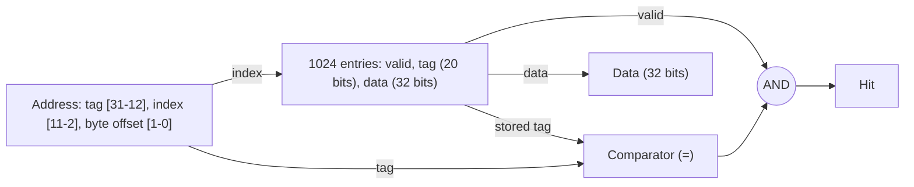

# بخش ۶، جلسه‌ی ۲ از ۱۲: کش با نگاشت مستقیم

این جلسه بخشی از **بخش ۶: سلسله‌مراتب حافظه** است. زمان مطالعه: حدود نیم ساعت.

**فهرست این جلسه:**

- ۱. کش چیست
- ۲. دو سؤال اصلی
- ۳. نگاشت مستقیم
- ۴. برچسب و بیت معتبر
- ۵. یک مثال قدم‌به‌قدم
- ۶. تقسیم آدرس در MIPS
- ۷. بلوک‌های چندکلمه‌ای
- ۸. شمارش بیت‌های کش
- ۹. تمرین‌ها

---

## ۱. کش چیست

**کش (Cache)** یا **حافظه‌ی نهان** کلمه‌ی فرانسوی به معنی «جای پنهان» است. اولین بار برای سطحی از سلسله‌مراتب بین پردازنده و حافظه‌ی اصلی به کار رفت. امروز هر حافظه‌ای که از محلی بودن استفاده کند کش نامیده می‌شود، مثلاً کش مرورگر وب.

کش‌ها در سخت‌افزار کاملاً **نامرئی** هستند: برنامه‌نویس آن‌ها را نمی‌بیند و دستورات `lw` و `sw` همان آدرس حافظه‌ی اصلی را می‌دهند. سخت‌افزار تصمیم می‌گیرد داده از کش بیاید یا از حافظه.

## ۲. دو سؤال اصلی

اسلاید درس با یک مثال ساده شروع می‌کند. فرض کن هر بلوک یک کلمه است و پردازنده کلمه‌ی Xn را درخواست می‌کند که در کش نیست. بعد از عدم اصابت، Xn از حافظه آورده و در کش قرار می‌گیرد.

دو سؤال پیش می‌آید:

1. **از کجا بفهمیم داده در کش هست یا نه؟**
2. **اگر هست، چطور آن را پیدا کنیم؟**

و سؤال سوم: اگر نیست، چه کنیم؟ جواب همه‌ی این‌ها به **روش آدرس‌دهی کش** بستگی دارد.

## ۳. نگاشت مستقیم

ساده‌ترین روش این است که هر بلوک حافظه **فقط یک جای مشخص** در کش داشته باشد. به این روش **نگاشت مستقیم (Direct mapped)** می‌گوییم:

```math
\text{Cache block index} = (\text{Block address}) \bmod (\text{Number of blocks in cache})
```

اگر تعداد بلوک‌های کش توانی از دو باشد، مثلاً ۲ به توان m، محاسبه‌ی باقی‌مانده خیلی ساده است: همان **m بیت پایین** آدرس بلوک.

مثال کتاب: کشی با ۸ بلوک (m = 3). هر کلمه‌ی حافظه با آدرس کلمه‌ای پنج‌بیتی، به بلوکی نگاشته می‌شود که سه بیت پایین آدرسش است:

| آدرس کلمه | دودویی | جای کش |
|---|---|---|
| آدرس 1 | 00001 | 001 |
| آدرس 5 | 00101 | 101 |
| آدرس 9 | 01001 | 001 |
| آدرس 13 | 01101 | 101 |
| آدرس 17 | 10001 | 001 |
| آدرس 21 | 10101 | 101 |
| آدرس 25 | 11001 | 001 |
| آدرس 29 | 11101 | 101 |

پس آدرس‌های ۱، ۹، ۱۷ و ۲۵ همه به جای ۰۰۱ نگاشته می‌شوند. در هر لحظه فقط **یکی** از آن‌ها می‌تواند در کش باشد.

## ۴. برچسب و بیت معتبر

چون چند آدرس به یک جا نگاشته می‌شوند، باید بدانیم کدامشان الان در کش است. اسلاید می‌گوید:

- **برچسب (Tag):** بیت‌های بالای آدرس (n − m بیت باقی‌مانده) در هر خانه‌ی کش ذخیره می‌شوند. برای فهمیدن اینکه بلوک موجود همان بلوک درخواستی است، برچسب مقایسه می‌شود.
- **بیت معتبر (Valid bit):** وقتی کامپیوتر روشن می‌شود، کش پر از مقادیر بی‌معنی است. بیت معتبر نشان می‌دهد آیا این خانه داده‌ی معتبر دارد یا نه. در ابتدا همه‌ی بیت‌های معتبر صفرند.

پس یک دسترسی وقتی **اصابت** است که:

```math
\text{Hit} = \text{Valid}[\text{index}] \;\cdot\; (\text{Tag}[\text{index}] = \text{address tag})
```

## ۵. یک مثال قدم‌به‌قدم

مثال کتاب و اسلاید: کش هشت‌بلوکی با بلوک‌های یک‌کلمه‌ای. دنباله‌ی آدرس‌های کلمه: ۲۲، ۲۶، ۲۲، ۲۶، ۱۶، ۳، ۱۶ و ۱۸.

| آدرس کلمه | دودویی | اصابت یا عدم اصابت | جای کش (سه بیت پایین) |
|---|---|---|---|
| آدرس 22 | 10110 | عدم اصابت | 110 |
| آدرس 26 | 11010 | عدم اصابت | 010 |
| آدرس 22 | 10110 | اصابت | 110 |
| آدرس 26 | 11010 | اصابت | 010 |
| آدرس 16 | 10000 | عدم اصابت | 000 |
| آدرس 3 | 00011 | عدم اصابت | 011 |
| آدرس 16 | 10000 | اصابت | 000 |
| آدرس 18 | 10010 | عدم اصابت | 010 |

وضعیت کش در پایان (فقط خانه‌های معتبر):

| شاخص | معتبر | برچسب | داده |
|---|---|---|---|
| شاخص 000 | 1 | 10 | Memory[10000] |
| شاخص 010 | 1 | 10 | Memory[10010] |
| شاخص 011 | 1 | 00 | Memory[00011] |
| شاخص 110 | 1 | 10 | Memory[10110] |

به دسترسی آخر دقت کن: آدرس ۱۸ (10010) به جای 010 نگاشته می‌شود که آدرس ۲۶ (11010) آنجا بود. برچسب‌ها فرق دارند (10 در برابر 11)، پس عدم اصابت است و بلوک ۲۶ **جایگزین** می‌شود. اگر دوباره به ۲۶ دسترسی پیدا کنیم، باز هم عدم اصابت خواهیم داشت. این نوع عدم اصابت را بعداً **عدم اصابت تداخلی** می‌نامیم.

## ۶. تقسیم آدرس در MIPS

در MIPS آدرس‌ها بایتی‌اند. پس یک آدرس ۳۲ بیتی برای کشی با بلوک‌های یک‌کلمه‌ای سه بخش دارد:

| بخش | بیت‌ها | کاربرد |
|---|---|---|
| برچسب | بیت‌های بالا | مقایسه با برچسب ذخیره‌شده |
| شاخص (Index) | m بیت | انتخاب خانه‌ی کش |
| آفست بایت (Byte offset) | 2 بیت پایین | انتخاب بایت در کلمه (در دسترسی کلمه‌ای نادیده گرفته می‌شود) |

مثال اسلاید: کشی با ۱۰۲۴ کلمه. شاخص ۱۰ بیت (بیت‌های 11 تا 2)، آفست بایت ۲ بیت (بیت‌های 1 و 0) و برچسب 32 − 10 − 2 = 20 بیت (بیت‌های 31 تا 12).



اسلاید می‌پرسد: این کش از کدام نوع محلی بودن استفاده می‌کند؟ جواب: فقط **زمانی**. چون هر بلوک یک کلمه است، دسترسی به کلمه‌ی کناری هیچ کمکی به ما نمی‌کند.

### نمونه‌ی واقعی: DECStation 3100

اسلاید کش ایستگاه کاری DECStation 3100 با پردازنده‌ی MIPS R2000 را نشان می‌دهد. این کش ۶۴ کیلوبایتی با ۱۶۳۸۴ بلوک یک‌کلمه‌ای است: ۱۴ بیت شاخص، ۲ بیت آفست و ۱۶ بیت برچسب. کش دستور و داده جدا بودند.

## ۷. بلوک‌های چندکلمه‌ای

برای استفاده از **محلی بودن مکانی**، بلوک را بزرگ‌تر می‌کنیم. وقتی یک کلمه عدم اصابت دارد، **کل بلوک** (چند کلمه‌ی کناری) آورده می‌شود. پس دسترسی‌های بعدی به کلمه‌های کناری اصابت خواهند بود.

حالا آدرس چهار بخش دارد:

| بخش | کاربرد |
|---|---|
| برچسب | مقایسه |
| شاخص | انتخاب بلوک |
| آفست بلوک (Block offset) | انتخاب کلمه در بلوک |
| آفست بایت | انتخاب بایت در کلمه |

مثال اسلاید: کشی با ۴۰۹۶ بلوک چهارکلمه‌ای (۶۴ کیلوبایت). آفست بایت ۲ بیت، آفست بلوک ۲ بیت، شاخص ۱۲ بیت و برچسب ۱۶ بیت. یک مالتی‌پلکسر ۴ به ۱ با آفست بلوک، کلمه‌ی درست را از ۱۲۸ بیت داده‌ی بلوک انتخاب می‌کند.

### نگاشت آدرس به بلوک

```math
\text{Block address} = \left\lfloor \frac{\text{Byte address}}{\text{Bytes per block}} \right\rfloor
```

```math
\text{Cache index} = \text{Block address} \bmod \text{Number of cache blocks}
```

مثال اسلاید و کتاب: کشی با ۶۴ بلوک و بلوک‌های ۱۶ بایتی. آدرس بایتی ۱۲۰۰ به کدام بلوک کش نگاشته می‌شود؟

```math
\left\lfloor \frac{1200}{16} \right\rfloor = 75 \qquad 75 \bmod 64 = 11
```

پس به بلوک ۱۱ کش. این بلوک همه‌ی بایت‌های ۱۲۰۰ تا ۱۲۱۵ را دارد.

## ۸. شمارش بیت‌های کش

اندازه‌ی کش معمولاً بر حسب **داده** گفته می‌شود. ولی کش واقعی برای هر بلوک بیت‌های برچسب و معتبر هم دارد. فرمول کلی برای کش با نگاشت مستقیم با ۲ به توان n بلوک، هر بلوک ۲ به توان m کلمه و آدرس ۳۲ بیتی:

```math
\text{Tag bits} = 32 - (n + m + 2)
```

```math
\text{Total bits} = 2^{n} \times \left(2^{m} \times 32 + \text{Tag bits} + 1\right)
```

### مثال اسلاید: ۱۲۸ کیلوبایت داده با بلوک یک‌کلمه‌ای

داده‌ی ۱۲۸ کیلوبایت یعنی 2 به توان 17 بایت، یعنی 2 به توان 15 کلمه، یعنی 2 به توان 15 بلوک.

```math
\text{Entry} = 32 + (32 - 15 - 2) + 1 = 48 \text{ bits}
```

```math
\text{Total} = 2^{15} \times 48 = 1.5 \times 2^{20} \text{ bits} = 1.5 \text{ Mbits}
```

نسبت کل به داده: 1.5 / 1 = 1.5.

### مثال اسلاید: همان کش با بلوک چهارکلمه‌ای

حالا 2 به توان 13 بلوک داریم:

```math
\text{Entry} = 128 + (32 - 13 - 2 - 2) + 1 = 144 \text{ bits}
```

```math
\text{Total} = 2^{13} \times 144 = 1.25 \text{ Mbits}
```

نسبت کل به داده: 1.25. بلوک بزرگ‌تر یعنی سربار برچسب کمتر.

### مثال کتاب: ۱۶ کیلوبایت با بلوک چهارکلمه‌ای

داده‌ی ۱۶ کیلوبایت یعنی 2 به توان 12 کلمه و 2 به توان 10 بلوک. برچسب 32 − 10 − 2 − 2 = 18 بیت.

```math
\text{Total} = 2^{10} \times (128 + 18 + 1) = 2^{10} \times 147 = 147 \text{ Kbits} \approx 18.4 \text{ KB}
```

یعنی حدود ۱.۱۵ برابر حجم داده.

## ۹. تمرین‌ها

<details>
<summary>تمرین ۱: تقسیم آدرس</summary>

**صورت:** کشی با نگاشت مستقیم ۳۲ کیلوبایتی با بلوک‌های ۶۴ بایتی و آدرس ۳۲ بیتی. تعداد بیت برچسب، شاخص و آفست را حساب کن.

**جواب:** آفست: لگاریتم ۶۴ یعنی ۶ بیت. تعداد بلوک: 32K / 64 = 512، پس شاخص ۹ بیت. برچسب: 32 − 9 − 6 = 17 بیت.
</details>

<details>
<summary>تمرین ۲: دنباله‌ی دسترسی</summary>

**صورت:** کش هشت‌بلوکی با بلوک‌های یک‌کلمه‌ای و آدرس‌های کلمه‌ای ۱، ۹، ۱، ۱۷، ۹، ۲. چند عدم اصابت؟

**جواب:**

| آدرس | جای کش | نتیجه | توضیح |
|---|---|---|---|
| آدرس 1 | 1 | عدم اصابت | کش خالی |
| آدرس 9 | 1 | عدم اصابت | جایگزین ۱ |
| آدرس 1 | 1 | عدم اصابت | جایگزین ۹ |
| آدرس 17 | 1 | عدم اصابت | جایگزین ۱ |
| آدرس 9 | 1 | عدم اصابت | جایگزین ۱۷ |
| آدرس 2 | 2 | عدم اصابت | کش خالی در این جا |

شش عدم اصابت در شش دسترسی. آدرس‌های ۱، ۹ و ۱۷ مدام همدیگر را بیرون می‌کنند، در حالی که هفت جای دیگر کش خالی‌اند. این نقطه‌ضعف اصلی نگاشت مستقیم است و در جلسه‌ی ۶-۵ آن را حل می‌کنیم.
</details>

<details>
<summary>تمرین ۳: کل بیت‌ها</summary>

**صورت:** کشی با نگاشت مستقیم با ۸ کیلوبایت داده و بلوک‌های ۸ کلمه‌ای (۳۲ بایتی) و آدرس ۳۲ بیتی، در کل چند بیت دارد؟

**جواب:** تعداد بلوک: 8K / 32 = 256 یعنی ۸ بیت شاخص. آفست ۵ بیت. برچسب 32 − 8 − 5 = 19 بیت. هر خانه: 256 + 19 + 1 = 276 بیت. کل: 256 × 276 = 70,656 بیت، یعنی حدود ۸.۶ کیلوبایت.
</details>

---

جلسه‌ی قبلی: [اصل محلی بودن و فناوری‌های حافظه](6-1-locality-and-memory-technologies.md)  
جلسه‌ی بعدی: [اندازه‌ی بلوک، عدم اصابت و نوشتن](6-3-block-size-misses-and-writes.md)
