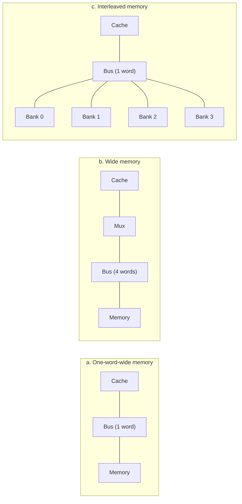

# بخش ۶، جلسه‌ی ۳ از ۱۲: اندازه‌ی بلوک، عدم اصابت و نوشتن

این جلسه بخشی از **بخش ۶: سلسله‌مراتب حافظه** است. زمان مطالعه: حدود نیم ساعت.

**فهرست این جلسه:**

- ۱. اثر اندازه‌ی بلوک
- ۲. رسیدگی به عدم اصابت خواندن
- ۳. نوشتن مستقیم و بافر نوشتن
- ۴. نوشتن با تأخیر
- ۵. عدم اصابت نوشتن
- ۶. کش جدا برای دستور و داده
- ۷. پهنای باند حافظه‌ی اصلی
- ۸. تمرین‌ها

---

## ۱. اثر اندازه‌ی بلوک

بلوک بزرگ‌تر از محلی بودن مکانی بیشتر استفاده می‌کند، پس معمولاً نرخ عدم اصابت را کم می‌کند. ولی اسلاید درس می‌گوید این رابطه همیشه درست نیست:

- **در ابتدا:** با بزرگ شدن بلوک، نرخ عدم اصابت کم می‌شود.
- **وقتی بلوک بخش بزرگی از کش شود:** نرخ عدم اصابت **بالا می‌رود**. دلیل‌ها: تعداد بلوک‌های کش کم می‌شود، رقابت برای بلوک‌ها زیاد می‌شود، و بلوک‌ها قبل از اینکه بیشتر کلمه‌هایشان استفاده شود، بیرون انداخته می‌شوند. اسلاید به این **کوبیدن (Thrashing)** در کش می‌گوید.

| اندازه‌ی بلوک نسبت به کش | اثر بر نرخ عدم اصابت | دلیل |
|---|---|---|
| خیلی کوچک (یک کلمه) | زیاد | از محلی بودن مکانی استفاده نمی‌شود |
| متوسط | کمترین | تعادل بین محلی بودن مکانی و تعداد بلوک‌ها |
| خیلی بزرگ (بخش بزرگی از کش) | دوباره زیاد | بلوک‌های کم، رقابت زیاد و بیرون رفتن زودهنگام |

کتاب COD در یک نمودار همین رفتار را برای کش‌های ۴ تا ۲۵۶ کیلوبایتی نشان می‌دهد: هرچه کش کوچک‌تر باشد، افزایش نرخ عدم اصابت با بلوک‌های بزرگ زودتر شروع می‌شود.

مشکل دیگر بلوک بزرگ: **جریمه‌ی عدم اصابت** بیشتر می‌شود، چون باید داده‌ی بیشتری از حافظه آورده شود. دو ترفند برای کم کردن این جریمه:

- **شروع زودهنگام (Early restart):** به محض اینکه کلمه‌ی درخواستی رسید، پردازنده ادامه دهد و منتظر بقیه‌ی بلوک نماند.
- **اول کلمه‌ی بحرانی (Critical word first):** حافظه اول کلمه‌ی درخواستی را بفرستد و بعد بقیه را.

## ۲. رسیدگی به عدم اصابت خواندن

در کش، اصابت خواندن هیچ کار خاصی نمی‌خواهد. ولی عدم اصابت نیاز به همکاری کش و واحد کنترل پردازنده دارد. اسلاید درس مراحل عدم اصابت **کش دستور** را این‌طور می‌گوید:

1. مقدار اصلی PC را به حافظه بفرست. چون PC در اولین گام دستور افزایش یافته، این مقدار **PC − 4** است.
2. به حافظه‌ی اصلی بگو خواندن را انجام دهد و منتظر بمان تا تمام شود. یعنی پردازنده **متوقف (Stall)** می‌شود.
3. بعد از خواندن، خانه‌ی کش را بنویس: داده، برچسب (بیت‌های بالای آدرس) و بیت معتبر.
4. اجرای دستور را از اولین گام دوباره شروع کن تا دستور این بار از کش واکشی شود.

برای **کش داده** همین مراحل است. ولی اسلاید یک بهبود پیشنهاد می‌کند: پردازنده می‌تواند تا وقتی کلمه‌ی خوانده‌شده واقعاً لازم نشده، دستورات بعدی را اجرا کند. به این **توقف هنگام استفاده (Stall on use)** می‌گوییم. اسلاید می‌پرسد: چرا این کار برای عدم اصابت دستور ممکن نیست؟ جواب: بدون دستور، پردازنده نمی‌داند چه کاری انجام دهد. دستور بعدی به همین دستور وابسته است.

یک نکته: در طراحی‌های واقعی، توقف کل پردازنده در عدم اصابت ساده است ولی در پردازنده‌های خارج از ترتیب، دستورات مستقل همچنان اجرا می‌شوند. به این کش‌ها **کش بدون توقف (Nonblocking)** می‌گوییم (جلسه‌ی ۶-۱۱).

## ۳. نوشتن مستقیم و بافر نوشتن

نوشتن پیچیده‌تر از خواندن است. فرض کن دستور `sw` در کش می‌نویسد ولی حافظه‌ی اصلی را تغییر نمی‌دهد. حالا کش و حافظه **ناسازگار (Inconsistent)** شده‌اند.

ساده‌ترین راه‌حل: **نوشتن مستقیم (Write-through)**. هر نوشتن هم در کش و هم در حافظه‌ی اصلی انجام شود. اسلاید:

- **اصابت نوشتن:** داده را در کش و حافظه جایگزین کن.
- **عدم اصابت نوشتن (بلوک یک‌کلمه‌ای):** کلمه را در کش و حافظه بنویس. لازم نیست کلمه‌ی قدیمی از حافظه خوانده شود، چون کل بلوک بازنویسی می‌شود.

مشکل: هر نوشتن به حافظه‌ی اصلی می‌رود که خیلی کند است. مثال کتاب: اگر نوشتن در حافظه ۱۰۰ سیکل طول بکشد و ۱۰٪ دستورات `sw` باشند، CPI از ۱ به 1 + 0.1 × 100 = 11 می‌رسد. یعنی ده برابر کندتر.

راه‌حل: **بافر نوشتن (Write buffer)**. یک صف کوچک که داده‌هایی را که منتظر نوشتن در حافظه‌اند نگه می‌دارد. پردازنده داده را در کش و بافر می‌نویسد و ادامه می‌دهد. وقتی نوشتن یک خانه در حافظه تمام شد، آن خانه‌ی بافر آزاد می‌شود. پردازنده فقط وقتی متوقف می‌شود که بافر **پر** باشد. اسلاید می‌گوید بافر نوشتن DECStation 3100 چهار کلمه داشت.

بافر نوشتن فقط وقتی کمک می‌کند که نرخ نوشتن کمتر از سرعت نوشتن حافظه باشد. اگر نوشتن‌ها پشت سر هم و به شکل انفجاری (Burst) بیایند، بافر پر می‌شود.

## ۴. نوشتن با تأخیر

روش دیگر: **نوشتن با تأخیر (Write-back)** یا **کپی برگشتی (Copy-back)**. داده فقط در کش نوشته می‌شود. بلوک تغییرکرده فقط وقتی در حافظه‌ی اصلی نوشته می‌شود که **از کش بیرون برود** (جایگزین شود).

برای اینکه بدانیم کدام بلوک‌ها تغییر کرده‌اند، هر بلوک یک **بیت کثیف (Dirty bit)** دارد. اگر بلوک کثیف باشد، هنگام جایگزینی باید اول در حافظه نوشته شود. اگر تمیز باشد، فقط دور ریخته می‌شود.

| ویژگی | نوشتن مستقیم | نوشتن با تأخیر |
|---|---|---|
| هر نوشتن به حافظه می‌رود | بله | خیر، فقط هنگام جایگزینی |
| ترافیک حافظه | زیاد | کم، چون چند نوشتن در یک بلوک یک بار نوشته می‌شوند |
| پیاده‌سازی | ساده‌تر | پیچیده‌تر (بیت کثیف، نوشتن قبل از جایگزینی) |
| سازگاری حافظه با کش | همیشه سازگار | فقط کش مقدار جدید را دارد |
| عدم اصابت خواندن | فقط خواندن | گاهی اول نوشتن بلوک کثیف و بعد خواندن |
| کاربرد رایج | کش سطح ۱ در بعضی طراحی‌ها | بیشتر کش‌های امروزی و همیشه حافظه‌ی مجازی |

اسلاید می‌گوید نوشتن با تأخیر کارآمدتر ولی پیچیده‌تر است. در کش‌های با نوشتن با تأخیر، معمولاً یک **بافر نوشتن** هم برای بلوک‌های کثیف بیرون‌رفته استفاده می‌شود تا خواندن بلوک جدید منتظر نوشتن بلوک قدیمی نماند.

## ۵. عدم اصابت نوشتن

در عدم اصابت نوشتن، دو سیاست وجود دارد:

- **تخصیص هنگام نوشتن (Write allocate):** بلوک از حافظه به کش آورده شود و بعد کلمه در آن نوشته شود. معمولاً با نوشتن با تأخیر استفاده می‌شود.
- **بدون تخصیص (No write allocate):** کلمه فقط در حافظه نوشته شود و کش تغییری نکند. معمولاً با نوشتن مستقیم استفاده می‌شود. این برای برنامه‌هایی مفید است که داده‌ای را می‌نویسند و به‌زودی نمی‌خوانند، مثل صفر کردن یک صفحه‌ی حافظه.

### بلوک‌های چندکلمه‌ای

اسلاید درس یک نکته‌ی ظریف دارد: با بلوک‌های چندکلمه‌ای، در عدم اصابت نوشتن **نمی‌توان فقط کلمه و برچسب را نوشت**. چرا؟ چون برچسب جدید می‌گوید کل بلوک مال آدرس جدید است، ولی بقیه‌ی کلمه‌های بلوک هنوز مال آدرس قبلی‌اند. پس:

- **اصابت نوشتن:** مثل بلوک یک‌کلمه‌ای، کلمه جایگزین و در کش و حافظه نوشته می‌شود.
- **عدم اصابت نوشتن:** بلوک از حافظه آورده می‌شود، کلمه‌ی جدید در آن جایگزین می‌شود و بعد نوشته می‌شود.

یعنی برخلاف بلوک یک‌کلمه‌ای، **عدم اصابت نوشتن با بلوک چندکلمه‌ای یک خواندن از حافظه لازم دارد**.

## ۶. کش جدا برای دستور و داده

اسلاید درس پیشنهاد می‌کند کش دستور و داده جدا باشند، چون:

- **خط لوله:** در هر سیکل یک واکشی دستور و یک دسترسی داده لازم است (مخاطره‌ی ساختاری جلسه‌ی ۵-۲).
- **محلی بودن متفاوت:** دستورات محلی بودن مکانی بیشتری دارند.

داده‌های اسلاید از DECStation 3100:

| برنامه | اندازه‌ی بلوک (کلمه) | نرخ عدم اصابت دستور | نرخ عدم اصابت داده | نرخ ترکیبی مؤثر |
|---|---|---|---|---|
| برنامه‌ی gcc | 1 | 6.1% | 2.1% | 5.4% |
| برنامه‌ی gcc | 4 | 2.0% | 1.7% | 1.9% |
| برنامه‌ی spice | 1 | 1.2% | 1.3% | 1.2% |
| برنامه‌ی spice | 4 | 0.3% | 0.6% | 0.4% |

دو نکته از این جدول:

- **اثر بلوک بزرگ‌تر روی دستورات:** نرخ عدم اصابت دستور در gcc از ۶.۱٪ به ۲.۰٪ کاهش یافت، چون دستورات محلی بودن مکانی زیادی دارند.
- **کش جدا در برابر کش یکپارچه:** کش یکپارچه با همان حجم کل ممکن است نرخ عدم اصابت **کمی کمتری** داشته باشد، چون حجم را بین دستور و داده به‌طور پویا تقسیم می‌کند. ولی کش جدا دو برابر پهنای باند دارد و در خط لوله مخاطره‌ی ساختاری ندارد. این همان سؤال امتحانی «کش یکپارچه و مجزا» است که در جلسه‌ی ۶-۴ حل می‌کنیم.

### نمونه‌ی واقعی: Intrinsity FastMATH

کتاب COD پردازنده‌ی نهفته‌ی FastMATH (بر پایه‌ی MIPS) را مثال می‌زند: کش دستور و داده‌ی جدا، هر کدام ۱۶ کیلوبایت با ۲۵۶ بلوک ۱۶ کلمه‌ای. کش داده هر دو حالت نوشتن مستقیم و با تأخیر را پشتیبانی می‌کند. کتاب نرخ عدم اصابت آن را روی SPEC2000 حدود ۰.۴٪ برای دستور، ۱۱.۴٪ برای داده و ۳.۲٪ ترکیبی گزارش می‌کند.

## ۷. پهنای باند حافظه‌ی اصلی

جریمه‌ی عدم اصابت به سرعت انتقال بلوک از حافظه بستگی دارد. مثال کتاب و اسلاید، با این فرض‌ها:

- **ارسال آدرس:** ۱ سیکل گذرگاه.
- **دسترسی DRAM:** ۱۵ سیکل برای هر دسترسی.
- **انتقال داده:** ۱ سیکل برای هر کلمه روی گذرگاه.

برای بلوک چهارکلمه‌ای، سه سازمان حافظه:

| سازمان | جریمه‌ی عدم اصابت | بایت در هر سیکل |
|---|---|---|
| حافظه‌ی یک‌کلمه‌ای | 1 + 4 × 15 + 4 × 1 = 65 سیکل | 16 / 65 = 0.25 |
| حافظه‌ی پهن (چهارکلمه‌ای) | 1 + 15 + 1 = 17 سیکل | 16 / 17 = 0.94 |
| حافظه‌ی درهم‌بافته (چهار بانک) | 1 + 15 + 4 × 1 = 20 سیکل | 16 / 20 = 0.80 |

- **حافظه‌ی پهن:** سریع‌ترین است ولی گذرگاه و حافظه‌ی پهن گران‌اند، و برای نوشتن یک کلمه هم باید کل عرض را مدیریت کرد.
- **حافظه‌ی درهم‌بافته (Interleaved):** چهار بانک حافظه که همزمان دسترسی خود را شروع می‌کنند. بعد کلمه‌ها یکی‌یکی روی گذرگاه باریک فرستاده می‌شوند. تقریباً به سرعت حافظه‌ی پهن با هزینه‌ی کمتر. این همان ایده‌ای است که امروز در **بانک‌های DRAM** و کانال‌های چندگانه می‌بینیم.

## ۸. تمرین‌ها

تمرین ۱: ترافیک نوشتن

**صورت:** حلقه‌ای ۱۰۰۰ بار به یک متغیر در حافظه می‌نویسد. با کش نوشتن مستقیم و کش نوشتن با تأخیر، چند نوشتن به حافظه‌ی اصلی می‌رسد؟

**جواب:** نوشتن مستقیم: ۱۰۰۰ نوشتن. نوشتن با تأخیر: فقط یک نوشتن، وقتی بلوک بالاخره از کش بیرون برود. این مثال نشان می‌دهد چرا نوشتن با تأخیر ترافیک حافظه را خیلی کم می‌کند.

تمرین ۲: جریمه با بلوک بزرگ‌تر

**صورت:** با فرض‌های بخش ۷، جریمه‌ی عدم اصابت برای بلوک هشت‌کلمه‌ای در هر سه سازمان چقدر است؟ (حافظه‌ی پهن را دوکلمه‌ای و درهم‌بافته را چهاربانکی فرض کن.)

**جواب:**

| سازمان | محاسبه | سیکل |
|---|---|---|
| حافظه‌ی یک‌کلمه‌ای | 1 + 8 × 15 + 8 × 1 | 129 |
| حافظه‌ی پهن دوکلمه‌ای | 1 + 4 × 15 + 4 × 1 | 65 |
| حافظه‌ی درهم‌بافته‌ی چهاربانکی | 1 + 2 × 15 + 8 × 1 | 39 |

در حافظه‌ی درهم‌بافته، هشت کلمه در دو دور از چهار بانک خوانده می‌شوند. اینجا فرض کرده‌ایم دور دوم بعد از دور اول شروع می‌شود و انتقال‌ها روی هم نمی‌افتند. با هم‌پوشانی، کمتر هم می‌شود.

تمرین ۳: پرسش مفهومی

**صورت:** چرا در حافظه‌ی مجازی (بین حافظه‌ی اصلی و دیسک) همیشه از نوشتن با تأخیر استفاده می‌شود؟

**جواب:** چون نوشتن در دیسک میلیون‌ها سیکل طول می‌کشد. نوشتن مستقیم یعنی هر `sw` میلیون‌ها سیکل منتظر بماند، که هیچ بافری نمی‌تواند آن را جبران کند. با نوشتن با تأخیر، صفحه فقط وقتی جایگزین می‌شود و کثیف است، یک بار در دیسک نوشته می‌شود.

---

جلسه‌ی قبلی: [کش با نگاشت مستقیم](6-2-direct-mapped-cache.md)  
جلسه‌ی بعدی: [سنجش کارایی کش و حل مسئله‌ی کش یکپارچه و مجزا](6-4-cache-performance.md)
