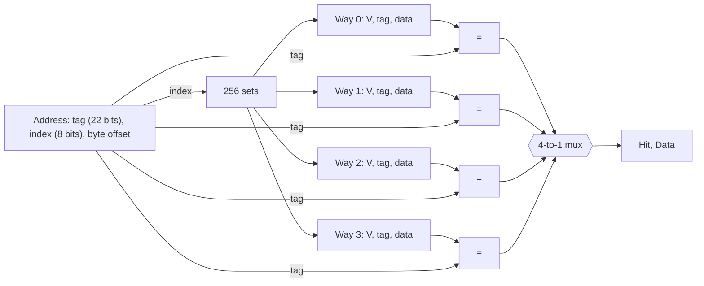

# بخش ۶، جلسه‌ی ۵ از ۱۲: کش انجمنی و کش چندسطحی

این جلسه بخشی از **بخش ۶: سلسله‌مراتب حافظه** است. زمان مطالعه: حدود نیم ساعت.

**فهرست این جلسه:**

- ۱. سه روش قرار دادن بلوک
- ۲. پیدا کردن بلوک در کش انجمنی
- ۳. مثال اسلاید: دنباله‌ی ۰، ۸، ۰، ۶، ۸
- ۴. اثر انجمنی بودن بر نرخ عدم اصابت
- ۵. هزینه‌ی انجمنی بودن
- ۶. سیاست جایگزینی
- ۷. کش چندسطحی
- ۸. نرخ عدم اصابت محلی و سراسری
- ۹. تمرین‌ها

---

## ۱. سه روش قرار دادن بلوک

در جلسه‌ی ۶-۲ دیدیم که در نگاشت مستقیم، بلوک‌هایی که به یک جا نگاشته می‌شوند مدام همدیگر را بیرون می‌کنند، حتی وقتی بقیه‌ی کش خالی است. برای کم کردن این مشکل، اجازه می‌دهیم بلوک در **چند جا** قرار گیرد. اسلاید درس سه روش را مقایسه می‌کند:

| روش | جای بلوک | جست‌وجو |
|---|---|---|
| نگاشت مستقیم (Direct mapped) | دقیقاً یک جا: آدرس بلوک به پیمانه‌ی تعداد بلوک‌ها | یک مقایسه |
| تمام‌انجمنی (Fully associative) | هر جایی از کش | همه‌ی خانه‌ها به‌طور موازی |
| انجمنی مجموعه‌ای n راهه (n-way set associative) | هر جایی در یک **مجموعه** با n خانه | n خانه‌ی آن مجموعه به‌طور موازی |

در کش انجمنی مجموعه‌ای:

```math
\text{Set index} = (\text{Block address}) \bmod (\text{Number of sets in cache})
```

```math
\text{Number of sets} = \frac{\text{Number of blocks}}{n}
```

نگاشت مستقیم همان انجمنی یک‌راهه است و تمام‌انجمنی همان انجمنی با n برابر تعداد کل بلوک‌ها. پس انجمنی مجموعه‌ای حالت کلی است.

### مثال اسلاید: بلوک ۱۲

کشی با ۸ بلوک. بلوک حافظه‌ی شماره‌ی ۱۲ کجا قرار می‌گیرد؟

| روش | محاسبه | جای ممکن |
|---|---|---|
| نگاشت مستقیم | 12 mod 8 = 4 | فقط بلوک ۴ |
| دوراهه (۴ مجموعه) | 12 mod 4 = 0 | هر دو خانه‌ی مجموعه‌ی ۰ |
| تمام‌انجمنی | – | هر ۸ بلوک |

### هشت آرایش یک کش هشت‌بلوکی

| آرایش | تعداد مجموعه | خانه در هر مجموعه |
|---|---|---|
| یک‌راهه (نگاشت مستقیم) | 8 | 1 |
| دوراهه | 4 | 2 |
| چهارراهه | 2 | 4 |
| هشت‌راهه (تمام‌انجمنی) | 1 | 8 |

## ۲. پیدا کردن بلوک در کش انجمنی

آدرس سه بخش دارد: **برچسب**، **شاخص مجموعه** و **آفست بلوک**. شاخص مجموعه را انتخاب می‌کند و برچسب با **همه‌ی** برچسب‌های آن مجموعه همزمان مقایسه می‌شود.

مثال اسلاید: کش چهارراهه با ۱۰۲۴ بلوک، یعنی ۲۵۶ مجموعه با ۴ خانه:



سخت‌افزار لازم: **چهار مقایسه‌گر** و یک **مالتی‌پلکسر ۴ به ۱** برای انتخاب داده‌ی راهی که اصابت داشته است. هر چه انجمنی بودن بیشتر، مقایسه‌گرها بیشتر و مالتی‌پلکسر بزرگ‌تر.

در کش تمام‌انجمنی، شاخص وجود ندارد و برچسب با همه‌ی خانه‌ها مقایسه می‌شود. این فقط برای کش‌های خیلی کوچک (مثل TLB) عملی است.

## ۳. مثال اسلاید: دنباله‌ی ۰، ۸، ۰، ۶، ۸

کشی با چهار بلوک یک‌کلمه‌ای. دنباله‌ی آدرس‌های بلوک: ۰، ۸، ۰، ۶، ۸. تعداد عدم اصابت را برای سه آرایش پیدا کن. برای انجمنی از LRU استفاده کن.

### نگاشت مستقیم

نگاشت: 0 mod 4 = 0، 6 mod 4 = 2، 8 mod 4 = 0.

| آدرس | نتیجه | بلوک ۰ | بلوک ۱ | بلوک ۲ | بلوک ۳ |
|---|---|---|---|---|---|
| آدرس 0 | عدم اصابت | Mem[0] | | | |
| آدرس 8 | عدم اصابت | Mem[8] | | | |
| آدرس 0 | عدم اصابت | Mem[0] | | | |
| آدرس 6 | عدم اصابت | Mem[0] | | Mem[6] | |
| آدرس 8 | عدم اصابت | Mem[8] | | Mem[6] | |

**پنج عدم اصابت.**

### انجمنی دوراهه

دو مجموعه: 0 mod 2 = 0، 6 mod 2 = 0، 8 mod 2 = 0. همه به مجموعه‌ی ۰ می‌روند.

| آدرس | نتیجه | مجموعه‌ی ۰ | مجموعه‌ی ۰ | مجموعه‌ی ۱ | مجموعه‌ی ۱ |
|---|---|---|---|---|---|
| آدرس 0 | عدم اصابت | Mem[0] | | | |
| آدرس 8 | عدم اصابت | Mem[0] | Mem[8] | | |
| آدرس 0 | اصابت | Mem[0] | Mem[8] | | |
| آدرس 6 | عدم اصابت | Mem[0] | Mem[6] | | |
| آدرس 8 | عدم اصابت | Mem[8] | Mem[6] | | |

در دسترسی ۴، بلوک ۸ کمتر از همه اخیراً استفاده شده بود (LRU)، پس بلوک ۶ جای آن را گرفت. **چهار عدم اصابت.**

### تمام‌انجمنی

| آدرس | نتیجه | بلوک ۰ | بلوک ۱ | بلوک ۲ | بلوک ۳ |
|---|---|---|---|---|---|
| آدرس 0 | عدم اصابت | Mem[0] | | | |
| آدرس 8 | عدم اصابت | Mem[0] | Mem[8] | | |
| آدرس 0 | اصابت | Mem[0] | Mem[8] | | |
| آدرس 6 | عدم اصابت | Mem[0] | Mem[8] | Mem[6] | |
| آدرس 8 | اصابت | Mem[0] | Mem[8] | Mem[6] | |

**سه عدم اصابت.** این کمترین ممکن است، چون سه بلوک متمایز داریم و هر کدام یک بار باید بیاید.

## ۴. اثر انجمنی بودن بر نرخ عدم اصابت

انجمنی بودن بیشتر معمولاً نرخ عدم اصابت را کم می‌کند، ولی سود آن با افزایش راه‌ها کم می‌شود. داده‌های کتاب COD برای یک کش داده‌ی ۶۴ کیلوبایتی با بلوک‌های ۱۶ کلمه‌ای (تقریبی):

| انجمنی بودن | نرخ عدم اصابت داده |
|---|---|
| یک‌راهه | 10.3% |
| دوراهه | 8.6% |
| چهارراهه | 8.3% |
| هشت‌راهه | 8.1% |

بیشترین سود از یک‌راهه به دوراهه است (۱۵٪ کاهش). بعد از آن سود خیلی کم است. اسلاید درس نمودار مشابهی از SPEC92 نشان می‌دهد: در کش‌های کوچک (۱ تا ۸ کیلوبایت)، انجمنی بودن اثر بیشتری دارد تا در کش‌های بزرگ (۶۴ و ۱۲۸ کیلوبایت).

یک قاعده‌ی تجربی از CAQA به نام **قاعده‌ی ۲:۱ کش**: کش با نگاشت مستقیم با اندازه‌ی N تقریباً همان نرخ عدم اصابت کش دوراهه با اندازه‌ی N/2 را دارد (برای کش‌های تا حدود ۱۲۸ کیلوبایت).

## ۵. هزینه‌ی انجمنی بودن

اسلاید درس می‌گوید افزایش انجمنی بودن نرخ عدم اصابت را کم می‌کند ولی **زمان اصابت را زیاد می‌کند**، به خاطر جست‌وجوی موازی و بعد انتخاب داده. هزینه‌ها:

- **مقایسه‌گرهای بیشتر:** n مقایسه‌گر برای n راه.
- **مالتی‌پلکسر:** داده فقط بعد از مقایسه انتخاب می‌شود. در نگاشت مستقیم، داده می‌تواند همزمان با بررسی برچسب به پردازنده برسد.
- **بیت‌های برچسب بیشتر:** هر دو برابر شدن انجمنی بودن، شاخص را یک بیت کم و برچسب را یک بیت زیاد می‌کند.

مثال کتاب: کشی با ۴۰۹۶ بلوک، بلوک‌های چهارکلمه‌ای و آدرس ۳۲ بیتی. آفست ۴ بیت است.

| انجمنی بودن | تعداد مجموعه | بیت شاخص | بیت برچسب | کل بیت‌های برچسب |
|---|---|---|---|---|
| نگاشت مستقیم | 4096 | 12 | 16 | 16 × 4096 = 64K |
| دوراهه | 2048 | 11 | 17 | 17 × 4096 = 68K |
| چهارراهه | 1024 | 10 | 18 | 18 × 4096 = 72K |
| تمام‌انجمنی | 1 | 0 | 28 | 28 × 4096 = 112K |

## ۶. سیاست جایگزینی

در نگاشت مستقیم، هنگام عدم اصابت انتخابی نداریم. در کش انجمنی باید تصمیم بگیریم کدام بلوک مجموعه بیرون برود:

- **قدیمی‌ترین استفاده (LRU، Least Recently Used):** بلوکی که بیشترین زمان از آخرین استفاده‌اش گذشته. بر پایه‌ی محلی بودن زمانی. اسلاید می‌گوید در کش دوراهه، LRU با **یک بیت** در هر مجموعه پیاده می‌شود که نشان می‌دهد کدام بلوک اخیراً استفاده شده.
- **شبه‌LRU (Pseudo-LRU):** برای انجمنی بودن بیشتر، LRU دقیق گران است. یک تقریب با بیت‌های کمتر استفاده می‌شود.
- **تصادفی (Random):** یک بلوک تصادفی. ساده است و در کش‌های بزرگ با انجمنی بالا تقریباً به خوبی LRU است.
- **اولین ورودی، اولین خروجی (FIFO):** قدیمی‌ترین بلوکی که وارد شده.

کتاب می‌گوید در کش‌های امروزی، تفاوت LRU و تصادفی معمولاً کم است، چون نرخ عدم اصابت کش‌های بزرگ خودش کم است.

## ۷. کش چندسطحی

برای کم کردن **جریمه‌ی عدم اصابت**، اسلاید درس پیشنهاد می‌کند یک **کش سطح دوم (L2)** بین کش سطح اول و حافظه‌ی اصلی اضافه کنیم:

- **کش سطح ۱:** روی همان تراشه‌ی پردازنده، کوچک و خیلی سریع.
- **کش سطح ۲:** با SRAM، بزرگ‌تر. اگر عدم اصابت در سطح ۱ رخ دهد و داده در سطح ۲ باشد، جریمه فقط زمان دسترسی سطح ۲ است که خیلی کمتر از حافظه‌ی اصلی است.
- **عدم اصابت در هر دو:** فقط آن‌وقت دسترسی به حافظه‌ی اصلی با جریمه‌ی بزرگ لازم است.

ملاحظات طراحی، طبق اسلاید:

- **سطح ۱:** زمان اصابت را بهینه کن تا سیکل ساعت کوتاه بماند. یعنی کوچک و ساده.
- **سطح ۲:** نرخ عدم اصابت را بهینه کن تا دسترسی‌های پرهزینه به حافظه کم شوند. یعنی بزرگ، با انجمنی بالا و بلوک بزرگ.

اسلاید جمع‌بندی می‌کند: سطح ۲ به سطح ۱ اجازه می‌دهد بدون «نگرانی» از عدم اصابت، به دنبال سرعت برود.

### مثال اسلاید

پردازنده‌ی ۵۰۰ مگاهرتز (سیکل ۲ نانوثانیه)، CPI پایه ۱.۰، دسترسی حافظه‌ی اصلی ۲۰۰ نانوثانیه، نرخ عدم اصابت ۵٪ به ازای هر دستور. اگر یک کش سطح ۲ با دسترسی ۲۰ نانوثانیه اضافه کنیم که نرخ عدم اصابت به حافظه‌ی اصلی را به ۲٪ برساند، چقدر سریع‌تر می‌شود؟

جریمه‌ی رفتن به حافظه‌ی اصلی: 200 / 2 = 100 سیکل.

```math
\text{CPI}_{\text{one level}} = 1 + 0.05 \times 100 = 6.0
```

جریمه‌ی رفتن به سطح ۲: 20 / 2 = 10 سیکل.

```math
\text{CPI}_{\text{two levels}} = 1 + 0.05 \times 10 + 0.02 \times 100 = 1 + 0.5 + 2.0 = 3.5
```

```math
\text{Speedup} = \frac{6.0}{3.5} \approx 1.7
```

### مثال کتاب

پردازنده‌ی ۴ گیگاهرتز (سیکل ۰.۲۵ نانوثانیه)، CPI پایه ۱، حافظه‌ی اصلی ۱۰۰ نانوثانیه، عدم اصابت سطح ۱ برابر ۲٪ به ازای هر دستور. کش سطح ۲ با ۵ نانوثانیه، نرخ عدم اصابت به حافظه‌ی اصلی را به ۰.۵٪ می‌رساند.

| مقدار | محاسبه |
|---|---|
| جریمه‌ی حافظه‌ی اصلی | 100 / 0.25 = 400 سیکل |
| مقدار CPI با یک سطح | 1 + 0.02 × 400 = 9.0 |
| جریمه‌ی سطح ۲ | 5 / 0.25 = 20 سیکل |
| مقدار CPI با دو سطح | 1 + 0.02 × 20 + 0.005 × 400 = 3.4 |
| تسریع | 9.0 / 3.4 = 2.6 |

## ۸. نرخ عدم اصابت محلی و سراسری

با کش چندسطحی، باید دو نوع نرخ را از هم جدا کرد (CAQA):

- **نرخ عدم اصابت محلی (Local miss rate):** تعداد عدم اصابت‌های یک سطح تقسیم بر تعداد **دسترسی‌هایی که به همان سطح رسیده‌اند**. برای سطح ۲، فقط دسترسی‌هایی به آن می‌رسند که در سطح ۱ عدم اصابت داشته‌اند.
- **نرخ عدم اصابت سراسری (Global miss rate):** تعداد عدم اصابت‌های یک سطح تقسیم بر **کل دسترسی‌های پردازنده**.

```math
\text{Global miss rate}_{L2} = \text{Miss rate}_{L1} \times \text{Local miss rate}_{L2}
```

در مثال کتاب، نرخ سراسری سطح ۲ برابر ۰.۵٪ و نرخ سطح ۱ برابر ۲٪ است. پس نرخ محلی سطح ۲ برابر 0.5 / 2 = 25% است. این عدد بزرگ به نظر می‌رسد، ولی طبیعی است: دسترسی‌های آسان را سطح ۱ گرفته و فقط دسترسی‌های سخت به سطح ۲ رسیده‌اند.

فرمول AMAT دوسطحی:

```math
\text{AMAT} = \text{Hit time}_{L1} + \text{Miss rate}_{L1} \times \left(\text{Hit time}_{L2} + \text{Local miss rate}_{L2} \times \text{Miss penalty}_{L2}\right)
```

## ۹. تمرین‌ها

<details>
<summary>تمرین ۱: تقسیم آدرس</summary>

**صورت:** کش ۳۲ کیلوبایتی هشت‌راهه با بلوک‌های ۶۴ بایتی و آدرس ۳۲ بیتی. بیت‌های برچسب، شاخص و آفست چند تاست؟

**جواب:** تعداد بلوک 32K / 64 = 512. تعداد مجموعه 512 / 8 = 64، پس شاخص ۶ بیت. آفست ۶ بیت. برچسب 32 − 6 − 6 = 20 بیت. این دقیقاً آرایش کش داده‌ی سطح ۱ بسیاری از پردازنده‌های اینتل است.
</details>

<details>
<summary>تمرین ۲: AMAT دوسطحی</summary>

**صورت:** زمان اصابت سطح ۱ یک سیکل و نرخ عدم اصابت آن ۴٪. زمان اصابت سطح ۲ ده سیکل و نرخ عدم اصابت محلی آن ۲۰٪. جریمه‌ی حافظه‌ی اصلی ۲۰۰ سیکل. AMAT و نرخ عدم اصابت سراسری سطح ۲ را حساب کن.

**جواب:**

```math
\text{AMAT} = 1 + 0.04 \times (10 + 0.20 \times 200) = 1 + 0.04 \times 50 = 3 \text{ cycles}
```

نرخ سراسری سطح ۲: 0.04 × 0.20 = 0.8%.
</details>

<details>
<summary>تمرین ۳: دنباله‌ی دسترسی</summary>

**صورت:** کش چهاربلوکی با دنباله‌ی بلوک‌های ۱، ۵، ۹، ۱، ۵، ۹. تعداد عدم اصابت را برای نگاشت مستقیم، دوراهه با LRU و تمام‌انجمنی با LRU پیدا کن.

**جواب:** همه‌ی این بلوک‌ها در نگاشت مستقیم به جای ۱ و در دوراهه به مجموعه‌ی ۱ می‌روند.

| آرایش | تعداد عدم اصابت | توضیح |
|---|---|---|
| نگاشت مستقیم | 6 | هر دسترسی قبلی را بیرون می‌کند |
| دوراهه با LRU | 6 | سه بلوک در یک مجموعه‌ی دوخانه‌ای؛ LRU همیشه همان بلوکی را بیرون می‌کند که بعداً لازم است |
| تمام‌انجمنی با LRU | 3 | هر سه جا می‌شوند |

مثال دوراهه نشان می‌دهد که LRU همیشه بهترین نیست: الگوی چرخشی با یک بلوک بیشتر از ظرفیت، بدترین حالت LRU است.
</details>

---

جلسه‌ی قبلی: [سنجش کارایی کش و حل مسئله‌ی کش یکپارچه و مجزا](6-4-cache-performance.md)  
جلسه‌ی بعدی: [حل سؤال‌های امتحانی کش و دسته‌بندی عدم اصابت‌ها](6-6-cache-exam-problems-and-3c.md)
