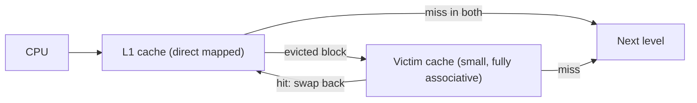

# بخش ۶، جلسه‌ی ۶ از ۱۲: حل سؤال‌های امتحانی کش و دسته‌بندی عدم اصابت‌ها

این جلسه بخشی از **بخش ۶: سلسله‌مراتب حافظه** است. زمان مطالعه: حدود چهل دقیقه.

**فهرست این جلسه:**

- ۱. صورت سؤال و فرض‌ها
- ۲. روش حل
- ۳. امتحان ۰۰-۰۱
- ۴. امتحان ۰۱-۰۲
- ۵. امتحان ۰۲-۰۳
- ۶. دسته‌بندی عدم اصابت‌ها (سه C)
- ۷. کش قربانی
- ۸. تمرین‌ها

---

## ۱. صورت سؤال و فرض‌ها

این سؤال در سه امتحان آمده است. صورت کلی:

> حافظه‌ای با ظرفیت ۱۰۲۴ بایت داریم. برنامه‌ای به ترتیب کلمه‌های موجود در آدرس‌های زیر را درخواست می‌کند. پردازنده یک حافظه‌ی نهان ۱۲۸ بایتی دارد و هر کلمه ۴ بایت است. تعداد عدم اصابت‌ها را در هر یک از این مدل‌ها پیدا کن: (۱) نگاشت مستقیم با بلوک‌های یک‌کلمه‌ای، (۲) نگاشت مستقیم با بلوک‌های چهارکلمه‌ای، (۳) انجمنی مجموعه‌ای دوراهه (یا چهارراهه) با بلوک‌های یک‌کلمه‌ای.

فرض‌هایی که در جواب می‌نویسیم:

- **آدرس‌ها بایتی‌اند.** چون همه مضرب ۴ هستند و صورت سؤال می‌گوید هر کلمه ۴ بایت است.
- **کش در ابتدا خالی است.**
- **سیاست جایگزینی LRU** برای کش انجمنی.
- **طول آدرس:** حافظه ۱۰۲۴ بایت است، پس آدرس ۱۰ بیتی است.
- **در امتحان ۰۰-۰۱** اندازه‌ی بلوک کش چهارراهه گفته نشده. فرض می‌کنیم یک‌کلمه‌ای است، مثل دو امتحان دیگر، و نسخه‌ی چهارکلمه‌ای را هم جداگانه حساب می‌کنیم.

## ۲. روش حل

برای هر مدل:

1. **تعداد بلوک‌ها و مجموعه‌ها** را حساب کن.
2. **تقسیم آدرس** را بنویس: برچسب، شاخص و آفست.
3. برای هر آدرس: **آدرس بلوک** = آدرس تقسیم بر اندازه‌ی بلوک (جزء صحیح)، و **شاخص** = آدرس بلوک به پیمانه‌ی تعداد مجموعه‌ها.
4. جدول را پر کن و اصابت‌ها را علامت بزن.

| مدل | اندازه‌ی بلوک | تعداد بلوک | تعداد مجموعه | آفست | شاخص | برچسب (آدرس ۱۰ بیتی) |
|---|---|---|---|---|---|---|
| نگاشت مستقیم یک‌کلمه‌ای | 4 B | 32 | 32 | 2 بیت | 5 بیت | 3 بیت |
| نگاشت مستقیم چهارکلمه‌ای | 16 B | 8 | 8 | 4 بیت | 3 بیت | 3 بیت |
| دوراهه یک‌کلمه‌ای | 4 B | 32 | 16 | 2 بیت | 4 بیت | 4 بیت |
| چهارراهه یک‌کلمه‌ای | 4 B | 32 | 8 | 2 بیت | 3 بیت | 5 بیت |

همه‌ی جدول‌های زیر با یک شبیه‌ساز کش بررسی شده‌اند.

## ۳. امتحان ۰۰-۰۱

دنباله: ۰، ۱۶، ۸، ۱۲۸، ۶۴، ۹۶، ۱۶، ۴۸، ۶۴، ۰

### مدل ۱: نگاشت مستقیم یک‌کلمه‌ای

| آدرس | آدرس بلوک | شاخص | برچسب | نتیجه |
|---|---|---|---|---|
| آدرس 0 | 0 | 0 | 0 | عدم اصابت |
| آدرس 16 | 4 | 4 | 0 | عدم اصابت |
| آدرس 8 | 2 | 2 | 0 | عدم اصابت |
| آدرس 128 | 32 | 0 | 1 | عدم اصابت (جایگزین بلوک 0) |
| آدرس 64 | 16 | 16 | 0 | عدم اصابت |
| آدرس 96 | 24 | 24 | 0 | عدم اصابت |
| آدرس 16 | 4 | 4 | 0 | اصابت |
| آدرس 48 | 12 | 12 | 0 | عدم اصابت |
| آدرس 64 | 16 | 16 | 0 | اصابت |
| آدرس 0 | 0 | 0 | 0 | عدم اصابت (بلوک 32 آنجاست) |

**هشت عدم اصابت.**

### مدل ۲: نگاشت مستقیم چهارکلمه‌ای

| آدرس | آدرس بلوک | شاخص | برچسب | نتیجه |
|---|---|---|---|---|
| آدرس 0 | 0 | 0 | 0 | عدم اصابت (بایت‌های 0 تا 15 می‌آیند) |
| آدرس 16 | 1 | 1 | 0 | عدم اصابت |
| آدرس 8 | 0 | 0 | 0 | اصابت (محلی بودن مکانی) |
| آدرس 128 | 8 | 0 | 1 | عدم اصابت (جایگزین بلوک 0) |
| آدرس 64 | 4 | 4 | 0 | عدم اصابت |
| آدرس 96 | 6 | 6 | 0 | عدم اصابت |
| آدرس 16 | 1 | 1 | 0 | اصابت |
| آدرس 48 | 3 | 3 | 0 | عدم اصابت |
| آدرس 64 | 4 | 4 | 0 | اصابت |
| آدرس 0 | 0 | 0 | 0 | عدم اصابت (بلوک 8 آنجاست) |

**هفت عدم اصابت.**

### مدل ۳: چهارراهه یک‌کلمه‌ای (۸ مجموعه)

| آدرس | آدرس بلوک | مجموعه | نتیجه | محتوای مجموعه بعد از دسترسی (از قدیمی به جدید) |
|---|---|---|---|---|
| آدرس 0 | 0 | 0 | عدم اصابت | 0 |
| آدرس 16 | 4 | 4 | عدم اصابت | 4 |
| آدرس 8 | 2 | 2 | عدم اصابت | 2 |
| آدرس 128 | 32 | 0 | عدم اصابت | 0، 32 |
| آدرس 64 | 16 | 0 | عدم اصابت | 0، 32، 16 |
| آدرس 96 | 24 | 0 | عدم اصابت | 0، 32، 16، 24 |
| آدرس 16 | 4 | 4 | اصابت | 4 |
| آدرس 48 | 12 | 4 | عدم اصابت | 4، 12 |
| آدرس 64 | 16 | 0 | اصابت | 0، 32، 24، 16 |
| آدرس 0 | 0 | 0 | اصابت | 32، 24، 16، 0 |

**هفت عدم اصابت.** چهار بلوک ۰، ۳۲، ۱۶ و ۲۴ همه به مجموعه‌ی ۰ می‌روند، ولی چهار راه دارد و همه جا می‌شوند. پس دسترسی آخر به ۰ اصابت است.

اگر کش چهارراهه بلوک‌های **چهارکلمه‌ای** داشت (۸ بلوک، ۲ مجموعه): **شش عدم اصابت**. هم آدرس ۸ اصابت می‌شود (محلی بودن مکانی) و هم آدرس آخر ۰ (انجمنی بودن).

## ۴. امتحان ۰۱-۰۲

دنباله: ۰، ۱۶، ۸، ۱۲۸، ۶۴، ۴، ۱۶، ۴۸، ۶۴، ۰

### مدل ۱: نگاشت مستقیم یک‌کلمه‌ای

| آدرس | آدرس بلوک | شاخص | نتیجه |
|---|---|---|---|
| آدرس 0 | 0 | 0 | عدم اصابت |
| آدرس 16 | 4 | 4 | عدم اصابت |
| آدرس 8 | 2 | 2 | عدم اصابت |
| آدرس 128 | 32 | 0 | عدم اصابت (جایگزین 0) |
| آدرس 64 | 16 | 16 | عدم اصابت |
| آدرس 4 | 1 | 1 | عدم اصابت |
| آدرس 16 | 4 | 4 | اصابت |
| آدرس 48 | 12 | 12 | عدم اصابت |
| آدرس 64 | 16 | 16 | اصابت |
| آدرس 0 | 0 | 0 | عدم اصابت |

**هشت عدم اصابت.**

### مدل ۲: نگاشت مستقیم چهارکلمه‌ای

| آدرس | آدرس بلوک | شاخص | نتیجه |
|---|---|---|---|
| آدرس 0 | 0 | 0 | عدم اصابت |
| آدرس 16 | 1 | 1 | عدم اصابت |
| آدرس 8 | 0 | 0 | اصابت |
| آدرس 128 | 8 | 0 | عدم اصابت (جایگزین 0) |
| آدرس 64 | 4 | 4 | عدم اصابت |
| آدرس 4 | 0 | 0 | عدم اصابت (جایگزین 8) |
| آدرس 16 | 1 | 1 | اصابت |
| آدرس 48 | 3 | 3 | عدم اصابت |
| آدرس 64 | 4 | 4 | اصابت |
| آدرس 0 | 0 | 0 | اصابت (بلوک 0 با دسترسی به 4 برگشته بود) |

**شش عدم اصابت.**

### مدل ۳: دوراهه یک‌کلمه‌ای (۱۶ مجموعه)

| آدرس | آدرس بلوک | مجموعه | نتیجه | محتوای مجموعه (از قدیمی به جدید) |
|---|---|---|---|---|
| آدرس 0 | 0 | 0 | عدم اصابت | 0 |
| آدرس 16 | 4 | 4 | عدم اصابت | 4 |
| آدرس 8 | 2 | 2 | عدم اصابت | 2 |
| آدرس 128 | 32 | 0 | عدم اصابت | 0، 32 |
| آدرس 64 | 16 | 0 | عدم اصابت | 32، 16 (بلوک 0 بیرون رفت) |
| آدرس 4 | 1 | 1 | عدم اصابت | 1 |
| آدرس 16 | 4 | 4 | اصابت | 4 |
| آدرس 48 | 12 | 12 | عدم اصابت | 12 |
| آدرس 64 | 16 | 0 | اصابت | 32، 16 |
| آدرس 0 | 0 | 0 | عدم اصابت | 16، 0 (بلوک 32 بیرون رفت) |

**هشت عدم اصابت.** سه بلوک ۰، ۳۲ و ۱۶ به مجموعه‌ی ۰ می‌روند که فقط دو راه دارد. پس انجمنی دوراهه در این دنباله هیچ کمکی نکرد.

## ۵. امتحان ۰۲-۰۳

دنباله: ۰، ۱۶، ۸، ۱۲۸، ۰، ۴۴، ۴، ۱۶، ۴۸، ۶۰

### مدل ۱: نگاشت مستقیم یک‌کلمه‌ای

| آدرس | آدرس بلوک | شاخص | نتیجه |
|---|---|---|---|
| آدرس 0 | 0 | 0 | عدم اصابت |
| آدرس 16 | 4 | 4 | عدم اصابت |
| آدرس 8 | 2 | 2 | عدم اصابت |
| آدرس 128 | 32 | 0 | عدم اصابت (جایگزین 0) |
| آدرس 0 | 0 | 0 | عدم اصابت (جایگزین 32) |
| آدرس 44 | 11 | 11 | عدم اصابت |
| آدرس 4 | 1 | 1 | عدم اصابت |
| آدرس 16 | 4 | 4 | اصابت |
| آدرس 48 | 12 | 12 | عدم اصابت |
| آدرس 60 | 15 | 15 | عدم اصابت |

**نه عدم اصابت.**

### مدل ۲: نگاشت مستقیم چهارکلمه‌ای

| آدرس | آدرس بلوک | شاخص | نتیجه |
|---|---|---|---|
| آدرس 0 | 0 | 0 | عدم اصابت |
| آدرس 16 | 1 | 1 | عدم اصابت |
| آدرس 8 | 0 | 0 | اصابت |
| آدرس 128 | 8 | 0 | عدم اصابت (جایگزین 0) |
| آدرس 0 | 0 | 0 | عدم اصابت (جایگزین 8) |
| آدرس 44 | 2 | 2 | عدم اصابت |
| آدرس 4 | 0 | 0 | اصابت |
| آدرس 16 | 1 | 1 | اصابت |
| آدرس 48 | 3 | 3 | عدم اصابت |
| آدرس 60 | 3 | 3 | اصابت |

**شش عدم اصابت.**

### مدل ۳: دوراهه یک‌کلمه‌ای (۱۶ مجموعه)

| آدرس | آدرس بلوک | مجموعه | نتیجه | محتوای مجموعه |
|---|---|---|---|---|
| آدرس 0 | 0 | 0 | عدم اصابت | 0 |
| آدرس 16 | 4 | 4 | عدم اصابت | 4 |
| آدرس 8 | 2 | 2 | عدم اصابت | 2 |
| آدرس 128 | 32 | 0 | عدم اصابت | 0، 32 |
| آدرس 0 | 0 | 0 | اصابت | 32، 0 |
| آدرس 44 | 11 | 11 | عدم اصابت | 11 |
| آدرس 4 | 1 | 1 | عدم اصابت | 1 |
| آدرس 16 | 4 | 4 | اصابت | 4 |
| آدرس 48 | 12 | 12 | عدم اصابت | 12 |
| آدرس 60 | 15 | 15 | عدم اصابت | 15 |

**هشت عدم اصابت.**

### جمع‌بندی سه امتحان

| امتحان | نگاشت مستقیم یک‌کلمه‌ای | نگاشت مستقیم چهارکلمه‌ای | انجمنی (یک‌کلمه‌ای) |
|---|---|---|---|
| امتحان ۰۰-۰۱ | 8 | 7 | 7 (چهارراهه) |
| امتحان ۰۱-۰۲ | 8 | 6 | 8 (دوراهه) |
| امتحان ۰۲-۰۳ | 9 | 6 | 8 (دوراهه) |

در هر سه امتحان، بلوک چهارکلمه‌ای بیشترین سود را داشت، چون آدرس‌ها نزدیک هم‌اند (محلی بودن مکانی). انجمنی بودن فقط وقتی کمک کرد که تداخل‌ها با تعداد راه‌ها جا می‌شدند.

## ۶. دسته‌بندی عدم اصابت‌ها (سه C)

این سؤال کوتاه در امتحان‌های ۹۵-۹۶ و ۹۹-۰۰ آمده است. کتاب CAQA (پیوست B) عدم اصابت‌ها را به سه دسته تقسیم می‌کند که به **مدل سه C** معروف است:

| دسته | تعریف | چطور اندازه بگیریم | چطور کم کنیم |
|---|---|---|---|
| عدم اصابت اجباری (Compulsory) | اولین دسترسی به یک بلوک که هرگز در کش نبوده است. به آن عدم اصابت **شروع سرد (Cold-start)** هم می‌گویند | عدم اصابت‌های یک کش با اندازه‌ی **بی‌نهایت** | بلوک بزرگ‌تر، پیش‌واکشی |
| عدم اصابت ظرفیتی (Capacity) | کش نمی‌تواند همه‌ی بلوک‌های لازم برنامه را نگه دارد و بلوک‌ها بیرون می‌روند و دوباره لازم می‌شوند | عدم اصابت‌های یک کش **تمام‌انجمنی** با همان اندازه، منهای اجباری | کش بزرگ‌تر |
| عدم اصابت تداخلی (Conflict) | چند بلوک به یک مجموعه نگاشته می‌شوند و همدیگر را بیرون می‌کنند، در حالی که کش جای خالی دارد. به آن **برخوردی (Collision)** هم می‌گویند | عدم اصابت‌های کش واقعی، منهای عدم اصابت‌های کش تمام‌انجمنی هم‌اندازه | انجمنی بودن بیشتر، کش قربانی |

در سیستم‌های چندهسته‌ای یک دسته‌ی چهارم هم هست: **عدم اصابت انسجامی (Coherence miss)** که در بخش ۱۰ می‌بینیم.

### مثال: امتحان ۰۲-۰۳ با نگاشت مستقیم یک‌کلمه‌ای

| دسته | محاسبه | تعداد |
|---|---|---|
| اجباری | بلوک‌های متمایز: 0، 4، 2، 32، 11، 1، 12، 15 | 8 |
| ظرفیتی | کش تمام‌انجمنی ۳۲ بلوکی هم ۸ عدم اصابت دارد، منهای ۸ اجباری | 0 |
| تداخلی | ۹ عدم اصابت واقعی منهای ۸ | 1 |

تنها عدم اصابت تداخلی، دسترسی دوم به آدرس ۰ است که بلوک ۳۲ آن را بیرون کرده بود.

### جواب نمونه‌ی امتحانی (سه خط)

عدم اصابت‌ها سه دسته‌اند: اجباری (اولین دسترسی به بلوک، حتی با کش بی‌نهایت)، ظرفیتی (کش برای مجموعه‌ی کاری برنامه کوچک است، حتی اگر تمام‌انجمنی باشد) و تداخلی (چند بلوک برای یک مجموعه رقابت می‌کنند، که با انجمنی بودن بیشتر کم می‌شود). در چندپردازنده‌ها، عدم اصابت انسجامی هم اضافه می‌شود.

## ۷. کش قربانی

این هم سؤال کوتاه امتحان ۹۵-۹۶ است.

**کش قربانی (Victim cache)** را نورمن ژوپی (Norman Jouppi) در سال ۱۹۹۰ پیشنهاد داد. یک کش کوچک **تمام‌انجمنی** (معمولاً ۴ تا ۱۶ بلوک) بین کش سطح ۱ و سطح پایین‌تر است که **فقط بلوک‌هایی را نگه می‌دارد که از سطح ۱ بیرون انداخته شده‌اند**، یعنی «قربانی‌ها».

کارکرد:

- **هنگام عدم اصابت در سطح ۱:** قبل از رفتن به سطح پایین، کش قربانی بررسی می‌شود.
- **اگر در کش قربانی بود:** بلوک با بلوکی که از سطح ۱ بیرون می‌رود **جابه‌جا** می‌شود. جریمه خیلی کمتر از رفتن به سطح پایین است.
- **کاربرد اصلی:** کم کردن **عدم اصابت‌های تداخلی** در کش‌های با نگاشت مستقیم، بدون افزایش زمان اصابت سطح ۱. کش سطح ۱ ساده و سریع می‌ماند و کش قربانی تداخل‌ها را جبران می‌کند.

کتاب CAQA گزارش می‌کند که یک کش قربانی فقط چهارخانه‌ای می‌تواند بخش قابل توجهی (در مثال آن، حدود یک‌چهارم) از عدم اصابت‌های یک کش داده‌ی ۴ کیلوبایتی با نگاشت مستقیم را حذف کند.

### مثال با امتحان ۰۲-۰۳

با نگاشت مستقیم یک‌کلمه‌ای و یک کش قربانی **یک‌خانه‌ای**: وقتی ۱۲۸ وارد می‌شود، بلوک ۰ به کش قربانی می‌رود. دسترسی بعدی به ۰، در کش قربانی پیدا می‌شود و با ۱۲۸ جابه‌جا می‌شود. پس تعداد عدم اصابت‌هایی که به سطح پایین می‌روند از ۹ به ۸ می‌رسد. یعنی تنها عدم اصابت تداخلی حذف شد.

### جواب نمونه‌ی امتحانی (سه خط)

کش قربانی یک کش کوچک تمام‌انجمنی بین سطح ۱ و سطح بعد است که بلوک‌های بیرون‌انداخته‌شده از سطح ۱ را نگه می‌دارد. در عدم اصابت سطح ۱، اگر بلوک در کش قربانی باشد، با یک جابه‌جایی سریع برمی‌گردد. هدف آن کاهش عدم اصابت‌های تداخلی کش‌های با نگاشت مستقیم بدون افزایش زمان اصابت است.

## ۸. تمرین‌ها

تمرین ۱: دسته‌بندی امتحان ۰۰-۰۱

**صورت:** هشت عدم اصابت مدل ۱ امتحان ۰۰-۰۱ را دسته‌بندی کن.

**جواب:** بلوک‌های متمایز: ۰، ۴، ۲، ۳۲، ۱۶، ۲۴، ۱۲، یعنی ۷ اجباری. کش تمام‌انجمنی ۳۲ بلوکی هم ۷ عدم اصابت دارد، پس ظرفیتی صفر است. یک عدم اصابت تداخلی: آخرین دسترسی به ۰.

تمرین ۲: نسخه‌ی خودساخته

**صورت:** با همان کش ۱۲۸ بایتی، دنباله‌ی ۰، ۶۴، ۱۲۸، ۰، ۶۴، ۱۲۸ را برای نگاشت مستقیم یک‌کلمه‌ای و دوراهه یک‌کلمه‌ای حل کن.

**جواب:** در نگاشت مستقیم، بلوک‌ها ۰، ۱۶ و ۳۲ به شاخص‌های ۰، ۱۶ و ۰ می‌روند. پس ۰ و ۱۲۸ همدیگر را بیرون می‌کنند ولی ۶۴ سالم می‌ماند: عدم اصابت، عدم اصابت، عدم اصابت، عدم اصابت، اصابت، عدم اصابت، یعنی **۵ عدم اصابت**. در دوراهه (۱۶ مجموعه)، هر سه بلوک ۰، ۱۶ و ۳۲ به مجموعه‌ی ۰ می‌روند که دو راه دارد. با LRU همیشه همان بلوکی بیرون می‌رود که بعداً لازم است: **۶ عدم اصابت**. اینجا انجمنی بودن حتی بدتر شد، چون بلوک ۶۴ را هم وارد رقابت کرد.

تمرین ۳: کش قربانی برای تمرین ۲

**صورت:** به نگاشت مستقیم تمرین ۲ یک کش قربانی یک‌خانه‌ای اضافه کن. چند عدم اصابت به سطح پایین می‌رسد؟

**جواب:** دسترسی‌ها: ۰ (عدم اصابت)، ۶۴ (عدم اصابت)، ۱۲۸ (عدم اصابت، ۰ به کش قربانی می‌رود)، ۰ (در کش قربانی پیدا می‌شود و با ۱۲۸ جابه‌جا می‌شود)، ۶۴ (اصابت)، ۱۲۸ (در کش قربانی پیدا می‌شود). پس فقط **۳ عدم اصابت** به سطح پایین می‌رسد که همه اجباری‌اند.

---

جلسه‌ی قبلی: [کش انجمنی و کش چندسطحی](6-5-associativity-and-multilevel-caches.md)  
جلسه‌ی بعدی: [حافظه‌ی مجازی](6-7-virtual-memory.md)
