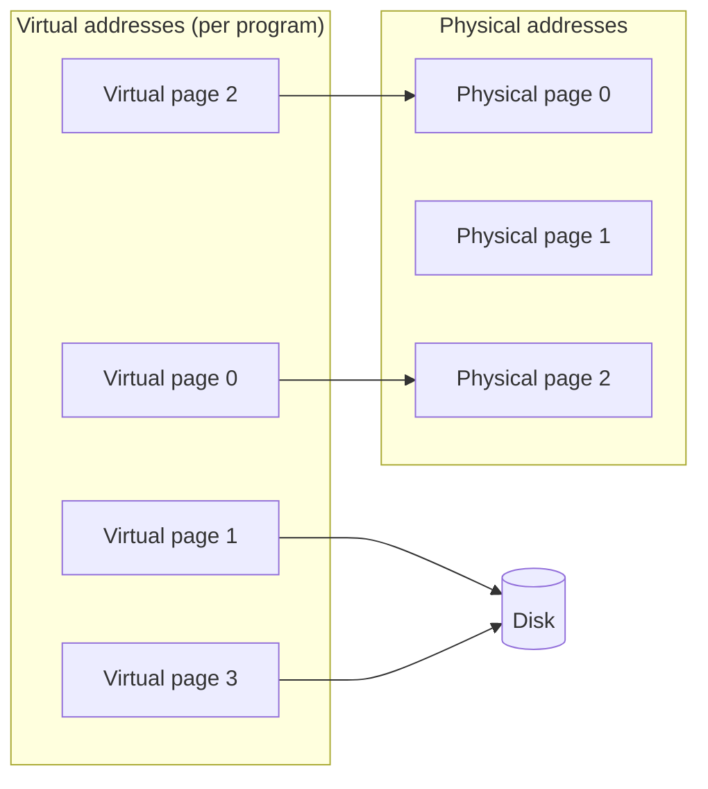
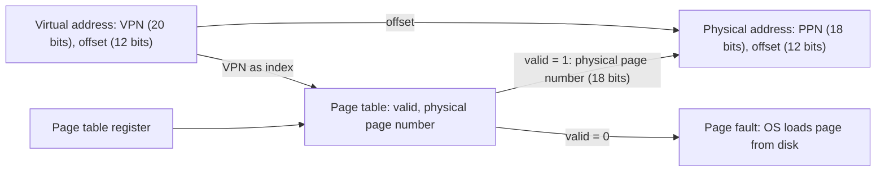
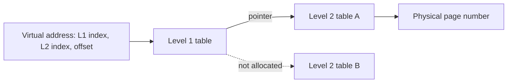

# بخش ۶، جلسه‌ی ۷ از ۱۲: حافظه‌ی مجازی

این جلسه بخشی از **بخش ۶: سلسله‌مراتب حافظه** است. زمان مطالعه: حدود نیم ساعت.

**فهرست این جلسه:**

- ۱. چرا حافظه‌ی مجازی
- ۲. اصطلاحات
- ۳. ترجمه‌ی آدرس
- ۴. طراحی برای کم کردن خطای صفحه
- ۵. جدول صفحه
- ۶. اندازه‌ی جدول صفحه و کم کردن آن
- ۷. خطای صفحه و فضای مبادله
- ۸. نوشتن و بیت کثیف
- ۹. حفاظت
- ۱۰. تمرین‌ها

---

## ۱. چرا حافظه‌ی مجازی

اسلاید درس می‌گوید: حافظه‌ی اصلی می‌تواند مثل یک **کش برای حافظه‌ی ثانویه** (دیسک یا فلش) رفتار کند. به این روش **حافظه‌ی مجازی (Virtual memory)** می‌گوییم. کتاب COD دو انگیزه‌ی اصلی می‌آورد:

- **اشتراک امن حافظه بین برنامه‌ها:** چند برنامه همزمان در حافظه‌اند. هر برنامه باید فکر کند کل فضای آدرس مال خودش است و نتواند حافظه‌ی برنامه‌ی دیگر را بخواند یا خراب کند. حافظه‌ی مجازی هر برنامه را در **فضای آدرس خودش** اجرا می‌کند و از برنامه‌های دیگر **حفاظت** می‌کند.
- **برنامه‌های بزرگ‌تر از حافظه‌ی فیزیکی:** قبلاً برنامه‌نویس باید برنامه‌اش را خودش به قطعه‌هایی به نام **روکش (Overlay)** تقسیم می‌کرد و آن‌ها را در زمان لازم بارگذاری می‌کرد. حافظه‌ی مجازی این کار را خودکار می‌کند.

اسلاید اندازه‌ها را این‌طور مقایسه می‌کند:

- **فضای آدرس مجازی:** که ISA تعیین می‌کند، مثلاً ۲ به توان ۳۲ یا ۲ به توان ۶۴ بایت.
- **معمولاً:** حافظه‌ی اصلی کوچک‌تر از دیسک و دیسک کوچک‌تر از فضای آدرس مجازی است.
- **برنامه می‌تواند وانمود کند** که حافظه‌ای به اندازه‌ی دیسک دارد. جدول صفحه آدرس مجازی را به‌طور نامرئی به آدرس فیزیکی تبدیل می‌کند. اگر داده در حافظه‌ی اصلی نباشد، از سیستم‌عامل می‌خواهد آن را از دیسک بیاورد.

یک مزیت دیگر: **جابه‌جاپذیری (Relocation)**. برنامه می‌تواند در هر جای حافظه‌ی فیزیکی بارگذاری شود و لازم نیست بلوک پیوسته‌ای از حافظه پیدا شود.

## ۲. اصطلاحات

مفاهیم حافظه‌ی مجازی همان مفاهیم کش‌اند، ولی به دلایل تاریخی اسم‌های دیگری دارند:

| در کش | در حافظه‌ی مجازی |
|---|---|
| بلوک | صفحه (Page) |
| عدم اصابت | خطای صفحه (Page fault) |
| آدرس | آدرس مجازی (Virtual address) |
| آدرس در سطح پایین | آدرس فیزیکی (Physical address) |
| پیدا کردن بلوک | ترجمه‌ی آدرس (Address translation) یا نگاشت آدرس (Address mapping) |

اسلاید درس: حافظه‌ی مجازی در بلوک‌هایی با اندازه‌ی ثابت (توانی از دو، معمولاً دست‌کم ۴ کیلوبایت) به نام **صفحه** سازمان‌دهی می‌شود. حافظه‌ی فیزیکی هم مجموعه‌ای از صفحه‌های هم‌اندازه دیده می‌شود. واحد انتقال بین دیسک و حافظه‌ی فیزیکی، یک صفحه است.



## ۳. ترجمه‌ی آدرس

آدرس مجازی دو بخش دارد:

- **شماره‌ی صفحه‌ی مجازی (Virtual page number یا VPN):** بیت‌های بالا.
- **آفست صفحه (Page offset):** بیت‌های پایین که جای بایت در صفحه را نشان می‌دهد.

ترجمه فقط شماره‌ی صفحه را عوض می‌کند. آفست بدون تغییر می‌ماند:

```math
\text{Physical address} = \text{PhysicalPageNumber}(\text{VPN}) \;\Vert\; \text{Page offset}
```

مثال کتاب: صفحه‌ی ۴ کیلوبایتی، فضای آدرس مجازی ۴ گیگابایت (۳۲ بیت) و حافظه‌ی فیزیکی ۱ گیگابایت (۳۰ بیت):

| بخش | تعداد بیت |
|---|---|
| آفست صفحه | 12 (چون 2 به توان 12 برابر 4096 است) |
| شماره‌ی صفحه‌ی مجازی | 32 − 12 = 20 |
| شماره‌ی صفحه‌ی فیزیکی | 30 − 12 = 18 |

پس 2 به توان 20 صفحه‌ی مجازی و 2 به توان 18 صفحه‌ی فیزیکی داریم. حافظه‌ی مجازی چهار برابر حافظه‌ی فیزیکی است.

## ۴. طراحی برای کم کردن خطای صفحه

جریمه‌ی خطای صفحه **بسیار** بزرگ است: میلیون‌ها سیکل برای دسترسی به دیسک (یا صدها هزار سیکل برای فلش). این واقعیت همه‌ی تصمیم‌های طراحی را شکل می‌دهد. اسلاید و کتاب:

- **صفحه‌های بزرگ:** تا یک سفر به دیسک ارزش زیادی داشته باشد. صفحه‌های ۴ تا ۱۶ کیلوبایتی رایج‌اند و سیستم‌های جدید صفحه‌های ۲ مگابایتی و ۱ گیگابایتی (Huge pages) هم پشتیبانی می‌کنند. اسلاید حتی ۳۲ یا ۶۴ کیلوبایت را مثال می‌زند.
- **کاهش خطای صفحه بسیار مهم است.** پس قرار دادن صفحه **تمام‌انجمنی** است: هر صفحه‌ی مجازی می‌تواند در هر صفحه‌ی فیزیکی قرار گیرد. این نتیجه‌ی طبیعی وجود جدول صفحه است.
- **جایگزینی هوشمند:** سیستم‌عامل با الگوریتم‌های هوشمند، مثل تقریب LRU، صفحه‌ی بیرون‌رونده را انتخاب می‌کند.
- **رسیدگی در نرم‌افزار:** خطای صفحه توسط سیستم‌عامل (نرم‌افزار) رسیدگی می‌شود، نه سخت‌افزار. سربار نرم‌افزار در برابر زمان دیسک ناچیز است.
- **همیشه نوشتن با تأخیر:** نوشتن مستقیم در دیسک خیلی گران است (جلسه‌ی ۶-۳).

### تقریب LRU با بیت استفاده

اسلاید می‌گوید LRU دقیق برای همه‌ی صفحه‌ها خیلی گران است. پس هر صفحه یک **بیت استفاده (Use bit)** یا **بیت ارجاع (Reference bit)** دارد که هر بار دسترسی به صفحه، سخت‌افزار آن را یک می‌کند. سیستم‌عامل به‌طور دوره‌ای همه‌ی این بیت‌ها را صفر می‌کند. پس صفحه‌هایی که در یک بازه‌ی زمانی استفاده شده‌اند، معلوم‌اند و صفحه‌ای که بیتش صفر است برای جایگزینی انتخاب می‌شود.

## ۵. جدول صفحه

برای پیدا کردن صفحه‌ی فیزیکی هر صفحه‌ی مجازی، از یک **جدول صفحه (Page table)** استفاده می‌کنیم که در حافظه‌ی اصلی قرار دارد:

- **اندیس با شماره‌ی صفحه‌ی مجازی:** جدول یک آرایه است که خانه‌ی i آن مال صفحه‌ی مجازی i است.
- **هر خانه (Page table entry یا PTE):** شماره‌ی صفحه‌ی فیزیکی، یک **بیت معتبر** (آیا صفحه در حافظه است) و بیت‌های دیگر مثل بیت استفاده، بیت کثیف و بیت‌های حفاظت.
- **ثبات جدول صفحه (Page table register):** یک ثبات سخت‌افزاری که به ابتدای جدول صفحه‌ی برنامه‌ی فعلی اشاره می‌کند.
- **یک جدول برای هر برنامه:** هر پردازه جدول صفحه‌ی خودش را دارد. هنگام تعویض پردازه، سیستم‌عامل فقط ثبات جدول صفحه را عوض می‌کند.



برخلاف کش، **برچسب لازم نیست**. چون جدول برای **هر** صفحه‌ی مجازی یک خانه دارد و با VPN اندیس‌گذاری می‌شود، جدول خودش تمام‌انجمنی است. «حالت» یک برنامه در حافظه‌ی مجازی شامل جدول صفحه، PC و ثبات‌هاست.

## ۶. اندازه‌ی جدول صفحه و کم کردن آن

### مثال اسلاید

فضای آدرس مجازی ۳۲ بیتی، صفحه‌ی ۴ کیلوبایتی و هر خانه‌ی جدول ۴ بایت. اگر بخواهیم به کل فضای مجازی دسترسی داشته باشیم، جدول صفحه چقدر است؟

```math
\text{Number of entries} = \frac{2^{32}}{2^{12}} = 2^{20}
```

```math
\text{Page table size} = 2^{20} \times 4 \text{ bytes} = 4 \text{ MB}
```

اسلاید می‌گوید این خیلی بزرگ است، و تازه برای **هر** برنامه. با صد برنامه، ۴۰۰ مگابایت فقط برای جدول‌های صفحه. با آدرس ۶۴ بیتی، این روش اصلاً ممکن نیست.

### روش‌های کاهش اندازه

کتاب و اسلاید چند روش را نام می‌برند:

- **ثبات حد (Limit register):** جدول فقط تا جایی که برنامه استفاده می‌کند بزرگ شود. اگر VPN از حد بیشتر بود، جدول گسترش می‌یابد.
- **دو قطعه:** جدول به دو بخش تقسیم شود: یکی که از پایین به بالا رشد می‌کند (برای heap) و یکی از بالا به پایین (برای پشته). این با چیدمان حافظه‌ی جلسه‌ی ۲-۶ جور است.
- **جدول صفحه‌ی وارونه (Inverted page table):** به جای یک خانه برای هر صفحه‌ی مجازی، یک خانه برای هر صفحه‌ی **فیزیکی**. با یک تابع درهم‌ساز (Hash) جست‌وجو می‌شود. اندازه‌اش به حافظه‌ی فیزیکی بستگی دارد، نه مجازی.
- **جدول صفحه‌ی چندسطحی (Multilevel page table):** جدول به شکل درخت سازمان‌دهی می‌شود. سطح اول به جدول‌های سطح دوم اشاره می‌کند و فقط جدول‌های سطح دومی که واقعاً لازم‌اند وجود دارند. x86-64 چهار یا پنج سطح دارد. ARMv8 هم چندسطحی است.
- **صفحه‌بندی خود جدول صفحه:** جدول صفحه خودش در حافظه‌ی مجازی قرار گیرد.



## ۷. خطای صفحه و فضای مبادله

وقتی بیت معتبر صفر است، **خطای صفحه** رخ می‌دهد و کنترل به سیستم‌عامل منتقل می‌شود (یک استثنا، جلسه‌ی ۵-۸). سیستم‌عامل باید:

1. صفحه را روی دیسک پیدا کند.
2. یک صفحه‌ی فیزیکی برای آن انتخاب کند. اگر جای خالی نیست، یک صفحه را بیرون کند (اگر کثیف بود، اول در دیسک بنویسد).
3. صفحه را از دیسک بخواند. در این مدت، معمولاً پردازه‌ی دیگری اجرا می‌شود.
4. جدول صفحه را به‌روز کند.
5. دستوری را که خطا داشت **از اول** اجرا کند.

اسلاید درس: یک ساختار داده، جزو جدول صفحه یا جدا از آن، ثبت می‌کند که هر صفحه‌ی مجازی کجای دیسک است. سیستم‌عامل معمولاً هنگام ساختن پردازه، فضایی روی دیسک برای همه‌ی صفحه‌های آن رزرو می‌کند که به آن **فضای مبادله (Swap space)** می‌گوییم.

## ۸. نوشتن و بیت کثیف

همان‌طور که گفتیم، حافظه‌ی مجازی همیشه از **نوشتن با تأخیر** استفاده می‌کند. هر خانه‌ی جدول صفحه یک **بیت کثیف** دارد که هنگام اولین نوشتن در صفحه، سخت‌افزار آن را یک می‌کند. هنگام جایگزینی:

- **صفحه‌ی کثیف:** باید در دیسک نوشته شود.
- **صفحه‌ی تمیز:** فقط کنار گذاشته می‌شود، چون نسخه‌ی دیسک هنوز درست است.

## ۹. حفاظت

حافظه‌ی مجازی اجازه می‌دهد چند پردازه حافظه را بدون آسیب به همدیگر شریک شوند. ولی این حفاظت فقط وقتی کار می‌کند که **خود جدول‌های صفحه** حفاظت شده باشند. کتاب COD می‌گوید سخت‌افزار باید دست‌کم سه چیز داشته باشد:

- **دو حالت اجرا:** **حالت کاربر (User mode)** و **حالت هسته (Kernel mode)** یا **ناظر (Supervisor)**. فقط سیستم‌عامل در حالت هسته اجرا می‌شود.
- **ثبات‌های خواندنی ولی نه نوشتنی:** بخشی از وضعیت پردازنده، مثل بیت حالت، ثبات جدول صفحه و خود TLB، که برنامه‌ی کاربر می‌تواند بخواند ولی نمی‌تواند بنویسد.
- **سازوکار جابه‌جایی بین حالت‌ها:** از حالت کاربر به هسته با یک **فراخوانی سیستم (System call)**، مثل دستور `syscall` در MIPS که یک استثنا ایجاد می‌کند. و برگشت با دستور ویژه‌ای مثل `eret` (بازگشت از استثنا) در MIPS.

جدول‌های صفحه در فضای آدرس سیستم‌عامل قرار دارند. پس هیچ برنامه‌ای نمی‌تواند جدول صفحه‌ی خودش را عوض کند. اگر دو پردازه بخواهند حافظه را شریک شوند، سیستم‌عامل خانه‌های جدول صفحه‌ی هر دو را طوری تنظیم می‌کند که به یک صفحه‌ی فیزیکی اشاره کنند. بیت‌های حفاظت می‌توانند دسترسی را فقط خواندنی کنند.

## ۱۰. تمرین‌ها

<details>
<summary>تمرین ۱: تقسیم آدرس مجازی</summary>

**صورت:** سیستمی با آدرس مجازی ۴۸ بیتی، صفحه‌ی ۱۶ کیلوبایتی و حافظه‌ی فیزیکی ۶۴ گیگابایتی. تعداد بیت‌های VPN، آفست و PPN چقدر است؟ جدول صفحه‌ی تک‌سطحی با خانه‌های ۸ بایتی چقدر است؟

**جواب:** آفست: لگاریتم 16K یعنی ۱۴ بیت. VPN: 48 − 14 = 34 بیت. حافظه‌ی فیزیکی 64 گیگابایت یعنی ۳۶ بیت آدرس، پس PPN برابر 36 − 14 = 22 بیت. جدول تک‌سطحی: 2 به توان 34 خانه × 8 بایت = 2 به توان 37 بایت یعنی ۱۲۸ گیگابایت. دو برابر کل حافظه‌ی فیزیکی! پس جدول چندسطحی ضروری است.
</details>

<details>
<summary>تمرین ۲: هزینه‌ی خطای صفحه</summary>

**صورت:** دسترسی به حافظه ۱۰۰ نانوثانیه و رسیدگی به خطای صفحه ۱۰ میلی‌ثانیه است. اگر بخواهیم زمان دسترسی مؤثر حداکثر ۱۰٪ بیشتر از ۱۰۰ نانوثانیه باشد، نرخ خطای صفحه حداکثر چقدر می‌تواند باشد؟

**جواب:**

```math
100 + p \times 10^{7} \le 110 \quad\Rightarrow\quad p \le 10^{-6}
```

یعنی حداکثر یک خطای صفحه در هر میلیون دسترسی. این نشان می‌دهد چرا کاهش خطای صفحه این‌قدر مهم است.
</details>

<details>
<summary>تمرین ۳: پرسش مفهومی</summary>

**صورت:** چرا در کش از نگاشت مستقیم یا انجمنی محدود استفاده می‌کنیم، ولی در حافظه‌ی مجازی قرار دادن تمام‌انجمنی است؟

**جواب:** در کش، زمان اصابت خیلی مهم است و جست‌وجوی همه‌ی خانه‌ها در سخت‌افزار گران و کند است. در حافظه‌ی مجازی، جریمه‌ی خطای صفحه میلیون‌ها سیکل است. پس ارزش دارد با قرار دادن تمام‌انجمنی و جایگزینی هوشمند، حتی چند خطا کمتر داشته باشیم. جست‌وجو هم با جدول صفحه (یک دسترسی اندیس‌گذاری‌شده، نه جست‌وجو) و TLB (جلسه‌ی بعد) سریع می‌شود.
</details>

---

جلسه‌ی قبلی: [حل سؤال‌های امتحانی کش و دسته‌بندی عدم اصابت‌ها](6-6-cache-exam-problems-and-3c.md)  
جلسه‌ی بعدی: [بافر ترجمه‌ی آدرس TLB](6-8-tlb.md)
