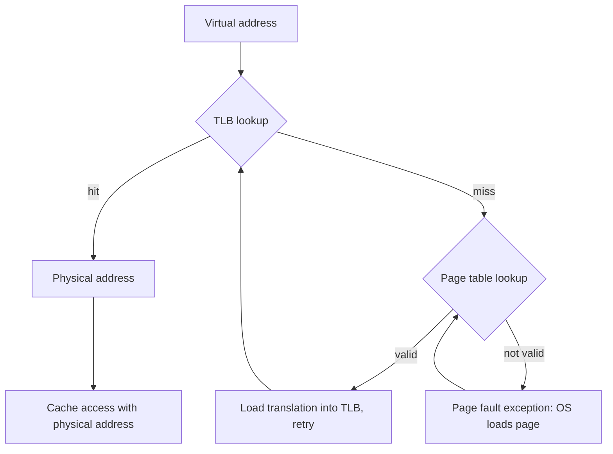
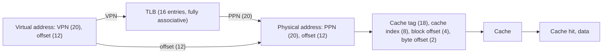

# بخش ۶، جلسه‌ی ۸ از ۱۲: بافر ترجمه‌ی آدرس TLB

این جلسه بخشی از **بخش ۶: سلسله‌مراتب حافظه** است. زمان مطالعه: حدود نیم ساعت.

**فهرست این جلسه:**

- ۱. مشکل: هر دسترسی دو دسترسی می‌شود
- ۲. بافر ترجمه‌ی آدرس
- ۳. پارامترهای معمول TLB
- ۴. یکپارچگی TLB و کش
- ۵. ترکیب‌های ممکن اصابت و عدم اصابت
- ۶. رسیدگی به عدم اصابت TLB در MIPS
- ۷. کش با آدرس مجازی
- ۸. نمونه‌های واقعی
- ۹. پاسخ کوتاه امتحانی
- ۱۰. تمرین‌ها

---

## ۱. مشکل: هر دسترسی دو دسترسی می‌شود

جدول صفحه در حافظه‌ی اصلی است. پس اگر برای هر دسترسی به حافظه، اول جدول صفحه را بخوانیم، **هر** دسترسی دو دسترسی به حافظه می‌شود: یکی برای گرفتن آدرس فیزیکی و یکی برای خود داده. یعنی دو برابر کندتر. با جدول چندسطحی، حتی بدتر.

راه‌حل باز هم **محلی بودن** است. اگر به صفحه‌ای دسترسی داشتیم، احتمالاً به‌زودی دوباره به همان صفحه دسترسی خواهیم داشت (زمانی) و بقیه‌ی کلمه‌های همان صفحه را هم می‌خواهیم (مکانی). پس ترجمه‌های اخیر را در یک کش نگه داریم.

## ۲. بافر ترجمه‌ی آدرس

**بافر ترجمه‌ی آدرس (Translation-lookaside buffer یا TLB)** یک کش کوچک برای ترجمه‌های آدرس است. اسلاید درس: در هر دسترسی به صفحه، ابتدا شماره‌ی صفحه‌ی مجازی در TLB جست‌وجو می‌شود. اگر در TLB نبود، جدول صفحه جست‌وجو می‌شود. اگر آنجا هم نبود (بیت معتبر صفر)، یک **خطای صفحه‌ی واقعی** است.

هر خانه‌ی TLB:

| فیلد | کاربرد |
|---|---|
| برچسب | بخشی از شماره‌ی صفحه‌ی مجازی |
| شماره‌ی صفحه‌ی فیزیکی | نتیجه‌ی ترجمه |
| بیت معتبر | آیا این خانه معتبر است |
| بیت کثیف | آیا صفحه نوشته شده |
| بیت ارجاع | آیا صفحه اخیراً استفاده شده |
| بیت‌های حفاظت | مجوزهای خواندن، نوشتن و اجرا |



دو نکته‌ی مهم:

- **بیت‌های کثیف و ارجاع:** وقتی در TLB تغییر می‌کنند، باید در نهایت به جدول صفحه برگردانده شوند. معمولاً هنگام جایگزینی خانه‌ی TLB این کار انجام می‌شود. TLB معمولاً **نوشتن با تأخیر** برای این بیت‌ها دارد.
- **عدم اصابت TLB با خطای صفحه فرق دارد:** عدم اصابت TLB یعنی ترجمه در TLB نیست، ولی صفحه ممکن است در حافظه باشد. این حالت خیلی رایج‌تر است و با چند ده سیکل حل می‌شود.

## ۳. پارامترهای معمول TLB

جدول کتاب COD:

| پارامتر | مقدار معمول |
|---|---|
| اندازه | 16 تا 512 خانه |
| اندازه‌ی بلوک | 1 تا 2 خانه‌ی جدول صفحه (هر کدام 4 تا 8 بایت) |
| زمان اصابت | 0.5 تا 1 سیکل |
| جریمه‌ی عدم اصابت | 10 تا 100 سیکل |
| نرخ عدم اصابت | 0.01% تا 1% |

انجمنی بودن TLB‌ها: TLBهای کوچک معمولاً **تمام‌انجمنی** هستند تا نرخ عدم اصابت کم باشد. TLBهای بزرگ‌تر **انجمنی مجموعه‌ای** هستند. جایگزینی در TLBهای تمام‌انجمنی معمولاً **تصادفی** است، چون LRU برای جست‌وجوی موازی گران است.

پردازنده‌های امروزی معمولاً دو سطح TLB دارند: یک TLB سطح ۱ کوچک و سریع (جدا برای دستور و داده) و یک TLB سطح ۲ بزرگ‌تر و مشترک.

## ۴. یکپارچگی TLB و کش

مثال کتاب: پردازنده‌ی **Intrinsity FastMATH** (بر پایه‌ی MIPS) با صفحه‌های ۴ کیلوبایتی و آدرس ۳۲ بیتی:

- **آدرس مجازی:** ۲۰ بیت شماره‌ی صفحه‌ی مجازی و ۱۲ بیت آفست.
- **بافر TLB:** ۱۶ خانه، تمام‌انجمنی، مشترک بین دستور و داده. هر خانه ۶۴ بیت: ۲۰ بیت برچسب، ۲۰ بیت شماره‌ی صفحه‌ی فیزیکی، بیت معتبر، بیت کثیف و بیت‌های دیگر.
- **کش:** با **آدرس فیزیکی** اندیس‌گذاری و برچسب‌گذاری می‌شود.



ترتیب کار: ابتدا TLB ترجمه را انجام می‌دهد، بعد آدرس فیزیکی برای دسترسی به کش استفاده می‌شود. در این طراحی **ترجمه روی مسیر بحرانی** است: زمان دسترسی به کش، زمان TLB به‌علاوه‌ی زمان کش است. برای کم کردن این، طراحی‌های دیگری وجود دارند که در بخش ۷ همین جلسه می‌بینیم.

### روند خواندن و نوشتن

1. **جست‌وجوی TLB.** اگر عدم اصابت بود، استثنای عدم اصابت TLB.
2. **اگر اصابت TLB:** آدرس فیزیکی ساخته می‌شود.
3. **برای نوشتن:** اگر بیت مجوز نوشتن صفر باشد، استثنای حفاظت. در غیر این صورت بیت کثیف در TLB یک می‌شود.
4. **دسترسی به کش با آدرس فیزیکی.** اگر عدم اصابت کش بود، بلوک از حافظه آورده می‌شود.

## ۵. ترکیب‌های ممکن اصابت و عدم اصابت

در سیستمی با TLB، جدول صفحه و کش، سه رویداد داریم. جدول کتاب COD هشت ترکیب را بررسی می‌کند:

| بافر TLB | جدول صفحه | کش | ممکن است؟ | توضیح |
|---|---|---|---|---|
| اصابت | اصابت | اصابت | بله | حالت ایده‌آل؛ جدول صفحه اصلاً بررسی نمی‌شود |
| اصابت | اصابت | عدم اصابت | بله | جدول صفحه در عمل بررسی نمی‌شود، ولی داده در کش نیست |
| عدم اصابت | اصابت | اصابت | بله | ترجمه از جدول صفحه می‌آید؛ بعد از تکرار، داده در کش پیدا می‌شود |
| عدم اصابت | اصابت | عدم اصابت | بله | ترجمه از جدول صفحه؛ بعد از تکرار، داده در کش نیست |
| عدم اصابت | عدم اصابت | عدم اصابت | بله | خطای صفحه؛ بعد از تکرار، داده حتماً در کش نیست |
| اصابت | عدم اصابت | عدم اصابت | خیر | اگر صفحه در حافظه نیست، ترجمه‌اش نمی‌تواند در TLB باشد |
| اصابت | عدم اصابت | اصابت | خیر | همان دلیل |
| عدم اصابت | عدم اصابت | اصابت | خیر | اگر صفحه در حافظه نیست، داده‌اش نمی‌تواند در کش باشد |

سه حالت آخر ناممکن‌اند، چون سیستم‌عامل وقتی صفحه‌ای را از حافظه بیرون می‌کند، ترجمه‌اش را از TLB و داده‌هایش را از کش هم پاک می‌کند. این یک تضمین مهم سازگاری است.

## ۶. رسیدگی به عدم اصابت TLB در MIPS

در MIPS، عدم اصابت TLB **در نرم‌افزار** رسیدگی می‌شود. سخت‌افزار یک استثنا ایجاد می‌کند و سیستم‌عامل خانه‌ی جدول صفحه را می‌خواند و در TLB می‌نویسد. کد کامل رسیدگی از کتاب COD فقط پنج دستور است:

```asm
TLBmiss:
        mfc0  $k1, Context     # copy address of PTE into temp $k1
        lw    $k1, 0($k1)      # put PTE into temp $k1
        mtc0  $k1, EntryLo     # put PTE into special register EntryLo
        tlbwr                  # put EntryLo into TLB entry at Random
        eret                   # return from TLB miss exception
```

- **ثبات Context:** سخت‌افزار در آن آدرس خانه‌ی جدول صفحه‌ی مربوط به آدرس مجازی خطادار را می‌سازد (ثبات جدول صفحه به‌علاوه‌ی VPN ضرب در اندازه‌ی خانه).
- **دستور `tlbwr`:** خانه را در یک جای **تصادفی** از TLB می‌نویسد. ثبات Random جای آن را انتخاب می‌کند.
- **دستور `eret`:** از استثنا برمی‌گردد و دستور خطادار دوباره اجرا می‌شود. این بار ترجمه در TLB هست.

کتاب می‌گوید این کد حدود ۱۲ سیکل طول می‌کشد. اگر خود خانه‌ی جدول صفحه نامعتبر باشد، دستور `lw` در کد بالا یک خطای صفحه ایجاد می‌کند که توسط روال دیگری رسیدگی می‌شود.

در مقابل، x86 و ARM عدم اصابت TLB را **در سخت‌افزار** رسیدگی می‌کنند: یک واحد **پیمایشگر جدول صفحه (Page table walker)** خودش جدول را می‌خواند. RISC-V هر دو را مجاز می‌داند.

### خطای صفحه در خط لوله

اگر یک `lw` در مرحله‌ی MEM خطای صفحه داشته باشد، جلسه‌ی ۵-۸ را به یاد بیاور: دستور خطادار و دستورات بعدی پاک می‌شوند، آدرس آن در EPC ذخیره می‌شود و بعد از رسیدگی، `lw` **از اول** اجرا می‌شود. این فقط با **استثنای دقیق** ممکن است. دستوری که می‌تواند بعد از خطا دوباره اجرا شود، **قابل شروع دوباره (Restartable)** نام دارد.

## ۷. کش با آدرس مجازی

در طراحی FastMATH، کش با آدرس فیزیکی کار می‌کند و ترجمه قبل از آن انجام می‌شود. دو گزینه‌ی دیگر:

### کش با آدرس مجازی کامل

کش با **آدرس مجازی** اندیس‌گذاری و برچسب‌گذاری شود. پس در اصابت کش، اصلاً به TLB نیازی نیست. مشکلات:

- **مستعارسازی (Aliasing):** دو آدرس مجازی مختلف (مثلاً در دو پردازه که یک صفحه را شریک‌اند) به یک آدرس فیزیکی اشاره کنند. هر کدام نسخه‌ی جدای خودش را در کش خواهد داشت. اگر یکی بنویسد، دیگری مقدار قدیمی را می‌بیند.
- **تعویض پردازه:** آدرس مجازی یکسان در دو پردازه به جاهای مختلف اشاره می‌کند. پس هنگام تعویض پردازه باید کش را پاک کرد، یا شناسه‌ی پردازه (Process ID یا ASID) را به برچسب اضافه کرد.

### اندیس مجازی، برچسب فیزیکی

راه‌حل رایج امروزی: **اندیس‌گذاری با آدرس مجازی و برچسب‌گذاری با آدرس فیزیکی (Virtually indexed, physically tagged یا VIPT)**.

- **ایده:** بیت‌های آفست صفحه در ترجمه تغییر نمی‌کنند. اگر شاخص کش و آفست بلوک **کاملاً داخل آفست صفحه** باشند، می‌توان کش را **همزمان** با ترجمه‌ی TLB اندیس‌گذاری کرد. وقتی TLB آدرس فیزیکی را داد، برچسب فیزیکی مقایسه می‌شود.
- **مزیت:** زمان TLB از مسیر بحرانی حذف می‌شود و مشکل مستعارسازی هم پیش نمی‌آید.
- **محدودیت:** اندازه‌ی هر راه کش نباید بیشتر از اندازه‌ی صفحه باشد:

```math
\frac{\text{Cache size}}{\text{Associativity}} \le \text{Page size}
```

مثال: با صفحه‌ی ۴ کیلوبایتی، یک کش ۳۲ کیلوبایتی باید دست‌کم هشت‌راهه باشد تا هر راه ۴ کیلوبایت شود. این یکی از دلیل‌هایی است که کش‌های داده‌ی سطح ۱ اینتل ۳۲ کیلوبایتی و هشت‌راهه بوده‌اند. CAQA این را جزو شش بهینه‌سازی پایه‌ی کش می‌آورد: **اجتناب از ترجمه‌ی آدرس هنگام اندیس‌گذاری کش**.

## ۸. نمونه‌های واقعی

اسلاید درس دو پردازنده‌ی قدیمی را مقایسه می‌کند:

| ویژگی | پردازنده‌ی Intel Pentium Pro | پردازنده‌ی PowerPC 604 |
|---|---|---|
| آدرس مجازی | 32 بیت | 52 بیت |
| آدرس فیزیکی | 32 بیت | 32 بیت |
| اندازه‌ی صفحه | 4 KB و 4 MB | 4 KB، قابل انتخاب، و 256 MB |
| سازمان TLB | جدا برای دستور و داده، هر دو چهارراهه | جدا برای دستور و داده، هر دو دوراهه |
| جایگزینی TLB | شبه‌LRU | LRU |
| اندازه‌ی TLB | دستور 32 خانه، داده 64 خانه | دستور 128 خانه، داده 128 خانه |
| رسیدگی به عدم اصابت TLB | سخت‌افزار | سخت‌افزار |
| کش | جدا، 8 KB هر کدام، چهارراهه | جدا، 16 KB هر کدام، چهارراهه |
| بلوک کش | 32 بایت | 32 بایت |
| سیاست نوشتن | نوشتن با تأخیر | نوشتن با تأخیر یا مستقیم |

## ۹. پاسخ کوتاه امتحانی

**صورت (امتحان ۹۵-۹۶):** TLB را معرفی کن.

**جواب نمونه (سه خط):** TLB یک کش کوچک و سریع (معمولاً تمام‌انجمنی یا با انجمنی بالا، ۱۶ تا ۵۱۲ خانه) برای ترجمه‌های آدرس مجازی به فیزیکی است که خانه‌های اخیراً استفاده‌شده‌ی جدول صفحه را نگه می‌دارد. بدون آن، هر دسترسی به حافظه یک دسترسی اضافه به جدول صفحه در حافظه لازم داشت. در عدم اصابت TLB، جدول صفحه با سخت‌افزار یا نرم‌افزار (در MIPS) خوانده می‌شود و اگر صفحه در حافظه نباشد، خطای صفحه رخ می‌دهد.

## ۱۰. تمرین‌ها

<details>
<summary>تمرین ۱: پوشش TLB</summary>

**صورت:** TLB با ۶۴ خانه و صفحه‌های ۴ کیلوبایتی. حداکثر چقدر حافظه را بدون عدم اصابت TLB می‌توان پوشش داد؟ با صفحه‌های ۲ مگابایتی چطور؟

**جواب:** پوشش TLB (TLB reach) برابر تعداد خانه‌ها ضرب در اندازه‌ی صفحه است: 64 × 4 KB = 256 KB. با صفحه‌های ۲ مگابایتی: 64 × 2 MB = 128 MB. این یکی از دلیل‌های پشتیبانی پردازنده‌های امروزی از **صفحه‌های بزرگ** برای برنامه‌هایی با حافظه‌ی زیاد، مثل پایگاه داده‌ها و یادگیری ماشین، است.
</details>

<details>
<summary>تمرین ۲: زمان دسترسی مؤثر</summary>

**صورت:** TLB نرخ اصابت ۹۸٪ و زمان ۱ نانوثانیه دارد. هر دسترسی به حافظه ۱۰۰ نانوثانیه است. جدول صفحه تک‌سطحی است. زمان دسترسی مؤثر (بدون کش داده) چقدر است؟

**جواب:** در اصابت TLB: 1 + 100 = 101 نانوثانیه. در عدم اصابت: 1 + 100 (جدول صفحه) + 100 (داده) = 201 نانوثانیه.

```math
T = 0.98 \times 101 + 0.02 \times 201 = 98.98 + 4.02 = 103 \text{ ns}
```

بدون TLB، 200 نانوثانیه بود.
</details>

<details>
<summary>تمرین ۳: محدودیت VIPT</summary>

**صورت:** صفحه‌ها ۸ کیلوبایتی‌اند. می‌خواهیم کش داده‌ی ۶۴ کیلوبایتی با روش VIPT بدون مستعارسازی بسازیم. حداقل انجمنی بودن چقدر باشد؟

**جواب:** هر راه باید حداکثر ۸ کیلوبایت باشد، پس انجمنی بودن دست‌کم 64 / 8 = 8.
</details>

---

جلسه‌ی قبلی: [حافظه‌ی مجازی](6-7-virtual-memory.md)  
جلسه‌ی بعدی: [چارچوب مشترک سلسله‌مراتب حافظه](6-9-common-framework.md)
