# بخش ۶، جلسه‌ی ۹ از ۱۲: چارچوب مشترک سلسله‌مراتب حافظه

این جلسه بخشی از **بخش ۶: سلسله‌مراتب حافظه** است. زمان مطالعه: حدود نیم ساعت.

**فهرست این جلسه:**

- ۱. چهار سؤال برای هر سطح
- ۲. سؤال ۱: بلوک کجا قرار می‌گیرد
- ۳. سؤال ۲: بلوک چطور پیدا می‌شود
- ۴. سؤال ۳: کدام بلوک جایگزین می‌شود
- ۵. سؤال ۴: نوشتن چطور انجام می‌شود
- ۶. مصالحه‌های طراحی با مدل سه C
- ۷. کنترل کش با ماشین حالت
- ۸. حافظه‌ی قابل اعتماد
- ۹. ماشین مجازی
- ۱۰. نگاهی به انسجام کش
- ۱۱. تمرین‌ها

---

## ۱. چهار سؤال برای هر سطح

کش، TLB و حافظه‌ی مجازی اسم‌های مختلف دارند، ولی همه یک ایده‌اند: یک حافظه‌ی کوچک و سریع که از محلی بودن برای پنهان کردن یک حافظه‌ی بزرگ و کند استفاده می‌کند. کتاب COD و CAQA هر سطح را با **چهار سؤال** توصیف می‌کنند:

| سؤال | نام انگلیسی |
|---|---|
| بلوک کجا می‌تواند قرار گیرد؟ | Block placement |
| بلوک چطور پیدا می‌شود؟ | Block identification |
| در عدم اصابت، کدام بلوک جایگزین شود؟ | Block replacement |
| نوشتن چطور انجام می‌شود؟ | Write strategy |

## ۲. سؤال ۱: بلوک کجا قرار می‌گیرد

طیف کامل از نگاشت مستقیم تا تمام‌انجمنی. هر نقطه از این طیف را با انجمنی مجموعه‌ای n راهه می‌توان توصیف کرد:

| روش | تعداد مجموعه | بلوک در هر مجموعه |
|---|---|---|
| نگاشت مستقیم | برابر تعداد بلوک‌ها | 1 |
| انجمنی مجموعه‌ای | تعداد بلوک‌ها تقسیم بر انجمنی بودن | بین 2 و تعداد بلوک‌ها |
| تمام‌انجمنی | 1 | برابر تعداد بلوک‌ها |

مزیت انجمنی بیشتر: نرخ عدم اصابت کمتر (به‌خاطر کاهش تداخل). عیب: هزینه‌ی سخت‌افزار و زمان اصابت بیشتر.

| سطح | روش معمول |
|---|---|
| کش سطح ۱ | انجمنی مجموعه‌ای با ۲ تا ۸ راه |
| کش سطح ۲ و ۳ | انجمنی مجموعه‌ای با ۸ تا ۱۶ راه یا بیشتر |
| واحد TLB | تمام‌انجمنی (کوچک) یا انجمنی مجموعه‌ای (بزرگ) |
| حافظه‌ی مجازی | تمام‌انجمنی |

## ۳. سؤال ۲: بلوک چطور پیدا می‌شود

| روش | چطور پیدا می‌شود | تعداد مقایسه |
|---|---|---|
| نگاشت مستقیم | با شاخص | 1 |
| انجمنی مجموعه‌ای | شاخص مجموعه را پیدا می‌کند و بعد برچسب همه‌ی خانه‌های مجموعه مقایسه می‌شود | n |
| تمام‌انجمنی، جست‌وجوی کامل | همه‌ی خانه‌ها مقایسه می‌شوند | همه‌ی خانه‌ها |
| تمام‌انجمنی، جدول جداگانه | با یک جدول جست‌وجو (مثل جدول صفحه) | 0 (ولی یک دسترسی اضافه) |

حافظه‌ی مجازی از روش آخر استفاده می‌کند: جدول صفحه. چرا؟ چون (۱) تمام‌انجمنی بودن برای کاهش خطای صفحه ارزش دارد، (۲) جست‌وجوی کامل با این تعداد صفحه ممکن نیست، و (۳) جدول صفحه اجازه می‌دهد سیستم‌عامل هر سیاست جایگزینی را پیاده کند.

## ۴. سؤال ۳: کدام بلوک جایگزین می‌شود

| سیاست | ویژگی | کاربرد |
|---|---|---|
| قدیمی‌ترین استفاده (LRU) | به محلی بودن زمانی تکیه می‌کند؛ پیاده‌سازی دقیقش با انجمنی زیاد گران است | کش‌های با انجمنی کم |
| تقریب LRU | با بیت‌های ارجاع | کش‌های با انجمنی متوسط و حافظه‌ی مجازی |
| تصادفی | ساده، با انجمنی بالا تقریباً به خوبی LRU | واحد TLB، کش‌های بزرگ |

کتاب COD می‌گوید در کش‌ها، تفاوت LRU و تصادفی با بزرگ شدن کش کم می‌شود. ولی در حافظه‌ی مجازی، چون هر خطای صفحه خیلی گران است، حتی بهبود کوچک در نرخ خطا ارزش دارد. پس همیشه یک تقریب از LRU استفاده می‌شود.

## ۵. سؤال ۴: نوشتن چطور انجام می‌شود

| سیاست | مزایا |
|---|---|
| نوشتن با تأخیر | چند نوشتن در یک بلوک فقط یک نوشتن در سطح پایین دارد؛ وقتی بلوک نوشته می‌شود، کل آن با یک انتقال پرپهنای‌باند فرستاده می‌شود |
| نوشتن مستقیم | عدم اصابت ساده‌تر و ارزان‌تر است، چون هیچ‌وقت لازم نیست بلوکی به سطح پایین برگردد؛ پیاده‌سازی ساده‌تر |

| سطح | سیاست معمول |
|---|---|
| کش سطح ۱ | هر دو، معمولاً با بافر نوشتن |
| کش سطح ۲ و ۳ | نوشتن با تأخیر |
| حافظه‌ی مجازی | همیشه نوشتن با تأخیر |

## ۶. مصالحه‌های طراحی با مدل سه C

مدل سه C جلسه‌ی ۶-۶ کمک می‌کند اثر هر تغییر طراحی را بفهمیم. جدول کتاب COD:

| تغییر طراحی | اثر بر نرخ عدم اصابت | اثر منفی احتمالی بر کارایی |
|---|---|---|
| افزایش اندازه‌ی کش | کاهش عدم اصابت ظرفیتی | ممکن است زمان دسترسی را زیاد کند |
| افزایش انجمنی بودن | کاهش عدم اصابت تداخلی | ممکن است زمان دسترسی را زیاد کند |
| افزایش اندازه‌ی بلوک | کاهش عدم اصابت اجباری (با محلی بودن مکانی) | جریمه‌ی عدم اصابت را زیاد می‌کند؛ بلوک خیلی بزرگ ممکن است نرخ عدم اصابت را هم زیاد کند |

کتاب می‌گوید چالش طراحی سلسله‌مراتب حافظه این است که هر تغییری که نرخ عدم اصابت را کم می‌کند، احتمالاً جنبه‌ی دیگری از کارایی را بدتر می‌کند. پس نتیجه همیشه یک مصالحه است.

## ۷. کنترل کش با ماشین حالت

کتاب COD (بخش ۵.۹) یک کنترل‌گر ساده برای کش طراحی می‌کند: نگاشت مستقیم، نوشتن با تأخیر، تخصیص هنگام نوشتن، بلوک‌های ۴ کلمه‌ای، کش ۱۶ کیلوبایتی. این کنترل‌گر یک ماشین حالت چهارحالتی است، مثل ماشین حالت پردازنده‌ی چندسیکلی در جلسه‌ی ۴-۸:

```mermaid
stateDiagram-v2
    Idle --> CompareTag: valid CPU request
    CompareTag --> Idle: cache hit (mark ready; set dirty on write)
    CompareTag --> Allocate: miss and old block is clean
    CompareTag --> WriteBack: miss and old block is dirty
    WriteBack --> WriteBack: memory not ready
    WriteBack --> Allocate: memory ready
    Allocate --> Allocate: memory not ready
    Allocate --> CompareTag: memory ready
```



- **حالت Idle:** منتظر درخواست پردازنده.
- **حالت Compare Tag:** برچسب را مقایسه می‌کند. اگر اصابت و معتبر بود، داده را می‌دهد یا می‌نویسد (و بیت کثیف را یک می‌کند) و به Idle برمی‌گردد.
- **حالت Write-Back:** بلوک کثیف قدیمی را در حافظه می‌نویسد و منتظر حافظه می‌ماند.
- **حالت Allocate:** بلوک جدید را از حافظه می‌خواند و منتظر می‌ماند. بعد به Compare Tag برمی‌گردد که این بار اصابت است.

کنترل‌گرهای واقعی خیلی پیچیده‌ترند: چند عدم اصابت همزمان، بافر نوشتن و انسجام کش را هم مدیریت می‌کنند.

## ۸. حافظه‌ی قابل اعتماد

کتاب COD در بخش ۵.۵ درباره‌ی **قابلیت اطمینان** حافظه صحبت می‌کند. در بخش ۱ معیارهای MTTF، MTTR و دسترس‌پذیری را دیدیم. برای حافظه‌ها، خطاهای نرم (مثلاً تغییر یک بیت به خاطر تشعشع) رایج‌اند. راه‌حل، **کدهای تصحیح خطا (ECC)** است:

- **بیت توازن (Parity):** یک بیت اضافه که تعداد یک‌ها را زوج یا فرد می‌کند. فقط تشخیص خطای یک‌بیتی، بدون تصحیح.
- **کد همینگ (Hamming code):** با بیت‌های توازن در جاهای توان دو، یک خطای یک‌بیتی را **تصحیح** می‌کند. به آن **SEC** (Single Error Correcting) می‌گوییم.
- **کد SEC/DED:** با یک بیت توازن اضافه روی کل، هم یک خطا را تصحیح و هم دو خطا را **تشخیص** می‌دهد. برای ۶۴ بیت داده، ۸ بیت اضافه لازم است. حافظه‌های سرور (ECC DRAM) از این استفاده می‌کنند.

تعداد بیت‌های توازن p برای d بیت داده در کد همینگ از این شرط به دست می‌آید:

```math
2^{p} \ge p + d + 1
```

برای d = 64، مقدار p برابر ۷ است. با یک بیت اضافه برای DED، ۸ بیت.

## ۹. ماشین مجازی

کتاب COD در بخش ۵.۶ **ماشین‌های مجازی (Virtual machines)** را معرفی می‌کند: نرم‌افزاری به نام **ناظر ماشین مجازی (Virtual machine monitor یا Hypervisor)** که چند سیستم‌عامل کامل را روی یک سخت‌افزار اجرا می‌کند. نمونه‌ها: VMware، Xen، KVM و VirtualBox.

ارتباط با حافظه: ناظر باید حافظه‌ی مجازی **سیستم‌عامل مهمان** را هم مجازی کند. یعنی دو سطح ترجمه داریم: آدرس مجازی مهمان به آدرس «فیزیکی» مهمان، و آن به آدرس فیزیکی واقعی. پردازنده‌های امروزی با **جدول‌های صفحه‌ی تودرتو (Nested page tables)**، مثل Intel EPT و AMD NPT، این کار را در سخت‌افزار انجام می‌دهند.

یک شرط برای مجازی‌سازی کارآمد: ISA باید طوری باشد که هر دستور حساسی که در حالت کاربر اجرا می‌شود، یک استثنا ایجاد کند تا ناظر بتواند آن را رسیدگی کند. x86 قدیمی چند دستور داشت که این شرط را نداشتند. این موضوع یکی از دام‌های جلسه‌ی ۶-۱۲ است.

## ۱۰. نگاهی به انسجام کش

در یک پردازنده‌ی چندهسته‌ای، هر هسته کش خودش را دارد. اگر دو هسته یک متغیر را در کش داشته باشند و یکی آن را تغییر دهد، دیگری ممکن است مقدار قدیمی را ببیند. به این **مشکل انسجام کش (Cache coherence problem)** می‌گوییم.

| زمان | رویداد | کش هسته‌ی A | کش هسته‌ی B | حافظه |
|---|---|---|---|---|
| زمان 0 | – | – | – | X = 0 |
| زمان 1 | هسته‌ی A مقدار X را می‌خواند | X = 0 | – | X = 0 |
| زمان 2 | هسته‌ی B مقدار X را می‌خواند | X = 0 | X = 0 | X = 0 |
| زمان 3 | هسته‌ی A مقدار ۱ را در X می‌نویسد (نوشتن مستقیم) | X = 1 | X = 0 | X = 1 |

حالا هسته‌ی B مقدار کهنه‌ی ۰ را دارد. راه‌حل رایج، پروتکل‌های **جاسوسی (Snooping)** است: هر کش گذرگاه را زیر نظر دارد و وقتی هسته‌ی دیگری می‌نویسد، نسخه‌ی خودش را **نامعتبر** می‌کند. پروتکل‌های MSI و MESI و نسخه‌ی مبتنی بر **دایرکتوری (Directory)** برای سیستم‌های بزرگ، موضوع **بخش ۱۰** هستند.

## ۱۱. تمرین‌ها

<details>
<summary>تمرین ۱: چهار سؤال برای TLB</summary>

**صورت:** چهار سؤال را برای یک TLB معمولی جواب بده.

**جواب:**

| سؤال | جواب برای TLB |
|---|---|
| قرار دادن | معمولاً تمام‌انجمنی یا انجمنی با تعداد راه زیاد |
| پیدا کردن | مقایسه‌ی موازی برچسب (VPN) با همه‌ی خانه‌ها |
| جایگزینی | تصادفی (در MIPS با ثبات Random) |
| نوشتن | بیت‌های کثیف و ارجاع با تأخیر به جدول صفحه برمی‌گردند |
</details>

<details>
<summary>تمرین ۲: کد همینگ</summary>

**صورت:** برای ۳۲ بیت داده، کد SEC/DED چند بیت اضافه لازم دارد؟

**جواب:** کوچک‌ترین p که 2 به توان p بزرگ‌تر یا مساوی p + 33 باشد: با p = 6، مقدار ۶۴ بزرگ‌تر از ۳۹ است. پس ۶ بیت برای SEC و یک بیت برای DED، یعنی ۷ بیت.
</details>

<details>
<summary>تمرین ۳: انتخاب طراحی</summary>

**صورت:** یک برنامه نرخ عدم اصابت بالایی دارد و بیشتر عدم اصابت‌هایش تداخلی‌اند. کدام تغییر بیشترین کمک را می‌کند و چه هزینه‌ای دارد؟

**جواب:** افزایش انجمنی بودن (یا اضافه کردن کش قربانی). هزینه: زمان اصابت بیشتر و سخت‌افزار بیشتر برای مقایسه‌گرها. بزرگ کردن کش هم ممکن است کمک کند، چون مجموعه‌های بیشتر یعنی تداخل کمتر، ولی هدف اصلی آن عدم اصابت ظرفیتی است.
</details>

---

جلسه‌ی قبلی: [بافر ترجمه‌ی آدرس TLB](6-8-tlb.md)  
جلسه‌ی بعدی: [شش بهینه‌سازی پایه‌ی کش](6-10-basic-cache-optimizations.md)
