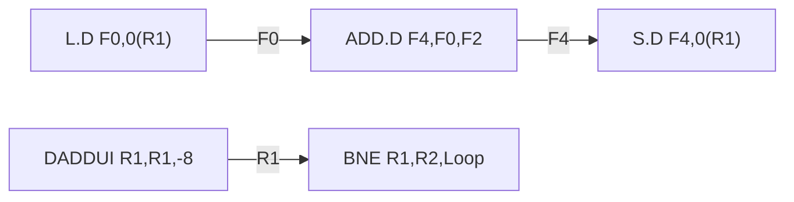

# بخش ۷، جلسه‌ی ۱ از ۱۳: موازی‌سازی در سطح دستور و وابستگی‌ها

این جلسه بخشی از **بخش ۷: موازی‌سازی ایستا در سطح دستور** است. زمان مطالعه: حدود نیم ساعت.

**فهرست این جلسه:**

- ۱. موازی‌سازی در سطح دستور چیست
- ۲. فرمول CPI و نقشه‌ی روش‌ها
- ۳. بلوک پایه و موازی‌سازی در سطح حلقه
- ۴. وابستگی داده
- ۵. وابستگی نامی
- ۶. سه نوع مخاطره‌ی داده
- ۷. وابستگی کنترلی
- ۸. رفتار استثنا و جریان داده
- ۹. تمرین‌ها

---

## ۱. موازی‌سازی در سطح دستور چیست

از حدود سال ۱۹۸۵ همه‌ی پردازنده‌ها خط لوله دارند (بخش ۵). خط لوله اجرای چند دستور را روی هم می‌اندازد. به این هم‌پوشانی بالقوه بین دستورات، **موازی‌سازی در سطح دستور (Instruction-level parallelism یا ILP)** می‌گوییم، چون دستورات می‌توانند به‌طور موازی ارزیابی شوند.

برای بهره بردن بیشتر از ILP دو راه اصلی وجود دارد:

| روش | چه کسی موازی‌سازی را پیدا می‌کند | کجا رایج است |
|---|---|---|
| روش پویا (Dynamic) | سخت‌افزار، در زمان اجرا | پردازنده‌های رومیزی و سرور، مثل Intel Core |
| روش ایستا (Static) | کامپایلر، در زمان کامپایل | پردازنده‌های کم‌مصرف، پردازنده‌های سیگنال (DSP) و پردازنده‌های VLIW |

این بخش (بخش ۷) روش‌های **ایستا** را می‌بیند: زمان‌بندی کد، باز کردن حلقه، تحلیل وابستگی، خط لوله‌ی نرم‌افزاری و VLIW. پیش‌بینی پرش و بافر مقصد پرش را هم اینجا کامل می‌کنیم، چون هر دو روش ایستا و پویا به آن نیاز دارند. بخش ۸ روش‌های **پویا** را می‌بیند: الگوریتم توماسولو، گمانه‌زنی و صدور چندگانه‌ی پویا.

کتاب CAQA یادآوری می‌کند که روش‌های تهاجمی مبتنی بر کامپایلر بارها امتحان شده‌اند (آخرینش Intel Itanium)، ولی بیرون از برنامه‌های علمی موفق نبوده‌اند. با این حال، ایده‌های این بخش در همه‌ی کامپایلرها و پردازنده‌های امروزی استفاده می‌شوند.

## ۲. فرمول CPI و نقشه‌ی روش‌ها

مقدار CPI یک پردازنده‌ی خط لوله‌ای برابر است با CPI ایده‌آل به‌علاوه‌ی همه‌ی توقف‌ها:

```math
\text{Pipeline CPI} = \text{Ideal pipeline CPI} + \text{Structural stalls} + \text{Data hazard stalls} + \text{Control stalls}
```

- **مقدار CPI ایده‌آل:** بهترین کارایی ممکن این پیاده‌سازی. در خط لوله‌ی ساده برابر ۱ است و با صدور چندگانه کمتر از ۱ می‌شود.
- **هدف:** هر روشی که در این بخش و بخش بعد می‌بینیم، یکی از جمله‌های سمت راست را کم می‌کند.

جدول زیر (برگرفته از جدول اول فصل ۳ کتاب CAQA) نشان می‌دهد هر روش کدام جمله را کم می‌کند و کجا آن را می‌خوانیم:

| روش | چه چیزی را کم می‌کند | جلسه |
|---|---|---|
| ارسال رو به جلو | توقف‌های بالقوه‌ی مخاطره‌ی داده | جلسه‌ی ۵-۵ |
| پرش تأخیری و زمان‌بندی ساده‌ی پرش | توقف‌های کنترلی | جلسه‌ی ۵-۷ |
| زمان‌بندی پایه‌ی کد با کامپایلر | توقف‌های مخاطره‌ی داده | جلسه‌ی ۷-۲ |
| باز کردن حلقه | توقف‌های کنترلی (و کمک به زمان‌بندی) | جلسه‌ی ۷-۳ |
| تحلیل وابستگی، خط لوله‌ی نرم‌افزاری، زمان‌بندی مسیر | CPI ایده‌آل و توقف‌های داده | جلسه‌های ۷-۵ و ۷-۶ |
| پشتیبانی سخت‌افزار از گمانه‌زنی کامپایلر | CPI ایده‌آل، توقف‌های داده و کنترلی | جلسه‌ی ۷-۷ |
| پیش‌بینی پرش | توقف‌های کنترلی | جلسه‌های ۷-۸ تا ۷-۱۱ |
| صدور چندگانه (VLIW) | CPI ایده‌آل | جلسه‌ی ۷-۱۲ |
| زمان‌بندی پویا با تغییر نام | توقف‌های داده، شامل وابستگی‌های نامی | بخش ۸ |
| گمانه‌زنی سخت‌افزاری | توقف‌های داده و کنترلی | بخش ۸ |

یک نکته‌ی مهم: روش‌هایی که CPI ایده‌آل را کم می‌کنند (مثل صدور چندگانه)، اهمیت مخاطره‌ها را **بیشتر** می‌کنند. وقتی در هر سیکل چهار دستور صادر می‌شود، یک توقف یک‌سیکلی یعنی از دست رفتن چهار دستور.

## ۳. بلوک پایه و موازی‌سازی در سطح حلقه

**بلوک پایه (Basic block)** دنباله‌ای از کد بدون پرش است: فقط از اول وارد می‌شویم و فقط از آخر خارج می‌شویم.

کتاب CAQA می‌گوید در برنامه‌های MIPS، فراوانی پویای پرش‌ها معمولاً ۱۵ تا ۲۵ درصد است. یعنی بین هر دو پرش فقط **سه تا شش دستور** اجرا می‌شود. این دستورات معمولاً به هم وابسته‌اند، پس موازی‌سازی داخل یک بلوک پایه خیلی کم است. نتیجه: برای ILP واقعی باید **از روی پرش‌ها** عبور کرد و دستورات چند بلوک پایه را با هم زمان‌بندی کرد.

ساده‌ترین و رایج‌ترین منبع ILP، **موازی‌سازی در سطح حلقه (Loop-level parallelism)** است: تکرارهای مختلف یک حلقه. مثلاً:

```c
for (i = 0; i <= 999; i = i + 1)
    x[i] = x[i] + y[i];
```

هر تکرار این حلقه از بقیه مستقل است. داخل یک تکرار موازی‌سازی کمی هست، ولی هر تکرار می‌تواند با هر تکرار دیگر هم‌پوشانی داشته باشد. دو راه برای تبدیل موازی‌سازی حلقه به ILP:

- **باز کردن حلقه:** یا ایستا توسط کامپایلر (جلسه‌ی ۷-۳) یا پویا توسط سخت‌افزار (بخش ۸).
- **دستورات SIMD و برداری:** یک دستور روی چند داده کار می‌کند (بخش ۹). کتاب می‌گوید حلقه‌ی بالا در حالت ساده ۷ دستور در هر تکرار دارد (دو بارگذاری، یک جمع، یک ذخیره، دو به‌روزرسانی آدرس و یک پرش)، یعنی ۷۰۰۰ دستور. در یک پردازنده‌ی برداری ممکن است فقط **چهار دستور** کافی باشد.

## ۴. وابستگی داده

مهم‌ترین سؤال در ILP این است: **کدام دستورات به هم وابسته‌اند؟** دو دستور مستقل را می‌توان همزمان در خط لوله‌ای با هر عمقی اجرا کرد (اگر منابع کافی باشد). دو دستور وابسته باید به ترتیب اجرا شوند، هرچند ممکن است بخشی از اجرایشان روی هم بیفتد.

سه نوع وابستگی داریم: **وابستگی داده**، **وابستگی نامی** و **وابستگی کنترلی**.

دستور j به دستور i **وابستگی داده (Data dependence)** یا **وابستگی واقعی (True dependence)** دارد اگر:

- دستور i نتیجه‌ای تولید کند که دستور j ممکن است استفاده کند، یا
- دستور j به دستور k وابسته باشد و دستور k به دستور i (یعنی یک **زنجیره** از وابستگی‌ها).

مثال کتاب: حلقه‌ای که یک عدد ثابت (در F2) را به همه‌ی عناصر یک آرایه اضافه می‌کند. کتاب CAQA از نسخه‌ی ۶۴ بیتی MIPS استفاده می‌کند. دستور `L.D` یک عدد ممیز شناور دودقتی را بارگذاری می‌کند، `S.D` آن را ذخیره می‌کند، `ADD.D` جمع دودقتی است و `DADDUI` جمع صحیح ۶۴ بیتی با عدد ثابت است:

```asm
Loop:   L.D     F0,0(R1)      ; F0 = array element
        ADD.D   F4,F0,F2      ; add scalar in F2
        S.D     F4,0(R1)      ; store result
        DADDUI  R1,R1,#-8     ; decrement pointer 8 bytes
        BNE     R1,R2,Loop    ; branch R1 != R2
```

دو زنجیره‌ی وابستگی داده در این کد هست:



نکته‌های مهم درباره‌ی وابستگی داده:

- **وابستگی ویژگی برنامه است، مخاطره ویژگی خط لوله.** اینکه یک وابستگی واقعاً مخاطره بسازد و توقف ایجاد کند، به ساختار خط لوله بستگی دارد. این تفاوت کلید فهم ILP است.
- **سه پیام وابستگی:** یک وابستگی داده سه چیز را می‌گوید: (۱) احتمال مخاطره، (۲) ترتیبی که نتیجه‌ها باید حساب شوند، (۳) **حد بالای** موازی‌سازی قابل استفاده.
- **دو راه غلبه:** یا وابستگی را نگه داریم ولی از مخاطره دوری کنیم (با **زمان‌بندی** کد، توسط کامپایلر یا سخت‌افزار)، یا با تغییر کد، وابستگی را **حذف** کنیم.
- **وابستگی از راه حافظه سخت است:** وابستگی از راه ثبات ساده پیدا می‌شود، چون نام ثبات در دستور ثابت است. ولی دو آدرس حافظه ممکن است متفاوت به نظر برسند و یکی باشند: `100(R4)` و `20(R6)` ممکن است یک خانه باشند. برعکس، `20(R4)` در دو تکرار مختلف ممکن است دو خانه‌ی متفاوت باشد.

## ۵. وابستگی نامی

**وابستگی نامی (Name dependence)** وقتی رخ می‌دهد که دو دستور از یک **نام** (ثبات یا خانه‌ی حافظه) استفاده کنند ولی **هیچ داده‌ای** بینشان جابه‌جا نشود. دستور i قبل از دستور j در ترتیب برنامه است:

- **ضدوابستگی (Antidependence):** دستور j در نامی **می‌نویسد** که دستور i از آن **می‌خواند**. ترتیب باید حفظ شود تا i مقدار درست (قدیمی) را بخواند. در مثال بالا، بین `S.D` (که R1 را می‌خواند) و `DADDUI` (که R1 را می‌نویسد) ضدوابستگی هست.
- **وابستگی خروجی (Output dependence):** هر دو دستور در **یک نام می‌نویسند**. ترتیب باید حفظ شود تا مقدار نهایی، مقدار دستور j باشد.

چون در وابستگی نامی داده‌ای منتقل نمی‌شود، اگر **نام را عوض کنیم** وابستگی از بین می‌رود و دستورات می‌توانند جابه‌جا یا همزمان اجرا شوند. این کار برای ثبات‌ها **تغییر نام ثبات (Register renaming)** نام دارد و هم کامپایلر (ایستا، جلسه‌ی ۷-۳) و هم سخت‌افزار (پویا، بخش ۸) می‌توانند انجامش دهند.

مثال:

```asm
DIV.D   F0,F2,F4
ADD.D   F6,F0,F8     ; reads F8
S.D     F6,0(R1)
SUB.D   F8,F10,F14   ; writes F8: antidependence with ADD.D
MUL.D   F6,F10,F8    ; writes F6: output dependence with ADD.D
```

اگر کامپایلر به جای F6 و F8 در دو دستور آخر از ثبات‌های آزاد S و T استفاده کند (و بعد از آن همه‌جا S و T را به کار ببرد)، فقط وابستگی‌های واقعی می‌مانند:

```asm
DIV.D   F0,F2,F4
ADD.D   S,F0,F8
S.D     S,0(R1)
SUB.D   T,F10,F14
MUL.D   F6,F10,T
```

## ۶. سه نوع مخاطره‌ی داده

**مخاطره (Hazard)** وقتی هست که بین دو دستور وابستگی داده یا نامی باشد و آن‌قدر به هم نزدیک باشند که هم‌پوشانی، ترتیب دسترسی به عملوند را عوض کند. هدف همه‌ی روش‌ها: حفظ **ترتیب برنامه (Program order)** فقط جایی که روی نتیجه اثر دارد.

مخاطره‌ها با ترتیبی که **باید حفظ شود** نام‌گذاری می‌شوند. دستور i قبل از j است:

| مخاطره | معنی | وابستگی متناظر | کجا رخ می‌دهد |
|---|---|---|---|
| مخاطره‌ی RAW (خواندن بعد از نوشتن) | دستور j عملوند را قبل از نوشتن i می‌خواند و مقدار قدیمی را می‌گیرد | وابستگی داده | رایج‌ترین مخاطره، در همه‌ی خط لوله‌ها |
| مخاطره‌ی WAW (نوشتن بعد از نوشتن) | دستور j قبل از i می‌نویسد و مقدار نهایی غلط می‌شود | وابستگی خروجی | خط لوله‌هایی که در بیش از یک مرحله می‌نویسند یا اجازه‌ی عبور از دستور متوقف را می‌دهند |
| مخاطره‌ی WAR (نوشتن بعد از خواندن) | دستور j قبل از اینکه i بخواند، می‌نویسد و i مقدار جدید را می‌گیرد | ضدوابستگی | وقتی بعضی دستورات دیر بخوانند و بعضی زود بنویسند، یا وقتی دستورات جابه‌جا شوند |

- **حالت RAR:** خواندن بعد از خواندن مخاطره نیست.
- **چرا WAR در خط لوله‌ی ساده رخ نمی‌دهد:** در خط لوله‌ی پنج‌مرحله‌ای همه‌ی خواندن‌ها زود (در ID) و همه‌ی نوشتن‌ها دیر (در WB) هستند.
- **چرا WAW در خط لوله‌ی ممیز شناور ممکن است:** دستورات با تأخیرهای مختلف ممکن است خارج از ترتیب تمام شوند. مثلاً یک `DIV.D` طولانی و بعد یک `ADD.D` کوتاه با همان مقصد (جلسه‌ی ۷-۲).

## ۷. وابستگی کنترلی

**وابستگی کنترلی (Control dependence)** ترتیب یک دستور را نسبت به یک پرش تعیین می‌کند، تا دستور فقط وقتی اجرا شود که باید. هر دستوری به جز دستورات اولین بلوک پایه، به یک یا چند پرش وابستگی کنترلی دارد.

```c
if (p1) {
    S1;
}
if (p2) {
    S2;
}
```

اینجا S1 به p1 وابستگی کنترلی دارد، و S2 به p2 دارد ولی به p1 نه.

دو محدودیت وابستگی کنترلی:

- **محدودیت اول:** دستوری که به پرش وابستگی کنترلی دارد را نمی‌توان **قبل از پرش** برد، چون دیگر تحت کنترل پرش نیست. مثلاً نمی‌توان دستوری از بخش then را قبل از if برد.
- **محدودیت دوم:** دستوری که به پرش وابسته نیست را نمی‌توان **بعد از پرش** (داخل بخش then) برد، چون آن وقت فقط گاهی اجرا می‌شود.

## ۸. رفتار استثنا و جریان داده

اگر پردازنده ترتیب برنامه را دقیقاً حفظ کند، وابستگی کنترلی هم حفظ می‌شود. ولی گاهی می‌خواهیم دستوری را اجرا کنیم که نباید اجرا می‌شد، به شرط اینکه درستی برنامه خراب نشود. پس خود وابستگی کنترلی ویژگی حیاتی نیست. دو ویژگی حیاتی برای درستی، این‌ها هستند:

**۱. رفتار استثنا (Exception behavior).** تغییر ترتیب نباید نحوه‌ی رخ دادن استثناها را عوض کند. یا دست‌کم نباید **استثنای جدیدی** ایجاد کند.

```asm
        DADDU   R2,R3,R4
        BEQZ    R2,L1
        LW      R1,0(R2)
L1:
```

هیچ وابستگی داده‌ای جلوی بردن `LW` به قبل از `BEQZ` را نمی‌گیرد. ولی اگر R2 صفر باشد، پرش انجام می‌شود و `LW` نباید اجرا شود. اگر آن را جلوتر ببریم، بارگذاری از آدرس صفر ممکن است **استثنای حفاظت حافظه** بدهد. فقط وابستگی کنترلی این جابه‌جایی را ممنوع می‌کند. راه‌حل‌ها: گمانه‌زنی سخت‌افزاری (بخش ۸) یا پشتیبانی سخت‌افزار از گمانه‌زنی کامپایلر (جلسه‌ی ۷-۷).

**۲. جریان داده (Data flow).** جریان واقعی مقدارها بین دستورات تولیدکننده و مصرف‌کننده. پرش‌ها جریان داده را **پویا** می‌کنند: منبع یک داده ممکن است از چند جا باشد.

```asm
        DADDU   R1,R2,R3
        BEQZ    R4,L
        DSUBU   R1,R5,R6
L:      ...
        OR      R7,R1,R8
```

دستور `OR` هم به `DADDU` و هم به `DSUBU` وابستگی داده دارد. اینکه کدام مقدار R1 به آن برسد، به پرش بستگی دارد. اگر پرش انجام شود، مقدار `DADDU` و اگر نه، مقدار `DSUBU`. پس حفظ وابستگی داده کافی نیست و ترتیب برنامه (یعنی وابستگی کنترلی) جریان داده را تضمین می‌کند. به همین دلیل `DSUBU` را هم نمی‌توان به قبل از پرش برد.

**گاهی نقض وابستگی کنترلی بی‌خطر است.** مثال:

```asm
        DADDU   R1,R2,R3
        BEQZ    R12,skip
        DSUBU   R4,R5,R6
        DADDU   R5,R4,R9
skip:   OR      R7,R8,R9
```

فرض کنید R4 بعد از `skip` استفاده نمی‌شود. به این ویژگی که آیا یک مقدار بعداً استفاده می‌شود یا نه، **زنده بودن (Liveness)** می‌گوییم. اگر R4 **مرده** باشد و `DSUBU` هم استثنا ندهد، می‌توان `DSUBU` را قبل از پرش برد. اگر پرش انجام شود، `DSUBU` بی‌فایده اجرا شده ولی نتیجه‌ی برنامه عوض نشده است.

این نوع جابه‌جایی را **گمانه‌زنی نرم‌افزاری (Software speculation)** می‌گویند: کامپایلر شرط می‌بندد که پرش معمولاً انجام نمی‌شود. در جلسه‌ی ۷-۷ نسخه‌های پیشرفته‌تر آن را می‌بینیم.

## ۹. تمرین‌ها

<details>
<summary>تمرین ۱: پیدا کردن همه‌ی وابستگی‌ها</summary>

**صورت:** همه‌ی وابستگی‌های داده، ضدوابستگی‌ها و وابستگی‌های خروجی کد زیر را پیدا کن:

```asm
I1: L.D    F0,0(R1)
I2: MUL.D  F2,F0,F4
I3: ADD.D  F0,F2,F6
I4: S.D    F0,0(R1)
I5: DADDUI R1,R1,#-8
```

**جواب:**

- **وابستگی داده:** I2 به I1 (ثبات F0)، I3 به I2 (ثبات F2)، I4 به I3 (ثبات F0).
- **ضدوابستگی:** I3 در F0 می‌نویسد که I2 آن را می‌خواند. همچنین I5 در R1 می‌نویسد که I1 و I4 آن را می‌خوانند.
- **وابستگی خروجی:** I1 و I3 هر دو در F0 می‌نویسند.

با تغییر نام مقصد I3 به یک ثبات آزاد (مثلاً F8) و استفاده از F8 در I4، ضدوابستگی I2 و I3 و وابستگی خروجی I1 و I3 حذف می‌شوند.
</details>

<details>
<summary>تمرین ۲: کدام جابه‌جایی مجاز است؟</summary>

**صورت:** در کد زیر، آیا می‌توان `LW R6,0(R7)` را به قبل از `BNEZ` برد؟ شرط‌ها را بنویس.

```asm
        BNEZ    R5,else
        LW      R6,0(R7)
        DADDU   R8,R6,R1
else:   ...
```

**جواب:** جابه‌جایی وقتی مجاز است که دو ویژگی حفظ شوند. **جریان داده:** ثبات R6 نباید بعد از `else` در مسیر انجام‌شده‌ی پرش زنده باشد، وگرنه مقدار قدیمی‌اش خراب می‌شود (یا کامپایلر از یک ثبات دیگر استفاده کند). **رفتار استثنا:** بارگذاری نباید استثنای جدید بدهد. اگر R7 در مسیر پرش انجام‌شده ممکن است آدرس نامعتبر باشد، این جابه‌جایی بدون پشتیبانی سخت‌افزار (بارگذاری گمانه‌ای، جلسه‌ی ۷-۷) مجاز نیست.
</details>

<details>
<summary>تمرین ۳: اندازه‌ی بلوک پایه</summary>

**صورت:** اگر ۲۰٪ دستورات اجراشده پرش باشند، متوسط طول بلوک پایه چقدر است؟

**جواب:** به ازای هر پرش، به طور متوسط 1 / 0.2 = 5 دستور اجرا می‌شود، یعنی حدود ۴ دستور غیرپرش و یک پرش. با این عدد کم، پیدا کردن دستورات مستقل داخل یک بلوک پایه سخت است.
</details>

---

جلسه‌ی بعدی: [خط لوله‌ی ممیز شناور و زمان‌بندی کد](7-2-fp-pipeline-and-scheduling.md)
