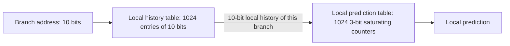
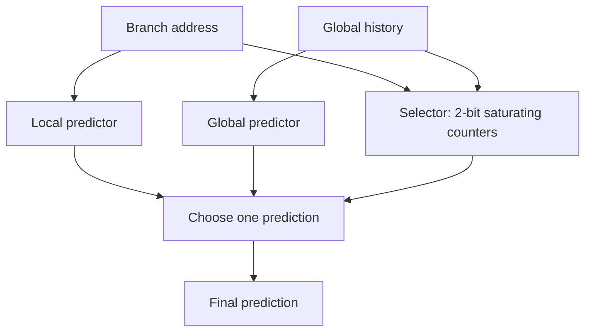

# بخش ۷، جلسه‌ی ۱۰ از ۱۳: حل سؤال امتحانی (2,2) و پیش‌بینی‌کننده‌های ترکیبی

این جلسه بخشی از **بخش ۷: موازی‌سازی ایستا در سطح دستور** است. زمان مطالعه: حدود نیم ساعت.

**فهرست این جلسه:**

- ۱. صورت سؤال امتحان‌های ۰۱-۰۲ و ۰۲-۰۳
- ۲. فرض‌ها
- ۳. حل گام به گام
- ۴. وضعیت نهایی جدول و تفسیر
- ۵. یک شبیه‌ساز کوچک
- ۶. پیش‌بینی‌کننده‌ی محلی
- ۷. پیش‌بینی‌کننده‌ی ترکیبی (تورنمنت)
- ۸. پیش‌بینی‌کننده‌ی Core i7 و پیش‌بینی‌کننده‌های برچسب‌دار
- ۹. تمرین‌ها

---

## ۱. صورت سؤال امتحان‌های ۰۱-۰۲ و ۰۲-۰۳

یک پیش‌بینی‌کننده‌ی (2,2) برای پرش‌های شرطی داریم (شکل جدول ۴ ستونی با ۴ بیت آدرس، جلسه‌ی ۷-۹). کد زیر در یک حلقه **۲۰ بار** تکرار می‌شود:

```asm
        DSUBUI  R3,R1,#2
        BNEZ    R3,L1           ; condition 1 (branch b1)
        DADD    R1,R0,R0
L1:     DSUBUI  R3,R2,#2
        BNEZ    R3,L2           ; condition 2 (branch b2)
        DADD    R2,R0,R0
L2:     DSUB    R3,R2,R1
```

شرط اول در **۵ بار اول و ۵ بار آخر** و شرط دوم **فقط در ۱۰ بار اول** «Taken» می‌شود. هر دو شرط در بقیه‌ی تکرارها «Not Taken» هستند. مقدار اولیه‌ی همه‌ی پیش‌بینی‌کننده‌ها «Not Taken» است.

**خواسته:** وضعیت BHT برای شرط اول چطور تغییر می‌کند و چند درصد پیش‌بینی‌ها برای این شرط درست است؟

## ۲. فرض‌ها

سؤال چند چیز را باز گذاشته است. فرض‌هایمان را صریح می‌نویسیم:

- **معنی «شرط Taken می‌شود»:** پرش مربوط (b1 یعنی `BNEZ R3,L1` و b2 یعنی `BNEZ R3,L2`) انجام می‌شود.
- **تاریخچه‌ی سراسری:** فقط همین دو پرش در برنامه‌اند. پرش برگشت حلقه را در تاریخچه حساب نمی‌کنیم (در بخش ۴ اثر آن را هم می‌بینیم). پس وقتی b1 در تکرار i پیش‌بینی می‌شود، دو پرش آخر عبارت‌اند از: b1 و b2 در تکرار i − 1.
- **مقدار اولیه‌ی تاریخچه:** هر دو بیت NT.
- **شمارنده:** شمارنده‌ی اشباعی دوبیتی (0 و 1 یعنی پیش‌بینی NT، 2 و 3 یعنی پیش‌بینی T). مقدار اولیه‌ی همه ۰ (یعنی NT قوی).
- **هم‌نامی:** b1 و b2 در سطرهای مختلف جدول‌اند (آدرس‌های متفاوت)، پس شمارنده‌هایشان جداست.

نمادگذاری تاریخچه: دو حرف، **اول** نتیجه‌ی b1 قبلی و **دوم** نتیجه‌ی b2 قبلی (جدیدتر). مثلاً «T N» یعنی b1 قبلی انجام‌شده و b2 قبلی انجام‌نشده بوده. هر تاریخچه یکی از چهار شمارنده‌ی b1 را انتخاب می‌کند.

رفتار واقعی:

| تکرار | پرش b1 | پرش b2 |
|---|---|---|
| تکرار 1 تا 5 | T | T |
| تکرار 6 تا 10 | N | T |
| تکرار 11 تا 15 | N | N |
| تکرار 16 تا 20 | T | N |

## ۳. حل گام به گام

| تکرار | تاریخچه (b1 و b2 قبلی) | شمارنده‌ی انتخاب‌شده قبل | پیش‌بینی | واقعی | درست؟ | شمارنده بعد |
|---|---|---|---|---|---|---|
| تکرار 1 | N N | 0 | NT | T | خیر | 1 |
| تکرار 2 | T T | 0 | NT | T | خیر | 1 |
| تکرار 3 | T T | 1 | NT | T | خیر | 2 |
| تکرار 4 | T T | 2 | T | T | بله | 3 |
| تکرار 5 | T T | 3 | T | T | بله | 3 |
| تکرار 6 | T T | 3 | T | N | خیر | 2 |
| تکرار 7 | N T | 0 | NT | N | بله | 0 |
| تکرار 8 | N T | 0 | NT | N | بله | 0 |
| تکرار 9 | N T | 0 | NT | N | بله | 0 |
| تکرار 10 | N T | 0 | NT | N | بله | 0 |
| تکرار 11 | N T | 0 | NT | N | بله | 0 |
| تکرار 12 | N N | 1 | NT | N | بله | 0 |
| تکرار 13 | N N | 0 | NT | N | بله | 0 |
| تکرار 14 | N N | 0 | NT | N | بله | 0 |
| تکرار 15 | N N | 0 | NT | N | بله | 0 |
| تکرار 16 | N N | 0 | NT | T | خیر | 1 |
| تکرار 17 | T N | 0 | NT | T | خیر | 1 |
| تکرار 18 | T N | 1 | NT | T | خیر | 2 |
| تکرار 19 | T N | 2 | T | T | بله | 3 |
| تکرار 20 | T N | 3 | T | T | بله | 3 |

نکته‌های ظریف:

- **تکرار ۱۱:** تاریخچه هنوز «N T» است، چون b2 در تکرار ۱۰ هنوز انجام‌شده بوده.
- **تکرار ۱۲:** شمارنده‌ی «N N» مقدار ۱ دارد، نه ۰. چون در تکرار ۱ (با همین تاریخچه) یک بار T دیده و از ۰ به ۱ رفته بود.
- **تکرار ۶:** بعد از ۵ بار T، شمارنده‌ی «T T» روی ۳ است و یک N آن را به ۲ می‌برد. ولی این شمارنده دیگر هرگز استفاده نمی‌شود.

**نتیجه:** ۷ پیش‌بینی غلط (تکرارهای ۱، ۲، ۳، ۶، ۱۶، ۱۷ و ۱۸) و ۱۳ پیش‌بینی درست:

```math
\text{Accuracy} = \frac{13}{20} = 65\%
```

## ۴. وضعیت نهایی جدول و تفسیر

| تاریخچه | شمارنده‌ی b1 در پایان | پیش‌بینی |
|---|---|---|
| تاریخچه‌ی N N | 1 (یعنی 01) | NT |
| تاریخچه‌ی N T | 0 (یعنی 00) | NT |
| تاریخچه‌ی T N | 3 (یعنی 11) | T |
| تاریخچه‌ی T T | 2 (یعنی 10) | T |

تفسیر: پیش‌بینی‌کننده تقریباً یاد گرفته که «b1 همان کاری را می‌کند که b1 دفعه‌ی قبل کرده» (تاریخچه‌هایی که با T شروع می‌شوند T پیش‌بینی می‌کنند). بیشتر خطاها در **شروع** هر فاز رخ می‌دهند: سه خطا در شروع (گرم شدن شمارنده‌ها) و سه خطا وقتی فاز چهارم شروع می‌شود و شمارنده‌ی جدید «T N» باید از صفر گرم شود.

**بررسی فرض‌های دیگر:**

- **با پرش حلقه در تاریخچه:** اگر پرش برگشت حلقه (که همیشه T است به جز آخرین بار) هم در تاریخچه بیاید، دو پرش آخر قبل از b1 می‌شوند b2 قبلی و پرش حلقه. با شبیه‌سازی (بخش ۵) جواب باز هم **۱۳ از ۲۰ یعنی ۶۵٪** است، هرچند شمارنده‌های متفاوتی استفاده می‌شوند.
- **اگر «شرط Taken» یعنی شرط C برقرار است:** یعنی شرط `aa == 2` درست است که پرش `BNEZ` را **انجام‌نشده** می‌کند. در این تفسیر همه‌ی نتیجه‌ها برعکس می‌شوند و جواب **۱۴ از ۲۰ یعنی ۷۰٪** است.

در امتحان، فرض‌هایت را اول جواب بنویس. روش حل در هر حالت همان است.

## ۵. یک شبیه‌ساز کوچک

برای بررسی جواب‌های این نوع سؤال، این برنامه‌ی پایتون یک پیش‌بینی‌کننده‌ی (m,n) کلی را شبیه‌سازی می‌کند:

```python
def simulate(trace, m, n, verbose=True):
    """trace: list of (branch_name, outcome) in program order, outcome 1 = taken."""
    top = (1 << n) - 1
    counters = {}                     # (branch, history) -> n-bit counter, starts at 0
    history = 0                       # last m outcomes, newest in the lowest bit
    stats = {}
    for name, taken in trace:
        key = (name, history)
        c = counters.get(key, 0)
        pred = 1 if c >= (1 << (n - 1)) else 0
        ok, total = stats.get(name, (0, 0))
        stats[name] = (ok + (pred == taken), total + 1)
        if verbose:
            h = format(history, '0%db' % m) if m else '-'
            print(f"{name}: history={h} counter={c} predict={'T' if pred else 'N'} "
                  f"actual={'T' if taken else 'N'} {'ok' if pred == taken else 'MISS'}")
        counters[key] = min(top, c + 1) if taken else max(0, c - 1)
        if m:
            history = ((history << 1) | taken) & ((1 << m) - 1)
    return stats

# exam problem: 20 iterations, b1 taken in the first 5 and the last 5, b2 taken in the first 10
trace = []
for i in range(1, 21):
    trace.append(('b1', 1 if i <= 5 or i >= 16 else 0))
    trace.append(('b2', 1 if i <= 10 else 0))
print(simulate(trace, m=2, n=2))
```

در خروجی، تاریخچه به شکل دو بیت نوشته می‌شود که بیت سمت راست جدیدترین نتیجه است (اینجا b2 قبلی). آخرین خط `{'b1': (13, 20), 'b2': (14, 20)}` را چاپ می‌کند: ۱۳ پیش‌بینی درست از ۲۰ برای b1. برای اضافه کردن پرش حلقه، کافی است بعد از b2 در هر تکرار، `('loop', 1 if i < 20 else 0)` را هم به دنباله اضافه کنی.

## ۶. پیش‌بینی‌کننده‌ی محلی

پیش‌بینی‌کننده‌ی همبسته از تاریخچه‌ی **سراسری** (پرش‌های دیگر) استفاده می‌کند. ولی بعضی پرش‌ها الگوی **خودشان** را دارند، مثل الگوی متناوب یا حلقه‌ای که همیشه ۴ بار تکرار می‌شود (T T T N). برای این‌ها **پیش‌بینی‌کننده‌ی محلی (Local predictor)** بهتر است: برای هر پرش، تاریخچه‌ی **چند اجرای آخر همان پرش** نگه داشته می‌شود.

پیش‌بینی‌کننده‌ی محلی کتاب CAQA دوسطحی است:



- **سطح اول:** جدول تاریخچه‌ی محلی با ۱۰۲۴ خانه‌ی ۱۰ بیتی. هر خانه ۱۰ نتیجه‌ی آخر یک پرش را نگه می‌دارد. اگر پرش ۱۰ بار پشت سر هم انجام شده، همه‌ی بیت‌ها ۱ است. اگر متناوب بوده، بیت‌ها یکی در میان ۰ و ۱ هستند.
- **سطح دوم:** این الگوی ۱۰ بیتی یکی از ۱۰۲۴ شمارنده‌ی **سه‌بیتی** را انتخاب می‌کند.
- **توانایی:** الگوهایی تا طول ۱۰ کشف و پیش‌بینی می‌شوند.

## ۷. پیش‌بینی‌کننده‌ی ترکیبی (تورنمنت)

بعضی پرش‌ها با اطلاعات سراسری بهتر پیش‌بینی می‌شوند و بعضی با اطلاعات محلی. **پیش‌بینی‌کننده‌ی ترکیبی یا تورنمنت (Tournament predictor)** هر دو را دارد و یک **انتخاب‌گر (Selector)** تصمیم می‌گیرد برای هر پرش از کدام استفاده شود.



- **انتخاب‌گر:** برای هر خانه یک شمارنده‌ی اشباعی دوبیتی. وقتی یکی از دو پیش‌بینی‌کننده درست و دیگری غلط بوده، شمارنده به سمت پیش‌بینی‌کننده‌ی درست حرکت می‌کند. مثل پیش‌بینی‌کننده‌ی دوبیتی، دو اشتباه لازم است تا انتخاب عوض شود.
- **کجا کدام:** کتاب می‌گوید یک پیش‌بینی‌کننده‌ی تورنمنت معمولی برای برنامه‌های صحیح SPEC حدود **۴۰٪** وقت پیش‌بینی‌کننده‌ی سراسری را انتخاب می‌کند و برای برنامه‌های ممیز شناور کمتر از **۱۵٪**.
- **نمونه‌ها:** پردازنده‌های Alpha اولین بار پیش‌بینی‌کننده‌ی تورنمنت را به کار بردند. پیش‌بینی‌کننده‌ی Alpha 21264 با همان پیش‌بینی‌کننده‌ی محلی بخش ۶، یک پیش‌بینی‌کننده‌ی سراسری با تاریخچه‌ی ۱۲ پرش آخر و یک انتخاب‌گر، در مجموع حدود **۲۹K بیت** دارد. پردازنده‌های AMD Opteron و Phenom هم از این سبک استفاده کرده‌اند.

مقایسه‌ی کتاب روی SPEC89 با افزایش اندازه‌ی کل پیش‌بینی‌کننده:

| پیش‌بینی‌کننده | رفتار با بزرگ شدن |
|---|---|
| پیش‌بینی‌کننده‌ی دوبیتی محلی | زود به سقف می‌رسد (حدود ۶ تا ۷ درصد خطا) و دیگر بهتر نمی‌شود |
| پیش‌بینی‌کننده‌ی همبسته | بهبود قابل توجه |
| پیش‌بینی‌کننده‌ی تورنمنت | کمی بهتر از همبسته، و از بیت‌های بیشتر بهتر استفاده می‌کند |

## ۸. پیش‌بینی‌کننده‌ی Core i7 و پیش‌بینی‌کننده‌های برچسب‌دار

**پیش‌بینی‌کننده‌ی Core i7.** کتاب می‌گوید اینتل اطلاعات کمی منتشر کرده است. آنچه گفته شده:

- **دو سطح:** یک پیش‌بینی‌کننده‌ی سطح اول کوچک‌تر که بتواند در هر سیکل یک پرش را پیش‌بینی کند، و یک پیش‌بینی‌کننده‌ی سطح دوم بزرگ‌تر به عنوان پشتیبان.
- **سه پیش‌بینی‌کننده در هر سطح:** دوبیتی ساده، پیش‌بینی‌کننده‌ی تاریخچه‌ی سراسری، و **پیش‌بینی‌کننده‌ی خروج از حلقه (Loop exit predictor)** که برای پرشی که حلقه تشخیص داده شده، تعداد دقیق تکرارها را با یک شمارنده پیش‌بینی می‌کند.
- **انتخاب:** برای هر پرش، بهترین پیش‌بینی بین این سه با پیگیری دقت هر کدام انتخاب می‌شود، مثل تورنمنت.
- **واحدهای جدا:** یک واحد برای پیش‌بینی مقصد پرش‌های غیرمستقیم و یک پشته برای پیش‌بینی آدرس بازگشت (جلسه‌ی ۷-۱۱).

**پیش‌بینی‌کننده‌های برچسب‌دار.** ویرایش ۶ کتاب CAQA نسل بعدی را معرفی می‌کند: **پیش‌بینی‌کننده‌های ترکیبی برچسب‌دار (Tagged hybrid predictors)**. معروف‌ترینشان **TAGE** است. ایده:

- **چند جدول با طول تاریخچه‌ی متفاوت:** یک پیش‌بینی‌کننده‌ی پایه (مثلاً دوبیتی ساده) به‌علاوه‌ی چند جدول که هر کدام با ترکیب آدرس پرش و تاریخچه‌ی سراسری با طول‌های رو به افزایش (مثلاً ۵، ۱۵، ۴۴ و ۱۳۰ پرش) اندیس‌گذاری می‌شوند. طول‌ها معمولاً یک دنباله‌ی هندسی‌اند.
- **برچسب:** برخلاف BHT ساده، خانه‌های این جدول‌ها **برچسب** دارند تا هم‌نامی تشخیص داده شود.
- **انتخاب:** از بین جدول‌هایی که برچسبشان می‌خواند، پیش‌بینی جدولی با **طولانی‌ترین تاریخچه** استفاده می‌شود. اگر هیچ‌کدام نخواند، پیش‌بینی‌کننده‌ی پایه.

این طرح هم پرش‌های ساده را با تاریخچه‌ی کوتاه زود یاد می‌گیرد و هم همبستگی‌های دور را با تاریخچه‌ی بلند. پیش‌بینی‌کننده‌های پردازنده‌های پیشرفته‌ی امروزی بر پایه‌ی همین ایده‌ها ساخته شده‌اند.

## ۹. تمرین‌ها

<details>
<summary>تمرین ۱: شرط دوم در سؤال امتحان</summary>

**صورت:** در سؤال امتحان، دقت پیش‌بینی برای b2 چقدر است؟

**جواب:** با فرض‌های بخش ۲، تاریخچه‌ی b2 در تکرار i از دو پرش آخر ساخته می‌شود: b2 در تکرار i − 1 (قدیمی‌تر) و b1 در تکرار i (جدیدتر). شبیه‌ساز بخش ۵ برای b2 عدد **۱۴ از ۲۰ یعنی ۷۰٪** را می‌دهد. شش خطا:

- **تکرارهای ۱ تا ۳:** گرم شدن. تاریخچه‌ی تکرار ۱ «N T» است و از تکرار ۲ به بعد «T T» که شمارنده‌اش باید از ۰ به ۲ برسد.
- **تکرارهای ۶ و ۷:** از تکرار ۶، b1 انجام‌نشده است. پس تاریخچه‌ی b2 می‌شود «T N» که شمارنده‌ی تازه‌ای است و باید دوباره گرم شود.
- **تکرار ۱۱:** رفتار b2 عوض می‌شود (N می‌شود) ولی تاریخچه هنوز «T N» است و شمارنده‌اش روی ۳.

بعد از آن، تاریخچه‌ها «N N» و «N T» می‌شوند که شمارنده‌هایشان N پیش‌بینی می‌کنند و همه درست‌اند.
</details>

<details>
<summary>تمرین ۲: محلی یا سراسری</summary>

**صورت:** برای هر کدام از پرش‌های زیر، کدام پیش‌بینی‌کننده (دوبیتی ساده، محلی یا سراسری) مناسب‌تر است؟ (الف) پرش انتهای حلقه‌ای که همیشه ۴ بار تکرار می‌شود. (ب) پرش b3 در کد eqntott. (ج) پرشی که ۹۹٪ وقت انجام می‌شود.

**جواب:** (الف) **محلی**: الگوی T T T N با تاریخچه‌ی ۴ بیتی همان پرش کامل یاد گرفته می‌شود، در حالی که دوبیتی در هر دور یک خطا دارد. (ب) **سراسری**: رفتار b3 به نتیجه‌ی b1 و b2 بستگی دارد. (ج) **دوبیتی ساده** کافی است و هر سه تقریباً یکسان کار می‌کنند. تورنمنت برای همین ساخته شده که برای هر پرش، بهترین را خودش انتخاب کند.
</details>

<details>
<summary>تمرین ۳: اندازه‌ی پیش‌بینی‌کننده‌ی محلی</summary>

**صورت:** پیش‌بینی‌کننده‌ی محلی بخش ۶ چند بیت حافظه لازم دارد؟

**جواب:** جدول تاریخچه 1024 × 10 = 10K بیت و جدول شمارنده‌ها 1024 × 3 = 3K بیت. در مجموع **۱۳K بیت**.
</details>

---

جلسه‌ی قبلی: [پیش‌بینی‌کننده‌های همبسته](7-9-correlating-predictors.md)  
جلسه‌ی بعدی: [بافر مقصد پرش و تحویل دستور](7-11-branch-target-buffer.md)
