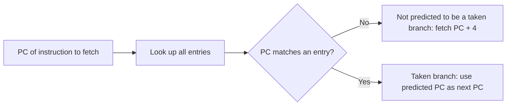
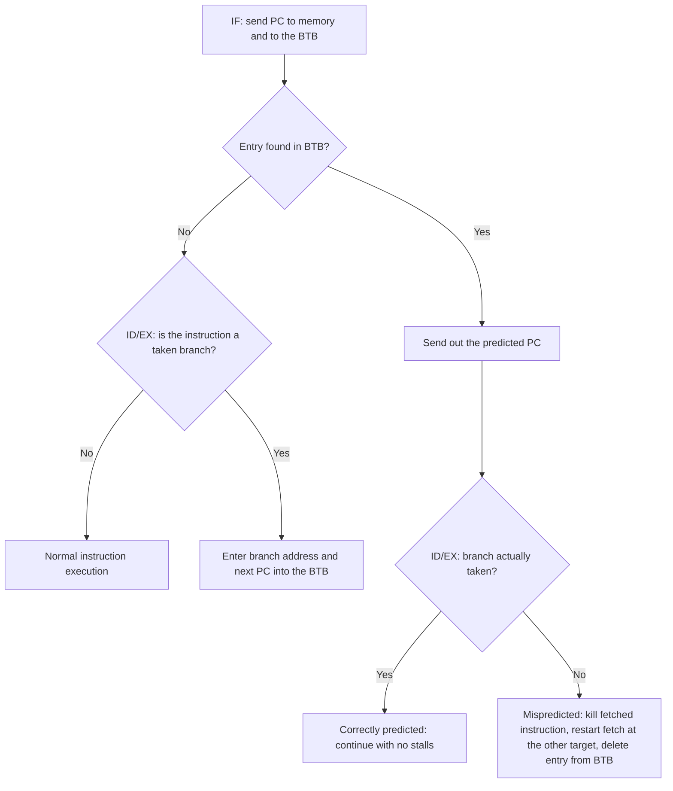
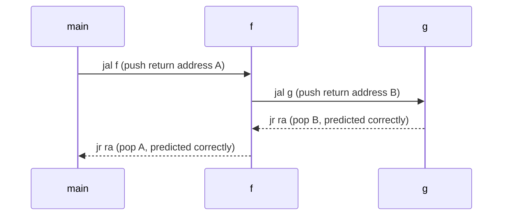
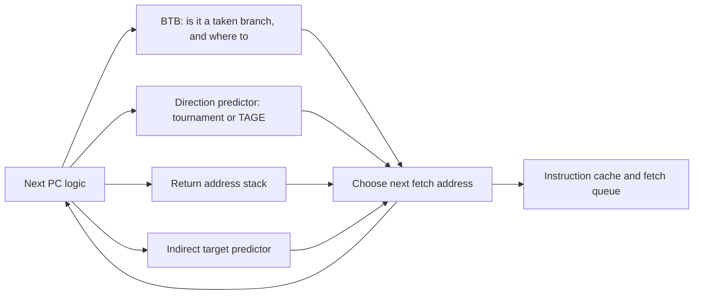

# بخش ۷، جلسه‌ی ۱۱ از ۱۳: بافر مقصد پرش و تحویل دستور

این جلسه بخشی از **بخش ۷: موازی‌سازی ایستا در سطح دستور** است. زمان مطالعه: حدود نیم ساعت.

**فهرست این جلسه:**

- ۱. چرا پیش‌بینی جهت کافی نیست
- ۲. ساختار بافر مقصد پرش
- ۳. مراحل کار با BTB
- ۴. جریمه‌ها و مثال کتاب
- ۵. سؤال ۲ امتحان ۹۵-۹۶
- ۶. ذخیره‌ی دستور مقصد و تاکردن پرش
- ۷. پیش‌بینی آدرس بازگشت
- ۸. واحد یکپارچه‌ی واکشی دستور
- ۹. تمرین‌ها

---

## ۱. چرا پیش‌بینی جهت کافی نیست

پیش‌بینی‌کننده‌های جلسه‌های قبل فقط **جهت** پرش را پیش‌بینی می‌کنند: انجام‌شده یا نه. ولی برای واکشی دستور بعدی در سیکل بعد، دو چیز دیگر هم لازم است:

- **آیا این دستور اصلاً پرش است؟** در مرحله‌ی IF دستور هنوز رمزگشایی نشده است.
- **آدرس مقصد چیست؟** آدرس مقصد در خط لوله‌ی ما در ID حساب می‌شود.

اگر در مرحله‌ی IF بدانیم دستوری که واکشی می‌شود یک پرش انجام‌شده است و مقصدش کجاست، می‌توانیم در سیکل بعد از مقصد واکشی کنیم و **جریمه‌ی پرش صفر** می‌شود. در پردازنده‌های صدور چندگانه که در هر سیکل ۴ تا ۸ دستور واکشی می‌کنند، این مسئله حیاتی‌تر است: پهنای باند تحویل دستور باید دست‌کم برابر با نرخ اجرا باشد.

## ۲. ساختار بافر مقصد پرش

**بافر مقصد پرش (Branch-target buffer یا BTB)** یا **کش مقصد پرش (Branch-target cache)** یک کش کوچک است که با آدرس دستور (PC) جست‌وجو می‌شود و **آدرس دستور بعد از پرش** را پیش‌بینی می‌کند.

| ستون | محتوا |
|---|---|
| آدرس دستور (برچسب) | آدرس پرش‌های شناخته‌شده |
| آدرس پیش‌بینی‌شده | آدرس دستور بعدی (مقصد پرش) |
| بیت‌های پیش‌بینی (اختیاری) | مثلاً شمارنده‌ی دوبیتی برای جهت |



دو تفاوت مهم با BHT (جلسه‌ی ۷-۸):

- **برچسب لازم است:** BHT برچسب نداشت، چون فقط برای دستوراتی که پرش بودند استفاده می‌شد و یک حدس غلط فقط کارایی را کم می‌کرد. ولی BTB **قبل از رمزگشایی** استفاده می‌شود. اگر برچسب نداشت، برای دستورات غیرپرش هم یک آدرس غلط فرستاده می‌شد. پس باید مطمئن باشیم که این خانه واقعاً مال همین PC است. سخت‌افزار BTB در اصل همان سخت‌افزار کش است.
- **فقط پرش‌های انجام‌شده:** کافی است فقط پرش‌هایی که پیش‌بینی می‌شود **انجام‌شده** باشند در بافر بمانند. پرش انجام‌نشده مثل دستور عادی رفتار می‌کند و دستور بعدی ترتیبی واکشی می‌شود.

## ۳. مراحل کار با BTB

مراحل رسیدگی به یک دستور در خط لوله‌ی پنج‌مرحله‌ای با BTB (شکل کتاب):



## ۴. جریمه‌ها و مثال کتاب

جریمه برای همه‌ی حالت‌ها در خط لوله‌ی پنج‌مرحله‌ای ساده (فقط پرش‌های انجام‌شده در بافر):

| دستور در بافر | پیش‌بینی | رفتار واقعی | جریمه (سیکل) |
|---|---|---|---|
| بله، در بافر است | انجام‌شده | انجام‌شده | 0 |
| بله، در بافر است | انجام‌شده | انجام‌نشده | 2 |
| خیر، در بافر نیست | | انجام‌شده | 2 |
| خیر، در بافر نیست | | انجام‌نشده | 0 |

چرا ۲ سیکل؟ یک سیکل برای به‌روزرسانی بافر با اطلاعات درست (در این سیکل نمی‌توان دستوری واکشی کرد) و یک سیکل برای شروع دوباره‌ی واکشی از آدرس درست.

**مثال کتاب.** جریمه‌ی کل پرش را حساب کن با این فرض‌ها:

- **دقت پیش‌بینی:** ۹۰٪ برای دستورات داخل بافر.
- **نرخ اصابت بافر:** ۹۰٪ برای پرش‌هایی که انجام‌شده پیش‌بینی می‌شوند.

دو رویداد جریمه‌ی ۲ سیکلی دارند:

```math
P(\text{in buffer, but actually not taken}) = 90\% \times 10\% = 0.09
```

```math
P(\text{not in buffer, but actually taken}) = 10\%
```

```math
\text{Branch penalty} = (0.09 + 0.10) \times 2 = 0.38 \text{ cycles per branch}
```

کتاب این را با پرش تأخیری مقایسه می‌کند که حدود ۰.۵ سیکل برای هر پرش جریمه داشت. سود BTB با عمیق‌تر شدن خط لوله بیشتر می‌شود. کتاب یادآوری می‌کند که پردازنده‌های پیشرفته جریمه‌ی پیش‌بینی غلط در حد ۱۵ سیکل دارند.

## ۵. سؤال ۲ امتحان ۹۵-۹۶

**صورت (ترجمه):** یک پردازنده با خط لوله‌ی عمیق داریم که برای آن یک BTB **فقط برای پرش‌های شرطی** پیاده‌سازی می‌کنیم. جریمه‌ی پیش‌بینی غلط همیشه ۴ سیکل و جریمه‌ی عدم اصابت بافر همیشه ۳ سیکل است. نرخ اصابت ۹۰٪، دقت ۹۰٪ و فراوانی پرش ۱۵٪ است. پردازنده با BTB چقدر سریع‌تر از پردازنده‌ای است که جریمه‌ی ثابت دوسیکلی برای پرش دارد؟ CPI پایه بدون توقف پرش برابر ۱ است.

**حل.** حالت‌های یک پرش:

| حالت | احتمال | جریمه | سهم |
|---|---|---|---|
| حالت اصابت و پیش‌بینی درست | 0.9 × 0.9 = 0.81 | 0 | 0 |
| حالت اصابت و پیش‌بینی غلط | 0.9 × 0.1 = 0.09 | 4 | 0.36 |
| حالت عدم اصابت | 0.1 | 3 | 0.30 |

جریمه‌ی متوسط هر پرش:

```math
\text{Penalty per branch} = 0.09 \times 4 + 0.1 \times 3 = 0.66 \text{ cycles}
```

مقدار CPI دو پردازنده:

```math
\text{CPI}_{\text{BTB}} = 1 + 0.15 \times 0.66 = 1.099
```

```math
\text{CPI}_{\text{fixed}} = 1 + 0.15 \times 2 = 1.30
```

با فرض سیکل ساعت یکسان و تعداد دستور یکسان:

```math
\text{Speedup} = \frac{1.30}{1.099} \approx 1.18
```

پس پردازنده‌ی با BTB حدود **۱.۱۸ برابر** سریع‌تر است.

**یک ظرافت:** صورت سؤال می‌گوید جریمه‌ی عدم اصابت «همیشه» ۳ سیکل است، پس ما آن را برای همه‌ی پرش‌هایی که در بافر نیستند حساب کردیم. در مدل کتاب (فقط پرش‌های انجام‌شده در بافر)، پرشی که در بافر نیست و انجام‌نشده است، جریمه‌ای ندارد. اگر مثلاً ۶۰٪ پرش‌های بیرون بافر انجام‌نشده باشند، جریمه‌ی عدم اصابت فقط برای ۴۰٪ آن‌ها حساب می‌شود و سرعت کمی بیشتر می‌شود. در امتحان، فرض صورت سؤال را دنبال کن و اگر لازم شد، فرضت را بنویس.

## ۶. ذخیره‌ی دستور مقصد و تاکردن پرش

یک گونه‌ی BTB به جای آدرس مقصد (یا علاوه بر آن)، **خود دستور یا دستورات مقصد** را ذخیره می‌کند. دو فایده:

- **بافر بزرگ‌تر:** دسترسی به بافر می‌تواند بیشتر از فاصله‌ی دو واکشی طول بکشد، چون دستور مقصد مستقیماً از بافر می‌آید و لازم نیست در همان سیکل از کش دستور واکشی شود. پس می‌توان بافر بزرگ‌تری ساخت.
- **تاکردن پرش (Branch folding):** برای پرش **بی‌شرط**، تنها کار پرش عوض کردن PC است. اگر BTB اصابت کند و بگوید این پرش بی‌شرط است، خط لوله می‌تواند **دستور مقصد را به جای خود پرش** بگذارد. یعنی پرش بی‌شرط در **صفر سیکل** اجرا می‌شود، انگار اصلاً وجود نداشته. گاهی برای پرش شرطی هم ممکن است.

## ۷. پیش‌بینی آدرس بازگشت

**پرش غیرمستقیم (Indirect jump)** پرشی است که مقصدش در زمان اجرا عوض می‌شود، مثل `jr` در MIPS. منابعش: فراخوانی غیرمستقیم رویه (اشاره‌گر تابع، توابع مجازی در C++)، دستور `switch` و از همه مهم‌تر **بازگشت از رویه**.

کتاب می‌گوید در SPEC95، بازگشت از رویه **بیش از ۱۵٪** پرش‌ها و بیشتر پرش‌های غیرمستقیم را تشکیل می‌دهد. در زبان‌های شیءگرا حتی بیشتر است.

مشکل BTB برای بازگشت: یک رویه از **چند جای مختلف** فراخوانی می‌شود. BTB فقط آخرین آدرس بازگشت را به خاطر دارد. کتاب می‌گوید در SPEC CPU95 یک پیش‌بینی‌کننده‌ی پرش قوی برای این بازگشت‌ها دقتی **کمتر از ۶۰٪** داشت.

راه‌حل: **پشته‌ی آدرس بازگشت (Return address stack)**. یک بافر کوچک که مثل پشته کار می‌کند:

- **هنگام فراخوانی** (`jal` در MIPS): آدرس بازگشت روی پشته **push** می‌شود.
- **هنگام بازگشت** (`jr $ra`): آدرس بالای پشته **pop** می‌شود و به عنوان مقصد پیش‌بینی‌شده استفاده می‌شود.



اگر پشته به اندازه‌ی حداکثر عمق فراخوانی بزرگ باشد، بازگشت‌ها **کاملاً** درست پیش‌بینی می‌شوند. کتاب نتیجه‌ی پشته‌هایی با ۰ تا ۱۶ خانه را نشان می‌دهد و می‌گوید چون عمق فراخوانی معمولاً زیاد نیست (به جز چند استثنا)، یک پشته‌ی کوچک خوب کار می‌کند. نمونه‌ها: Intel Core و AMD Phenom پشته‌ی آدرس بازگشت دارند و ARM Cortex-A8 یک پشته‌ی ۸ خانه‌ای.

در RISC-V، سخت‌افزار از روی ثبات‌های مقصد و مبدأ دستورات `jal` و `jalr` تشخیص می‌دهد که دستور فراخوانی است یا بازگشت: اگر مقصد `x1` (یعنی `ra`) یا `x5` باشد فراخوانی (push) و اگر `jalr` از `x1` یا `x5` بخواند بازگشت (pop). مشخصات RISC-V این قاعده را به عنوان راهنمای پشته‌ی آدرس بازگشت تعریف کرده است.

## ۸. واحد یکپارچه‌ی واکشی دستور

در پردازنده‌های صدور چندگانه، واکشی دیگر یک مرحله‌ی ساده‌ی خط لوله نیست. طراحان یک **واحد یکپارچه‌ی واکشی دستور (Integrated instruction fetch unit)** می‌سازند: یک واحد مستقل که دستورات را به بقیه‌ی خط لوله تحویل می‌دهد و این کارها را با هم انجام می‌دهد:

1. **پیش‌بینی پرش یکپارچه:** پیش‌بینی‌کننده بخشی از واحد واکشی است و دائم پرش‌ها را پیش‌بینی می‌کند تا واکشی از مسیر درست ادامه یابد.
2. **پیش‌واکشی دستور:** برای اینکه در هر سیکل چند دستور تحویل داده شود، واحد جلوتر از نیاز واکشی می‌کند و پیش‌واکشی را با پیش‌بینی پرش ترکیب می‌کند.
3. **دسترسی به حافظه‌ی دستور و بافر کردن:** واکشی چند دستور در سیکل ممکن است از مرز بلوک کش رد شود. این واحد این پیچیدگی را پنهان می‌کند و یک **صف دستور** نگه می‌دارد. مثلاً ARM Cortex-A8 یک صف ۱۲ خانه‌ای دارد.

کتاب درباره‌ی Core i7 می‌گوید واحد واکشی از یک **BTB چندسطحی** استفاده می‌کند تا بین سرعت و دقت تعادل برقرار شود، یک پشته‌ی آدرس بازگشت دارد و در هر سیکل ۱۶ بایت از کش دستور می‌آورد.

جمع‌بندی ساختار جلوی خط لوله در یک پردازنده‌ی امروزی:



## ۹. تمرین‌ها

<details>
<summary>تمرین ۱: تغییر نرخ اصابت</summary>

**صورت:** در مثال کتاب (بخش ۴)، اگر نرخ اصابت بافر به ۹۵٪ و دقت به ۹۵٪ برسد، جریمه‌ی متوسط هر پرش چقدر می‌شود؟

**جواب:** حالت داخل بافر و انجام‌نشده: 0.95 × 0.05 = 0.0475. حالت بیرون بافر و انجام‌شده: 0.05. جریمه: (0.0475 + 0.05) × 2 = 0.195 سیکل برای هر پرش، تقریباً نصف ۰.۳۸.
</details>

<details>
<summary>تمرین ۲: پشته‌ی کوچک و بازگشت</summary>

**صورت:** پشته‌ی آدرس بازگشت ۲ خانه دارد و وقتی پر است، push قدیمی‌ترین خانه را دور می‌ریزد. برنامه این دنباله را اجرا می‌کند: main تابع a را صدا می‌زند، a تابع b را، b تابع c را، سپس c برمی‌گردد، b برمی‌گردد، a برمی‌گردد. کدام بازگشت‌ها درست پیش‌بینی می‌شوند؟

**جواب:** پس از سه فراخوانی، پشته فقط آدرس‌های بازگشت به a و به b را دارد (آدرس بازگشت به main دور ریخته شده). بازگشت c به b: درست. بازگشت b به a: درست. بازگشت a به main: پشته خالی است، پس یا از BTB پیش‌بینی می‌شود (ممکن است غلط باشد) یا غلط. پس ۲ از ۳ درست.
</details>

<details>
<summary>تمرین ۳: BTB با جریمه‌ی متفاوت</summary>

**صورت:** در سؤال امتحان، اگر پردازنده‌ی مقایسه‌ای به جای جریمه‌ی ثابت ۲ سیکل، جریمه‌ی ثابت ۳ سیکل داشته باشد، تسریع چقدر است؟

**جواب:** CPI مقایسه‌ای برابر 1 + 0.15 × 3 = 1.45 است و CPI با BTB همان 1.099. تسریع 1.45 / 1.099 ≈ 1.32 برابر.
</details>

---

جلسه‌ی قبلی: [حل سؤال امتحانی (2,2) و پیش‌بینی‌کننده‌های ترکیبی](7-10-exam-and-tournament-predictors.md)  
جلسه‌ی بعدی: [پردازنده‌های VLIW و EPIC](7-12-vliw-and-epic.md)
