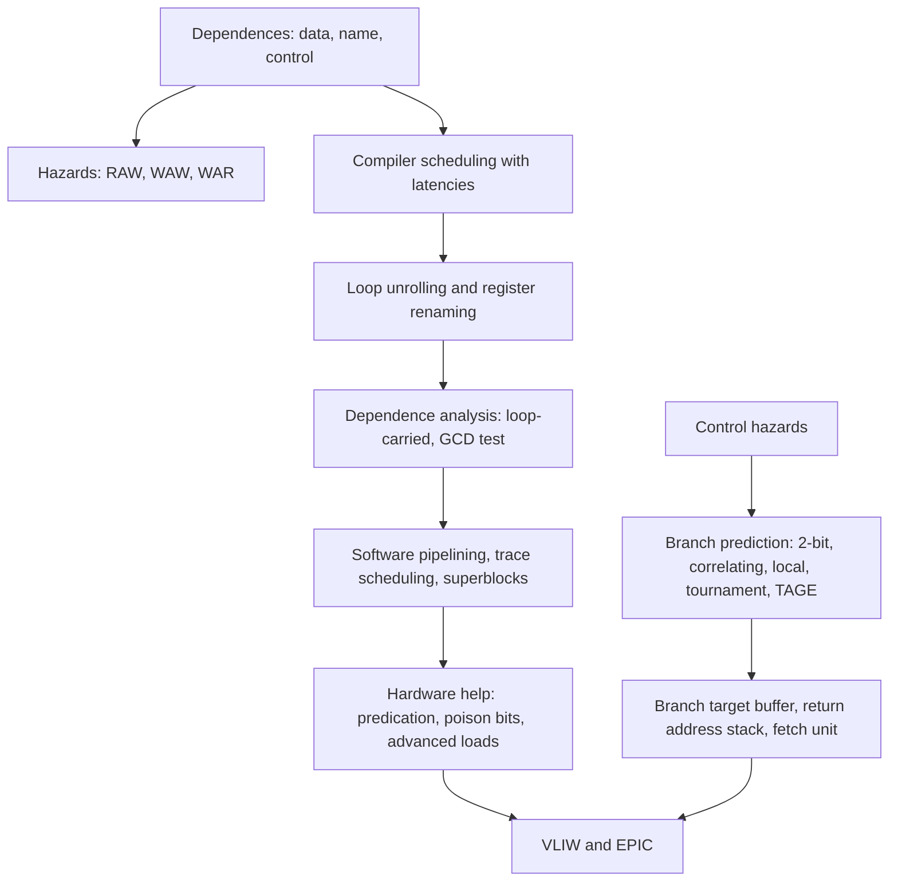

# بخش ۷، جلسه‌ی ۱۳ از ۱۳: پردازنده‌های واقعی، باورهای غلط و واژه‌نامه

این جلسه بخشی از **بخش ۷: موازی‌سازی ایستا در سطح دستور** است. زمان مطالعه: حدود نیم ساعت.

**فهرست این جلسه:**

- ۱. پردازنده‌ی ARM Cortex-A8: یک ابرعددی ایستا
- ۲. جلوی خط لوله‌ی Intel Core i7
- ۳. مقایسه‌ی سه پردازنده
- ۴. باورهای غلط و دام‌ها
- ۵. جمع‌بندی بخش
- ۶. واژه‌نامه
- ۷. تمرین‌های مرور

---

## ۱. پردازنده‌ی ARM Cortex-A8: یک ابرعددی ایستا

کتاب CAQA در بخش ۳.۱۳ دو پردازنده را با هم مقایسه می‌کند. اولی، **ARM Cortex-A8**، نمونه‌ی خوبی از ایده‌های این بخش است: یک **ابرعددی ایستا (Statically scheduled superscalar)** با تشخیص پویای صدور.

- **صدور:** در هر سیکل یک یا دو دستور، **به ترتیب**. یک ساختار ساده‌ی scoreboard بررسی می‌کند که دستور کی می‌تواند صادر شود. دو دستور وابسته می‌توانند با هم وارد منطق صدور شوند، ولی پشت سر هم اجرا می‌شوند، مگر اینکه مسیرهای ارسال وابستگی را حل کنند.
- **خط لوله:** ۱۳ مرحله: سه سیکل برای واکشی، چند سیکل برای رمزگشایی و یک خط لوله‌ی صحیح. واحد واکشی تلاش می‌کند یک **صف دستور ۱۲ خانه‌ای** را پر نگه دارد.
- **پیش‌بینی پرش:**
    - یک **BTB دوراهه‌ی ۵۱۲ خانه‌ای** (جلسه‌ی ۷-۱۱).
    - یک **بافر تاریخچه‌ی سراسری ۴K خانه‌ای** که با تاریخچه‌ی پرش و PC اندیس‌گذاری می‌شود (جلسه‌ی ۷-۹). اگر BTB عدم اصابت داشته باشد، پیش‌بینی جهت از این بافر می‌آید.
    - یک **پشته‌ی آدرس بازگشت ۸ خانه‌ای**.
- **جریمه‌ی پیش‌بینی غلط:** ۱۳ سیکل، چون کل خط لوله پاک می‌شود.

چون Cortex-A8 به ترتیب صادر می‌کند، کیفیت **زمان‌بندی کامپایلر** (جلسه‌های ۷-۲ تا ۷-۴) مستقیماً روی کارایی‌اش اثر دارد. همین دلیل است که این پردازنده در این بخش آمده و Core i7 در بخش ۸ کامل‌تر بررسی می‌شود.

در تکلیف ARM درس، Cortex-A76 یک پردازنده‌ی خارج از ترتیب است. پس از نظر هسته به Core i7 نزدیک‌تر است تا به Cortex-A8. ولی ساختار جلوی خط لوله (BTB، پیش‌بینی‌کننده‌ی جهت، پشته‌ی آدرس بازگشت و صف دستور) در همه‌ی این پردازنده‌ها همان اجزای این بخش است. جزئیات دقیق A76 را از راهنمای فنی ARM بگیر.

## ۲. جلوی خط لوله‌ی Intel Core i7

از توضیح کتاب درباره‌ی Core i7 (جزئیات اجرای خارج از ترتیب در بخش ۸):

- **واکشی:** یک **BTB چندسطحی** برای تعادل بین سرعت و دقت، یک **پشته‌ی آدرس بازگشت**، و واکشی ۱۶ بایت در هر سیکل از کش دستور.
- **پیش‌بینی‌کننده‌ی جهت:** دوسطحی، با ترکیب دوبیتی، تاریخچه‌ی سراسری و پیش‌بینی‌کننده‌ی خروج از حلقه (جلسه‌ی ۷-۱۰).
- **ادغام ماکروعملیات (Macro-op fusion):** ترکیب‌هایی مثل «مقایسه و بعد پرش» در یک عملیات ادغام می‌شوند.
- **جریمه‌ی پیش‌بینی غلط:** متن کتاب حدود ۱۵ سیکل می‌گوید (و شکل کتاب ۱۷ سیکل). کتاب می‌گوید بیشتر اتلاف کارایی i7 از دو منبع است: پیش‌بینی غلط پرش و عدم اصابت کش.

## ۳. مقایسه‌ی سه پردازنده

کتاب سه پردازنده را با فناوری ساخت مشابه (۴۵ نانومتر) مقایسه می‌کند:

| ویژگی | Intel Core i7 920 | ARM Cortex-A8 | Intel Atom 230 |
|---|---|---|---|
| تعداد هسته | چهار، با ممیز شناور | یک | یک، با ممیز شناور |
| فرکانس ساعت | 2.66 GHz | 1 GHz | 1.66 GHz |
| توان طراحی حرارتی | 130 W | 2 W | 4 W |
| حداکثر نرخ صدور | ۴ عملیات در سیکل (با ادغام) | ۲ عملیات در سیکل | ۲ عملیات در سیکل |
| زمان‌بندی خط لوله | خارج از ترتیب با گمانه‌زنی | صدور پویای به ترتیب | صدور پویای به ترتیب |
| پیش‌بینی پرش | دوسطحی | دوسطحی: BTB ۵۱۲ خانه‌ای، تاریخچه‌ی سراسری ۴K، پشته‌ی بازگشت ۸ خانه‌ای | دوسطحی |

پردازنده‌ی Atom ریزمعماری‌ای شبیه A8 دارد ولی مجموعه‌دستور x86 را اجرا می‌کند. پس i7 و Atom یک ISA و یک فناوری دارند و فقط ریزمعماری‌شان فرق می‌کند. این زمینه‌ی اولین باور غلط است.

## ۴. باورهای غلط و دام‌ها

### باور غلط: پیش‌بینی کارایی و بهره‌وری انرژی دو پیاده‌سازی از یک ISA با فناوری یکسان آسان است

کتاب i7 را با Atom روی برنامه‌های جاوا و SPEC CPU2006 مقایسه می‌کند (فقط یک هسته‌ی i7 فعال):

- **کارایی:** i7 روی **همه‌ی** برنامه‌ها دست‌کم ۴ برابر سریع‌تر است و روی بعضی بیش از ۱۰ برابر. چون نسبت فرکانس‌ها فقط ۱.۶ است، بیشتر این مزیت از **CPI بسیار کمتر** i7 می‌آید: ۲.۸ برابر برای جاوا، ۳.۱ برابر برای SPECINT و ۴.۳ برابر برای SPECFP.
- **انرژی:** توان متوسط i7 کمی کمتر از ۴۳ وات و Atom حدود ۴.۲ وات است، یعنی یک‌دهم. نتیجه: Atom معمولاً **بیش از ۱.۵ برابر و اغلب ۲ برابر** بهره‌وری انرژی بهتری دارد. کتاب می‌گوید i7 هرگز در بهره‌وری انرژی از Atom بهتر نمی‌شود و فقط روی چهار برنامه تقریباً برابر است.

درس: مزیت کارایی ابرعددی تهاجمی با زمان‌بندی پویا و گمانه‌زنی، با **هزینه‌ی قابل توجهی در انرژی** همراه است. به همین دلیل پردازنده‌های کم‌مصرف سال‌ها روش‌های ایستا را ترجیح می‌دادند.

### باور غلط: پردازنده‌ی با CPI کمتر همیشه سریع‌تر است. باور غلط: پردازنده‌ی با ساعت سریع‌تر همیشه سریع‌تر است

کارایی به **حاصل‌ضرب** CPI و زمان سیکل بستگی دارد (جلسه‌ی ۱-۵). ساعت سریع با خط لوله‌ی خیلی عمیق فقط وقتی سود دارد که CPI پایین بماند. مقایسه‌ی کتاب (فقط یک هسته در هر پردازنده):

| پردازنده | فرکانس | SPECint2006 پایه | SPECfp2006 پایه |
|---|---|---|---|
| پردازنده‌ی Intel Pentium 4 670 | 3.8 GHz | 11.5 | 12.2 |
| پردازنده‌ی Intel Itanium 2 | 1.66 GHz | 14.5 | 17.3 |
| پردازنده‌ی Intel i7 | 3.3 GHz | 35.5 | 38.4 |

- **پنتیوم ۴:** عمیق‌ترین خط لوله‌ی ساخت اینتل (بیش از ۲۰ مرحله) و بالاترین فرکانس، ولی ضعیف‌ترین کارایی. کتاب می‌گوید این نشانه‌ی شکست تلاش برای ILP بیشتر بود.
- **ایتانیوم ۲:** معماری شبیه VLIW. با وجود کاهش پیچیدگی بالقوه، هیچ‌وقت به فرکانس‌های رقابتی نرسید، هرچند CPI کلی‌اش شبیه i7 به نظر می‌رسد. این عددها مکمل جلسه‌ی ۷-۱۲ است.
- **یادآوری:** این پردازنده‌ها با فناوری‌های متفاوت ساخته شده‌اند، ولی اختلاف بیش از ۳ برابری بین پنتیوم ۴ و i7 باز هم شگفت‌آور است.

### دام: باز کردن حلقه بیش از حد

باز کردن حلقه همیشه سود ندارد (جلسه‌ی ۷-۳). سود کاهش سربار با هر باز کردن بیشتر کم می‌شود، ولی هزینه‌ها بیشتر می‌شوند: کد بزرگ‌تر که ممکن است از کش دستور بیرون بزند، و **فشار ثبات** که ممکن است کامپایلر را مجبور به ریختن مقدارها در حافظه کند. کد بازشده‌ای که در کش دستور جا نشود یا ثبات کم بیاورد، ممکن است از کد اصلی هم کندتر باشد. کامپایلرها به همین دلیل در `-O2` معمولاً فقط حلقه‌های کوچک را محدود باز می‌کنند.

### باور غلط: بزرگ‌تر کردن جدول پیش‌بینی همیشه دقت را بالا می‌برد

داده‌های کتاب (جلسه‌ی ۷-۸) نشان داد که BHT دوبیتی ۴K خانه‌ای تقریباً به خوبی یک BHT **بی‌نهایت** است، و بیت‌های بیشتر برای هر شمارنده هم کمک نمی‌کند. بهبود از **ساختار بهتر** آمد: همبستگی، تاریخچه‌ی محلی، تورنمنت و TAGE. پیش‌بینی‌کننده‌ی (2,2) با ۸K بیت روی eqntott خطا را از ۱۸٪ به ۶٪ رساند، در حالی که دوبیتی نامحدود همان ۱۸٪ ماند (جلسه‌ی ۷-۹).

### باور غلط: کامپایلر می‌تواند همه‌ی موازی‌سازی را در زمان کامپایل پیدا کند

داستان VLIW و ایتانیوم (جلسه‌ی ۷-۱۲) نشان داد که کامپایلر محدودیت‌های اساسی دارد: اشاره‌گرها و دسترسی‌های غیرآفین تحلیل وابستگی را محافظه‌کار می‌کنند (جلسه‌ی ۷-۵)، عدم اصابت کش قابل پیش‌بینی نیست و پرش‌های وابسته به داده (مثل آزمایش جلسه‌ی ۷-۸) در زمان کامپایل معلوم نیستند. بهترین نتیجه از **همکاری** کامپایلر و سخت‌افزار به دست می‌آید: کامپایلر زمان‌بندی و باز کردن را انجام می‌دهد و سخت‌افزار پویا باقی را.

### دام: فراموش کردن اینکه حساب ممیز شناور شرکت‌پذیر نیست

کاهش ارتفاع درخت و چند جمع‌کننده (جلسه‌های ۷-۳ و ۷-۵) ترتیب جمع‌ها را عوض می‌کنند. در حساب ممیز شناور، این ممکن است نتیجه را در بیت‌های آخر (یا در موارد بد، خیلی بیشتر) عوض کند. به همین دلیل کامپایلر بدون گزینه‌ای مثل `-ffast-math` این کار را نمی‌کند. برنامه‌نویسی که با دست چند جمع‌کننده می‌نویسد باید بداند نتیجه‌اش ممکن است با نسخه‌ی ساده دقیقاً برابر نباشد.

### دام: فرض اینکه کار گمانه‌ای اثری باقی نمی‌گذارد

پیش‌بینی پرش و گمانه‌زنی طوری طراحی شده‌اند که نتیجه‌ی **معماری** برنامه را عوض نکنند: اگر پیش‌بینی غلط بود، ثبات‌ها و حافظه به حالت درست برمی‌گردند. ولی وضعیت **ریزمعماری** مثل محتوای کش و جدول‌های پیش‌بینی‌کننده عوض می‌شود. حمله‌های Spectre (منتشرشده در ۲۰۱۸) دقیقاً از همین استفاده کردند: یک برنامه‌ی مهاجم جدول‌های پیش‌بینی پرش (از جمله BTB) را طوری آموزش می‌دهد که برنامه‌ی قربانی به‌طور گمانه‌ای کدی را اجرا کند که داده‌ی محرمانه را در کش ردپا بگذارد. نتیجه: پیش‌بینی‌کننده‌ها و کش‌ها بخشی از **سطح امنیتی** پردازنده‌اند و پردازنده‌ها و سیستم‌عامل‌ها از آن به بعد سازوکارهایی برای جدا کردن این حالت‌ها اضافه کرده‌اند.

## ۵. جمع‌بندی بخش

- **وابستگی‌ها حد بالای ILP را تعیین می‌کنند:** وابستگی داده واقعی است. وابستگی نامی با تغییر نام حذف می‌شود. وابستگی کنترلی با پیش‌بینی، اجرای شرطی یا گمانه‌زنی کم‌اثر می‌شود.
- **زمان‌بندی کامپایلر:** با دانستن تأخیرها، دستورات مستقل را بین دستورات وابسته می‌گذارد. فرمول کلیدی: مصرف‌کننده زودتر از سیکل تولید + تأخیر + ۱ نمی‌آید.
- **باز کردن حلقه:** سربار را کم و دستورات مستقل را زیاد می‌کند. محدودیت‌ها: سود کاهنده، حجم کد، فشار ثبات.
- **تحلیل وابستگی:** وابستگی بین تکرارها و دور در گراف وابستگی، موازی بودن حلقه را تعیین می‌کند.
- **پیش‌بینی پرش:** از دوبیتی به همبسته، محلی، تورنمنت و برچسب‌دار. **ساختار** مهم‌تر از **اندازه** است.
- **بافر مقصد پرش:** جهت را با مقصد کامل می‌کند تا جریمه‌ی پرش درست پیش‌بینی‌شده صفر شود.
- **پردازنده‌ی VLIW:** موازی‌سازی را کامپایلر پیدا می‌کند. مشکلات: حجم کد، اجرای قفل‌شده، سازگاری دودویی.

در بخش ۸ می‌بینیم که سخت‌افزار چطور همین کارها را **در زمان اجرا** انجام می‌دهد: تغییر نام ثبات در سخت‌افزار (الگوریتم توماسولو)، باز کردن پویای حلقه، گمانه‌زنی با بافر بازترتیب و صدور چندگانه‌ی پویا.

## ۶. واژه‌نامه

| اصطلاح فارسی | معادل انگلیسی | توضیح کوتاه |
|---|---|---|
| موازی‌سازی در سطح دستور | Instruction-level parallelism (ILP) | هم‌پوشانی اجرای دستورات |
| بلوک پایه | Basic block | کد بدون پرش، با یک ورودی و یک خروجی |
| موازی‌سازی در سطح حلقه | Loop-level parallelism | استقلال تکرارهای حلقه |
| وابستگی داده (واقعی) | Data (true) dependence | جریان مقدار از تولیدکننده به مصرف‌کننده |
| وابستگی نامی | Name dependence | استفاده‌ی مشترک از یک نام بدون جریان داده |
| ضدوابستگی | Antidependence | نوشتن بعد از خواندنِ یک نام |
| وابستگی خروجی | Output dependence | دو نوشتن در یک نام |
| وابستگی کنترلی | Control dependence | ترتیب یک دستور نسبت به پرش |
| زنده بودن | Liveness | آیا مقدار بعداً استفاده می‌شود |
| تأخیر | Latency | سیکل‌های خالی لازم بین دو دستور وابسته |
| فاصله‌ی شروع | Initiation interval | فاصله‌ی لازم بین دو عملیات هم‌نوع |
| زمان‌بندی فهرستی | List scheduling | زمان‌بندی سیکل به سیکل با اولویت مسیر بحرانی |
| باز کردن حلقه | Loop unrolling | تکرار بدنه‌ی حلقه برای کم کردن سربار |
| تغییر نام ثبات | Register renaming | حذف وابستگی نامی با ثبات دیگر |
| فشار ثبات | Register pressure | کمبود ثبات بعد از زمان‌بندی تهاجمی |
| تقسیم نواری حلقه | Strip mining | حلقه‌ی کوچک برای باقی‌مانده و حلقه‌ی بازشده |
| وابستگی بین تکرارها | Loop-carried dependence | داده‌ی یک تکرار در تکرار بعد استفاده می‌شود |
| بازگشت | Recurrence | تعریف متغیر بر اساس مقدار قبلی خودش |
| فاصله‌ی وابستگی | Dependence distance | فاصله‌ی تکرارهای وابسته |
| اندیس آفین | Affine index | اندیس به شکل a × i + b |
| آزمون GCD | GCD test | آزمون کافی برای نبود وابستگی |
| تحلیل اشاره‌به | Points-to analysis | آیا دو اشاره‌گر به یک جا اشاره می‌کنند |
| کاهش ارتفاع درخت | Tree height reduction | بازآرایی عبارت برای زنجیره‌ی کوتاه‌تر |
| خط لوله‌ی نرم‌افزاری | Software pipelining | ترکیب دستورات تکرارهای مختلف در یک تکرار |
| زمان‌بندی سراسری | Global code scheduling | جابه‌جایی کد از روی پرش‌ها |
| زمان‌بندی مسیر | Trace scheduling | زمان‌بندی پرتکرارترین مسیر |
| ابربلوک | Superblock | یک ورودی و چند خروجی |
| تکرار دُم | Tail duplication | ساخت نسخه‌ی جدا برای حذف ورودی‌های وسط |
| دستور گزاره‌دار | Predicated instruction | دستوری که با یک شرط اجرا یا لغو می‌شود |
| انتقال شرطی | Conditional move | کپی ثبات فقط اگر شرط برقرار باشد |
| گمانه‌زنی نرم‌افزاری | Software speculation | اجرای زودتر دستور با شرط بستن روی پرش |
| بیت مسموم | Poison bit | علامت استثنای معوق یک دستور گمانه‌ای |
| پرش لغوشونده | Canceling branch | لغو شکاف تأخیر در پیش‌بینی غلط |
| جدول تاریخچه‌ی پرش | Branch history table (BHT) | جدول شمارنده‌های پیش‌بینی با اندیس آدرس |
| هم‌نامی | Aliasing | دو پرش با یک خانه‌ی جدول |
| پیش‌بینی‌کننده‌ی همبسته | Correlating predictor | استفاده از نتیجه‌ی پرش‌های دیگر |
| ثبات تاریخچه‌ی سراسری | Global history register | نتیجه‌ی m پرش آخر |
| پیش‌بینی‌کننده‌ی محلی | Local predictor | الگوی اجراهای قبلی همان پرش |
| پیش‌بینی‌کننده‌ی تورنمنت | Tournament predictor | انتخاب بین محلی و سراسری |
| پیش‌بینی‌کننده‌ی برچسب‌دار | Tagged hybrid predictor (TAGE) | چند جدول با طول تاریخچه‌ی هندسی |
| بافر مقصد پرش | Branch-target buffer (BTB) | کش آدرس مقصد پرش‌های انجام‌شده |
| تاکردن پرش | Branch folding | جایگزینی پرش با دستور مقصد |
| پشته‌ی آدرس بازگشت | Return address stack | پیش‌بینی مقصد دستور بازگشت |
| کلمه‌ی دستور خیلی بلند | VLIW | چند عملیات موازی در یک دستور |
| معماری EPIC | Explicitly parallel instruction computing | موازی‌سازی صریح، معماری IA-64 |
| ابرعددی ایستا | Statically scheduled superscalar | صدور چندگانه‌ی به ترتیب |

## ۷. تمرین‌های مرور

تمرین ۱: از وابستگی تا زمان‌بندی

**صورت:** حلقه‌ی `x[i] = x[i] * s` را با تأخیر ضرب به ذخیره ۵ و بارگذاری به ضرب ۱ در نظر بگیر (بدون پرش تأخیری). چند بار باید باز کرد تا توقفی نماند؟

**جواب:** هر نسخه ۳ دستور (بارگذاری، ضرب، ذخیره) دارد و سربار ۲ دستور. با k نسخه: بارگذاری‌ها در سیکل‌های ۱ تا k، ضرب‌ها در k + 1 تا 2k (ضرب اول باید دست‌کم در سیکل ۳ باشد، پس k ≥ 2)، و ذخیره‌ی اول دست‌کم در سیکل (k + 1) + 6 = k + 7. اگر `DADDUI` را بین ضرب‌ها و ذخیره‌ها بگذاریم، ذخیره‌ی اول در سیکل 2k + 2 است. شرط: 2k + 2 ≥ k + 7، پس **k ≥ 5**. با ۵ بار باز کردن: ۱۷ دستور در ۱۷ سیکل، یعنی ۳.۴ سیکل برای هر عنصر.

تمرین ۲: کدام پیش‌بینی‌کننده

**صورت:** برای پرشی با الگوی تکراری «T T N»، دقت پیش‌بینی‌کننده‌ی دوبیتی و یک پیش‌بینی‌کننده‌ی محلی با تاریخچه‌ی ۲ بیتی (در حالت پایدار) چقدر است؟

**جواب:** دوبیتی: در حالت پایدار شمارنده بین ۲ و ۳ است. هر T درست پیش‌بینی می‌شود و هر N غلط. پس دقت 2 / 3 ≈ 67%. محلی با تاریخچه‌ی ۲ بیتی: تاریخچه‌ها «T T»، «T N» و «N T» هستند و بعد از هر کدام همیشه یک نتیجه‌ی ثابت می‌آید (بعد از «T T» همیشه N، بعد از «T N» همیشه T، بعد از «N T» همیشه T). پس بعد از گرم شدن، دقت **۱۰۰٪**.

تمرین ۳: هزینه‌ی کل پرش

**صورت:** پردازنده‌ای با صدور دوتایی (CPI پایه‌ی ۰.۵)، فراوانی پرش ۲۰٪، BTB با نرخ اصابت ۹۵٪، دقت ۹۵٪ برای پرش‌های داخل بافر، جریمه‌ی پیش‌بینی غلط ۱۲ سیکل و جریمه‌ی عدم اصابت BTB برای پرش انجام‌شده ۳ سیکل. فرض کن نیمی از پرش‌های بیرون بافر انجام‌شده‌اند. CPI چقدر است؟

**جواب:** جریمه‌ی متوسط هر پرش: اصابت و پیش‌بینی غلط 0.95 × 0.05 × 12 = 0.57، عدم اصابت و انجام‌شده 0.05 × 0.5 × 3 = 0.075. جمع 0.645 سیکل. CPI = 0.5 + 0.2 × 0.645 = 0.629. یعنی پرش‌ها حدود ۲۶٪ به CPI ایده‌آل اضافه کرده‌اند.

تمرین ۴: VLIW یا ابرعددی

**صورت:** برای هر کاربرد، VLIW مناسب‌تر است یا ابرعددی پویا؟ (الف) پردازنده‌ی سیگنال در یک مودم. (ب) پردازنده‌ی لپ‌تاپ که باید نرم‌افزارهای قدیمی را اجرا کند. (ج) شتاب‌دهنده‌ی ضرب ماتریس در یک دوربین هوشمند.

**جواب:** (الف) **VLIW**: کد منظم و قابل پیش‌بینی، اهمیت انرژی، و کد برای یک تراشه‌ی خاص کامپایل می‌شود. (ب) **ابرعددی پویا**: سازگاری دودویی و رفتار نامنظم برنامه‌های عمومی. (ج) **VLIW** (یا برداری): حلقه‌های منظم، تأخیرهای قابل پیش‌بینی، انرژی محدود.

---

جلسه‌ی قبلی: [پردازنده‌های VLIW و EPIC](7-12-vliw-and-epic.md)  
بخش بعدی: بخش ۸، موازی‌سازی پویا در سطح دستور
