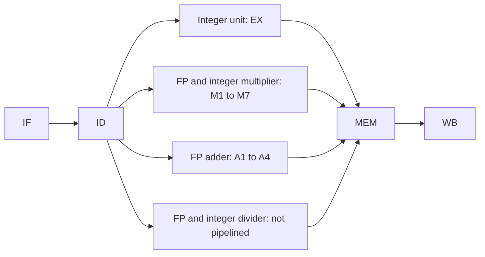
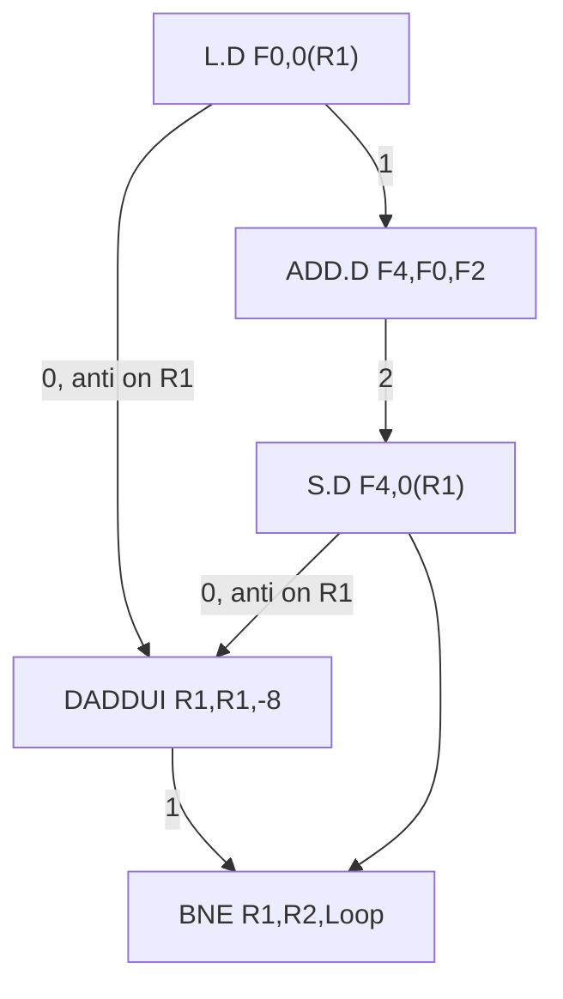

# بخش ۷، جلسه‌ی ۲ از ۱۳: خط لوله‌ی ممیز شناور و زمان‌بندی کد

این جلسه بخشی از **بخش ۷: موازی‌سازی ایستا در سطح دستور** است. زمان مطالعه: حدود نیم ساعت.

**فهرست این جلسه:**

- ۱. چرا عملیات ممیز شناور طولانی‌اند
- ۲. خط لوله‌ی ممیز شناور MIPS
- ۳. تعریف دقیق تأخیر
- ۴. مخاطره‌های جدید در خط لوله‌ی ممیز شناور
- ۵. جدول تأخیر این بخش
- ۶. مثال اصلی: حلقه‌ی بدون زمان‌بندی
- ۷. زمان‌بندی حلقه
- ۸. نسخه‌ی اسلاید درس: با پرش تأخیری
- ۹. کامپایلر چطور زمان‌بندی می‌کند
- ۱۰. تمرین‌ها

---

## ۱. چرا عملیات ممیز شناور طولانی‌اند

در خط لوله‌ی پنج‌مرحله‌ای بخش ۵، هر دستور فقط **یک سیکل** در مرحله‌ی EX می‌ماند. برای جمع و تفریق صحیح این شدنی است. ولی ضرب و تقسیم صحیح و همه‌ی عملیات ممیز شناور (جلسه‌های ۳-۵ تا ۳-۹) خیلی طولانی‌ترند. اگر سیکل ساعت را آن‌قدر بلند کنیم که یک تقسیم ممیز شناور در یک سیکل تمام شود، همه‌ی دستورات کند می‌شوند.

راه‌حل: مرحله‌ی EX برای این دستورات **چند سیکل** طول بکشد و چند واحد اجرایی جدا داشته باشیم.

## ۲. خط لوله‌ی ممیز شناور MIPS

پیوست C کتاب CAQA خط لوله‌ی MIPS را با چهار واحد اجرایی جدا گسترش می‌دهد:



کتاب برای هر واحد دو عدد تعریف می‌کند:

- **تأخیر (Latency):** تعداد سیکل‌های **بین** دستور تولیدکننده و دستور مصرف‌کننده که لازم است تا توقف رخ ندهد.
- **فاصله‌ی شروع (Initiation interval):** تعداد سیکل‌هایی که باید بین صدور دو دستور **از یک نوع** بگذرد.

| واحد | تأخیر | فاصله‌ی شروع |
|---|---|---|
| واحد ALU صحیح | 0 | 1 |
| حافظه‌ی داده (بارگذاری صحیح و ممیز شناور) | 1 | 1 |
| جمع ممیز شناور | 3 | 1 |
| ضرب ممیز شناور (و ضرب صحیح) | 6 | 1 |
| تقسیم ممیز شناور (و تقسیم صحیح) | 24 | 25 |

- **واحدهای خط لوله‌ای:** جمع‌کننده و ضرب‌کننده کاملاً خط لوله‌ای‌اند (فاصله‌ی شروع ۱). پس در هر سیکل می‌توان یک ضرب جدید شروع کرد، هرچند هر ضرب ۷ سیکل طول می‌کشد.
- **تقسیم‌کننده خط لوله‌ای نیست:** فاصله‌ی شروع ۲۵ یعنی تقسیم بعدی باید صبر کند تا تقسیم قبلی کاملاً تمام شود. دلیلش این است که تقسیم کم‌تکرار است و خط لوله‌ای کردنش گران.

## ۳. تعریف دقیق تأخیر

تعریف تأخیر در این بخش با تعریف روزمره فرق دارد و در حل مسئله خیلی مهم است:

> تأخیر یعنی تعداد **سیکل‌های خالی بین** دو دستور وابسته، اگر بخواهیم هیچ توقفی نداشته باشیم.

پس اگر تأخیر L باشد و تولیدکننده در سیکل t صادر شود، مصرف‌کننده زودتر از سیکل زیر نمی‌تواند صادر شود:

```math
t_{\text{consumer}} \ge t_{\text{producer}} + L + 1
```

مثال‌ها:

- **واحد ALU صحیح، تأخیر ۰:** دستور وابسته می‌تواند درست در سیکل بعد بیاید (با ارسال رو به جلو).
- **بارگذاری، تأخیر ۱:** یک سیکل بین `lw` و استفاده‌اش لازم است. این همان مخاطره‌ی بارگذاری-استفاده‌ی جلسه‌ی ۵-۶ است.
- **قاعده‌ی کلی:** تأخیر تقریباً برابر است با تعداد مرحله‌های اجرایی منهای یک. جمع‌کننده چهار مرحله (A1 تا A4) دارد، پس تأخیر ۳.
- **استثنای ذخیره:** دستور ذخیره، مقداری که باید ذخیره کند را یک سیکل دیرتر (در MEM) لازم دارد. پس تأخیر تا ذخیره برای **مقدار ذخیره‌شونده** یک واحد کمتر است. ولی برای **ثبات پایه‌ی آدرس** کم نمی‌شود، چون آدرس در EX حساب می‌شود.

## ۴. مخاطره‌های جدید در خط لوله‌ی ممیز شناور

با واحدهای چندسیکلی، چند پدیده‌ی تازه پیدا می‌شود:

- **مخاطره‌ی ساختاری:** تقسیم‌کننده خط لوله‌ای نیست، پس دو تقسیم نزدیک به هم با هم تداخل دارند. همچنین چند دستور با طول‌های مختلف ممکن است در یک سیکل به WB برسند و همه بخواهند در فایل ثبات بنویسند.
- **توقف‌های RAW بیشتر:** چون تأخیرها بلندترند، فاصله‌ی لازم بین دستورات وابسته بیشتر است.
- **مخاطره‌ی WAW ممکن می‌شود:** دستورات به ترتیب صادر ولی **خارج از ترتیب تمام** می‌شوند. مثلاً `DIV.D F0,...` و کمی بعد `L.D F0,...`: بارگذاری زودتر تمام می‌شود و اگر کاری نکنیم، تقسیم بعداً مقدار F0 را بازنویسی می‌کند.
- **استثنای غیردقیق:** اگر تقسیم استثنا بدهد ولی دستورات بعدی کوتاه‌تر قبلاً تمام شده باشند، وضعیت پردازنده دیگر با ترتیب برنامه نمی‌خواند. این مشکل در بخش ۸ با بافر بازترتیب حل می‌شود.

## ۵. جدول تأخیر این بخش

فصل ۳ کتاب CAQA و اسلاید درس برای همه‌ی مثال‌ها از این جدول ساده‌تر استفاده می‌کنند:

| دستور تولیدکننده | دستور مصرف‌کننده | تأخیر (سیکل) |
|---|---|---|
| عملیات ALU ممیز شناور | عملیات ALU ممیز شناور دیگر | 3 |
| عملیات ALU ممیز شناور | ذخیره‌ی دودقتی | 2 |
| بارگذاری دودقتی | عملیات ALU ممیز شناور | 1 |
| بارگذاری دودقتی | ذخیره‌ی دودقتی | 0 |

فرض‌های دیگر:

- **عملیات صحیح:** تأخیر بارگذاری صحیح ۱ و تأخیر ALU صحیح ۰.
- **پرش:** خط لوله‌ی پنج‌مرحله‌ای استاندارد، پس پرش در ID تصمیم می‌گیرد. در نتیجه یک دستور ALU صحیح و پرشی که به نتیجه‌ی آن وابسته است، باید یک سیکل فاصله داشته باشند (جلسه‌ی ۵-۷: پرش در ID مقدار را زودتر از EX لازم دارد).
- **بدون مخاطره‌ی ساختاری:** همه‌ی واحدها کاملاً خط لوله‌ای یا تکراری‌اند. پس در هر سیکل می‌توان یک دستور از هر نوعی صادر کرد.

چرا «بارگذاری به ذخیره» تأخیر ۰ دارد؟ چون نتیجه‌ی بارگذاری در انتهای MEM آماده است و ذخیره‌ی بعدی آن را در MEM خودش لازم دارد، یعنی یک سیکل بعد. پس با ارسال، بدون توقف می‌رسد. چرا «جمع به ذخیره» ۲ است و نه ۳؟ به خاطر همان استثنای ذخیره‌ی بخش ۳.

## ۶. مثال اصلی: حلقه‌ی بدون زمان‌بندی

حلقه‌ای که یک عدد ثابت s را به همه‌ی عناصر یک آرایه اضافه می‌کند:

```c
for (i = 999; i >= 0; i = i - 1)
    x[i] = x[i] + s;
```

در کد MIPS، ثبات R1 در ابتدا آدرس عنصری با بالاترین آدرس است، F2 مقدار s را دارد و R2 طوری از قبل حساب شده که `8(R2)` آدرس آخرین عنصر باشد:

```asm
Loop:   L.D     F0,0(R1)      ; F0 = array element
        ADD.D   F4,F0,F2      ; add scalar in F2
        S.D     F4,0(R1)      ; store result
        DADDUI  R1,R1,#-8     ; decrement pointer
        BNE     R1,R2,Loop    ; branch R1 != R2
```

با جدول بخش ۵ و بدون هیچ زمان‌بندی، هر تکرار **۹ سیکل** طول می‌کشد:

| دستور | سیکل صدور | دلیل توقف |
|---|---|---|
| دستور `L.D F0,0(R1)` | 1 | |
| توقف | 2 | بارگذاری به ALU ممیز شناور: تأخیر ۱ |
| دستور `ADD.D F4,F0,F2` | 3 | |
| توقف | 4 | جمع به ذخیره: تأخیر ۲ |
| توقف | 5 | |
| دستور `S.D F4,0(R1)` | 6 | |
| دستور `DADDUI R1,R1,#-8` | 7 | |
| توقف | 8 | ALU صحیح به پرش: یک سیکل |
| دستور `BNE R1,R2,Loop` | 9 | |

## ۷. زمان‌بندی حلقه

کامپایلر می‌تواند `DADDUI` را بالا ببرد تا شکاف بعد از `L.D` را پر کند:

```asm
Loop:   L.D     F0,0(R1)
        DADDUI  R1,R1,#-8
        ADD.D   F4,F0,F2
        stall
        stall
        S.D     F4,8(R1)      ; offset changed from 0 to 8
        BNE     R1,R2,Loop
```

حالا هر تکرار **۷ سیکل** است. سه نکته‌ی ظریف:

- **تغییر جابه‌جایی ذخیره:** چون `DADDUI` حالا قبل از `S.D` اجرا می‌شود، R1 هشت واحد کمتر شده است. پس آدرس ذخیره باید از `0(R1)` به `8(R1)` تغییر کند. کامپایلر باید وابستگی بین `S.D` و `DADDUI` (ضدوابستگی روی R1) را بفهمد و جبرانش کند.
- **دو توقف باقی‌مانده:** این دو توقف برای فاصله‌ی `ADD.D` تا `S.D` است. در یک تکرار دستور مستقل دیگری نداریم که این شکاف را پر کند.
- **کار مفید در برابر سربار:** از ۷ سیکل، فقط ۳ سیکل کار واقعی روی آرایه است (بارگذاری، جمع، ذخیره). ۴ سیکل دیگر **سربار** است: `DADDUI`، `BNE` و دو توقف. برای حذف این سربار، باید نسبت دستورات مفید به دستورات سربار را بالا ببریم. این همان **باز کردن حلقه** در جلسه‌ی بعد است.

## ۸. نسخه‌ی اسلاید درس: با پرش تأخیری

اسلاید درس (برگرفته از ویرایش‌های قدیمی‌تر CAQA) همین مثال را با یک فرض اضافه حل می‌کند: پرش **تأخیری** است و یک شکاف تأخیر دارد (جلسه‌ی ۵-۷). کتاب ویرایش ۵ پرش تأخیری را نادیده می‌گیرد. در امتحان باید دقت کنی کدام فرض داده شده است.

**بدون زمان‌بندی (اسلاید):** همان ۹ سیکل، به‌علاوه‌ی یک سیکل برای شکاف تأخیر خالی بعد از `BNE`. یعنی **۱۰ سیکل**:

| دستور | سیکل |
|---|---|
| دستور `L.D F0,0(R1)` | 1 |
| توقف | 2 |
| دستور `ADD.D F4,F0,F2` | 3 |
| توقف | 4 |
| توقف | 5 |
| دستور `S.D F4,0(R1)` | 6 |
| دستور `DADDUI R1,R1,#-8` | 7 |
| توقف | 8 |
| دستور `BNE R1,R2,Loop` | 9 |
| توقف (شکاف تأخیر خالی) | 10 |

**با زمان‌بندی (اسلاید):** حالا `S.D` می‌تواند به **شکاف تأخیر** برود:

```asm
Loop:   L.D     F0,0(R1)
        DADDUI  R1,R1,#-8
        ADD.D   F4,F0,F2
        stall
        BNE     R1,R2,Loop    ; delayed branch
        S.D     F4,8(R1)      ; in the delay slot
```

| دستور | سیکل |
|---|---|
| دستور `L.D F0,0(R1)` | 1 |
| دستور `DADDUI R1,R1,#-8` | 2 |
| دستور `ADD.D F4,F0,F2` | 3 |
| توقف | 4 |
| دستور `BNE R1,R2,Loop` | 5 |
| دستور `S.D F4,8(R1)` | 6 |

نتیجه: **۶ سیکل** در هر تکرار. اسلاید می‌گوید با این وابستگی‌ها ۶ سیکل بهینه است. توجه کن که `S.D` در سیکل ۶ است و `ADD.D` در سیکل ۳، پس فاصله‌ی ۲ سیکل لازم رعایت شده. پرش در سیکل ۵ است و `DADDUI` در سیکل ۲، پس پرش هم مقدار درست R1 را دارد.

## ۹. کامپایلر چطور زمان‌بندی می‌کند

کاری که بالا دستی انجام دادیم را کامپایلر به صورت سیستماتیک انجام می‌دهد. روش رایج، **زمان‌بندی فهرستی (List scheduling)** است:

1. **ساخت گراف وابستگی:** هر دستور یک گره است. هر وابستگی (داده، نامی، حافظه) یک یال است و وزن یال، تأخیر لازم.
2. **محاسبه‌ی مسیر بحرانی:** برای هر گره، طولانی‌ترین مسیر تا انتهای گراف حساب می‌شود. دستوراتی که روی **مسیر بحرانی (Critical path)** هستند، اولویت بالاتری دارند.
3. **زمان‌بندی سیکل به سیکل:** در هر سیکل، از بین دستورات **آماده** (یعنی همه‌ی پیش‌نیازهایشان با رعایت تأخیر تمام شده)، دستور با بالاترین اولویت صادر می‌شود. اگر هیچ دستوری آماده نبود، توقف (یا `nop`) گذاشته می‌شود.

گراف وابستگی حلقه‌ی ما (عدد روی یال، تأخیر است):



یال‌های «anti» ضدوابستگی‌اند. کامپایلر با **تنظیم جابه‌جایی** (offset) آدرس `S.D` می‌تواند ضدوابستگی بین `S.D` و `DADDUI` را بشکند. این همان کاری است که در قسمت ۷ همین جلسه کردیم.

مسیر بحرانی این گراف: `L.D` و ۱ سیکل و `ADD.D` و ۲ سیکل و `S.D` و `BNE`. یعنی دست‌کم ۱ + ۱ + ۱ + ۲ + ۱ + ۱ = ۷ سیکل از صدور `L.D` تا صدور `BNE`. پس بدون پرش تأخیری، ۷ سیکل واقعاً کمترین مقدار ممکن برای یک تکرار است.

## ۱۰. تمرین‌ها

<details>
<summary>تمرین ۱: تأخیر ضرب</summary>

**صورت:** در حلقه‌ی بخش ۶، به جای `ADD.D` از `MUL.D F4,F0,F2` استفاده می‌کنیم. تأخیر ضرب به ضرب دیگر ۶ و ضرب به ذخیره ۵ است. حلقه‌ی بدون زمان‌بندی و با زمان‌بندی چند سیکل طول می‌کشد (بدون پرش تأخیری)؟

**جواب:** بدون زمان‌بندی: `L.D` (1)، توقف (2)، `MUL.D` (3)، پنج توقف (4 تا 8)، `S.D` (9)، `DADDUI` (10)، توقف (11)، `BNE` (12). یعنی **۱۲ سیکل**. با زمان‌بندی: `L.D` (1)، `DADDUI` (2)، `MUL.D` (3)، پنج توقف (4 تا 8)، `S.D 8(R1)` (9)، `BNE` (10). یعنی **۱۰ سیکل**. هرچه تأخیر بیشتر باشد، زمان‌بندی تنها کمتر کمک می‌کند و باز کردن حلقه لازم‌تر می‌شود.
</details>

<details>
<summary>تمرین ۲: مخاطره‌ی WAW</summary>

**صورت:** در خط لوله‌ی ممیز شناور MIPS (جدول بخش ۲)، کد زیر را در نظر بگیر. آیا مخاطره‌ی WAW رخ می‌دهد؟

```asm
DIV.D   F0,F2,F4
L.D     F0,0(R1)
```

**جواب:** بله، اگر سخت‌افزار کاری نکند. تقسیم ۲۵ سیکل طول می‌کشد و بارگذاری خیلی زودتر به WB می‌رسد. بعد تقسیم مقدار F0 را بازنویسی می‌کند، در حالی که طبق ترتیب برنامه مقدار نهایی باید مقدار بارگذاری باشد. راه‌حل‌ها: صدور `L.D` را تا نزدیک تمام شدن تقسیم عقب بینداز، یا نوشتن نتیجه‌ی تقسیم را لغو کن. در عمل چنین کدی بی‌معنی است (نتیجه‌ی تقسیم هرگز خوانده نمی‌شود)، ولی سخت‌افزار باید درست رفتار کند.
</details>

<details>
<summary>تمرین ۳: زمان‌بندی حلقه‌ی دو آرایه</summary>

**صورت:** حلقه‌ی `x[i] = x[i] + y[i]` را با جدول بخش ۵ بنویس و زمان‌بندی کن (بدون باز کردن و بدون پرش تأخیری). هر تکرار چند سیکل است؟

**جواب:** کد زمان‌بندی‌شده:

```asm
Loop:   L.D     F0,0(R1)
        L.D     F2,0(R2)
        DADDUI  R1,R1,#-8
        ADD.D   F4,F0,F2
        DADDUI  R2,R2,#-8
        stall
        S.D     F4,8(R1)
        BNE     R1,R3,Loop
```

بارگذاری دوم در سیکل ۲ است و `ADD.D` در سیکل ۴، پس تأخیر ۱ رعایت شده. ذخیره باید دست‌کم در سیکل 4 + 2 + 1 = 7 باشد. پرش در سیکل ۸ است و `DADDUI R1` در سیکل ۳، پس مشکلی ندارد. نتیجه: **۸ سیکل** با یک توقف.
</details>

---

جلسه‌ی قبلی: [موازی‌سازی در سطح دستور و وابستگی‌ها](7-1-ilp-and-dependences.md)  
جلسه‌ی بعدی: [باز کردن حلقه](7-3-loop-unrolling.md)
