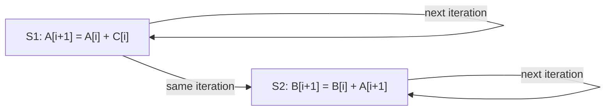
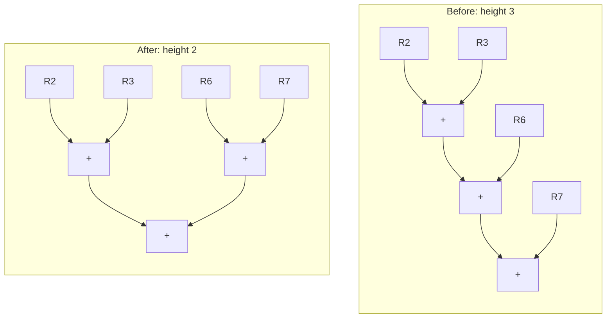

# بخش ۷، جلسه‌ی ۵ از ۱۳: تحلیل وابستگی و موازی‌سازی در سطح حلقه

این جلسه بخشی از **بخش ۷: موازی‌سازی ایستا در سطح دستور** است. زمان مطالعه: حدود نیم ساعت.

**فهرست این جلسه:**

- ۱. وابستگی بین تکرارها
- ۲. مثال اول: وابستگی دوری
- ۳. مثال دوم: وابستگی بین تکرارها بدون دور
- ۴. مثال اسلاید: سه دستور
- ۵. بازگشت و فاصله‌ی وابستگی
- ۶. پیدا کردن وابستگی: اندیس آفین و آزمون GCD
- ۷. دسته‌بندی وابستگی‌ها و تغییر نام
- ۸. محدودیت‌های تحلیل: اشاره‌گرها
- ۹. حذف محاسبات وابسته
- ۱۰. تمرین‌ها

---

## ۱. وابستگی بین تکرارها

تحلیل **موازی‌سازی در سطح حلقه** معمولاً در سطح کد منبع (یا نزدیک به آن) انجام می‌شود، چون کامپایلر آنجا حلقه‌ها، آرایه‌ها و متغیرهای شمارنده را راحت تشخیص می‌دهد. سؤال اصلی:

> آیا داده‌ای که در یک تکرار تولید می‌شود، در تکرار بعدی استفاده می‌شود؟

به چنین وابستگی‌ای **وابستگی بین تکرارها (Loop-carried dependence)** می‌گوییم. حلقه‌ای که چنین وابستگی‌ای ندارد، **موازی** است: همه‌ی تکرارهایش را می‌توان همزمان اجرا کرد. اسلاید درس می‌گوید اگر ۱۰۰۰ پردازنده داشتیم، می‌توانستیم هر تکرار را به یک پردازنده بدهیم.

```c
for (i = 1000; i > 0; i = i - 1)
    x[i] = x[i] + s;
```

اینجا بین دو استفاده از `x[i]` وابستگی هست، ولی **داخل یک تکرار** است. بین مقدارهای i در تکرارهای پشت سر هم وابستگی بین تکرارها هست، ولی i یک **متغیر استقرایی (Induction variable)** است که کامپایلر راحت تشخیص می‌دهد و حذفش می‌کند (همان کاری که در باز کردن حلقه با ادغام `DADDUI`ها کردیم). پس این حلقه موازی است.

## ۲. مثال اول: وابستگی دوری

```c
for (i = 1; i <= 100; i = i + 1) {
    A[i + 1] = A[i] + C[i];    /* S1 */
    B[i + 1] = B[i] + A[i + 1]; /* S2 */
}
```

فرض: آرایه‌های A، B و C جدا هستند و روی هم نمی‌افتند. دو نوع وابستگی هست:

- **وابستگی بین تکرارها:** دستور S1 در تکرار i مقدار `A[i + 1]` را می‌سازد که S1 در تکرار i + 1 می‌خواند. همین برای S2 و آرایه‌ی B هم درست است.
- **وابستگی داخل تکرار:** دستور S2 مقدار `A[i + 1]` را که S1 در **همین تکرار** ساخته، استفاده می‌کند.



اثر این دو فرق دارد:

- **وابستگی S1 به خودش:** یک **دور** است. تکرار i به تکرار i − 1 وابسته است و آن به i − 2 و الی آخر. پس تکرارها **باید پشت سر هم** اجرا شوند.
- **وابستگی S2 به S1:** اگر تنها وابستگی بود، تکرارهای مختلف می‌توانستند موازی اجرا شوند، فقط ترتیب S1 و S2 داخل هر تکرار باید حفظ می‌شد.

## ۳. مثال دوم: وابستگی بین تکرارها بدون دور

```c
for (i = 1; i <= 100; i = i + 1) {
    A[i] = A[i] + B[i];        /* S1 */
    B[i + 1] = C[i] + D[i];    /* S2 */
}
```

دستور S1 مقدار `B[i]` را می‌خواند که S2 در **تکرار قبلی** ساخته است. پس وابستگی بین تکرارها هست. ولی این وابستگی **دوری نیست**: هیچ دستوری به خودش وابسته نیست و S2 به S1 وابسته نیست. زنجیره بعد از یک قدم تمام می‌شود.

قاعده‌ی کلیدی کتاب: **حلقه‌ای که در گراف وابستگی‌هایش دور نباشد، موازی است**، چون وابستگی‌ها فقط یک ترتیب جزئی می‌سازند. ولی باید حلقه را تبدیل کرد تا موازی‌سازی آشکار شود. دو مشاهده:

1. **از S1 به S2 وابستگی نیست.** پس جابه‌جا کردن دو دستور اجرای S2 را عوض نمی‌کند.
2. **در اولین تکرار،** S1 به مقدار `B[1]` وابسته است که قبل از حلقه وجود داشته.

حلقه‌ی تبدیل‌شده:

```c
A[1] = A[1] + B[1];
for (i = 1; i <= 99; i = i + 1) {
    B[i + 1] = C[i] + D[i];
    A[i + 1] = A[i + 1] + B[i + 1];
}
B[101] = C[100] + D[100];
```

حالا وابستگی بین دو دستور **داخل یک تکرار** است و دیگر بین تکرارها نیست. پس تکرارها می‌توانند با هم‌پوشانی اجرا شوند، به شرط اینکه دو دستور داخل هر تکرار به ترتیب بمانند.

## ۴. مثال اسلاید: سه دستور

اسلاید درس این مثال را برای تحلیل می‌دهد:

```c
for (i = 1; i <= 100; i = i + 1) {
    A[i] = A[i] + B[i];        /* S1 */
    B[i + 1] = C[i] + D[i];    /* S2 */
    C[i + 1] = E[i] + D[i];    /* S3 */
}
```

**وابستگی‌ها:**

- **دستور S1 به S2:** دستور S1 مقدار `B[i]` را می‌خواند که S2 در تکرار قبل نوشته (بین تکرارها).
- **دستور S2 به S3:** دستور S2 مقدار `C[i]` را می‌خواند که S3 در تکرار قبل نوشته (بین تکرارها).
- **دستور S3:** فقط E و D را می‌خواند که در حلقه نوشته نمی‌شوند. به هیچ دستوری وابسته نیست.

زنجیره: S3 در تکرار i − 1، بعد S2 در تکرار i، بعد S1 در تکرار i + 1. باز هم **دور نیست**، پس حلقه موازی‌پذیر است.

**یک راه موازی‌سازی: تقسیم حلقه (Loop distribution یا Loop fission).** چون دور نیست، می‌توان حلقه را به سه حلقه‌ی جدا شکست، به ترتیب «تولیدکننده قبل از مصرف‌کننده»:

```c
for (i = 1; i <= 100; i = i + 1)
    C[i + 1] = E[i] + D[i];    /* all S3 */
for (i = 1; i <= 100; i = i + 1)
    B[i + 1] = C[i] + D[i];    /* all S2: uses C[1] from before, C[2..100] from loop 1 */
for (i = 1; i <= 100; i = i + 1)
    A[i] = A[i] + B[i];        /* all S1: uses B[1] from before, B[2..100] from loop 2 */
```

هر کدام از این سه حلقه کاملاً موازی است (هیچ وابستگی بین تکرارها ندارد). روش دیگر، مثل بخش ۳، جابه‌جایی دستورات و بیرون کشیدن اولین و آخرین تکرار است.

## ۵. بازگشت و فاصله‌ی وابستگی

وابستگی بین تکرارها اغلب شکل **بازگشت (Recurrence)** دارد: یک متغیر بر اساس مقدار خودش در تکرار قبل تعریف می‌شود.

```c
for (i = 2; i <= 100; i = i + 1)
    Y[i] = Y[i - 1] + Y[i];
```

حالا این را ببین:

```c
for (i = 6; i <= 100; i = i + 1)
    Y[i] = Y[i - 5] + Y[i];
```

در تکرار i به عنصر i − 5 مراجعه می‌شود. به عدد ۵ **فاصله‌ی وابستگی (Dependence distance)** می‌گوییم. حلقه‌ی اول فاصله‌ی ۱ دارد.

- **فاصله‌ی ۱:** اگر حلقه را باز کنیم، دستورات پشت سر هم به هم وابسته‌اند و موازی‌سازی کمی پیدا می‌شود.
- **فاصله‌ی ۵:** اگر حلقه را ۵ بار باز کنیم، ۵ دستور مستقل داریم. یعنی هرچه فاصله بیشتر، موازی‌سازی بیشتر.

تشخیص بازگشت دو فایده دارد: بعضی معماری‌ها (به‌خصوص برداری) پشتیبانی ویژه برای آن دارند، و بعضی بازگشت‌ها (مثل حالت فاصله‌ی ۵) موازی‌سازی خوبی دارند.

## ۶. پیدا کردن وابستگی: اندیس آفین و آزمون GCD

تحلیل وابستگی برای سه کار لازم است: (۱) زمان‌بندی خوب کد، (۲) تشخیص حلقه‌های موازی، (۳) حذف وابستگی‌های نامی.

تقریباً همه‌ی الگوریتم‌ها فرض می‌کنند اندیس‌ها **آفین (Affine)** هستند: اندیس یک‌بعدی به شکل a × i + b، که a و b ثابت‌اند و i متغیر حلقه. دسترسی‌های آرایه‌ی خلوت مثل `x[y[i]]` آفین نیستند.

فرض کن حلقه در خانه‌ی a × i + b می‌نویسد و از خانه‌ی c × i + d می‌خواند، و i از m تا n می‌رود. وابستگی وجود دارد اگر:

- دو اندیس j و k در بازه‌ی حلقه باشند: m ≤ j ≤ n و m ≤ k ≤ n.
- خانه‌ی نوشته‌شده در تکرار j همان خانه‌ی خوانده‌شده در تکرار k باشد:

```math
a \times j + b = c \times k + d
```

حل دقیق این مسئله در حالت کلی سخت است (کتاب می‌گوید NP-complete). ولی یک آزمون ساده برای **نبود** وابستگی وجود دارد.

**آزمون بزرگ‌ترین مقسوم‌علیه مشترک (GCD test):** اگر وابستگی بین تکرارها وجود داشته باشد، آنگاه GCD(a, c) باید (d − b) را بشمارد. پس اگر نشمارد، **قطعاً** وابستگی نیست.

مثال کتاب:

```c
for (i = 1; i <= 100; i = i + 1)
    X[2 * i + 3] = X[2 * i] * 5.0;
```

اینجا a = 2، b = 3، c = 2 و d = 0. پس GCD(2, 2) = 2 و d − b = −3. عدد ۲ عدد −۳ را نمی‌شمارد، پس **هیچ وابستگی‌ای ممکن نیست**. دلیل شهودی: خانه‌های نوشته‌شده همه فردند (2i + 3) و خانه‌های خوانده‌شده همه زوج (2i).

محدودیت آزمون GCD: شرط **کافی** برای نبود وابستگی است، نه لازم. ممکن است آزمون بگوید «شاید وابستگی باشد» ولی در واقع نباشد، چون مثلاً **مرزهای حلقه** را در نظر نمی‌گیرد.

## ۷. دسته‌بندی وابستگی‌ها و تغییر نام

کامپایلر علاوه بر پیدا کردن وابستگی، نوعش را هم تعیین می‌کند تا وابستگی‌های نامی را با تغییر نام حذف کند. مثال کتاب:

```c
for (i = 1; i <= 100; i = i + 1) {
    Y[i] = X[i] / c;    /* S1 */
    X[i] = X[i] + c;    /* S2 */
    Z[i] = Y[i] + c;    /* S3 */
    Y[i] = c - Y[i];    /* S4 */
}
```

| نوع | بین | روی |
|---|---|---|
| وابستگی واقعی | دستور S1 به S3 و S1 به S4 | آرایه‌ی Y (داخل تکرار) |
| ضدوابستگی | دستور S1 به S2 | آرایه‌ی X |
| ضدوابستگی | دستور S3 به S4 | آرایه‌ی Y |
| وابستگی خروجی | دستور S1 به S4 | آرایه‌ی Y |

وابستگی‌های واقعی داخل تکرارند و جلوی موازی بودن حلقه را نمی‌گیرند. سه وابستگی دیگر نامی‌اند و با تغییر نام حذف می‌شوند:

```c
for (i = 1; i <= 100; i = i + 1) {
    T[i]  = X[i] / c;   /* Y renamed to T: removes output dependence */
    X1[i] = X[i] + c;   /* X renamed to X1: removes antidependence */
    Z[i]  = T[i] + c;   /* Y renamed to T: removes antidependence */
    Y[i]  = c - T[i];
}
```

بعد از حلقه، کامپایلر در کد بعدی هر جا X بود از X1 استفاده می‌کند. اینجا تغییر نام کپی واقعی لازم ندارد و با جایگزینی نام یا تخصیص ثبات انجام می‌شود. در موارد دیگر ممکن است کپی لازم باشد.

## ۸. محدودیت‌های تحلیل: اشاره‌گرها

تحلیل وابستگی آرایه‌ای فقط در شرایط محدودی کار می‌کند: یک لانه‌ی حلقه با اندیس‌های آفین. در این حالت‌ها کم می‌آورد:

- **اشاره‌گرها:** وقتی به اشیا با اشاره‌گر مراجعه می‌شود، نه با اندیس آرایه.
- **اندیس غیرمستقیم:** مثل `x[y[i]]` در آرایه‌های خلوت.
- **وابستگی وابسته به ورودی:** وابستگی برای بعضی ورودی‌ها ممکن است ولی در عمل هیچ‌وقت رخ نمی‌دهد.
- **سؤال دقیق‌تر:** وقتی کامپایلر باید بداند یک خواندن دقیقاً به **کدام** نوشتن وابسته است.

برای اشاره‌گرها، تحلیل دیگری به نام **تحلیل اشاره‌به (Points-to analysis)** لازم است: آیا دو اشاره‌گر می‌توانند به یک خانه اشاره کنند؟ این تحلیل از سه منبع کمک می‌گیرد: نوع داده‌ها، محل تخصیص اشیا و انتساب‌های اشاره‌گر. ولی معمولاً **بین‌رویه‌ای (Interprocedural)** است، یعنی باید چند تابع را با هم تحلیل کند که گران است. اگر کامپایلر چیزی درباره‌ی دو اشاره‌گر پارامتر نداند، باید بدترین حالت را فرض کند: شاید به یک جا اشاره کنند.

یک کمک عملی در زبان C: کلمه‌ی کلیدی `restrict` (از C99). برنامه‌نویس با آن قول می‌دهد که این اشاره‌گر تنها راه دسترسی به آن داده است:

```c
/* without restrict, the compiler must assume x and y may overlap */
void add(double *restrict x, const double *restrict y, int n)
{
    for (int i = 0; i < n; i++)
        x[i] = x[i] + y[i];
}
```

با این قول، کامپایلر می‌تواند بارگذاری‌های y را قبل از ذخیره‌های x ببرد، حلقه را باز کند یا برداری کند.

## ۹. حذف محاسبات وابسته

کامپایلر می‌تواند با **جایگزینی رو به عقب (Back substitution)** زنجیره‌های وابسته را کوتاه کند.

**انتشار کپی (Copy propagation) و ساده‌سازی جبری** در یک بلوک پایه:

```asm
DADDUI  R1,R2,#4
DADDUI  R1,R1,#4
```

اگر این تنها استفاده از R1 باشد، به یک دستور تبدیل می‌شود:

```asm
DADDUI  R1,R2,#8
```

همین کار را در باز کردن حلقه با ادغام `DADDUI`ها کردیم.

**کاهش ارتفاع درخت (Tree height reduction).** گاهی می‌خواهیم موازی‌سازی را بیشتر کنیم، حتی اگر تعداد عملیات کم نشود:

```asm
ADD  R1,R2,R3
ADD  R4,R1,R6
ADD  R8,R4,R7
```

هر دستور به قبلی وابسته است، پس دست‌کم سه سیکل اجرا لازم است. با استفاده از شرکت‌پذیری:

```asm
ADD  R1,R2,R3
ADD  R4,R6,R7
ADD  R8,R1,R4
```

دو دستور اول مستقل‌اند، پس دو سیکل اجرا کافی است. درخت محاسبه «پهن‌تر ولی کوتاه‌تر» شده:



**بازگشت‌ها در حلقه‌ی بازشده.** اگر حلقه‌ای با `sum = sum + x` را پنج بار باز کنیم:

```math
\text{sum} = \text{sum} + x_1 + x_2 + x_3 + x_4 + x_5
```

این پنج عملیات وابسته است، ولی می‌توان نوشت:

```math
\text{sum} = ((\text{sum} + x_1) + (x_2 + x_3)) + (x_4 + x_5)
```

که فقط سه عملیات وابسته دارد. این دقیقاً همان کاری است که در آزمایش جلسه‌ی ۷-۳ با چهار جمع‌کننده کردیم.

**هشدار:** حساب کامپیوتر شرکت‌پذیر **نیست**. حساب صحیح به خاطر محدوده‌ی محدود (سرریز) و حساب ممیز شناور به خاطر محدوده و دقت (جلسه‌ی ۳-۹). پس این تبدیل‌ها گاهی نتیجه را عوض می‌کنند. به همین دلیل بیشتر کامپایلرها این بهینه‌سازی‌ها را فقط با اجازه‌ی صریح انجام می‌دهند.

## ۱۰. تمرین‌ها

<details>
<summary>تمرین ۱: آزمون GCD</summary>

**صورت:** با آزمون GCD بررسی کن آیا در این حلقه وابستگی ممکن است:

```c
for (i = 1; i <= 100; i = i + 1)
    A[4 * i + 2] = A[6 * i + 1] + 1.0;
```

**جواب:** نوشتن با a = 4 و b = 2، خواندن با c = 6 و d = 1. پس GCD(4, 6) = 2 و d − b = −1. عدد ۲ عدد −۱ را نمی‌شمارد، پس **وابستگی ممکن نیست**. (شهودی: 4i + 2 همیشه زوج و 6i + 1 همیشه فرد است.)
</details>

<details>
<summary>تمرین ۲: آزمون GCD که شکست می‌خورد</summary>

**صورت:** حلقه‌ی زیر را بررسی کن:

```c
for (i = 1; i <= 10; i = i + 1)
    A[2 * i] = A[2 * i + 40] + 1.0;
```

**جواب:** نوشتن با a = 2 و b = 0، خواندن با c = 2 و d = 40. پس GCD(2, 2) = 2 و d − b = 40. عدد ۲ عدد ۴۰ را می‌شمارد، پس آزمون GCD می‌گوید «شاید وابستگی باشد». ولی در واقع خانه‌های نوشته‌شده ۲ تا ۲۰ و خانه‌های خوانده‌شده ۴۲ تا ۶۰ هستند و هیچ اشتراکی ندارند. آزمون GCD مرزهای حلقه را نمی‌بیند و اینجا محافظه‌کارانه جواب داده است.
</details>

<details>
<summary>تمرین ۳: دسته‌بندی وابستگی</summary>

**صورت:** همه‌ی وابستگی‌های این حلقه را بنویس و بگو آیا حلقه موازی است:

```c
for (i = 1; i <= 100; i = i + 1) {
    A[i] = B[i] + C[i];       /* S1 */
    D[i] = A[i] * E[i];       /* S2 */
    B[i + 1] = D[i] + 1.0;    /* S3 */
}
```

**جواب:** دستور S2 به S1 (آرایه‌ی A، داخل تکرار). دستور S3 به S2 (آرایه‌ی D، داخل تکرار). دستور S1 در تکرار i + 1 مقدار `B[i + 1]` را می‌خواند که S3 در تکرار i نوشته (بین تکرارها). پس دور داریم: S1 به S2 به S3 و دوباره S1 در تکرار بعد. حلقه **موازی نیست** و تکرارها باید پشت سر هم اجرا شوند (فقط کمی هم‌پوشانی داخل هر تکرار ممکن است).
</details>

<details>
<summary>تمرین ۴: کاهش ارتفاع درخت</summary>

**صورت:** عبارت `r = a + b + c + d + e + f + g + h` را اگر از چپ به راست حساب کنیم چند سطح عملیات وابسته دارد؟ کمترین ارتفاع ممکن چقدر است؟

**جواب:** از چپ به راست ۷ جمع پشت سر هم، یعنی ارتفاع ۷. با درخت متوازن: سطح اول ۴ جمع موازی، سطح دوم ۲ جمع، سطح سوم ۱ جمع. پس ارتفاع ۳ که برابر با لگاریتم ۸ در پایه‌ی ۲ است. تعداد کل جمع‌ها در هر دو حالت ۷ است.
</details>

---

جلسه‌ی قبلی: [حل سؤال‌های امتحانی باز کردن حلقه](7-4-unrolling-exam-problems.md)  
جلسه‌ی بعدی: [خط لوله‌ی نرم‌افزاری و زمان‌بندی سراسری](7-6-software-pipelining-global-scheduling.md)
