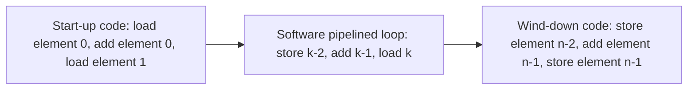
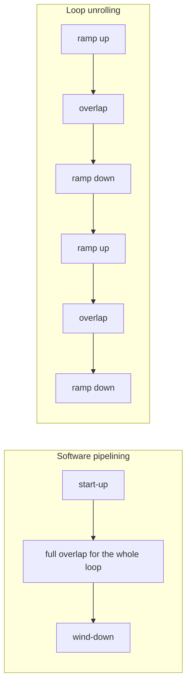
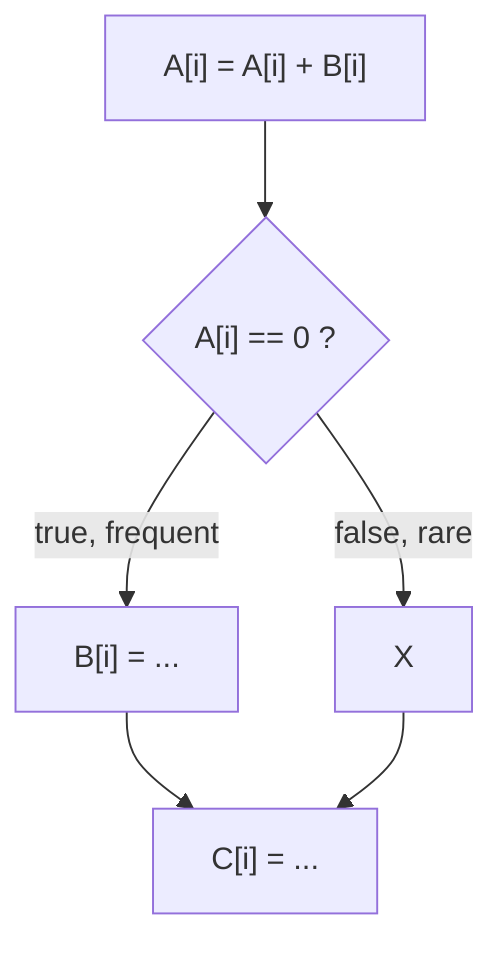
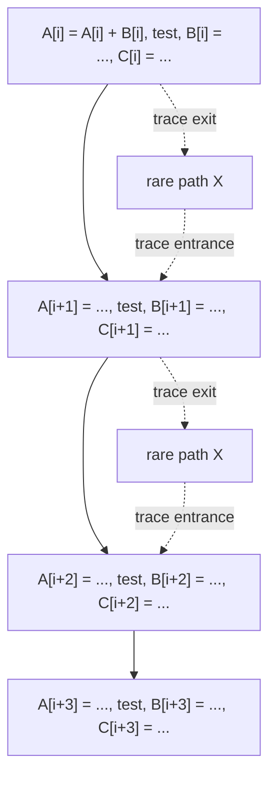
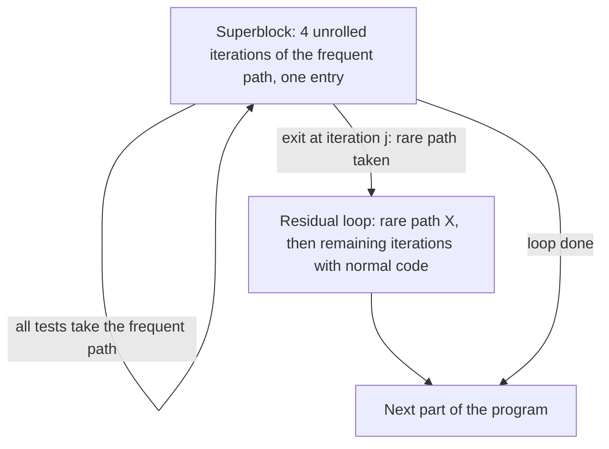

# بخش ۷، جلسه‌ی ۶ از ۱۳: خط لوله‌ی نرم‌افزاری و زمان‌بندی سراسری

این جلسه بخشی از **بخش ۷: موازی‌سازی ایستا در سطح دستور** است. زمان مطالعه: حدود نیم ساعت.

**فهرست این جلسه:**

- ۱. ایده‌ی خط لوله‌ی نرم‌افزاری
- ۲. مثال: حلقه‌ی جمع با عدد ثابت
- ۳. کد شروع و کد پایان
- ۴. مقایسه با باز کردن حلقه
- ۵. زمان‌بندی سراسری کد
- ۶. زمان‌بندی مسیر
- ۷. ابربلوک‌ها
- ۸. تمرین‌ها

---

## ۱. ایده‌ی خط لوله‌ی نرم‌افزاری

در جلسه‌ی ۷-۳ دیدیم که حلقه‌ی بازشده و زمان‌بندی‌شده، دستورات **تکرارهای مختلف** را در هم می‌آمیزد تا دستورات وابسته‌ی یک تکرار از هم فاصله بگیرند. **خط لوله‌ی نرم‌افزاری (Software pipelining)** همین ایده را **بدون باز کردن واقعی** پیاده می‌کند.

در خط لوله‌ی نرم‌افزاری، هر تکرار حلقه‌ی جدید از دستوراتی ساخته می‌شود که از **تکرارهای مختلف حلقه‌ی اصلی** برداشته شده‌اند. درست مثل خط لوله‌ی سخت‌افزاری که در هر سیکل، مرحله‌های مختلف دستورات مختلف را اجرا می‌کند.

| سیکل حلقه‌ی جدید | بارگذاری | جمع | ذخیره |
|---|---|---|---|
| تکرار جدید ۱ | عنصر ۳ | عنصر ۲ | عنصر ۱ |
| تکرار جدید ۲ | عنصر ۴ | عنصر ۳ | عنصر ۲ |
| تکرار جدید ۳ | عنصر ۵ | عنصر ۴ | عنصر ۳ |

هر عنصر در سه تکرار پشت سر هم «از خط لوله عبور می‌کند»: اول بارگذاری، بعد جمع، بعد ذخیره. کتاب CAQA می‌گوید این روش **نسخه‌ی نرم‌افزاری کاری است که الگوریتم توماسولو در سخت‌افزار انجام می‌دهد** (بخش ۸)، و به آن **باز کردن نمادین حلقه (Symbolic loop unrolling)** هم می‌گویند.

## ۲. مثال: حلقه‌ی جمع با عدد ثابت

حلقه‌ی همیشگی:

```asm
Loop:   L.D     F0,0(R1)
        ADD.D   F4,F0,F2
        S.D     F4,0(R1)
        DADDUI  R1,R1,#-8
        BNE     R1,R2,Loop
```

**قدم ۱: باز کردن نمادین.** سه تکرار پشت سر هم را بنویس (بدون سربار حلقه) و از هر کدام یک دستور انتخاب کن:

```asm
; iteration i
        L.D     F0,0(R1)
        ADD.D   F4,F0,F2
        S.D     F4,0(R1)        ; <- take the store from iteration i
; iteration i+1
        L.D     F0,0(R1)
        ADD.D   F4,F0,F2        ; <- take the add from iteration i+1
        S.D     F4,0(R1)
; iteration i+2
        L.D     F0,0(R1)        ; <- take the load from iteration i+2
        ADD.D   F4,F0,F2
        S.D     F4,0(R1)
```

**قدم ۲: کنار هم گذاشتن با کد کنترل حلقه.** ذخیره‌ی عنصر k − 2، جمع عنصر k − 1 و بارگذاری عنصر k (وقتی R1 در ابتدای تکرار به عنصر k اشاره می‌کند):

```asm
Loop:   S.D     F4,16(R1)       ; store element k-2
        DADDUI  R1,R1,#-8
        ADD.D   F4,F0,F2        ; add element k-1
        L.D     F0,8(R1)        ; load element k (offset fixed after DADDUI)
        BNE     R1,R2,Loop
```

**بررسی تأخیرها (جدول جلسه‌ی ۷-۲، بدون پرش تأخیری):**

| دستور | سیکل در هر تکرار | منبع مقدار | فاصله |
|---|---|---|---|
| دستور `S.D F4` | 1 | جمع تکرار قبل (سیکل ۳ آن) | ۲ سیکل خالی، لازم ۲ |
| دستور `DADDUI` | 2 | | |
| دستور `ADD.D F4` | 3 | بارگذاری تکرار قبل (سیکل ۴ آن) | ۳ سیکل خالی، لازم ۱ |
| دستور `L.D F0` | 4 | | |
| دستور `BNE` | 5 | دستور `DADDUI` در سیکل ۲ | ۲ سیکل خالی، لازم ۱ |

نتیجه: **۵ سیکل برای هر عنصر بدون هیچ توقف**، در برابر ۷ سیکل حلقه‌ی زمان‌بندی‌شده‌ی معمولی. کتاب با فرض پرش تأخیری همین عدد ۵ را به دست می‌آورد (`L.D` در شکاف تأخیر). کد حلقه کوتاه مانده است: هنوز ۵ دستور.

یک نکته‌ی مهم: در این کد ثبات‌ها بین دستورات تکرارهای مختلف **دوباره استفاده می‌شوند**. مثلاً `ADD.D` ثبات F4 را می‌نویسد که `S.D` همان تکرار کمی قبل خوانده است. این ضدوابستگی است و سخت‌افزار باید جلوی مخاطره‌ی WAR را بگیرد. در خط لوله‌ی به ترتیب ساده این مشکلی ندارد.

## ۳. کد شروع و کد پایان

حلقه‌ی بالا فرض می‌کند در ابتدای هر تکرار، F4 حاصل جمع عنصر k − 2 و F0 مقدار عنصر k − 1 را دارد. پس قبل از حلقه باید این وضعیت ساخته شود و بعد از حلقه، کارهای نیمه‌تمام کامل شوند.



کد کامل (عنصر ۰ در بالاترین آدرس، یعنی `0(R1)` در شروع، و R2 آدرس عنصر n است، یعنی یک خانه بعد از آخرین عنصر):

```asm
; start-up code
        L.D     F0,0(R1)        ; load element 0
        ADD.D   F4,F0,F2        ; add element 0
        L.D     F0,-8(R1)       ; load element 1
        DADDUI  R1,R1,#-16      ; R1 now points to element 2
; software pipelined loop: runs for k = 2 .. n-1
Loop:   S.D     F4,16(R1)       ; store element k-2
        DADDUI  R1,R1,#-8
        ADD.D   F4,F0,F2        ; add element k-1
        L.D     F0,8(R1)        ; load element k
        BNE     R1,R2,Loop
; wind-down code
        S.D     F4,16(R1)       ; store element n-2
        ADD.D   F4,F0,F2        ; add element n-1
        S.D     F4,8(R1)        ; store element n-1
```

کتاب همین را در کلمات می‌گوید: در شروع، بارگذاری تکرارهای ۱ و ۲ و جمع تکرار ۱ لازم است. در پایان، جمع آخرین تکرار و ذخیره‌ی دو تکرار آخر. چون بارگذاری و ذخیره دو تکرار از هم فاصله دارند، حلقه **دو تکرار کمتر** اجرا می‌شود.

## ۴. مقایسه با باز کردن حلقه

هر دو روش دستورات تکرارهای مختلف را در هم می‌آمیزند، ولی **دو نوع سربار متفاوت** را کم می‌کنند:

| ویژگی | باز کردن حلقه | خط لوله‌ی نرم‌افزاری |
|---|---|---|
| سربار حلقه (پرش و شمارنده) | کم می‌کند: یک بار برای هر k عنصر | کم نمی‌کند: هنوز در هر عنصر |
| زمان کار با سرعت کمتر از حداکثر | در شروع و پایان **هر** بلوک بازشده (m / k بار برای m تکرار) | فقط **یک بار** در شروع و یک بار در پایان کل حلقه |
| حجم کد | زیاد (k برابر بدنه) | کم (بدنه به‌علاوه‌ی کد شروع و پایان) |
| پیچیدگی ثبات‌ها | ثبات‌های جدا برای هر نسخه | مدیریت سخت، به‌خصوص وقتی تأخیرها بلندند |



چون این دو روش با دو سربار متفاوت مقابله می‌کنند، **بهترین کارایی از ترکیب هر دو** به دست می‌آید. همچنین وقتی بدنه‌ی حلقه دستورات کمی دارد و تأخیرها بلندند، یک تکرار فاصله کافی نیست و باید خط لوله‌ی نرم‌افزاری را با باز کردن ترکیب کرد.

کتاب هشدار می‌دهد که کامپایل با خط لوله‌ی نرم‌افزاری در عمل سخت است: خیلی از حلقه‌ها اول باید تبدیل شوند، انتخاب بین سربار و کارایی پیچیده است و مدیریت ثبات دردسر دارد. معماری IA-64 برای همین **ثبات‌های چرخشی (Rotating registers)** دارد که در جلسه‌ی ۷-۱۲ می‌بینیم.

## ۵. زمان‌بندی سراسری کد

باز کردن حلقه و خط لوله‌ی نرم‌افزاری وقتی خوب کار می‌کنند که بدنه‌ی حلقه یک بلوک پایه باشد. ولی خیلی از حلقه‌ها داخلشان `if` دارند. برای زمان‌بندی خوب، باید دستورات را **از روی پرش‌ها** جابه‌جا کرد. به این **زمان‌بندی سراسری کد (Global code scheduling)** می‌گوییم.

مثال کتاب (یک تکرار از یک حلقه، مسیر پرتکرار سمت چپ است):



کد MIPS معمولی (آدرس‌های A، B و C در R1، R2 و R3):

```asm
        LD      R4,0(R1)        ; load A
        LD      R5,0(R2)        ; load B
        DADDU   R4,R4,R5        ; add to A
        SD      R4,0(R1)        ; store A
        ...
        BNEZ    R4,elsepart     ; test A
        ...                     ; then part
        SD      ...,0(R2)       ; store to B
        ...
        J       join            ; jump over else
elsepart:
        ...                     ; else part
        X                       ; code for X
        ...
join:   ...                     ; after if
        SD      ...,0(R3)       ; store C[i]
```

برای کوتاه کردن مسیر پرتکرار، ممکن است بخواهیم انتساب به B و C را **قبل از آزمون** ببریم:

- **بردن B بالای پرش:** این کار **گمانه‌ای** است، چون B فقط در مسیر then لازم است. باید مطمئن شد جریان داده خراب نمی‌شود: اگر در X یا بعد از if از مقدار قبلی B استفاده شود، نمی‌توان B را جابه‌جا کرد. همچنین رفتار استثنا نباید عوض شود. کامپایلرها معمولاً دستورات دسترسی به حافظه را گمانه‌ای جابه‌جا نمی‌کنند، چون ممکن است استثنا بدهند (راه‌حل در جلسه‌ی ۷-۷).
- **بردن C بالای پرش:** دو قدم دارد. اول C از روی نقطه‌ی پیوند (join) به داخل بخش then می‌رود و یک **کپی** از آن در مسیر else گذاشته می‌شود (کد جبرانی). بعد از بخش then به بالای پرش می‌رود و آن کپی دیگر لازم نیست.

کتاب سؤال‌هایی را می‌شمارد که کامپایلر باید جواب دهد: فراوانی نسبی مسیر then و else چقدر است؟ هزینه‌ی اجرای B بالای پرش چقدر است (اگر شکاف خالی باشد، تقریباً مجانی است)؟ آیا B روی مسیر بحرانی است؟ آیا B بهترین گزینه برای جابه‌جایی است؟ هزینه‌ی کد جبرانی چقدر است؟ این تصمیم‌ها به هم وابسته‌اند و مسئله را خیلی پیچیده می‌کنند.

## ۶. زمان‌بندی مسیر

برای ساده کردن زمان‌بندی سراسری، دو روش مهم ساخته شده که هر دو یک ایده دارند: **روی پرتکرارترین مسیر تمرکز کن**.

**زمان‌بندی مسیر (Trace scheduling)** دو قدم دارد:

1. **انتخاب مسیر (Trace selection):** دنباله‌ای از بلوک‌های پایه که احتمالاً پشت سر هم اجرا می‌شوند انتخاب می‌شود، به نام **مسیر (Trace)**. حلقه‌ها باز می‌شوند (چون پرش حلقه تقریباً همیشه انجام می‌شود) و بقیه‌ی پرش‌ها با پیش‌بینی ایستا (معمولاً از پروفایل) یک طرفه فرض می‌شوند. نتیجه یک کد خطی طولانی است.
2. **فشرده‌سازی مسیر (Trace compaction):** کد مسیر زمان‌بندی می‌شود: دستورات تا جای ممکن بالا می‌روند و در کمترین تعداد دستور پهن (یا بسته‌ی صدور) قرار می‌گیرند.



پرش‌ها به شکل **خروج از مسیر** یا **ورود به مسیر** دیده می‌شوند. وقتی دستوری از روی این نقطه‌ها جابه‌جا می‌شود، در مسیر کم‌تکرار **کد حسابداری (Bookkeeping code)** لازم است تا نتیجه درست بماند. فرض اصلی: مسیر انتخاب‌شده آن‌قدر محتمل است که هزینه‌ی کد حسابداری مهم نیست.

کتاب می‌گوید زمان‌بندی مسیر در کدهای علمی با حلقه‌های سنگین و پروفایل دقیق موفق بوده، ولی برای برنامه‌های کمتر قابل پیش‌بینی معلوم نیست مناسب باشد، چون کد جبرانی زیاد می‌شود. این روش برای پردازنده‌های VLIW ساخته شد.

## ۷. ابربلوک‌ها

یکی از دردسرهای زمان‌بندی مسیر، **ورودی‌های وسط مسیر** است: وقتی از مسیر کم‌تکرار به وسط مسیر اصلی برمی‌گردیم، کامپایلر باید کد جبرانی پیچیده‌ای بسازد.

**ابربلوک (Superblock)** این مشکل را حل می‌کند: یک بلوک گسترش‌یافته با **فقط یک ورودی** ولی **چند خروجی**. چون ورودی وسط ندارد، فقط جابه‌جایی از روی خروجی‌ها باید بررسی شود و فشرده‌سازی ساده‌تر است.

ابربلوک با **تکرار دُم (Tail duplication)** ساخته می‌شود: به جای برگشت از مسیر کم‌تکرار به وسط ابربلوک، یک نسخه‌ی جدا از بقیه‌ی کد ساخته می‌شود. در مثال ما، هر خروج از ابربلوک به یک **حلقه‌ی باقی‌مانده** می‌رود که تکرارهای باقی را با کد معمولی اجرا می‌کند.



هزینه: حجم کد بیشتر، چون بخشی از کد تکرار می‌شود. سود: زمان‌بندی ساده‌تر و قابل تخمین‌تر.

کتاب جمع‌بندی می‌کند که باز کردن حلقه، خط لوله‌ی نرم‌افزاری، زمان‌بندی مسیر و زمان‌بندی ابربلوک همه برای این هستند که ILP کافی برای پردازنده‌هایی که در هر سیکل بیش از یک دستور صادر می‌کنند پیدا شود.

## ۸. تمرین‌ها

<details>
<summary>تمرین ۱: فاصله‌ی تکرارها در خط لوله‌ی نرم‌افزاری</summary>

**صورت:** در حلقه‌ی بخش ۲، فرض کن تأخیر جمع ممیز شناور به ذخیره به جای ۲، برابر ۶ باشد. آیا همان حلقه‌ی ۵ دستوری بدون توقف اجرا می‌شود؟ اگر نه، چه کار کنیم؟

**جواب:** در حلقه‌ی بخش ۲، فاصله‌ی `ADD.D` (سیکل ۳ تکرار قبل) تا `S.D` (سیکل ۱ تکرار بعد) فقط ۲ سیکل خالی است. با تأخیر ۶، چهار سیکل توقف لازم است. راه‌حل: ذخیره را از تکرار دورتری برداریم. یعنی بارگذاری عنصر k، جمع عنصر k − 1 و ذخیره‌ی عنصر k − 3. حالا بین جمع و ذخیره‌اش ۲ تکرار (۱۰ سیکل) فاصله است. ولی مقدار جمع باید دو تکرار زنده بماند، در حالی که جمع بعدی هم در F4 می‌نویسد. پس ثبات‌ها کم می‌آیند و باید حلقه را دو بار باز کرد تا دو ثبات مختلف (مثلاً F4 و F8) به‌تناوب استفاده شوند. این همان ترکیب خط لوله‌ی نرم‌افزاری و باز کردن است.
</details>

<details>
<summary>تمرین ۲: تعداد دفعات کار با سرعت کمتر</summary>

**صورت:** حلقه‌ای ۱۰۰ تکرار دارد. اگر ۴ بار باز شود، چند بار «شروع و پایان» با هم‌پوشانی ناقص رخ می‌دهد؟ با خط لوله‌ی نرم‌افزاری چطور؟

**جواب:** با باز کردن، بلوک بازشده 100 / 4 = 25 بار اجرا می‌شود و هر بار هم‌پوشانی در شروع و پایان بلوک کامل نیست. پس ۲۵ بار. با خط لوله‌ی نرم‌افزاری فقط **یک بار** در شروع کل حلقه و یک بار در پایان آن.
</details>

<details>
<summary>تمرین ۳: کد جبرانی</summary>

**صورت:** در مثال بخش ۵، فرض کن کامپایلر انتساب به C را از بعد از نقطه‌ی پیوند به داخل بخش then برده است ولی هنوز به بالای پرش نبرده. چه کدی باید به مسیر else اضافه شود؟ چرا؟

**جواب:** باید یک **کپی** از کد محاسبه و انتساب C در انتهای مسیر else (بعد از X) گذاشته شود. چون C قبلاً بعد از نقطه‌ی پیوند بود و در هر دو مسیر اجرا می‌شد. اگر فقط در then باشد، در مسیر else اجرا نمی‌شود و دستوراتی که بعداً از C استفاده می‌کنند مقدار غلط می‌گیرند. وقتی C به بالای پرش رفت، دوباره در هر دو مسیر اجرا می‌شود و این کپی معمولاً حذف می‌شود.
</details>

---

جلسه‌ی قبلی: [تحلیل وابستگی و موازی‌سازی در سطح حلقه](7-5-dependence-analysis.md)  
جلسه‌ی بعدی: [اجرای شرطی و پشتیبانی سخت‌افزار از گمانه‌زنی کامپایلر](7-7-predication-and-compiler-speculation.md)
