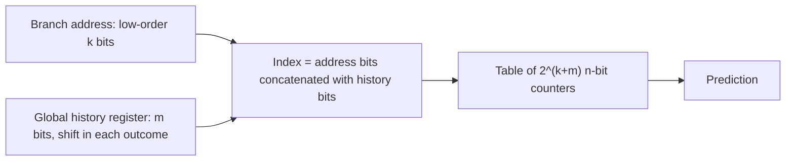

# بخش ۷، جلسه‌ی ۹ از ۱۳: پیش‌بینی‌کننده‌های همبسته

این جلسه بخشی از **بخش ۷: موازی‌سازی ایستا در سطح دستور** است. زمان مطالعه: حدود نیم ساعت.

**فهرست این جلسه:**

- ۱. ایده: پرش‌ها به هم ربط دارند
- ۲. مثال ساده‌ی اسلاید: متغیر d
- ۳. پیش‌بینی‌کننده‌ی یک‌بیتی بدون همبستگی
- ۴. پیش‌بینی‌کننده‌ی (1,1)
- ۵. پیش‌بینی‌کننده‌ی کلی (m,n)
- ۶. شمارش بیت‌ها
- ۷. مقایسه‌ی دقت
- ۸. یک گونه‌ی رایج: gshare
- ۹. تمرین‌ها

---

## ۱. ایده: پرش‌ها به هم ربط دارند

پیش‌بینی‌کننده‌ی دوبیتی فقط به رفتار گذشته‌ی **همان پرش** نگاه می‌کند. ولی رفتار یک پرش اغلب به رفتار **پرش‌های دیگر** ربط دارد. مثال کتاب از برنامه‌ی eqntott (که با پیش‌بینی‌کننده‌ی دوبیتی ۱۸٪ خطا داشت):

```c
if (aa == 2)
    aa = 0;
if (bb == 2)
    bb = 0;
if (aa != bb) {
    ...
}
```

کد MIPS (aa در R1 و bb در R2):

```asm
        DADDIU  R3,R1,#-2
        BNEZ    R3,L1           ; branch b1 (aa != 2)
        DADD    R1,R0,R0        ; aa = 0
L1:     DADDIU  R3,R2,#-2
        BNEZ    R3,L2           ; branch b2 (bb != 2)
        DADD    R2,R0,R0        ; bb = 0
L2:     DSUBU   R3,R1,R2        ; R3 = aa - bb
        BEQZ    R3,L3           ; branch b3 (aa == bb)
```

مشاهده‌ی کلیدی: اگر b1 و b2 هر دو **انجام‌نشده** باشند، یعنی شرط هر دو if درست بوده و aa و bb هر دو صفر شده‌اند. پس aa با bb برابر است و b3 **حتماً انجام می‌شود**. پیش‌بینی‌کننده‌ای که فقط تاریخچه‌ی خود b3 را ببیند، هرگز این رابطه را نمی‌فهمد.

پیش‌بینی‌کننده‌ای که از رفتار پرش‌های دیگر هم استفاده کند، **پیش‌بینی‌کننده‌ی همبسته (Correlating predictor)** یا **پیش‌بینی‌کننده‌ی دوسطحی (Two-level predictor)** نام دارد.

## ۲. مثال ساده‌ی اسلاید: متغیر d

اسلاید درس یک مثال کوچک‌تر دارد:

```c
if (d == 0)
    d = 1;
if (d == 1) {
    ...
}
```

کد MIPS (d در R1):

```asm
        BNEZ    R1,L1           ; branch b1 (d != 0)
        DADDIU  R1,R0,#1        ; d == 0, so d = 1
L1:     DADDIU  R3,R1,#-1
        BNEZ    R3,L2           ; branch b2 (d != 1)
        ...
L2:
```

اگر d فقط یکی از مقدارهای ۰، ۱ یا ۲ باشد:

| مقدار اولیه‌ی d | آیا d == 0 | پرش b1 | مقدار d قبل از b2 | آیا d == 1 | پرش b2 |
|---|---|---|---|---|---|
| مقدار 0 | بله | انجام‌نشده | 1 | بله | انجام‌نشده |
| مقدار 1 | خیر | انجام‌شده | 1 | بله | انجام‌نشده |
| مقدار 2 | خیر | انجام‌شده | 2 | خیر | انجام‌شده |

رابطه: اگر b1 انجام‌نشده باشد، b2 هم حتماً انجام‌نشده است.

## ۳. پیش‌بینی‌کننده‌ی یک‌بیتی بدون همبستگی

فرض کن d به‌تناوب ۲ و ۰ است و هر پرش یک پیش‌بینی‌کننده‌ی یک‌بیتی دارد که با «انجام‌نشده» (NT) شروع می‌کند. با T یعنی انجام‌شده:

| مقدار d | پیش‌بینی b1 | واقعی b1 | پیش‌بینی جدید b1 | پیش‌بینی b2 | واقعی b2 | پیش‌بینی جدید b2 |
|---|---|---|---|---|---|---|
| مقدار 2 | NT | T | T | NT | T | T |
| مقدار 0 | T | NT | NT | T | NT | NT |
| مقدار 2 | NT | T | T | NT | T | T |
| مقدار 0 | T | NT | NT | T | NT | NT |

نتیجه: **همه‌ی پیش‌بینی‌ها غلط**، یعنی ۱۰۰٪ خطا. هر پرش دقیقاً برعکس دفعه‌ی قبلش رفتار می‌کند.

## ۴. پیش‌بینی‌کننده‌ی (1,1)

حالا به هر پرش **دو** بیت پیش‌بینی می‌دهیم:

- **بیت اول:** پیش‌بینی، اگر **آخرین پرش اجراشده** (هر پرشی، نه لزوماً همین) انجام‌نشده بوده.
- **بیت دوم:** پیش‌بینی، اگر آخرین پرش اجراشده انجام‌شده بوده.

نمادگذاری اسلاید: «NT/T» یعنی اگر آخرین پرش NT بوده پیش‌بینی NT، و اگر T بوده پیش‌بینی T.

| بیت‌های پیش‌بینی | پیش‌بینی اگر آخرین پرش NT بوده | پیش‌بینی اگر آخرین پرش T بوده |
|---|---|---|
| حالت NT/NT | NT | NT |
| حالت NT/T | NT | T |
| حالت T/NT | T | NT |
| حالت T/T | T | T |

همان دنباله‌ی d، با شروع از NT/NT برای هر دو پرش و فرض اینکه قبل از شروع، آخرین پرش NT بوده. بیت استفاده‌شده در هر سطر با «آخرین پرش» تعیین می‌شود:

| مقدار d | آخرین پرش قبل از b1 | حالت b1 | پیش‌بینی b1 | واقعی b1 | حالت جدید b1 | آخرین پرش قبل از b2 | حالت b2 | پیش‌بینی b2 | واقعی b2 | حالت جدید b2 |
|---|---|---|---|---|---|---|---|---|---|---|
| مقدار 2 | NT | NT/NT | NT (غلط) | T | T/NT | T | NT/NT | NT (غلط) | T | NT/T |
| مقدار 0 | T | T/NT | NT | NT | T/NT | NT | NT/T | NT | NT | NT/T |
| مقدار 2 | NT | T/NT | T | T | T/NT | T | NT/T | T | T | NT/T |
| مقدار 0 | T | T/NT | NT | NT | T/NT | NT | NT/T | NT | NT | NT/T |

نتیجه: فقط **دو پیش‌بینی اول** غلط‌اند (در شروع). بعد از آن همه درست. چرا؟

- **پرش b1:** آخرین پرش قبل از آن، b2 از تکرار قبل است. وقتی b2 انجام‌نشده بوده (d = 0 بوده)، حالا d = 2 است و b1 انجام می‌شود. و برعکس. پس بیت «اگر آخرین NT» یاد می‌گیرد T و بیت «اگر آخرین T» یاد می‌گیرد NT.
- **پرش b2:** آخرین پرش قبل از آن، b1 در همان تکرار است. و رابطه‌ی بخش ۲ دقیقاً می‌گوید b2 همان کاری را می‌کند که b1 کرده.

این پیش‌بینی‌کننده با **یک بیت همبستگی** و **یک بیت پیش‌بینی** را **(1,1)** می‌نامیم.

## ۵. پیش‌بینی‌کننده‌ی کلی (m,n)

تعمیم: یک پیش‌بینی‌کننده‌ی **(m,n)** از رفتار **m پرش آخر** استفاده می‌کند تا یکی از **2ᵐ** پیش‌بینی‌کننده‌ی **n بیتی** را برای هر پرش انتخاب کند.

سخت‌افزارش ساده است:

- **ثبات تاریخچه‌ی سراسری (Global history register):** یک ثبات انتقالی m بیتی. هر پرش که تمام می‌شود، نتیجه‌اش (۱ برای انجام‌شده، ۰ برای انجام‌نشده) از یک طرف وارد و قدیمی‌ترین بیت از طرف دیگر خارج می‌شود.
- **اندیس جدول:** بیت‌های پایین آدرس پرش **کنار هم گذاشته** (Concatenate) با m بیت تاریخچه‌ی سراسری.



اسلاید درس یک پیش‌بینی‌کننده‌ی (2,2) با ۱۶ خانه را نشان می‌دهد: ۴ بیت آدرس یکی از ۱۶ سطر را انتخاب می‌کند و ۲ بیت تاریخچه یکی از ۴ ستون را. در واقع یک آرایه‌ی خطی ۶۴ خانه‌ای از شمارنده‌های دوبیتی است با اندیس ۶ بیتی. همان شکلی که در امتحان‌های ۰۱-۰۲ و ۰۲-۰۳ آمده است.

| نوع | معنی |
|---|---|
| پیش‌بینی‌کننده‌ی (0,2) | همان دوبیتی معمولی بدون تاریخچه |
| پیش‌بینی‌کننده‌ی (1,1) | یک بیت تاریخچه، شمارنده‌ی یک‌بیتی (بخش ۴) |
| پیش‌بینی‌کننده‌ی (2,2) | دو بیت تاریخچه، شمارنده‌ی دوبیتی |

## ۶. شمارش بیت‌ها

برای مقایسه‌ی منصفانه، باید پیش‌بینی‌کننده‌هایی با **تعداد بیت برابر** را مقایسه کنیم:

```math
\text{Total bits} = 2^m \times n \times \text{Number of prediction entries selected by the branch address}
```

مثال‌های کتاب و اسلاید:

- **دوبیتی ۴K خانه‌ای، یعنی (0,2):** 2⁰ × 2 × 4K = 8K بیت.
- **پیش‌بینی‌کننده‌ی (2,2) با ۱۶ خانه‌ی انتخاب‌شده با آدرس:** 2² × 2 × 16 = 128 بیت.
- **پیش‌بینی‌کننده‌ی (2,2) با ۸K بیت:** 2² × 2 × X = 8K، پس X = 1K خانه‌ی انتخاب‌شده با آدرس. یعنی **۱۰ بیت** از آدرس پرش برای اندیس استفاده می‌شود (به‌علاوه‌ی ۲ بیت تاریخچه).

## ۷. مقایسه‌ی دقت

کتاب CAQA سه پیش‌بینی‌کننده را روی SPEC89 مقایسه می‌کند: دوبیتی ۴۰۹۶ خانه‌ای (۸K بیت)، دوبیتی با خانه‌های **نامحدود**، و (2,2) با ۱۰۲۴ خانه (همان ۸K بیت). چند نمونه از نرخ پیش‌بینی غلط:

| برنامه | دوبیتی 4K | دوبیتی نامحدود | پیش‌بینی‌کننده‌ی (2,2) با 1K |
|---|---|---|---|
| برنامه‌ی spice | 9% | 9% | 5% |
| برنامه‌ی fpppp | 9% | 9% | 5% |
| برنامه‌ی gcc | 12% | 11% | 11% |
| برنامه‌ی espresso | 5% | 5% | 4% |
| برنامه‌ی eqntott | 18% | 18% | 6% |
| برنامه‌ی li | 10% | 10% | 5% |

نتیجه‌ی مهم: پیش‌بینی‌کننده‌ی همبسته با **همان تعداد بیت**، نه فقط از دوبیتی هم‌اندازه بهتر است، بلکه اغلب از دوبیتی **با اندازه‌ی نامحدود** هم بهتر است. برنامه‌ی eqntott از ۱۸٪ به ۶٪ رسیده، دقیقاً به خاطر همبستگی‌ای که در بخش ۱ دیدیم. پس **اطلاعات درست** مهم‌تر از **اطلاعات بیشتر** است.

## ۸. یک گونه‌ی رایج: gshare

در طرح (m,n) بالا، بیت‌های آدرس و تاریخچه کنار هم گذاشته می‌شوند. اگر m بزرگ باشد، جدول خیلی بزرگ می‌شود. طرح رایج دیگری به نام **gshare** (پیشنهاد McFarling در ۱۹۹۳) به جای کنار هم گذاشتن، آن‌ها را **XOR** می‌کند:

```math
\text{Index} = \text{PC bits} \oplus \text{Global history bits}
```

فایده: با همان اندازه‌ی جدول، می‌توان تاریخچه‌ی طولانی‌تری استفاده کرد و خانه‌های جدول یکنواخت‌تر پر می‌شوند. هزینه: دو پرش مختلف با دو تاریخچه‌ی مختلف ممکن است به یک خانه برسند (هم‌نامی). بسیاری از پیش‌بینی‌کننده‌های واقعی از این ایده استفاده کرده‌اند.

## ۹. تمرین‌ها

<details>
<summary>تمرین ۱: شمارش بیت</summary>

**صورت:** یک پیش‌بینی‌کننده‌ی (4,2) با ۳۲K بیت داریم. چند بیت از آدرس پرش برای اندیس استفاده می‌شود؟ اندیس کل چند بیت است؟

**جواب:** 2⁴ × 2 × X = 32K، پس X = 32K / 32 = 1K خانه. یعنی **۱۰ بیت** آدرس. اندیس کل 10 + 4 = 14 بیت است (۱۶K شمارنده‌ی دوبیتی، که همان ۳۲K بیت است).
</details>

<details>
<summary>تمرین ۲: الگوی متناوب با تاریخچه‌ی محلی</summary>

**صورت:** فقط یک پرش در برنامه داریم که به‌تناوب T و N است. آیا یک پیش‌بینی‌کننده‌ی (1,2) آن را درست پیش‌بینی می‌کند؟

**جواب:** بله. وقتی تنها پرش برنامه همین است، «آخرین پرش» همان اجرای قبلی خودش است. یک شمارنده برای حالت «آخرین T» و یکی برای «آخرین N» داریم. بعد از چند اجرا، شمارنده‌ی «آخرین T» به سمت N و شمارنده‌ی «آخرین N» به سمت T می‌رود. پس بعد از گرم شدن، دقت ۱۰۰٪ است. در حالی که دوبیتی ساده روی این الگو ۰٪ دقت داشت (تمرین ۳ جلسه‌ی قبل).
</details>

<details>
<summary>تمرین ۳: کدام پرش به کدام همبسته است</summary>

**صورت:** در کد eqntott بخش ۱، اگر b1 انجام‌شده و b2 انجام‌نشده باشد، درباره‌ی b3 چه می‌دانیم؟

**جواب:** پرش b1 انجام‌شده یعنی aa مخالف ۲ بوده و تغییر نکرده. پرش b2 انجام‌نشده یعنی bb برابر ۲ بوده و صفر شده. پس bb = 0 و aa مقدار اولیه‌اش است. اگر aa صفر نبوده، b3 انجام‌نشده است. پس این حالت **قطعیت** نمی‌دهد، فقط اگر aa معمولاً صفر نباشد، b3 معمولاً انجام‌نشده است. فقط حالت «هر دو انجام‌نشده» قطعاً b3 را تعیین می‌کند.
</details>

---

جلسه‌ی قبلی: [پیش‌بینی ایستا و پیش‌بینی پویای ساده](7-8-static-and-basic-dynamic-prediction.md)  
جلسه‌ی بعدی: [حل سؤال امتحانی (2,2) و پیش‌بینی‌کننده‌های ترکیبی](7-10-exam-and-tournament-predictors.md)
