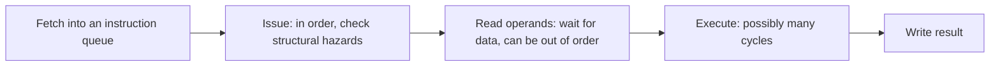
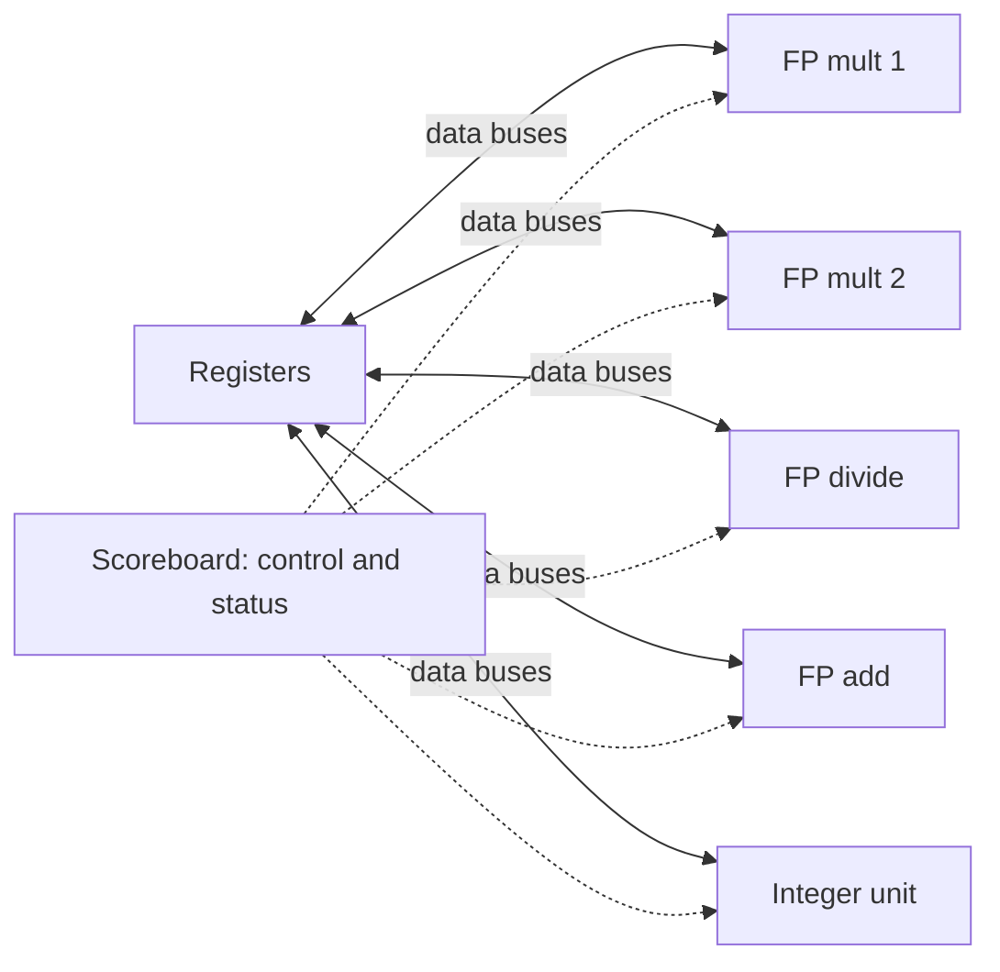

# بخش ۸، جلسه‌ی ۱ از ۱۳: زمان‌بندی پویا و جدول امتیاز

این جلسه بخشی از **بخش ۸: موازی‌سازی پویا در سطح دستور** است. زمان مطالعه: حدود نیم ساعت.

**فهرست این جلسه:**

- ۱. مشکل اجرای به ترتیب
- ۲. سه مزیت زمان‌بندی پویا
- ۳. شکستن مرحله‌ی ID به دو مرحله
- ۴. مخاطره‌های WAR و WAW در اجرای خارج از ترتیب
- ۵. استثنای غیردقیق
- ۶. جدول امتیاز (Scoreboard)
- ۷. ساختارهای داده‌ی جدول امتیاز
- ۸. محدودیت‌های جدول امتیاز
- ۹. تمرین‌ها

---

## ۱. مشکل اجرای به ترتیب

در بخش ۷ دیدیم که کامپایلر با زمان‌بندی کد توقف‌ها را کم می‌کند. ولی خط لوله‌ی ساده‌ی بخش ۵ یک محدودیت اساسی دارد: **صدور و اجرای به ترتیب (In-order)**. اگر یک دستور متوقف شود، هیچ دستور بعدی هم نمی‌تواند جلو برود، حتی اگر به آن دستور متوقف هیچ وابستگی‌ای نداشته باشد.

مثال کتاب CAQA:

```asm
DIV.D   F0,F2,F4
ADD.D   F10,F0,F8
SUB.D   F12,F8,F14
```

دستور `ADD.D` به نتیجه‌ی `DIV.D` (که ده‌ها سیکل طول می‌کشد) وابسته است و متوقف می‌شود. دستور `SUB.D` به هیچ دستوری در خط لوله وابسته نیست، ولی چون پشت `ADD.D` است، آن هم متوقف می‌شود. در این مدت واحد جمع‌کننده بیکار است.

اسلاید درس همین را با یک مثال کامل‌تر نشان می‌دهد:

```asm
DIV.D   F0,F2,F4
ADD.D   F6,F0,F8      ; stalled by a true dependence on DIV.D
S.D     F6,0(R1)      ; stalled by a true dependence on ADD.D
SUB.D   F8,F10,F14    ; ready to execute, but blocked
MUL.D   F6,F10,F8     ; ready after SUB.D, but blocked
```

**زمان‌بندی پویا (Dynamic scheduling)** یعنی سخت‌افزار در زمان اجرا ترتیب اجرای دستورات را عوض کند تا توقف‌ها کم شوند، با حفظ **جریان داده** و **رفتار استثنا** (جلسه‌ی ۷-۱).

## ۲. سه مزیت زمان‌بندی پویا

کتاب سه مزیت می‌شمارد:

1. **کد کامپایل‌شده برای یک خط لوله، روی خط لوله‌ی دیگر هم خوب اجرا می‌شود.** دیگر لازم نیست برای هر ریزمعماری یک نسخه‌ی جدا کامپایل کرد. امروز که بیشتر نرم‌افزارها به شکل دودویی پخش می‌شوند، این مزیت بزرگی است. این دقیقاً نقطه‌ی ضعف VLIW در جلسه‌ی ۷-۱۲ بود.
2. **وابستگی‌هایی که در زمان کامپایل معلوم نیستند:** مثلاً وابستگی از راه حافظه با اشاره‌گرها، پرش‌های وابسته به داده، یا کدی که با پیوند پویا بارگذاری می‌شود.
3. **تحمل تأخیرهای غیرقابل پیش‌بینی:** مهم‌ترین مزیت. وقتی یک بارگذاری در کش عدم اصابت دارد، پردازنده دستورات مستقل دیگر را اجرا می‌کند. این همان کش بدون توقف جلسه‌ی ۶-۱۱ است که بدون اجرای خارج از ترتیب فایده‌ی کمی دارد.

هزینه: **پیچیدگی سخت‌افزاری زیاد**.

## ۳. شکستن مرحله‌ی ID به دو مرحله

در خط لوله‌ی پنج‌مرحله‌ای، همه‌ی مخاطره‌ها در ID بررسی می‌شدند و دستور فقط وقتی از ID خارج می‌شد که هیچ مخاطره‌ای نداشت. برای اینکه `SUB.D` بتواند زودتر اجرا شود، مرحله‌ی ID به دو قسمت شکسته می‌شود:

1. **صدور (Issue):** رمزگشایی دستور و بررسی مخاطره‌ی **ساختاری**. این مرحله **به ترتیب** است.
2. **خواندن عملوندها (Read operands):** صبر تا نبود مخاطره‌ی **داده**، سپس خواندن عملوندها. دستورات در این مرحله می‌توانند از هم سبقت بگیرند.



پس خط لوله **صدور به ترتیب** ولی **اجرای خارج از ترتیب (Out-of-order execution)** دارد، که نتیجه‌اش **تکمیل خارج از ترتیب** هم هست. برای اینکه چند دستور همزمان در حال اجرا باشند، یا چند واحد اجرایی لازم است یا واحدهای خط لوله‌ای. کتاب این دو را برای کنترل خط لوله معادل می‌گیرد و فرض می‌کند چند واحد داریم.

## ۴. مخاطره‌های WAR و WAW در اجرای خارج از ترتیب

در خط لوله‌ی به ترتیب، مخاطره‌ی WAR وجود نداشت و WAW فقط در خط لوله‌ی ممیز شناور ممکن بود (جلسه‌ی ۷-۲). با اجرای خارج از ترتیب، هر دو جدی می‌شوند. مثال کتاب:

```asm
DIV.D   F0,F2,F4
ADD.D   F6,F0,F8
SUB.D   F8,F10,F14
MUL.D   F6,F10,F8
```

- **ضدوابستگی بین `ADD.D` و `SUB.D` روی F8:** اگر `SUB.D` (که آماده است) قبل از اینکه `ADD.D` (که منتظر `DIV.D` است) F8 را بخواند، در F8 بنویسد، `ADD.D` مقدار غلط می‌گیرد. این **مخاطره‌ی WAR** است.
- **وابستگی خروجی بین `ADD.D` و `MUL.D` روی F6:** اگر `MUL.D` زودتر تمام شود و بعد `ADD.D` در F6 بنویسد، مقدار نهایی غلط است. این **مخاطره‌ی WAW** است.

دو راه برای این مخاطره‌ها هست:

- **توقف:** دستور بعدی صبر کند. این کار جدول امتیاز است (بخش ۶).
- **تغییر نام ثبات در سخت‌افزار:** مقصدها نام‌های جدید بگیرند تا وابستگی نامی از بین برود. این کار الگوریتم توماسولو است (جلسه‌ی بعد).

## ۵. استثنای غیردقیق

تکمیل خارج از ترتیب، رسیدگی به استثنا را هم سخت می‌کند. پردازنده‌ی پویا باید **رفتار استثنا** را حفظ کند: دقیقاً همان استثناهایی رخ دهند که در اجرای ترتیبی رخ می‌دادند. ولی ممکن است استثنا **غیردقیق (Imprecise)** باشد: وضعیت پردازنده هنگام استثنا دقیقاً شبیه اجرای ترتیبی نباشد. دو حالت:

- **دستورات بعدی تمام شده‌اند:** دستوراتی که در ترتیب برنامه بعد از دستور مسبب استثنا هستند، قبلاً تمام شده و نتیجه‌شان را نوشته‌اند.
- **دستورات قبلی تمام نشده‌اند:** بعضی دستورات که قبل از دستور مسبب استثنا هستند، هنوز تمام نشده‌اند.

استثنای غیردقیق ادامه‌ی اجرا (مثلاً بعد از خطای صفحه) را خیلی سخت می‌کند. راه‌حل اصلی، **بافر بازترتیب** در گمانه‌زنی است (جلسه‌ی ۸-۶).

## ۶. جدول امتیاز (Scoreboard)

**جدول امتیاز (Scoreboard)** ساده‌ترین روش زمان‌بندی پویاست. نامش از رایانه‌ی **CDC 6600** (سال ۱۹۶۴) می‌آید که ۱۶ واحد اجرایی جدا داشت. پیوست C کتاب CAQA آن را روی MIPS با دو ضرب‌کننده، یک جمع‌کننده، یک تقسیم‌کننده و یک واحد صحیح شرح می‌دهد.



همه‌ی تشخیص و رفع مخاطره در جدول امتیاز **متمرکز** است. هر دستور چهار مرحله دارد (به جای ID، EX و WB):

1. **صدور:** اگر واحد اجرایی آزاد است **و** هیچ دستور فعال دیگری همان ثبات مقصد را ندارد، دستور صادر می‌شود. پس **WAW با توقف در صدور** جلوگیری می‌شود. اگر مخاطره‌ی ساختاری یا WAW باشد، صدور (و همه‌ی دستورات بعدی) متوقف می‌شود.
2. **خواندن عملوندها:** وقتی هیچ دستور فعال قبلی قرار نیست منبع‌ها را بنویسد، عملوندها از ثبات‌ها خوانده می‌شوند. **RAW به‌طور پویا** اینجا حل می‌شود و دستورات خارج از ترتیب وارد اجرا می‌شوند.
3. **اجرا:** واحد اجرایی کار می‌کند و تمام شدن را به جدول امتیاز خبر می‌دهد.
4. **نوشتن نتیجه:** جدول امتیاز بررسی می‌کند که **WAR** وجود ندارد. اگر دستوری قبلی هنوز عملوندش را (که همین ثبات مقصد است) نخوانده، نوشتن **متوقف** می‌شود.

مثال WAR در جدول امتیاز:

```asm
DIV.D   F0,F2,F4
ADD.D   F10,F0,F8
SUB.D   F8,F8,F14
```

دستور `SUB.D` می‌تواند اجرا شود، ولی در مرحله‌ی نوشتن نتیجه صبر می‌کند تا `ADD.D` عملوند F8 را بخواند (یعنی تا `DIV.D` تمام شود).

دو نکته‌ی دیگر:

- **بدون ارسال:** عملوندها فقط از فایل ثبات خوانده می‌شوند و ارسال وجود ندارد. ولی چون نتیجه به محض تمام شدن نوشته می‌شود (نه در یک شکاف ثابت)، این ضرر کمتر از آن است که به نظر می‌رسد. فقط یک سیکل اضافه می‌ماند، چون نوشتن و خواندن نمی‌توانند در یک سیکل روی هم بیفتند.
- **محدودیت گذرگاه:** تعداد گذرگاه‌های خواندن و نوشتن ثبات محدود است. CDC 6600 واحدها را در چهار گروه گذاشته بود و هر گروه گذرگاه‌های خودش (به نام **trunk**) را داشت.

## ۷. ساختارهای داده‌ی جدول امتیاز

جدول امتیاز سه بخش دارد:

**۱. وضعیت دستور:** هر دستور در کدام مرحله از چهار مرحله است.

**۲. وضعیت واحد اجرایی:** برای هر واحد نه فیلد:

| فیلد | معنی |
|---|---|
| فیلد Busy | واحد مشغول است یا نه |
| فیلد Op | عملیات (مثلاً جمع یا تفریق) |
| فیلد Fi | ثبات مقصد |
| فیلدهای Fj و Fk | شماره‌ی ثبات‌های منبع |
| فیلدهای Qj و Qk | واحدی که ثبات‌های منبع را تولید می‌کند |
| فیلدهای Rj و Rk | پرچم آماده بودن Fj و Fk که هنوز خوانده نشده‌اند؛ بعد از خواندن «No» می‌شوند |

**۳. وضعیت نتیجه‌ی ثبات‌ها:** برای هر ثبات، کدام واحد قرار است آن را بنویسد (یا خالی).

مثال کتاب: این کد، وقتی اولین `L.D` تمام شده و دومی اجرایش تمام شده ولی هنوز ننوشته:

```asm
L.D     F6,34(R2)
L.D     F2,45(R3)
MUL.D   F0,F2,F4
SUB.D   F8,F6,F2
DIV.D   F10,F0,F6
ADD.D   F6,F8,F2
```

| واحد | Busy | Op | Fi | Fj | Fk | Qj | Qk | Rj | Rk |
|---|---|---|---|---|---|---|---|---|---|
| واحد Integer | Yes | Load | F2 | R3 | | | | No | |
| واحد Mult1 | Yes | Mult | F0 | F2 | F4 | Integer | | No | Yes |
| واحد Mult2 | No | | | | | | | | |
| واحد Add | Yes | Sub | F8 | F6 | F2 | | Integer | Yes | No |
| واحد Divide | Yes | Div | F10 | F0 | F6 | Mult1 | | No | Yes |

| ثبات | F0 | F2 | F4 | F6 | F8 | F10 |
|---|---|---|---|---|---|---|
| واحد نویسنده | Mult1 | Integer | | | Add | Divide |

- **دستورات `MUL.D`، `SUB.D` و `DIV.D`:** صادر شده‌اند ولی منتظر عملوندند.
- **دستور `ADD.D`:** هنوز صادر **نشده**، چون تنها جمع‌کننده را `SUB.D` گرفته (مخاطره‌ی ساختاری).
- **ادامه‌ی ماجرا:** کتاب نشان می‌دهد که بعداً `ADD.D` اجرایش تمام می‌شود ولی به خاطر **WAR روی F6** (که `DIV.D` هنوز نخوانده) نمی‌تواند بنویسد تا `DIV.D` عملوندهایش را بخواند.

## ۸. محدودیت‌های جدول امتیاز

کتاب چهار عامل محدودکننده می‌شمارد:

1. **مقدار موازی‌سازی بین دستورات:** اگر هر دستور به قبلی وابسته باشد، هیچ روش پویایی کمک نمی‌کند. در CDC 6600 دستورات فقط از یک بلوک پایه بودند.
2. **تعداد خانه‌های جدول امتیاز:** این تعیین می‌کند خط لوله تا کجا جلوتر را برای دستورات مستقل می‌بیند. به مجموعه‌ی دستوراتی که بررسی می‌شوند **پنجره (Window)** می‌گوییم.
3. **تعداد و نوع واحدهای اجرایی:** مخاطره‌ی ساختاری با زمان‌بندی پویا بیشتر می‌شود.
4. **ضدوابستگی‌ها و وابستگی‌های خروجی:** که به توقف WAR و WAW منجر می‌شوند.

نتیجه‌ی CDC 6600: بهبود ۱.۷ برابر برای برنامه‌های FORTRAN و ۲.۵ برابر برای اسمبلی دست‌نویس (قبل از کش و زمان‌بندی نرم‌افزاری). منطق جدول امتیاز حدوداً به اندازه‌ی یک واحد اجرایی بود. هزینه‌ی اصلی، گذرگاه‌ها بود: حدود چهار برابر یک پردازنده‌ی به ترتیب.

عامل چهارم را **تغییر نام** حل می‌کند. کتاب می‌گوید جدول امتیاز احتمالاً برای یک ابرعددی دوصدوری ساده مثل ARM Cortex-A8 کافی است (جلسه‌ی ۷-۱۳ دیدیم که A8 یک جدول امتیاز ساده دارد). ولی پردازنده‌ی تهاجمی‌تر مثل Core i7 چهارصدوری از الگوریتم توماسولو و تغییر نام سود می‌برد.

## ۹. تمرین‌ها

<details>
<summary>تمرین ۱: کدام مخاطره و کجا</summary>

**صورت:** در جدول امتیاز، برای هر جفت در کد زیر بگو چه مخاطره‌ای هست و در کدام مرحله باعث توقف می‌شود:

```asm
I1: MUL.D  F0,F2,F4
I2: ADD.D  F6,F0,F8
I3: SUB.D  F8,F10,F12
I4: DIV.D  F6,F10,F12
```

**جواب:**

- **دستور I2 و I1 (F0):** RAW. I2 در مرحله‌ی خواندن عملوندها صبر می‌کند تا I1 بنویسد.
- **دستور I3 و I2 (F8):** WAR. I3 اجرا می‌شود ولی در مرحله‌ی نوشتن نتیجه صبر می‌کند تا I2 عملوند F8 را بخواند.
- **دستور I4 و I2 (F6):** WAW. I4 در مرحله‌ی **صدور** متوقف می‌شود، چون I2 هنوز فعال است و همان مقصد را دارد. و چون صدور به ترتیب است، هر دستور بعد از I4 هم متوقف می‌شود.
</details>

<details>
<summary>تمرین ۲: چرا WAW در صدور و WAR در نوشتن؟</summary>

**صورت:** چرا جدول امتیاز WAW را در صدور و WAR را در نوشتن نتیجه بررسی می‌کند؟

**جواب:** جدول امتیاز برای هر ثبات فقط **یک** نویسنده‌ی در انتظار ثبت می‌کند (وضعیت نتیجه‌ی ثبات). اگر دستور دومی با همان مقصد صادر شود، این ساختار نمی‌تواند هر دو را دنبال کند. پس ساده‌ترین کار، توقف در صدور است. ولی WAR فقط وقتی مشکل است که نوشتن زودتر از خواندن دستور قبلی رخ دهد. پس می‌توان اجرای دستور را مجاز کرد و فقط نوشتن را عقب انداخت. این بیشترین هم‌پوشانی را می‌دهد.
</details>

<details>
<summary>تمرین ۳: صف دستور</summary>

**صورت:** وقتی صدور متوقف می‌شود، برای واکشی چه اتفاقی می‌افتد؟

**جواب:** بافر بین واکشی و صدور پر می‌شود. اگر این بافر یک خانه باشد، واکشی بلافاصله متوقف می‌شود. اگر یک صف چندخانه‌ای باشد، واکشی تا پر شدن صف ادامه می‌یابد.
</details>

---

جلسه‌ی بعدی: [الگوریتم توماسولو: ساختار و تغییر نام](8-2-tomasulo-structure.md)
