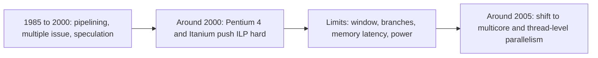

# بخش ۸، جلسه‌ی ۱۱ از ۱۳: محدودیت‌های موازی‌سازی در سطح دستور

این جلسه بخشی از **بخش ۸: موازی‌سازی پویا در سطح دستور** است. زمان مطالعه: حدود نیم ساعت.

**فهرست این جلسه:**

- ۱. سؤال اصلی: چقدر ILP وجود دارد
- ۲. پردازنده‌ی ایده‌آل
- ۳. موازی‌سازی در سطح دستور در پردازنده‌ی ایده‌آل
- ۴. پردازنده‌ای جاه‌طلبانه ولی قابل تصور
- ۵. اثر اندازه‌ی پنجره
- ۶. مثال: سه پردازنده
- ۷. محدودیت‌هایی که حتی پردازنده‌ی کامل دارد
- ۸. نتیجه: پایان دوران ILP
- ۹. تمرین‌ها

---

## ۱. سؤال اصلی: چقدر ILP وجود دارد

بهره‌برداری از ILP از دهه‌ی ۱۹۶۰ شروع شد و در دهه‌های ۱۹۸۰ و ۱۹۹۰ کلید رشد سریع کارایی بود. سؤال حیاتی: **چقدر ILP در برنامه‌ها هست** و برای بهره‌برداری از آن چه لازم است؟ این سؤال تعیین می‌کرد که آیا می‌توان کارایی را سریع‌تر از سرعت پایه‌ی فناوری مدار بالا برد.

کتاب CAQA بخشی از مطالعه‌ی **Wall (سال ۱۹۹۳)** را مرور می‌کند. این مطالعات فرض‌هایی می‌کنند و می‌بینند با آن فرض‌ها چقدر موازی‌سازی هست. این داده‌ها همچنین ارزش ایده‌های این بخش را می‌سنجند: ابهام‌زدایی حافظه، تغییر نام و گمانه‌زنی.

پیام اصلی از ابتدا: برای سخت‌افزارهایی با هزینه‌ی معقول، **هزینه‌ی گمانه‌زنی خیلی تهاجمی توجیه ندارد**. بسیاری از پژوهشگران و سازندگان روی ILP بیشتر شرط بسته بودند، ولی تا سال ۲۰۰۵ مجبور شدند نظرشان را عوض کنند.

## ۲. پردازنده‌ی ایده‌آل

**پردازنده‌ی ایده‌آل** پردازنده‌ای است که همه‌ی محدودیت‌های ILP از آن برداشته شده و تنها محدودیت، **جریان واقعی داده** از راه ثبات‌ها یا حافظه است. پنج فرض:

1. **تغییر نام بی‌نهایت:** تعداد نامحدود ثبات مجازی. همه‌ی WAW و WAR حذف می‌شوند و تعداد نامحدودی دستور می‌توانند همزمان شروع شوند.
2. **پیش‌بینی کامل پرش:** همه‌ی پرش‌های شرطی دقیقاً پیش‌بینی می‌شوند.
3. **پیش‌بینی کامل پرش‌های غیرمستقیم:** همه‌ی پرش‌ها، شامل بازگشت و پرش‌های محاسبه‌شده، دقیق پیش‌بینی می‌شوند. با فرض ۲، این معادل گمانه‌زنی کامل و یک بافر نامحدود از دستورات آماده‌ی اجراست.
4. **تحلیل کامل هم‌نامی حافظه:** همه‌ی آدرس‌ها دقیقاً معلوم‌اند و یک بارگذاری می‌تواند از هر ذخیره‌ای با آدرس متفاوت جلو بزند.
5. **کش کامل:** همه‌ی دسترسی‌های حافظه یک سیکل.

فرض‌های ۲ و ۳ همه‌ی وابستگی‌های کنترلی و فرض‌های ۱ و ۴ همه‌ی وابستگی‌ها به جز وابستگی‌های واقعی داده را حذف می‌کنند. پس هر دستور می‌تواند در سیکلِ درست بعد از اجرای دستوری که به آن وابسته است اجرا شود. حتی آخرین دستور برنامه ممکن است در سیکل اول اجرا شود!

فرض‌های دیگر: صدور نامحدود در هر سیکل، بدون محدودیت نوع (مثلاً تعداد نامحدود بارگذاری در یک سیکل)، و تأخیر **یک سیکل** برای همه‌ی واحدها.

روش اندازه‌گیری: برنامه‌ها با کامپایلرهای بهینه‌ساز MIPS کامپایل و اجرا می‌شوند و یک **رد (Trace)** از دستورات و آدرس‌ها ثبت می‌شود. هر دستور رد، در زودترین سیکل ممکن (فقط محدود به وابستگی داده) زمان‌بندی می‌شود. چون رد داریم، پیش‌بینی کامل پرش و تحلیل کامل هم‌نامی ساده است.

## ۳. موازی‌سازی در سطح دستور در پردازنده‌ی ایده‌آل

متوسط تعداد دستور صادرشده در هر سیکل برای شش برنامه‌ی SPEC92:

| برنامه | نوع | دستور در سیکل |
|---|---|---|
| برنامه‌ی gcc | صحیح | 55 |
| برنامه‌ی espresso | صحیح | 63 |
| برنامه‌ی li | صحیح | 18 |
| برنامه‌ی fpppp | ممیز شناور | 75 |
| برنامه‌ی doduc | ممیز شناور | 119 |
| برنامه‌ی tomcatv | ممیز شناور | 150 |

- **برنامه‌های ممیز شناور** حلقه‌محورند و موازی‌سازی حلقه‌ی زیادی دارند (که پردازنده‌ی برداری یا چندپردازنده هم می‌تواند از آن استفاده کند).
- **برنامه‌ی li** یک مفسر LISP است با وابستگی‌های کوتاه و زیاد.

این عددها **سقف** هستند. هیچ پردازنده‌ی واقعی به آن‌ها نزدیک نمی‌شود.

## ۴. پردازنده‌ای جاه‌طلبانه ولی قابل تصور

کتاب سپس پردازنده‌ای را بررسی می‌کند که هم‌سطح یا بهتر از بهترین‌های سال ۲۰۱۱ است:

1. **تا ۶۴ دستور در سیکل** بدون محدودیت نوع: بیش از ۱۰ برابر پهن‌ترین پردازنده‌ی ۲۰۱۱. کتاب می‌گوید اثر صدور خیلی پهن روی فرکانس، پیچیدگی منطق و توان احتمالاً مهم‌ترین محدودیت است.
2. **پیش‌بینی‌کننده‌ی تورنمنت** با ۱K خانه و پیش‌بینی‌کننده‌ی بازگشت ۱۶ خانه‌ای: در حد بهترین‌های ۲۰۱۱. این گلوگاه اصلی نیست.
3. **ابهام‌زدایی کامل و پویای حافظه:** جاه‌طلبانه ولی برای پنجره‌های کوچک (یا با پیش‌بینی هم‌نامی) شاید شدنی.
4. **تغییر نام با ۶۴ ثبات صحیح اضافه و ۶۴ ثبات ممیز شناور اضافه:** کمی کمتر از تهاجمی‌ترین پردازنده‌ی ۲۰۱۱. برای مقایسه، Core i7 یک ROB با ۱۲۸ خانه و IBM Power7 حدود ۲۰۰ خانه دارد.

و هنوز تأخیر همه‌ی واحدها یک سیکل و کش کامل فرض شده است، که هر دو در واقعیت اثر بزرگی دارند. پس این عددها هم **خیلی خوش‌بینانه‌اند**.

برای مقایسه، کتاب IBM Power7 را پیشرفته‌ترین ابرعددی اعلام‌شده تا آن زمان می‌نامد: صدور تا شش دستور در سیکل، شروع اجرا روی ۸ واحد از ۱۲ واحد (فقط دو واحد بارگذاری و ذخیره)، ثبات‌های تغییر نام زیاد (صدها دستور در جریان)، پیش‌بینی‌کننده‌ی بزرگ و ابهام‌زدایی پویای حافظه. Power7 در عین حال به سمت موازی‌سازی سطح نخ رفت: چندنخنگی همزمان با ۴ نخ در هر هسته و ۸ هسته در هر تراشه.

## ۵. اثر اندازه‌ی پنجره

**پنجره (Window)** مجموعه‌ی دستوراتی است که پردازنده در هر لحظه برای پیدا کردن دستورات مستقل بررسی می‌کند. کتاب ILP را برای پنجره‌های مختلف (از بی‌نهایت تا ۳۲) روی همان شش برنامه اندازه می‌گیرد. چند نتیجه:

- **عددها خیلی کمتر از پردازنده‌ی ایده‌آل‌اند:** با پنجره‌ی بی‌نهایت، gcc حدود ۱۰ دستور در سیکل دارد (در برابر ۵۵ در پردازنده‌ی ایده‌آل). بهترین برنامه‌ها (fpppp و tomcatv) در حد چند ده دستور.
- **برای برنامه‌های صحیح، اندازه‌ی پنجره اثر کمی دارد:** مثلاً gcc با پنجره‌ی ۶۴ حدود ۹ دستور در سیکل دارد، نزدیک به پنجره‌ی بی‌نهایت. چون عوامل دیگر (پیش‌بینی پرش، تغییر نام محدود و موازی‌سازی کمتر از ابتدا) محدودکننده‌اند.
- **برای دو برنامه‌ی ممیز شناور،** موازی‌سازی حلقه پنجره‌ی بزرگ را مفید می‌کند.

کتاب تأکید می‌کند که این تفاوت مهم است، چون از اواسط دهه‌ی ۱۹۹۰ با رشد وب و رایانش ابری، بیشتر رشد بازار (پردازش تراکنش، سرورهای وب) به کارایی **صحیح** وابسته بود، نه ممیز شناور.

## ۶. مثال: سه پردازنده

مثال کتاب با برنامه‌ی gcc. زمان حافظه‌ی اصلی (که جریمه‌ی عدم اصابت را تعیین می‌کند) ۵۰ نانوثانیه است:

| پردازنده | توصیف | ساعت | CPI خط لوله | عدم اصابت در هر دستور |
|---|---|---|---|---|
| پردازنده‌ی ۱ | MIPS دوصدوری ایستا، ساده | 4 GHz | 0.8 | 0.005 |
| پردازنده‌ی ۲ | MIPS دوصدوری، خط لوله‌ی عمیق، کش کمی کوچک‌تر | 5 GHz | 1.0 | 0.0055 |
| پردازنده‌ی ۳ | ابرعددی گمانه‌زن با پنجره‌ی ۶۴، نصف نرخ صدور ایده‌آل این پنجره، ۲۵٪ جریمه‌ی عدم اصابت را پنهان می‌کند | 2.5 GHz | محاسبه شود | 0.01 |

**جریمه‌ی عدم اصابت** برابر است با زمان حافظه تقسیم بر زمان سیکل. زمان سیکل‌ها 250، 200 و 400 پیکوثانیه است:

```math
\text{Penalty}_1 = \frac{50\text{ ns}}{250\text{ ps}} = 200, \quad \text{Penalty}_2 = \frac{50\text{ ns}}{200\text{ ps}} = 250, \quad \text{Penalty}_3 = \frac{0.75 \times 50\text{ ns}}{400\text{ ps}} \approx 94
```

**مقدار CPI کش:**

```math
\text{Cache CPI}_1 = 0.005 \times 200 = 1.0, \quad \text{Cache CPI}_2 = 0.0055 \times 250 \approx 1.4, \quad \text{Cache CPI}_3 = 0.01 \times 94 = 0.94
```

**مقدار CPI خط لوله‌ی پردازنده‌ی ۳:** نرخ صدور gcc با پنجره‌ی ۶۴ حدود ۹ است و پردازنده نصف آن را می‌گیرد:

```math
\text{Pipeline CPI}_3 = \frac{1}{9 \times 0.5} = \frac{1}{4.5} \approx 0.22
```

**مقدار CPI کل و نرخ اجرا:**

| پردازنده | CPI کل | میلیون دستور در ثانیه |
|---|---|---|
| پردازنده‌ی ۱ | 0.8 + 1.0 = 1.8 | 4000 / 1.8 ≈ 2222 |
| پردازنده‌ی ۲ | 1.0 + 1.4 = 2.4 | 5000 / 2.4 ≈ 2083 |
| پردازنده‌ی ۳ | 0.22 + 0.94 = 1.16 | 2500 / 1.16 ≈ 2155 |

نتیجه: پردازنده‌ی **ساده‌ی دوصدوری** بهترین است. با اینکه پردازنده‌ی گمانه‌زن CPI خط لوله‌ی بسیار کمتری دارد، فرکانس پایین‌تر و کش کوچک‌ترش آن را عقب می‌اندازد. درس: کارایی به CPI **و** فرکانس با هم بستگی دارد، و در برنامه‌هایی مثل gcc، سیستم حافظه بخش بزرگی از CPI است.

## ۷. محدودیت‌هایی که حتی پردازنده‌ی کامل دارد

کتاب محدودیت‌های خود این مطالعه را هم می‌شمارد. حتی برای پردازنده‌ی کامل:

1. **مخاطره‌های WAW و WAR از راه حافظه:** مطالعه این مخاطره‌ها را برای ثبات‌ها با تغییر نام حذف کرده، ولی نه برای حافظه. این مخاطره‌ها به خاطر **تخصیص قاب پشته** پیش می‌آیند: یک رویه‌ی فراخوانده‌شده همان خانه‌های پشته‌ی رویه‌ی قبلی را دوباره استفاده می‌کند.
2. **وابستگی‌های غیرضروری:** با ثبات نامحدود، فقط وابستگی‌های واقعی می‌مانند. ولی بعضی وابستگی‌های واقعی از قراردادهای تولید کد می‌آیند، مثل متغیر کنترل حلقه (که در هر تکرار زیاد می‌شود) یا **اشاره‌گر پشته** که در فراخوانی و بازگشت کم و زیاد می‌شود. باز کردن حلقه و بهینه‌سازی جبری (جلسه‌ی ۷-۵) بعضی را حذف می‌کنند.
3. **شکستن سقف جریان داده:** اگر پیش‌بینی مقدار با دقت بالا کار می‌کرد، می‌توانست این سقف را بشکند. پیش‌بینی کامل مقدار یعنی موازی‌سازی عملاً بی‌نهایت. ولی کتاب می‌گوید از بیش از ۱۰۰ مقاله در این زمینه، هیچ‌کدام با روش پیش‌بینی واقع‌گرایانه بهبود قابل توجهی در ILP نشان نداده‌اند.

برای پردازنده‌های غیرکامل، ایده‌ای مثل **گمانه‌زنی روی چند مسیر** (اجرای هر دو طرف پرش) هم پیشنهاد شده. ولی چون منابع لازم با تعداد پرش‌ها **نمایی** رشد می‌کند و بیشتر کار دور ریخته می‌شود، همه‌ی طراحی‌های تجاری به جای آن، سخت‌افزار بیشتری برای گمانه‌زنی بهتر روی **مسیر درست** گذاشته‌اند.

کتاب تأکید می‌کند که هیچ‌کدام از این محدودیت‌ها **بنیادی** (مثل قوانین فیزیک) نیستند. ولی موانع عملی جدی‌اند: اندازه‌ی پنجره، تشخیص هم‌نامی، پیش‌بینی پرش.

## ۸. نتیجه: پایان دوران ILP

تلاش‌ها برای عبور از این محدودیت‌ها در پنج سال اول قرن بیست‌ویکم به **ناامیدی** رسید. بعضی روش‌ها بهبود کوچکی دادند، ولی اغلب با افزایش زیاد پیچیدگی، سیکل ساعت طولانی‌تر و افزایش نامتناسب توان. خلاصه‌ی کتاب: طراحان فهمیدند که **بیرون کشیدن ILP بیشتر، بیش از حد ناکارآمد است**.



همان‌طور که کتاب در جمع‌بندی فصل ۳ می‌گوید، تا سال ۲۰۰۵ اینتل و همه‌ی سازندگان بزرگ رویکردشان را به سمت **چندهسته‌ای** عوض کردند: کارایی بالاتر از راه **موازی‌سازی سطح نخ** به جای ILP، و مسئولیت استفاده‌ی کارآمد از پردازنده تا حد زیادی از سخت‌افزار به برنامه‌نویس منتقل شد. جلسه‌ی بعد اولین قدم این مسیر یعنی چندنخنگی را می‌بیند و بخش ۱۰ چندپردازنده‌ها را.

## ۹. تمرین‌ها

<details>
<summary>تمرین ۱: تغییر یک فرض</summary>

**صورت:** در مثال بخش ۶، اگر پردازنده‌ی ۳ به جای ۲۵٪، نیمی از جریمه‌ی عدم اصابت را پنهان می‌کرد، کدام پردازنده سریع‌تر بود؟

**جواب:** جریمه 0.5 × 50 ns / 400 ps = 62.5 سیکل. CPI کش 0.01 × 62.5 = 0.625. CPI کل 0.22 + 0.625 ≈ 0.85. نرخ اجرا 2500 / 0.85 ≈ 2950 میلیون دستور در ثانیه. حالا پردازنده‌ی ۳ بهترین است. پس توانایی پنهان کردن تأخیر حافظه (جلسه‌ی ۸-۴) تعیین‌کننده است.
</details>

<details>
<summary>تمرین ۲: کش بزرگ‌تر یا ILP بیشتر</summary>

**صورت:** در مثال بخش ۶، اگر پردازنده‌ی ۱ با کش بزرگ‌تر عدم اصابت در هر دستور را به ۰.۰۰۳ برساند، نرخ اجرایش چقدر می‌شود؟

**جواب:** CPI کش 0.003 × 200 = 0.6 و CPI کل 0.8 + 0.6 = 1.4. نرخ اجرا 4000 / 1.4 ≈ 2857 میلیون دستور در ثانیه، حدود ۲۹٪ بهتر. این همان دام «گاهی بزرگ‌تر و ساده‌تر بهتر است» در جلسه‌ی ۸-۱۳ است.
</details>

<details>
<summary>تمرین ۳: کدام فرض بیشترین اثر را دارد</summary>

**صورت:** چرا برنامه‌ی li حتی در پردازنده‌ی ایده‌آل فقط ۱۸ دستور در سیکل دارد، در حالی که tomcatv ۱۵۰ دارد؟

**جواب:** در پردازنده‌ی ایده‌آل، تنها محدودیت **وابستگی واقعی داده** است. li یک مفسر است: بیشتر کارش پیمایش ساختارهای پیوندی و تصمیم‌گیری بر اساس داده است، پس زنجیره‌های وابستگی کوتاه ولی پشت سر هم (مثلاً بارگذاری یک اشاره‌گر، سپس بارگذاری از آن) زیادند. tomcatv حلقه‌هایی روی آرایه‌های بزرگ دارد که تکرارهایشان مستقل‌اند، پس صدها عملیات می‌توانند همزمان اجرا شوند.
</details>

---

جلسه‌ی قبلی: [تغییر نام با ثبات‌های فیزیکی و مرزهای گمانه‌زنی](8-10-renaming-and-speculation-limits.md)  
جلسه‌ی بعدی: [چندنخنگی](8-12-multithreading.md)
