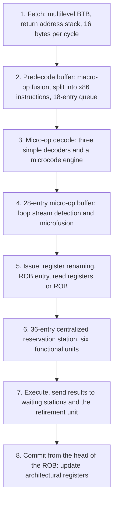
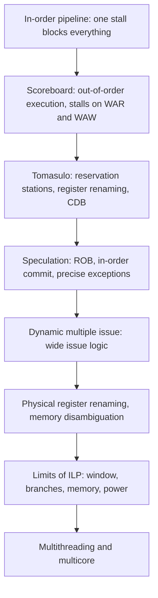

# بخش ۸، جلسه‌ی ۱۳ از ۱۳: پردازنده‌های واقعی، باورهای غلط و واژه‌نامه

این جلسه بخشی از **بخش ۸: موازی‌سازی پویا در سطح دستور** است. زمان مطالعه: حدود نیم ساعت.

**فهرست این جلسه:**

- ۱. خط لوله‌ی Intel Core i7
- ۲. کارایی i7: کار هدررفته و CPI
- ۳. پیوند با پردازنده‌های امروزی
- ۴. باورهای غلط و دام‌ها
- ۵. جمع‌بندی بخش
- ۶. واژه‌نامه
- ۷. تمرین‌های مرور

---

## ۱. خط لوله‌ی Intel Core i7

کتاب CAQA در بخش ۳.۱۳ پردازنده‌ی Core i7 (نسل Nehalem) را به عنوان یک پردازنده‌ی **گمانه‌زن با زمان‌بندی پویا و صدور چندگانه** بررسی می‌کند. عمق کل خط لوله ۱۴ مرحله است، ۴۸ بافر بارگذاری و ۳۲ بافر ذخیره دارد و شش واحد اجرایی مستقل که هر کدام می‌توانند در هر سیکل یک ریزعملیات آماده را شروع کنند.



هشت گام، از واکشی تا نهایی‌سازی:

1. **واکشی:** یک **BTB چندسطحی** برای تعادل بین سرعت و دقت پیش‌بینی، و یک **پشته‌ی آدرس بازگشت** (جلسه‌ی ۷-۱۱). جریمه‌ی پیش‌بینی غلط حدود ۱۵ سیکل. در هر سیکل ۱۶ بایت از کش دستور واکشی می‌شود.
2. **بافر پیش‌رمزگشایی:** **ادغام ماکروعملیات (Macro-op fusion)** ترکیب‌هایی مثل مقایسه و سپس پرش را در یک عملیات ادغام می‌کند. همچنین ۱۶ بایت به دستورات x86 جدا شکسته می‌شود. این کار ساده نیست، چون طول دستور x86 از ۱ تا ۱۷ بایت است. دستورات در یک صف ۱۸ خانه‌ای قرار می‌گیرند.
3. **رمزگشایی به ریزعملیات:** هر دستور x86 به **ریزعملیات (Micro-op)** ترجمه می‌شود: دستورات ساده‌ی شبیه MIPS که خط لوله مستقیم اجرا می‌کند. این روش از پنتیوم پرو (۱۹۹۷) استفاده شده است. سه رمزگشا دستورات تک‌ریزعملیاتی را رمزگشایی می‌کنند و یک **موتور ریزبرنامه (Microcode)** دستورات پیچیده را به دنباله‌ای از ریزعملیات تبدیل می‌کند (تا ۴ ریزعملیات در سیکل).
4. **بافر ریزعملیات ۲۸ خانه‌ای:** **تشخیص جریان حلقه (Loop stream detection)**: اگر یک حلقه‌ی کوچک (کمتر از ۲۸ دستور یا ۲۵۶ بایت) پیدا شود، ریزعملیات‌ها مستقیم از این بافر صادر می‌شوند و مراحل واکشی و رمزگشایی خاموش می‌مانند. **ریزادغام (Microfusion)** جفت‌هایی مثل بارگذاری و عملیات ALU را در یک ایستگاه رزرو قرار می‌دهد.
5. **صدور:** پیدا کردن محل ثبات‌ها در جدول‌ها، **تغییر نام ثبات**، تخصیص خانه‌ی ROB و خواندن نتیجه‌ها از ثبات‌ها یا ROB، سپس فرستادن به ایستگاه‌های رزرو.
6. **ایستگاه رزرو متمرکز ۳۶ خانه‌ای** مشترک بین شش واحد اجرایی. تا شش ریزعملیات در هر سیکل به واحدها فرستاده می‌شوند.
7. **اجرا:** نتیجه‌ها به ایستگاه‌های منتظر و به **واحد بازنشستگی ثبات** فرستاده می‌شوند، که وقتی معلوم شد دستور دیگر گمانه‌ای نیست، وضعیت ثبات‌ها را به‌روز می‌کند. خانه‌ی ROB تمام‌شده علامت می‌خورد.
8. **نهایی‌سازی:** وقتی یک یا چند دستور در سر ROB تمام‌شده‌اند، نوشتن‌های معوق انجام و دستورات از ROB حذف می‌شوند.

این دقیقاً همان طرح جلسه‌های ۸-۶ تا ۸-۸ است: ایستگاه‌های رزرو، ROB، تغییر نام، صدور چندگانه و گمانه‌زنی، به‌علاوه‌ی لایه‌ی ترجمه‌ی x86.

## ۲. کارایی i7: کار هدررفته و CPI

کتاب کارایی تک‌نخی i7 را روی SPEC CPU2006 بررسی می‌کند. به خاطر گمانه‌زنی تهاجمی و کش‌های بدون توقف، نسبت دادن دقیق فاصله‌ی کارایی ایده‌آل و واقعی سخت است. چند نتیجه:

- **صدور کمتر متوقف می‌شود:** مثلاً فقط حدود ۳٪ بارگذاری‌ها به خاطر نبود ایستگاه رزرو تأخیر دارند.
- **دو منبع اصلی اتلاف:** پیش‌بینی غلط پرش (حدود ۱۵ سیکل) و عدم اصابت کش. هزینه‌ی عدم اصابت سطح ۱ حدود ۱۰ سیکل، سطح ۲ کمی بیش از سه برابر آن، و سطح ۳ حدود ۱۳ برابر (۱۳۰ تا ۱۳۵ سیکل). برای عدم اصابت‌های سطح ۳، احتمالاً بافرها قبل از رسیدن داده پر می‌شوند و صدور متوقف می‌شود.
- **کار هدررفته:** نسبت ریزعملیات‌هایی که فرستاده می‌شوند ولی هرگز نهایی نمی‌شوند. برای sjeng، **۲۵٪**. برای mcf، کار هدررفته نسبت به نرخ پیش‌بینی غلط بیشتر به نظر می‌رسد. توضیح کتاب: mcf عدم اصابت کش داده‌ی خیلی زیادی دارد، پس در طول گمانه‌زنی غلط دستورات زیادی فرستاده می‌شوند (تا وقتی ایستگاه کافی برای ارجاع‌های حافظه‌ی متوقف هست). وقتی پیش‌بینی غلط کشف می‌شود، ریزعملیات‌ها پاک می‌شوند، ولی ارجاع‌های گمانه‌ای حافظه که شروع شده‌اند، هنوز دور کش‌ها ازدحام می‌کنند و راه ساده‌ای برای متوقف کردنشان نیست.
- **مقدار CPI:** متوسط CPI برنامه‌های صحیح ۱.۰۶ با واریانس بسیار زیاد (انحراف معیار ۰.۶۷). برنامه‌های mcf و omnetpp با CPI بیش از ۲ استثنا هستند، در حالی که بیشتر برنامه‌ها نزدیک ۱ یا کمتر از آن‌اند (gcc، بعدی در ترتیب، ۱.۲۳). این واریانس از تفاوت دقت پیش‌بینی پرش و نرخ عدم اصابت کش می‌آید.

یعنی پردازنده‌ای که می‌تواند ۴ دستور در سیکل صادر کند (CPI ایده‌آل ۰.۲۵)، در عمل روی برنامه‌های صحیح حدود ۱ دستور در سیکل اجرا می‌کند. فاصله‌ی بین حداکثر و واقعی همان محدودیت‌های جلسه‌ی ۸-۱۱ است.

## ۳. پیوند با پردازنده‌های امروزی

پردازنده‌های خارج از ترتیب امروزی (اینتل، AMD، Apple و هسته‌های بزرگ ARM مثل Cortex-A76) همان اجزای این بخش را دارند، با عددهای بزرگ‌تر:

| جزء | جلسه | در پردازنده‌های امروزی |
|---|---|---|
| تغییر نام | جلسه‌های ۸-۲ و ۸-۱۰ | فایل ثبات فیزیکی بزرگ، معمولاً چند صد ثبات |
| بافر بازترتیب | جلسه‌ی ۸-۶ | صدها خانه، یعنی صدها دستور در جریان |
| ایستگاه رزرو | جلسه‌ی ۸-۲ | صف‌های زمان‌بندی، متمرکز یا تقسیم‌شده بین واحدها |
| ابهام‌زدایی حافظه | جلسه‌های ۸-۴ و ۸-۱۰ | صف‌های بارگذاری و ذخیره، ارسال ذخیره به بارگذاری، پیش‌بینی وابستگی حافظه |
| صدور چندگانه | جلسه‌ی ۸-۸ | رمزگشایی و تغییر نام چند دستور در سیکل |
| چندنخنگی | جلسه‌ی ۸-۱۲ | SMT دوتایی در بسیاری از هسته‌های رومیزی و سروری |

برای تکلیف ARM درس، ستون‌های این جدول چارچوب خوبی برای توصیف هسته‌ی Cortex-A76 است: پهنای رمزگشایی و صدور، اندازه‌ی ROB، تعداد و نوع واحدهای اجرایی، صف‌های بارگذاری و ذخیره، و جریمه‌ی پیش‌بینی غلط. عددهای دقیق را از راهنمای فنی و منابع رسمی ARM بگیر.

## ۴. باورهای غلط و دام‌ها

### دام: گاهی بزرگ‌تر و ساده‌تر بهتر است

در اوایل دهه‌ی ۲۰۰۰ بیشتر توجه‌ها روی پردازنده‌های تهاجمی ILP بود: پنتیوم ۴ با عمیق‌ترین خط لوله‌ی تاریخ ریزپردازنده‌ها، و ایتانیوم با بالاترین نرخ صدور اوج در هر سیکل. ولی خیلی زود معلوم شد که محدودیت اصلی ILP اغلب **سیستم حافظه** است. خط لوله‌های گمانه‌زن خارج از ترتیب بخش قابل توجهی از جریمه‌ی ۱۰ تا ۱۵ سیکلی عدم اصابت سطح ۱ را پنهان می‌کردند، ولی در برابر عدم اصابت سطح ۲ که به حافظه‌ی اصلی می‌رفت (۵۰ تا ۱۰۰ سیکل) کار زیادی نمی‌توانستند بکنند.

نتیجه: این طراحی‌ها با وجود تعداد ترانزیستور زیاد و روش‌های بسیار هوشمندانه، هرگز به نزدیکی توان عملیاتی اوج نرسیدند. به جای پنهان کردن تأخیر بیشتر با ILP، طراحان ترانزیستورها را صرف **کش‌های خیلی بزرگ‌تر** کردند: ایتانیوم ۲ و i7 کش سه‌سطحی (۹ و ۸ مگابایت در سطح ۳) دارند، در برابر کش دوسطحی ۲ مگابایتی پنتیوم ۴. ساختن کش بزرگ‌تر خیلی ساده‌تر از طراحی خط لوله‌ی بیش از ۲۰ مرحله‌ای پنتیوم ۴ است و طبق داده‌های جلسه‌ی ۷-۱۳، مؤثرتر هم بوده.

### باور غلط: صدور پهن‌تر همیشه کارایی بیشتری می‌دهد

دو مانع اصلی (جلسه‌های ۸-۸ و ۸-۱۱): (۱) منطق صدور با **مجذور** پهنای صدور پیچیده می‌شود و کتاب آن را گلوگاه احتمالی بیش از ۴ دستور در سیکل می‌داند، (۲) ILP موجود در برنامه‌های صحیح با پنجره‌های واقع‌گرایانه در حد چند دستور در سیکل است. نتیجه: بیشتر معماری‌ها روی **سه تا چهار** صدور در سیکل ماندند و ترانزیستورهای اضافه را صرف هسته‌های بیشتر کردند.

### باور غلط: با زمان‌بندی پویا، زمان‌بندی کامپایلر بی‌فایده است

کتاب می‌گوید زمان‌بندی خط لوله با کامپایلر روی پردازنده‌ی با زمان‌بندی پویا هم استفاده می‌شود. پنجره‌ی سخت‌افزار محدود است، ولی کامپایلر کل برنامه را می‌بیند. کامپایلری که دستورات وابسته را از هم دور کند، باز کردن حلقه انجام دهد یا بارگذاری‌ها را زودتر بگذارد، به پردازنده‌ی پویا هم کمک می‌کند. آزمایش جلسه‌ی ۷-۳ (چهار جمع‌کننده) روی یک پردازنده‌ی خارج از ترتیب امروزی اجرا شد و باز هم چهار برابر سرعت داد: سخت‌افزار نمی‌تواند زنجیره‌ی وابستگی واقعی را بشکند، فقط کامپایلر (یا برنامه‌نویس) می‌تواند.

### دام: نادیده گرفتن هزینه‌ی انرژی گمانه‌زنی

داده‌های جلسه‌ی ۸-۱۰: در برنامه‌های صحیح، حدود ۳۰٪ دستورات اجراشده از گمانه‌زنی غلط‌اند. مقایسه‌ی i7 و Atom (جلسه‌ی ۷-۱۳) نشان داد که پردازنده‌ی گمانه‌زن تهاجمی با وجود سرعت خیلی بیشتر، بهره‌وری انرژی کمتری دارد. برای دستگاه‌های همراه و مراکز داده، معیار درست اغلب کارایی بر وات است، نه فقط کارایی.

### دام: ترتیب‌های اجرای غیرمنتظره ممکن است مخاطره‌های غیرمنتظره بسازند

این دام از پیوست C کتاب است. در نگاه اول WAW نباید هرگز رخ دهد، چون هیچ کامپایلری دو نوشتن در یک ثبات بدون خواندن بینشان تولید نمی‌کند. ولی ممکن است در ترتیب‌های غیرمنتظره پیش بیاید: مثلاً نوشتن اول در شکاف تأخیر یک پرش انجام‌شده باشد، در حالی که زمان‌بند فکر می‌کرده پرش انجام نمی‌شود. پس سخت‌افزار باید همه‌ی حالت‌ها را درست مدیریت کند، نه فقط حالت‌هایی که کامپایلرهای معمولی تولید می‌کنند. نسخه‌ی مدرن این دام، حمله‌های گمانه‌ای مثل Spectre است (جلسه‌ی ۷-۱۳).

## ۵. جمع‌بندی بخش



- **زمان‌بندی پویا:** صدور به ترتیب، اجرای خارج از ترتیب. سه مزیت: کد مستقل از خط لوله، وابستگی‌های نامعلوم در زمان کامپایل، و پنهان کردن تأخیر کش.
- **جدول امتیاز:** RAW را پویا حل می‌کند ولی برای WAW در صدور و برای WAR در نوشتن متوقف می‌شود.
- **الگوریتم توماسولو:** ایستگاه‌های رزرو تغییر نام می‌دهند و WAR و WAW را بدون توقف حذف می‌کنند. CDB نتیجه را به همه‌ی منتظرها پخش می‌کند. حلقه‌ها پویا باز می‌شوند.
- **گمانه‌زنی:** اجرای دستورات قبل از حل پرش. ROB نتیجه‌ها را تا نهایی‌سازی به ترتیب نگه می‌دارد و استثنای دقیق و بازیابی ساده را ممکن می‌کند.
- **صدور چندگانه‌ی پویا:** گلوگاه، منطق صدور است که وابستگی‌های داخل بسته را در یک سیکل حل می‌کند.
- **مرزها:** حتی پردازنده‌های جاه‌طلبانه فقط چند دستور در سیکل از برنامه‌های صحیح می‌گیرند. هزینه‌ی انرژی گمانه‌زنی جدی است. این‌ها صنعت را به سمت چندهسته‌ای و چندنخنگی برد.

بخش ۹ نوع دیگری از موازی‌سازی را می‌بیند که برای بعضی برنامه‌ها خیلی کارآمدتر از ILP است: **موازی‌سازی سطح داده** در پردازنده‌های برداری، SIMD و GPU.

## ۶. واژه‌نامه

| اصطلاح فارسی | معادل انگلیسی | توضیح کوتاه |
|---|---|---|
| زمان‌بندی پویا | Dynamic scheduling | تغییر ترتیب اجرا در سخت‌افزار |
| اجرای خارج از ترتیب | Out-of-order execution | اجرای دستور به محض آماده بودن عملوندها |
| صدور | Issue | تخصیص منابع و تغییر نام، به ترتیب برنامه |
| استثنای غیردقیق | Imprecise exception | وضعیت پردازنده با اجرای ترتیبی نمی‌خواند |
| جدول امتیاز | Scoreboard | کنترل متمرکز اجرای خارج از ترتیب، روش CDC 6600 |
| پنجره | Window | مجموعه‌ی دستوراتی که برای اجرا بررسی می‌شوند |
| ایستگاه رزرو | Reservation station | نگه‌داری دستور و عملوندها تا زمان اجرا |
| گذرگاه مشترک داده | Common data bus (CDB) | پخش نتیجه به همه‌ی منتظرها |
| برچسب | Tag | نام ایستگاه یا خانه‌ی ROB تولیدکننده‌ی نتیجه |
| تغییر نام ثبات | Register renaming | حذف WAR و WAW با نام‌های جدید |
| بافر بارگذاری و ذخیره | Load and store buffers | نگه‌داری آدرس و داده‌ی دسترسی‌های حافظه |
| ابهام‌زدایی حافظه | Memory disambiguation | تشخیص تداخل آدرس بارگذاری‌ها و ذخیره‌ها |
| ارسال ذخیره به بارگذاری | Store-to-load forwarding | رساندن مقدار ذخیره‌ی معوق به بارگذاری |
| گمانه‌زنی سخت‌افزاری | Hardware speculation | اجرای دستورات قبل از حل پرش |
| نهایی‌سازی | Commit | به‌روزرسانی ثبات یا حافظه، به ترتیب |
| بافر بازترتیب | Reorder buffer (ROB) | صف نتیجه‌ها بین پایان اجرا و نهایی‌سازی |
| وقفه‌ی دقیق | Precise interrupt | وضعیت دقیقاً مثل اجرای ترتیبی |
| بازیابی | Recovery | پاک کردن دستورات بعد از پرش غلط |
| ثبات فیزیکی | Physical register | ثبات واقعی پشت ثبات‌های معماری |
| جدول نگاشت | Rename map | نگاشت ثبات معماری به ثبات فیزیکی |
| پیش‌بینی مقدار | Value prediction | حدس نتیجه‌ی یک دستور |
| پیش‌بینی هم‌نامی آدرس | Address aliasing prediction | حدس تداخل یا عدم تداخل دو دسترسی |
| پردازنده‌ی ایده‌آل | Perfect processor | فقط محدود به جریان واقعی داده |
| چندنخنگی ریزدانه | Fine-grained multithreading | تعویض نخ در هر سیکل |
| چندنخنگی درشت‌دانه | Coarse-grained multithreading | تعویض نخ فقط در توقف‌های گران |
| چندنخنگی همزمان | Simultaneous multithreading (SMT) | اجرای دستورات چند نخ در یک سیکل روی هسته‌ی پویا |
| ریزعملیات | Micro-op | دستور ساده‌ی داخلی که از دستور x86 ساخته می‌شود |
| ادغام ماکروعملیات | Macro-op fusion | ادغام دو دستور (مثل مقایسه و پرش) در یکی |

## ۷. تمرین‌های مرور

<details>
<summary>تمرین ۱: سه روش، یک کد</summary>

**صورت:** برای کد زیر بگو در خط لوله‌ی به ترتیب، جدول امتیاز و الگوریتم توماسولو، دستور `SUB.D` کی می‌تواند اجرا شود و کی نتیجه‌اش را بنویسد:

```asm
DIV.D   F0,F2,F4
ADD.D   F6,F0,F8
SUB.D   F8,F10,F14
```

**جواب:**

- **به ترتیب:** `SUB.D` پشت `ADD.D` که منتظر `DIV.D` است گیر می‌کند. نه اجرا و نه نوشتن تا بعد از شروع `ADD.D`.
- **جدول امتیاز:** `SUB.D` صادر و اجرا می‌شود، ولی به خاطر WAR روی F8، نوشتن نتیجه صبر می‌کند تا `ADD.D` عملوندهایش را بخواند (یعنی تا تمام شدن `DIV.D`).
- **توماسولو:** `SUB.D` صادر، اجرا و نتیجه‌اش را بدون صبر می‌نویسد. `ADD.D` مقدار F8 را هنگام صدور در ایستگاهش کپی کرده است.
</details>

<details>
<summary>تمرین ۲: ROB و استثنا</summary>

**صورت:** در یک پردازنده‌ی گمانه‌زن، دستور سوم در ROB (بعد از دو دستور تمام‌نشده) یک خطای صفحه می‌دهد. دستور اول یک پرش است که بعداً معلوم می‌شود اشتباه پیش‌بینی شده. خطای صفحه رخ می‌دهد؟

**جواب:** خیر. خطا فقط در ROB ثبت می‌شود. وقتی پرش (دستور اول) به سر ROB می‌رسد یا اجرا می‌شود و اشتباه بودنش معلوم می‌شود، همه‌ی دستورات بعد از آن، از جمله دستور سوم و خطایش، پاک می‌شوند. استثنا هرگز گرفته نمی‌شود، که درست است چون دستور نباید اجرا می‌شد.
</details>

<details>
<summary>تمرین ۳: کارایی واقعی</summary>

**صورت:** پردازنده‌ای ۴ صدوری با CPI ایده‌آل ۰.۲۵ داریم. فراوانی پرش ۲۰٪، دقت پیش‌بینی ۹۵٪ و جریمه‌ی پیش‌بینی غلط ۱۵ سیکل است. عدم اصابت سطح ۳ در هر دستور ۰.۰۰۲ و جریمه‌ی آن ۱۳۰ سیکل است که پردازنده ۲۰٪ آن را پنهان می‌کند. CPI چقدر است؟

**جواب:** جمله‌ی پرش: 0.2 × 0.05 × 15 = 0.15. جمله‌ی حافظه: 0.002 × 130 × 0.8 = 0.208. CPI = 0.25 + 0.15 + 0.208 ≈ 0.61. یعنی IPC حدود ۱.۶، کمتر از نصف حداکثر ۴. با این حال این عدد از CPI واقعی i7 روی برنامه‌های صحیح (حدود ۱) بهتر است، چون اثرات دیگر (کش‌های سطح ۱ و ۲، وابستگی‌ها، محدودیت پنجره) را حساب نکرده‌ایم.
</details>

<details>
<summary>تمرین ۴: انتخاب طراحی</summary>

**صورت:** برای یک تراشه با بودجه‌ی ترانزیستور ثابت، کدام بهتر است: (الف) یک هسته‌ی ۸ صدوری خارج از ترتیب با ROB خیلی بزرگ، (ب) چهار هسته‌ی ۴ صدوری با SMT دوتایی و کش سطح ۳ بزرگ مشترک؟

**جواب:** برای بیشتر بارهای کاری امروزی (سرورها، برنامه‌های چندنخی، چند برنامه‌ی همزمان)، (ب). دلایل: ILP برنامه‌های صحیح با صدور ۸ تایی تقریباً بیشتر نمی‌شود (جلسه‌ی ۸-۱۱)، منطق صدور ۸ تایی بسیار پیچیده و پرمصرف است، و کش بزرگ در برابر تأخیر حافظه مؤثرتر است (دام «بزرگ‌تر و ساده‌تر»). (الف) فقط برای یک برنامه‌ی تک‌نخی که ILP زیادی دارد بهتر است. صنعت دقیقاً همین راه (ب) را رفت.
</details>

---

جلسه‌ی قبلی: [چندنخنگی](8-12-multithreading.md)  
بخش بعدی: بخش ۹، موازی‌سازی سطح داده
