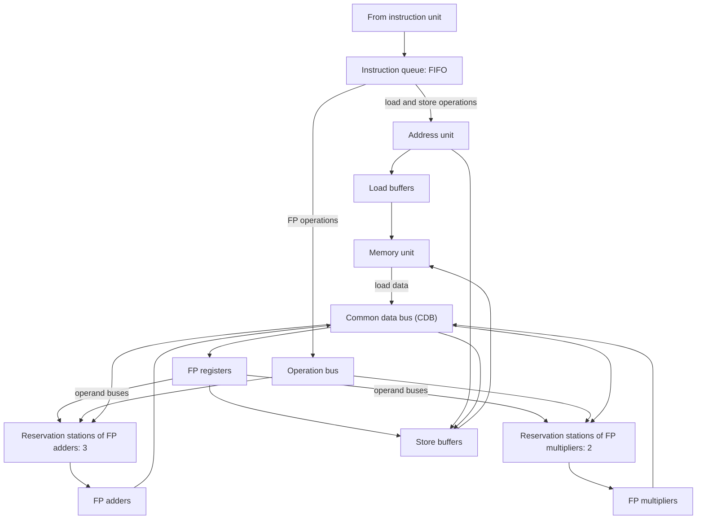

# بخش ۸، جلسه‌ی ۲ از ۱۳: الگوریتم توماسولو: ساختار و تغییر نام

این جلسه بخشی از **بخش ۸: موازی‌سازی پویا در سطح دستور** است. زمان مطالعه: حدود نیم ساعت.

**فهرست این جلسه:**

- ۱. تاریخچه و انگیزه
- ۲. ایده‌ی تغییر نام ثبات
- ۳. ایستگاه رزرو: تغییر نام در سخت‌افزار
- ۴. ساختار کلی
- ۵. سه مرحله‌ی هر دستور
- ۶. فیلدهای ایستگاه رزرو و ثبات‌ها
- ۷. مقایسه با جدول امتیاز
- ۸. تمرین‌ها

---

## ۱. تاریخچه و انگیزه

واحد ممیز شناور رایانه‌ی **IBM 360/91** (اواخر دهه‌ی ۱۹۶۰) از روشی استفاده می‌کرد که **رابرت توماسولو (Robert Tomasulo)** ابداع کرده بود. هدف IBM کارایی بالای ممیز شناور با همان مجموعه‌دستور و همان کامپایلرهای کل خانواده‌ی 360 بود، بدون کامپایلر ویژه برای مدل‌های گران.

سه انگیزه‌ی خاص:

- **ثبات‌های کم:** معماری 360 فقط **چهار** ثبات ممیز شناور دودقتی داشت. با این تعداد، کامپایلر نمی‌تواند تغییر نام و زمان‌بندی خوبی انجام دهد (جلسه‌ی ۷-۳).
- **تأخیرهای طولانی:** دسترسی به حافظه و عملیات ممیز شناور در 360/91 طولانی بودند.
- **کد عمومی:** کد باید بدون کامپایل ویژه سریع اجرا شود.

این روش سال‌ها کنار گذاشته شد، ولی از دهه‌ی ۱۹۹۰ پایه‌ی تقریباً همه‌ی پردازنده‌های پیشرفته شد (جلسه‌ی ۸-۴ دلایلش را می‌گوید).

الگوریتم توماسولو دو کار اصلی انجام می‌دهد:

- **ردیابی آماده بودن عملوندها:** دستور به محض آماده شدن عملوندهایش اجرا می‌شود. این مخاطره‌ی **RAW** را حل می‌کند (همان کاری که جدول امتیاز هم می‌کرد).
- **تغییر نام ثبات در سخت‌افزار:** مخاطره‌های **WAR و WAW** را **بدون توقف** حذف می‌کند.

## ۲. ایده‌ی تغییر نام ثبات

مثال کتاب و اسلاید:

```asm
DIV.D   F0,F2,F4
ADD.D   F6,F0,F8
S.D     F6,0(R1)
SUB.D   F8,F10,F14
MUL.D   F6,F10,F8
```

| نوع | بین | روی |
|---|---|---|
| وابستگی واقعی | دستور `DIV.D` و `ADD.D` | ثبات F0 |
| وابستگی واقعی | دستور `ADD.D` و `S.D` | ثبات F6 |
| وابستگی واقعی | دستور `SUB.D` و `MUL.D` | ثبات F8 |
| ضدوابستگی (WAR) | دستور `ADD.D` و `SUB.D` | ثبات F8 |
| ضدوابستگی (WAR) | دستور `S.D` و `MUL.D` | ثبات F6 |
| وابستگی خروجی (WAW) | دستور `ADD.D` و `MUL.D` | ثبات F6 |

با دو ثبات موقت S و T، همه‌ی وابستگی‌های نامی حذف می‌شوند:

```asm
DIV.D   F0,F2,F4
ADD.D   S,F0,F8
S.D     S,0(R1)
SUB.D   T,F10,F14
MUL.D   F6,F10,T
```

و هر استفاده‌ی بعدی از F8 باید به T تبدیل شود. کامپایلر می‌تواند این کار را در یک بلوک انجام دهد (جلسه‌ی ۷-۱)، ولی پیدا کردن همه‌ی استفاده‌های بعدی F8 از روی پرش‌ها سخت است. الگوریتم توماسولو **از روی پرش‌ها** هم تغییر نام می‌دهد، چون در زمان اجرا کار می‌کند.

## ۳. ایستگاه رزرو: تغییر نام در سخت‌افزار

در روش توماسولو، تغییر نام با **ایستگاه‌های رزرو (Reservation stations)** انجام می‌شود:

- **بافر عملوند:** ایستگاه رزرو عملوند را **به محض آماده شدن** می‌گیرد و نگه می‌دارد. پس دیگر لازم نیست بعداً از ثبات خوانده شود.
- **ارجاع به تولیدکننده:** اگر عملوند هنوز آماده نیست، دستور منتظر شماره‌ی **ایستگاه رزروی** می‌ماند که آن را تولید می‌کند، نه شماره‌ی ثبات.
- **فقط آخرین نوشتن:** وقتی چند نوشتن به یک ثبات روی هم می‌افتند، فقط آخری واقعاً ثبات را به‌روز می‌کند.

یعنی در لحظه‌ی صدور، **نام ثبات‌های منبع با نام ایستگاه‌های رزرو جایگزین می‌شوند**. این همان تغییر نام است. چون تعداد ایستگاه‌های رزرو می‌تواند **بیشتر از ثبات‌ها** باشد، این روش حتی وابستگی‌هایی را حذف می‌کند که کامپایلر با ثبات‌های کم نمی‌توانست. در مثال کتاب، برچسب ۴ بیتی یکی از ۵ ایستگاه رزرو یا ۵ بافر بارگذاری را نام می‌برد: معادل **۱۰ ثبات مقصد**، در برابر ۴ ثبات دودقتی واقعی 360.

دو ویژگی مهم دیگر ایستگاه‌های رزرو:

- **کنترل توزیع‌شده:** برخلاف جدول امتیاز متمرکز، اطلاعات هر ایستگاه تعیین می‌کند که دستورش کی اجرا شود.
- **ارسال از طریق گذرگاه مشترک:** نتیجه‌ها مستقیماً از واحد اجرایی به همه‌ی ایستگاه‌های منتظر می‌روند، از طریق **گذرگاه مشترک داده (Common data bus یا CDB)**. همه‌ی منتظرها **همزمان** آن را می‌گیرند. در پردازنده‌های چندصدوری، بیش از یک گذرگاه نتیجه لازم است.

## ۴. ساختار کلی

ساختار واحد ممیز شناور MIPS با الگوریتم توماسولو (شکل کتاب):



- **صف دستور:** دستورات به ترتیب (FIFO) صادر می‌شوند تا جریان داده درست بماند.
- **ایستگاه‌های رزرو:** صف نیستند. هر ایستگاه مستقل به واحد اجرایی‌اش دسترسی دارد (اسلاید درس روی این تأکید می‌کند).
- **بافرهای بارگذاری سه کار دارند:** (۱) نگه‌داری اجزای آدرس تا آدرس مؤثر حساب شود، (۲) پیگیری بارگذاری‌های منتظر حافظه، (۳) نگه‌داری نتیجه‌ی بارگذاری‌های تمام‌شده که منتظر CDB‌اند.
- **بافرهای ذخیره سه کار دارند:** (۱) نگه‌داری اجزای آدرس، (۲) نگه‌داری آدرس مقصد ذخیره‌هایی که منتظر مقدارند، (۳) نگه‌داری آدرس و مقدار تا واحد حافظه آزاد شود.
- **گذرگاه CDB:** به همه‌جا می‌رود به جز بافر بارگذاری. فایل ثبات، ایستگاه‌های رزرو و بافرهای ذخیره همه گوش می‌دهند.

## ۵. سه مرحله‌ی هر دستور

هر دستور از سه مرحله می‌گذرد که هر کدام می‌تواند چند سیکل طول بکشد:

**۱. صدور (Issue).** دستور بعدی را از سر صف بردار.

- **اگر ایستگاه رزرو مناسب خالی است:** دستور را به آن بفرست. اگر عملوندها در ثبات‌ها هستند، **مقدارشان** را هم بفرست. اگر نیستند، **نام ایستگاهی** که آن‌ها را تولید می‌کند ثبت کن.
- **اگر ایستگاه خالی نیست:** مخاطره‌ی ساختاری. صدور متوقف می‌شود تا ایستگاهی آزاد شود.
- **تغییر نام:** این مرحله ثبات‌ها را تغییر نام می‌دهد و WAR و WAW را حذف می‌کند. (بعضی پردازنده‌ها به این مرحله **dispatch** می‌گویند.)

**۲. اجرا (Execute).**

- **منتظر عملوند:** اگر عملوندی آماده نیست، CDB را پایش کن. به محض پخش شدن، در ایستگاه قرار بگیرد.
- **شروع اجرا:** وقتی همه‌ی عملوندها آماده‌اند، اجرا شروع می‌شود. تأخیر تا آماده شدن عملوندها، **RAW** را حل می‌کند.
- **انتخاب:** اگر چند دستور در یک سیکل برای یک واحد آماده شوند، واحد یکی را انتخاب می‌کند (برای ممیز شناور دلخواه).
- **بارگذاری و ذخیره دو مرحله دارند:** اول آدرس مؤثر حساب می‌شود (وقتی ثبات پایه آماده است). بعد بارگذاری به محض آزاد بودن حافظه انجام می‌شود، ولی ذخیره منتظر مقداری است که باید ذخیره کند. محاسبه‌ی آدرس بارگذاری‌ها و ذخیره‌ها **به ترتیب برنامه** انجام می‌شود (جلسه‌ی ۸-۴).
- **پرش‌ها:** برای حفظ رفتار استثنا، هیچ دستوری اجرایش را شروع نمی‌کند تا همه‌ی پرش‌های قبل از آن تمام شوند. یعنی پیش‌بینی پرش فقط صدور را جلو می‌برد، نه اجرا را. گمانه‌زنی (جلسه‌ی ۸-۶) این محدودیت را برمی‌دارد.

**۳. نوشتن نتیجه (Write result).** وقتی نتیجه آماده شد، روی CDB بنویس. از آنجا به ثبات‌ها و به همه‌ی ایستگاه‌ها و بافرهای ذخیره‌ی منتظر می‌رود. ذخیره‌ها وقتی هم آدرس و هم مقدار آماده است، در حافظه می‌نویسند.

**یک سیکل تأخیر اضافه:** چون تطبیق نتیجه و استفاده‌کننده فقط در مرحله‌ی نوشتن نتیجه ممکن است، در پردازنده‌ی پویا تأخیر مؤثر بین تولیدکننده و مصرف‌کننده **دست‌کم یک سیکل بیشتر** از تأخیر واحد اجرایی است. یعنی دستور وابسته در سیکلِ **بعد از** پخش روی CDB اجرا را شروع می‌کند.

## ۶. فیلدهای ایستگاه رزرو و ثبات‌ها

هر ایستگاه رزرو هفت فیلد دارد:

| فیلد | معنی |
|---|---|
| فیلد Op | عملیات روی دو عملوند منبع |
| فیلدهای Qj و Qk | ایستگاهی که عملوند منبع را تولید می‌کند. صفر یعنی عملوند در Vj یا Vk آماده است (یا لازم نیست) |
| فیلدهای Vj و Vk | مقدار عملوندهای منبع. برای هر عملوند فقط یکی از V یا Q معتبر است. در بارگذاری، Vk جابه‌جایی را نگه می‌دارد |
| فیلد A | اطلاعات محاسبه‌ی آدرس بارگذاری یا ذخیره. اول عدد ثابت دستور و بعد از محاسبه، آدرس مؤثر |
| فیلد Busy | این ایستگاه و واحد اجرایی‌اش مشغول‌اند |

فایل ثبات یک فیلد اضافه دارد:

| فیلد | معنی |
|---|---|
| فیلد Qi | شماره‌ی ایستگاهی که نتیجه‌اش باید در این ثبات نوشته شود. خالی یا صفر یعنی هیچ دستور فعالی این ثبات را نمی‌نویسد و مقدار، همان محتوای ثبات است |

**چرا صدور باید به ترتیب باشد؟** اسلاید درس این سؤال را می‌پرسد. در صدور، دستور (۱) برای منبع‌هایش به فیلد Qi ثبات‌ها نگاه می‌کند و (۲) شماره‌ی ایستگاه خودش را در Qi ثبات مقصدش می‌نویسد. فرض کن:

```asm
SUB.D   F2,F4,F6
ADD.D   F8,F2,F4
```

اگر به ترتیب صادر شوند: `SUB.D` در Qi ثبات F2 مثلاً Add1 را می‌نویسد. `ADD.D` بعد Qi ثبات F2 را می‌خواند، Add1 را می‌بیند و منتظر Add1 می‌ماند. درست است.

اگر برعکس صادر شوند: `ADD.D` اول می‌آید، Qi ثبات F2 خالی است، پس مقدار **قدیمی** F2 را برمی‌دارد. بعد `SUB.D` می‌آید و Qi را تغییر می‌دهد. وابستگی واقعی از دست رفته و نتیجه غلط است. پس ترتیب صدور، تنها جایی است که ترتیب برنامه حفظ می‌شود و کل تغییر نام به آن متکی است.

## ۷. مقایسه با جدول امتیاز

| ویژگی | جدول امتیاز | الگوریتم توماسولو |
|---|---|---|
| حل RAW | صبر تا آماده بودن عملوند در ثبات | صبر تا پخش عملوند روی CDB |
| حل WAW | توقف در صدور | تغییر نام، بدون توقف |
| حل WAR | توقف در نوشتن نتیجه | خواندن عملوند در صدور یا از CDB، بدون توقف |
| کنترل | متمرکز | توزیع‌شده در ایستگاه‌های رزرو |
| ارسال | ندارد، فقط از ثبات | از طریق CDB به همه‌ی منتظرها |
| محل عملوندها | در ثبات‌ها تا لحظه‌ی خواندن | در ایستگاه رزرو، نام ثبات‌ها بعد از صدور کنار گذاشته می‌شود |

کتاب تأکید می‌کند: در روش توماسولو، برچسب‌ها به **بافر یا واحدی** اشاره می‌کنند که نتیجه را تولید می‌کند. **نام ثبات‌ها بعد از صدور دور ریخته می‌شوند.** این تفاوت کلیدی با جدول امتیاز است که در آن عملوندها در ثبات می‌مانند و فقط بعد از تمام شدن تولیدکننده خوانده می‌شوند.

## ۸. تمرین‌ها

<details>
<summary>تمرین ۱: تغییر نام دستی</summary>

**صورت:** فرض کن ایستگاه‌های Add1 تا Add3 و Mult1 تا Mult2 خالی‌اند و همه‌ی ثبات‌ها آماده‌اند. کد زیر را به ترتیب صادر کن و بگو هر دستور در کدام ایستگاه است و Qj و Qk آن چیست:

```asm
MUL.D   F0,F2,F4
ADD.D   F6,F0,F8
SUB.D   F0,F10,F12
ADD.D   F14,F0,F6
```

**جواب:**

- **دستور `MUL.D` در Mult1:** هر دو عملوند از ثبات (Qj و Qk صفر). Qi ثبات F0 برابر Mult1 می‌شود.
- **دستور `ADD.D F6` در Add1:** Qj = Mult1 (برای F0)، Vk = مقدار F8. Qi ثبات F6 برابر Add1.
- **دستور `SUB.D F0` در Add2:** هر دو عملوند از ثبات. Qi ثبات F0 برابر **Add2** می‌شود (دیگر Mult1 نیست). این WAW بین `MUL.D` و `SUB.D` را حذف می‌کند: نتیجه‌ی Mult1 به Add1 می‌رسد ولی در F0 نوشته نمی‌شود.
- **دستور `ADD.D F14` در Add3:** Qj = Add2 (F0 جدید)، Qk = Add1 (F6). Qi ثبات F14 برابر Add3.
</details>

<details>
<summary>تمرین ۲: ثبات‌های مجازی</summary>

**صورت:** یک پردازنده‌ی توماسولو ۳ ایستگاه برای جمع، ۲ برای ضرب، ۳ بافر بارگذاری و ۲ بافر ذخیره دارد. حداکثر چند نتیجه‌ی در جریان (ثبات مجازی) می‌تواند نام‌گذاری شود؟

**جواب:** فقط ایستگاه‌ها و بافرهایی که نتیجه تولید می‌کنند: 3 + 2 + 3 = 8. بافرهای ذخیره نتیجه‌ای در ثبات تولید نمی‌کنند.
</details>

<details>
<summary>تمرین ۳: تأخیر مؤثر</summary>

**صورت:** جمع ممیز شناور ۲ سیکل اجرا دارد. در پردازنده‌ی توماسولو، اگر `ADD.D F2,...` اجرایش را در سیکل ۱۰ شروع کند، دستور وابسته `MUL.D ...,F2,...` زودتر از کدام سیکل اجرا را شروع نمی‌کند؟

**جواب:** جمع در سیکل‌های ۱۰ و ۱۱ اجرا می‌شود، در سیکل ۱۲ نتیجه را روی CDB می‌نویسد و ضرب در سیکل **۱۳** شروع می‌کند. یعنی بین پایان اجرای جمع و شروع ضرب یک سیکل (نوشتن نتیجه) فاصله است.
</details>

---

جلسه‌ی قبلی: [زمان‌بندی پویا و جدول امتیاز](8-1-dynamic-scheduling-and-scoreboard.md)  
جلسه‌ی بعدی: [الگوریتم توماسولو: جزئیات و مثال سیکل به سیکل](8-3-tomasulo-details-and-example.md)
